# 项目章程（Charter）—— 基于 cordis 的可插拔办公文档 SDK 与在线协同编辑器

> 状态：v0.2 草稿（M0 蓝图阶段） | 负责：总编排（Orchestrator） | 更新：2026-09-19（D10 术语、§5.2 补应用栏 ⋯/头像；14 §1 C-01…C-30 模块设计线跨模块收敛回写：§5.2 依赖上限四行 + `@cordexjs/design` 行、§5.5 事件域并集，裁决见 rulings §4.11）；2026-09-22：§5.2 `package.json#cordex` 扩展为八键；2026-09-24（rulings §4.15，§10 Q1–Q10 用户裁决回写正文）：§2.3 新增「单组织、不做多租户/自营 SaaS」与动画结束态按场景；§4.1 RenderTarget 术语；§4.2 补「身份来源」；§5.2 slide-render 依赖上限加 ooxml-core（C-28 修订）、server-headless/apps/server 去租户与 renderer 角色；§5.3 规则 4 为 apps/web 放行 react/react-dom/react-router/tailwindcss/@tailwindcss/*；§5.4 服务端/UI/渲染行；§6.1 D9 改 pnpm 11 双锁 + Node 26、D10「可换」改写为可验证范围、D13 镜像口径与 D16 解释；§6.2 已定行标为已接受并删「缩略图/放映可走 canvas」；§7 M1–M4 受影响描述；2026-09-24（rulings §4.16）：§7 补不定周期说明（Q13）、M4 可插拔证据改为内部非核心成员（Q11）；2026-09-24（复核修正，rulings §4.17）：Ticket 术语补 60 s 单次、CRDT 行与 §10 Q3 补 D4（被他人删除即跳过、不看 TTL）、目录树补 playground 并标 prototype/mockups 已退役；2026-09-25（补图）；2026-09-25（矛盾收口，rulings §4.18）：§5.1 铁律 1 与 §5.3 规则 3 改为「非组合根的水平层包」、图 5-1/5-10 同步（FE-01）；§5.2 server-headless 改为文档类型盲、apps/server 由 `src/cordis-host/**` 装配束包（FE-01），「依赖上限」列定 L0 隐式口径并按实际用法补边、apps/web 上限对齐 R9（FE-02/FE-05），图 5-4 至 5-8 同步、原图 5-8 拆为 5-8a/5-8b；`package.json#cordex` 八键补 `implements`、`bundle` 对组合根 preset 选填、`rank` 不入包元数据（FE-21/FE-01）；slide-render 行注明图表只读渲染器为惰性子路径 `./chart`（FE-08）；§5.3 规则 7 改为「只走 `publicEntry` 登记的子路径」（FE-04）、规则 8 含带 bundle 的 preset；§4.1 `Origin` 补 `system(maintenance)` 与分批装载的 `system(import)`（CO-07/CO-12）；kernel 行 `Service` 为值导出（顺带对齐 §4.14 K-1）；§8 文档树补齐、「30 个限界上下文」（GV-09/GV-10）；§9.2 第 4 条改为 Mermaid 优先（GV-04）；§6.2 插件清单行澄清 `manifest.ts` 为入库生成物（GV-17）；§10 Q5「超包络」改「超系统天花板」（UX-13）；2026-09-25（§4.19）：§7 M2 纳入协同后端（网关、Room、update 持久化与快照、服务端导入）、M3 改为多人协同体验层（D-M2-CONTENT）；§5.1/§5.2 登记 `@cordexjs/comments`（D-COMMENTS-PKG）；§5.2 `apps/server` 装配矩阵改指 `60-backend/01` §5；§5.5 补文档类型级套件命名；§8 文档树与 §9.1 分工补 50/60/70 三条设计线；2026-09-25（设计线拆分：§8 文档树中 30-architecture/07、08、10、11 的说明改为摘要 + 链接口径，`_tools/` 补 DDL 校验；§5.2 `apps/server` 行矩阵引用与 §8、§9.1 的 50/60/70 登记沿用 §4.19 回写）；2026-09-26（§4.20：§8 `_tools/` 补 check-links 与 check-terms；§9.2 第 5 条补更名登记 terms.json、新增第 10 条链接与章节引用（TX-02、TX-04））；2026-09-26（§4.21：§2.3 补插入非目标；§3 R4 与 §6.1 D8 改 Nest 12（纯 ESM），D13 改为许可分级见 ADR-0049；§4.4 新增「架构三件套」「可追加元素」「元素族」「可编辑度」术语；§5.1、§5.2 新增 L0 包 `@cordexjs/xml`，ooxml-core 上限改为 shared, xml, model-core，collab-yjs、collab-transport-ws、server-collab 三行按 Hocuspocus 4 改写，collab-offline-idb 改自写 idb 适配；§5.3 规则 4 放行 `@hocuspocus/*` 并新增第三方单点登记表、zod 口径放宽；§6.2 登记 ADR-0018/0019/0036/0039/0049；§7 表格、图表与元素插入的里程碑；§8 文档树（30/07 渲染跨端契约、30/08 撤销、50/17–25、60/19、新 ADR）；§9.1 架构-运行时行去 08）；2026-09-26（§4.21 整合：§5.1 注明秩表落地唯一源为 30/02 §1；§5.3 单点登记表补 Hocuspocus 测试期例外、extension-redis 路径与服务端路径级放行、apps/server 的 xml 白名单项；§2.3、§6.2、§10 Q4 的 canvas 用途补媒体与图标预处理；numfmt 放行 slide-ui 图表数据分区）；2026-09-26（§4.21 Remap：原 30/08 引用按 60-backend/README §6.1 改指新位置，30/08 已删除）；2026-09-26（§4.21 复核：§5.3 fflate 单点只在 ooxml-core；§7 M4 行的元素扩展改为 M4+ 候选、不计入 M4 验收）；2026-09-30（§4.21 剩余缺口样张回写：§8 文档树 `20-design/03-screens/` 范围说明同步为 01–31，新增 30 表格编辑、31 图表编辑）；2026-10-01（§4.23 插件管理：§4.5 登记「内容级插件 / 界面级插件」「插件声明文件」「插件集指纹」「内容插件足迹」四个术语）；2026-10-01（§4.23 插件管理样张回写：§8 文档树 `20-design/03-screens/` 范围改为 01–32，09 重写为个人插件面板、新增 32 管理员插件管理）
> 读者：产品 / 设计 / 架构 / 类型治理各条线的 agent 与人类评审者。
> 本文是所有下游文档（PRD、设计稿、架构文档）的**共同输入**。下游文档不得与本文冲突；若有异议，写入各自 README 的「对章程的异议/建议」段落，由总编排裁决后回写本文。
> v0.2 变更：吸收五条线的异议与建议（裁决明细见 [rulings-2026-09-14.md](./rulings-2026-09-14.md)）：垂直束改为「层带」并给出机械化秩表（§5.1/§5.3）；新增 `preset-slide-viewer`、`collab-offline-idb`、`slide-render-chart` 三包（§5.2）；`package.json#cordex` 字段规范（§5.2）；依赖规则第 8 条「束间隔离」（§5.3）；服务名/贡献点 id 定稿与第三方前缀规则（§5.5）；D7/D8/D9/D11/D12 补充与 D14–D16 新增（§6.1）；里程碑 M2/M3 微调（§7）；术语表扩充（§4）；待用户决策扩至 Q20（§10）。v0.2 与 v0.1 兼容（只增不改语义），下游标注「依赖：charter v0.1」的文档无需重写。

---

## 0. 一句话定义

> 一个 **以 cordis 4 为内核、每一层都可插拔** 的办公文档 SDK：先做 **PowerPoint（.pptx）的直接读取、高保真渲染与在线协同编辑**，并以同一套内核在后续扩展到 Word（.docx）与 Excel（.xlsx）。

三个关键词：

| 关键词 | 含义 | 反例（我们不做的） |
|---|---|---|
| **SDK 优先** | 交付的是可嵌入的内核 + 插件 + 预设（preset），应用（apps/web）只是一个组装样例 | 只做一个不可拆的 Web 应用 |
| **每一级可插拔** | 内核、文档模型、存储、格式、协同、渲染、UI、服务端模块全部是 cordis 插件；任何一级都能被替换/移除而系统仍能启动 | 只在「功能层」允许插件，底座写死 |
| **文档类型盲（doc-type blind）** | 水平层（内核/存储/协同/渲染引擎/UI 基座）不知道「幻灯片」是什么；幻灯片、文档、表格是垂直插件束 | Univer 式「core 里放了 3.4 万行 sheets/docs 模型」 |

---

## 1. 背景与参考基线

- 参考对象：**Univer**（dream-num/univer，Apache-2.0，14.3k stars）。我们参考的是其 **架构骨架**，不是其实现。用户提供的《Univer 架构评估》报告（2026-09-14，基线 b3547d403）是主要依据，提炼见 [reference-univer-lessons.md](./reference-univer-lessons.md)。
- 内核框架：**cordis 4**（cordiverse/cordis，npm `cordis@4.0.0-rc.10`，2026-09-08 发布；论文 *A Programming Paradigm for Spatiotemporal Composability*，arXiv 2608.25512）。用法基线见 [cordis-primer.md](./cordis-primer.md)。
- pptx 生态现状（2026-09）：不存在成熟的「读→编辑→无损写回」TS 库。可借鉴的对象与其可借鉴点：
  - `ChristopherVR/pptx-viewer`（Apache-2.0，93★）：CSS/DOM 渲染、判别联合元素类型、EMU 内部单位、Element→Placeholder→Layout→Master→Theme 样式解析链、Strict↔Transitional 命名空间归一化、Yjs 协同雏形。
  - `aiden0z/pptx-renderer`（Apache-2.0，112★）：高保真 HTML/SVG 渲染，**以 PowerPoint 真机导出为 oracle 的视觉回归测试**（SSIM/IoU），SafeXmlNode 空安全遍历，逐节点错误隔离，懒解析。
  - `@hokkyss/pptx`（MIT，新生）：品牌类型单位（`Emu`/`Inches`/`Points`）、同构、reader/writer/core 三分包。
  - `PPTist`（AGPL-3.0，9.3k★）：**仅作交互参考，禁止引入代码**（许可证不兼容）。
  - Univer `packages/slides`：alpha 级，不作实现参考。

---

## 2. 目标与非目标

### 2.1 本阶段（M0 蓝图）目标

1. 产出可评审的 **PRD、设计稿、架构文档、类型治理方案**，细致到目录级别（每个目录/文件写什么）。
2. 固化 **不可协商的硬约束**（§3）与 **术语**（§4），使后续实现不必反复讨论。
3. 形成 **里程碑骨架**（§7）与 **待用户决策清单**（§10）。

### 2.2 产品长期目标

- 直接打开 `.pptx`，高保真渲染，多人实时协同编辑，导出为合法 `.pptx` 且未修改部分**零丢失**。
- 第三方可以在**不改内核**的前提下：新增元素类型、新增渲染方式、新增 UI 面板/菜单、替换存储/协同/鉴权实现、新增文档类型。
- 同一套内核在浏览器与 Node（NestJS 服务端）中运行同一份模型/格式代码。

### 2.3 非目标（明确不做）

- 不做 Canvas 优先的通用绘图引擎：渲染介质为 DOM/SVG 单实现；canvas 仅用于栅格化、文本度量、媒体与图标预处理（插入前转码与缩放，只产出 Blob；2026-09-26 ADR-0021 修订）与预留的 `RenderTarget`（见 §6.2）。
- 不做多租户与自营 SaaS：**一次部署 = 一个组织**，数据模型、API、权限中没有租户概念；M1–M5 只交付集成方/自有部署的自托管栈（rulings §4.15 T-0 / Q10）。将来若做 SaaS 另立项，以迁移加回。
- 不做 `.ppt`（97-2003 二进制）读写。
- 动画/切换效果：M1–M3 **渲染结束态、不播放、原样保留与回写**；播放为 M4+ 的 P2；编辑不在 M1–M3 范围。「结束态」按场景区分（rulings §4.15 Q7）：编辑态、缩略图、PDF 为静态全部可见；放映为主序列可见性终态。
- 不做移动端「整包复刻」；移动端是变化点插件（Univer 教训 A7）。
- 不做插件的安全沙箱（cordis 的 isolate 不是安全边界，见 primer）；插件信任模型为「同源可信」，第三方插件走审核/签名而非运行时隔离。
- 不提供 SmartArt、OLE、3D 模型、墨迹、缩放定位与录屏的**插入**（已有对象照常只读渲染与保留；SmartArt 另有 M4+「转换为形状」），自定义几何的顶点编辑也是非目标；音视频插入时不写 `p:timing`（rulings §4.21 R-d-75、q-smartart、q-media-insert）。

---

## 3. 硬约束（来自用户要求，逐条具体化）

| # | 用户要求 | 具体化为可检查的约束 |
|---|---|---|
| R1 | 参考 Univer SDK 设计规划 editor | 继承：命令三分法、per-unit 作用域、逻辑/UI 分包、严格 DAG 依赖、Disposable 纪律。规避：内核边界错位、104 个 register*、声明不执行、闭合文档类型枚举、手写逆操作、DI override 接缝、猴子补丁 facade、全局可变注册表。见 lessons 文档 |
| R2 | cordis 插件机制，**每一级都可插拔** | 每个包要么是 cordis 插件，要么是被插件加载的纯库；任一层存在 ≥1 个「定义（Definition）」与可替换的「提供者（Provider）」；`apps/*` 只做组装与传输壳，零**编辑器领域逻辑**（命令/模型/协同/渲染不得出现在 apps）；应用壳自身的页面（文档列表、分享与权限、插件管理器宿主页）属于应用，允许存在 |
| R3 | editor 分层合理 | §5 的分层网格 + 依赖规则由 dependency-cruiser 机械执行；违反即 CI 失败 |
| R4 | 前后端，后端 NestJS，考虑协同 | `apps/server` 为 NestJS 12（纯 ESM，HTTP 适配器 Fastify 5；2026-09-26 rulings §4.21 q-nest-major，原「NestJS 11」作废）；协同网关（Hocuspocus 4 嵌入，ADR-0039）、导入导出、快照持久化、鉴权均为 Nest 模块并内嵌 cordis 宿主复用同构包 |
| R5 | 后续扩展 doc、excel | 水平层「文档类型盲」；`DocumentType` 为开放注册的 contribution point，不是枚举；M5 用 `model-doc`/`model-sheet` 骨架验证 |
| R6 | 直接读取 pptx，在线协同编辑 | OPC/OOXML 层同构；未建模部分**不透明保留（opaque preservation）**到部件级与节点级；协同以 CRDT 为单一事实源 |
| R7 | TS 强类型规约 + 约束机制（hooks、扫描脚本） | tsconfig 最严格集 + typescript-eslint strict-type-checked + 自研扫描器 + lefthook + CI 门禁；**每条规范必须对应一个机械执行点**，且有「规范↔执行」矩阵被 CI 校验（Univer 的核心教训） |

---

## 4. 术语表（所有文档必须使用）

### 4.1 核心术语

| 术语 | 英文标识 | 定义 |
|---|---|---|
| 内核 | `kernel` | 对 cordis 4 的薄封装，唯一允许 `import 'cordis'` 的包；提供 ContributionPoint、Manifest、错误/日志/遥测基础服务、`createIsolatedScope` |
| 插件 | `Plugin` | cordis 的可挂载生命周期单元（函数/类/对象三种形态）；本项目默认函数插件 |
| 纤程 | `Fiber` | 一个插件的一次运行实例（cordis 概念），拥有 effect 清理与状态机 |
| 服务 | `Service` | 挂在 `ctx.<name>` 上的命名能力，有 Definition（契约）/ Provider（实现）/ Consumer（使用方）三角色 |
| 贡献点 | `ContributionPoint` | 内核提供的**唯一**注册抽象：类型化、带 schema、由 effect 拥有生命周期、可静态列举。替代 Univer 的 104 个 `register*` |
| 清单 | `Manifest` | 插件包的静态描述：provides / injects / contributes / events / isomorphism class；由源码生成，不运行即可知道插件贡献了什么 |
| 文档单元 | `Unit` | 一份打开的文档实例（一个 pptx 即一个 Unit）；拥有独立作用域（UnitScope）；由 `model-core` 的 `units` 服务管理 |
| 单元作用域 | `UnitScope` | 通过 kernel 的 `createIsolatedScope`（内部对约定服务集逐个 `ctx.isolate()`）为每个 Unit 隔离出的服务域（`store`、`history`、`selection`、`render`、`presence` 等按单元隔离），保证同页多文档互不污染 |
| 文档类型 | `DocumentType` | 开放注册的垂直能力束（slide / doc / sheet），声明其模型、编解码器、单元插件 |
| 模型 | `Model` | 运行时文档对象图（类型化），通过 `DocumentStore` 读写 |
| 存储 | `DocumentStore` | 模型的事务化读写接口（`transact`/`observe`/`undo`/`redo`，带 `Origin`）；只理解 `StoreOp` 原语；Provider 有 `store-memory`、`store-yjs` |
| 存储原语 | `StoreOp` | Store 唯一理解的 5 种结构操作：`set`/`delete`/`insert`/`remove`/`text`（无 `move`：有身份实体的顺序由 `order: FracKey` 字段承载，移动即 `set`；原子数组用 `remove`+`insert`）；逆操作在此层由 Provider 推导 |
| 降级 | lowering | 文档类型贡献的纯函数 `lower(mutation, view) → StoreOp[]`，把语义 Mutation 变成原语 |
| 命令 | `Command` | 用户意图；可读状态、计算，然后在一个事务内执行若干 Mutation；不同步；返回 `Result`，不返回 boolean |
| 变更 | `Mutation` | **唯一**修改 Store 的操作；可序列化、确定性、可权限校验、可审计；只能在事务内产生，外部不可直接执行；逆操作由 Store 推导（不手写） |
| 操作 | `Operation` | 视图状态变化（选区、缩放、当前页）；不持久化，可作为 presence 广播 |
| 事务 | `Transaction` | 一组 Mutation 的原子应用单元，也是撤销/重做粒度；携带 `Origin` |
| 来源 | `Origin` | 事务来源：`local(clientId, via?)` / `remote` / `system(reason)` / `replay`，`reason` ∈ `load`、`import`、`migration`、`repair`、`restore`、`maintenance`（取值集合以架构 04 §2 与 40-modules/02 `store/origin.ts` 为准，2026-09-25 对齐）；撤销只作用于 `local`。`system(import)` 也用于大文件打开时首批之后的分批追加（不入撤销栈、`DirtyTracker` 忽略，rulings §4.18 CO-12）；`system(maintenance)` 为服务端单写者的维护事务（墓碑 TTL 硬删除、经审计的「彻底删除元素」、键长治理，CO-07） |
| 变更集 | `ChangeSet` | 一次事务触及的 `StoreOp[]` + 派生脏路径集合，供渲染与编解码做脏追踪 |
| 快照 | `Snapshot` | 模型的持久化形态（JSON，带 `schemaVersion`）；与运行时模型有**显式编解码边界**；只含 `BlobRef`，不含二进制 |
| 快照包 | `SnapshotBundle` | `Snapshot` + 内容寻址 Blob 集合 |
| Blob 引用 | `BlobRef` | `{ hash, size, contentType }`，指向 `BlobStore` 中的不可变字节 |
| 派生类型 | `Derived<T>` | 类型级品牌，标记不得进入 Snapshot 的派生字段；`Persisted<T>` 将其剔除 |
| 资源钩子 | `ResourceHook` | 插件把自有数据挂进 Snapshot 的唯一途径（命名空间由模板字面量类型约束） |
| 编解码器 | `FormatCodec` | 外部格式 ↔ 模型的导入/导出器（如 `ooxml-pptx`），按 MIME 注册到 `core.format` 贡献点 |
| 部件 | `Part` | OPC 包内的一个 zip 条目（xml/媒体），带关系（rels）与内容类型 |
| 不透明保留 | opaque preservation | 部件级：未建模 Part 以原始字节保留（`OpaquePartRef`）；节点级：已建模节点内未建模的属性/子元素/`extLst` 以 `OpaqueXml` 槽保留并带插入锚点；导出时干净部件 verbatim，只重生成脏部件 |
| 脏追踪器 | `DirtyTracker` | 模型路径前缀 ↔ Part 名映射；决定导出时哪些部件 verbatim、哪些重生成 |
| 场景 | `Scene` / `SceneNode` | 渲染引擎唯一认识的输入：`{ id, kind, bbox, transform, zIndex, children?, data }`；引擎对 `kind` 无知 |
| 场景提供者 | `SceneProvider` | 文档类型贡献（`render.scene`）：把 Unit 的某一页/视图构造成 `Scene`，并把 `ChangeSet` 映射为脏节点 |
| 渲染目标 | `RenderTarget` | 渲染引擎的输出介质：`dom`（HTML+SVG，唯一实现）/ `canvas`（预留，对外 Stable 前须有最小 canvas Provider 通过契约），贡献点 `render.target`（rulings §4.15 Q4） |
| 元素渲染器 | `ElementRenderer` | 按 `kind` 注册的渲染贡献（`render.element`） |
| 文本度量器 | `TextMeasurer` | `engine-layout` 的 Definition（`layout.measurer`）；Provider：`render-dom` 的 canvas 度量、`server-headless` 的字体解析度量 |
| 预设 | `Preset` | 一组插件 + 默认配置的组合，是「产品」的形状（`preset-slide`、`preset-slide-collab`、`preset-slide-viewer`） |
| 在场信息 | `Presence` / `Awareness` | 协作者光标、选区、当前页等非持久状态 |
| 同构类 | isomorphism class | 包的运行环境声明：`iso`（浏览器+Node，无 DOM 无 node 内建）/ `dom`（仅浏览器）/ `node`（仅 Node） |
| 层带 | band | 垂直束包的层位标签：`V-model`/`V-codec`/`V-render`/`V-ui`，各有可依赖的水平层上限（§5.1） |
| 夹具文档类型 | `fixture` | `model-core/testing` 提供的测试专用 `DocumentType`，用于验证文档类型盲 |

**图 4-1 命令到存储、渲染与导出的术语链**

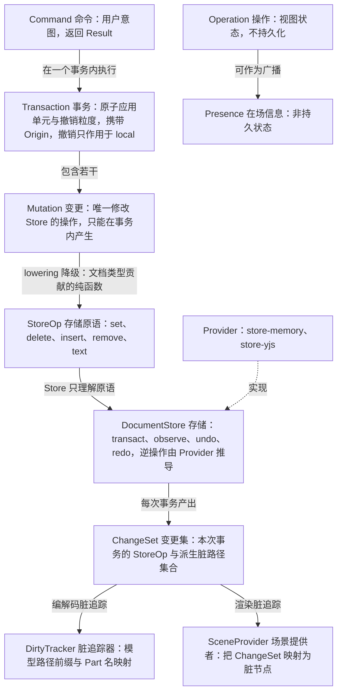

怎么读：实线为术语之间的产生或使用关系，虚线为 Provider 实现 Definition；从 Command 到 ChangeSet 的主链是唯一的模型修改路径，`Operation` 与之并列、不进入事务与 Store。
依据：本节 §4.1 术语定义；§6.1 D4、D5。

**图 4-2 持久化形态术语关系**

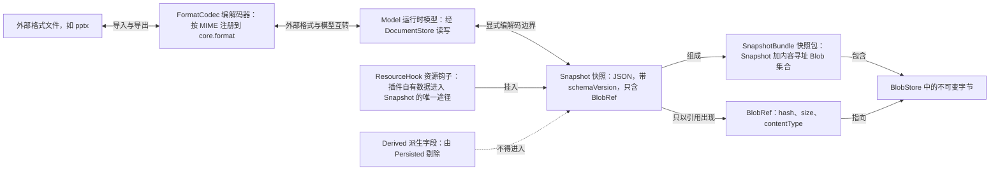

怎么读：双向箭头是可逆的编解码边界，单向实线为组成或引用关系，虚线表示被类型系统禁止的流向；二进制从不直接进入 Snapshot，只经 `BlobRef` 引用。
依据：本节 §4.1；§6.1 D6。

### 4.2 协同与服务端术语

| 术语 | 定义 |
|---|---|
| Room | 服务端为一份文档维护的协同会话集合与其 Y.Doc 副本（= 服务端 Unit）；M2 起由 Hocuspocus 4 的 Document 承载，文档名为 `docId:epoch`，Room 七态作为派生状态映射到其钩子（rulings §4.21，ADR-0039） |
| Session | 一个客户端与一个 Room 的连接生命周期 |
| Ticket | 短时签名凭据，用于 WS 握手，携带角色与权限版本；一方 Ticket 60 s、`jti` 单次（集成方签名 JWT ≤ 1 h 为另一形态，M4；ADR-0029） |
| 身份来源（issuer） | 签发用户身份的外置 OIDC IdP；用户以 `(issuer, sub)` 标识，服务端首次登录 JIT 建号、不持有密码（rulings §4.15 Q6）。单组织：身份与权限模型中没有租户 |
| Update / StateVector | Yjs 的二进制增量 / 各 client 已知时钟向量 |
| Compaction | 用一个快照替换其前的 update 序列 |
| Repair | 服务端软门禁（schema/不变量修复）发出的补偿事务（origin=`repair`） |
| FracKey | fractional index 字符串，用于有序集合的并发插入/移动 |
| Version | 一次命名或自动快照，构成版本历史 |
| Soft Conflict（软冲突） | CRDT 收敛后语义上仍需提示用户的并发情形（如「你正在编辑的页被他人删除」） |

**图 4-3 协同与服务端术语关系**

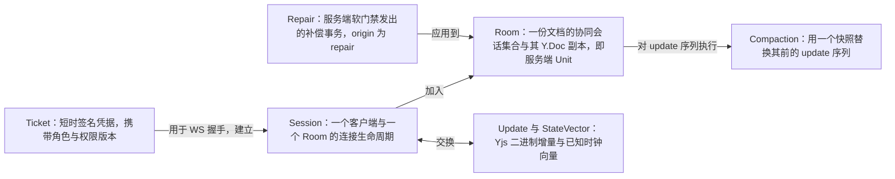

怎么读：箭头为术语之间的使用或作用关系，从握手凭据到会话、房间，再到房间内的增量、压缩与修复；身份来源、版本、软冲突等其余术语不涉及这条链，未画入。
依据：本节 §4.2。

### 4.3 产品与质量术语

| 术语 | 定义 |
|---|---|
| Support Level（支持级） | pptx 特性支持矩阵的取值：`P` 仅保留 / `V~` 近似查看 / `V` 查看 / `E~` 有限编辑 / `E` 编辑 / `✗` 不支持 |
| Oracle / Corpus | 以 PowerPoint 真机导出为基线的视觉/结构对照 / 用于保真与回归测试的 pptx 语料库 |
| Integrator（集成方） | 把 SDK 嵌入自家产品的工程团队 |
| 角色 | `owner` / `editor` / `commenter` / `viewer`（权限模型的四个内置角色，能力位见 PRD CO 域） |

### 4.4 架构与元素术语（2026-09-26，rulings §4.21）

| 术语 | 定义 |
|---|---|
| 架构三件套 | 全仓的三份架构文档：**总架构** `30-architecture/01-overview.md`（唯一一份，跨端：系统上下文、统一原则、技术栈与复用总表、端到端数据流、M1–M4 里程碑边界唯一表）、**前端架构** `50-frontend/01-overview-and-runtime-map.md`、**后端架构** `60-backend/01-service-overview-and-roles.md`（后两份就地升格，只改标题、节号不动）；阅读路径固定为总架构 → 前端架构 → 后端架构 → 各线细节（q-arch-reorg） |
| 可追加元素 | 用户能经插入入口（插入页签、命令面板、快捷键、拖入或粘贴文件）新建到页上的元素类型，如文本框、形状、线条、图片、表格、图表、音视频、图标与符号；每类在元素目录（50/19–50/25）有一份设计：用途（追加它有什么作用）、OOXML 落点、插入入口与默认值、模型、渲染、交互、属性面板、命令、协同、导入导出、可访问性、复用与里程碑。只读渲染与保留、不提供插入的对象（SmartArt、OLE、3D、墨迹等）不属于可追加元素，但同样收进元素目录的「只读与不透明类」，写明为何不提供插入 |
| 元素族 | 元素目录的分篇单位，共六族：文本类（50/20）、结构类（50/21，占位符、页眉页脚、背景、组合）、形状与线条（50/22）、媒体类（50/23）、表格与图表（50/24）、只读与不透明类（50/25）；通用设计（元素基类、变换矩阵、z 序、插入命令通用流程、默认落点与尺寸等）只在总览 50/19 写一份 |
| 可编辑度 | 元素目录中每个元素「导入 → 编辑 → 导出」能达到的程度，与 §4.3 支持级用同一刻度：`E` 可编辑 / `E~` 部分可编辑 / `V` 查看 / `V~` 近似查看 / `P` 仅保留；支持级面向 pptx 特性矩阵（PRD 01），可编辑度面向可追加元素与元素目录，两者不另立取值 |

**图 4-4 架构三件套与编辑器元素文档的阅读关系**

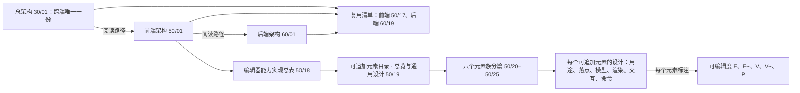

怎么读：上排是架构三件套的固定阅读顺序；前端架构往下展开为能力总表、元素总览与六个元素族分篇，每个可追加元素再标注其可编辑度；复用清单由总架构的技术栈总表汇总、前后端架构各链一份详表。
依据：rulings §4.21 q-arch-reorg、R-d-01；本节术语定义。

### 4.5 插件管理术语（2026-10-01，rulings §4.23）

| 术语 | 定义 |
|---|---|
| 内容级插件 / 界面级插件 | 插件的**作用域**，写在 `cordex-manifest.json` 的 `scope` 字段（`content` \| `ui`）。内容级插件会改变文档内容、渲染结果、导入导出结果或部署的基础行为（存储、协同传输、遥测出口），只能由部署管理员按部署统一启停（强制启用 / 禁用两态）；界面级插件只改变本人看到的界面（`ui.*`、`i18n.bundle`、`render.overlay`、不带写能力位的命令），管理员设为「允许用户选择」后由用户个人启停。作用域由清单生成器按贡献与实现机械推出，作者只能声明得更严；拿不准即内容级（PRD 09 §2.2） |
| 插件声明文件 | 部署方随部署版本管理的一份只读挂载文件（配置键 `plugins.catalogFile`，格式 `cordex-plugins.json`），列出本部署的插件：`id`、精确版本、来源（镜像内置或挂载目录）、包摘要、签名或审核记录、初始状态与可选锁定。插件**只能**经声明文件与镜像内置进入部署，界面不提供上传、URL 安装或市场（60/17 §5.16） |
| 插件集指纹 | 一次部署当前插件组成的两段摘要 `{ catalog, policy }`：`catalog` 覆盖通过校验的内容级插件的 `id@版本@摘要`，只随重新部署变化；`policy` 覆盖全部插件的管理员策略与配置摘要，随管理员保存变化。随会话下发、随协同握手（Auth token `pluginSet`）上送：`catalog` 不符按版本漂移处理（4426 `collab.plugins_outdated`），`policy` 不符只提示「插件设置已更新」、重新加载后生效（60/16 §12） |
| 内容插件足迹 | 文档里记录的「用到了哪些内容级插件」：插件 `id`、所需最低版本、它负责的元素类型与资源命名空间；由内核在内容插件首次写入时并入同一事务、只增不减，存于资源命名空间 `core.pluginFootprint`，导出 pptx 时保留。打开文档时据此判断缺哪个插件、为什么缺（已停用 / 未安装或被拒 / 版本过旧 / 启动失败），降级显示而不丢数据（ADR-0050，提议） |

**图 4-5 插件从部署到文档的四个术语**

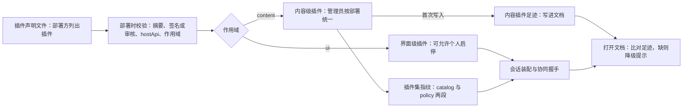

怎么读：左起插件只能经声明文件进入部署并通过校验；作用域决定谁来启停——内容级进入指纹、在协同握手时比对，界面级只影响本人会话；内容级插件写入文档时留下足迹，别人打开时用足迹判断缺了什么。
依据：rulings §4.23 裁决与 O-1…O-4 定稿；PRD [09-plugin-manager](../10-prd/03-features/09-plugin-manager.md) §2、PM-04、PM-12、PM-13。

---

## 5. 架构基线

### 5.1 分层 × 文档类型 网格（核心图）与秩表

本节原为一张 ASCII 网格，2026-09-25 拆为三张图（水平层、垂直束、层带上限）与下方的铁律列表，内容不变；全局秩序列见 §5.3 图 5-9。秩表的落地版在 [30-architecture/02](../30-architecture/02-layering-and-packages.md) §1，它是下游文档引用秩表的全仓唯一源（2026-09-26 起，rulings §4.21；与本节及 §5.3 规则 2 一致，改动须三处同步）；L0 含 2026-09-26 新增的 `@cordexjs/xml`。

**图 5-1 水平层与秩（文档类型盲，可被任一垂直束复用）**

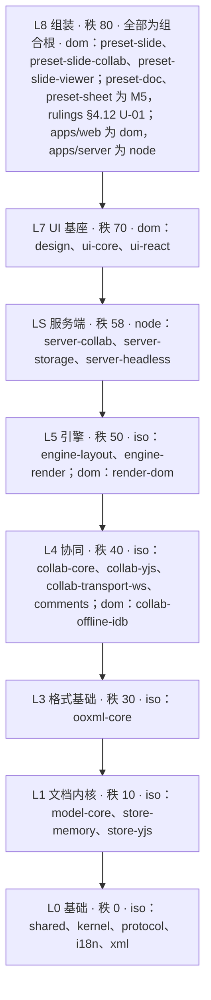

怎么读：自上而下按秩递减排列，包名均省略 `@cordexjs/` 前缀；箭头只表示「只向下」的允许方向，不代表相邻层之间一定有实际依赖；能否依赖还要同时满足铁律 4 的同构类约束（例如 L7 的 dom 包不能依赖 LS 的 node 包）。L8 的包全部是组合根（`cordex.compositionRoot: true`），不受铁律 1 约束；L0 至 L7 与 LS 都是非组合根的水平层包，铁律 1 对它们无条件生效。L0 的 `xml` 是 2026-09-26 从 ooxml-core 抽出的 XML 词法与保真树包，零运行时依赖（rulings §4.21 X:q-xml-package）。
依据：本节铁律 1；rulings §4.18 FE-01、§4.21 X:q-xml-package。

**图 5-2 垂直束 × 层带网格（每束横跨四个层带；束与束之间互不依赖）**

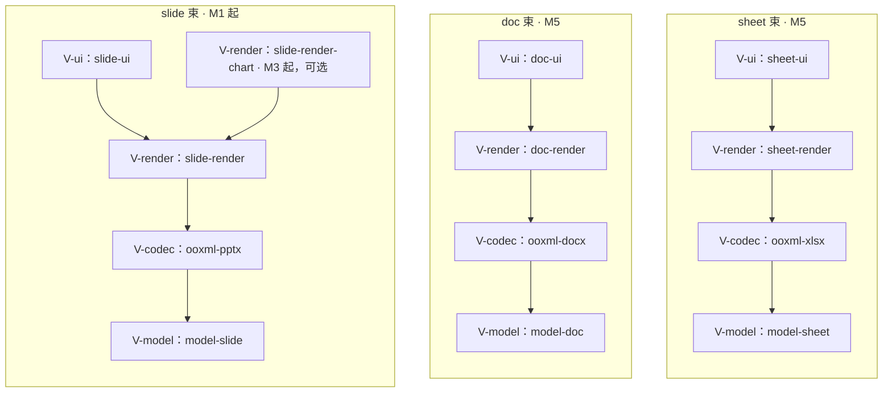

怎么读：每个子图是一个垂直束，束内箭头是铁律 3 规定的同束向下方向（V-ui → V-render → V-codec → V-model），`slide-render-chart` 指向 `slide-render` 取自 §5.2 的依赖上限；三个子图之间没有任何箭头，对应铁律 2 束间隔离。

**图 5-3 层带的上限、同构类与秩**

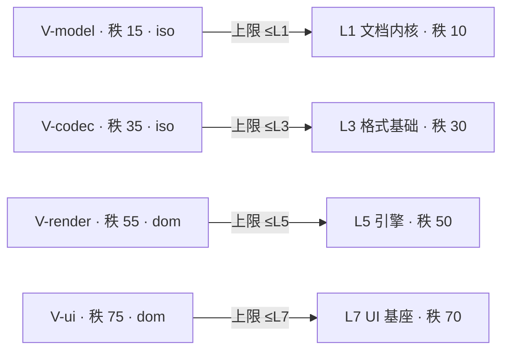

怎么读：每个层带可依赖的水平层最高到箭头所指的一层（含），层带的秩恰好落在该层与更高一层之间，因此「上限」与「秩只向下」两种表述等价。

铁律（原网格下方文字；铁律 1 于 2026-09-25 按 rulings §4.18 FE-01 修订，其余原样保留）：

- 铁律 1（文档类型盲）：水平层中**非组合根**的任何包 **不得** import 任何垂直束的包。组合根（`cordex.compositionRoot: true`，仅 `preset-*`、`apps/web`、`apps/server`）豁免本条，但仍各受约束：`preset-*` 以其 `cordex.bundle` 受铁律 2 约束（如 `preset-doc` 不得 import slide 束）；`apps/web` 受 R9 白名单约束，只 import preset、不直接 import 束包；`apps/server` 只在 `src/cordis-host/**`（`preset-server.ts`）装配束包。`server-headless` 等 LS 包没有豁免，文档类型盲，所需的文档类型插件由 `apps/server` 以插件清单传入（2026-09-25，rulings §4.18 FE-01）。
- 铁律 2（束间隔离）：不同 bundle 的垂直束包互不 import（如 model-slide ✗→ model-doc）。
- 铁律 3（只向下）：rank(import 目标) ≤ rank(自身)；垂直束同束内按层带向下（V-ui → V-render → V-codec → V-model）。
- 铁律 4（同构类）：node 不得 import dom；iso 只能 import iso；dom 可 import iso/dom。
- 说明：LS 秩 58 允许 server-* 依赖 L5 的 iso 包（engine-layout、engine-render 契约）；render-dom 由铁律 4 拦截。

### 5.2 包清单（v0.2；npm scope 已裁决，见 §10 Q1）

> 架构-结构条线在 `02-layering-and-packages.md` 中把每个包细化到**目录级**；此处只定边界与职责，不得更名（除非经章程修订）。
>
> **「依赖上限」列口径**（2026-09-25，rulings §4.18 FE-02）：L0 的 `kernel`、`shared`、`protocol` 对**非 L0 包隐式允许**，本列可以不写（已写出的保留，与隐式等价）；`design`（R18）、`shared`（R11）与 `xml`（2026-09-26，rulings §4.21 X:q-xml-package）保持零依赖，不适用隐式规则；`xml` 也不在隐式允许集合内，依赖它的包须在本列显式写出（目前只有 `ooxml-core` 与 `apps/server`）；L0 包之间（含 `i18n`）仍逐条显式，例如 `kernel` 只依赖 `shared`，不因隐式规则获得 `protocol`。各包 `package.json` 的内部依赖须 ⊆ 本列 ∪ 隐式 L0；tsconfig `references` 等于 `package.json` 内部依赖。本列导出为机器可读的 `tooling/policy/dependency-limits.json`，由现有的 `sync-references` 与 `scan-manifest` 校验（配负向夹具）。本列是上限，不等于实际 import；实际依赖以 `40-modules` 各模块文档为准，但不得超出本列。

| 包 | 层/层带 | 同构 | 职责边界 | 依赖上限 |
|---|---|---|---|---|
| `@cordexjs/shared` | L0 | iso | 纯工具、品牌类型（`Emu`、`Pt`、`UnitId`、`SlideId`、`NodeId`…）、`Result` 类型、断言；**零依赖 cordis**；零领域知识 | — |
| `@cordexjs/kernel` | L0 | iso | 唯一 import `cordis`；re-export `Context`/`Plugin` 等类型与 `Service`（值导出，插件写 `class X extends Service`，rulings §4.14 K-1）；`createHost`；`defineContributionPoint`/`ctx.contribute`/`ctx.contributions`；Manifest 类型与校验；`errors`/`telemetry` 服务与 logger 适配；`createIsolatedScope`（文档无关）；Disposable 与诊断工具 | shared |
| `@cordexjs/protocol` | L0 | iso | 前后端共享契约：REST DTO、WS 消息、错误码、权限能力位；全部为 Standard Schema（zod 4）定义并导出推导类型；禁止 `enum` | shared |
| `@cordexjs/i18n` | L0 | iso | 从 zh-CN 源文件反推**编译期 key 类型**；`ctx.i18n` 服务；`i18n.bundle` 贡献点 | kernel |
| `@cordexjs/xml` | L0 | iso | 2026-09-26 新增（rulings §4.21 X:q-xml-package、X:q-xml-lexer；ADR-0019），`package.json#cordex` 为 `{ layer:'L0', iso:'iso', role:'library' }`：自研 XML 词法器，两个入口 `scan`（不建树，负责计数与限额）与 `parseDocument`（建整树），都支持 write/end 与按时间片让出；保真树与序列化（门禁为脏部件 c14n 等价）；`XmlLimits`（XML 限额的唯一定义处）；DOCTYPE 一律拒绝，只认 5 个预定义实体与字符引用，超限返回 `format.limit_exceeded{limit, actual}`，全部走 `Result`；输入为字节，按 BOM 与 encoding 声明嗅探 UTF-8/UTF-16；W3C 合规与差分测试（saxes、libxml2-wasm 只作 devDependency oracle）都在本包；**零运行时依赖**（不依赖任何包，shared 也不依赖） | — |
| `@cordexjs/model-core` | L1 | iso | `Unit`/`UnitScope`/`units` 服务、`DocumentType` 贡献点、`DocumentStore` Definition 与 `StoreOp`、Command/Mutation/Operation + `commands` 服务（单一执行入口）、`history`、`Transaction`/`Origin`/`ChangeSet`、`Snapshot`/`SnapshotBundle` 编解码 + `schemaVersion` + `core.migration`、`ResourceHook`（`core.resource`）、`permissions`（fail-closed，`core.permissionPolicy`）、`core.format` 贡献点、通用 `Selection<A>` 类型、`drawing/`（DrawingML 共享绘图词汇的运行时类型与 schema，无 XML、无文档类型知识）、`testing/`（`fixture` 文档类型、conformance 套件） | kernel, shared, protocol |
| `@cordexjs/store-memory` | L1 | iso | `DocumentStore` Provider：不可变结构共享快照，事务级撤销 | model-core |
| `@cordexjs/store-yjs` | L1 | iso | `DocumentStore` Provider：Y.Doc 映射、`UndoManager`（按 origin）、update 编码；公共 API 不暴露 `Y.*` 类型 | model-core |
| `@cordexjs/model-slide` | V-model | iso | Presentation/Master/Layout/Slide/Shape 树/TextBody/Theme 模型；幻灯片 Mutation 及其 `lower()`；样式继承链解析（纯函数）；`OpaqueXml`/`extensions` 槽；`validateChangeSet`/修复规则（服务端与客户端共用）；`testing/` | model-core |
| `@cordexjs/ooxml-core` | L3 | iso | OOXML 专属层：OPC（zip/`[Content_Types]`/rels；关系与内容类型集合都未变时原样写回，变了才由 PartTable 重生成，rulings §4.21 X:q-content-types）、namespaces（Strict↔Transitional 48 对）与归一化、mce、DrawingML 编解码（类型来自 model-core/drawing）、`DirtyTracker` 与不透明保留引擎、`testing/`（`diffPackage`、c14n 规范化器）；XML 词法、保真树与序列化改由 `@cordexjs/xml` 提供，运行时不引任何第三方 XML 依赖（2026-09-26，§4.21 X:q-xml-package，原「命名空间感知 XML（自研最小保真 DOM）」一项迁出）；内嵌字体 `.fntdata` 的 MTX 解压用 mtx-decompressor（MPL-2.0 未修改依赖，§4.21 q-license-tiers） | shared, xml, model-core（xml 为 2026-09-26 新增，§4.21） |
| `@cordexjs/ooxml-pptx` | V-codec | iso | PresentationML ↔ model-slide 的 `FormatCodec`；占位符与继承；媒体部件 | ooxml-core, model-slide, model-core（媒体部件经 `BlobStore`；2026-09-25 按实际用法补，FE-02） |
| `@cordexjs/collab-core` | L4 | iso | Definition：`collab` 服务契约（session/room 状态机、awareness 模型、权限检查点、`OfflineStore` 接口）、`collabTransport` Definition | model-core, protocol |
| `@cordexjs/collab-yjs` | L4 | iso | Provider：`HocuspocusProvider` 同步（y-protocols sync + awareness 经 Hocuspocus 帧），两级 ack 帧映射、被拒回滚与 FIFO 胶水，依赖 store-yjs 的 Y.Doc（store-yjs 增「接管外部 Y.Doc」选项）（2026-09-26，rulings §4.21 H:q-hp-provider，ADR-0039） | collab-core, store-yjs |
| `@cordexjs/collab-transport-ws` | L4 | iso | `collabTransport` Provider：`HocuspocusProviderWebsocket` 装配（`autoConnect:false`、`maxAttempts:1`）、`WebSocketPolyfill` 垫片、注入 Clock 的重连调度、帧计量与关闭码策略；Ticket 放在 Auth token（2026-09-26，rulings §4.21 H:q-hp-provider，ADR-0039；原「WebSocket 传输、重连退避、Ticket 握手」由 provider 承担传输部分） | collab-core |
| `@cordexjs/collab-offline-idb` | L4 | dom | `OfflineStore` Provider：IndexedDB 实现；自写 IDB 适配，唯一 import `idb`（ISC；2026-09-26 rulings §4.21 R-d-26，y-indexeddb 的模型不适配、不采用；OfflineStore 与 provider 内部 messageQueue 无关，ADR-0033） | collab-core |
| `@cordexjs/comments` | L4 | iso | 评论横向能力，**文档类型盲**：threads / replies 实体、ResourceHook `comments.threads`（命名空间 `comments.*`）、`comments.*` 命令、`comment/*` 事件、锚点抽象（具体锚点由文档类型以 resolver 提供）；M3 起装入 `preset-slide-collab`，slide 专属的锚点解析、检查器评论页签与画布评论钉由 `slide-ui` 贡献（2026-09-25 新增，rulings §4.19 D-COMMENTS-PKG；层号 L4 已由结构线在 `30-architecture/02` §4.12c 确认，`package.json#cordex` 为 `{ layer:'L4', iso:'iso', role:'plugin' }`、不依赖 `collab-*`，`tooling/policy/dependency-limits.json` 由本列导出） | model-core（kernel、shared、protocol 按 L0 隐式口径） |
| `@cordexjs/engine-layout` | L5 | iso | `TextMeasurer` Definition（`layout.measurer`）、断行、字体回退、预设几何（OOXML prstGeom → path）、单位换算 | shared, kernel |
| `@cordexjs/engine-render` | L5 | iso | 渲染契约与管线：`Scene`、`render.scene`/`render.target`/`render.element`/`render.overlay` 贡献点、视口/缩放、脏区与虚拟化、命中测试契约；**对幻灯片无知** | kernel, engine-layout |
| `@cordexjs/render-dom` | L5 | dom | `RenderTarget` Provider：HTML/SVG 输出、图层、覆盖层宿主、IME 文本输入宿主、浏览器 canvas `TextMeasurer` Provider | engine-render, engine-layout |
| `@cordexjs/slide-render` | V-render | dom | 幻灯片 `SceneProvider` 与元素渲染器（sp/pic/grpSp/cxnSp/graphicFrame: table/ole；图表 M1–M2 只读解析 `c:chart` 部件渲染；SmartArt 渲染 `dsp:drawing`；解析器位于 ooxml-core）、母版/版式/页合成、缩略图。图表只读渲染器 M1–M2 是本包的惰性子路径 `@cordexjs/slide-render/chart`（遇到图表元素才加载），主包只含图表占位渲染器，渲染器未加载时发 `render/element-degraded{reason:'chart-unavailable'}`（rulings §4.18 FE-08）；图表几何底层用 d3-scale / d3-shape / d3-array（ISC），按 OOXML 语义自研布局（manualLayout、Excel 自动刻度、堆积、饼图标签避让），数字格式用 numfmt（2026-09-26，rulings §4.21 q-chart-route，ADR-0036） | model-slide, ooxml-core, engine-render, engine-layout, render-dom |
| `@cordexjs/slide-render-chart` | V-render | dom | M3 起从 slide-render 拆出的可选图表渲染/编辑插件，隔离图表库体积：五类可编辑（bar/line/pie/area/scatter）的数据模型与渲染、图表插入（M3）、内嵌工作簿用自研最小 xlsx 写出器（ooxml-core OPC + fflate）+ numfmt；图表数据网格属 UI，按 §5.3 规则 4 落在 `*-ui`（@tanstack/react-table 9 + shadcn Table）（2026-09-26，rulings §4.21 q-chart-route、R-d-34、R-d-35，ADR-0036） | slide-render, engine-render, model-slide, ooxml-core；model-core 仅类型或注入（2026-09-25 按实际用法补，FE-02） |
| `@cordexjs/design` | L7 | dom | 设计 token（颜色/间距/字号/圆角/阴影/z-index/动效/密度；shadcn 变量 + Cordex 扩展变量（`--glass-*`、`--layer-*`、`--duration-*`、`--ease-*`、`--control-h-*`、`--text-2xs` 等裸名）；`--cordex-*` 已作废（2026-09-18））；**零依赖 SDK** | — |
| `@cordexjs/ui-core` | L7 | dom | 框架无关的壳：`ui.*` 贡献点、输入管线 → 命令、视图模型；无 React；只允许 import `@cordexjs/design` 的 `css/tokens.css` 与 type-only token 名 | kernel, model-core, design(仅 token), i18n, shared |
| `@cordexjs/ui-react` | L7 | dom | React 19 绑定：把 ui-core 贡献渲染成组件；`<EditorHost>` | ui-core, design |
| `@cordexjs/slide-ui` | V-ui | dom | 幻灯片专属 UI 贡献：插入/格式 ribbon 页签、缩略图侧栏、属性面板、放映模式；M3 起贡献评论的 slide 专属部分（锚点 resolver、检查器评论页签、画布评论钉） | slide-render, ui-react, ui-core, design, model-slide, comments（M3，rulings §4.19 D-COMMENTS-PKG） |
| `@cordexjs/preset-slide` | L8 | dom | 单人 pptx 打开/编辑/导出的插件束 + 默认配置；组合根，`cordex.bundle` 标 `slide` | 上述 |
| `@cordexjs/preset-slide-collab` | L8 | dom | preset-slide + 协同（store-yjs 替换 store-memory，加 collab-*；M3 起加 comments）；M2 起为参考应用编辑器接协同网关所用的 preset（rulings §4.19 D-M2-CONTENT）；组合根，`cordex.bundle` 标 `slide` | 上述 |
| `@cordexjs/preset-slide-viewer` | L8 | dom | 只读查看器：无编辑 UI、无 collab；体积预算见 PRD OF-14；组合根，`cordex.bundle` 标 `slide` | 上述 |
| `@cordexjs/preset-doc` | L8 | dom | doc 单人预设，M5（rulings §4.12 U-01）；组合根，`cordex.bundle` 标 `doc` | 同 preset-slide 口径（只含 doc 束，规则 8） |
| `@cordexjs/preset-sheet` | L8 | dom | sheet 单人预设，M5（rulings §4.12 U-01）；组合根，`cordex.bundle` 标 `sheet` | 同 preset-slide 口径（只含 sheet 束，规则 8） |
| `@cordexjs/server-collab` | LS | node | cordis 插件（提供 `collabServer`）：Hocuspocus 实例与扩展——onAuthenticate 握手全序与准入、beforeSync 门禁并先落库、afterHandleMessage 修复与 ack、beforeHandleAwareness 校验盖章、onLoadDocument 加载快照与日志、beforeUnloadDocument 排空与钉住；update 逐帧持久化与 Compaction、三档溢写、软门禁修复；跨实例同步 M3 由 `apps/server` 组装的 extension-redis 承担；与 Nest 解耦，IO 经 Definition 注入，不依赖 pg/ioredis/aws-sdk（2026-09-26，rulings §4.21 q-ws-gateway 与 H 六题，ADR-0039；原「房间、awareness 广播、跨实例 pub/sub」自研改为 Hocuspocus 承担） | collab-core, store-yjs, model-core, protocol（model-core 为 2026-09-25 按实际用法补，FE-02） |
| `@cordexjs/server-storage` | LS | node | `BlobStore` Definition 与 Provider（S3 兼容/本地）；唯一允许 import S3 SDK 的 server 包 | shared |
| `@cordexjs/server-headless` | LS | node | Node 中的 cordis 宿主（`createHeadlessHost({ plugins })`，内部调用 `createHost`）：挂载调用方给定的 iso 插件清单（由 `apps/server` 的 `preset-server.ts` 选定；`worker_threads` 按清单中的模块路径加载）做导入/导出/校验/迁移，按 `documentType` 经 `formats`/`documentTypes` 服务取编解码器；**文档类型盲**，不 import 任何垂直束包（2026-09-25，rulings §4.18 FE-01）；Node 字体 `TextMeasurer` Provider；缩略图/PDF 的 headless Chromium 适配（在独立零出站 renderer sidecar 中运行，ADR-0026） | kernel, protocol, model-core, store-*, ooxml-core, engine-layout, engine-render（iso 契约）（FE-01 改写，原「model-*, ooxml-*」作废） |
| `apps/web` | L8 | dom | Vite + React 应用壳：登录（OIDC 授权码 + PKCE 由服务端 auth 模块换码，浏览器只跳转与回环、不持有 verifier 与 IdP 令牌，rulings §4.18 BE-09；注册入口仅在部署开关 `auth.selfSignup` 开启时出现）、**开始页（新建/模板/最近/指南入口，PRD AS-01）**、文档列表、账户菜单（设置/快捷键/帮助/退出）、编辑器应用栏「⋯」更多菜单与账户头像（rulings §4.10 Q14/Q20，2026-09-18）、分享/权限入口、版本入口、编辑器路由、`/render` headless 渲染页（渲染状态由编排方经 `window.__cordex.inject` 注入，页面不发起拉取，rulings §4.18 BE-04）；组合根，只做组装、不含领域定义（R9），不直接 import 束包 | preset-*、protocol、design、ui-react（`EditorHost`、壳组件、`./ui`、`./styles.css`）、i18n、shared、kernel（值导入仅限 `application/host/**`，其余只许 `import type`）；第三方库放行见 §5.3 规则 4（2026-09-25 对齐 R9，FE-05） |
| `apps/server` | L8 | node | NestJS 12（纯 ESM，apps/server 构建为 ESM；HTTP 适配器 Fastify 5；OTel 以 `node --import` 预加载；2026-09-26 rulings §4.21 q-nest-major，原「NestJS 11」作废）：Auth（只认 OIDC，M4 加集成方签名 JWT/API Key）、Users、Documents（单组织，无租户）、Permissions（文档权限；分享链接令牌解析也归此，rulings §4.18 BE-02）、ShareLinks（分享链接的创建、撤销、列表与守卫）、Storage、Collab（`CollabModule`，原「CollabGateway」：在底层 HTTP server 的 upgrade 上自挂 ws noServer，把连接交给 server-collab 的 Hocuspocus 实例；M3 组装 extension-redis；不用 Nest WsAdapter 与网关装饰器，ADR-0039）、ImportExport、Snapshots、Thumbnails、Comments、Audit、Health 模块；同一镜像按 `CORDEX_ROLE`（all/api/collab/worker/renderer）运行，模块 × 角色装配矩阵见 `60-backend/01` §5（2026-09-25 起为服务端设计唯一事实源；BE-13 原指 `40-modules/12` §7.1）；pg / Redis 协议（默认 Valkey）/ S3 兼容（默认 SeaweedFS）等 IO 适配器以 cordis 插件形式放在对应模块目录；组合根，垂直束包只在 `src/cordis-host/**`（`preset-server.ts`）装配 | server-*, protocol, xml（媒体模块 SVG 消毒，2026-09-26 §4.21 X:q-xml-package，server-app-thin 白名单同步）；`src/cordis-host/**` 另可 import 装配所需的 iso 包（kernel、model-*、store-*、ooxml-*、engine-layout、engine-render），并把插件清单传给 server-headless（2026-09-25，FE-01/FE-02） |
| `tooling/*` | — | node | eslint-config、tsconfig、depcruise 规则、api-extractor 配置、扫描脚本、policy 矩阵校验器、changeset 配置 | — |

> 2026-09-18（14 §1 C-28）：`engine-layout`、`ui-core`、`slide-ui`、`slide-render` 四行「依赖上限」按 `40-modules` 实际用法修订；这些依赖在秩表（§5.1）与铁律 1/2/4（§5.3）下全部合规，此前只是本列写得比实现更紧，现按实现对齐。
>
> 2026-09-24（rulings §4.15 Q7，修订 C-28）：`slide-render` 依赖上限加入 `ooxml-core`（V-render 秩 55 > L3 秩 30，铁律全部合规），用于 D16 图表只读解析与 SmartArt `dsp:drawing` 解析；`parseChartSpace` 归属统一为 `ooxml-core`。
>
> 2026-09-25（rulings §4.18 FE-01/FE-02/FE-05，沿 C-28 先例）：`ooxml-pptx` 加 `model-core`；`slide-render-chart` 加 `engine-render`、`model-slide`、`ooxml-core`（`model-core` 仅类型或注入）；`server-collab` 加 `model-core`；`server-headless` 改为文档类型盲的新上限（含 `store-*`、`engine-render`，去掉 `model-*`/`ooxml-*` 通配）；`apps/server` 注明 `src/cordis-host/**` 的装配面；`apps/web` 按 R9「不含领域定义」判据改写。这些边在秩表与铁律下全部合规，此前只是本列写得比实现更紧；`ooxml-core`→`kernel`、`model-slide`→`shared`、协同与渲染包→`protocol` 等 L0 边按上方口径隐式允许，不再逐行补写。
>
> 2026-09-26（rulings §4.21）：新增 L0 包 `@cordexjs/xml`（零依赖，X:q-xml-package）；`ooxml-core` 上限由「shared, model-core」改为「shared, xml, model-core」，`apps/server` 上限加 `xml`（媒体模块 SVG 消毒）——`xml` 秩 0，两条新边在秩表与铁律下全部合规；`collab-yjs`、`collab-transport-ws`、`server-collab` 三行按 Hocuspocus 4 改写职责、上限不变（ADR-0039）；`collab-offline-idb` 改为自写 idb 适配；`apps/server` 改 NestJS 12（q-nest-major）。

下面六张图把上表「依赖上限」一列画成包依赖图，按层分组；包名省略 `@cordexjs/` 前缀。箭头 = 允许依赖（上限），不等于实际 import，实际依赖以 `40-modules` 各模块文档为准；指向 `kernel`、`shared`、`protocol` 的隐式 L0 边只在上表写出时画出，未画不等于禁止。

**图 5-4 依赖上限：L0 基础、L1 文档内核与 V-model**

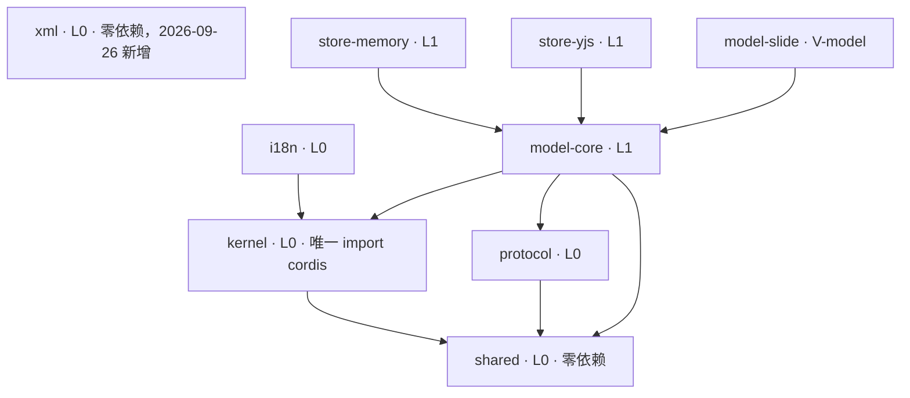

怎么读：箭头从依赖方指向被依赖方；两个 `DocumentStore` Provider 与幻灯片模型都只依赖 `model-core`，彼此之间没有箭头（三角色规则 6）；`xml` 与 `shared` 一样零依赖、没有出边，被 `ooxml-core` 与 `apps/server` 依赖（图 5-5、图 5-8a；rulings §4.21 X:q-xml-package）。

**图 5-5 依赖上限：L3 格式基础、V-codec 与 L4 协同**

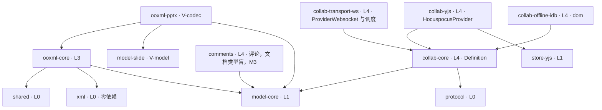

怎么读：箭头从依赖方指向被依赖方；三个协同 Provider（yjs 同步、WS 传输、IndexedDB 离线）都指向 `collab-core` 的契约，其中只有 `collab-yjs` 另外依赖 `store-yjs` 的 Y.Doc；`ooxml-pptx → model-core` 是 2026-09-25 按实际用法补的边（媒体部件经 `BlobStore`）；协同包到 `protocol` 的边属隐式 L0，未画出；`comments` 是 2026-09-25 新增的评论横向包，只依赖 `model-core`（rulings §4.19 D-COMMENTS-PKG）；`ooxml-core → xml` 是 2026-09-26 新增的边，XML 词法与保真树从 ooxml-core 抽到 L0 的 `xml`（rulings §4.21 X:q-xml-package）；两个协同 Provider 的职责按 Hocuspocus 4 改写，依赖上限不变（ADR-0039）。
依据：§5.2 包清单「依赖上限」列与表后注；rulings §4.18 FE-02、§4.19 D-COMMENTS-PKG、§4.21 X:q-xml-package、q-ws-gateway。

**图 5-6 依赖上限：L5 引擎与 V-render**

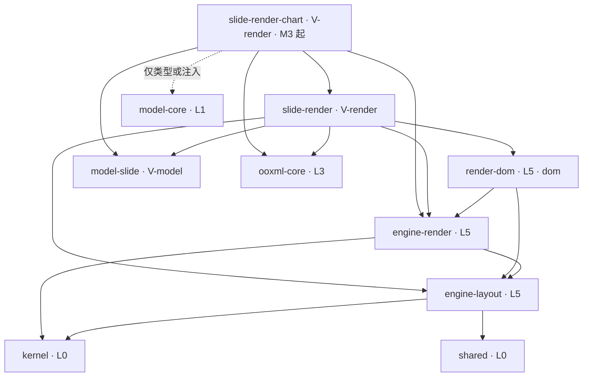

怎么读：箭头从依赖方指向被依赖方；`engine-render` 与 `engine-layout` 不依赖任何幻灯片包（文档类型盲），幻灯片知识全部在 `slide-render` 一侧；`slide-render → ooxml-core` 为 2026-09-24 按 C-28 修订放行的边；`slide-render-chart` 的四条新边为 2026-09-25 按实际用法补的上限，虚线表示对 `model-core` 只允许类型引用或由调用方注入（FE-02）。M1–M2 的图表只读渲染器是 `slide-render` 内的惰性子路径 `./chart`，不是本图的独立节点（FE-08）。

**图 5-7 依赖上限：L7 UI 基座与 V-ui**

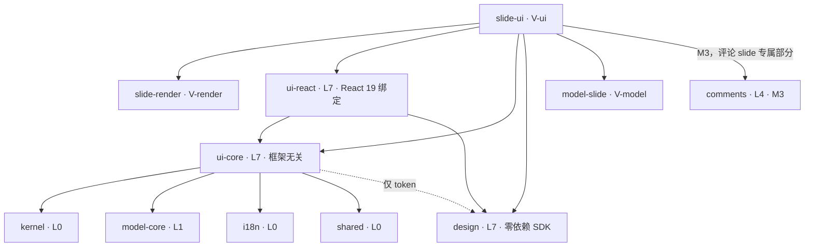

怎么读：实线箭头从依赖方指向被依赖方；虚线表示 `ui-core` 对 `design` 只允许 `css/tokens.css` 与 type-only token 名（§5.3 规则 6 特例）；`design` 没有出边；`slide-ui → comments` 自 M3 起，用于贡献评论锚点 resolver、检查器评论页签与画布评论钉（rulings §4.19 D-COMMENTS-PKG）。

**图 5-8a 依赖上限：LS 服务端与后端组合根 apps/server**

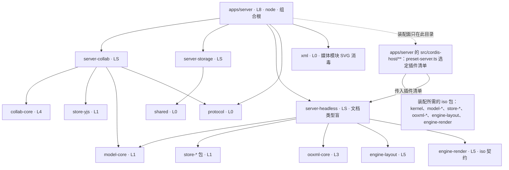

怎么读：实线从依赖方指向被依赖方；虚线表示 `cordis-host/**` 是 `apps/server` 内唯一可 import 束包与装配用 iso 包的目录（组合根豁免铁律 1）。`server-headless` 不再指向 `model-*`/`ooxml-*` 通配，而是只依赖契约层，由 `preset-server.ts` 传入的插件清单决定挂哪个文档类型；`server-collab → model-core` 为 2026-09-25 按实际用法补的边；`apps/server → xml` 为 2026-09-26 新增（媒体模块 SVG 消毒，rulings §4.21 X:q-xml-package）；`kernel`、`protocol` 对 LS 包隐式允许，未全画。
依据：§5.1 铁律 1；§5.2 表与表后注；rulings §4.18 FE-01、FE-02、§4.21 X:q-xml-package。

**图 5-8b 依赖上限：前端组合根 apps/web 与 preset**

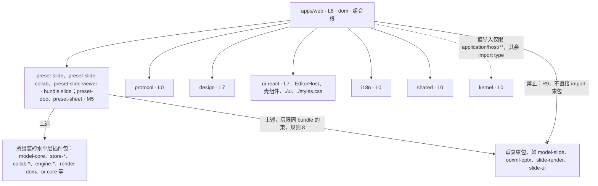

怎么读：实线从依赖方指向被依赖方，虚线是带条件的允许，带叉的边为禁止；`apps/web` 按 R9「不含领域定义」判据可引用 preset、呈现层与 L0 包，但不能绕过 preset 直接 import 垂直束包；各 preset 的上限在上表写作「上述」，即其组装的插件束，组合根豁免铁律 1，但 `preset-doc` 等只能组装同 `bundle` 的束包（规则 8）。
依据：§5.2 `apps/web` 行；§5.3 规则 3、规则 4、规则 8；rulings §4.15 Q2、§4.18 FE-01、FE-05。

**`package.json#cordex` 字段（规范）**：

```jsonc
"cordex": {
  "layer": "L1",              // L0|L1|L3|L4|L5|L7|L8|LS|V-model|V-codec|V-render|V-ui
  "iso": "iso",               // iso|dom|node
  "bundle": "slide",          // slide|doc|sheet；layer 以 V- 开头时必填；compositionRoot 为 true 的 preset 选填
                              // （preset-slide* 标 slide、preset-doc 标 doc、preset-sheet 标 sheet，填了即受规则 8 约束）；
                              // 其余包省略或 null（rulings §4.18 FE-01）
  "role": "provider",         // library|plugin|definition|provider|bundle|app|tooling（人类可读七值）
                              // depcruise 读取时按固定表折叠为四值：definition→definition、provider→provider、
                              // library|plugin|bundle|app|tooling→consumer；例外：同时是某 Definition 的 Provider
                              // 的包（如 kernel 自身）折叠为 provider；tooling/* 等不参与秩体系的包用 n/a
  "implements": ["store"],    // 字符串数组：本包实现的 Definition 服务名；role 为 provider 时必填，其余省略；规则 6（R7）读取
  "compositionRoot": false,   // 布尔；仅 preset-*、apps/web、apps/server 可为 true，且这些包必须显式写 true
                              // （规则 3 的组合根豁免与三角色豁免都读这个键）
  "publicEntry": ["."],       // 字符串数组；须与 package.json#exports 的 key 集合逐一相等（规则 7 读取）
  "stability": "beta"         // 可选：stable|beta|experimental，缺省 stable（供 api-extractor 与 Changesets 分组）
}
```
八键：`layer`、`iso`、`bundle`、`role`、`implements`、`compositionRoot`、`publicEntry`、`stability`（2026-09-22 由四键扩展，见 `40-modules/01-tooling-and-governance.md` §2.2、`40-modules/14-cross-module-review.md` §1 C-11、`40-modules/16-plugin-catalog.md` §8 G-15；第八键定为 `implements`，2026-09-25 rulings §4.18 FE-21）。秩（rank）由 `layer` 查 §5.1 秩表得出，**不**写进 `package.json`；schema 拒绝 `rank` 等未知键。schema 位于 `tooling/policy/schema/cordex-package-metadata.schema.json`；depcruise 与扫描器以此为唯一元数据来源。`tooling/*` 自身包不填该字段。

### 5.3 依赖规则（由 dependency-cruiser + eslint `no-restricted-imports`/`no-restricted-globals` 强制）

1. **无环**：包级与文件级均不允许循环依赖。
2. **只向下**：`rank(to) ≤ rank(from)`，秩表见 §5.1（L0=0、L1=10、V-model=15、L3=30、V-codec=35、L4=40、L5=50、V-render=55、LS=58、L7=70、V-ui=75、L8=80）。
3. **文档类型盲**：非组合根的水平层包不得 import 垂直束包；判据只读包元数据：from 侧排除 `cordex.compositionRoot: true` 的包（`preset-*`、`apps/web`、`apps/server`），to 侧为 `layer` 以 `V-` 开头的包。组合根的其余约束见铁律 1（2026-09-25，rulings §4.18 FE-01）。
4. **第三方库单点引入**：`cordis` 仅 `kernel`；`yjs`/`y-protocols` 仅 `store-yjs`/`collab-yjs`/`server-collab`；`lib0` 仅 `collab-yjs`/`server-collab`；`@hocuspocus/provider` 仅 `collab-yjs` 与 `collab-transport-ws`，`@hocuspocus/server` 仅 `server-collab`，`@hocuspocus/extension-redis` 仅在 `apps/server` 组装（M3），均精确钉 4.7.0（2026-09-26，rulings §4.21 H-d-24、H-d-25）；`idb` 仅 `collab-offline-idb`（自写 IDB 适配，§4.21 R-d-26；原 `y-indexeddb` 不采用）；`react`、`radix-ui`、`class-variance-authority`、`lucide-react`、`tailwindcss` 仅 `ui-react` 与 `*-ui`（shadcn 复制件所在）；**例外：`apps/web`（Vite + React 应用壳）放行 `react`、`react-dom`、`react-router`、`tailwindcss`、`@tailwindcss/*`**（rulings §4.15 Q2）；`react-router` 仅限 `apps/web`；`@nestjs/*` 仅 `apps/server`；`pg`/Redis 协议客户端（`ioredis` 等，默认对接 Valkey）/S3 SDK 仅 `apps/server` 的适配器目录与 `server-storage`（`server-collab` 仍不依赖三者）；`zod` 仅 `protocol`、`kernel` 与各包的 config 与 schema 文件（2026-09-26 由「仅 protocol/kernel」放宽，§4.21 R-d-56）。Yjs 14（`@y/y`、`@y/protocols`）与 `lib0` v1 预留与 `yjs`/`lib0` 相同的放行范围（M3 前升级 spike 用）。其余第三方依赖的放行范围见本节末「第三方单点登记表」；新增第三方依赖一律四处同步——该表、license-allowlist、catalog 精确锁、`50-frontend/13` 体积预算（§4.21 R-d-10），许可按 ADR-0049 分级。
5. **同构隔离**：`iso` 包 tsconfig 不含 `dom` lib、禁止 `node:*`；`node` 不得 import `dom`；CI 以 `node --import` 冒烟每个 iso 包（Univer 教训 A20）。
6. **三角色**：Provider 之间互不 import；Consumer 只 import Definition。特例：`ui-core` 对 `@cordexjs/design` 只允许 `css/tokens.css` 与 type-only 引用。
7. **无深引用**：跨包只能走目标包 `exports` 显式登记的子路径（即其 `cordex.publicEntry`，每个子路径都有 api-extractor 基线）；除 `.` 与 `./testing` 外，已裁定的子路径逐个登记，如 `@cordexjs/kernel/preset`（C-07）、`@cordexjs/shared/order`（A-9）、`@cordexjs/ui-react/ui`（R17）、`@cordexjs/slide-render/chart`（M1–M2）；`./testing` 只能被测试代码与其他包的 `testing/` 引用；禁止 `@cordexjs/x/src/*`、`@cordexjs/x/lib/*` 深引用；禁止 `"./*"`/`"./lib/*"` 通配 exports（Univer 缺陷 D2）；R17、R18 等是在本规则之上对个别子路径的专项限制（2026-09-25，rulings §4.18 FE-04）。
8. **束间隔离**：`cordex.bundle` 不同的包互不 import；带 `bundle` 的 preset 同样受约束（如 `preset-doc` 不得 import slide 束）。

**图 5-9 规则 2：全局秩序列（水平层与层带合并）**

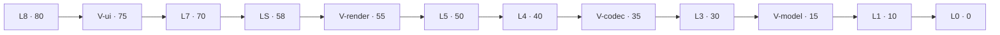

怎么读：从左到右秩递减，箭头方向即允许的 import 方向 `rank(to) ≤ rank(from)`；同秩（同一层内）互相依赖不被秩规则禁止，但仍受规则 1 无环与规则 5 同构约束。

**图 5-10 规则 3 与规则 8：文档类型盲与束间隔离**

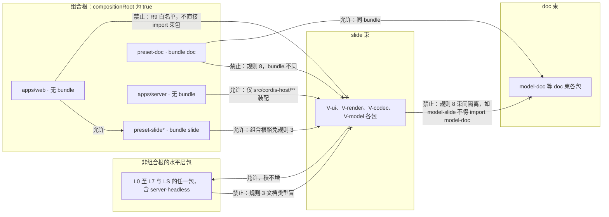

怎么读：带叉的边是 depcruise 必须拦截的方向。对非组合根的水平层包，垂直束依赖水平层是唯一合法的跨组方向，且仍要满足图 5-9 的秩与图 5-3 的层带上限；组合根豁免规则 3，但 preset 以自身 `bundle` 受规则 8 约束，`apps/web` 受 R9 白名单约束只能经 preset 装配，`apps/server` 只在 `cordis-host/**` 装配束包；组合根之间与组合根到水平层的允许边未画出。
依据：§5.1 铁律 1、铁律 2；本节规则 3、规则 8；rulings §4.18 FE-01。

**图 5-11 规则 5：同构类 import 方向**

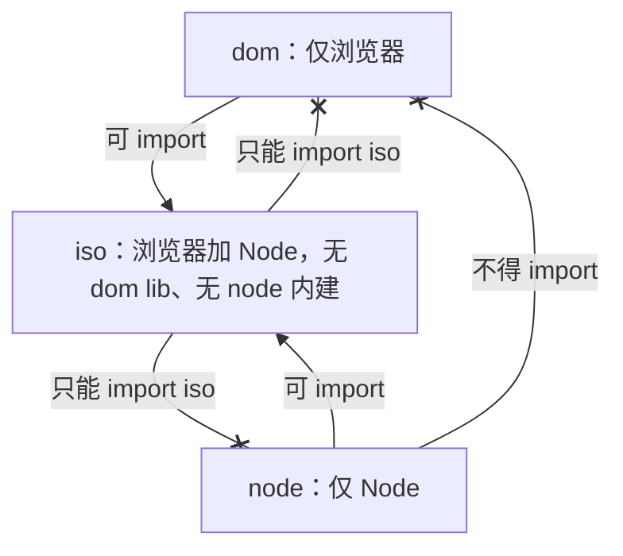

怎么读：实线为允许、带叉为禁止；同类之间的依赖（dom 可 import dom，iso 只能 import iso）不画成自环；`iso` 包由 tsconfig 去掉 `dom` lib 并禁止 `node:*` 在编译期保证，CI 另以 `node --import` 冒烟每个 iso 包。

**图 5-12 规则 6：三角色**

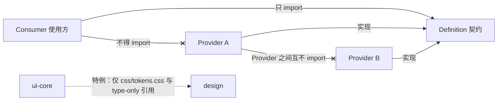

怎么读：实线为允许、带叉为禁止、虚线为规则 6 写明的唯一特例；替换 Provider 时 Consumer 无需改动，这是 §5.4「每一级可插拔」的依赖层基础。

**图 5-13 规则 4：第三方库单点引入**

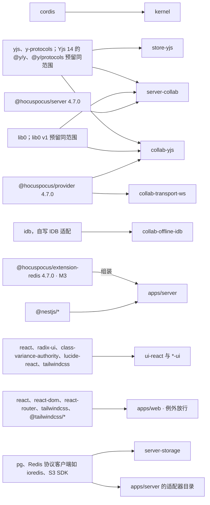

怎么读：箭头左端是第三方库，右端是唯一允许 import 它的包，任何其它包引入即 lint 失败；`react-router` 只允许出现在 `apps/web`；`server-storage` 是唯一允许 import S3 SDK 的 server 包（§5.2）。三个 `@hocuspocus/*` 包与 `idb` 是 2026-09-26 的新边（rulings §4.21 H-d-25、R-d-26），原 `y-indexeddb` 不再采用；其余新登记的第三方库见下方登记表与图 5-14。

**第三方单点登记表（规则 4 的明细，2026-09-26 起，rulings §4.21）**

规则 4 正文列出的库之外，下表是本轮复用裁决登记的第三方依赖及其唯一放行范围；版本号、体积、替代与否决理由的详表以 [50-frontend/17](../50-frontend/17-reuse-and-dependency-catalog.md)（前端）与 [60-backend/19](../60-backend/19-reuse-and-dependency-catalog.md)（后端）为准，depcruise 的 `third-party-single-entry`（30/02 的 R5）按本表生成。表中许可均已按 ADR-0049 分级核对。

| 库 | 唯一放行范围 | 许可 | 依据 |
|---|---|---|---|
| `@hocuspocus/provider`、`@hocuspocus/server`、`@hocuspocus/common`、`@hocuspocus/extension-redis`（4.7.0 精确钉） | provider 仅 collab-yjs、collab-transport-ws；server 仅 server-collab（例外：collab-transport-ws 以 devDependency 在 `testing/` 与 `__tests__/` 中引用，供脚本化服务端测试，不进生产依赖）；common 随前两者；extension-redis 及其传递依赖 `ioredis`、`@sesamecare-oss/redlock` 仅 apps/server 的 `collab/infrastructure/hp-redis.extension.ts` 组装（M3） | MIT；extension-redis 的传递依赖 `@sesamecare-oss/redlock` 1.4.0 按例外登记（元数据 UNLICENSED、LICENSE.md 为 MIT），其自带的 `ioredis ~5.6.1` 按单版本例外登记 | q-ws-gateway、H-d-23…H-d-25 |
| `ws` | apps/server（collab 升级处理，noServer） | MIT | H-d-01 |
| `idb` 8 | collab-offline-idb | ISC | R-d-26 |
| `d3-scale`、`d3-shape`、`d3-array`（`d3-path` 等为其传递依赖） | slide-render 的惰性子路径 `./chart`（M1）、slide-render-chart（M3） | ISC | q-chart-route |
| `numfmt` 3.2 | slide-render 的 `./chart`、slide-render-chart；slide-ui 的图表数据分区（M3，解析数据网格输入） | MIT | R-d-35、ADR-0036 |
| `fflate` | ooxml-core（server-storage 不引 zip，2026-09-26 复核删去；多页 PNG zip 走 ooxml-core 导出的 writeZip，不扩单点） | MIT | R-d-51 |
| `mtx-decompressor` | ooxml-core（内嵌字体 `.fntdata` 的 MTX 解压） | MPL-2.0（只许不修改使用） | q-license-tiers |
| `emf-converter` 4.0.x | slide-render（EMF/WMF 栅格化 Worker，既有单点） | Apache-2.0 | R-d-24 |
| `react-colorful` 5.8.1（pnpm patch 为静态 CSS）、`colord` 2.10、`@tanstack/react-virtual` 3.14、`@tanstack/react-table` 9、`use-sync-external-store` | ui-react 与 `*-ui`（与 `react` 同范围；图表数据网格因此落在 `*-ui`） | MIT | R-d-13、R-d-14、R-d-16、R-d-19、R-d-34 |
| `react-hook-form` 7.88 + `@hookform/resolvers` | ui-react、`*-ui`、apps/web | MIT | R-d-18 |
| `@atlaskit/pragmatic-drag-and-drop` 4.x | `*-ui`（slide-ui 拖放适配，接 ui-core 拖放管线） | Apache-2.0 | R-d-17 |
| `lucide-static`（惰性，M3 P2） | slide-ui（插入 › 图标库） | ISC | q-extra-inserts |
| `simplify-js`、`fit-curve`（P2） | slide-ui（任意多边形与自由曲线绘制） | BSD-2-Clause、MIT | R 元素设计（50/22） |
| `htmlparser2` 12（惰性） | ui-core（剪贴板 HTML 转纯文本） | MIT | R-d-20 |
| `comlink` 4.4 | Worker 入口所在包的 `infrastructure/` | Apache-2.0 | R-d-21 |
| `p-queue` 9 | apps/web（上传队列） | MIT | R-d-21 |
| `@opentelemetry/sdk-trace-web`、`@opentelemetry/exporter-trace-otlp-http`（成对锁版本）、`@sentry/browser`（可选 sink） | apps/web | Apache-2.0、MIT | R-d-22 |
| `harfbuzzjs`、`bidi-js`（M4/M5） | render-dom（shaping 度量，惰性）、engine-layout（bidi） | MIT | R-d-28 |
| `rbush` 4（M2 bench 超 2 ms 才引） | engine-render（命中索引） | MIT | R-d-30 |
| `@nestjs/*` 12.x、`fastify` 5 与 `@fastify/*`（cookie、multipart、helmet、otel）、`drizzle-orm` 0.45.x、`pg`、`pg-query-stream`、`ioredis` 6.0.x、`bullmq` 6.3.x、`bullmq-otel`、`openid-client`、`jose`、`quick-lru`、`croner`、`commander`、`pino`、`nestjs-pino`、`@opentelemetry/*`（服务端）、`image-size`、`file-type`、`ipaddr.js`、`undici`、`canonicalize` | apps/server（IO 客户端只在适配器目录；`openid-client`、`jose` 只在 `auth/infrastructure/`；`file-type`、`image-size` 只在媒体模块的 `asset-inspector.ts`；server-collab 不依赖其中任何一个） | MIT、Apache-2.0、ISC 等宽松类 | q-nest-major、q-db-access、R-d-36…R-d-56 |
| `@aws-sdk/*` v3 | server-storage 与 apps/server 适配器目录（既有） | Apache-2.0 | R-d-49 |
| `playwright-core`、`opentype.js`、`@fastify/busboy` | server-headless（renderer 驱动、node-font 度量、renderer RPC 流式 multipart） | Apache-2.0、MIT | R-d-50、R-d-52、R-d-57 |
| `zod` 4 | protocol、kernel 与各包的 config 与 schema 文件 | MIT | R-d-56 |
| `@cordexjs/xml`（一方包，列此为 server-app-thin 白名单项） | apps/server 只允许媒体模块的 `media/infrastructure/svg-sanitizer.ts` 引入（SVG 消毒），其余 apps/server 源码不直接引用 | —（一方包） | X:q-xml-package |
| 仅 tooling 或测试：`culori`、`subset-font`、`opentype.js`、`@formatjs/icu-messageformat-parser`、`linebreak`（对照）、`zod-openapi`（protocol 构建脚本）、`saxes`、`libxml2-wasm`、`@rgrove/parse-xml`（xml 包差分 oracle 与退路）、`axe-core`、`testcontainers`、`oidc-provider` | `tooling/*` 与各包测试（devDependency），不进任何运行时 bundle | 宽松类；`axe-core` 为 MPL-2.0（不修改） | R-d-14、R-d-25、R-d-27、R-d-28、R-d-54、R-d-58、X:q-xml-lexer |

**图 5-14 规则 4：2026-09-26 新登记的前端第三方单点**

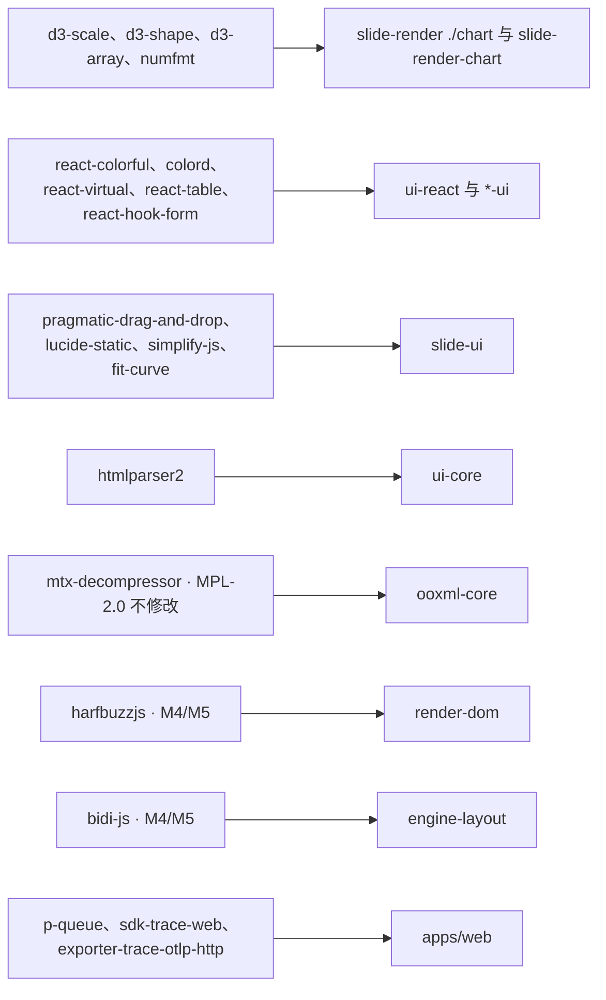

怎么读：箭头左端是本轮新登记的前端第三方库（按放行范围归组），右端是唯一允许 import 它们的包；`react-hook-form` 另放行 `apps/web`、`comlink` 放在各 Worker 入口的 `infrastructure/`，未画出；后端新依赖全部只在 `apps/server`（少数在 `server-headless`），见上表。
依据：本节登记表；rulings §4.21 q-chart-route、q-license-tiers、R-d-13…R-d-28。

### 5.4 每一级的「可插拔」如何体现（R2 验收口径）

| 层 | Definition（契约） | 默认 Provider | 可替换为 | 移除后系统能否启动 |
|---|---|---|---|---|
| 内核基础服务 | `errors`/`telemetry`/`logger` | 控制台实现 | Sentry/OTel 实现 | 是（降级为 no-op） |
| 存储 | `DocumentStore` | store-memory | store-yjs / 未来 store-loro | 否（必需，但任一 Provider 皆可） |
| 文档类型 | `core.documentType` 贡献点 | slide | doc / sheet / 第三方 | 是：打开未知类型以错误码 `format.no_document_type` 失败（错误码为点式，事件名为 `域/动作`，见 D11 与架构 10），宿主仍运行 |
| 格式 | `core.format` 贡献点 | ooxml-pptx | 其他格式、JSON | 是（无法打开文件） |
| 协同 | `collab` / `collabTransport` / `OfflineStore` | collab-yjs（HocuspocusProvider）+ collab-transport-ws（HocuspocusProviderWebsocket 与自有调度）+ collab-offline-idb（2026-09-26，ADR-0039） | webrtc 传输 / 其他 CRDT | 是（单人模式） |
| 渲染 | `render.target`/`render.element`/`render.scene` | render-dom（DOM/SVG）+ slide-render | 第三方元素；`canvas` Target 预留（对外 Stable 前以最小 canvas Provider 通过契约，M3 末） | 是（空白画布） |
| 度量 | `layout.measurer` | render-dom canvas 度量 | server-headless 字体度量 | 否（必需，任一 Provider） |
| UI | ui-core 贡献点 | ui-react | ui-vue（未来；须同时提供对应的 `*-ui`，因 `*-ui` 的组件层绑定 React）；形态 B 由宿主自绘，`UiRenderer('vanilla')` 过契约 | 是（headless） |
| 服务端 | Nest 模块 + `BlobStore` Provider | Postgres / Redis 协议兼容（默认 Valkey）/ S3 兼容（默认 SeaweedFS） | 任意 S3 兼容服务 / Kafka | 按模块 |

### 5.5 统一的服务名、事件名与贡献点 id

- **服务名**（`ctx.<name>`）：全局——`units`、`documentTypes`、`commands`、`formats`、`resources`、`migrations`、`permissions`、`collab`、`collabTransport`、`layout`、`ui`、`shortcuts`、`i18n`、`theme`、`errors`、`telemetry`、`logger`（cordis 内建）；UnitScope 内——`store`、`history`、`selection`、`render`、`presence`；服务端——`collabServer`、`blobStore`；垂直束——`slides`。
- **事件名**：`<域>/<动作>`，如 `unit/opened`、`command/executed`、`store/transaction`、`collab/synced`、`permission/changed`、`render/element-failed`、`slide/shape-added`。事件必须在 `Events` 接口中声明，否则扫描器报错。遥测事件另有登记表（PRD 06 / 架构 10）。
- **贡献点 id**（camelCase）：`core.documentType`、`core.format`（导出专用编解码器亦在此，`canImport:false`）、`core.command`（可执行定义）、`core.mutation`、`core.migration`、`core.resource`、`core.permissionPolicy`、`render.scene`、`render.target`、`render.element`、`render.overlay`、`layout.measurer`、`i18n.bundle`、`errors.sink`、`telemetry.sink`、`ui.ribbon`、`ui.toolbar`、`ui.panel`、`ui.contextMenu`、`ui.shortcut`、`ui.command`（命令的**呈现元数据**：title/icon/when/keybinding）、`ui.statusBar`、`ui.dialog`、`ui.notification`、`ui.theme`、`slide.shapeKind`。完整 schema 见架构 03 §3.6。协同传输与 Blob 存储**不是**贡献点，而是 `collabTransport`/`blobStore` 服务的 Provider 座。
- **契约套件命名**：`run<Definition>Conformance`（如 `runDocumentStoreConformance`、`runFormatCodecConformance`），由 Definition 所在包的 `./testing` 子路径导出。文档类型条目不是 Definition，其体级自洽套件平行命名为 `run<DocType>ModelConformance`（如 `runSlideModelConformance`，M5 另有 `runDocModelConformance`、`runSheetModelConformance`），由该文档类型的 V-model 包 `./testing` 子路径导出（2026-09-25，`70-testing/02` §8、§14 回写 5）。
- **第三方前缀规则**：第一方保留域为 `core`、`kernel`、`contribution`、`unit`、`command`、`store`、`history`、`selection`、`permission`、`format`、`render`、`layout`、`ui`、`i18n`、`collab`、`collab-server`、`presence`、`plugin`、`error`、`perf`、`view`、`export`、`comment`、`slide`、`doc`、`sheet`（与架构 03 §3.6 的域名单合并为一份并集，2026-09-18，14 §1 C-24）。`app` 单列为**应用壳私有域**：`apps/web` 用 typed `EventTarget`（非 cordis `Events`/`ctx.emit`）承载 `app/*` 事件，禁止 `packages/*` 使用，不经扫描器登记。服务端审计记账名（如 `share.granted`）**不**采用 `<域>/<动作>` 事件形式，改用点式 `action` 字符串，避免与 cordis 事件域混淆。第三方插件的事件名与贡献点 id 必须以其 npm scope（去 `@`）为前缀：事件 `<vendor>:<域>/<动作>`，贡献点 `<vendor>:<域>.<名>`；扫描器拒绝无前缀的非保留域。

---

## 6. 关键决策：已定 vs 待 ADR

### 6.1 已定（章程级，不再讨论）

| 决策 | 内容 | 依据 |
|---|---|---|
| D1 内核 | cordis 4（`cordis@4.0.0-rc.10`）锁版本，仅 kernel 引入；跟随 rc 升级由 kernel 吸收 | R2；API 尚在 rc，需隔离风险 |
| D2 配置与边界校验 | Standard Schema（zod 4）用于插件 Config、WS/REST DTO、编解码输出、Snapshot 载入；「parse, don't validate」；`z.infer` 为类型单一来源 | cordis 4 原生支持 Standard Schema；R7 |
| D3 注册抽象 | 全代码库只有一种注册：ContributionPoint；禁止自建 `register*`/全局 `Map` 注册表 | Univer 104 个 register* 教训 |
| D4 命令三分法 | Command / Mutation / Operation；Mutation 是唯一改 Store 的途径，只能在事务内产生；语义 Mutation 经 `lower()` 降级为 `StoreOp`；逆操作由 Store 推导，禁止手写；命令返回 `Result` 不返回 boolean | Univer 最正确的一项 + 缺陷 #3 |
| D5 事实源 | 运行时模型通过 `DocumentStore` 读写，协同模式下 CRDT 文档是唯一事实源；不存在第二份模型 | Univer Worker 双模型不一致教训 |
| D6 持久化边界 | Snapshot 与运行时模型有显式编解码；二进制以 `BlobRef` 引用；`schemaVersion` + 迁移注册表从 M1 起存在；派生字段标 `Derived<T>` 不入 Snapshot | Univer 决策 #10 |
| D7 保真策略 | 部件级 + **节点级**不透明保留、脏部件重生成；「未修改零丢失」是 M1 验收；口径：零编辑时字节相同；有编辑时未触碰部件字节相同、脏部件 XSD 有效、规范化 diff 限于编辑子树、派生部件白名单 | R6；PRD CS-01/CS-06 |
| D8 后端 | NestJS 12 作为传输壳（2026-09-26 rulings §4.21 q-nest-major，用户选择的非推荐项；原「NestJS 11」作废）：`@nestjs/*` 统一 12.x；Nest 12 为纯 ESM，`apps/server` 构建改为 ESM；HTTP 适配器 Fastify 5；OTel 以 `node --import` 预加载注册，`@opentelemetry/instrumentation-nestjs-core` 暂不支持 12，Nest 层 span 暂由 `@fastify/otel` 加手工 span 补齐（ADR-0030）；DB 访问层 drizzle-orm 0.45.x + 手写 schema（ADR-0022）；协同 WS 接入由 Hocuspocus 4 嵌入底层 HTTP server 的 upgrade（ADR-0039）。业务逻辑在 `server-*` 包；Nest 内嵌 cordis 宿主复用 iso 插件；pg/redis/s3 等 IO 适配器以 cordis 插件形式置于 `apps/server` 对应模块目录 | R4 |
| D9 monorepo 与工具链 | pnpm 11 双锁（`packageManager` 精确版本 + `devEngines.packageManager/runtime`，`onFail: error`；corepack 仅作可选安装渠道；pnpm 设置全部写入 `pnpm-workspace.yaml`，`.npmrc` 只留鉴权；lefthook + CI 的 lockfile-guard 只允许根 `pnpm-lock.yaml`；仓库根命令一律 pnpm）+ Turborepo；**Node 26 基线**（开发 / CI / 镜像统一，`engines >=26`）；内部依赖一律 `workspace:` 协议（peer `workspace:^`，其余 `workspace:*`）；TS ≥ 5.9 最严格集 + `isolatedDeclarations`；库 `tsc -b` 未打包 ESM，apps Vite；Vitest（dom 包默认 happy-dom，布局/IME 用例走 browser mode）；Playwright；Changesets；ESLint（typescript-eslint 类型感知）+ Biome 格式化 | R7；2026-09-24 按 §10 Q9 修订（rulings §4.15；原「pnpm 10 + corepack 锁定」作废，「全局 yarn 冲突」前提实测不成立；pnpm 12 切换检查点 2027-03-31 前） |
| D10 UI 框架与组件库 | React 19（SDK 对宿主 React 要求 `^19.0`）。「可换」的可验证范围（rulings §4.15 Q2）：`ui-core` 与各 `*-ui` 的 domain/application 层框架无关（depcruise 规则）；组件层（ui-react 与 *-ui 的 tsx）绑定 React，更换框架需同时提供对应的 `*-ui`；形态 B 由宿主自绘 UI，装配排除 `slide-ui`（`FRAMEWORK_FREE_EXCLUDES`），`embed-vanilla` 跑 `UiRenderer('vanilla')` 契约；每个号称可替换的 Definition 在对外 Stable 前须有第二个 Provider 通过契约；组件层**直接复用 shadcn/ui**（`radix-rhea` 风格，2026-09-16 起，原 `radix-nova`；rulings §4.8：Radix 语义与键盘行为、Lucide 图标、Geist 字体）以 CLI 复制进 `@cordexjs/ui-react/src/components/ui/`，样式为 Tailwind 4 工具类；`@cordexjs/design` 交付 shadcn 主题变量 + Cordex 扩展变量；Cordex 特有组合：`ui-react/src/components/editor/` 提供槽位宿主与原语（Ribbon 框架、画布覆盖层宿主、检查器框架），具体内容（缩略图栏、母版缩略图窗格等幻灯片专属部件）由 `*-ui` 贡献（14 O-7）；第三方 UI = 声明式 + React 组件（经 ErrorBoundary 与 axe 夹具）；CSP nonce M2、Trusted Types M2 report-only → M3 强制；设计 playground（`docs/20-design/playground/`）是 ui-react 的种子与设计稿的唯一基准 | Univer 同选型；用户要求复用成熟组件（2026-09-15）；§10 Q2 已裁决（rulings §4.15；依据 §4.8 与 ADR-0017） |
| D11 观测性 | `errors`（类型化错误码，禁止裸 `throw new Error`）、`telemetry`、结构化 `logger` 为 L0 服务，从 M1 起接入；包内禁止 `console.*`；错误码/span/metric/遥测事件名通过声明合并登记并由扫描器校验 | Univer D 级项 |
| D12 权限 | fail-closed：无显式允许即拒绝；检查点在 `commands` 执行管线（含 Mutation 级）与服务端网关两处；服务端软门禁（schema/不变量修复）是数据完整性边界，与权限边界并列 | Univer C 级项；数据访问兜底另加文档级 Postgres RLS（§10 Q6，rulings §4.15） |
| D13 许可 | **许可分级，见 ADR-0049**（2026-09-26 rulings §4.21 q-license-tiers；原「全部依赖须为 MIT/Apache-2.0/BSD/ISC 兼容；AGPL 代码禁止引入」由分级附表取代）：宽松类（MIT、Apache-2.0、BSD-2/3、ISC、0BSD、BlueOak-1.0.0、MIT-0、Zlib、Python-2.0 等）视同放行；OFL-1.1 只用于字体资产，CC0-1.0 只用于数据文件与内置源码（须注明出处），MPL-2.0 只允许不修改的依赖；LGPL、GPL、AGPL、SSPL、BUSL、Unlicense 及更强 copyleft 禁止；元数据与许可文件不一致的包逐个附证据登记例外。传递依赖与 devDependency 同样扫描（TD-050） | 见 §1。适用口径（rulings §4.15 Q10/Q8，原文不改）：对**容器镜像**按主组件许可白名单解释——默认 compose 不含 AGPL 镜像（故以 SeaweedFS 替换 MinIO，Redis 协议用 Valkey 而非 RSAL/SSPL 版本），Grafana/Loki 等 AGPL 组件只作显式开启的可选 profile；npm 依赖严格按原文（如 sharp 依赖 LGPL 的 libvips，不采用）；2026-09-26 起 npm 依赖按 ADR-0049 分级执行，镜像口径不变 |
| D14 分层编码 | 垂直束用层带 `V-*` 而非层号；`package.json#cordex = { layer, iso, bundle? }` 为唯一分层元数据；秩表见 §5.1 | 结构线 C-1、类型治理 Q-T1 |
| D15 命名 | 贡献点 id 与服务名 camelCase；第三方前缀规则见 §5.5 | PRD CS-07、结构线 C-3 |
| D16 图表策略 | M1–M2：`c:chart` 部件不透明保留，渲染器只读解析部件与缓存数据以满足查看（SSIM ≥ 0.80）；M3 起数据模型与编辑（`slide-render-chart`）；渲染底层为 d3-scale / d3-shape / d3-array，按 OOXML 语义自研布局，图表插入定 M3（2026-09-26 rulings §4.21 q-chart-route，ADR-0036） | PRD OF-09 与结构线 A-11 的合并。解释（rulings §4.15 Q7）：只读解析不以「包内预览位图，否则占位」代替，下游此类写法作废；解析器归 `ooxml-core`（slide-render 依赖上限相应放宽，C-28 修订）；表格/图表/SmartArt 为 M1 gated；M3 可编辑五类（U-06）；chartex（`cx:`）M1–M3 只保留 + 诊断占位 |

### 6.2 待 ADR

ADR 索引与状态以 `docs/30-architecture/adr/README.md` 为准（结构 0001–0019、运行时 0020–0039、类型治理 0040–0049）。章程记录**默认倾向**与已被用户裁决而接受的行（标「已接受」，2026-09-24 rulings §4.15），未接受的行用户可否决：

| 议题 | 默认倾向 / 结论 | ADR |
|---|---|---|
| CRDT 选型 | **已接受**（§10 Q3）：Yjs 13.6.x（lockfile 锁精确版本）；有序集合用 FracKey（键格式 2026-09-26 改为内置 rocicorp fractional-indexing 算法：整数头 + 随机后缀、后缀避开以 '0' 结尾，rulings §4.21 q-frackey）；撤销语义写入 `DocumentStore` 中性契约（他人后写跳过并提示、整步跳过即停、删除为软删除墓碑 + TTL 24 h；撤销目标被他人删除即跳过、不看 TTL，rulings §4.17 D4）；Loro 为已评估替代，按可机械检验的阈值重评；Yjs 14 GA 后 M3 前做升级 spike | 0020、0032 |
| 渲染介质 | **已接受**（§10 Q4）：DOM/SVG 单实现；canvas 仅用于 toImage 栅格化、`measureText`、媒体与图标预处理（`createImageBitmap` + `canvas.toBlob`，只产出 Blob；2026-09-26 §4.21 R-d-23 修订）与预留的 `RenderTarget`；文档内 SVG 只以图像上下文渲染；DX-1000 不达标先做合成层优化，再仅对查看/放映启用 canvas | 0021 |
| 服务端存储与部署 | **已接受**（§10 Q10）：Postgres 18（元数据 + update 追加表 + Compaction + 文档级 RLS）、Redis 协议兼容（默认 Valkey）、S3 兼容（默认 SeaweedFS）；自托管 compose 洁净栈，同一镜像按角色运行，独立 renderer sidecar，可选 Casdoor；DB 访问层 drizzle-orm 0.45.x + 手写 schema（漂移检查直查 pg_catalog），HTTP 适配器 Fastify 5（2026-09-26 rulings §4.21 q-db-access，B1/B2 结案） | 0022、0025、0035、0037 |
| 鉴权 | **已接受**（§10 Q6）：单组织；服务端 M1–M3 只认 OIDC，不持有密码；集成方签名 JWT / API Key M4；`auth.selfSignup` 默认关；组管理推迟 | 0029 |
| 服务端缩略图 | **已接受**（§10 Q8）：M3 前半段 headless Chromium（同一渲染代码、零出站 sidecar）；M2 以包内 `thumbnail.jpeg` 过渡；PDF M3 后半段 | 0026 |
| 协同传输与协议 | **已裁决**（2026-09-26 rulings §4.21 q-ws-gateway，用户选择的非推荐项）：WS 接入与 Room 框架改用 Hocuspocus 4.7.0（嵌入 Nest 底层 HTTP server 的 upgrade，一 WS 一文档；线上为 Hocuspocus 帧 + Stateless，CONTROL 改作 Stateless 载荷，Ticket 放 Auth token）；逐帧落库 + 两级 ack（S-3a，beforeSync 先落库、Stateless 下发 ack）；权限变更 ≤ 2 s 生效（PermissionSync 扩展）；M3 多实例用 extension-redis + 按 documentId 哈希偏好亲和；重连 step2 单设 16 MiB 上限 | 0023（部分被 0039 取代）、0029、0039 |
| 声明合并策略 | kernel 桥接 `Events`/`Context`，插件只 `declare module '@cordexjs/kernel'`；需 spike | 0001 |
| 版本策略 | L0–L1 lockstep；垂直束与 Provider 独立 semver；peer 加载期校验失配即 FAILED | 0002 |
| 插件清单 | `manifest.ts` 由静态分析生成并入库，CI 重新生成无 diff；`cordex-manifest.json` 构建时由其序列化、随包发布、不入库；运行时比对（rulings §4.18 GV-17 澄清） | 0003 |
| 包管理与工具链 | **已接受**（§10 Q9）：见 D9 | 0004 |
| 类型预算 | `any`/`as`/`!`/`@ts-*` 计数预算只减不增 | 0040 |
| Strict 一致性类写回 | **已裁决**（§10 Q14 = 方案 C）：保持原一致性类，脏部件反向映射写回 Strict，干净部件 verbatim；整包转 Transitional 仅作反向映射失败时的异常兜底 | 0008 |
| 可追加元素的模型与插入命令 | **已裁决**（2026-09-26 rulings §4.21 q-table-depth、q-media-insert、q-extra-inserts 与 R-d-61…R-d-78）：插入命令通用流程（一次插入一个撤销步）、新元素默认样式只写 `p:style` 引用、线条落 `p:cxnSp`；表格 M2 可插入并改单元格文字、M3 前改为 Record + FracKey 归一化模型（不变量 I-TBL1、I-TBL2） | 0018 |
| XML 词法与保真树 | **已裁决**（2026-09-26 rulings §4.21 X:q-xml-lexer、X:q-xml-package、X:q-content-types；A-2 结案）：自研词法与保真树，抽为 L0 包 `@cordexjs/xml`（零依赖），`scan` 与 `parseDocument` 两个入口，XmlLimits 为限额唯一定义处，DOCTYPE 一律拒绝；关系与内容类型集合未变时原样写回 | 0019、0008 |
| 图表渲染与编辑 | **已裁决**（2026-09-26 rulings §4.21 q-chart-route）：d3-scale / d3-shape / d3-array + 按 OOXML 语义自研布局；M1 只读（SSIM ≥ 0.80），M3 插入与五类编辑（数据网格 @tanstack/react-table 9 + shadcn Table，内嵌 xlsx 自研最小写出器 + numfmt） | 0036 |
| 依赖准入与许可分级 | **已裁决**（2026-09-26 rulings §4.21 q-license-tiers、R-d-10）：许可分级附表（见 D13）；新增依赖四处同步；停更判定与 minimumReleaseAge；传递依赖与 devDependency 同扫 | 0049 |

---

## 7. 里程碑骨架（产品条线细化验收标准）

> 周期：**不定周期**——按范围与验收推进，每个里程碑开工前再估（rulings §4.16 Q13）。

**图 7-1 里程碑骨架 M0–M5**

```mermaid
flowchart LR
  m0["M0 蓝图 · 本阶段"] --> m1["M1 打开与保真 · viewer+round-trip"] --> m2["M2 单人编辑 · 命令/撤销/导出+协同后端"]
  m2 --> m3["M3 多人协同 · 在场/评论/权限/离线"] --> m4["M4 插件 SDK 公开 · manifest/文档/示例"] --> m5["M5 多文档类型孵化 · model-doc/sheet 骨架"]
```

怎么读：箭头为里程碑的先后顺序，每个节点「·」后是该里程碑的主交付；周期不定，按下表的验收与可插拔证据逐个推进。协同后端（网关、Room、update 持久化与快照、服务端导入）自 M2 起交付，M3 是多人协同体验层（rulings §4.19 D-M2-CONTENT）；两者的逐项边界以 PRD `05-milestones-and-scope.md` §0.3 为准。

| 里程碑 | 一句话验收 | 必含的「可插拔」证据 |
|---|---|---|
| M0 | PRD/设计/架构/类型治理文档通过评审；仓库目录骨架与全部门禁配置就位（无业务代码） | 规范↔执行矩阵 CI 校验通过 |
| M1 | 任意合法 pptx：打开 → 高保真只读渲染（表格/图表/SmartArt 为 gated，OLE 显示预览图；图表只读渲染用 d3 + 按 OOXML 语义自研布局，ADR-0036）→ 未修改导出与原文件语义等价（D7 口径；外部关系全部原样保留）；`preset-slide-viewer` 可用 | store-memory 与 render-dom 均可被 no-op Provider 替换后仍能启动（no-op 只证明「可移除」，不替代「第二个 Provider 过契约」） |
| M2 | 文本/形状/图片/幻灯片增删排序/属性编辑/撤销重做/导出；插入表格与单元格文字编辑（P1；2026-09-26 rulings §4.21 q-table-depth，原「只做单元格文本编辑」扩为可插入）；超链接（P1，§4.21 R-d-67）；基础放映（P1，无动画，主序列可见性终态）；EMF/WMF 惰性栅格化（P1）；**协同后端**（rulings §4.19 D-M2-CONTENT）：OIDC 登录、协同网关与 Room（Hocuspocus 4 嵌入、单实例，含 Postgres 故障溢写与两级 ack，ADR-0039）、update 持久化与快照、服务端导入，参考应用的文档内容自 M2 起只以协同快照为事实源（不设过渡的 pptx 内容版本端点）；文档卡片以包内 `thumbnail.jpeg` 过渡；客户端安全基线（CSP nonce、Trusted Types report-only、`externalResources`）；性能预算达标 | 第三方示例插件新增一种元素渲染与一个 ribbon 按钮，零改内核 |
| M3 | 多人协同体验层：presence、评论、权限细化（单组织、按人分享与分享链接、权限即时生效；组管理推迟）、离线重连、软冲突与协同撤销提示、版本历史（命名、列表、恢复）；多实例扩展（extension-redis + 按 documentId 哈希偏好亲和，含跨实例溢写认领；§4.21 H:q-hp-fanout）；服务端导出与服务端缩略图（前半段）、PDF 导出（后半段）；自托管 compose 洁净栈出口（断网 e2e、digest 钉死、SBOM、镜像许可门禁）；表格结构与样式编辑（行列插删、合并拆分、样式；M3 前表格模型改为 Record + FracKey 归一化，ADR-0018）；图表插入与数据编辑（五类，ADR-0036）；图标与符号插入（P2，§4.21 q-extra-inserts） | store-yjs 替换 store-memory 仅改 preset 配置；M3 末最小 canvas Provider 通过 `render.target` 契约；`UiRenderer('vanilla')` 通过 UI 契约 |
| M4 | 插件开发指南、manifest、示例仓库、版本协商、兼容性测试套件；集成方签名 JWT 与 API Key；离线安装包 / 多架构 / Helm（P1）；动画播放（P2）；M4+ 候选（不计入 M4 验收，M4 之后另行立项；§4.21 q-smartart、q-equation、q-extra-inserts）：SmartArt「转换为形状」、公式（自研 OMML↔MathML，MathJax 4 输出 SVG）、屏幕截图与相册插入（P2） | 内部非核心成员（未参与内核开发的同事或全新 AI agent 会话）仅凭公开文档独立完成一个插件（≤ 2 人日；rulings §4.16 Q11） |
| M5 | `model-doc`/`model-sheet` 骨架通过「文档类型盲」验证：水平层零改动（文件哈希冻结） | dependency-cruiser 报告零横向依赖 |

---

## 8. 文档树（本阶段交付物，目录级）

```
docs/
├── README.md                         文档地图、阅读顺序、状态约定
├── 00-charter/                       共同输入（总编排负责）
│   ├── charter.md                    本文
│   ├── reference-univer-lessons.md   Univer 继承/规避清单 → 我们的机制 → 落实位置
│   ├── cordis-primer.md              cordis 4 API 摘要 + 本项目用法铁律
│   ├── rulings-2026-09-14.md         对各条线异议/建议的逐条裁决记录（采纳/否决/待用户）；§4.15 起为用户裁决
│   └── _evidence/                    裁决调研证据包（Q1–Q10 决策包、复核报告、矛盾分诊与执行清单；§4.21 的复用与架构三件套、Hocuspocus 采用、XML 专项三份证据与本轮简报），只作出处，不是正文
├── 10-prd/                           产品条线
│   ├── README.md                     PRD 总览、范围声明、待决事项、对章程的异议、术语补充
│   ├── 01-background-and-goals.md    背景、问题陈述、目标与非目标、成功指标
│   ├── 02-personas-and-scenarios.md  角色（编辑者/评审者/插件开发者/集成方/运维）、核心场景、用户故事
│   ├── 03-features/                  功能需求，每个域一文件（含用户故事、验收标准、优先级、里程碑）
│   │   ├── 01-open-and-fidelity.md   打开/渲染/保真/导出 + pptx 特性支持矩阵
│   │   ├── 02-editing.md             文本/形状/图片/表格/页管理/属性/撤销重做/快捷键
│   │   ├── 03-collaboration.md       实时协同/presence/评论/权限/离线/版本历史/软冲突表
│   │   ├── 04-plugin-sdk.md          面向插件开发者的产品需求（manifest、示例、文档、兼容）
│   │   ├── 05-embedding-and-integration.md  SDK 嵌入、鉴权对接、存储对接、事件回调
│   │   ├── 06-server-and-ops.md      服务端能力、运维、审计、配额
│   │   ├── 07-masters-layouts-and-themes.md 母版、版式与主题
│   │   └── 08-app-shell.md           应用壳：开始页、最近、模板、指南、账户
│   ├── 04-non-functional-requirements.md 性能预算、保真指标、可用性、安全、可访问性、i18n、浏览器矩阵
│   ├── 05-milestones-and-scope.md    M0–M5 的范围、验收、依赖与风险
│   ├── 06-metrics-and-analytics.md   北极星指标、埋点需求（对应 telemetry 服务）
│   ├── 07-design-coverage-and-gaps.md 需求 ↔ 设计 ↔ 原型覆盖矩阵与缺口清单（G-xx）
│   ├── 08-prd-design-alignment-2026-09-17.md PRD 与设计稿一致性核对（历史记录）
│   └── 09-prd-design-alignment-2026-09-18.md PRD 与设计稿一致性复核（历史记录）
├── 20-design/                        设计条线
│   ├── README.md                     设计原则、范围、待决事项、对章程的异议
│   ├── 01-information-architecture.md 编辑器 IA：区域划分、层级、导航模型、三种模式
│   ├── 02-user-flows.md              打开/编辑/协同/冲突/离线/导出/插件启用等关键流程
│   ├── 03-screens/                   每个页面/面板一文件，01–32（ASCII 线框 + 状态 + 交互说明；30 表格编辑、31 图表编辑 2026-09-30 新增；09 于 2026-10-01 重写为个人插件面板，32 管理员插件管理同日新增）
│   ├── 04-design-system.md           token 体系（对应 @cordexjs/design）、组件清单、主题/暗色、密度
│   ├── 05-collaboration-ux.md        presence、远端光标/选区、软冲突可视化、评论、版本历史、离线态
│   ├── 06-extensibility-ux.md        插件如何贡献 UI：ui.* 槽位规范与视觉约束
│   ├── 07-accessibility-and-i18n.md  键盘导航、屏幕阅读器、IME、RTL、文案规范
│   ├── 08-prototype-audit-and-v2-plan.md 原型现状自审与 v2 规划（历史记录）
│   ├── 09-design-specification.md    设计规范：shadcn Rhea + Liquid Glass 材质层
│   ├── 10-modernization-audit.md     现代化审计：对照 iOS Liquid Glass 的逐屏挑刺
│   ├── 11-modern-glass-redesign-proposal.md 现代化改造提案（路线 B 已实施）
│   ├── 12-editor-routes-review.md    编辑器族路由视觉评审（宿主外壳逐屏截图）
│   ├── playground/                   设计 playground（设计终稿与视觉基准，已发布 artifact）
│   ├── mockups/                      历史静态稿（**已退役**，已被 playground 取代，rulings §4.17 D6）
│   └── prototype/index.html          旧低保真原型（**已退役**，以 playground 为准，rulings §4.17 D6）
├── 30-architecture/                  总架构与跨端契约（结构 / 运行时 / 类型治理三条子线；§4.21 起 30 只留总架构，前端架构、后端架构分别是 50/01、60/01）
│   ├── README.md                     总架构入口：架构三件套表、原则、文档索引、待决事项、ADR 速览
│   ├── 01-overview.md                总架构（全仓唯一一份，跨端）：C4 L1/L2、统一原则、技术栈与复用总表、端到端数据流、M1–M4 里程碑边界唯一表
│   ├── 02-layering-and-packages.md   分层网格与依赖规则（§4.21 起逐包目录树删去、改指 40-modules 各篇 §4，标题留桩）
│   ├── 03-kernel-and-plugin-model.md kernel 封装、ContributionPoint、Manifest、UnitScope、生命周期、preset
│   ├── 04-document-model.md          model-core 抽象、model-slide 模型、OOXML 映射、不透明保留、样式继承、迁移
│   ├── 05-command-and-history.md     命令三分法、事务、降级、自动逆操作、权限检查点、审计
│   ├── 06-collaboration.md           CRDT 映射、同步协议、presence、离线、权限即时性、软冲突语义
│   ├── 07-rendering.md               渲染跨端契约（§4.21 改名）：渲染介质、贡献点与帧管线契约、Scene、RenderTarget/ElementRenderer 契约、度量；运行侧两节迁 50-frontend/01，元素渲染器表迁 50-frontend/19
│   │                                 （原 08-backend-nestjs.md 于 §4.21 撤销：五条跨端原则并入 01，后端一页总览迁 60-backend/01，文件已于重映射阶段删除）
│   ├── 09-type-discipline/           类型治理子线（README + 01 tsconfig / 02 lint / 03 boundaries / 04 api-surface / 05 runtime-boundaries / 06 scanners / 07 hooks-and-ci / 08 policy-enforcement-matrix / 09 plugin-type-contracts）
│   ├── 10-observability-and-errors.md 错误码体系与映射、日志命名与脱敏、遥测命名规则、公开事件定稿；清单类内容链接 50/60
│   ├── 11-testing-strategy.md        测试原则与门禁口径摘要；各类测试细则链接 70-testing
│   ├── 12-extension-to-doc-and-sheet.md 文档类型盲验证方案、model-doc/sheet 骨架
│   └── adr/                          ADR-0001…（结构 0001-0019、运行时 0020-0039、类型治理 0040-0049）+ README 索引；§4.21 新增 0018 可追加元素模型与插入命令、0019 XML 词法与保真树、0036 图表渲染与编辑、0039 协同服务端采用 Hocuspocus（部分取代 0023）、0049 依赖准入与许可分级
├── 40-modules/                       模块设计线（2026-09-18 新增）：DDD 限界上下文 × cordis 插件，粒度到文件
│   ├── 00-module-map.md              模块切分总图：30 个限界上下文、上下文映射、前后端切分、doc/sheet 扩展、13 个模块分 3 批
│   ├── _template.md                  模块文档模板（14 节：边界 / 领域模型 / 插件定义 / 目录树 / 逐文件职责 / API / 前后端 / 扩展缝 / 测试 / 约束 / 里程碑 / 差异 / 未决）
│   ├── 01…13-*.md                    13 份模块设计文档（工具链、内核与文档内核、幻灯片模型、编解码、协同、布局渲染、幻灯片渲染、服务端 ×3、UI、预设与应用壳、doc/sheet 扩展骨架）
│   ├── 14-cross-module-review.md     跨模块评审：冲突、命名、依赖、归属、追加建议与未决汇总（历史稿，被裁决覆盖处行内标注）
│   ├── 15-server-architecture-review.md 服务端模块拆分评审（历史稿，S-1…S-5 已裁决）
│   ├── 16-plugin-catalog.md          插件总账与可插拔矩阵：运行时插件单元、Definition、贡献点、preset 装配对比
│   ├── 17-plugin-authoring-patterns.md 插件书写模式手册：插件形态骨架、横切规范、反模式与机械验证
│   ├── 18-atlas-system-and-frontend.md 架构图集（一）：系统与前端，以图为主、不新增决定
│   ├── 19-atlas-backend-and-data.md  架构图集（二）：后端、数据与部署，以图为主、不新增决定
│   └── README.md                     索引与依赖图
├── 50-frontend/                      前端架构与设计（2026-09-25 新增，rulings §4.19；§4.21 起 01 为前端架构）：前端侧设计的唯一事实源，30/40 中重复段落改为引用
│   ├── README.md                     定位、边界、导航与遗留口径登记
│   ├── 01-overview-and-runtime-map.md 前端架构（§4.21 就地升格，节号不动）
│   ├── 02…16-*.md                    15 份专题设计：应用壳路由与会话、预设装配、文档命令与撤销、渲染与缩略图、文本编辑与 IME、协同客户端、评论与版本历史、UI 体系与主题、编辑器外壳、母版版式主题、查看器嵌入与 /render 页、性能与分包、客户端安全、事件错误与遥测、i18n 与可访问性
│   ├── 17、18-*.md                   复用与能力（§4.21 新增）：17 前端复用组件清单、18 编辑器能力实现总表
│   └── 19…25-*.md                    元素目录（§4.21 新增）：19 可追加元素目录·总览与通用设计，20 文本类、21 结构类、22 形状与线条、23 媒体类、24 表格与图表、25 只读与不透明类
├── 60-backend/                       后端架构与设计（2026-09-25 新增；§4.21 起 01 为后端架构）：服务端设计的唯一事实源，含完整 DDL
│   ├── README.md                     定位、边界、导航与遗留口径登记
│   ├── 01…18-*.md                    18 份：01 后端架构（服务总览与角色、装配矩阵；§4.21 就地升格，吸收原 30/08 的一页总览）、鉴权链路、模块设计 ×5（身份与访问、文档存储媒体、协同与快照、作业导入导出缩略图、评论 Webhook 审计）、数据库约定与 DDL ×6、Valkey 与对象存储保留、REST 目录、WS 服务端视角、部署与配置、可观测性与运维端点
│   └── 19-reuse-and-dependency-catalog.md 后端复用组件清单（§4.21 新增）
├── 70-testing/                       测试设计线（2026-09-25 新增）：测试设计的唯一事实源
│   ├── README.md                     定位、边界、导航与遗留口径登记
│   └── 01…13-*.md                    13 份：策略与分层、契约套件与可插拔证据、保真往返与语料、视觉 oracle、协同模拟与性质测试、前端组件与 e2e、后端集成与 API / WS e2e、部署与环境 e2e、性能与容量、安全测试、测试数据与确定性、CI 门禁映射、需求可追溯
└── _tools/                           文档线工具：模块文档结构校验、Mermaid 校验（绘图规范见其 README）、扫描器名校验、DDL 校验（60-backend 的 SQL 在 PG 18 中顺序执行）、严格链接与章节引用检查（check-links）、术语残留检查（check-terms + terms.json）、文档站生成与界面截图、换机器迁移手册
```

---

## 9. 条线分工与写作规范

### 9.1 分工

| 条线 | agent 角色 | 产出目录 | 不得触碰 |
|---|---|---|---|
| 产品 | 资深产品经理（SDK/协同编辑领域） | `docs/10-prd/` | 其他目录 |
| 设计 | UI/UX 设计师（编辑器与设计系统） | `docs/20-design/` | 其他目录 |
| 架构-结构 | 架构师 A（结构） | `30-architecture/{README,01,02,03,04,05,12}.md`（01 为总架构，§4.21）、`adr/0001-0019`、`adr/README.md` | 09 子目录、06/07/10/11 |
| 架构-运行时 | 架构师 B（运行时） | `30-architecture/{06,07,10,11}.md`（08 于 §4.21 撤销；07 为渲染跨端契约）、`adr/0020-0039` | 09 子目录、A 的文件 |
| 架构-类型治理 | TypeScript 治理专家 | `30-architecture/09-type-discipline/*`、`adr/0040-0049` | 其他文件 |
| 前端设计 | 前端设计线（2026-09-25 起，rulings §4.19）；§4.21 起兼管前端架构（50/01）、复用清单（50/17）、能力总表（50/18）与元素目录（50/19–25） | `docs/50-frontend/` | 其他目录；30/40 中对应段落只改为引用，由各属主执行 |
| 后端设计 | 后端设计线（含 DDL）；§4.21 起兼管后端架构（60/01）与复用清单（60/19） | `docs/60-backend/` | 同上 |
| 测试设计 | 测试设计线 | `docs/70-testing/` | 同上 |
| 总编排 | Orchestrator | `00-charter/*`、`docs/README.md`、`adr/README.md` 合并、跨线裁决 | 各条线正文（只做一致性修订） |

### 9.2 写作规范（全部条线）

1. **语言**：中文正文，英文标识符/包名/文件名；文件名 kebab-case，带两位序号。
2. **状态头**：每个 md 的首行或标题后第一行为引用块：`> 状态：草稿 | 负责：<条线> | 更新：2026-09-14 | 依赖：charter v0.x`。
3. **目录级细化**：凡涉及代码结构，给出目录树，**每个目录/文件一行说明其内容与职责**；不写实现代码，接口/类型可给「签名级草案」并标注「草案」。
4. **图**：图用 Mermaid 11，且须通过 `docs/_tools/mermaid-check.cjs`（0 invalid）；界面 ASCII 线框（`20-design/03-screens/`）、目录树与代码结构仍用文本代码块。引号口径、转义、单图 ≤40 行 ≤25 节点、加粗图名 +「怎么读」+「依据」等具体画法见 `docs/_tools/README.md`「绘图规范」（2026-09-25 由「优先 ASCII」改写，rulings §4.18 GV-04）。
5. **术语**：只用 §4 词表；新术语在本条线 README 的「术语补充」中定义，经裁决后回写 §4。已裁定更名的旧名（标识符、事件名、贡献点 id、文件后缀、包 scope 或前缀）在回写同一轮登记进 `docs/_tools/terms.json`，由 `docs/_tools/check-terms.py` 检查正文残留为 0（PRD 05 M0 验收 2，rulings §4.20 TX-02）。
6. **决策纪律**：与章程冲突不得擅改，写入 README「对章程的异议/建议」；未决事项写入 README「待决事项」并标注需要谁决策。
7. **可验收**：需求写验收标准（Given/When/Then 或可度量指标）；架构写「如何被机械验证」；设计写「状态与边界情况」。
8. **引用**：引用外部库/论文写出名称与版本/日期；引用 Univer 教训时写编号（见 lessons 文档）。
9. **不越界**：不修改其他条线目录；不创建 `docs/` 之外的文件（仓库代码骨架在 M0 后半段另行创建）。
10. **链接与章节引用**：相对链接的目标文件必须存在，锚点必须精确等于目标标题的 GitHub 锚点（文档站的相近改指只是阅读兜底，不算通过）；带目录前缀的章节引用（`60/08 §10.1`、`40-modules/12 §4.13`）必须指向存在的标题。改文档后运行 `docs/_tools/check-links.py` 与 `check-terms.py`，要求 0 失配、0 残留（rulings §4.20 TX-04、TX-02）。

---

## 10. 待用户决策（agent 按默认值推进，用户可随时否决）

| # | 问题 | 当前默认 | 影响 |
|---|---|---|---|
| Q1 | 项目代号与 npm scope | **已裁决**（2026-09-24，rulings §4.15）：更名 **Cordex**，scope `@cordexjs`，内部前缀 oce→cordex，显示名「Cordex 幻灯片」；全仓更名已完成（2026-09-24） | 全部包名 |
| Q2 | UI 框架 | **已裁决**：React 19（收口 D10，「可换」改写为可验证范围；rulings §4.15） | ui-react / *-ui 包 |
| Q3 | CRDT | **已裁决**：Yjs 13.6.x；撤销=跳过他人后写并提示、整步被跳过即停、删除改软删除墓碑+TTL、被他人删除即跳过不看 TTL（rulings §4.15、§4.17 D4） | store-yjs / collab-yjs / server-collab |
| Q4 | 渲染介质 | **已裁决**：DOM/SVG 单实现，canvas 仅作栅格化/测量/预留 RenderTarget（rulings §4.15）；2026-09-26 补媒体与图标预处理（ADR-0021 修订，rulings §4.21 R-d-23） | render-dom / slide-render |
| Q5 | 规模目标 | **已裁决**：五数字为保证包络 + 文档总元素 20,000 天花板、按权重准入；超出系统天花板（页数 / 单页元素 / 总元素）或文件超过 200 MB 的导入直接拒绝（rulings 原文「超包络」即超天花板，见 ADR-0035 复核修正，rulings §4.18 UX-13）；名额按用户计；部署配置完全可调（rulings §4.15） | 性能预算与存储设计 |
| Q6 | 鉴权/租户 | **已裁决**：**单组织、去租户**；外置 OIDC（可选内置 Casdoor），集成方 JWT/API Key 降 M4；自助注册部署级开关默认关；文档级 RLS；组管理推迟（rulings §4.15） | apps/server Auth 模块 |
| Q7 | 保真范围 | **已裁决**：范围不变 + 补齐落点 + M2 EMF/WMF 栅格化；外链资源自动加载（部署可收紧）；受限字体仅只读渲染（rulings §4.15） | PRD 03-features |
| Q8 | 服务端缩略图 | **已裁决**：M3 前半段 headless Chromium 零出站 sidecar；M2 用包内 thumbnail.jpeg；PDF M3 后半段（rulings §4.15） | server-headless |
| Q9 | 包管理器 | **已裁决**：pnpm 11 双锁（packageManager + devEngines），corepack 可选；Node 26 基线；全局 yarn 冲突前提不成立（rulings §4.15） | 工具链 |
| Q10 | 部署形态 | **已裁决**：自托管 compose 洁净栈（PG 18 / Valkey / SeaweedFS / 独立 renderer / 可选 Casdoor），不自营 SaaS；离线包/多架构/Helm M4（rulings §4.15） | 运维需求 |
| Q11 | M4 外部试点团队来源 | **已裁决**：内部非核心成员（或全新 agent 会话）仅凭公开文档完成（rulings §4.16） | M4 验收 |
| Q12 | 仓库自身许可证 | **已裁决**：Apache-2.0（rulings §4.16） | 第三方插件生态、依赖审查基线 |
| Q13 | 里程碑周期 | **已裁决**：不定周期，按范围与验收推进，开工前再估（rulings §4.16） | 排期 |
| Q14 | Strict 一致性类文件有编辑时的导出 | **已裁决：C**（2026-09-19，rulings §4.12 U-02）——方案 C：保持原一致性类（反向映射写回 Strict），M1 即完整实现；方案 B（整包转 Transitional）仅作反向映射失败时的异常兜底，不再是默认自动回退路径 | 保真承诺表述、PRD OF 域、ADR-0008 |
| Q15 | 加密 pptx、`.pptm` 宏、数字签名文件 | **已裁决**：M1–M4 拒绝加密文件；`.pptm` 直接拒绝导入；签名文件编辑后提示签名失效（rulings §4.16） | 安全/合规 |
| Q16 | 排他编辑锁（形状级/页级） | **已裁决**：不做，只有 awareness 软提示（rulings §4.16） | 协同 UX |
| Q17 | 版本与数据保留 | **已裁决**：默认值不变，全部进入部署配置可调（rulings §4.16） | 存储成本、合规 |
| Q18 | 图表 M3 可编辑范围 | **已裁决：bar / line / pie / area / scatter 五类可编辑**（2026-09-19，rulings §4.12 U-06），其余仅查看 | slide-render-chart |
| Q19 | 服务端字体包与许可 | **已裁决**：Noto + Liberation + Carlito/Caladea，部署可挂载自有授权字体目录（rulings §4.16） | 服务端渲染保真、法务 |
| Q20 | 移动端范围与 a11y 目标 | **已裁决**：按默认（rulings §4.16） | 设计/PRD NF |
