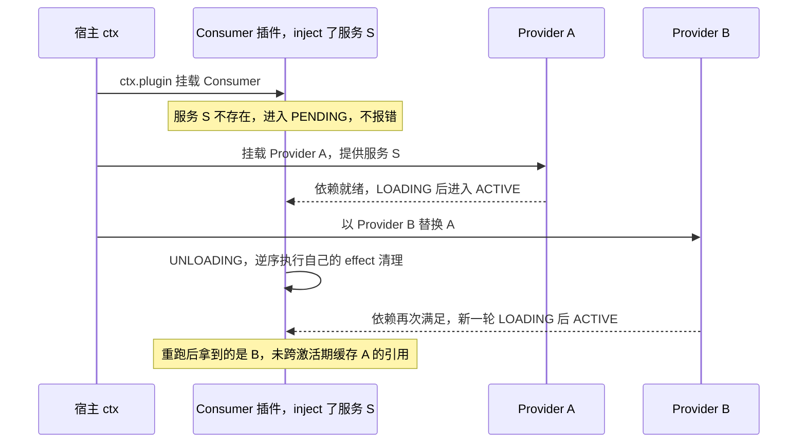
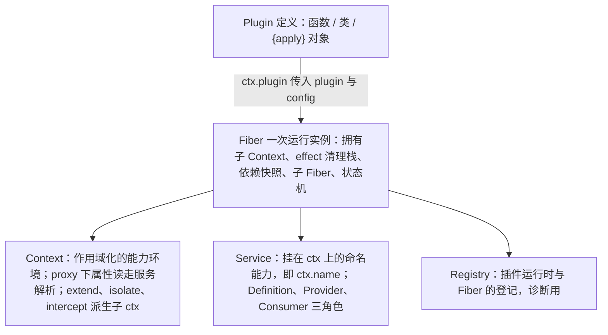
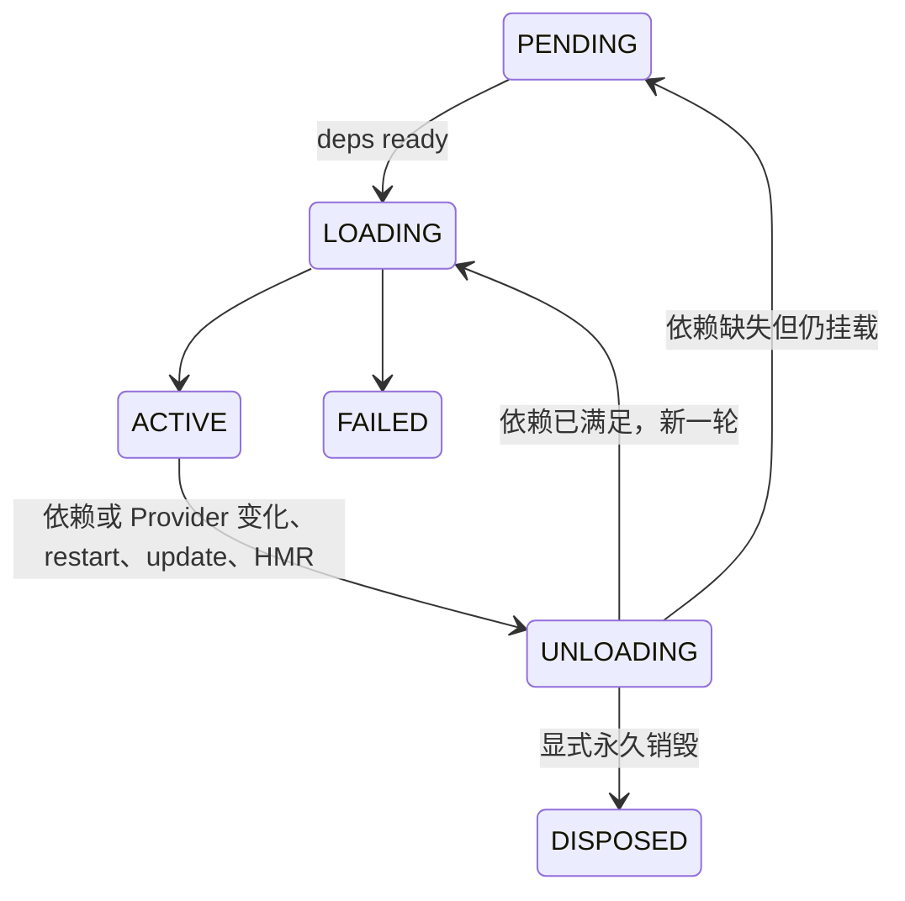
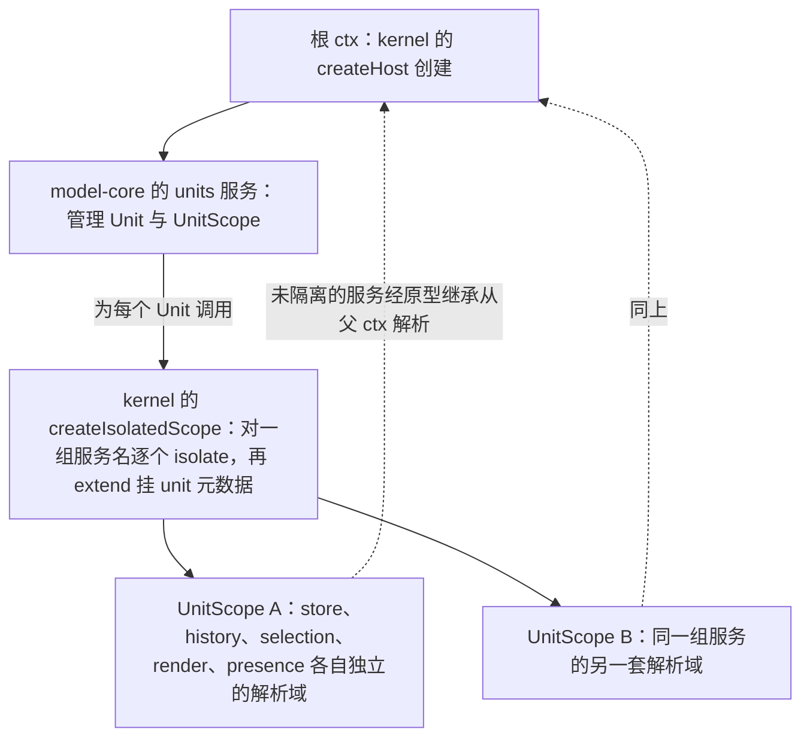
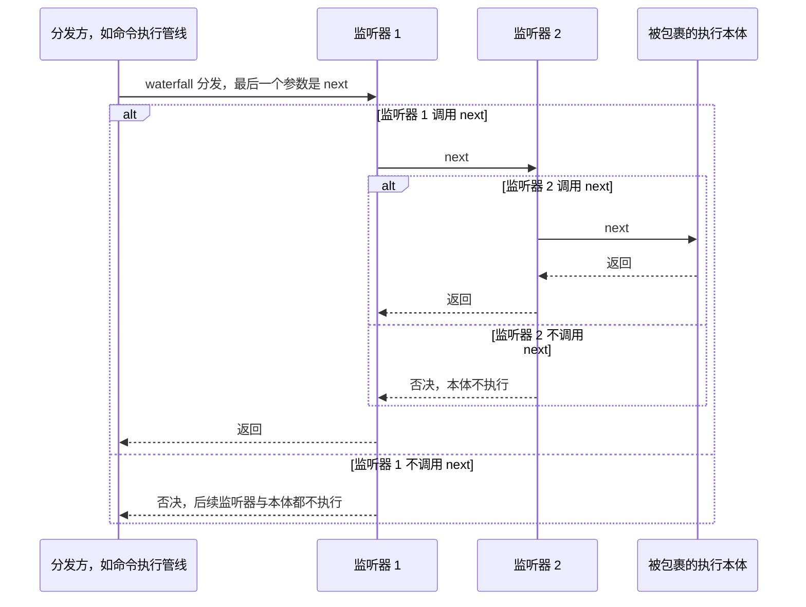
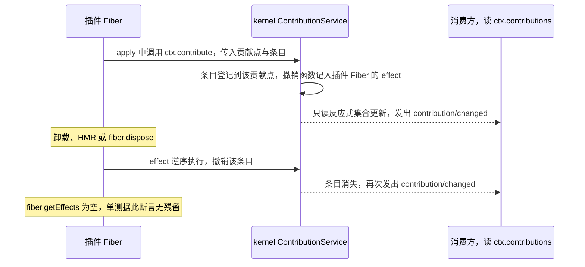
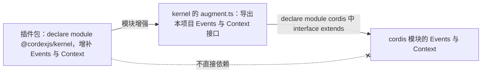

# cordis 4 使用基线（本项目视角）

> 状态：v0.1 | 负责：总编排 | 更新：2026-09-14；2026-09-25（补图）；2026-09-25（矛盾收口，rulings §4.18）：§3.6 server-headless 改为挂载 apps/server 给定的插件清单（FE-01）；§5.1 贡献键冲突语义（GV-18）；§5.3 `manifest.ts` 为生成物（GV-17）；顺带对齐 §4.14 K-1/K-2（`Service` 值导出、`defineContributionPoint` 由 schema 反推类型）；2026-10-04（design-language-v3 第 0 批：域前缀示例 `ui.ribbon` 改为 `ui.toolbar`（rulings §4.25 DS-5）） | 依赖：charter v0.1
> 事实来源：npm `cordis@4.0.0-rc.10`（2026-09-08，cordiverse/cordis，deps: `@standard-schema/spec`, `cosmokit`）；`@cordisjs/plugin-loader@1.0.0-rc.7`；cordiverse 仓库 `packages/`: core, create, group, hmr, include, loader, logger-console, timer, utils；生成式 API 目录（context/fiber/events/registry/service）与《Cordis System Guide for Coding Agents》（2026-08-24 快照）。
> 注意：`@deepseek-ai/cordis@4.0.2` 是 DeepSeek Harness 的 vendored 分支，**本项目使用上游 `cordis`**；示例中出现的 `'@deepseek-ai/cordis'` 一律读作 `'cordis'`。
> API 处于 rc，**只有 `@cordexjs/kernel` 允许直接 import**，其余包通过 kernel 的 re-export 使用类型与工具。

---

## 1. 两个形式概念（论文 arXiv 2608.25512）

| 概念 | 含义 | 在本项目中的体现 |
|---|---|---|
| **时间可组合性**（temporal） | 组件移除时能**完全撤销**其副作用 | 每个注册（贡献、监听、timer、DOM 节点、WS 连接）都由 `ctx.effect()` 拥有；插件卸载后 `fiber.getEffects()` 为空是单测断言 |
| **空间可组合性**（spatial） | 组件能**声明**并**反应式**管理对其他组件的依赖 | `inject` 声明硬依赖；Provider 更换时消费者自动重跑；缺依赖进入 `PENDING` 而非报错 |

**图 1-1 两种可组合性在一次 Provider 更换中的体现**



怎么读：纵向为时间；上半段体现空间可组合性（声明依赖、缺依赖等待），中段的逆序清理体现时间可组合性（移除时完全撤销副作用），末尾对应 §4 MUST NOT 3「不跨激活期缓存 Provider 引用」。
依据：本节 §1；§2 Fiber 状态机；§4 铁律。

---

## 2. 对象模型（勿混淆）

**图 2-1 cordis 对象模型**



怎么读：上方箭头是「挂载一个插件得到一个 Fiber」；Fiber 之下三条分支沿用原 ASCII 树形，列出与一次运行实例相关的三个概念，勿把 Plugin（定义）与 Fiber（实例）混为一谈。

Fiber 状态机（rc.10 实际导出）：

**图 2-2 Fiber 状态机**



怎么读：每个方框是 rc.10 实际导出的一个状态，箭头上的文字是触发条件；`PENDING` 是「已挂载、等依赖」的正常状态，只有 `FAILED` 表示启动出错。

- `PENDING` **不是错误**：表示「已挂载但声明的环境不存在」。诊断时先看状态再怀疑 `apply`。
- 不存在 `INACTIVE` 枚举；不存在通用 `ctx.fork()`。

---

## 3. API 摘要（以 rc.10 生成式文档为准）

### 3.1 Context

| API | 语义 | 本项目用途 |
|---|---|---|
| `ctx.extend(meta?)` | 派生带额外元数据的子 ctx（原型继承，不改父） | 给 UnitScope 挂 `unit` 元数据 |
| `ctx.isolate(name, label?)` | 为服务 `name` 建独立解析域；同 label 可合并 | **UnitScope 的实现手段**：`store`/`history`/`selection`/`render`/`presence` 按单元隔离 |
| `ctx.intercept(name, config)` | 为子树中的插件合并服务级配置 | 预设对某服务的局部配置（如只读模式下的 `commands`） |
| `ctx.get(name, strict=true)` | 无 inject 要求地读服务；strict 只返回活跃 Provider | **可选依赖**的读取方式 |
| `ctx.set(name, value)` | 覆盖已提供的服务值（仅提供者 Fiber 可调） | 内核内部 |
| `ctx.provide(name, value)` → disposer | 以当前 Fiber 为所有者注册服务；同域重复抛错 | 轻量服务（无需 Service 类） |
| `ctx.accessor(name, {get,set?})` | 计算属性 | 内核内部 |
| `ctx.mixin(name, keys)` | 把服务成员转发到 ctx（如 `ctx.on` → `ctx.events.on`） | **仅内核**使用（规避 Univer A12） |
| `ctx.root` / `ctx.fiber` / `ctx.events` / `ctx.logger` / `ctx.registry` / `ctx.reflect` | 内建 | `ctx.logger(name)` 取命名 logger |
| `Context.is(value)` | 跨 realm 判定 ctx | 测试工具 |

**图 3-1 用 isolate 与 extend 构造 UnitScope**



怎么读：实线为调用与派生关系，虚线为服务解析的回退方向；两个 UnitScope 各有一套按单元隔离的服务，因此同页多文档互不污染；`isolate` 只是解析域，不是安全沙箱（§4 MUST NOT 5）。
依据：本节 §3.1；§5.1 kernel 职责边界；章程 §4.1 UnitScope。

### 3.2 Registry / Plugin

```ts
ctx.plugin<P extends Plugin>(plugin: P, ...args: Spread<GetPluginConfig<P>>): Fiber & PromiseLike<Fiber>
ctx.inject(deps: Inject, callback: Plugin.Function<void>): Fiber & PromiseLike<Fiber>   // = ctx.plugin({ inject, apply })

interface Plugin.Base<T> {
  name?: string                       // 诊断/日志名
  Config?: StandardSchemaV1<any, T>   // 启动前校验（Standard Schema：zod/valibot/arktype/schemastery 皆可）
  inject?: Inject                     // 硬依赖：数组或 { name: interceptConfig }
  provide?: string | string[]         // 声明提供的服务名（Service 与 loader 读取）
  intercept?: Dict<boolean>           // 声明消费哪些服务的 intercept 配置
}
// 三种形态：函数 (ctx, config) => any | 类 new (ctx, config) | 对象 { apply(ctx, config) }
```

- `await ctx.plugin(...)` 在加载完成后 settle，配置或启动错误会 reject。
- 配置校验失败抛 `ValidationError`（聚合 Standard Schema issues）。

### 3.3 Fiber

| API | 语义 |
|---|---|
| `ctx.effect(execute, label?)` | 立即执行 `execute`，收集其返回的 disposer（单个 / Promise / 同步或异步可迭代逐个 yield），Fiber 卸载或手动 dispose 时**逆序**运行；对已销毁 Fiber 调用抛 `CordisError('INACTIVE_EFFECT')` |
| `fiber.await()` | 等待稳定并重抛启动错误 |
| `fiber.dispose()` | 永久销毁 |
| `fiber.restart()` | 以当前配置重载 |
| `fiber.update(config, noSave?)` | 校验新配置后重启（先走 `internal/update` waterfall，HMR 可接管） |
| `fiber.getEffects()` | 返回带 label 的 effect 树（诊断；**卸载后应为空**） |
| `fiber.state` / `fiber.uid` / `fiber.config` / `fiber.store` / `fiber.inertia` | 状态、id、已校验配置、依赖快照、进行中的过渡 |

### 3.4 Events（五种分发模式，本项目只允许这五种）

| 模式 | 语义 | 本项目用法 |
|---|---|---|
| `emit` | 同步广播，忽略返回值 | 通知类事件（`unit/opened`） |
| `parallel` | 并发等待全部 | 多个异步观察者（保存前钩子） |
| `serial` | 顺序 await，直到有人 bail | 有序异步决策 |
| `bail` | 同步顺序，首个非空返回即停 | 同步决策（命中测试链） |
| `waterfall` | 洋葱模型，最后一个参数是 `next` | **唯一的拦截机制**（命令执行管线、权限、审计）；监听器不调 `next` 即为否决，必须显式 |

**图 3-2 waterfall：唯一的拦截机制（洋葱模型）**



怎么读：纵向为时间，每层监听器包住内层；「不调用 next」就是否决且必须是有意为之（§4 MUST 6）；本项目的命令执行管线、权限与审计都只用这一种拦截方式，监听器的顺序与具体职责由各自插件定义，图中编号不代表固定顺序。

`ctx.on(name, listener, { prepend?, global? })` / `ctx.once` 返回 disposer；监听器**本身就是 effect**，随 Fiber 卸载。类型化：`declare module 'cordis' { interface Events { 'slide/shape-added'(unitId: UnitId, shapeId: ShapeId): void } }`。

### 3.5 Service

```ts
class SlidesService extends Service {
  constructor(ctx: Context) { super(ctx, 'slides') }   // 运行时注册 ctx.slides
}
declare module 'cordis' { interface Context { slides: SlidesService } }  // 编译期告知
```

静态 symbol：`Service.init`（构造后运行）、`Service.check`（可用性谓词）、`Service.config`（intercept 配置幽灵类型）、`Service.invoke`（使服务可调用，如 `ctx.logger()`）、`Service.extend`、`Service.tracker`、`Service.resolveConfig`。

### 3.6 Loader（`@cordisjs/plugin-loader`）

- 以配置（`cordis.yml`）描述插件树：`{ id, name, config, disabled?, group?, isolate? }`；**稳定 id** 让 loader 能 diff 并做局部挂载/卸载/重配置；HMR（`@cordisjs/plugin-hmr`）= 卸载 + 重载，靠 effect 清理保证幂等。
- Loader 面向 Node 文件系统。**本项目决定**：浏览器端用 preset（程序化组合）；服务端 `server-headless` 自身文档类型盲、不自选插件——`createHeadlessHost({ plugins })` 挂载 `apps/server` 的 `src/cordis-host/preset-server.ts` 选定的插件清单，`worker_threads` 每个任务新建宿主时按清单中的模块路径加载（章程 §5.1 铁律 1，rulings §4.18 FE-01）；是否在清单之上再用 loader 做配置驱动组合见 ADR-0010。

---

## 4. 本项目铁律（在 cordis 指南 MUST/MUST NOT 基础上收紧）

### MUST
1. 每个硬依赖都写进 `inject`；可选能力用 `ctx.get()` 或依赖门控的子插件。判断口径：「没有这个服务，插件的行为还完整吗？」否 → inject。
2. 激活期创建的**每一个**资源都必须可清理并归属 Fiber（`ctx.effect`）：timer、DOM 监听、WS、Observer、缓存、贡献。
3. 假定同一插件在一个进程内可激活多次（多 Unit、HMR）；禁止模块级可变状态。
4. 部署/环境相关的值进 `Config`（Standard Schema）并在启动前校验；**先失败，不部分激活**。
5. 需要可替换的能力必须走 Definition / Provider / Consumer 三角色；Consumer 不得 import 具体 Provider。
6. `waterfall` 监听器除非有意否决，否则必须调用 `next()`。
7. 测试卸载/重载，不只测试启动：断言 `getEffects()` 卸载后为空、无重复注册。
8. 自定义服务名与事件名带域前缀（`slide/…`、`ui.toolbar`），避免碰撞。

### MUST NOT
1. 依赖 yaml/数组顺序保证就绪。
2. 在 effect 之外留下原生 timer/listener/watcher。
3. 跨激活期缓存 Provider 引用（Provider 更换会重跑消费者；缓存会指向陈旧实例）。
4. 把 `PENDING` 当错误。
5. 把 `isolate` 当安全沙箱（它只是解析域）。
6. 发明 `ctx.fork()`。
7. 在内核之外调用 `ctx.mixin` / 原型赋值。
8. 假定插件销毁能撤销**外部**历史（已发出的网络请求、已写入的文件）。

### 选择机制的决策表（面向实现者）

| 需要 | 用 |
|---|---|
| 可独立挂载/卸载的行为 | 插件 |
| 直接可调用的能力 | Service |
| 硬依赖 | `inject` |
| 可选能力 | `ctx.get()` / 依赖门控子插件 |
| 带清理的原生资源 | `ctx.effect()` |
| 观察运行时事件 | `ctx.on` |
| 多个异步观察者需全部完成 | `parallel` |
| 有序决策链 | `serial` / `bail` |
| 环绕式拦截/策略 | `waterfall` |
| 一族可替换实现 | Definition + Provider + Consumer |
| 每个子树一个 Provider | `ctx.isolate()`（UnitScope） |
| 子树级服务配置 | `ctx.intercept()` |
| 运行时组合变化 | preset 重组 / loader 配置 |

---

## 5. 本项目在 cordis 之上的约定（由 `@cordexjs/kernel` 提供）

### 5.1 kernel 的职责边界

```
@cordexjs/kernel
├── re-export: Service、CordisError、ValidationError（值导出，插件写 class X extends Service）；Context、Plugin、Fiber、Events（类型）（rulings §4.14 K-1）
├── createHost(options): 创建根 ctx，预装 errors/telemetry/logger 适配、ContributionService、ManifestService
├── defineContributionPoint({ id, schema, key, conflict? }) → ContributionPoint<InferOutput<schema>>
│   （唯一类型参数绑定 schema，贡献项类型由 schema 反推，调用方不显式传类型；rulings §4.14 K-2）
├── ctx.contribute(point, item)        → 由 effect 拥有，Fiber 卸载自动撤销；同键重复按贡献点的 conflict 处理：
│   缺省拒绝后来者、记 duplicate 诊断、返回 no-op disposer、不抛异常（rulings §4.18 GV-18）
├── ctx.contributions(point)           → 只读反应式集合（+ 事件 `contribution/changed`）
├── Manifest 类型 + 运行时一致性校验（与构建时由 manifest.ts 序列化、随包发布的 cordex-manifest.json 对比）
├── createIsolatedScope(ctx, { services, meta })：文档无关的隔离工具，对一组服务名逐个 isolate 并 extend 元数据；
│   Unit/UnitScope/units 服务属于 model-core，由其调用本工具构造 UnitScope（章程 v0.2 裁决 C-4）
└── 诊断：dumpFiberTree(ctx)、assertNoLiveEffects(fiber)
```

**图 5-1 一条贡献从注册到撤销的生命周期**



怎么读：纵向为时间；注册与撤销都不需要插件手写清理代码，因为撤销函数由 effect 持有；这是替代 Univer 104 个 `register*` 的唯一注册抽象（章程 D3）。
依据：本节 §5.1；§3.3 `ctx.effect`；§4 MUST 2 与 MUST 7。

### 5.2 声明合并的桥接（ADR-0001，需 spike）

目标：插件包只写 `declare module '@cordexjs/kernel'`，不直接依赖 `cordis` 类型。设想：

```ts
// @cordexjs/kernel/src/augment.ts（草案）
export interface Events {}    // 本项目事件表
export interface Context {}   // 本项目服务表
declare module 'cordis' {
  interface Events extends import('./augment').Events {}
  interface Context extends import('./augment').Context {}
}
// 插件侧：
declare module '@cordexjs/kernel' {
  interface Events { 'slide/shape-added'(unitId: UnitId, shapeId: ShapeId): void }
  interface Context { slides: SlidesService }
}
```

**图 5-2 声明合并桥接（草案，待 ADR-0001 spike）**



怎么读：实线是类型声明的合并路径，带叉虚线表示插件包不得直接增强 `cordis`；若 spike 不可行，退路见下文「风险」。

风险：接口继承 + 模块增强的组合是否在所有下游 tsconfig（尤其 `isolatedDeclarations`）下稳定；spike 任务列入 M0 收尾。若不可行，退路是允许 `declare module 'cordis'` 但由 lint 限定只能出现在 `*.contribution.ts` 文件且该文件不得含运行时 import。

### 5.3 插件文件约定（类型治理条线细化检查）

```
packages/<pkg>/src/
├── index.ts               仅 re-export 公共 API（api-extractor 入口）
├── plugin.ts              export const name / inject / Config / apply（函数插件）
├── manifest.ts            export const manifest: Manifest；生成物：manifest-gen（即 tooling/scripts/scan-manifest.ts）
│                          从源码静态分析生成，头部 generated、入库、禁止手改，CI --check 重新生成无 diff；
│                          构建时序列化为随包发布的 cordex-manifest.json（不入库）（rulings §4.18 GV-17）
├── *.contribution.ts      declare module '@cordexjs/kernel' 增强 + 贡献点定义
├── services/*.service.ts  Service 子类（Provider）
├── contracts/*.ts         Definition：接口、请求/结果类型、schema
└── __tests__/             含「卸载后无 effect」「缺依赖进入 PENDING」「Provider 替换」用例
```
