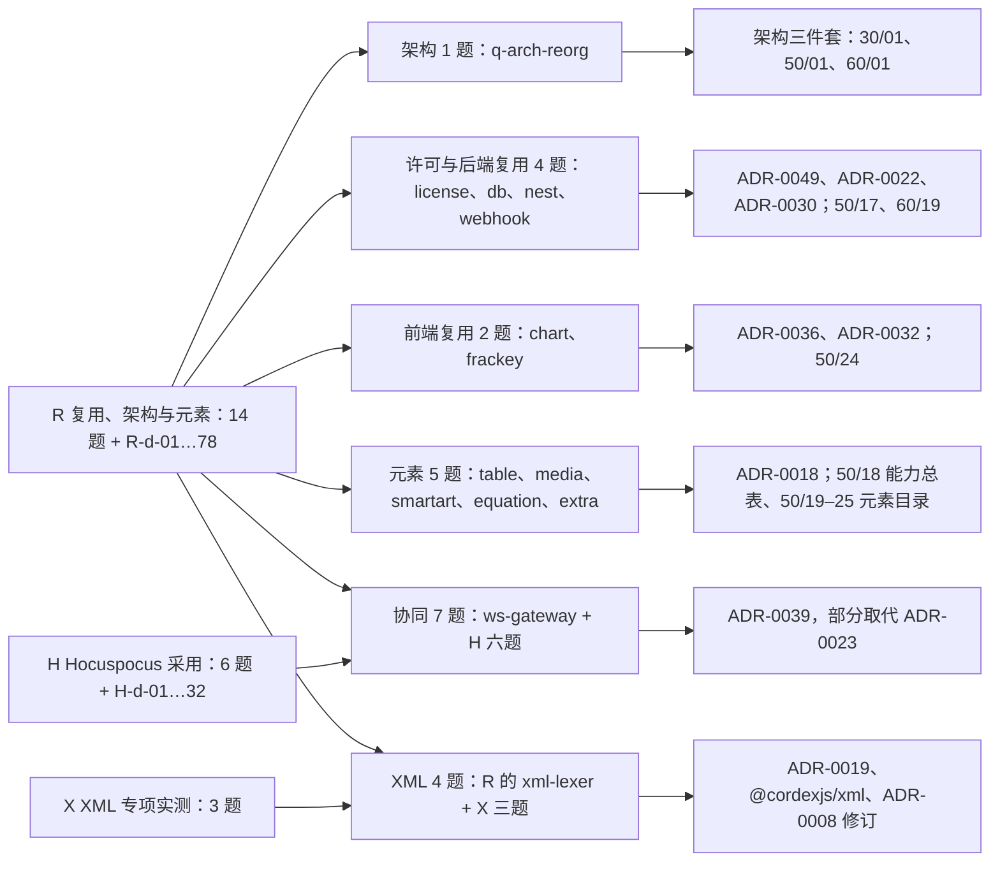
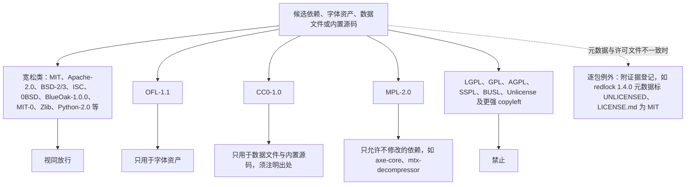
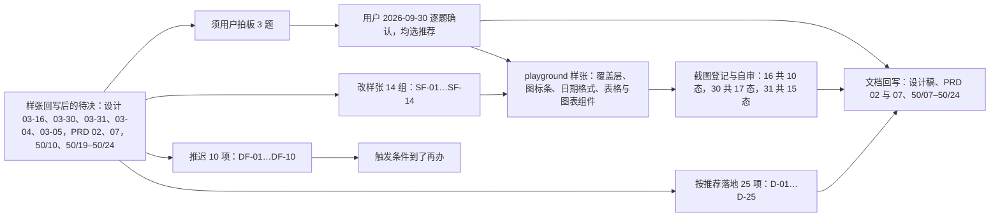
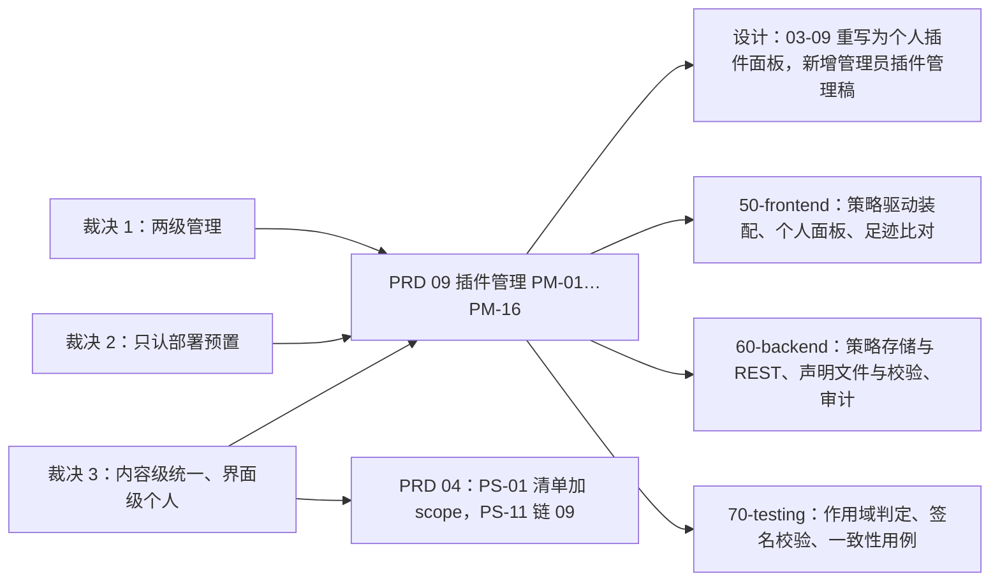

# 裁决记录（2026-09-14）—— 各条线对章程 v0.1 的异议/建议处置

> 状态：v0.2 | 负责：总编排 | 更新：2026-09-21（§4.10 Q11–Q20；§4.11 跨模块收敛 C-01…C-30；§4.12 模块设计线用户裁决 U-01…U-16；§4.13 服务端拆分评审裁决 S-1…S-5；§4.14 插件模型矛盾修正 K-1…K-3；§4.15 章程 §10 Q1–Q10 用户裁决；§4.16 Q11–Q20 收口；§4.17 复核裁决 D1–D6，2026-09-24；§4.18 文档矛盾收口；§4.19 三条设计线与遗留取舍，2026-09-25；§4.20 遗留小项收口，2026-09-26）；2026-09-25（矛盾收口，rulings §4.18：§4.14 K-3 后补回写注记，GV-24）；2026-09-26（§4.20）（§4.10 Q11 修订注记、§4.14 G-9 结案注记）；2026-09-26（§4.20 FE-08）；2026-09-26（§4.21：复用优先、架构三件套与编辑器元素，登记 23 题裁决、R/H/X 默认值、被修订的既有裁决与推迟项）；2026-09-26（§4.21 整合：§4.21 新增「新增编号与待用户裁决项」：ED-15a、ED-31–ED-35、G-77–G-83、I18N-01/02；VIEW-04、EXP-05、Mod+E 冲突、ADR-0049 T-01 待裁；H-d-09 补 1012 contaminated）；2026-09-26（§4.21 复核：§4.21 末补已撤销 30/08 历史引用的查找说明）；2026-09-30（§4.22 设计待决收口：3 题用户裁决——插入时填入空占位符、占位符表格图标弹网格、放宽对话框行数；改样张 14 组、默认值 25 项、推迟 10 项，另记样张取舍 5 项待确认；§4.21 推迟项两行补指向 DF-02、DF-08）；2026-09-30（§4.22 整合：Q1 补两处细化——已选中的空占位符优先、只覆盖表格图表图片；「被修订的既有口径」50/10 §7.4、50/19 §3.1 两行同步）；2026-10-01（§4.23 插件管理：3 题用户裁决——两级管理、只认部署预置、内容级按部署统一 / 界面级个人启停；新增 PM-01…PM-16、清单字段 scope、G-84…G-87，登记下游落地清单与开放问题 O-1…O-4）；2026-10-01（§4.23 插件管理：O-1…O-4 经用户确认按推荐定稿，下游落地清单除设计稿外已回写）；2026-10-01（§4.23 插件管理样张回写：用户确认 playground 样张（含管理员改策略先进草稿、底部保存条一次保存，禁用被依赖插件与首次启用第三方当下弹确认卡，个人面板演示本会话报告版本不兼容），设计三行回写完毕：03-09 重写为个人插件面板、新建 03-32 管理员插件管理，06 / 03-24 / 03-02 / 01 / AS-06 同步；G-84…G-87 改为已回写）；2026-10-01（插件口径仅计 cordis 插件：§4.23 末尾新增「补充裁决：插件计数口径」PC-1…PC-4——插件只计 cordis 插件 48，纯库 5 与 Nest 模块 25 不计入，78 改称运行时单元）；2026-10-03（§4.24 设计线对齐审计：用户裁决 AL-1…AL-7，总编排裁定 TA-1…TA-10）；2026-10-04（§4.25 研发流程与设计语言 v3：用户裁决 DP-1…DP-8、DS-1…DS-8（DS-2 样张拍板确认）；2026-10-05 补 DS-9…DS-20，总编排提议 TP-1…TP-5 经评审确认）；2026-10-05（design-language-v3 第 0 批修正：§4.25「被修订的既有口径」补登被 DS-1 / DS-5 / DS-18 取代的 §4.9 Q8、§4.10 Q14、§4.11 C-05、§4.20 FE-08 四行，原条目加取代注记；裁决内容不变）；2026-10-07（§4.25 design-language-v3 第 1 批拍板：DS-21…DS-26，「被修订的既有口径」补 §4.22 SF-01、D-01 / D-02、D-11、图表「更改类型」「角色与抽屉」与设计 03-17 五行，更新 §4.9 Q8、§4.10 Q14 两行，原条目加修订注记；DS-18 补注账户菜单条目以 PRD AS-06 为准，2026-10-07 用户确认）；2026-10-07（§4.25 第 1 批文档回写：用户裁决 DS-27…DS-30，总编排技术口径 TB-1…TB-30，「被修订的既有口径」补 9 行，§4.22 SR-3、SR-4、D-17、DF-07 与类型切换确认加结案或修订注记）；2026-10-08（§4.25 第 1 批回写第二轮：用户裁决 DS-31…DS-33，总编排技术口径 TB-31…TB-54，更正 TB-1 括注，「被修订的既有口径」补 2 行）；2026-10-08（§4.25 第 1 批评审意见：用户裁决 DS-34…DS-37（样式库原位展开、安静控件、开关按下强调色淡底、次按钮细边），技术口径 TB-55…TB-58，「被修订的既有口径」补 DS-9、DS-31 与设计 04 §1 第 6 条三行，DS-9、DS-31 加修订注记）；2026-10-15（§4.25 design-language-v3 第 2 批：用户裁决 DS-38…DS-62（协作族样张拍板 25 题，均按推荐）与 DS-63（备选状态保留并标「未采纳」，未采用推荐）；回写中用户裁决 DS-64…DS-70，总编排技术口径 TB-59…TB-100；「被修订的既有口径」补 19 行；DS-28、TB-31、TB-42、TB-49 加结案或去向注记）；2026-10-16（§4.25 design-language-v3 第 3 批开工前：用户裁决 DS-71…DS-78（范围并入登录与错误页、模板库最小样张、嵌入画全套、TB-58 四项出对照、横幅统一 40、只留单档密度、标杆同第 2 批、`Mod+E` 归居中对齐）；§4.21「待用户裁决」的 `Mod+E` 一行加结案注记；总编排技术口径 TB-101…TB-106）；2026-10-21（§4.25 第 3 批样张复验：总编排技术口径 TB-107…TB-129）；2026-10-22（§4.25 design-language-v3 第 3 批拍板：用户裁决 DS-79…DS-136，其中 DS-80、DS-91、DS-96、DS-98、DS-123 未采用推荐；回写中用户裁决 DS-137…DS-139，评审修改 DS-140…DS-143，总编排技术口径 TB-130…TB-185）；2026-11-04（§4.25 design-language-v3 母版视图改版：用户裁决 DS-144（2026-10-23 选择按标杆重新设计，未采用推荐）与 DS-145…DS-172（2026-11-02 至 11-03 拍板 42 题，均按推荐；子题、规则冲突与同一件事的题并入同一条），回写中用户裁决 DS-173…DS-177（2026-11-04，均按推荐），总编排技术口径 TB-186…TB-210；「被修订的既有口径」补 15 行；§4.9 Q8、§4.10 Q12、Q16、§4.25 DS-15、DS-21、DS-53、TB-46 加修订注记）；2026-11-05（§4.26 PRD 现行版：用户裁决 PV-1…PV-31，修订 §4.15 Q6、§4.13 S-2） | 依赖：charter v0.2
> 编号来源：产品 CS-xx / PD-xx（`10-prd/README.md`）、结构 C-x / A-x（`30-architecture/README.md`）、运行时 S1–S10 与各文档待决（06/07/08/10/11 文末）、类型治理 Q-Tx（`09-type-discipline/README.md`）。
> 处置取值：**采纳**（已写入章程 v0.2）/ **采纳-改写**（采纳意图但表述不同）/ **否决** / **待用户**（进入章程 §10）/ **下放**（由指定条线在 ADR/文档中决定）。

## 1. 结构线（C-1…C-10、A-1…A-13）

| 编号 | 建议 | 处置 | 理由 / 落点 |
|---|---|---|---|
| C-1 | 规则 2「只向下」与 `slide-ui(L6)→ui-react(L7)` 冲突，改为层带 + 允许矩阵 | 采纳-改写 | 章程 §5.1 改为层带 `V-*` + 数值秩表（与类型治理线的 depcruise 数值比较合一）；D14 |
| C-2 | §5.5 增加 `selection` | 采纳 | §5.5 |
| C-3 | `ui.command` 语义与贡献点 id 补全 | 采纳 | §5.5 定稿 25 个 id；`ui.statusBar` camelCase；D15 |
| C-4 | `openUnitScope` → kernel 的 `createIsolatedScope`，Unit/UnitScope 归 model-core | 采纳 | §4、§5.2；primer §5.1 同步修订 |
| C-5 | `render-dom` 依赖上限加 `engine-layout` | 采纳 | §5.2 |
| C-6 | `ui-core` 对 design 只允许 tokens.css + type-only | 采纳 | §5.2、§5.3-6 特例 |
| C-7 | `SnapshotBundle`/`BlobRef` 术语 | 采纳 | §4、D6 |
| C-8 | dom 包单测环境 happy-dom + browser mode | 采纳 | D9 |
| C-9 | pnpm@10 corepack 锁定 | 采纳 | D9；Q9 保留待用户确认全局 yarn 无冲突 |
| C-10 | DrawingML 运行时类型放 `model-core/drawing/`，`ooxml-core` 依赖上限加 model-core | 采纳 | §5.2 |
| A-3 | Strict 写回：脏部件 Transitional + 干净 verbatim | 下放 + 待用户 | 与产品 PD-03 分歧 → Q14；ADR-0008 记录两案 |
| A-5 | NodeId = UUIDv7 | 下放 | ADR-0014，听取 B 对 Y.Doc 体积评估 |
| A-7 | 仓库许可证 Apache-2.0 | 待用户 | Q12 |
| A-11 | 图表 M1–M2 不透明保留 + 预览图 | 采纳-改写 | 与产品 OF-09 冲突：pptx 图表部件通常无位图预览 → D16「只读解析 `c:chart` 部件与缓存数据」 |
| A-12 | 「部件级 diff 零差异」口径 | 采纳 | 与 CS-01 合并写入 D7 |
| A-13 | 200 MB 文件全量内存 + 懒解压 | 下放 | ADR-0008 / 07 性能预算 |
| 其余 A-x | — | 下放 | 保持结构线默认，写入对应 ADR |

## 2. 运行时线（S1–S10 与 P/R/B/O/T 待决）

| 编号 | 建议 | 处置 | 理由 / 落点 |
|---|---|---|---|
| S1 | 新增 `@cordexjs/collab-offline-idb`（L4，dom） | 采纳 | §5.1/§5.2；否则 collab-yjs 无法保持 iso |
| S2 | 规则 4 补 `y-indexeddb`、`lib0` 单点 | 采纳 | §5.3-4 |
| S3 | 术语 Room/Session/Ticket/Update/StateVector/Compaction/Repair | 采纳 | §4.2 |
| S4 | D12 补「服务端软门禁是数据完整性边界」 | 采纳 | D12 |
| S5 | `engine-render` 明确 iso，`render-dom` dom | 采纳 | §5.1 拆行 |
| S6 | `@cordexjs/slide-render-chart` M3 拆出 | 采纳 | §5.1/§5.2 |
| S7 | IO 适配器（pg/redis/s3）以 cordis 插件置于 apps/server 模块目录 | 采纳 | D8、§5.2 apps/server |
| S8 | `server-collab` 标注为 cordis 插件（提供 `collabServer`） | 采纳 | §5.2、§5.5 |
| S9 | D11 补「包内禁 console；错误码/span/metric 登记并扫描」 | 采纳 | D11 |
| S10 | 规则 7 的 `./testing` 引用限制 | 采纳 | §5.3-7 |
| P1 排他锁 | 不做 | 待用户 | Q16 |
| P2/B5/B6 保留策略 | 快照 30 天、update 7 天、原件 30 天 | 待用户 | Q17 |
| R1 图表 M3 范围 | bar/line/pie | 待用户 | Q18 |
| R3 服务端字体 | Noto + Liberation + Carlito/Caladea | 待用户 | Q19 |
| R4 headless 页放 apps/web `/render` | 采纳 | §5.2 apps/web |
| B1–B4、O1–O4、T1–T4 | 技术默认 | 下放 | 保持 B 线默认，写入 08/10/11 |

## 3. 产品线（CS-01…CS-12、PD-xx）

| 编号 | 建议 | 处置 | 理由 / 落点 |
|---|---|---|---|
| CS-01 | M1 diff 口径 | 采纳 | D7（与 A-12 合并） |
| CS-02 | M2 补表格单元格文本编辑 P1、基础放映 P1；表格结构编辑归 M3 | 采纳 | §7 |
| CS-03 | 动画/切换播放策略 | 采纳 | §2.3、§7 M4 |
| CS-04 | Q5 增只读查看者 ≤ 50、单页元素 ≤ 1,000 | 采纳 | Q5 |
| CS-05 | 「打开空壳」改为 `format/no-document-type` 可验证口径 | 采纳 | §5.4 |
| CS-06 | 元素级（节点级）不透明保留 | 采纳 | §4、R6、D7 |
| CS-07 | 第三方事件/贡献点前缀规则 | 采纳 | §5.5 |
| CS-08 | 术语新增 | 采纳（精简） | §4.2/§4.3 |
| CS-09 | apps/web 最小演示范围 | 采纳 | §5.2 apps/web |
| CS-10 | 试点团队来源 | 待用户 | Q11 |
| CS-11 | 新增 `preset-slide-viewer` | 采纳 | §5.1/§5.2、M1 验收 |
| CS-12 | 服务端缩略图排 M3 前半段 | 采纳 | Q8、§7 M3 |
| PD-03 | Strict 导出整包转 Transitional | 待用户 | Q14（架构默认为混合方案，理由：整包转换会重写干净部件，违反「未修改零丢失」） |
| PD-01/02/20 | 加密/宏/签名文件 | 待用户 | Q15 |
| PD-13 | 里程碑周期 8/10/12/6/6 周 | 待用户 | Q13 |
| PD-15 | 移动端范围 | 待用户 | Q20 |
| PD-21 | 许可证 Apache-2.0 | 待用户 | Q12（与 A-7 合并） |
| 其余 PD-xx | — | 保留在 PRD README | 由产品负责人批量决策 |

## 4. 类型治理线（Q-T1…Q-T7）

| 编号 | 建议 | 处置 | 理由 / 落点 |
|---|---|---|---|
| Q-T1 | LS 秩值需与结构线一致 | 采纳-改写 | 秩表定稿 LS=58（原推导 45 会拦住 server-headless 对 engine-layout/engine-render 契约的合法依赖）；D14 |
| §5.3 第 8 条「束间隔离」 | 编入章程 | 采纳 | §5.3-8 |
| Q-T2 | 是否全部包对外发布 | 下放 | 默认全部可发布，统一门禁；M1 前由结构线在 02 标注例外 |
| Q-T3 | coverage-patch 阈值 | 下放 | 11 测试策略定稿 |
| Q-T4 | zod 4 | 采纳 | D2 |
| Q-T5/Q-T6/Q-T7 | 自评估项 | 下放 | 保持类型治理线默认 |

## 4.1 结构线 / 运行时线收尾后的补充裁决

| 编号 | 分歧 | 裁决 | 落点 |
|---|---|---|---|
| A-9 残余 | Snapshot 中顺序表示：保留 `order: FracKey` 键（A）vs 转数组（B） | 保留键；键由命令层经 `@cordexjs/shared/order` 计算，Mutation 携带最终键 | ADR-0013 §7 维持；ADR-0032 §6/§7 修订 |
| A-3 更新 | Strict 导出三案：A 混合 / B 整包 Transitional / C 保持原一致性类 | 默认「C 为目标、B 为自动回退」，最终待用户（Q14） | 章程 Q14；ADR-0008 |
| 契约套件命名 | `defineStoreContractSuite`（A）vs `runDocumentStoreConformance`（B） | `run<Definition>Conformance` | 章程 §5.5；06/11 |
| 第三方前缀 | `x-<pluginId>`（A）vs `<vendor>:`（章程 D15） | 维持 `<vendor>:`（与 npm scope 机械对应，扫描器可校验） | 章程 §5.5 |
| `collab.transport` / `storage.blob` | 贡献点还是 Provider 座 | Provider 座（`collabTransport`/`blobStore` 服务），从贡献点清单移除 | 章程 §5.5；PRD PS-02 需同步 |
| `export.target` | 是否新增贡献点 | 不新增；= `core.format` 且 `canImport:false` | 章程 §5.5 |
| `errors.sink` / `telemetry.sink` | 是否为贡献点 | 是（sink 可插拔） | 章程 §5.5；ADR-0011 |
| `cordex.stability` | 包级 API 稳定级字段 | 采纳为可选第四字段 | 章程 §5.2 |
| P8（B 新增） | 服务端语义软门禁：PRD CO-12「不做」vs ADR-0034 不变量修复 | 采纳 ADR-0034：`softGate: repair`（不变量）+ `report-only`（schema）；修复只限不变量（悬空引用等），不改用户内容语义 | D12；PRD CO-12 需同步 |
| `render/painted` | B 提案 | 不采纳；用 cordis 事件 `render/frame` + 遥测事件 `perf/frame`（派生） | 06/07/10 |
| 原语数 | A 5 种（无 `move`）vs B 6 种 | 5 种：`set/delete/insert/remove/text`；`Ordered` 为 `DocumentType.shape` 形状标注；原子数组移动用 `remove`+`insert` | 章程 §4；ADR-0013；06 §1.2、ADR-0032 修订 |

## 4.2 类型治理线收尾后的字段/语义对齐（Q-T8…Q-T12，默认裁决，结构线可在 M0 收尾 spike 中否决）

| 编号 | 问题 | 默认裁决 | 落点 |
|---|---|---|---|
| Q-T8 | `CommandDef.permission` 形状 | `readonly Capability[]`（AND 语义：全部能力位满足才放行；空数组非法，只读命令显式声明 `['doc.read']`） | 05、ADR-0012、`cordex/command-declares-capability` |
| Q-T9 | `schema-lock` 语义 | 「schema 哈希锁」：某 `documentType` 的 Snapshot schema 哈希入库，哈希变化而 `schemaVersion` 未升即失败；不是「schema 不可变」 | ADR-0009、`scan-schema-lock` |
| Q-T10 | `requirements.json` / `event-domains.json` 归属 | 需求 id 清单由产品线维护（PRD 是源，`tooling/policy/requirements.json` 为生成镜像，CI 校验一致）；事件域白名单由结构线维护（章程 §5.5 保留域为源） | 06-scanners、08 矩阵 |
| Q-T11 | `tooling/xsd/` 校验粒度 | 仅校验脏部件；按部件内容类型选择 ECMA-376 Transitional schema（含 DrawingML/ChartML）；Strict 输出（Q14 方案 C）额外用 Strict schema；干净部件不校验（verbatim） | 07 CI `xsd-validate`、ADR-0008 |
| Q-T12 | `store-transact-in-commands-only`/`no-unit-scoped-inject-at-root` 的检测锚点 | 锚点为 `commands` 管线的事务阶段（05 §管线）与 `createIsolatedScope` 返回的 UnitScope ctx；`openUnitScope` 一词已废弃（裁决 C-4） | 02-lint-rules 4.x |

## 4.3 产品线与设计线收尾后的补充裁决

| 编号 | 问题 | 裁决 | 落点 |
|---|---|---|---|
| CS-13（产品） | 章程 §5.4 错误码 `format/no-document-type` 与 D11/架构 10 的点式格式不一致 | 采纳：错误码统一点式 `format.no_document_type`；事件名保持 `域/动作` | 章程 §5.4 |
| 设计-1 | 放映模式是否可播放已导入动画/切换 | 维持 CS-03 裁决：M1–M3 放映渲染结束态、不播放；播放为 M4+ P2。设计文档中的放映模式需按此标注阶段 | 章程 §2.3、§7；设计 03-screens/11 |
| 设计-2 / PRD #10 | `apps/web`「零业务逻辑」与分享对话框、插件管理器等页面的矛盾 | 澄清：禁止的是**编辑器领域逻辑**（命令/模型/协同/渲染）；应用壳自身页面（文档列表、分享与权限、插件管理器宿主页）属于应用，允许 | 章程 R2、§5.2 apps/web |
| 查看器体积 | A「查看器壳 ≤ 15 KB」与 PRD「查看器 preset ≤ 350 KB gzip」 | 两者不冲突：15 KB 是框架无关的极简壳（apps 侧）预算，350 KB 是 `preset-slide-viewer` 整体 gzip 预算；设计按 350 KB 口径无误 | PRD OF-14/NF-01；架构 02 §4.21b |
| 设计待决 | `ui.ribbon` 三级（tab/group/control）编码；`data-cordex-density` 属性名 | 下放结构线（03 §3.6）在 M0 收尾定稿；属性名默认 `data-cordex-density` | 架构 03；设计 04/06 |

## 4.4 UI/UX 评审（2026-09-15，ui-ux-pro-max）

用户要求以 ui-ux-pro-max skill 评审设计稿。评审依据其 119 条 UX 规则与 WCAG 对比度脚本核算；发现 15 类问题（对比度、控件边框、语义色文字、协作者色、裸色、emoji 图标与小字号、命中区、表单标签、删除撤销、live region 与对话框焦点、页签语义、过渡与 reduced-motion、深链接、tooltip 焦点、地标）并全部修订。明细见 `docs/20-design/README.md` §8；token 取值变更记录在 04 §2.2/§2.3/§2.6。裁决：保留系统字体栈与靛蓝 accent，不采纳 skill 推荐的 Plus Jakarta Sans 与青绿主色（理由见设计 README §8）。原型已重写并重新发布。

## 4.5 功能细化设计（2026-09-15，产品线 + 设计线）

用户反馈原型"功能不全"。产品线产出 `docs/10-prd/07-design-coverage-and-gaps.md`（79 条 M1–M3 需求的设计/原型覆盖矩阵、54 个缺口含 Given/When/Then、原型 v2 的 15 条流程、22 条影响界面的产品默认答案 D1–D22）；设计线产出 `docs/20-design/08-prototype-audit-and-v2-plan.md`（原型自审：86 项现状、覆盖矩阵 138 项中 95 项为"无"），随后新增 13 份界面文档（03-screens/13–25）、更新 9 份，并把原型重写为 15 个 hash 路由的 v2。裁决：07 §4 的产品默认答案 D1–D22 视为已定决策（用户可否决）；功能范围与优先级以 07 为准、交互形态以 08 为准；表格/图表结构编辑、登录页、开发者面板、回收站等 M2 P1/M3 项目暂不建独立界面文件，M3 开工前补齐；软冲突原型演示以 3 种 P0 场景为准。总编排复核时修正了 v2 的两处回归：协作者头像堆叠缺少布局规则；模式切换与子路由的 JS 选择器指向了不存在的属性并缺少评审模式 CSS 规则。

## 4.6 母版/版式/主题需求域与 skill 驱动的高保真设计稿（2026-09-15）

用户指出设计稿过于简略、左侧栏与编辑器未考虑幻灯片母版，并要求设计过程使用 ui-ux-pro-max skill。裁决与处置：
- 母版/版式/主题由 ED-25 的"M2 只读 P2"提级为正式需求域：产品线新增 `10-prd/03-features/07-masters-layouts-and-themes.md`（ML-01 母版视图 M2 P0、ML-02 版式应用与重置 M2 P0、ML-03 母版与版式编辑 M3 P0、ML-04 主题 M3 P1、ML-05 备注/讲义母版 M4 P2），覆盖矩阵新增 G-70–G-75，里程碑 M2/M3 验收同步。
- 结构线在 04/05/03/02 追加母版模型核对、占位符重匹配与继承纯函数、引用完整性不变量、命令族与 `viewMode` 上下文键；命名裁决：`view.setMode` 为水平层 Operation，`slide.selectMasterOrLayout` 为垂直束 Operation（载荷含 slide 专有 id）。
- 设计线以 skill 驱动产出 `20-design/mockups/` 13 份高保真设计稿（含 26 母版视图、27 版式选择器、28 设计页签与主题）与目录页，界面文档增至 28 份并加"设计规格"与"应用的 UX 规则"留痕，04 新增与 skill 设计系统基线的比对，原型新增 `#/editor/masters`。总编排复核修正：6 稿中"已保存 ✓"等符号字形改为 SVG 图标或删除，3 稿中 9–10px 的 UI 文字提升到 11px；幻灯片内容内的缩字与项目符号选择器的字符属合理保留。
- 设计稿目录发布为独立多文件 artifact；原型同 URL 升至第 4 版。

## 4.7 设计系统改为复用 shadcn/ui（2026-09-15，用户指令）

用户先指出设计稿"缺少一套完整且可遵循的设计规范，稿件不精致"，总编排起草了规范 09 v1 与手工样式套件 `kit/`；随后用户明确要求"组件应直接复用成熟组件，如 shadcn"。裁决：
- 组件层改为 shadcn/ui（CLI 4.21，`radix-nova` 预设，Radix + Tailwind 4 + Lucide + Geist），源码复制进仓库；手工套件 `kit/` 删除；规范 09 改写为 v2.0"shadcn 映射版"（主题变量映射、组件映射表、组合模式、模板、遵循方式）。
- 新建设计 playground `docs/20-design/playground/`（Vite 8 + React 19 + TS strict），设计稿即真实组件页面，`/styleguide` 为组件状态基准，构建产物发布为 artifact；旧静态稿 `mockups/` 在路由覆盖后退役。
- 章程 D10 补充组件库决策；§5.3 规则 4 单点引入增加 `radix-ui`、`class-variance-authority`、`lucide-react`、`tailwindcss`（仅 `ui-react` 与 `*-ui`）。
- 与 `@cordexjs/design`"零依赖"的关系：design 只交付主题变量（CSS），组件依赖全部落在 `ui-react`，K7 原则不变；`ui-core` 仍无 React。
- 结构线已回写：ADR-0017（已接受）、02 §4.17/§4.19 改写、新增依赖规则 R17 `shadcn-ui-dir-private`（`@cordexjs/ui-react/ui` 仅供 `ui-react`、`*-ui`、`apps/*` 引用，水平层/模型/渲染包禁止）与 R18 `design-css-only`。总编排采纳 R17 把 `apps/*` 纳入可引用范围（应用壳页面需要原子组件，与 §4.3「设计-2」一致）。

## 4.8 现代化改造：iOS 27 Liquid Glass 方向（2026-09-16，用户裁决）

用户反馈 playground "过于不现代化、组件粗糙"，要求参考 iOS 最新设计风格（现代化 + 毛玻璃）。经审计（设计 10）与提案（设计 11）后用户裁决：

| # | 问题 | 裁决 |
|---|---|---|
| Q1 | 路线 | **B**：shadcn 风格切 Rhea + 自建材质层 + 悬浮壳 |
| Q2 | 基础风格 | **Rhea**（紧凑版 Luma） |
| Q3 | 主色 | **不更换家族，但去紫**（尤其暗色）：亮 `#3A5CE6`、暗 `#6B93FF`、暗焦点环 `#7DA2FF` |
| Q4 | Ribbon 组标题与竖线 | 默认：去竖线，组标题极淡（11px `muted-foreground/70`），间距 + 柔和分组底分组 |
| Q5 | 状态栏形态 | 默认：底部整条悬浮胶囊 |
| Q6 | 字体 | **保留 Geist**（`Geist Variable` 优先，系统字体与 PingFang/微软雅黑回退） |

| Q7 | 暗色 token（用户截图：选中态成黑洞） | 暗色填充类 token 极性修正（04 §9、09 §1.1），Toggle 选中态显式规则 |
| Q8 | 普通/母版切换位置 | **常驻菜单栏（Ribbon 页签行右侧分段控件）**，缩略图栏顶部的分段控件移除；母版视图同位置显示"母版"档（2026-10-04 被 §4.25 DS-1 取代：Ribbon 取消，母版视图入口改为主菜单「视图」、`Mod+Alt+M` 与命令面板，常驻入口随 design-language-v3 第 1 批定稿；2026-10-07 第 1 批拍板（DS-21）：不设常驻按钮，母版视图中画布顶部横幅的「关闭母版视图」是唯一的常驻退出入口；见 §4.25「被修订的既有口径」）（2026-11-04 起普通视图检查器「版式」节另有常驻进入入口「编辑版式」，选中占位符时检查器顶行有「转到版式」；退出口径不变——§4.25 DS-147） |

影响：章程 D10 措辞（`radix-nova` → `radix-rhea`）、ADR-0017 修订、设计 04 v0.4 / 09 v3.0、playground 全部路由重做与重新发布。仓库 playground 已按此实施。

## 4.9 PRD 与设计稿同步（2026-09-17，用户裁决）

用户核对后确认 PRD 未随 09-16/17 的设计裁决更新，指示"按清单同步 PRD"，并定稿两项分歧：

| # | 问题 | 裁决 |
|---|---|---|
| Q9 | 母版视图快捷键（PRD `Mod+Alt+M` vs 设计线 `Mod+Shift+M`） | **`Mod+Alt+M`**；设计 03-screens/26 与 playground 改回 |
| Q10 | 母版页签是否保留「主题」组（PRD 原把主题控件放在「设计」页签 ML-04） | **留在母版页签**（母版视图下隐藏「设计」页签，主题控件在母版页签「主题」组；与 ML-04 同一套控件） |

影响：PRD `07-masters` ML-01/ML-03/§3 修订、新增 `08-app-shell.md`（AS-01…06）、覆盖矩阵 G-70–G-73 / D12 / D13 / D23–D25 / §1.5 / §1.7 / §1.8、README、EM-06 / EM-17、NF-01 §1.5、05 里程碑；章程 §5.2 `apps/web` 补开始页与账户菜单；核对与处置记录见 `10-prd/08-prd-design-alignment-2026-09-17.md`。

## 4.10 PRD 与设计稿复核后的裁决（2026-09-18，用户交互确认）

四路 agent 复核（正向 PRD→设计、反向 设计→PRD、设计文档↔playground、裁决落地矩阵；记录见 `10-prd/09-prd-design-alignment-2026-09-18.md`）后，用户逐项确认：

| # | 问题 | 裁决 |
|---|---|---|
| Q11 | 删除仍被页面引用的版式（PRD ML-03「阻断确认 + 全部改为」 vs 设计 26「确认后自动改用默认版式」） | **按设计**：确认对话框「该版式仍被 N 个页面使用，删除后这些页面将改用「与当前页相同」的默认版式，操作不可撤销」[删除][取消]；确认后受影响页改用同一母版的默认版式、占位符按类型/索引重新匹配，不可撤销（D9 不可逆→确认）；引用数 = 0 直接删除 + 可撤销 toast。**Q11 修订（2026-09-26，§4.20 FE-05）**：改为「确认后可撤销」——确认对话框保留、文案删去「操作不可撤销」，执行后入撤销栈并给带 [撤销] 的 toast（同 Q16 先例）；默认版式取法按 §4.20 FE-03 的 `defaultLayoutOf`，删除被引用母版按 FE-23；本行「不可撤销」两处作废 |
| Q12 | 母版视图在评审模式 / 窄屏（< 1024）是否可用（PRD 评审只读可进、窄屏改抽屉 vs 设计 不提供入口） | **按设计**：仅编辑模式（有 `doc.write`）且视口 ≥ 1024 提供入口；评审 / 放映 / 窄屏下视图分段不显示、视图页签「母版视图」按钮禁用并 tooltip 说明原因、快捷键无效；已在母版视图中时缩窄窗口不强制退出（2026-11-04 起不可用时按 `Mod+Alt+M` 不切换，给一次轻提示「母版视图：〈原因〉」——§4.25 DS-163，见 §4.25「被修订的既有口径」） |
| Q13 | 换版式后元素无法匹配占位符的提示形态（PRD toast + 撤销 vs 设计 27 内联条 / 14 toast 无撤销 / playground 对话框描述） | **按 PRD**：toast「N 个元素无法匹配新版式的占位符，已保留为普通形状 [撤销]」，三处统一 |
| Q14 | 编辑器应用栏是否放账户头像 | **放**：编辑器族全部路由共用 `UserMenu`（头像形态），应用栏右侧顺序：在场头像 · 分享 · 模式下拉 · ⋯ · 账户头像（2026-10-04 起应用栏随 §4.25 DS-1 取消，右侧顺序作废；账户入口按 DS-18 改为右上角自己的头像，共用 `UserMenu` 不变；见 §4.25「被修订的既有口径」） |
| Q15 | Ribbon「切换」页签在 M1–M3 的形态（playground 完整可编辑 vs PRD/章程 Q7 不编辑动画） | **只读展示**：显示当前页保留的切换效果名与时长（控件禁用）+ 提示「已保留原文件的切换效果，M1–M3 暂不可编辑」；移除「应用到全部」「自动换片」等可编辑控件 |
| Q16 | 设计独有、PRD 未写的 8 项功能 | **全部补进 PRD 并保留实现**：范围条「编辑版式 \| 母版」双态单选（ML-01）；版式选择器搜索框（ML-02）；跨母版选版式 = 同时切换母版与主题解析链、一个事务（ML-02）；母版数据加载骨架态与失败重试态（ML-01）；版式 Shift/Mod 多选批量删除（ML-03，遵循 Q11 规则）；同类占位符超过版式上限时阻止插入并 toast（ML-03）；应用栏「改动将影响 N 页」徽标（ML-01，与状态栏文案并存）；「重置为版式默认」二次确认卡 + 可撤销 toast 双层（ML-02，作为 D9 的显式例外）（2026-11-04 起：范围条撤销，母版视图里窗格选中即编辑对象；母版数据加载改为转圈 + 一句文字、失败重试为次按钮——§4.25 DS-146、DS-154，见 §4.25「被修订的既有口径」） |
| Q17 | 设计 28「设置为默认主题」「另存为新主题」 | **删除**（设计与 playground 同删；ML-04 不变） |
| Q18 | 只读查看器缩略图导航与备注查看（PRD OF-14 有 vs 设计 25 / 信息架构 §8 无） | **按 PRD**：设计 25 与 playground `/viewer` 补「可选缩略图条」与「备注抽屉」（默认关、宿主选项开启、按需加载、不计入 350 KB 基线） |
| Q19 | 响应断点（PRD NF-07 / 信息架构 §6 / 设计 04 §5 用 1024/640 vs 规范 09 T-01 与 playground 用 768） | **统一 1024 / 640**（以信息架构 §6 表为准：≥ 1024 完整；640–1024 紧凑，缩略图栏收为图标条、检查器按需浮层；< 640 仅查看，两侧栏改抽屉） |
| Q21 | 亮色 `--border-control #A3ABB9` 白底仅 2.3:1（复核时核算，低于 WCAG 1.4.11 的 3:1） | **提高到 ≥ 3:1**：取 `#757F8F`（白底 4.05:1 / 画布 3.58:1 / 字段填充 3.14:1，最浅的全面达标值）；设计 09 §1.1、04 §2.2/§2.6、playground `index.css` 同步 |
| Q20 | 编辑器应用栏「⋯」更多菜单（设计 22 / 10 / 流程 F6、F8、F9 依赖，playground 无） | **补**：导出…（`Mod+E`）/ 保真报告 / 版本历史 / 插件管理器 / 重命名 / 创建副本 /（开发者，仅开发模式） |

同时确认：复核发现的第一类"机械回写"项（设计文档正文与线框、PRD 残留、章程 / ADR / 架构线术语、playground 小修）按既定裁决直接执行，不再逐项请示；快捷键面板入口保持三个（Ribbon 页签行右侧「?」、账户菜单「键盘快捷键」、`Mod+/`），「唯一入口」的说法只对「设置」成立。

影响：PRD `07-masters` ML-01 / ML-02 / ML-03、覆盖矩阵 G-70 / G-71 / G-73 / D9 例外 / F-P16、`08-app-shell` AS-06 措辞、`01-open` OF-14 保持；设计 26 / 01 / 02 / 06 / 09 / 04 / 20 / 23 / 24 / 25 / 27 / 28 等正文回写；章程 D10 与 ADR-0017、架构线 README / 02 术语；playground 应用栏（⋯ 与头像）、切换页签只读、断点、查看器可选条、快捷键面板入口、演讲者视图占位移除。逐项处置记录见 `10-prd/09-prd-design-alignment-2026-09-18.md`。

## 4.11 模块设计线跨模块收敛裁定（2026-09-18 晚，总编排按 14 §1 采纳）

模块设计线十三份模块文档（`40-modules/01`…`13`）与总图完成后，阶段三评审 `40-modules/14-cross-module-review.md` §1 汇总出 **30 条跨模块冲突**（同一事实两份及以上文档给出不同答案，涉及命令/事件/贡献点归属、命名、依赖上限、缓存计数口径等），并逐条给出「推荐裁定」。总编排于当晚复核后**全部采纳**，不再逐条征询用户。下表登记每条裁定的议题、结论与回写位置；「回写位置」多数落在 `40-modules/*` 模块文档内部（由对应模块条线自行收口，不在本次改动范围），凡落在章程 / 裁决记录 / 架构文档 / ADR / PRD 的条目已在本轮同步回写，详见本节末尾「影响」段。

| # | 议题 | 裁定 | 回写位置 |
|---|---|---|---|
| C-01 | `view.setMode` Operation 归属 model-core 还是 ui-core | 归 `ui-core`（`ui-core/application/operations/view-set-mode.ts`），非 model-core | `40-modules/02`/`03` |
| C-02 | 撤销/重做缺内置命令 id | `model-core` 收编为内置 Operation `core.undo`/`core.redo` | `40-modules/02` |
| C-03 | M-03 命令清单缺 14 条 UI 必需命令 | M-03 §2.6 追加这 14 条目 | `40-modules/03` |
| C-04 | `SlideshowService` 存在但未 `provide` | 删除该服务，放映编排改归 `slide-ui` 自编排 | `40-modules/07`/`10` |
| C-05 | `ui.ribbonTab`/`ui.inspector` 是否新增贡献点 | 不新增，复用 `ui.ribbon{kind:'tab'}`/`ui.panel{slot:'inspector'}`（2026-10-04 被 §4.25 DS-5 取代：`ui.ribbon` 删除，检查器格式分区改走新增的 `ui.inspectorSection`，`ui.panel{slot:'inspector'}` 只承载检查器页签级的整页面板；见 §4.25「被修订的既有口径」） | `30-architecture/03-kernel-and-plugin-model.md` §3.6 |
| C-06 | 查看器壳与可选缩略图条/备注抽屉归属 | 归 `preset-slide-viewer/src/shell/**`（M-11） | `40-modules/10`/`11` |
| C-07 | 装配运行时（`PresetEntry`/`mountEntries` 等）无归属包 | 收编进 `@cordexjs/kernel`（`kernel/src/preset/{entry,lazy,mount,report,validate}.ts`） | `40-modules/02`/`11`、`30-architecture/03-kernel-and-plugin-model.md` §9 |
| C-08 | 服务端修复事件名 `collab/repair` vs `collab-server/repair` | 保留两个事件名；服务端统一为 `collab-server/*` | `40-modules/00`；域名单并入 C-24 |
| C-09 | `ThumbnailRenderer` 对外导出形态未定 | `HeadlessHost` 增只读字段 `thumbnails: ThumbnailRenderer`，`renderThumbnails` 作废 | `40-modules/09`、`30-architecture/08-backend-nestjs.md` |
| C-10 | `apps/server/src/cordis-host/adapters/*` 归属 | 归 M-09（服务端协同网关 / headless host 模块），M-12 只引用不新增 | `40-modules/00` |
| C-11 | `package.json#cordex.role` 两套枚举（7 值 vs 4 值） | 确认「同一物理字段、两级折叠」：`definition→definition`、`provider→provider`、其余→`consumer`（除非同时是某 Definition 的 Provider） | `30-architecture/02-layering-and-packages.md` §4.0.1、`30-architecture/09-type-discipline/03-boundaries.md` §2 |
| C-12 | 「三处 LRU」的计数口径 | 系统级共 4 处（engine 侧三处：Style/Media/measure-cache；slide-render 侧一处：LayerTemplateCache） | `30-architecture/07-rendering.md` §11 |
| C-13 | 视图模式三套词汇（M-03/M-06/M-10 各不同） | 三层各留词汇 + 一张映射表，映射表上移到 `engine-render` | `40-modules/06`；`30-architecture/03-kernel-and-plugin-model.md` §3.6 确认表述 |
| C-14 | `TransactionOrigin` vs `Origin` | 统一为 model-core 的 `Origin` 判别字面量，并正式接受 06 §18.2 的两项增补 | `40-modules/02`、`30-architecture/06-collaboration.md` |
| C-15 | `Capability` vs `PermissionAction` vs `CapabilityBit` | 统一为 `Capability`，另两词作废（可留一版本 `@deprecated` 别名） | `40-modules/01`、`30-architecture/02-layering-and-packages.md` |
| C-16 | 错误码：点式值 vs UPPER_SNAKE 常量 | 采纳双口径通则（TS 常量 UPPER_SNAKE / 错误码**值**点式）；唯一权威拼写 `format.no_document_type` | `00-charter/charter.md`、`30-architecture/adr/0016` |
| C-17 | `epoch` 与 `permVersion` 是否联动 | 维持不合并，补显式语义：`epoch` 递增=强制重连，`permVersion` 递增=仅重算权限 | `30-architecture/08-backend-nestjs.md`、`30-architecture/adr/0029` |
| C-18 | `OoxmlIdMap` 是否提升到 `ooxml-core` | 维持暂缓，M-13（model-doc/sheet）改为各自临时复制 | `40-modules/13`/`04` |
| C-19 | `preset-doc`/`preset-sheet` 是否带 `-skeleton` 后缀 | 不加后缀，用 `cordex.stability:'experimental'` 标识未完工 | `00-charter/charter.md`、`10-prd/05-milestones-and-scope.md` |
| C-20 | `apps/web` 路由 path 还是 hash | path 路由 + SPA fallback（playground 的 hash 不回写） | `40-modules/11` |
| C-21 | 主题切换属性三口径（`.dark`/`data-cordex-theme`/`data-theme`） | 三选择器长期等价，写成明文契约（含 `prefers-color-scheme` 兜底） | `20-design/04-design-system.md`、`30-architecture/02-layering-and-packages.md` §4.18、`30-architecture/adr/0017` |
| C-22 | `--cordex-*` token 前缀是否作废 | 作废，改为 shadcn 变量 + Cordex 扩展变量（`--glass-*` 等裸名） | `00-charter/charter.md` §5.2 |
| C-23 | `render.overlay` 项类型两种形状并存 | 以 `engine-render` 的 `OverlayRenderer{id; zIndex; mount(ctx,target)}` 为准 | `30-architecture/03-kernel-and-plugin-model.md` §3.6 |
| C-24 | 事件域白名单两份不一致且多个在用域未登记 | 合并为一份并集白名单并一次性收编；`app` 单列为应用壳私有域 | `00-charter/charter.md` §5.5、`30-architecture/03-kernel-and-plugin-model.md` §3.6 |
| C-25 | `render/frame` 与 `perf/frame` 并存 | 接受两层区分：`render/frame` 进程内事件，`perf/frame` 遥测事件，二者并存非改名 | 本表（§4.11，登记确认）；`30-architecture/07-rendering.md`/`10-observability-and-errors.md` |
| C-26 | `runFormatCodecConformance` 被引用但无归属文件 | model-core 补 `testing/format-codec-conformance.ts` | `40-modules/02` |
| C-27 | `RenderPageProtocol` 是跨进程契约却不在 `@cordexjs/protocol` | model-core 在 `protocol/src/render/page.ts` 新增 Schema，M-09/M-11 改为 import | `40-modules/02`/`09`/`11` |
| C-28 | `slide-ui`/`ui-core`/`engine-layout`/`slide-render` 实际依赖超出章程「依赖上限」 | 按实际用法上调「依赖上限」列（均在秩表与铁律 1/2/4 下合规） | `00-charter/charter.md` §5.2 |
| C-29 | 模块文档 G/Q 编号体系分裂（全局连号 vs 各自从 1 起） | 统一为模块前缀式 `M-xx/G-n`/`M-xx/Q-n`，不要求回改各文档内部编号 | `40-modules/README.md`/`_template.md` |
| C-30 | `collab-offline-idb` 是否兼任浏览器侧 `BlobStore` Provider | 不纳入；ADR-0033「后果」段删除该句 | `30-architecture/adr/0033` |

影响：本轮据此表同步回写的上游文件——`00-charter/charter.md`（§5.2 `slide-ui`/`ui-core`/`engine-layout`/`slide-render`/`@cordexjs/design` 行、§5.5 事件域并集与 `app`/审计记账名注）、`30-architecture/03-kernel-and-plugin-model.md`（§3.6 `render.overlay` 项类型、`ui.ribbon`/`ui.panel` 注、事件域并集、`when` 键新增）、`30-architecture/07-rendering.md`（§11 LRU 计数改「四处」）、`30-architecture/02-layering-and-packages.md`（§4.0.1 `cordex.role` 七值↔四值折叠表、§4 开头 DDD 目录旁注）、`30-architecture/09-type-discipline/03-boundaries.md`（§2 折叠表引用）、`30-architecture/adr/0016`（错误码拼写）、`30-architecture/adr/0033`（删「后果」段一句）、`10-prd/05-milestones-and-scope.md`（M5 `preset-doc`/`preset-sheet` 包名）。其余条目的回写留给对应模块/架构条线在各自文档中落实，不在本次改动范围内。

## 4.12 模块设计线用户级未决裁决（2026-09-19，用户交互确认，已完成）

`40-modules/14-cross-module-review.md` §6.1 列出 16 项需用户裁决的问题，分四轮确认；本节按轮次追加。

| # | 来源 | 问题 | 裁决 | 落地 |
|---|---|---|---|---|
| U-01 | 00/Q-M2、M-13/Q1、M-13/G-2 | `@cordexjs/preset-doc` / `@cordexjs/preset-sheet` 是否正式收录章程、是否带 `-skeleton` 后缀 | **收录，不带后缀**；未完工用 `package.json#cordex.stability:'experimental'` 标识 | charter §5.1 L8 行、§5.2 补两行；PRD 05 M5 段（已改）；M-13 不变 |
| U-02 | M-04/Q-3 | OOXML Strict 写回 C 案是否 M1 生效 | **M1 即做 C 案完整写回**（反向映射表 + 字节级验证；B 回退仅作异常兜底） | M-04 §11 里程碑与 §13 Q-3；PRD OF-18 验收口径；章程 Q14 结案为 C |
| U-03 | M-11/Q-8 | 查看器 `allowExport` 默认值 | **默认关**，集成方显式开启 | M-11 §2.5/§4.3 已按此；PRD OF-14 补一句 |
| U-04 | M-11/Q-6 | 开始页「最近 / 固定」M2 是否只做本地 | **M2 即服务端同步**（IndexedDB 仅作离线缓存） | M-08 documents 模块 M2 补 `recent`/`pinned` 端点与 protocol DTO（M-11 G-8 缺口提前）；M-11 §11 M2 切片；PRD AS-02 验收保持 M2 P1 |
| U-05 | M-04/Q-5、M-04/G-7 | 新增诊断码 `format.pptx.signature_invalidated` 与架构 04 §4.1 `_xmlsignatures/*` 部件行 | **采纳** | M-04 §2.4 诊断表；架构 04 §4.1 补行；章程 Q15 口径落地 |
| U-06 | M-07/Q-6 | 章程 Q18 图表可编辑类型集合 | **扩到五类：bar / line / pie / area / scatter** | 章程 §10 Q18 回写；M-07 §4.2 `slide-render-chart/renderers|editors` 各补 area、scatter；PRD ED 图表条目 |
| U-07 | M-09/Q-9、M-02/Q-2、M-09/G-21 | PRD CO-07「版本恢复可撤销」与 `core.restoreVersion` 不入撤销栈的冲突 | **不采用两个简单方案**（"恢复前落快照变相撤销"与"进本地撤销栈"均否决）：撤销语义必须在多人协同场景下专项设计（他人已在恢复后的内容上继续编辑时如何回退、是否引入受保护的"恢复事务"与二次确认、与 CRDT 合并/快照链的关系） | 新开设计项：M-02 × M-05 × M-09 联合出一份 `version-restore-undo` 设计说明（拟 ADR），M3 前定稿；CO-07 措辞暂标"待专项设计" |
| U-08 | M-10/Q-7 | 高对比 / `forced-colors` 第三套主题时机 | **M3 P1**；M1–M2 只加 `@media (forced-colors: active)` 系统色兜底 | M-10 §11；设计 04 §3 补一句；NF-01 门禁 M3 增条 |

| U-09 | M-08/Q-1 | `ROLE_CAPABILITIES` 是否把 `doc.export` / `history.read` 下放到 editor | **下放到 editor**（commenter / viewer 不可） | M-08 §2.2 已按此；PRD CO-04 权限矩阵核对一致 |
| U-10 | M-08/Q-2 | `create-tenant` 是否对外公开自助注册 | **否**：M3 仅内部 / 管理脚本可调；公开注册留到产品化阶段 | M-08 §2.6 用例标注；PRD SV-06 |
| U-11 | M-08/Q-3 | `principal_type='group'` 缺 Group 聚合 | **M3 即实现组管理**：新增 Group 聚合、`groups` / `group_members` 表、组的创建 / 重命名 / 删除 / 成员增删、按组授权 | M-08 §2/§4/§5/§11 扩展；架构 08 §5 数据模型；protocol `rest/groups.ts`（M-02）；PRD CO-04 主体含组、05 里程碑 M3 |
| U-12 | M-08/Q-7 | 是否补服务端操作日志支持管理员撤销误操作 | **M3 不做**：靠 `audit_log` 人工核对 + 回收站；操作日志降 M4 | M-08 §13 Q-7 结案 |
| U-13 | M-12/Q-3、G-31 | SV-13 `fill-template` 作业归属 | **并入 import-export**（细节 M4 一起定）；validate / migrate / convert 亦并入 | M-12 §2.6 用例占位、§12 G-31 / §13 Q-3 结案 |
| U-14 | M-12/Q-6 | 评论事件交给集成方：客户端回调 vs 服务端 Webhook | **两者 M3 都做**：EM-05 客户端回调 + SV-15 服务端 Webhook（注册 / 签名 / 重试 / 死信）+ 跨文档「@我」REST | M-12 comments 模块扩展；protocol `rest/webhooks.ts`；PRD SV-15 提前到 M3、05 里程碑 |
| U-15 | M-12/Q-9 | `audit_log` 哈希链是否 M3 实现 | **M3 即实现**：`prev_hash` / `hash` 链式校验 + 校验工具 + 定期封存作业；数据库角色隔离照旧 | M-12 audit 模块扩展；架构 08 §5 `audit_log` 字段；PRD SV-07 P1 提前 M3 |
| U-16 | M-11/Q-11 | 「开发者」菜单 gating | **构建期 `import.meta.env.DEV` 或运行期 `features.developerMenu` 二者取或** | M-11 §13 Q-11 结案 |

（16 项全部裁决完毕，2026-09-19。）

## 4.13 服务端模块拆分评审裁决（2026-09-21，用户交互确认）

后端架构评审 `40-modules/15-server-architecture-review.md` 判定服务端拆分**基本合理、不重排**（20 个 Nest 模块逐个"保持"），但列出 3 处严重缺口与 7 处有问题项，其中 5 项需用户裁决（S-1…S-5）。用户逐项确认如下：

| # | 议题 | 裁决 | 落地 |
|---|---|---|---|
| S-1 | 分享链接是否支持真正匿名访问 | **不做匿名**：链接角色只叠加在**已登录**用户上。任意已登录账号（含其它租户用户）凭链接即可访问并获得链接角色；无账号者走**个人账号自助注册**（与 U-10「租户不开放自助创建」不冲突：开放的是个人账号，不是租户）；每次外部访问写审计。不新增 `Principal.kind='shareLink'` | M-08 `share-links` 增 `ShareLinkGuard`（叠加角色，不产出匿名 Principal）、`auth` 增个人账号注册用例与外部访问审计；PRD CO-15「免登录」改为「登录后凭链接即得角色」；ADR-0029 补一节 |
| S-2 | 硬删除与 GDPR 擦除的级联方式 | **编排式**：`documents` 发起 `schedule-purge`，`permissions` / `media` / `thumbnails` / `comments` / `server-collab`（updates + snapshots）各自执行 purge 用例，保持"谁的表谁写"；失败可重试、可审计 | M-08 / M-12 / M-09 各补 purge 用例与契约 `purgeAll(docId)`；PRD SV-11 验收补级联清单 |
| S-3 | Postgres 持续故障期间 Room 内存背压 | **溢写而非拒写**：超过第一阈值溢写 Redis，超过第二阈值分块落对象存储（BlobStore）；恢复后按 `seq` 顺序回放到 `document_updates`；两级阈值与回放耗时写入 NF 预算。不拒绝新编辑 | M-09 `server-collab` 增溢写/回放组件与两级阈值配置；架构 08 §12 预算表；PRD SV-05 / NF 并发条目 |
| S-4 | Webhook 出站 SSRF 防护严格度 | **默认严格**：拒绝私网 / 回环 / 链路本地 / 云元数据端点，解析后校验并防 DNS 重绑定；提供**部署级配置**放宽为显式白名单（自托管单租户场景） | M-12 `webhooks/infrastructure/egress-guard.ts`；`config/` 增放宽白名单项；PRD SV-15 安全验收 |
| S-5 | `webhooks` 是否登记为独立限界上下文 | **现在登记为 BC-30**（出站集成，generic） | 总图 §3 新增 BC-30、§4.1 关系表、§6.1 通用性分类、§7 M-12 行；M-12 §0 覆盖上下文改为 BC-23…26 + BC-30 |

同时确认：评审 §3 的其余问题按 §4.4 文件变更清单执行，不再逐项请示——`GroupRepository.findById` 补 `tenantId`（跨租户越权，严重）、`documents.head_seq`/`epoch` 的写入方收紧为 M-09 且仓储入参类型排除这两列、作业入队与 Webhook 投递补 Outbox 对账扫描、进程角色两套开关补启动期一致性断言、`comments` 锚点索引改用文档类型无关方案、`cordis-host` 补 `ServiceMap` 类型面。

影响：`40-modules/08`、`09`、`12`、`00-module-map`、`15`（标注裁决结果）；`30-architecture/08-backend-nestjs.md`（§5 字段、§12 预算）；`30-architecture/adr/0029`；PRD `03-collaboration.md` CO-15、`06-server-and-ops.md` SV-05 / SV-11 / SV-15、`04-non-functional-requirements.md`。

## 4.14 插件模型文档内部矛盾的机械修正（2026-09-22，总编排裁定）

产出 `40-modules/16-plugin-catalog.md` 与 `17-plugin-authoring-patterns.md` 时，发现 `30-architecture/03-kernel-and-plugin-model.md` 三处内部矛盾（非设计分歧，属笔误级不一致），按事实裁定并已修正：

| # | 矛盾 | 裁定 | 位置 |
|---|---|---|---|
| K-1 | §1.1 kernel re-export 面把 `Service` 列入 `export type`（type-only），但 §2.1/§2.3 要求插件写 `class X extends Service`（需值导入） | **`Service` 改为值导出**；其余类型保持 type-only | 03 §1.1 |
| K-2 | `defineContributionPoint` 有两份不一致签名：03 §3.2 为 `<T, K extends string>(spec)`，`09-type-discipline/09-plugin-type-contracts.md` §1.1 为 `<S extends StandardSchemaV1>(options)` 且禁止调用方显式传类型 | **以 09-plugin-type-contracts §1.1 为准**（贡献项类型由 schema 反推，使「schema 与类型失配」在类型层面不可表达）；03 §3.2 旧双参数形式作废 | 03 §3.2 |
| K-3 | 03 §3.2 注释称 `conflict:'replace'`「仅 ui.* 允许」，但 §3.6 总表与 `40-modules/07`（M3 `slide-render-chart` 替换内置只读图表渲染器）已突破 | **放宽**：`'replace'` 须在贡献点定义时显式声明，当前允许 `ui.*` 与 `render.element` | 03 §3.2 |

> 回写注记（2026-09-25，§4.18 GV-24）：K-3 原文不改；其「当前允许」清单不再在各处手写，一律以 `30-architecture/03` §3.6 总表 conflict 列为准（当前 `ui.*`、`render.element`、`render.overlay`、`i18n.bundle`），03 §3.2 注释与 ADR-0006 决策 4 已同步。

另记：`17` §7 列出的其余缺口（G-5 UnitScope 服务集历史遗留 symbol 键、G-6 Host 组合根缺正确性测试、G-7 文案硬编码缺扫描器、G-8 preset `configure`/`override` 合并算法未定义、G-9 UnitScope 内挂载水平层 Provider 的机制未文档化）保持开放，待实现期或后续 ADR 处理。

> 结案注记（2026-09-26，§4.20 FE-01）：G-9 结案——机制为 UnitScope 默认 Provider 登记表 `units.registerUnitProvider(entry): Disposer` 与 `units.listUnitProviders()`（model-core `unit/units.service.ts`；30/03 §5.1a、40/02 §2.1），preset 的 `scope:'unit'` 条目在 mount 时登记，model-core 不 import 水平层包；17 §7 G-9 已标结案。G-5 至 G-8 仍开放。

## 4.15 章程 §10 Q1–Q10 用户裁决（2026-09-24，用户交互确认）

> 编号说明：本节 Q1–Q10 指**章程 §10** 的待用户决策，与 §4.8–§4.10 设计评审的 Q 编号无关。
> 过程：5 组调研 + 5 路反方复核 + 1 路跨题收口（决策包：`00-charter/_evidence/q1-q10-decision-pack.json`，含 5 份调研、5 份复核、1 份收口；`results[10]` 为收口，其 `crossConflicts`/`docUpdates` 是回写清单；与本节冲突处以本节为准），再逐题交互确认。
> **方向性裁决**：用户指出多租户/SaaS 设计属过度复杂化——本项目**只做单组织「用户登录 + 协同」**。凡与下表 T-0 冲突的既有裁决（U-10、S-1 的跨租户措辞、S-3 按租户分桶、§4.13 `GroupRepository.findById` 补 `tenantId` 等）以本节为准。

| # | 议题 | 裁决 | 主要回写落点 |
|---|---|---|---|
| T-0 | 租户模型 | **单组织、完全去租户**：一次部署 = 一个组织；数据模型、API、权限中无 tenant；将来若做 SaaS 另立项、以迁移加回 | charter §0/§2、PRD 01/05/06、40-modules/08/12/15、ADR-0029 |
| Q1 | 项目代号与 npm scope | **更名 Cordex**，npm scope **`@cordexjs`**（实测 `@oce`、`@cordex` 均已被他人占用）；**内部前缀 oce 一并改为 cordex**（`package.json#cordex`、`data-cordex-*`、`cordex/*` lint 规则、`cordex-manifest.json`、`--cordex-*` 变量；语义不变）；私有包并入主 scope（`@cordexjs/eslint-config`、`@cordexjs/eslint-plugin`、`@cordexjs/test-suite`，均 `private:true`）；脚手架 `@cordexjs/create-plugin`，第三方关键字 `cordexjs-plugin`；显示名 **「Cordex 幻灯片」/ Cordex Slides**，首次公开发布前做软件类商标检索（Cordex® 属 Alpha Technologies 电源类）；npm org **首次公开发布前注册**；内部依赖一律 `workspace:` 协议（peer `workspace:^`，其余 `workspace:*`）并加 TD 校验 | 全仓机械替换（先改私有包名再换 scope）；charter D10/D14 文案；playground 品牌与重发 |
| Q2 | UI 框架 | **React 19**（收口 D10）；「可换」改写为可验证范围（ui-core 与 *-ui 的 domain/application 框架无关 + depcruise 规则）；形态 B 由宿主自绘 UI，`FRAMEWORK_FREE_EXCLUDES` 加 slide-ui，`embed-vanilla` 跑 `UiRenderer('vanilla')` 契约；第三方 UI = 声明式 + React 组件（经 ErrorBoundary 与 axe 夹具）；SDK 对宿主 React `^19.0`；CSP nonce M2、Trusted Types M2 report-only → M3 强制；§5.3 规则 4 为 apps/web 放行 react/react-router/tailwind | charter D10/§5.3、ADR-0017、40-modules/10/11 |
| Q3 | CRDT 与撤销语义 | **Yjs 13.6.x**（锁精确版本），ADR-0020 接受；Loro 重评触发阈值（wasm ≤200 KB gzip / 协议 ≥1.0 / 过 Store 契约 / Q5 上调）；Yjs 14 GA 后 M3 前做升级 spike。撤销写入 DocumentStore 中性契约：**同一键被他人后写 → 跳过并提示**（CO-08 提示条改「恢复我的值」新事务）；**整步被跳过 → 停下不连撤**；**删除改软删除墓碑 + TTL（默认 24h）硬删除**，id 稳定；文档擦除与「立即彻底删除」不等 TTL | ADR-0020/0032、06 §8、05 §13.4、PRD CO-07/08/09、PRD 07:465、设计 02/05 |
| S-3a | PG 故障溢写期 ack | **两级 ack**：溢写成功 `ack{tier:'spill'}`，落库 `ack{seq,tier:'db'}` 才清 pending；正式 seq 回放时由 PG 分配；回放后断言无 pendingStructs | 40-modules/09、06、PRD NF-03 |
| Q4 | 渲染介质 | **DOM/SVG 单实现**，ADR-0021 接受；canvas 仅用于 toImage 栅格化、measureText、预留 RenderTarget；删去「缩略图/放映可走 canvas」，推翻 14 §5.4 offscreen-canvas Provider；toImage Web 字体问题列 M2 spike；DX-1000 不达标先合成层优化，再仅查看/放映启用 canvas；M3 末用最小 canvas Provider 验证 `render.target` 契约；文档内 SVG 只以图像上下文渲染、禁 innerHTML 注入 | charter §6.2、07-rendering、40-modules/06/07、14 §5.4 |
| Q5 | 规模目标 | **两层口径**：五个数字为性能保证包络（门禁只收紧）；系统天花板 = 200 页 / 单页 1,000 / **文档总元素 20,000**（软警告 15,000，墓碑计入），服务端房间**按文档实测权重准入**；**超包络导入直接拒绝**（`quota_exceeded`）；名额**按用户计**（多标签/多设备占 1；commenter 计查看者；owner 不占编辑者名额）；规模数字**部署配置完全可调**（超包络告警、性能承诺不再成立）；数字按对标定稿，M1 语料实测后只收紧；房间内存按实测改（D200≈85 MB）（2026-09-25 注：此处「超包络导入直接拒绝」的超包络即超系统天花板，见 ADR-0035 复核修正与 §4.18 UX-13；原文不改） | PRD 04 NF-01、06 §14、ADR-0035、07-rendering 堆预算 |
| Q6 | 鉴权 | **外置 IdP**：服务端只认 OIDC（M1–M3），不持有密码；compose 可选内置 **Casdoor**（可换任意 OIDC IdP，国内 IM 经 Casdoor 代理）；集成方签名 JWT 与 API Key **降为 M4**（届时 JIT 建影子用户）；注册策略 = **部署级开关 `auth.selfSignup`，默认关**（管理员邀请/在 IdP 建号），分享链接始终要求登录（延续 S-1 不匿名）；数据访问兜底 = 文档权限检查（D12）+ **文档级 Postgres RLS**；CI 分层认证（PR：Casdoor 容器 + oidc-provider mock；nightly：Keycloak/Entra/飞书等）；**组管理（U-11）推迟**，M3 只按人分享 | ADR-0029、08-backend、40-modules/08/12/15、PRD 05/06、设计 08 分享对话框 |
| Q7 | 保真范围 | 范围不变（动画/切换/SmartArt/OLE 只保留不编辑，图表按 D16 + U-06 五类）；**补齐落点 + M2 EMF/WMF 惰性栅格化**（emf-converter，Apache-2.0，Worker chunk）；SmartArt M1 渲染 dsp:drawing；OLE 显示预览图；动画结束态按场景（编辑/缩略图/PDF 静态全部可见；放映主序列可见性终态，M2 P1）；AlternateContent 对象建模变换（删除 M1 P0、移动缩放 M2 P1，结案 PD-18）；chartex 占位 + 诊断；**外链资源自动加载**（http(s)；用户选择，偏离推荐——隐私/EM-14 风险由部署配置 `externalResources` 可收紧为 confirm/never 兜底，服务端永不加载）；受限字体仅用于只读渲染、编辑态用回退字体；竖排/RTL 分阶段；机械修正：Relationship 全部保留仅 http(s) 可激活、C-28 放行 slide-render→ooxml-core、ADR-0008 决策 9 白名单化 | PRD 01/02、ADR-0008、07-rendering、40-modules/04/07、11 §7 |
| Q8 | 服务端缩略图 | M3 前半段 headless Chromium（同一渲染代码），ADR-0026 接受；**M2 封面取包内 `docProps/thumbnail.jpeg`**（服务端只做头校验不解码）；按页内容哈希失效；导入后首页 ≤10 s，D200 全量 ≤90 s；独立零出站 renderer sidecar（非 root、沙箱、无凭据）；卡片 640 px WebP；PDF 导出 M3 后半段；不用 sharp（libvips LGPL） | ADR-0026、40-modules/09/12、PRD 06 SV-04/09 |
| Q9 | 包管理器 | **pnpm 11 双锁**（`packageManager` + `devEngines` onFail:error），corepack 降为可选；设置全部写入 `pnpm-workspace.yaml`，删 `.npmrc` 非鉴权设置；lockfile-guard 只允许根 lockfile；仓库根命令一律 pnpm；**Node 26 基线**（开发/CI/镜像，`engines >=26`）；playground 纳入根 workspace（不进 turbo 门禁）；「全局 yarn 冲突」前提实测不成立，删除；pnpm 12 切换检查点 2027-03-31 前 | charter D9、ADR-0004、02 §2、MIGRATION、08 Dockerfile、PRD RM-S |
| Q10 | 部署形态 | **自托管洁净栈**：M1–M5 仅集成方/自有 docker-compose，不自营 SaaS；同一镜像按 `CORDEX_ROLE`（all/api/collab/worker/renderer）运行；Postgres 18、**Valkey**、**SeaweedFS**（替换 MinIO：上游归档、镜像下架、AGPL）、独立 renderer、可选 Casdoor；观测默认 OTel Collector + Jaeger + Prometheus，Grafana/Loki 为显式开启的 AGPL 可选 profile；D13 对镜像按主组件许可白名单解释；M3 出口 = 断网 compose e2e、digest 钉死、SBOM、镜像许可门禁；离线包/多架构/Helm 为 M4 P1；新增 ADR-0037 部署拓扑 | ADR-0022/0035/0037、02 §153、PRD 06 SV-09 |

影响（待回写，另行执行）：Cordex 全仓更名；去租户与组管理推迟对 40-modules/08/12/15、PRD、设计 08 的删改；Q3 撤销语义对 PRD/设计/架构四处矛盾的统一；Q9 Node 26 与 pnpm 11 的工具链文案；决策包 `crossConflicts` 列出的其余机械修正。

## 4.16 章程 §10 其余待决 Q11–Q20 用户裁决（2026-09-24，用户交互确认）

> Q14、Q18 已于 §4.12 裁决；本节收口其余 8 题，原则沿用 §4.15 T-0「当前阶段够用即可」。

| # | 议题 | 裁决 | 主要回写落点 |
|---|---|---|---|
| Q11 | M4 外部试点团队 | **内部非核心成员**（未参与内核开发的同事或全新 AI agent 会话），只看公开文档完成一个插件（≤ 2 人日） | PRD 05 M4 验收、charter §7 |
| Q12 | 仓库许可证 | **Apache-2.0**（含 NOTICE；可发布包 `license: Apache-2.0`） | 根 LICENSE/NOTICE（M0 骨架）、40-modules/01 包模板 |
| Q13 | 里程碑周期 | **不定周期**：只按范围与验收推进，每个里程碑开工前再估 | PRD 05、charter §7 |
| Q15 | 加密 / 宏 / 签名 | 加密文件 M1–M4 **拒绝**并提示先去除密码；**`.pptm` 直接拒绝导入**（偏离默认的「宏原样保留」，更保守）；签名文件可打开，编辑后提示签名失效（U-05 诊断码） | PRD 01 OF、40-modules/04 导入校验、错误码 `format.macro_rejected` |
| Q16 | 排他编辑锁 | **不做**，只有 awareness 软提示（选中框 + 名字），冲突按 CO-08 软冲突规则 | 无变更（确认默认） |
| Q17 | 版本与数据保留 | 默认值不变（自动快照每 10 min 或 500 updates、保留 30 天；命名快照永久；update 追加表 7 天；导入原件 30 天；墓碑 TTL 24 h），**全部进入部署配置可调** | PRD 06 SV-03/SV-11、30-architecture/08 配置表 |
| Q19 | 服务端字体包 | 内置 Noto（含 CJK）+ Liberation + Carlito/Caladea，均开源；**部署方可挂载自有授权字体目录**；不内置商业字体 | PRD 06、ADR-0026/0037 renderer 镜像 |
| Q20 | 移动端与 a11y | 按默认：桌面优先；平板只读评审；M2 必达键盘可达 + 基本朗读；WCAG 2.2 AA 分阶段 | 无变更（确认默认） |

## 4.17 回写后复核的用户裁决 D1–D6（2026-09-24，用户交互确认）

> 来源：4 路交叉复核报告（https://claude.ai/artifact/2GDDLi4aNw6f9QYbv1rPjz ；源文件 `00-charter/_evidence/review-2026-09-24.html`）。本节只裁决口径分歧；报告中其余 53 条机械修正按「以谁为准」列执行，不再请示。

| # | 议题 | 裁决 | 落点 |
|---|---|---|---|
| D1 | 服务端「待接受邀请」表 | **不要**：管理员在 IdP（Casdoor）建号，分享邀请只对已存在账号生效，没有账号提示联系管理员；删除 `pending_invitations` 表、`invitations.service.ts`、`rest/invitations.ts` 及相关测试 | 30-architecture/08、11；40-modules/02 protocol；PRD 07 G-61 |
| D2 | 编辑期超上限错误码 | **`document.quota_exceeded{dimension, limit, actual}`**（409，命令守卫拒绝、不关连接）；M-03 的 `SLIDE_LIMIT_EXCEEDED`/`ELEMENT_LIMIT_EXCEEDED` 常量映射到它；与 `format.quota_exceeded`（导入）、`storage.quota_exceeded`（存储）三码并列 | 40-modules/03；30-architecture/10 |
| D3 | 扫描器 `doc-access-via-permission` | **正式登记为 M-01 第 14 个扫描器**（按文档读写的仓储方法必须经权限服务），补 TD 行；与文档级 RLS 构成代码层 + 数据库层两道防线 | 40-modules/01、09-type-discipline/06、08；14:285 标注 |
| D4 | 撤销目标被他人删除（墓碑 TTL 内） | **跳过并提示，不看 TTL**：撤销永不复活他人删除的元素；恢复由删除方撤销或「恢复元素」完成 | PRD 07 G-53；PRD 03 CO-09；设计 05 |
| D5 | 「撤销被跳过」埋点 | **单独统计** `store/undo-skipped`（跳过次数、整步跳过次数），不计入软冲突率 | PRD 03:157、PRD 06:122；40-modules/05 |
| D6 | playground 缺的新状态 | **全部 18 处补齐**（含保真报告路由、旧原型退役标注、标题统一），按设计系统实现并截图自审后重发 | docs/20-design/playground；prototype/mockups 退役标注 |

## 4.18 文档矛盾收口裁决（2026-09-25，用户交互确认）

> 来源：补图与复核过程中各 agent 报告的约 120 条疑点，经 5 簇分诊 + 反方复核 + 收口（`_evidence/contradiction-plan-2026-09-25.json`/`.md`）得到：15 项用户决策、23 项规格空白默认值（用户确认全部按推荐）、67 项机械修正（依既有权威直接改，不再请示）、17 项剔除。本节优先于与之冲突的旧正文；§4.15–§4.17 仍有效。

### 决策（15）

| # | 议题 | 裁决 |
|---|---|---|
| BE-01 | IdP与存储入口 | **反代子域暴露**：反代新增 idp.<域名> 转 Casdoor、s3.<域名> 转 SeaweedFS S3 网关（保持 Host 头），两者仍只在 backend 网络、不开宿主端口；issuer 用对外 URL，预签名改用新配置 storage.s3.publicEndpoint 生成，服务端自身读写走内网 endpoint。 |
| BE-02 | 分享链接角色 | **解析归权限模块**：把 ResolveShareLinkUseCase（经 SECURITY DEFINER 函数只读 share_links）移进 PermissionsModule 并导出，ShareLinks 只管创建、撤销、列表与守卫。也能消环，但 Permissions 多一条读 share_links 的路径，令牌在守卫与 RoleResolver 两处解析须保持一致；WS 重算缺口仍要另补。 另补 WS 侧缺口（不属取舍）：票据加可选 claim `lnk`，AuthzSource 重算取 max(直接授权, 有效链接角色)，会话记录 linkExpiresAt 到期主动降权；补测试「他人改权限不踢链接会话、撤销 ≤1 s 降权、到期降权」。 |
| BE-03 | 快照所在角色 | **只挂协同角色**：SnapshotsModule 与 AdminController（compact/migrate/epoch）只在 collab（及 all）装配，反代把 /documents/:id/snapshots* 转给 collab；恢复在本实例打开 Room 执行、多副本经 FanoutBus 收敛；评论 REST 留在 api，CommentMirrorObserver 只在 collab 注册；DiagnosticsController 留各角色；forceEpoch 递增后经 Valkey 通知其他持有该 Room 的实例踢会话；启动断言「role=api 不装配 SnapshotsModule 与 AdminController」。不增组件，all 模式行为不变，拆分部署只多一条反代路由（与 BE-11 前缀规则一起写）。 |
| BE-04 | 渲染拉取端点 | **彻底取消拉取**：local 与 remote 两种模式都由编排方（Playwright page.evaluate / sidecar RPC）调用 window.__cordex.inject 注入，页面只一条路径（07:636「同一份代码」）。删 12 的 IssueRenderStateTokenUseCase、RenderStateTokenStore、render-state.controller 与 GET 端点，Thumbnails→Internal 依赖消失；RenderPageQuery.token 改为 renderId 仅作日志关联，RenderPageState 的 fetchingState 改为 awaitingInject（原 FE-10），注入超时改为页面常量；ADR-0026 决策 1 写「已取消」，09:280/:283、12 §1.2/§2.2/§2.6/§3/图 2-4/3-2、11 §2.1/§2.5/§7 同步；两种模式各跑一次「/render 网络请求数为 0」e2e。少一个凭 token 换快照字节的内部接口。 |
| FE-01 | 组合根豁免 | **豁免组合根并盲化**：R3 的 from 侧排除 compositionRoot:true 的包（preset-*、apps/web、apps/server）；cordex.bundle 改为「V-* 必填、preset 选填（preset-slide* 标 slide、preset-doc 标 doc），其余省略」，R4 继续拦 preset-doc→slide 束，apps/web 仍受 R9 白名单约束不能直接 import 束包。server-headless 不再 import model-slide/ooxml-pptx：导入导出经 formats/documentTypes 按 documentType 取 codec，createHeadlessHost 接收 apps/server 已有 preset-server.ts 提供的插件清单，worker_threads 按清单模块路径加载；soft-gate-repair 测试迁到 apps/server 集成测试。M5 新增 doc 时 server-* diff=0（PRD 05:230）。 |
| CO-12 | 渐进打开模型 | **首批装载后台追加**：按架构 07 §14.2：Worker 跑 import-pipeline，先完成包络计数（超天花板整体拒绝，不装到一半才失败），再分批回传；首批 store.load 后立即发 unit/opened（可渲染、可编辑），后续批次以 origin system('import') 追加，不入撤销栈、DirtyTracker 忽略该来源（零编辑导出零脏部件），全部到齐发新事件 unit/loaded；全选、查找替换、导出、跨页重排等全文命令在 loaded 前等待或禁用；配合 CO-11 的 prioritize 消息；协同模式不走此路径（Y 状态由 HTTP 快照 bootstrap）。 |
| GV-15 | 扫描器名对账 | **全量对账加校验**：逐个归并：能对应既有机制的（如 provider-runs-conformance→scan-manifest 规则 e、manifest-present→scan-manifest、deprecated-expiry→scan-deprecations）补进 08 §11 对照表并把原文改成正式名；对不上的（shadcn 三件套、theme-vars-contract、i18n-keys-sync、no-doc-type-literals-server、preset 几条）落为既有扫描器子规则、lint 规则或测试断言并补 TD-086 起的行；已作废的（如 repo-requires-tenant-id）删去。docs/_tools 新增文档检查「写成扫描器 `x` 的名字必须能在 06 或 08 §11 查到」，scan-policy 职责与「14 个」上限不变；ADR-0017 只改措辞记变更，14/15 历史稿只加行内标注。约 31 个名字、60 来处引用。 |
| GV-14 | CI job 名 | **保持13个并入**：集合外名字全部改写为既有 job 的「步骤」：unit/contract/lifecycle/roundtrip/collab-sim/snapshot-migration-corpus 归 test，types 归 test-typecheck，iso 归 iso-smoke，visual oracle 归 e2e（PR 跑 gated 类别、nightly 全量），manifest-check/schema-lock/horizontal-freeze（M5 起）/shadcn-diff 归 scanners，doc-type-blindness 拆回 depcruise/lint/test。已有 ADR-0004:18、07:103、M-01:643 三次先例；保真失败仍阻断合并，只是要到 test job 日志里看。约改 12 处，ADR-0017 只改措辞，scan-policy 封闭集合不动。 |
| CO-07 | 元素彻底删除 | **墓碑态经审计删**：只对已删除（墓碑态）元素开放、只能由 owner 发起：POST /documents/:id/elements/purge{ids} 经 M-08 鉴权，交 M-09 单写者以 system('maintenance') 立即硬删（复用 tombstone-sweeper 事务，与 M-02:1479 相容），写审计 document.element_purged。只清当前文档状态：历史快照与 update 表按保留期存在，引用的图片原件按 30 天无引用 GC，界面明示「历史版本仍含该内容，要连历史清除请永久删除文档」；删除方之后撤销该步按整步跳过（同 TTL 到期，wholeStep:true）。术语拆开：文档级改称「永久删除文档」。工作量：一个 REST、一个 M-09 用例、一个审计事件、一处 UI 入口，可与墓碑同在 M3；状态图统一为「墓碑 → 已硬删除」，PRD 03 CO-08 补验收。 |
| BE-15 | 文档擦除编排 | **单作业加参与者**：schedule-purge 同一事务把状态置 purging 并写 job_runs(kind=document-purge)，G-37 对账扫描兜底；worker 上的处理器三步：① 让 collab 踢出该文档会话、关闭 Room，M-09 加入房间时检查 documents.status，purging 一律拒绝；② 依次调用各模块以 @PurgeParticipant 登记的幂等 purge 用例（DiscoveryService 收集，documents 不 import 下游），进度写 job_runs.result，失败整作业重试；③ finalize-purge 用 ListObjectVersions 删 docs/{docId}/ 全部对象版本、删 documents 行并写审计。启动断言登记集合 = {permissions, share-links, media, collab, thumbnails, comments, user-marks}；M-09 参与者只依赖 PgUpdateStore/PgSnapshotStore，可在 worker 装配而不激活 collabServer（纳入 BE-13 矩阵）；状态机允许「立即彻底删除」active→purging。测试：在线编辑中立即删除后无 update 落库、对象存储无版本残留、中途失败重试结果一致。 |
| UX-02 | 过期重新登录 | **新窗口重新登录**：横幅「重新登录」在弹窗或新标签完成 OIDC，服务端照常设 httpOnly cookie，回调页经 BroadcastChannel 通知原页（原页重获焦点也探测 /auth/me）；原页不跳转、队列保留，拿到新票据后按架构已有的 denied→connecting 边重连 → 同步中 → 已恢复；弹窗被拦截退化为新标签链接。回来的用户 id 与原会话不同则不重放队列、按只读处理并提供导出本地副本，防止以他人身份提交更改；该横幅处理前不可关闭。令牌刷新遇 401 直接进「登录已过期」，只有网络错误才走重连中。 |
| CO-08 | 故障期广播 | **降级期照常广播**：PG 写失败即进入降级期，update 通过门禁、进入 none/valkey/blob 任一档后立即在本实例广播并跨实例扇出，不等持久化；persistBeforeBroadcast 只约束 PG 可用时的顺序。持久性由发起方 pending 兜底（S-3a：收到 tier:'db' 才清），其他收到广播的客户端重连时经 step2 回填，风险窗口与 persistBeforeBroadcast=false 相同，NF-03「已 ack(db) 零丢失」不受影响；UI 显示「未保存到服务器」，新增指标 cordex_collab_broadcast_before_persist_total。 |
| UX-19 | 查看者界面 | **编辑器只读变体**：查看者进 /documents/:id 协同编辑器 mode='view'：评审外观去掉「评论/高亮」等创建类按钮，只保留跳转与阅读评论，模式下拉只列「只读浏览」与放映；能实时看到修改与在场，计入 50 个查看者名额，与 rulings Q5「查看者在房间内只上报视图」一致；/documents/:id/view 只留给 M1 查看器与嵌入。 |
| UX-03 | 离线判据 | **按时间30秒**：自进入重连起累计 30 s 仍未连上即 offline，navigator.onLine=false 立即 offline（横幅图补 none→offline，去抖 2 s）；令牌刷新的网络失败共用同一计时，不另设计时器。 |
| UX-20 | 母版中切评审 | **切评审即退出母版**：手动切到评审即退出母版视图，回到进入前的页、缩放与滚动位置；被降权（仍在编辑模式、readonly-degraded、Ribbon 还在）时保持 26 §6 只读母版态（编辑类禁用、tooltip「需要编辑权限」、四种退出方式可用）；缩窄窗口仍按 Q12 不退出。只改 26 §6、01-IA:226/:247、02-user-flows:422 与 40-modules/10 MasterViewState 及 master-view.test（补「切评审退出」、保留「降权不退出」），评审工具条不变。 |

### 规格空白默认值（23，全部采纳）

- **CO-10** 重连 step2 的 ack 对应与超限拆分（影响 high）：SyncStep2 视同一个入站 update 帧，服务端对每个 step2 恰好回一帧 db ack（空 diff 也回、seq 取当前 head），客户端以发送时 pending 的最大 localSeq 作为一个 FIFO 条目、收到即 ackUpTo 且被覆盖的 pending 不再逐帧重发；step2 超过 maxUpdateBytes（1 MiB）时先按 localSeq 用 mergeUpdates 切成不超限的块逐块以普通 update 帧发送（每块一个 FIFO 条目），再发只含剩余差量的 step2，仍超限则上报遥测并提示导出、不无限重试；溢写回放补发 ack 时原会话已断开即丢弃，由重连兜底。
- **FE-02** 章程依赖上限列的书写口径：沿 C-28 先例把各行上调到实际用法（补 ooxml-pptx→model-core、slide-render-chart→engine-render/model-slide/ooxml-core、server-collab→model-core，server-headless 按 FE-01、apps/web 按 FE-05），kernel/shared/protocol 对非 L0 包隐式允许（design 的 R18 与 shared 的 R11 例外）、L0 包之间仍逐条显式，09-type-discipline/01 的「references 与上限列不多不少」改为「references = package.json 内部依赖 ⊆ 上限列 ∪ 隐式 L0」，上限列导出 tooling/policy/dependency-limits.json 由现有 sync-references 与 scan-manifest 校验并配负向夹具。
- **BE-06** SessionGuard 全局注册与公开白名单：SessionGuard 由 AppModule 以 APP_GUARD 全局注册、默认拒绝，只用 @Public() 放行 /auth/oidc/login、/auth/oidc/callback、/auth/config、/auth/.well-known/jwks.json、/healthz、/readyz，非 HTTP 上下文直接放行（WS 靠首帧票据），业务模块不再为鉴权 import AuthModule（顺带消除 BE-07 的 Auth↔Permissions 环），并加「遍历路由表、除 @Public 快照清单外无会话一律 401」e2e。
- **BE-10** 导入原件对象键与上传凭证：改为两步：POST /imports/uploads 由服务端预分配 jobId（新建文档时同时预分配 docId=UUIDv7）并返回绑定该对象键的预签名 PUT 与绑定 userId、1 h 有效的一次性 uploadId，浏览器直传后 POST /imports{uploadId} 校验归属并 HEAD 确认对象再建作业入队；客户端全程不提交任意对象键，通用 /storage/presign 删除或仅内部使用，提交他人对象键或 uploadId 返回 403。
- **BE-11** REST 路径 /api/v1 前缀：REST 统一挂 /api/v1 全局前缀（Nest setGlobalPrefix，排除 /healthz、/readyz；/metrics 走独立端口；/internal/* 不加前缀、反代不转发），RuntimeConfig.apiBase 定为 https://<host>/api/v1、各端点表注明「相对 apiBase」，OIDC redirectUri 改为 /api/v1/auth/oidc/callback，WS 维持 /collab/v1/rooms/:id，反代按 /api、/collab、其余静态文件分流。
- **BE-13** CORDEX_ROLE 到模块的装配矩阵：在 40-modules/12 §7.1 给出「模块 × 角色 × 部件（rest/producer/processor/observer/cron）」矩阵并由 ADR-0037 决策 1 与 08 §0 引用：api 装全部 REST 与生产者，collab 装 Collab、Snapshots 与管理动作（BE-03）、评论观察器、Webhook 生产者、Permissions、ShareLinks（BE-02），worker 装全部处理器与定时作业（对账、SealJob、maintenance、document-purge 及 M-09 purge 参与者），global 模块与 Health/Metrics/Internal 诊断在三角色都装，renderer 只装入口加精简探针（BE-14），启动断言逐项核对。
- **BE-18** 幂等键命中失败作业的语义：幂等只对非失败行生效：同键命中 queued/running/succeeded 返回既有行，命中 failed 则新建一行并以 attempt_of 指向上一行（状态机保持单向），job_runs 增 idempotency_key、attempt_of 两列与部分唯一索引 unique(idempotency_key) where status <> 'failed'，08 §7 不存在的 import_job_id 改由 BE-10 预分配 docId 保证，单测覆盖并发同键只建一行、失败后同键重提得新行。
- **BE-19** Webhook 队列、周期作业与投递状态：投递队列定名 webhook-delivery（并发 4、指数退避、最多 8 次）登记进 08 §7 与 queues.ts，全部周期作业（reconciliation 每 1 min、audit-seal 每日、media GC 等）用 BullMQ Job Scheduler 挂 maintenance 队列、只由 worker 启动时注册（墓碑清理仍为 LeaseLock 例外），投递状态为 pending（含重试中）→ succeeded | failed（出站守卫拒绝、订阅停用、非 408/429 的 4xx 等不可重试）| dead-lettered（重试用尽）。
- **CO-03** 离线后回到在线的出口：进入 offline 后不停止重试：每 30 s（±20% 抖动）自动重连一次，navigator.onLine=false 期间暂停，收到 online 事件或用户点「立即重连」立即进入 connecting；06 §5.1、M-05 两张 FSM 图、ADR-0023 决策 5 与图 2 同步，runCollabConformance 断言服务端恢复后 offline 会话 ≤36 s 自动回连、断网期间不发连接（与 UX-01、UX-03 一起落）。
- **CO-16** PG 不可达时 Room 收尾与遗留溢写回放：关闭或 SIGTERM 时若 PG 不可达，先把内存档强制写入一级溢写再进入 closed，不在 persisting 久等（ADR-0035 决策 9 同步）；存活实例只回放自己 instanceId 的溢写行（readAllOrdered(docId, instanceId)），心跳过期实例留下的行由下次加载该文档的 Room 在 bootstrap 之后持 lock:spill:{doc} 租约认领回放，删去 09:983「停留 persisting」。
- **UX-05** 导出「等待同步」后的去向：点「等待同步」后对话框停在该态实时显示「正在同步 N 项…」，归零自动进入生成中、期间可取消，离线或重连中时该按钮禁用并提示「恢复连接后才能同步」；PDF 与 M3 起的批量 PNG 等服务端格式不提供「仍要导出」、警告改为「需先同步 N 项更改」，「导出将包含本地最新内容」只用于客户端格式。
- **GV-16** RLS 与 renderer 沙箱测试的运行时机（并入 BE-34）：security:rls（testcontainers 起 PG）与 renderer 零出站测试都进每个 PR 的 e2e 冒烟子集并自 M3 起阻断，renderer 的非 root、无凭据、沙箱开启改由 scanners job 的 check-image-policy 静态检查，断网 compose e2e 仍在 main 全量段；11 §10 与门禁流①、PRD 05:171/:182、40-modules/01 §5.7/§5.9 同步。
- **FE-09** /render 页 ready 判据：/render 装配 viewer 时关闭惰性加载（lazy.charts、lazy.locales 置 false），ready = 所请求页全部 render/page-mounted ∧ 这些页的字体请求全部结算（fonts-ready 或 font-fallback，无字体需加载视为已结算）∧ 此后出现一次待绘脏区为空的 render/frame（06 的 render/frame 补 pendingDirty 或提供 hasPendingWork()），注入等待超时（页面常量，默认 60 s）与 ADR-0026 每页 10 s 渲染超时分开计，11 与 07:624 统一写这一条并由 render-page.spec.ts 断言。
- **FE-21** cordex 字段第八键、rank 与 compositionRoot：第八个键定为 implements（provider 必填、R7 读取），rank 由 layer 查秩表得出、不写进 package.json（schema 拒绝 rank 等未知键），preset-*、apps/web、apps/server 显式写 compositionRoot:true，preset 的 bundle 按 FE-01 结论写。
- **BE-30** 浏览器遥测端点的承接模块：/api/v1/telemetry/errors 与 otlp 代理由 M-12 新增 client-telemetry 控制器承接、装在 api 角色，要求登录并加令牌桶限流与请求体上限（errors ≤64 KiB，otlp ≤512 KiB 且只转发 traces），30-arch/10 流图补 Collector→Jaeger（traces）与 Collector→Prometheus（metrics）。
- **BE-31** 最近/固定记账表与会话表：新增 document_user_marks(user_id, doc_id, last_opened_at, pinned_at null, pk(user_id, doc_id)) 归 M-08 documents、受文档级 RLS 且只返回本人行、纳入 S-2 purge 参与者；collab_sessions 在 M1–M3 不建（会话统计走 Prometheus，加入离开走 audit_log 的 collab.join/leave）。
- **CO-14** 内存压力下空闲房间回收：内存压力或准入不足时先按 LRU 提前结束 draining 房间（draining→persisting→closed，无在线客户端无需 1012），仍超预算才对 active 房间走 active→evicting；删去 09 的 draining→evicting 边，06 §14 准入在预算不足分支前先回收空闲房间再判定，容量测试补对应用例。
- **UX-06** 组合编辑态 Esc 的落点：Esc 逐级：文本编辑 → 选中子元素 → 选中整个组合（退出组合编辑态）→ 取消选择 →（仅母版视图中且已无选区）退出母版视图，与 PowerPoint 一致，17 补选择状态图并同步 16、PRD 02-editing:66 与无障碍 Esc 分流图。
- **UX-07** 放映黑屏/白屏如何恢复：B/W 为切换键：黑屏或白屏时再按同一键、点击画面或按任一翻页键都先恢复到当前页（不翻页），Esc 仍直接退出放映，期间控制条照常可浮现；11 状态图补 blank 子态，PRD ED-21 补半句。
- **GV-04** 绘图规范入库与章程「优先 ASCII」：章程 §9.2 第 4 条改为「图用 Mermaid 11 且须通过 mermaid-check；界面 ASCII 线框、目录树与代码结构仍用文本块」，docs/_tools/README.md 新增绘图规范五条（引号口径、破坏解析或会被净化吞掉的字符用实体转义、单图 ≤40 行 ≤25 节点、加粗图名+怎么读+依据、必须过校验），mermaid-check.cjs 增加引号、「< 后接字母」与超限三项检查，全部报错，既有超限图进豁免表。
- **GV-05** 既有超限图与状态图标签圆括号：4 张既有超限图（00-module-map:10、02:391、15:178、15:246）保留不拆并登记进 mermaid-check 豁免表，状态图转移标签里的函数调用圆括号允许保留，只有破坏解析或被 HTML 净化吞掉的字符强制转义（05:153 另按 GV-23 修）。
- **GV-08** 09 号模块图号顺序：09 §2 按出现顺序重新编号（Room 生命周期状态机改为图 2-2，原 2-2/2-3 顺延为 2-3/2-4，2-5 至 2-7 不变），同步 09:582、09:1131、19-atlas:1010 三处引用。
- **GV-24** replace 冲突策略的允许清单：各处不再手写 replace 允许清单，统一写「须在贡献点定义时显式声明，当前取值以 03 §3.6 总表 conflict 列为准（ui.*、render.element、render.overlay、i18n.bundle）」，改 03:179–180 注释与 ADR-0006:18（记变更依 K-3），rulings K-3 原文不改、只在回写记录注明。

> 注（2026-09-25 回写后）：CO-03 默认值原文中的 `runCollabConformance` 已在下游拆为 `runCollabTransportConformance` 与 `runOfflineStoreConformance`，以 30-architecture/11 §3 与 ADR-0023 为准；能力位统一用协议定义的 `history.read` / `history.restore`（M-02 `permissions/actions.ts` 为唯一定义）。

### 机械修正（67）

按 `_evidence/contradiction-plan-2026-09-25.json` 的 `plan.mechanical` 逐条执行（每条附权威出处与 fixPlan）。

## 4.19 三条设计线拆分与遗留取舍（2026-09-25，用户交互确认）

> 来源：用户要求前端、后端、测试设计分开，后端补完整 DDL 级表结构与模块设计。新建 `docs/50-frontend`、`docs/60-backend`、`docs/70-testing` 三条设计线，各为该侧设计的唯一事实源；30-architecture 保留跨端原则与 ADR，40-modules 保留包/文件级规划，重复段落改为引用。规划中 81 项遗留口径由总编排按权威收口，以下 5 项由用户裁决；补完阶段分诊出的 N1 亦由用户裁决（表末行）。

| # | 议题 | 裁决 |
|---|---|---|
| D-M2-CONTENT | M2 应用壳新建/打开的文档内容存在哪里 | **协同后端提前到 M2**：协同网关、Room、update 持久化与快照、服务端导入从 M3 提前到 M2（与 40-modules/09「M2 切片」一致），M2 起文档内容即以协同快照为唯一事实源，不设过渡的 pptx 内容版本端点。章程 §7、PRD 05 里程碑与各设计线里程碑标注随之改写；M3 保留多人协同体验层（在场、评论、权限细化、离线重连、服务端缩略图等，以 PRD 05 修订为准）。 |
| INC-09 | PG 故障期「未保存到服务器」由谁判定、谁能看到 | **服务端显式信号 + 分级受众**：`CONTROL.room` 增可选字段 `persist: 'ok' \| 'degraded'`（PG 写失败 ≤1 s 推 degraded，回放完成且无溢写后推 ok），不新增帧类型；客户端判据 = `room.persist==='degraded'` ∨ 在途含仅获 spill 确认的项 ∨ 最老在途 ≥ `unsavedWarnAfterMs`（collab-yjs 配置，默认 15000）；有本地未获 db 确认项的发起方显示横幅「未保存到服务器 N 项」，其余协作者在状态胶囊显示弱提示「服务器保存延迟」。 |
| C-06 | 自动快照保留 | **30 天内全量；30 天后每天保留最后一个 auto 快照**，保留至 `retention.autoSnapshotDailyDays`（默认 365，0 = 永久）；named 永久（每文档上限 200）；import/migration/restore/epoch 事件快照按 auto 口径；全部部署可配。 |
| D-COMMENTS-PKG | 评论客户端插件的包归属 | **新增 iso 包 `@cordexjs/comments`**（横向能力、文档类型盲：threads/replies 实体、ResourceHook `comments.threads`、`comments.*` 命令、`comment/*` 事件、锚点抽象由文档类型提供 resolver），装入 preset-slide-collab；slide 专属锚点解析、检查器评论页签、画布评论钉由 slide-ui 贡献；PRD 05 可插拔白名单改为 `+comments`；章程 §5.2 登记层号与依赖上限。 |
| D-TEST-INFRA | 性能 runner 与 PowerPoint 基线机器 | **托管 + 自托管分阶段**：性能 M1 用 GitHub larger runner（4 核），协同与服务端压测所需的自托管专用 runner 在 M2 前落地（随 D-M2-CONTENT 提前）；低配机型用 CDP CPU 4× 节流近似；视觉 oracle 基线用一台 Windows + PowerPoint 365 维护机（不进 CI，脚本生成基线提 PR 并评审签字），macOS 基线在 M2 加入。 |
| N1-IMPORT-OVERWRITE-RESTORE-LOCK | 覆盖导入与版本恢复的语义与锁定 | **恢复不锁、覆盖导入换纪元**：版本恢复 = 持有 Room 的 collab 进程内单事务、不加锁；ADR-0029 决策 5 的锁定窗口收窄为「导入与迁移」（记修订）。覆盖既有文档的导入 = 换纪元：导入期间文档 `locked`，worker 写 import 快照（epoch+1）并经 room 控制通道通知，在线会话以 4428 断开后重新 bootstrap，未获 db 确认的本地更改移入 rejected 并可导出（复用 INC-06 流程）；不新增 worker → collab 触发通道。 |
其余 76 项遗留口径的收口结论见 `_evidence/design-tracks-plan-2026-09-25.json` 的 `leftoverDecisions`（needsUser=false，按权威判定）。

## 4.20 遗留小项收口（2026-09-26，用户交互逐条确认）

> 来源：三条设计线落地后的遗留项（`_evidence/leftovers-plan-2026-09-26.json`），经 3 簇分诊 + 反方复核 + 收口：3 项决策与 12 项默认值由用户逐条确认（全部按推荐），25 项机械修正按权威执行，5 项推迟（写明触发条件），7 项已解决剔除。

| # | 议题 | 裁决 |
|---|---|---|
| BE-01+TX-03 | WS升级限流 | **先扣后退加上限**：Origin 通过后、升级前从 IP 令牌桶扣 1；票据验签通过即退还（之后被 4503/4404/4426/4428 等准入规则拒绝也已退还），4401 票据无效或重放、4408 5 s 内没发 auth、4427 协议不符、升级后未认证就断开的不退。IP 桶实际只约束未认证升级，防空连接的力度不变；同一出口数十人被驱逐后约分 3 波、≤ 5 s 重连完（更大的出口由部署调高 connectPerIpPerMin）。另加每用户单实例并发上限 limits.ws.maxConnectionsPerUser（默认 32），超出回 auth.denied{collab.rate_limited} 并以 4429 关闭。代价：一次 Valkey 退还调用、一个进程内计数；需在 auth.denied 的 code 集合与 protocol 登记 collab.rate_limited。 |
| FE-05 | 删被引用版式 | **确认后可撤销**：保留 Q11 的确认对话框（撤销栈只在会话内有效，墓碑 24 h 后硬删，所以仍要事前确认），文案删去「操作不可撤销」；执行后入撤销栈并给带 [撤销] 的 Toast（同 Q16 先例）。撤销时各页引用回退、版式以原 id 复活，协同下他人后写的键按 Q3 跳过并提示。CommandDef.undoable 不改，30/05、40/03 现有写法保留；要记一条 Q11 修订，改 PRD 07 ML-03 与 D9 行、设计 26 与 50/11 的对话框文案。 |
| BE-05+TX-22 | 唯一owner空窗 | **加运维转移命令**：M3 在 cordex-ops 加子命令 documents:reassign-owner --doc <id> --to <userId>：以系统上下文调用 PermissionsModule 导出的用例写 owner 授权、perm_version 加 1（在线会话随之重算），审计 admin.owner_reassigned；擦除、停用的响应与审计都附「唯一 owner 文档数」提醒管理员。新 owner 即可撤链接、授权或删除；M4 管理面板直接复用同一用例。 |
| TX-01+BE-10 | U-07 版本恢复可撤销：联合 ADR 立项与定稿时点（高） | 本轮就在 adr/README 把预留的 0038 登记为 version-restore-undo（提议）并建骨架：M-02 主笔，M-05、M-09 会签，70/05 出 rs/restore-revert-* 场景；M2 期间起草，M2 出口评审前定稿（即 U-07 的「M3 前」），未定稿则 M3 的版本恢复（CO-07）不开工；基线按 TX-01：持有 Room 的实例内单事务、不加锁、走命令管线（不用 revertTo），判断「他人后写」看当前值是否仍出自恢复事务的 struct 范围而非值相等，恢复时删掉的元素以原 id 复活；「谁能撤销」「可撤销时效」两处留到 ADR 定稿时再交互拍板。同步：40/02 Q-3、40/09 Q-9 改为随 ADR-0038 结案；60 README:296、50 README:280、50/08:17 改为 ADR-0038 链接；PRD 05 的 M3 验收加检查名 history:restore-revert 并在 70/13 §3.4 登记。 |
| FE-01 | UnitScope 默认 Provider 的登记 API（40/11 Q-2，高） | 定名 units.registerUnitProvider(entry): Disposer 与 units.listUnitProviders()，落在 model-core unit/units.service.ts；model-core 在 ready 时只登记 history、selection，store、render、presence、collab-yjs、comments 由 preset 的 scope:'unit' 条目在 mount 时登记；同一 provides 只允许登记一次（后来者被拒并记诊断、不抛）、只影响之后打开的 Unit、preset dispose 时全部撤销；删除 Config.defaultStoreProvider；30/03 §9 PresetEntry 补 scope 与 provides（对齐 40/11:805）；按 FE-01 fixPlan ①–⑥ 回写，M1 前定稿，加 model-core units 契约用例（重复登记被拒、只影响新 Unit、dispose 后无残留）。 |
| BE-02 | REST 限流档默认值定稿（ticket/search/job/public/upload 与 256 KiB） | upload 改为 60/min、突发 20（插 20 张图约 20 s 传完），public 改为 300/min、突发 100（百人办公出口登录高峰与离线探测不再撞 429）；ticket 120/30、search 30/10、job 60/10 与默认请求体 256 KiB 维持并定稿；不加档位、不加配置键；同步 17:467 与 CFG-01 快照，60 README §8.4 与 15 §9:458 的重复待复核项一并移入已定稿，50/05 §8.3 删去「避免撞上 upload 限流档」这一误导理由（改为「429 按 Retry-After 等待」）。 |
| BE-03+TX-14 | 迁移 SQL 与文档逐字一致（DB-13）：现在做什么、挂哪个门禁 | 现在只做两件事：把 ddl-check.sh 第 5、35、81 行的 NNNN- 改为 NNNN_（与 60/08 §10.1 一致，纯 bug）；在 70/12 §7 激活表登记 scanners/check-migrations-sync（不起容器、直接 gated），60/08 §11 第 6 条、§13 DB-13、60 README §7 该行、40/12:964 与 :1097 的「待实现」改为「首批迁移文件入库的同一 PR 实现，由 scanners 步骤 gated」。比对实现随 M1 第一个含 0001_*.sql 的 PR 落地（40/12:1103 定 0001、0002 为 M1；test/server-integration 要 M2 才激活，所以挂 scanners 而不是它的前置）。 |
| FE-06 | ui-core 的 enablement 与 can.* 键族登记 | 两个契约都采纳并一次登记齐：ContributionBase 增可选 enablement（ui.shortcut、ui.command 也带，语法同 when；不可用时禁用而不隐藏并给原因，对应 PRD ED-30）；标准键族 can.<capability> 取 protocol permissions/actions.ts 能力位全集，can. 为 ui-core 保留前缀；30/03 §3.6 项类型加 enablement?，键清单改为引用 50/09 §6.3 并补 editorMode、unitLoaded、can.*；40/10 §2.1、§2.5、§6 同步；09-06 scan-contributions 规则 (e) 扩到 enablement 子句并校验 can.<x> 属于能力位、第三方不得登记 can. 前缀（TD-089 同步），加三条负向夹具与 aria-disabled 单测。 |
| FE-18+TX-06 | Trusted Types 与第三方运行时样式（Radix、sonner、react-resizable-panels） | 现在就定、不等 M2 报告：TT 用名为 default 的策略，createHTML 只对登记的两段 Radix 固定样式文本（ScrollArea 1.2.18、Select 2.3.7 的 Viewport 常量）精确比对放行，其余一律返回 null，常量表放 ui-react src/infrastructure/csp/trusted-style-constants.ts；50/14:106 trusted-types 取值加 default、改写「不创建名为 default 的策略」并记为 TT-CSP-REPORT 修订，§4.1:259、§4.4:275 改为已定；sonner 改为静态引入 sonner/dist/styles.css 并用 pnpm patch 删掉 import 时的 __insertCSS（pnpm-workspace.yaml 登记 patchedDependencies），§3 表删去「只产生报告、外观不变」这一与零违规门禁矛盾的退路；react-resizable-panels 4.x 用 adoptedStyleSheets，注明无需处理；csp-strict e2e 断言 TT 与 style-src 违规都为 0、Toast 与 ScrollArea 计算样式与基线一致，并加 default 策略拒绝未登记文本的负向用例。 |
| FE-23 | 删除被引用母版时各页改用哪个版式（PRD G-73、40/03 Q6/G-9） | slide.deleteMaster{masterId, reassignTo?: MasterId}，reassignTo 是目标母版；每个受影响页取 defaultLayoutOf(body, {masterId: reassignTo, type: 原版式的 type})（目标母版同 type 首个 → 目标母版首个，与 FE-03 同一函数），整个删除一个事务；UI 不加母版选择器，默认取按 order 排序的首个剩余母版，对话框文案改为「N 个页面将改用剩余母版中对应的版式」；能否撤销随决策 FE-05；30/05:392、40/03:310 与 §2.1 CRDT 表写明规则，40/03 G-9、Q6，40/14 N-21，PRD G-73 结案，50/11 :315、:440 关闭；model-slide 单测覆盖同 type 保持、无同 type 落首个、单事务。 |
| TX-02 | M0 验收 2「未定义术语数 = 0」改为可机械检查的口径 | 把 PRD 05:109 的验收 2 改写为「术语表登记的旧名在正文中残留 0 处」，实现为 docs/_tools/check-terms.py + terms.json（只用标准库、只读、有残留退出码 1）；首批只收已裁定更名的内部标识符：FakeClock/FakeServerClock→FixedClock、FixedMetricsMeasurer→FixedWidthMeasurer、*.test-d.ts→*.type-test.ts、render/error→render/element-failed、collab/permission-changed→permission/changed、ui.statusbar→ui.statusBar、@oce/oce-→@cordexjs/cordex；MinIO、pending_invitations、runCollabConformance、render/frame 有合法用法不收；跳过 rulings、_evidence、adr/，放行状态头行、同行含正名或更名标注的行与每条的 allowIn 文件；70/13:169、:686 与 _tools/README 同步，rulings 回写流程加「新更名须登记 terms.json」；首轮清零与 TX-10 的 FakeClock 替换合并执行。 |
| TX-04 | docs/_tools 严格链接与章节引用检查 | 新增 docs/_tools/check-links.py（只用标准库、只读）：按 GitHub 规则生成标题锚点（反引号内文字保留、重名加 -1/-2，另认显式 <a id>），检查目标文件存在、锚点精确匹配、不做相近改指；同一遍历检查带目录前缀的章节引用（NN/MM §x.y、<线目录>/NN §x.y 及同一行接着写的「、§x.y」，不带前缀的不查），失配报「文件:行 → 目标」并退出码 1；_tools/README 列为改文档后必跑，70 README:299 执行点改指它，gen-docs-site 报告注明相近改指不算通过；首跑前先修完 TX-11 的 32 处锚点、BE-11+TX-12 的失效节号，保证首跑为 0。 |
| BE-08+TX-07 | RendererPool 容量与 renderer 副本数（分诊 #119） | 容量 = headless.poolSize（按单个 worker、1 个 renderer 副本计），删去 60/06 §10.5:653 与 §14 中「按 endpoint 背后实际可用副本计」这句做不到的表述；多 worker 或多副本时的超额下发与容量闲置由 renderer 的 503 headless.renderer_busy + Retry-After 兜底（§9.1）；现在不加副本数配置键，M4 Helm 横向扩容时再加（备选：按 TX-07 现在就加 headless.rendererReplicas，默认 1）。 |
| FE-02 | 放映中「远端更新可关闭」（PRD ED-21） | 删去 PRD 02-editing.md:356 的「（可关闭）」，M2–M3 放映始终实时应用远端更新（与设计 03-11、50/10 §9.3、50/05 §12 一致），不新增渲染暂停接口；主讲人要屏蔽改动时用「创建副本」后放映，随演讲者视图（M4+ P2）再议；50/10 §9.3:411 删去「待定」一句，§12.3:571 关闭。 |
| FE-08 | 评审与只读模式下「主题 · ?」两个控件的位置 | 放在评审工具条右端；工具条没有条目时（M2 未装 comments 包时是常态）放在 ReadonlyRibbonNotice 细条右端；由 ui-react 外壳直接渲染，与编辑模式页签行右侧同组件，不走 ui.toolbar 贡献；「普通 ／ 母版」切换在这两种模式仍不显示（Q12 不变）。按你的习惯先在 playground Main.tsx 做出来，用 playwright 截亮/暗 × 有/无条目四张样张给你看，确认后再回写 50/10 §1:48、§3.2:164，40/10:544 与设计 01:73。 用户已确认样张（2026-09-26），已回写。2026-10-04 起尾部区随 Ribbon 取消（§4.25 DS-1），本条失去对象：「?」进主菜单「帮助」，亮暗主题进账户菜单（DS-18）；见 §4.25「被修订的既有口径」。 |

### 推迟项（触发条件）

- **BE-07+TX-05** ADR-0037 决策 5 最低主机规格的数值（溢写阈值已登记，无需动作）：M3 出口前，renderer 与 worker 落地且 ops:compose 全绿后，在自托管 perf runner 上跑 host-footprint 场景（RM-S 负载，core 与 core+idp 两档）；测试设计线出 host-footprint.json，后端设计线按「峰值合计 × 1.3」回填 60/17 §11，架构线把 ADR-0037 决策 5 的表改为只留口径、数值链接 60/17 §11，并按修订惯例标注。ADR 字面「M3 前实测」按 M3 出口前理解（renderer 在 M3 才有）。溢写阈值已由 70/09:420 spill-calibration 登记（M2 自托管 runner 落地后校准、只收紧）。现在只做场景登记，见 mechanical「BE-07+TX-05·登记」。
- **BE-03+TX-14·实现** 迁移目录逐字比对的实现（DB-13）：M1 第一个包含 apps/server/src/db/migrations/0001_*.sql 的 PR：同一 PR 实现 ddl-check 的 --migrations <dir>（核对文件集合、文件名、逐字节内容，失败报「文件 + 编号 + 首个差异行」）、--write-migrations <dir>、--sync-only（不起容器），接 scanners/check-migrations-sync（gated），tooling/ci/steps.json 与 40/01 §5.7 同步登记，_tools/README 登记新参数，DB-13 改为已实现。负责：总编排（docs/_tools）与后端设计线。
- **TX-01+BE-10·内容** version-restore-undo ADR 的两处待确认：ADR-0038 定稿时（M2 出口评审前）交互拍板：「谁能撤销恢复」（建议任一持 history.restore 者）与「可撤销时效」（建议只限最近一次恢复、其后无新恢复且仍在 update 保留 7 天内；备选把恢复前快照与恢复事务 update 标为受保护）。负责：M-02 主笔，M-05、M-09 会签；定稿后后端回填 60/05 §11 与 15 §3.8，70/05 落 rs/restore-revert-* 三类场景。
- **BE-08+TX-07·M4** 按副本放大 RendererPool 并发的容量键：M4 Helm 横向扩容 renderer、确需按副本放大并发时，在 60/17 §5 加显式容量键（如 headless.rendererReplicas）并改 60/06 §10.5；负责：后端设计线。
- **FE-09·正文** 40-modules/20-comments-client.md 正文：M3 开工前（comments 客户端包随 M3 交付）；负责：前端设计线补齐目录树、文件职责、契约套件、comments.anchorResolver 贡献点、comments UnitScope 服务、comments.reanchor 与 comments.importThreads 的文件落点、slide-ui 的 resolver 接口。本轮只登记占位（见 mechanical FE-09）。

## 4.21 复用优先、架构三件套与编辑器元素（2026-09-26，用户交互逐条确认）

> 来源：用户本轮三项诉求——「对于前端部分，后端部分，理论上有能够复用的组件，应该尽可能用可复用成熟组件」「对于架构，我理解应该是一份总架构，接下来是前端架构和后端架构」「还是前端部分，没有说清楚编辑器的每个能力，前端计划怎么实现，尤其是追加元素的部分，至少要满足需要追加什么东西，有什么作用，每个元素应该怎么设计」。证据三份与写作口径一份，均在 `_evidence/`：
> - **R** `reuse-arch-elements-plan-2026-09-26.json`：复用、架构分层、编辑器能力与可追加元素（5 路调研 + 2 路核实；14 题、默认值 R-d-01…R-d-78、docPlan、revisionLog 33 条，被核实推翻或降级的推荐已改掉）；
> - **H** `hocuspocus-adoption-2026-09-26.json`：q-ws-gateway 选定 Hocuspocus 后的逐条映射与核实（源码 v4.7.0、实验 exp1–exp8、核实 vA–vG；6 题、默认值 H-d-01…H-d-32、ADR-0039 底稿）；
> - **X** `xml-parser-research-2026-09-26.json`：XML 解析器专项实测（21 个候选、边界探针与差分；3 题、`recommendation.docChanges`）；
> - 写作口径 `round-2026-09-26-brief.md`（23 题裁决与关键口径；证据与简报冲突时以简报为准）。
>
> 23 题由用户逐题交互确认：21 题选推荐项，**2 题是用户知情选择的非推荐项**（q-ws-gateway → Hocuspocus 4；q-nest-major → M1 直接上 Nest 12）。R 的 q-xml-lexer 经 X 专项实测后由 X:q-xml-lexer 细化，两行口径一致。本节优先于与之冲突的旧正文与 §4.8–§4.20；§4.19 的三条设计线分工不变，本节只把「架构」明确为总架构、前端架构、后端架构三件套。

| # | 议题 | 裁决 |
|---|---|---|
| q-arch-reorg | 架构重组方式 | **方案 B（推荐）**：`30-architecture` 只留总架构，30/01 是全仓唯一一份跨端总架构；`50-frontend/01` 就地升格为前端架构、`60-backend/01` 就地升格为后端架构，只改标题、现有节号不动，新节按 §1a、§4a、§5a、§5b（前端）与 §0、§1a（后端）插入；阅读路径固定 30/01 → 50/01 → 60/01。30/08 撤销：五条跨端原则并入 30/01 的统一原则节，后端一页总览与里程碑边界迁 60/01 卷首新节，其余引用改指 60/xx（改引用与删文件由重映射阶段统一做）。30/07 缩为「渲染跨端契约」：运行侧两节迁 50/01，元素渲染器表迁 50/19。M1–M4 里程碑边界表只在 30/01 留一份。文档站分区改名「总架构 / 前端架构与设计 / 后端架构与设计」，总架构分区置顶「架构三件套」。不推翻 §4.19，check-links 不用改，约 180 处引用按两张现成映射表重指。 |
| q-license-tiers | 许可白名单分级 | **分级附表（推荐）**：宽松类（MIT、Apache-2.0、BSD-2/3、ISC、0BSD、BlueOak-1.0.0、MIT-0、Zlib、Python-2.0 等）视同放行；OFL-1.1 只用于字体资产，CC0-1.0 只用于数据文件与内置源码（须注明出处），MPL-2.0 只允许不修改的依赖（axe-core、mtx-decompressor 可用，PowerPoint 内嵌 `.fntdata` 的 MTX 解压不必自研）；LGPL、GPL、AGPL、SSPL、BUSL、Unlicense 及更强 copyleft 仍禁；逐包例外附证据登记（`@sesamecare-oss/redlock` 1.4.0 的 package.json 标 UNLICENSED、LICENSE.md 为 MIT）。写 ADR-0049，章程 D13 改为「许可分级，见 ADR-0049」；不裁定则连 tslib（0BSD）、lru-cache（BlueOak）等已定依赖的传递依赖都过不了 TD-050。 |
| q-table-depth | 表格编辑深度 | **M2 可插入并改单元格文字，结构与样式 M3（推荐）**：M2 插入表格（与设计 04、playground 一致）并编辑单元格文字；行列插删、合并拆分与样式放 M3。M3 前把表格改为归一化模型：`columns: Record<ColId,{order: FracKey, width}>`、`rows: Record<RowId,{order: FracKey, height}>`、`cells: Record<"RowId:ColId", TableCell>`，合并在锚格上记 gridSpan/rowSpan、被合并格加标记，导出按 order 排序重建 `a:tbl`；不变量 I-TBL1（每行有效格覆盖全部列）与 I-TBL2（跨度合法）兜底。写入 ADR-0018，同步 30/04、40/03 与 30/06 的 Yjs 映射，从根上消除并发插行插列造成的缺格。 |
| q-chart-route | 图表渲染路线 | **d3-scale / d3-shape / d3-array（ISC，约 30 KB）做底层，按 OOXML 语义自研布局（推荐）**：覆盖 manualLayout、Excel 自动刻度、堆积与饼图标签避让；M1 只读渲染（SSIM ≥ 0.80，slide-render 惰性子路径 `./chart`），M3 五类编辑（数据网格用 @tanstack/react-table 9 + shadcn Table，内嵌 xlsx 用自研最小写出器 + numfmt）；图表插入定 M3，删除设计 04 的「M1/M2 可插入静态图表」。写 ADR-0036。代价：刻度、堆积与标签避让自研，保真靠语料迭代。 |
| q-db-access | DB 访问层 | **drizzle-orm 0.45.x + 手写 schema（推荐）**：漂移检查改为直查 pg_catalog（含 relkind 'p' 的分区父表 `document_updates`、`audit_log`），不用 drizzle-kit pull（0.31 内省会丢分区父表）；HTTP 适配器（B2）收口为 Fastify 5；Drizzle 1.0 的破坏性变更须在 M2 前评估。B1、B2 写进 ADR-0022 修订并结案。 |
| q-ws-gateway | 协同 WS 接入 | **改用 Hocuspocus 4 作 Room 框架（用户选择，非推荐项）**。原推荐为「绕开 WsAdapter，在 HTTP server 的 upgrade 上自挂 ws（noServer），Room、门禁、两级 ack 维持 ADR-0023 自研」。落地按 H：`@hocuspocus/server`、`provider`、`common`、`extension-redis` 精确钉 4.7.0（MIT）；Hocuspocus 类嵌入 Nest（Fastify）底层 HTTP server 的 upgrade（ws noServer + `handleConnection`），不用其 Server 类与 Nest WsAdapter；握手、门禁、持久化、awareness 校验都做成 server-collab 内的钩子与扩展，逐帧持久化、两级 ack、三档溢写、客户端 FIFO 与 OfflineStore 保留；线上帧改为 Hocuspocus 帧 + Stateless，与 y-websocket 不再互通。写 ADR-0039（部分取代 ADR-0023，吸收 WS 接入）；落地细则由下方 6 个 H 题裁定。 |
| q-xml-lexer | XML 解析器 | **自研词法与保真树（推荐）**，经 X 专项实测后定案，细则见 X:q-xml-lexer 行；30-architecture/README 的 A-2 结案，写 ADR-0019。 |
| q-nest-major | Nest 主版本 | **M1 直接上 Nest 12（用户选择，非推荐项）**。原推荐为「M1 锁 11.2.x，M2 前再评估 12」。`@nestjs/*` 统一 12.x（core、common、platform-fastify、testing 12.1.0，config、schedule 12.0.x，bullmq 12.0.0，terminus 12.1.x），nestjs-pino 5.2.x 已支持 12；nestjs-zod 不支持 12，本来就不用（OpenAPI 由 zod-openapi 在构建期生成）。Nest 12 是纯 ESM，apps/server 构建改为 ESM；OTel 改为 `node --import` 预加载注册；`@opentelemetry/instrumentation-nestjs-core` 0.68 不支持 12，Nest 层 span 暂由 `@fastify/otel` 加手工 span 补齐。同步改章程 D8、R4、§5.2，30/09-type-discipline/01，ADR-0030，60/01、60/17、60/18。 |
| q-media-insert | 音视频插入 | **插入维持 P2，插入时不写 `p:timing`（推荐）**：导出后在 PowerPoint 放映需点媒体控件播放、不随单击自动播放；不扩 ADR-0008 决策 9 的写入白名单。 |
| q-smartart | SmartArt 深度 | **M4+ 先做「转换为形状」（推荐）**：一次性物化为组合，复用现有形状编辑能力，不形成第二份可编辑模型（ADR-0008 决策 10）；转换后失去 SmartArt 语义；节点文字编辑之后再评估。 |
| q-equation | 公式路线 | **M4+ 立项（推荐）**：基于 `@cordexjs/xml` 的树自研 OMML↔MathML，渲染用 MathJax 4 输出 SVG、惰性加载（约 1 MB）；不用 foreignObject（ADR-0021 已否）、不用依赖 DOM 的 omml2mathml 与 LGPL 的 MathML→OMML 库；导出为原生 OMML，可在 PowerPoint 里继续编辑；MathJax 字体数据许可待核（见推迟项）。 |
| q-frackey | 分数索引算法 | **内置 rocicorp fractional-indexing 算法源码（CC0，注明出处）（推荐）**：改写 ADR-0032 决策 2 的键格式为整数头 + 随机后缀，后缀避开以 '0' 结尾；连续追加时键不增长，减少决策 4 的 rekey；按许可附表的「内置源码」登记，不作 npm 依赖。尚无代码，换键格式零迁移成本。 |
| q-webhook-sig | Webhook 签名 | **改为 Standard Webhooks（推荐）**：头为 `webhook-id`、`webhook-timestamp`、`webhook-signature: v1,<base64>`，多个签名空格分隔，天然支持密钥轮换；用 node:crypto 实现（约 15 行），不引 standardwebhooks 包（其依赖 fast-sha256 为 Unlicense）。旧头 `X-Cordex-Signature`（`t=,v1=hex`）废止并登记 terms.json；改 PRD SV-15、60/07、60/15、60/18、70/07、70/10 等 7 处。 |
| q-extra-inserts | PRD 外插入项 | **图标与符号进 M3 P2，截图与相册 M4+ P2，录屏不做（推荐）**：图标用 lucide-static（ISC，与界面同风格），存为 SVG + PNG 回退（ADR-0021 补 canvas「媒体与图标预处理」用途）；符号用自建 Unicode 表；PRD 02 补条目（新增，§4.21）。 |
| H:q-hp-persist-ack | 持久化与确认 | **逐帧落库 + 两级 ack（推荐）**：beforeSync 先落库取 seq，再放行应用与广播；afterHandleMessage 经 Stateless 下发 `ack{tier,seq}`；§4.15 S-3a、§4.18 CO-09、NF-03 的 RPO ≤ 1 s 与「未保存到服务器 N 项」原样保留；不用 onStoreDocument 整文档持久化（存储失败不重试，之后一次空断开就丢，exp2）。代价：服务端约 300 行、客户端帧映射约 250 行，PG 提交时延直接限制单连接帧率。 |
| H:q-hp-fanout | 多实例扇出 | **extension-redis + 文档哈希（推荐）**：M3 装 `@hocuspocus/extension-redis`（Valkey 实测 2.6–7.1 ms），反代按路径中的 documentId 做一致性哈希——偏好亲和、不是会话粘性，同一文档的连接常态落在同一实例，Redis 只兜底；ADR-0035 决策 7 由可选改为默认，§4.15 Q10 与 60/01、60/17 的「无粘性」改写；extension-redis 在 Valkey 故障时会杀进程，须继承加固（约 40 行）；原默认 R-d-38 的「FanoutBus 自研」改由 extension-redis 承担。 |
| H:q-hp-provider | 客户端 provider | **用官方 `@hocuspocus/provider`（推荐）**：provider 管 socket、Auth、step1/step2、合并发送、awareness 与保活（约 10 KB gzip）；`autoConnect:false`、`maxAttempts:1`，重连与离线由注入 Clock 的自有调度器驱动，FIFO 靠 outgoingMessage 事件与 WebSocketPolyfill 垫片映射（约 600 行胶水）。代价：依赖监听器注册顺序等内部时序，须钉版本；provider 内部计时用 fake timers，TD-110 只约束自有代码。 |
| H:q-hp-server-tx | 服务端事务顺序 | **低频先落库，修复先广播（推荐）**：版本恢复、彻底删除、墓碑清扫先在复制文档（临时 Unit）上执行 → 落库 → 再应用到 Room 并广播（O(文档)，但低频）；迁移本在加载期先落库；软门禁修复要 p95 ≤ 5 ms，仍先广播、由 onChange 送写入器。约 150 行；崩溃窗口只影响修复事务的归属。 |
| H:q-hp-awareness-tick | 满员在场合并 | **包装出站合并（推荐）**：包装 `Connection.send`，只对 awareness 帧按连接 100 ms 合并，文档更新不受影响，保住房间内广播 p95 ≤ 100 ms 与 ADR-0024 的满员合并。约 120 行，依赖内部实现，须钉版本并加契约测试。 |
| H:q-hp-step2-cap | 长离线差量上限 | **step2 单设 16 MiB（推荐）**：update 仍 ≤ 1 MiB；重连 step2 单独上限 16 MiB（等于 ws maxPayload），超限以 4413 关闭后提示导出重载；ADR-0023 验收的「离线累计 5 MiB 重连全部同步」仍能通过；§4.18 CO-10 的「先按 1 MiB 切块」改写（step2 视同一帧、恰回一帧 db ack 的对应规则保留）；16 MiB 单帧的门禁与落库时延须压测，M4 IndexedDB 上线后再评估。 |
| X:q-xml-lexer | XML 解析器 | **自研词法与保真树（推荐）**：ooxml-core 运行时不引任何 XML 依赖；提供 `scan`（不建树，负责计数与限额）与 `parseDocument`（建整树）两个入口，都支持 write/end 与按时间片让出；saxes 6.0.0 与 libxml2-wasm 只作 devDependency 差分 oracle，输入限深、限长；@rgrove/parse-xml 5 作退路（补命名空间层与 DOCTYPE 守卫）。工作量约 20 人日 ±30%，须接入 W3C XML Conformance 的 not-wf/wf 与 Namespaces 子集。saxes 仓库已归档（最后发版 2021-11-07），不作运行时依赖。 |
| X:q-content-types | [Content_Types].xml 与 .rels 零编辑写回 | **结构不变就原样写回（推荐）**：关系与内容类型集合都没变时写回原字节，变了才由 PartTable 重生成；序列化器只需 c14n 等价，不必逐字节复现。改 ADR-0008 决策 5、30/02:683、30/04:717、40/04:165，与 30/04 §5.4、70/03 统一。 |
| X:q-xml-package | 解析器归属 | **抽出独立 iso 包 `@cordexjs/xml`（推荐）**：L0 · 秩 0 · iso · library，零运行时依赖（不依赖任何包，shared 也不依赖）；词法器、保真树、序列化、`XmlLimits` 以及合规与差分测试都放在本包；ooxml-core 保留 OOXML 专属层（OPC、namespaces 的 Strict↔Transitional 48 对、normalize、mce、c14n 测试用），依赖上限由「shared, model-core」改为「shared, xml, model-core」；apps/server 的媒体模块（SVG 消毒）可以依赖 `@cordexjs/xml`，server-app-thin 规则白名单加这一项。章程 §5.1、§5.2 登记。 |

**图 4.21-1 三份证据、23 题与主要落点**

怎么读：左列是三份证据，中列把 23 题按议题归成六簇（括号内为题数），右列是每簇写成的主要 ADR 与文档；R 的 q-ws-gateway 定下方向后由 H 的六题细化，R 的 q-xml-lexer 由 X 的三题细化，所以协同与 XML 两簇各有两个来源。
依据：本节裁决表；简报 §1–§2。

**图 4.21-2 许可分级（ADR-0049，取代章程 D13 原口径）**

怎么读：从上往下按许可证归类，每类只有一种结论；虚线是元数据与许可文件不一致时走的例外登记，不是第六种许可类别。容器镜像仍按章程 D13 的「主组件许可白名单」解释，不在本图范围。
依据：本节 q-license-tiers；简报 §2「许可分级」。

### 默认值（按簇，全部采纳）

证据中标为 defaults 的项不再逐题请示，按推荐落地；下面按簇列要点，编号与证据一致，细节以证据原文为准。与本节裁决冲突的默认值已就地修正并注明。

**R 架构（R-d-01…R-d-09）**

- **R-d-01、R-d-02**：前端新文档平铺编号 50/17–50/25，不建子目录；50/01、60/01 只改标题不改文件名，新节用 §0、§1a、§4a、§5a 等插入，现有节号不动，「50/NN §」「60/01 §」引用仍可被 check-links 检查。
- **R-d-03、R-d-04**：30/08 撤销——§0 五条原则并入 30/01 §3，§0 两图与 §0.1 迁 60/01 卷首新节，其余引用按 60/README 的映射表改指 60；30/07 缩为渲染跨端契约（留 §1、§2、§5、§10），§3–§4 迁 50/01，§4.2 元素渲染器表迁 50/19。
- **R-d-05、R-d-06**：30/06 删四处目录树、§4.1 迁 50/07，§1.3.2 的 `slides/<id>/shapes` 嵌套写法按 30/04 §3.1 改为顶层 shapes 表；30/02 删逐包目录树、改指 40-modules 各篇 §4，章节标题留一行桩，保证引用零失配。
- **R-d-07、R-d-08**：M1–M4 里程碑边界表只留 30/01 一份，30/06 §0.1、50/01 §8、60/01 §3 改为引用；09-type-discipline、adr、30/11 原位不动，40/18、40/19 图集保留、依据行改指 60/01。
- **R-d-09**：文档站分区改名「总架构 / 前端架构与设计 / 后端架构与设计」，总架构分区置顶「架构三件套」。

**R 前端复用（R-d-10…R-d-35）**——凡「维持自研」的，理由写进 50/17 的「维持自研」表（用户要求尽可能复用，自研须说明为什么没有合适的成熟库）。

- **R-d-10**：新增第三方依赖一律四处同步：章程 §5.3 单点表、license-allowlist、catalog 精确锁、50/13 体积预算。
- **R-d-11、R-d-12**：UI 原子层维持 ADR-0017（shadcn 4.21、radix-ui 1.6.7、Tailwind 4.3、sonner、cmdk），react-resizable-panels 升 4.13.3 并同 PR 更新 50/14 注入点表；`cn` 维持 clsx + tailwind-merge，shadcn 生成脚本加 codemod 改写 `from 'cn'`（cn 包新代码线发布不足 4 周，称不上成熟）。
- **R-d-13…R-d-15**：颜色选择器面板用 react-colorful 5.8.1（MIT），pnpm patch 删运行时 `<style>` 注入、改静态 CSS（原注入是 TrustedHTML sink，M3 强制 TT 后会抛错）；UI 颜色解析用 colord 2.10、构建期 OKLCH 与对比度用 culori 4，OOXML 颜色变换维持自研（schemeClr、lumMod/lumOff 等是 DrawingML 语义，通用颜色库不覆盖）；渐变编辑器自写（radix Slider + react-colorful）。
- **R-d-16、R-d-17**：缩略图栏虚拟列表用 @tanstack/react-virtual 3.14；缩略图拖拽排序与外部文件拖入用 @atlaskit/pragmatic-drag-and-drop 4.x（Apache-2.0，按 4.x 子路径导入）。
- **R-d-18、R-d-19**：表单用 react-hook-form 7.88 + standardSchemaResolver，直接复用 protocol 的 zod schema；画布锚定浮层复用 radix Popper 的 virtualRef，不单独引 floating-ui，选择器绑定用 use-sync-external-store/with-selector。
- **R-d-20、R-d-21**：剪贴板 HTML 转纯文本用 htmlparser2 12（回调模式、惰性加载），替代手写标签扫描；Worker RPC 用 comlink 4.4，嵌入桥维持 zod 自研协议，上传队列并发用 p-queue 9，REST 客户端维持自研。
- **R-d-22、R-d-23**：浏览器遥测 sdk-trace-web 与 exporter-trace-otlp-http 成对锁版本，Sentry 只作 apps/web 可选 sink；图片预处理（压缩、GIF 首帧、SVG 与图标 PNG 回退、海报帧）用 createImageBitmap + canvas，ADR-0021 补「媒体与图标预处理」用途。
- **R-d-24、R-d-25**：EMF/WMF 维持 emf-converter，改评 4.0.x（显式 gdiAntialias），过 minimumReleaseAge 后精确锁；i18n 维持自研 ICU 子集（intl-messageformat 运行时会压爆查看器 350 KB 基线），@formatjs/icu-messageformat-parser 只在 tooling 校验语言包。
- **R-d-26…R-d-28**：离线持久化（M4）自写 idb 适配（idb 8，ISC），在章程 §5.3 规则 4 登记（y-indexeddb 的模型不适配 ADR-0033）；UAX#14 断行表由 tooling 从最新 UCD 生成，linebreak（数据停在 Unicode 13）只作一致性对照，改 ADR-0027 决策 4；字体子集与度量抽取放 tooling（subset-font + opentype.js），RTL 与复杂文种（M4/M5）用 harfbuzzjs + bidi-js，CSP 补 wasm-unsafe-eval 例外。
- **R-d-29…R-d-31**：选择手柄、吸附、缩放平移、裁剪覆盖层、连接符路由、表格渲染、缩略图导出、快捷键维持自研（几何全部来自 OOXML 仿射语义与自有行模型，EMU 精度与 PowerPoint 行为对齐，交互只参考 Excalidraw 等 MIT 实现）；命中测试维持线性扫描，M2 bench 超过 2 ms 再引 rbush 4；文本宿主维持 ADR-0028，EditContext 作第三实现并入 R-M2-1 spike。
- **R-d-32…R-d-35**：预设几何维持编译表，pptx-viewer-core 只在仓库外隔离运行、输出存 fixture（其依赖含 MPL 与 GPL 选项）；UUIDv7 维持 ADR-0014 自研（L0 共享包零依赖）；图表数据网格（M3）用 @tanstack/react-table 9 + shadcn Table（react-datasheet-grid 在 React 19 严格 peer 下装不上）；图表内嵌 xlsx 用自研最小写出器（ooxml-core OPC + fflate），数字格式用 numfmt 3.2。

**R 后端复用（R-d-36…R-d-60）**——冲突项已按本节 q-nest-major、q-ws-gateway 与 q-webhook-sig 修正。

- **R-d-36、R-d-37**：HTTP 适配器 B2 收口为 Fastify 5；Yjs 13.6.33、y-protocols 1.0.7、lib0 同步精确锁，Yjs 14 跟踪 `@y/y` RC，M3 前 spike。
- **R-d-38（按 H:q-hp-fanout 修正）**：协同持久化、LeaseLock、admit.lua、迁移执行器、分区轮换维持自研，Lua 用 ioredis `defineCommand` 注册；原「FanoutBus 自研」取消，M3 起跨实例同步由 extension-redis 承担。
- **R-d-39、R-d-40**：快照 zstd 用 Node 26 内置 zlib、外包 codec 适配器，浏览器不支持时回退 gzip；Valkey 客户端 ioredis 6.0.x（apps/server 显式声明），pg 8.23.x + pg-query-stream，compose 不带 PgBouncer、迁移直连 PG。
- **R-d-41、R-d-42**：作业队列维持 BullMQ 6.3.x + @nestjs/bullmq 12 + bullmq-otel，msgpackr-extract 登记允许构建；cordex-ops cron 用 croner 10（或宿主 cron），60/17 补 cron 子命令，参数解析用 commander 15。
- **R-d-43、R-d-44**：OIDC 维持 openid-client 6.8，JWT/JWKS 定为 jose 6.2，cookie 用 @fastify/cookie 11.1（不签名），CSRF 维持自研；限流维持自研 Valkey Lua 令牌桶（rate-limiter-flexible 只有固定窗口，违背 §4.20 BE-01+TX-03 与 BE-02，insuranceLimiter 退到进程内会按实例数放大限额）。
- **R-d-45、R-d-46**：SVG 消毒维持自研白名单（严格 XML、拒 DOCTYPE，解析复用 `@cordexjs/xml`），不引 DOMPurify + jsdom（jsdom 带进多种许可，其 HTML 序列化会把 U+00A0 写成 `&nbsp;` 使独立 SVG 失效）；图片尺寸用 image-size 2.0、MIME 用 file-type 22，SVG/EMF/WMF 自写签名与头解析。
- **R-d-47（按 q-nest-major 修正）**：日志 pino 10 + nestjs-pino 5.2；OTel sdk-node 0.222 按需挑 instrumentation，Fastify 用 @fastify/otel，ws 手工 span，不做 overrides（0.221 与 0.222 并存）；`@opentelemetry/instrumentation-nestjs-core` 在 Nest 12 下暂不可用，Nest 层 span 暂由 @fastify/otel 加手工 span 补齐。
- **R-d-48、R-d-49**：`/metrics` 用 OTel exporter-prometheus（以 60/18 为准），40/12 删 prom-client，错误平台只留 Reporter 接缝；S3 维持 @aws-sdk v3，forcePathStyle 与 WHEN_REQUIRED 校验和。
- **R-d-50、R-d-51**：playwright-core 1.63 与 chromium-headless-shell 同步升级，缩略图 WebP 由截图直出、服务端不引图像编解码库；多页 PNG zip 由 ooxml-core 导出 writeZip（publicEntry 登记），不扩 fflate 单点。
- **R-d-52、R-d-53**：multipart 导入用 @fastify/multipart 10.1、renderer RPC 用 @fastify/busboy 3.2 流式；SSRF 守卫编排自研 + ipaddr.js 2.5 判段，出站统一 undici 8 Agent。
- **R-d-54、R-d-55**：OpenAPI 3.1 由 zod-openapi 6 在 protocol 构建脚本生成，安全头用 @fastify/helmet 13.1 最小配置，@nestjs/terminus 统一 12.1.x；JCS 用 canonicalize 5.1（Apache-2.0），审计链与 node:crypto 原语维持自研，领域事件复用参与者模式 + DiscoveryService。
- **R-d-56、R-d-57**：进程内 TTL 缓存 quick-lru 7.3，配置 loader 维持自研；zod 单点由「仅 protocol/kernel」放宽为「protocol/kernel + 各包 config 与 schema 文件」（章程 §5.3 规则 4、30/02 R5 同步）；node-font 度量用 opentype.js 2.0。
- **R-d-58、R-d-59**：服务端测试 testcontainers 12.1（postgresql/valkey/toxiproxy）+ Fastify inject + vitest 5 + oidc-provider 9.12；基础设施锁 Valkey 9.1.2、SeaweedFS 4.47、Casdoor v4.10.x、postgres 18.x，全部按 digest。
- **R-d-60（按 q-nest-major 修正）**：apps/server 随 Nest 12 改为 ESM 构建，openid-client、jose、file-type、canonicalize、quick-lru 等纯 ESM 依赖直接 import；原「CJS 构建下经 require(esm) 加载」口径作废，M1 冒烟覆盖 ESM 启动与 `node --import` 预加载。

**R 元素（R-d-61…R-d-78）**

- **R-d-61、R-d-62**：插入页签分组以设计 04 与 playground 为准（文本 / 形状 / 图像 / 表格 / 图表 / 链接与批注 / 插件），回写 40/10；插入工具态状态机写入 50/10：十字光标、单击或拖出（4 px 阈值）、Esc 取消、插入后选中并进子编辑态。
- **R-d-63、R-d-64**：新元素默认样式只写 `p:style` 引用，Theme.objectDefaults（spDef/lnDef/txDef）M2 只读建模，快速样式不烤显式值；线条与箭头插入落 `p:cxnSp`，导入的 sp + line 不改写。
- **R-d-65、R-d-66**：空文本框退出编辑即删除，与插入合并为同一撤销步；形状库首批约 72 项 10 类，缩略图构建期由 preset-table 生成 SVG sprite。
- **R-d-67、R-d-68**：超链接按 PRD ED-19 定为 M2 P1，改 40/10、50/10 的「P2 禁用」；视频编辑态可点击临时播放（覆盖层、不进 Scene），修正 50/05 与 G-06 的冲突。
- **R-d-69、R-d-70**：空内容占位符显示图标条，新增 `slide.fillPlaceholder`（新增，§4.21），图片 M2 P1、其余随各元素里程碑；页眉和页脚对话框 + `slide.setHeaderFooter`（新增，§4.21；M2 P2），页脚族占位符用确定性 id。
- **R-d-71、R-d-72**：新增命令与 Mutation（`shape.setNonVisual`、`pic.setBlipFill`、`cxnSp.setConnections` 等 20 余项，新增，§4.21）登记进 40/03、30/05，逆操作由 Store 推导；检查器 selectionKind 补 table、chart、media、placeholder-empty。
- **R-d-73、R-d-74**：placeholderFamily 与 PRD ML-03 内容族统一，以 PRD 为准；删除设计 04 的「M1/M2 可插入静态图表」（与 D16 冲突），图表插入定 M3 并补 PRD 条目。
- **R-d-75、R-d-76**：非目标——SmartArt、OLE、3D、墨迹、缩放定位、录屏不提供插入，自定义几何的顶点编辑也是非目标；裸 `p:contentPart` 映射为 UnknownShape（补 30/04、40/04 shape-tree）。
- **R-d-77、R-d-78**：动作按钮 ppaction 清单补 lastslideviewed、endshow，插入即弹「操作设置」；连接符跟随采用命令内联写回 + 导出按派生值重算，取消组合的变换折算与「空组视为删除」写进 40/03 不变量。

**H 协同改用 Hocuspocus（H-d-01…H-d-32）**——细则以 ADR-0039 与 H 证据为准。

- **H-d-01…H-d-03 接入与帧**：server-collab 内持 Hocuspocus 类，在 Nest/Fastify 底层 server 的 upgrade 上自挂 ws（noServer）并调 `handleConnection`，不用 Server 类（自建 http.Server、无法共端口）与 WsAdapter，升级前 400→403→429→503 不变；一个 WS 只承载一个文档，适配层校验帧地址等于 URL 的 docId，业务关闭一律调原始 `ws.close(码)`，客户端在构造配置的 onClose 里决定是否重连；线上改用 Hocuspocus 帧，CONTROL 的 zod 判别联合改作 Stateless 字符串载荷，`auth` → Auth token JSON，`auth.denied` → PermissionDenied（reason JSON）+ `ws.close(映射码)`，`auth.refresh` → sendToken/onTokenSync，客户端发 BroadcastStateless 在适配层按 4400 拒绝。
- **H-d-04…H-d-07 握手与心跳**：Hocuspocus 认证前队列保留默认宽上限以覆盖加载窗口，严格限额与 5 s 认证期限放适配层、只计到 Authenticated，删「首帧必须 auth」「认证前 SYNC 即 4401」「再收 auth 即 4400」；`auth.refresh` 原子性由适配层保证（转发 Auth 帧后暂停后续帧，等 onTokenSync 完成再放行，失败 4401，重算的角色直接写 `connection.readOnly`）；`auth.ok` 与首帧 `room` 在 connected 钩子用 sendStateless 发出，客户端以 Authenticated 进入 syncing；删 `CONTROL.ping`/`pong`，服务端空闲判死由适配层逐帧计时（每 5 s 查、45 s 无帧即关），客户端靠 awareness 15 s 续期与 messageReconnectTimeout 30 s，RTT 用可选 Stateless ping。
- **H-d-08、H-d-09 权限与拒绝**：自写 PermissionSync 扩展（订阅 perm:doc → 逐会话 resolveRole → 改 readOnly 并发 Stateless permission；none → revoked + 4403；Valkey 恢复后全量重算）；拒绝采用连接污染规则——丢过写入帧的连接，之后的写入帧一律不落库、不回 ack，直到重连，权限升级或解锁时若丢过帧则发 permission 后以 `ws.close(1012, 'contaminated')` 关闭重连，落库前用 parseUpdateMeta 加删除集缺口检查兜底（核实推翻了「临时 readOnly 软拒」：被拒帧之后的更新会「已 ack 但不可见」）。
- **H-d-10…H-d-15 持久化与房间**：L3 改用 `Y.decodeUpdate`（协议只有 V1），document_updates 存 V1 字节，快照仍是 encodeStateAsUpdateV2 + zstd；none/valkey/blob 三档溢写保留在写入器，有内存档时 beforeUnloadDocument 抛错钉住文档；不用 onStoreDocument 持久化（只作压缩检查节拍、永不抛错），不用 extension-database/s3/sqlite/throttle/webhook/logger 与 transformer；Room 七态作派生状态映射（loading=onLoadDocument、draining=beforeUnloadDocument 抛错 + 60 s 后 unloadDocument、evicting=1012 等）；文档名为 `docId:epoch`（URL 仍是 docId、token 带 epoch），旧纪元文档自然排空；onLoadDocument 内完成快照 + 日志、迁移（持 lock:migrate）、认领溢写、墓碑清扫，末尾 `document.flush()`，加载失败在 catch 里撤销名额。
- **H-d-16…H-d-18 准入、awareness 与信号**：onAuthenticate 内完成握手全序、每用户 32 上限、Lua 名额、实测权重准入；IP 桶在 upgrade 处理先扣、验签通过即退（§4.20 BE-01+TX-03 口径不变），不用 extension-throttle；beforeHandleAwareness 只就地删改、从不抛错（zod、2 KiB、clientID 与 user.id 盖章、只读剥离）；`room{persist}`、repair、ack、permission、error 只用 connection.sendStateless，CONTROL.event 用 document.broadcastStateless（经 extension-redis 跨实例）。
- **H-d-19…H-d-22 健壮性**：所有钩子自包 try/catch，未预期异常记 traceId 后 `ws.close(1011)`，指定钩子必须吞错，装进程级 unhandledRejection 兜底；关闭码新增 4205（认证前队列或待认证文档数超限），4408 扩为超时通用码，close-codes.ts 仍是唯一源；停机用自写 drainAll（readyz 503 → 停 upgrade → room{draining} → 写入器 flush 并补 ack 或写一级溢写 → `ws.close(1012)` → 等卸载 → onDestroy），closeConnections 不能代替 1012；extension-redis 加固（M3 装、M2 单实例不装）：保留离线队列并限 maxRetriesPerRequest，继承 Redis 类覆写 beforeBroadcastStateless 与 onStoreDocument 加 catch，独立前缀登记 60/14。
- **H-d-23…H-d-25 许可、版本与依赖边界**：`@hocuspocus/*` 均为 MIT，装 extension-redis 时 redlock 1.4.0 按许可附表登记例外并附证据；server、provider、common、extension-redis 精确钉 4.7.0（已含 GHSA-xwhh-v746-pj9m 与 GHSA-8v8m-xjrm-95h6 修复），升级须过协同契约套件，根 overrides 锁 yjs 13.6.33、CI 检查 yjs 只有一份；依赖边界（章程 §5.3 规则 4）：`@hocuspocus/provider` 仅 collab-yjs 与 collab-transport-ws，`@hocuspocus/server` 仅 server-collab，extension-redis 与 ioredis 仅在 apps/server 组装，server-collab 仍不依赖 pg/ioredis/aws-sdk。
- **H-d-26…H-d-29 客户端**：store-yjs 增「接管外部 Y.Doc」选项（服务端在 afterLoadDocument 让 Unit 接管 Hocuspocus Document，客户端把 provider 登记为 remote origin，gc:true 与 ADR-0025 决策 7 一致）；token 为 async 函数（每次现换票），authenticationFailed 时 SessionDriver 立即 disconnect，leave 顺序 flushPendingUpdates → 等 db ack ≤ 5 s → destroy，不用 unsyncedChanges 或 synced 判断是否已保存；删自有令牌桶，由 provider `flushDelay=50` 合并，批次将超 1 MiB 前先 flush，运行期收到 4429 时 flushDelay 加倍；接受 Hocuspocus 把更新回显给发送者，在 PRD 04 下行预算注明。
- **H-d-30…H-d-32 测试、编号与里程碑**：删 y-websocket 互操作，改为 provider v3/v4 互连与 y-protocols 编码一致，conformance 与 collab-sim 直接跑 Hocuspocus 类 + 内存 WebSocketLike；Hocuspocus 取 ADR-0039 并吸收 WS 接入，原复用计划拟用 0039 写的 B1/B2 改作 ADR-0022 修订、Nest 主版本改作章程 D8 与 ADR-0030 修订；M2（单实例 all）交付 Hocuspocus 嵌入、钩子扩展、写入器与溢写、客户端 provider，extension-redis、跨实例 PermissionSync 与文档哈希分流随 M3。
- **ioredis 版本（本轮核实）**：extension-redis 4.7.0 的配置接受 `createClient: () => RedisInstance` 与 `redis`（内部 `duplicate()`），可以注入 apps/server 的 ioredis 6.0.x 实例，运行期连接统一用 6.0.x（源码 `packages/extension-redis/src/Redis.ts` 的 Configuration 与构造函数）；但它在 package.json 硬依赖 `ioredis ~5.6.1` 并在模块顶层 import，安装层面 5.6.x 仍作为传递依赖存在，按单版本规则登记例外（60/19 与许可 / 单版本登记同步）；是否以 pnpm overrides 合一留到 M3 装 extension-redis 时验证（见推迟项）。

**X XML 专项（`recommendation.docChanges` 第 1–11 条）**

- **保真口径**：门禁是脏部件 c14n 等价，逐字节一致只靠 verbatim；实体原文、引号风格、`<a/>` 写法、属性顺序、注释和 PI 都是期望项。
- **安全与限额**：DOCTYPE 一律拒绝，只认 5 个预定义实体与字符引用；深度、属性数、文本长度、属性值长度都在词法层计数，超限返回 `format.limit_exceeded{limit, actual}`（错误码沿用 60/06 现行口径，具体 limit 键由 ADR-0019 定）；全部走 Result，不抛异常。
- **编码**：输入是字节，按 BOM 与 encoding 声明嗅探 UTF-8/UTF-16；TextDecoder(fatal) 的错误映射到登记码；iso tsconfig 里本地声明 TextDecoder 类型。
- **验证与退路**：接入 W3C XML Conformance 的 not-wf/wf 与 Namespaces 子集；saxes 6.0.0 与 libxml2-wasm 0.7.2 作 devDependency 差分 oracle（输入限深、限长）；21 条边界探针入库；退路为 @rgrove/parse-xml 5 加命名空间层与 DOCTYPE 守卫。
- **限额单一来源**：XML 限额只在 ADR-0019 的 XmlLimits 表里定义一次，PRD 01:612、50/14:446、60/06:357/366、60/17:469、70/10:102–104 改为引用这张表，不再各自重述数值；DOCTYPE 统一写「拒绝」。
- **错误码与落点**：30/10 的错误码目录登记 `format.malformed_xml`；30-architecture/README 的 A-2 候选改为「自研 / @rgrove/parse-xml 5 / saxes（已归档）」、状态改为已决并链 ADR-0019；原计划放在 ooxml-core `xml/` 下的 scanner、limits（XmlLimits）、decode 与 xml-hardening、合规套件、差分模糊三类测试，随 X:q-xml-package 落进 `@cordexjs/xml`。

### 被修订的既有裁决与 ADR

以下旧口径由本节改写。已接受的 ADR 按惯例以「修订 2026-09-26（§4.21）」就地注记，原文以「原：…」保留；旧裁决原文不改，以本表为准。

| 原裁决 / ADR | 原口径 | 改为 | 依据 |
|---|---|---|---|
| §4.15 Q10（经 ADR-0035 决策 7） | 协同多副本不依赖房间亲和，反代「无粘性」，按 documentId 偏好某实例只是可选项 | 反代按路径 documentId 一致性哈希**偏好亲和**（非会话粘性，也不是正确性前提），由可选改为默认；extension-redis 兜底跨实例同步 | H:q-hp-fanout |
| §4.18 CO-10 | step2 超过 maxUpdateBytes（1 MiB）时先按 localSeq 切块逐块发送 | step2 单设 16 MiB 上限，超限 4413 后提示导出重载；「step2 视同一帧、恰回一帧 db ack、客户端以发送时最大 localSeq 作一个 FIFO 条目」保留 | H:q-hp-step2-cap |
| §4.18 CO-09（机械修正） | 两级 ack 逐帧应答、客户端以在途 FIFO 队首对应 | 语义不变；落库挂 beforeSync，ack 经 Stateless `ack{tier,seq}` 于 afterHandleMessage 下发 | H:q-hp-persist-ack |
| §4.20 BE-01+TX-03 | WS 升级先扣后退；4408 为 5 s 内没发 auth；每用户上限超出回 `auth.denied{collab.rate_limited}` 并 4429 | 口径不变，挂点改写：IP 桶在 upgrade 处理先扣、验签通过即退；5 s 认证期限由适配层计到 Authenticated；`auth.denied` 映射为 PermissionDenied + 原始 `ws.close` | H-d-04、H-d-16 |
| §4.19 INC-09 | `CONTROL.room` 可选字段 `persist` | 语义不变，经 Stateless `room{persist}` 下发 | H-d-18 |
| ADR-0023 | 决策 1（服务端 Nest ws 适配器、客户端自研传输）、决策 3（1 字节信封与 CONTROL 专用帧）、决策 4 的「首帧必须 auth、认证前 SYNC 即 4401」、决策 7 的重连 step2 切块 | **部分被 ADR-0039 取代**；决策 2、5、6、8 与两级 ack 语义保留 | q-ws-gateway、H |
| ADR-0029 决策 2 | 严格首帧：首帧必须 auth，认证前 SYNC 即 4401，再收 auth 即 4400 | Auth 帧 token JSON + 认证前有界排队 + 适配层 5 s 期限；删上述三条；`auth.refresh` = sendToken → onTokenSync，适配层暂停后续帧 | H-d-04、H-d-05 |
| ADR-0024、0025、0033、0034、0035 | 自研中继、写入器、离线队列、门禁挂点与扇出 | 按 Hocuspocus 钩子改写挂点：awareness 由 Hocuspocus Document 中继、beforeHandleAwareness 校验、包装出站合并；落库挂 beforeSync；OfflineStore 与 provider 内部 messageQueue 无关；L1 在适配层、L2/L3 在 beforeSync、L4 在 afterHandleMessage；扇出用 extension-redis、亲和改为默认 | H docPlan |
| ADR-0032 决策 2 | 自研键格式（base-62、首键 V） | rocicorp fractional-indexing 格式：整数头 + 随机后缀，后缀避开以 '0' 结尾；算法源码按 CC0 内置并注明出处 | q-frackey |
| ADR-0008 决策 5 | `[Content_Types].xml` 与已建模部件的 `.rels` 永不 verbatim、始终由 PartTable 生成（0008:21、30/04:717），与 30/04:753、70/03:253「零编辑时字节相同」的口径相反 | 关系与内容类型集合都未变时写回原字节，变了才由 PartTable 重生成；序列化器只需 c14n 等价 | X:q-content-types |
| ADR-0022 | B1（DB 访问层，默认 Drizzle 但名义待决）、B2（HTTP 适配器）待决 | B1：drizzle-orm 0.45.x + 手写 schema，漂移检查直查 pg_catalog（含分区父表）；B2：Fastify 5；两项结案 | q-db-access、R-d-36 |
| ADR-0030 | OTel 自动仪表化含 nestjs-core | `node --import` 预加载注册；nestjs-core 仪表化暂不可用，@fastify/otel + 手工 span；/metrics 用 exporter-prometheus | q-nest-major、R-d-47、R-d-48 |
| ADR-0021 | canvas 只有栅格化、度量、预留 RenderTarget 三个角色 | 补「媒体与图标预处理」用途（图片压缩、GIF 首帧、SVG 与图标 PNG 回退、海报帧） | R-d-23、q-extra-inserts |
| ADR-0027 决策 4 | 断行机会点「`Intl.Segmenter` 可用时用之，否则内置表」 | tooling 从最新 UCD 生成，linebreak 只作一致性对照 | R-d-27 |
| ADR-0028 | 隐藏 textarea 与 contenteditable-mirror 两种宿主 | EditContext 作第三实现并入 R-M2-1 spike | R-d-31 |
| ADR-0017 | UI 单点表 | 补登 react-colorful（patch 为静态 CSS）、colord、@tanstack/react-virtual、pragmatic-drag-and-drop、react-hook-form、htmlparser2；react-resizable-panels 升 4.13.3；cn 维持 clsx + tailwind-merge 并加 codemod | R-d-11…R-d-20 |
| 章程 D8、R4、§5.2 apps/server 行 | NestJS 11 | NestJS 12（纯 ESM，apps/server ESM 构建），HTTP 适配器 Fastify 5 | q-nest-major、R-d-36 |
| 章程 D13 | 依赖须 MIT/Apache-2.0/BSD/ISC 兼容，禁 AGPL（npm 严格按原文） | 许可分级，见 ADR-0049；镜像按主组件许可白名单的解释不变 | q-license-tiers |
| 章程 §5.1、§5.2 | ooxml-core 内含「自研最小保真 DOM」，依赖上限 shared, model-core | XML 层抽为 L0 包 `@cordexjs/xml`（零依赖），ooxml-core 上限改为 shared, xml, model-core；apps/server 可依赖 xml（SVG 消毒） | X:q-xml-package |
| 章程 §5.3 规则 4、30/02 R5 | `zod` 仅 protocol/kernel；`y-indexeddb` 仅 collab-offline-idb | zod 放宽为 protocol/kernel + 各包 config 与 schema 文件；collab-offline-idb 用 idb 自写适配（不采用 y-indexeddb）；新增第三方依赖逐项登记单点 | R-d-56、R-d-26、R-d-10 |
| 30-architecture/README A-2 | XML 解析「自研最小保真 DOM」，决策人未签 | 结案：自研词法与保真树，见 ADR-0019 | q-xml-lexer、X:q-xml-lexer |
| 设计 04（插入页签） | M1/M2 可插入静态图表 | 删除；图表插入定 M3 | R-d-74、q-chart-route |
| PRD ED-10、40/10「插入表格恒显」、40/03 | 表格插入 M3 与 M2、恒显三种口径 | M2 可插入并编辑单元格文字；结构与样式 M3 | q-table-depth |
| PRD SV-15 | `X-Cordex-Signature: t=,v1=hex` | Standard Webhooks：`webhook-id`、`webhook-timestamp`、`webhook-signature: v1,<base64>` | q-webhook-sig |
| 40/10、50/10 超链接 | P2 禁用 | 按 PRD ED-19 为 M2 P1 | R-d-67 |

### 新增编号与待用户裁决项（整合阶段登记）

**新增编号**（均为 2026-09-26 新增（§4.21），编号一经发布不复用）：

| 类别 | 编号 | 内容 | 出处 |
|---|---|---|---|
| PRD 需求 | ED-15a | 插入图表（五类，M3 P1；数据编辑随 ED-15） | [PRD 02](../10-prd/03-features/02-editing.md)、q-chart-route、R-d-74 |
| PRD 需求 | ED-31 | 页眉和页脚（页码、日期字段；M2 P2） | PRD 02、R-d-69 |
| PRD 需求 | ED-32 | 插入图标（lucide-static；M3 P2） | PRD 02、q-extra-inserts |
| PRD 需求 | ED-33 | 插入符号与特殊字符（只插 Unicode，自建 Unicode 表；M3 P2） | PRD 02、q-extra-inserts |
| PRD 需求 | ED-34 | 屏幕截图与相册（M4+ P2；录屏不做） | PRD 02、q-extra-inserts |
| PRD 需求 | ED-35 | 插入视频与音频（P2，不写 `p:timing`） | PRD 02、q-media-insert |
| 设计缺口 | G-77…G-83 | 插入工具态、形状库 72 项与线条与动作按钮、操作设置对话框、空内容占位符图标条、页眉和页脚对话框、图标面板、符号面板 | [PRD 07](../10-prd/07-design-coverage-and-gaps.md) §2.7 |
| 能力 id | I18N-01、I18N-02 | 界面语言与语言包切换；伪本地化、RTL 界面镜像与文案规范。50/18 新增，证据 R 的 162 项能力盘点里没有，合计 164 项 | [50-frontend/18](../50-frontend/18-editor-capabilities.md) |

**待用户裁决**（不在本轮 23 题内，写作阶段提出；各文档先按建议写，裁决前不排期）：

| # | 议题 | 建议 | 出处 |
|---|---|---|---|
| VIEW-04 | 大纲 / 幻灯片浏览 / 阅读视图 | 阅读视图不另做（只读查看器已覆盖）；幻灯片浏览视图复用缩略图栏的网格形态，排 M3 P2；大纲视图 M4+。须先在 PRD 02 补条目 | 50/18（VIEW 域） |
| EXP-05 | 打印 / 讲义打印 | 不做 `window.print()` 直出；「打印」= 生成服务端 PDF（EXP-04）后在新标签由浏览器 PDF 查看器打印；讲义随 M4+ 评估。须先在 PRD 补条目（2026-10-22 由 §4.25 DS-104 结案：不加打印入口、不排期，需要打印时导出 PDF 再打印） | 50/18（EXP 域） |
| Mod+E 冲突 | 快捷键 `Mod+E` 同时被 PRD 02 ED-16（居中对齐）与 PRD 07 D27（导出…）占用 | 保留 ED-16 的居中对齐（PowerPoint 习惯），导出改为 `Mod+Shift+E`；裁决前两处都登记，由 `ui/shortcut-conflict` 报出；裁决后同步 PRD 07 D27、50/03 §8、50/09 §8、40/11（2026-10-16 用户裁决：按建议，见 §4.25 DS-78） | PRD 02 ED-16、50/10 §12.3、40/10 §13 |
| T-01 | CC-BY 数据包归档：caniuse-lite（CC-BY-4.0，playground 经 shadcn CLI 带入）、spdx-exceptions 2.5.0（CC-BY-3.0） | 按「数据文件」并入 B 档：只允许纯数据包，署名写进 `NOTICE`。M0 骨架落地前须定，否则 license-allowlist 步骤会在 playground 依赖树上报红 | [ADR-0049](../30-architecture/adr/0049-dependency-admission-and-license-tiers.md) 决策 6 |

### 推迟项（触发条件）

- **74 个内置表格样式的数据来源与许可**：M3 表格样式开工前定；来源须过 ADR-0049 分级（LibreOffice 的样式数据为 MPL-2.0，只参考、不复制）；负责：前端设计线（50/24）。（2026-09-30：编为 §4.22 DF-02，缩略图保真随之登记为 DF-01。）
- **MathJax 4 字体数据许可**：M4+ 公式立项前按 ADR-0049 核实；未核实前不引入 MathJax；负责：前端设计线。
- **utif2 停更**（4.1.0 最后发布 2023-05，超过 12 个月）：TIFF 支持（M3）开工前重评，结论写进 50/17；负责：前端设计线。
- **Drizzle 1.0（RC）破坏性变更**：M2 前评估，结论写进 ADR-0022 修订；负责：后端设计线。
- **Nest 12 下的 nestjs-core 插桩**：上游 `@opentelemetry/instrumentation-nestjs-core` 发版支持 12 后启用，在此之前 Nest 层 span 由 @fastify/otel 加手工 span 补齐；负责：后端设计线（60/18、ADR-0030）。
- **EditContext spike**：并入 R-M2-1 文本宿主 spike（M2 前），只在 Chromium 121+ 可用，决定是否作 ADR-0028 的第三实现；负责：前端设计线。
- **Yjs 14（`@y/y` RC）**：M3 前做升级 spike（R-d-37）。
- **emf-converter 4.0.x**：过 minimumReleaseAge 后精确锁（R-d-24）；**rbush**：M2 命中测试 bench p95 超过 2 ms 再引（R-d-30）。
- **step2 16 MiB 上限**：M2 自托管 runner 落地后压测 16 MiB 单帧的门禁与落库时延；M4 IndexedDB 上线后重评上限（H:q-hp-step2-cap）。
- **ioredis 合一**：M3 装 extension-redis 时验证 `createClient` 注入 6.0.x 实例与 redlock 的兼容，并决定是否以 pnpm overrides 把传递依赖合到 6.0.x；未合一前按单版本例外登记（见上文「ioredis 版本」）。
- **SmartArt 节点文字编辑**：「转换为形状」（M4+）交付后再评估（q-smartart）。
- **其余开放项**（写进对应文档的待决，不需本轮拍板，出处为 R 的 notes）：图标版权声明是否适用于用户文档；`datetime1`…`datetime13` 字段与中日格式的映射（2026-09-30：编为 §4.22 DF-08，写明触发条件）；服务端字体 Liberation 须锁 2.x。

**关于已撤销的 30/08 的历史引用**（2026-09-26 复核补记）：原 `30-architecture/08-backend-nestjs.md` 已按 R-d-03、R-d-04 撤销并删除；本文件 §4.21 之前各节所称「架构 08」或 `30-architecture/08-backend-nestjs.md` 均指该篇当时的文本，作为裁决记录保留原文不改，现行落点按 [60-backend/README](../60-backend/README.md) §6.1 的映射查找。

## 4.22 设计待决收口（2026-09-30，用户交互确认）

> 来源：PRD 07 剩余缺口（G-80 空内容占位符图标条、G-81 页眉和页脚对话框、G-32 表格插入与单元格文本、G-62 表格结构与样式、G-63 图表编辑）的 playground 样张回写之后，设计 [03-16](../20-design/03-screens/16-text-editing-and-formatting.md)、[03-30](../20-design/03-screens/30-table-editing.md)、[03-31](../20-design/03-screens/31-chart-editing.md)、[03-04](../20-design/03-screens/04-insert-menu.md)、[03-05](../20-design/03-screens/05-context-menu.md) 的待决表，以及 PRD 02、[PRD 07](../10-prd/07-design-coverage-and-gaps.md)、50/10、50/19–50/24 里仍挂着的待决项。分诊证据 `_evidence/design-pending-triage-2026-09-30.json`，按键分四类：
> - `questions` 与 `userDecisions`：3 题须用户拍板，用户 2026-09-30 逐题确认，均选推荐项；
> - `sampleFixes`（SF-01…SF-14）：改 playground 样张 14 组，每组的 `docFollowup` 是对应的文档跟改；
> - `docDefaults`（D-01…D-25）：按推荐直接落地的文档修改 25 项；
> - `deferred`（DF-01…DF-10）：推迟 10 项，各写触发条件。
>
> 样张由文本、表格、图表三个样张组和截图组实做并自审。实际做法与计划不一致的以样张为准，见下文「样张与计划的出入」。本节优先于与之冲突的旧正文，以及 §4.21 及更早各节的对应口径。

| # | 议题 | 裁决 |
|---|---|---|
| Q1-insert-placement | 从插入页签插表格、图表（以及图片）时，页上有空内容占位符，新元素要不要填进去（50/10 §7.4 写「视口中心或所选空占位符」，50/19 §3.1 写居中于视口；样张按 PowerPoint 填入） | **填入空占位符（推荐）**：页上有空内容占位符（obj，或同类的 tbl / chart / pic）就填入阅读序第一个，保留 `p:ph`，走 `slide.fillPlaceholder`；没有空占位符才居中于视口。图片插入同一口径。代价：不想放进占位符时要把元素拖出来。回写 50/10 §7.4、50/19 §3.1、50/24 §2.3 与 §3.3，以及 PRD 02 ED-10 的「水平居中」；样张 03-30、03-31 的 inserted 态保持填入（SF-06 ⑭、SF-09 ⑲ 不做）。**整合阶段确认的两处细化**：(a) 已选中的空内容占位符优先于阅读序第一个，沿用 50/10 原「所选空占位符」口径；(b) 本条只覆盖表格、图表、图片，图标与音视频从插入页签插入时沿用原规则（视口中心或所选空占位符）。 |
| Q2-placeholder-table-icon | 在空内容占位符上点「表格」图标弹什么（PRD 07 G-32 写打开对话框，同 PowerPoint；设计 03-04、03-16 与 50/21 §3 写与插入页签同一组件） | **网格弹层（推荐）**：在图标旁弹出与插入页签同一个 `TableGridPicker`（8 行 × 10 列悬停网格 +「插入表格…」），一个组件两处用，有悬停预览。代价：与 PowerPoint 直接开对话框的做法不同，小缩放时弹层较挤。PRD 07 G-32 改为「打开与插入页签同一网格弹层（含『插入表格…』）」；样张补 03-16 `placeholder-table-grid` 与 03-30 `placeholder-grid` 两个「占位符 · 表格网格」演示态。 |
| Q3-table-row-limit | 「插入表格…」对话框最多能插几行（最初 ED-10 的 10 × 8 是网格尺寸，后来被写成对话框上限；M2 不能加行，所以 8 行就成了 M2 表格的硬上限） | **放宽行数（推荐）**：对话框行数不再限 8，列数一并评估；具体上限随 50/24 §2.14 第 1 条的性能评估定（参照 PowerPoint 对话框的 75 × 75），评估触发点从 M3 提前到 M2 表格插入开工前（DF-10）。定值之前，对话框提示「行数、列数各 1–75 · 上限待性能评估（暂按 75 × 75）」，网格仍是 8 行 × 10 列的悬停范围；全文「10 × 8 上限」改为「网格悬停范围 8 行 × 10 列；对话框上限待性能评估」。代价：M2 开工前要先跑一次大表渲染与协同基准。 |

**图 4.22-1 设计待决的分诊与去向**

怎么读：左端是回写后仍挂着的待决项，分成四类。3 题经用户确认后既改样张也改文档；SF 先改样张、登记截图并自审，再按样张实际取值回写文档；D 类直接改文档；DF 类只登记触发条件，本轮不动。
依据：本节裁决表；证据的 `questions`、`userDecisions`、`sampleFixes`、`docDefaults`、`deferred` 五个键。

### 默认值（按簇，全部采纳）

证据里的 SF 与 D 两类不再逐题请示，按推荐落地。下面按簇列要点，编号与证据一致：改法细节以证据原文为准，取值以样张实际为准；各组的文档跟改见证据中该条的 `docFollowup` 或 `docTargets`。

**SF 画布覆盖层与占位符图标条（SF-01…SF-03，设计 03-16）**

- **SF-01**：画布在缩放后的纸面外加一层不缩放的屏幕坐标覆盖层，向下提供缩放比与「幻灯片坐标 → 屏幕坐标」换算。迷你工具条画在这一层：入参仍是幻灯片坐标，按屏幕尺寸 12px 绘制，不随缩放变小（表格、图表的迷你条一并受益）。选中框加「是否画手柄」开关，只读与格内编辑时不画手柄。（2026-10-07 被 §4.25 DS-13、DS-22 修订：迷你工具条全部取消，屏幕覆盖层保留，承载画布浮签、手柄、选区标签与尺寸角标；见 §4.25「被修订的既有口径」）
- **SF-02**：图标条挂到覆盖层，按占位符的屏幕框居中，按钮固定 76 / 84 px。放不下时（4 个图标共 344 px，四周还须各留 ≥ 8 px）折叠为一个「插入 ▾」菜单，条目、里程碑标记与禁用原因不变。可用与否只看 `enabledKinds`（M2 默认表格、图片）；里程碑标记只要条目有里程碑就显示，与插入页签一致。键盘按 APG Toolbar：整条只占一个 Tab 停靠点，←/→ 循环移动，Home/End 到两端，禁用项可以聚焦并显示原因。表格等图标在图标旁弹出选择器；折叠时锚到「插入 ▾」按钮。
- **SF-03**：03-16 新增 `placeholder-collapsed`「图标条 · 窄占位符折叠」与 `placeholder-table-grid`「占位符 · 表格网格」两态。只读时不画图标条，检查器也去掉「插入到占位符」组；禁用按钮改用 Tooltip 给原因。图标条聚焦时，状态栏写「←/→ 在图标间移动 · Enter 插入 · Esc 回到占位符」。占位符检查器分为三组：占位符、位置与大小、插入到占位符；位置与大小以 in 显示，每个字段标「继承自版式」或「已覆盖 · 重置」。

**SF 日期和时间（SF-04，设计 03-15、03-16）**

- **SF-04**：日期格式抽成共用模块 `datetime-formats.ts`，zh-CN、en-US、ja-JP 各 13 种 `datetimeN`，样例时刻统一为 2026-09-30 14:32:05。日期选择器与页眉和页脚对话框共用这张表：存格式代码、不存下标，默认 `datetime1`（「2026/9/30」），固定日期的默认值同为「2026/9/30」。语言名改用界面语言写法「中文（中国）/ 英语（美国）/ 日语」，页眉页脚对话框的语言下拉加宽到 128 px。「自动更新」的说明改为「插入为日期字段：这里显示插入当天的日期，在 PowerPoint 中打开时自动更新」。三语映射是否与 PowerPoint 一致，推迟到 DF-08。

**SF 插入页签与表格插入（SF-05，设计 03-04、03-30）**

- **SF-05**：文本组加第三列「公式」：Sigma 图标、M4+ 标记、`aria-disabled`，tooltip「暂不支持插入公式（M4+）。文稿里已有的公式照常查看、放映、移动和缩放。」
  - **表格网格**：`TableGridPicker` 抽到 `ribbon/insert/` 单独成文件，悬停范围 8 行 × 10 列，读数「R 行 × C 列 表格」。键盘按 role=grid：方向键移动高亮角，Home/End 到行首行尾，Enter/Space 插入，读数由 aria-live 播报。
  - **插入表格对话框**：「插入表格…」先关网格，再开 `InsertTableDialog`。对话框宽 384，行、列两个整数框并排；非法值内联报错，「确定」变为 `aria-disabled` 并用 tooltip 重复错误；上限提示按 Q3-table-row-limit 暂写 75 × 75。取消或 Esc 后，焦点回到触发它的按钮或图标。
  - **插入反馈与图表菜单**：插入后 toast「已插入 R 行 × C 列表格」；图表菜单改用 SF-13 的 `ChartTypeMenu`。

**SF 表格编辑（SF-06…SF-08，设计 03-30、03-05）**

- **SF-06**：画布、提示与右键菜单按以下各组改。
  - **工具条与提示**：迷你条改为 12px；他人删行的 toast 按钮改为「恢复该行」，说明「恢复即可找回你在该行的修改」。
  - **选中与插入**：只有整表选中才画尺寸手柄。inserted 态是单元格选区「单元格 · 第 1 行第 1 列（新表格 R 行 × C 列）」，检查器默认展开「文本（所选单元格）」。
  - **M2 态**：图表禁用原因引用共用常量；空占位符挂上图标条。
  - **合并与边框**：合并态只有首行是标题行；边框态按所选预设画预览，不画选区外框。
  - **右键菜单**：禁用项一律 `aria-disabled`，补上「粘贴 ⌘V」「删除文本 ⌫」。
  - **只读**：画布不画插入符、选区、工具条、提示与手柄；右键菜单除「复制」外全部禁用，提示「需要编辑权限」。
  - **新增演示态**：`m2-range`「M2 · 单元格选区」（文本条，条尾是 aria-disabled 的「表格结构 M3」），`placeholder-grid`「占位符 · 表格网格」，`table-dialog`「插入表格对话框」，`table-dialog-error`「插入表格对话框 · 超出上限」，`styles-all`「样式库 · 全部 74 种（M3）」。
- **SF-07**：表格检查器按里程碑锁定。
  - **M2 锁定**：尺寸、样式缩略图（当前样式保留选中环，其余降到 60%）、6 个标志复选，以及「单元格」「行高与列宽」分区的控件都设 `aria-disabled`，tooltip「M3 提供」，读屏名加「（M3 提供）」。只读用同样的做法，原因写「需要编辑权限」。
  - **数值与单位**：垂直对齐默认「顶端」；位置、尺寸、行高、列宽与边距一律以 in 显示（1 in = 72 单位，取自实际几何）。
  - **新增控件与外观**：「单元格」分区加「文字方向」（横排 / 所有文字旋转 90° / 所有文字旋转 270° / 堆积）；色块用双层对比环；边框为 10 个预设。
  - **样式库展开**：「显示全部 74 种」展开为分组列表（浅色 21、中等 28、深色 11、其它 14），可以「收起」。缩略图逐部件保真推迟到 DF-01。
- **SF-08**：单元格文字顶端对齐，边距取 OOXML 默认值（上下 0.05 in、左右 0.1 in）；合并格沿用所在列的对齐，不再强制居中。

**SF 图表编辑（SF-09…SF-13，设计 03-31）**

- **SF-09**：图表编辑页按以下各组改。
  - **更改类型**：迷你条「更改类型 ▾」接 `ChartTypeMenu`，高亮当前子类型（2026-10-07 被 §4.25 DS-22 修订：改为检查器「类型」字段的下拉，接同一个 `ChartTypeMenu`）。导入图表切到会丢内容的类型前先确认，确认条有两种形态：检查器内联（`type-confirm`「更改类型 · 会移除导入内容」）与下拉底部（`type-confirm-menu`「更改类型 ▾ · 下拉内确认」）。文案「切换为〈子类型名〉将移除坐标轴与趋势线」，左「取消」、右「切换」，焦点落在「切换」。
  - **只读类型**：去掉常驻气泡，双击或 Enter 弹 toast「此类型仅支持查看：〈类型名〉」，带「查看保真详情」，同一对象 10 秒内不重复弹。
  - **检查器**：图例位置加「右上」；饼图的三项标签接到渲染。P2 分区改为不可展开的 `aria-disabled` 标题行，原因文案见 D-16。替代文本补上「描述」。
  - **新增演示态**：`placeholder-chart`「占位符图标条 › 图表（M3）」、`grid-menu`「数据网格 · 行列右键菜单」、`compact-overflow`「紧凑网格 · 超过 8 × 4」、`workbook-notice`「数据面板 · 原工作簿提示」、`type-menu`「更改类型 ▾ · 下拉」。
  - **M2 态**：改为选中一张导入的柱形图，并改名为 `m2-disabled`「M2 · 图表 ▾ 禁用 · 选中导入图表」。
  - **角色与抽屉**：评审与查看角色不画手柄和迷你条，并收起抽屉；抽屉的「收起到检查器」与「关闭」分成两个操作。（2026-10-07 起迷你条随 §4.25 DS-22 取消，评审与查看角色只是不画手柄、不出数据面板）
- **SF-10…SF-12**：模型、示意渲染与数据网格。
  - **图表模型**：`chart-model` 导出共用的图表禁用原因与 `seriesColor`（第 7 个系列起按 accent 亮度派生），图例位置加 topRight。
  - **示意渲染**：DemoChart 画右上图例；百分比堆积的数据标签显示原值。
  - **数据网格**：类别格与系列表头有右键菜单，行为上移、下移、删除，列为左移、右移、删除；到边的项设 `aria-disabled` 并给原因，Shift+F10 可以打开。饼图时第 2 列起变淡，并说明「饼图只画第一个系列」。紧凑网格截断到 8 × 4，说明行写「共 N 类别 × M 系列 · 此处显示前 8 × 4」。
- **SF-13**：新建 `ChartTypeMenu`（六项 + 子类型 flyout，参数有 current、onPick、header、footer），插入页签、「更改类型 ▾」与占位符图标条的图表三处共用。

**SF 截图登记与自审（SF-14）**

- **SF-14**：`capture-screens.cjs` 与 playground 路由登记本轮新态：03-16 共 10 态、03-30 共 17 态、03-31 共 15 态（清单以各设计稿的状态表为准），22 条路由亮暗两套全部重拍。自审另修了 8 类问题：
  1. 新增浮层材质档 `glass-float`（亮 84%、暗 96%），用于弹层、菜单、对话框、Select、Command，以及画布覆盖层上的迷你条和浮签。原因：暗色 78% 的浮层叠在白纸面上时，说明文字只有 2.52:1；改为 96% 后是 4.6:1。
  2. 画布浮签（键盘提示条、拖动角标、受限字体的一次性提示、拖入说明）改用 `CanvasFloat` 画在覆盖层上，字号 12px。
  3. 项目符号态的正文改为顶端对齐。
  4. 占位符网格弹层在下方放不下时，翻到图标上方。
  5. 表格样式库的组头字号与间距。
  6. 图表网格与确认条的断行。
  7. 外部菜单打开时，图标条上对应的图标显示按下态。
  8. 受控打开的对话框关闭后，焦点回到触发它的图标。

  第 1 条改动了设计规范，见下文「被修订的既有口径」。

**D 表格（D-01…D-10，设计 03-30、03-05）**

- **D-01、D-02**：M2 不出现悬停「+」与分隔线手柄；M3 也不加「表格设计」「表格布局」上下文页签，表格与图片、图表一样走检查器与迷你条。（2026-10-07 被 §4.25 DS-22 修订：表格走检查器、右键与命令面板，不设迷你条；见 §4.25「被修订的既有口径」）
- **D-03**：边框预设定为 10 个：无框线、所有框线、外侧框线、内部框线、内部横框线、内部竖框线、上框线、下框线、左框线、右框线，命令枚举 `none / all / outer / inner / innerH / innerV / top / bottom / left / right`（设计 03-30 §6.4）。
- **D-04、D-05**：M2 右键菜单的「删除表格」可用，只灰显行列与合并拆分。M3 只拆合并过的单元格：普通格的「拆分单元格…」禁用，原因「只有合并过的单元格可以拆分」，不做拆分对话框（按行列拆分见 DF-04）。
- **D-06**：M2 的单元格选区出文本条（字体、字号、B、I），条尾是禁用入口「表格结构 M3」；M3 起换成 `toolbar.table-cell`。
- **D-07**：示例数据的数值列右对齐，视为用户设过的对齐；新表格按样式默认左对齐。
- **D-08**：设计 03-30 §12 第 1、2、3、6、9、12 行已跟改，标为「已关闭」。
- **D-09**：远端单元格选区沿用设计 09 的远端选区样式，按单元格矩形画；点行首或列顶外沿选中整行、整列，视觉同单元格选区。不另出样张。
- **D-10**：无编辑权限时，右键菜单的编辑类项禁用（不隐藏）并提示「需要编辑权限」；设计 03-05「只读（评审模式）」随之改写。

**D 图表（D-11…D-21，设计 03-31）**

- **D-11**：数据面板取形态 (a)：检查器坞由 300 加宽到 440，整栏换成数据面板。入口分开：迷你条「编辑数据」直接打开展开的面板，双击图表只展开检查器的「数据」分区。（2026-10-07 被 §4.25 DS-22、DS-26 修订：检查器栏由 280 加宽到 400，入口为检查器「数据」分区的「展开」，迷你条取消；见 §4.25「被修订的既有口径」）
- **D-12**：粘贴块超出现有行列时，自动新增类别与系列，与粘贴合为一条命令、一步撤销；超过规模上限则整块拒绝并 toast。
- **D-13**：维持按文档语言解析与显示：先取图表部件的 `c:lang`，没有时取演示文稿默认语言。numfmt 严格解析，千分位分组不合规（如 en 下的「1,5」）判为非法、不提交。
- **D-14**：新插入图表的空值按缺口画，导出写 `c:dispBlanksAs val="gap"`。
- **D-15**：他人删了类别或系列时先退出格编辑，toast「该类别（系列）已被〈姓名〉删除」，按钮「恢复该类别（系列）」，与表格用同一组件；50/07 §12 补一行图表类别 / 系列粒度。
- **D-16**：P2 分区的原因文案：「坐标轴范围、数字格式、趋势线与误差线排在后续版本（P2）；导入文件里已有的设置原样保留。」
- **D-17**：窄屏（640–1024）的数据面板用底部 Sheet，样张随紧凑断点统一出（DF-07）。（2026-10-07 结案：样张 `narrow.compact-chart-data` 随 §4.25 DS-21 拍板）
- **D-18**：PRD 07 G-63 的「其余灰显『仅查看』」改为「其余类型不列入；导入的非五类图表选中时显示『此类型仅支持查看』」。
- **D-19、D-20**：不补样张的两处写明「结果同『插入后』态」，50/24 图 3-3 补两条迁移；50/24 的禁用 tooltip 改为引用设计 03-31 的「禁用原因」，M2 与组件未装载共用一条。
- **D-21**：设计 03-31 文首追加本轮收口记录，样张确认后把「最终以用户确认为准」改为已确认；PRD 07、50/24 §3.14 与 50/24 §6 同步；撤销插入与规模拒绝（ED-15a）的原句不改。

**D 文本与占位符（D-22…D-25，设计 03-16、03-03）**

- **D-22**：「自动更新」只改说明文字。正文日期字段不在 Cordex 内刷新，由 PowerPoint 打开时自行更新；50/20 §8 的 T-9 收口。
- **D-23**：多张图片拖入空占位符时，指针下的占位符填第一张，其余在放下点普通插入、依次错位 0.2 in，不自动填同页其它占位符。
- **D-24**：设计 03-16 待决第 13 行删除，「视觉就是 placeholder-icons 帧」一句保留。
- **D-25**：按钮组统一叫「插入到占位符」；50/10 §5 的 placeholder-empty 行改为「占位符（类型、索引、来自版式）」，重置改由「位置与大小」逐字段承担。

### 样张与计划的出入（以样张为准）

- **03-16 图标条的演示版式**：由「两栏内容」（408 + 408 pt）改为「内容与图片」（540 + 276 pt）。原因：1440 × 900 适配缩放（83%）下，408 pt 的栏只有 339 px，放不下 4 图标条（344 px，另加四周 8 px 余量），按 SF-02 的规则会折叠。折叠态改用 50% 缩放演示：左侧折叠为「插入 ▾」，右侧单图标仍是 84 px。
- **「插入表格…」的打开顺序**：各入口都是先关网格、再开对话框（PowerPoint 与 macOS 的习惯），不把对话框叠在弹层上。playground 的对话框用逐字段即时校验代替 react-hook-form（playground 没有装这个依赖），产品实现仍按 §4.21 R-d-18。
- **表格数值**：新插入表格的行高是 0.41 in（370840 EMU）；示例数据表的行高 0.56 in，视为用户调高过。检查器的数值取自实际几何：第 1 列 3.00 in、其余列 2.61 in，列宽拖动角标写「3.00 in → 3.56 in」。
- **类型切换确认**：拆成检查器内联与下拉底部两个演示态。下拉形态下按 Esc 会关掉整个菜单，等同取消。（2026-10-07 被 §4.25 TB-11 修订：合为「类型」下拉底部一种）
- **03-31 的 M2 态**：用「两栏内容」版式，左栏是导入的柱形图，右栏是空内容占位符。83% 下图标条按 SF-02 折叠为「插入 ▾」，图表项在菜单里禁用并带 M3 标记。
- **原工作簿提示条**：数据面板顶部与检查器数据分区顶部都会出现，两处共用同一状态；首次提交或点「知道了」后都不再出现。
- **SF-14 的范围**：自审修复超出了「登记与重拍」，改到了文本、表格、图表三组的文件，改动清单见上文 SF-14。

### 待用户确认的样张取舍

样张自审留下的取舍如下。设计稿按样张现状写，裁决前不排期。

| # | 取舍 | 样张现状 | 另一选择 |
|---|---|---|---|
| SR-1 | 两栏版式下的占位符图标条 | 真实 PowerPoint 两栏版式的栏宽约 373 pt，常见笔记本缩放下图标条多半折叠为「插入 ▾」 | 调整 SF-02 的按钮尺寸或排布规则，让两栏在常见缩放下也能展开 |
| SR-2 | 浮层材质 `glass-float` 暗色不透明度 | 96%：叠在白纸面上基本不透，只剩模糊与边缘高光；说明文字 4.6:1、主色 4.9:1 | 降到 92%，更通透，但说明文字降到 4.07:1，达不到 AA |
| SR-3 | 占位符表格网格弹层的方向 | 下方放不下时翻到图标上方，会盖住标题占位符 | 始终向下，压住状态栏与缩放条（2026-10-07 结案，§4.25 TB-10） |
| SR-4 | 检查器长度单位 | 03-16、03-30 用 in，02、03-31 仍用 pt | 全部统一为一种单位（2026-10-07 裁决：文档按 pt、产品随设置，§4.25 DS-27） |
| SR-5 | 选区手柄与标签 | 手柄、选区标签与尺寸角标仍画在纸面坐标，随缩放变小（02 在 77% 时约 8.5px） | 与迷你条一样移到屏幕覆盖层（SF-01 按计划没有做） |

另有几处小项留在样张自审记录里，等设计负责人一并过目，不单独编号：检查器分组卡底部留白约 28px（全局既有样式）；03-30 styles 态最底一行标志贴近面板底边；暗色下网格未选格的描边不到 3:1；03-31 雷达图标题贴近轴标签（属示意渲染，归 DF-05）。

### 推迟项（触发条件）

- **DF-01** 表格样式缩略图逐部件保真（按真实样式数据重画样式库缩略图）：74 种样式数据定稿（DF-02）后、M3 表格样式开工前办。设计 03-30 §13 第 1 条改为 §6.3 的「已知近似」注记，不再算待决。展开态与计数已随 SF-07 做完。负责：设计线与前端设计线。
- **DF-02** 74 种内置表格样式的数据来源与许可（须过 ADR-0049 分级，唯一登记点是 50/24 §2.14 第 2 条）：M3 表格样式开工前办。它就是 §4.21 推迟项里的同一项，这里只补编号；设计 03-30 §13 第 2 条改为一句指向。负责：前端设计线。
- **DF-03** 表格内部列分隔线的拖动语义（此消彼长，还是只改左列）：M3 表格结构开工前、维护机上的 PowerPoint 对照完成后办。样张暂按此消彼长，对照结果不同时再改列宽角标与设计 03-30 §5.2。负责：前端设计线与测试线维护机。
- **DF-04** 普通单元格按行列数拆分：要扩 `slide.table.splitCell{rows?, cols?}` 与对应 Mutation，改 40/03、30/05、ADR-0018 决策 6 与 50/24 §2.8，并补对话框样张。M3 之后出现明确用户需求时再议，本轮不问用户。
- **DF-05** DemoChart 只是渲染示意，真实外观按 70/04 §8.1 的图表语料校准（SSIM ≥ 0.80、数据墨迹 IoU ≥ 0.85）：slide-render-chart 实现后办（ADR-0036、50/24 §3.5）。负责：前端渲染线与测试线。
- **DF-06** 饼图小扇区标签外移与引导线，由 slide-render-chart 按 50/24 §3.5 的 bestFit 与左右避让实现；设计 03-31 写「由渲染器处理，样张不演示」。slide-render-chart 实现并用饼图语料校准时办。负责：前端渲染线。
- **DF-07** 窄屏（640–1024）数据面板底部 Sheet 的样张（规格已由 D-17 定下）：紧凑断点编辑态统一出样张时办，与 03-16、03-30 一起。（2026-10-07 结案：§4.25 DS-21 拍板的 `narrow.compact-chart-data`）
- **DF-08** `datetime1`…`datetime13` 在 zh-CN、en-US、ja-JP 下的格式映射：M2 P2 的 `slide.insertField`、`slide.setHeaderFooter` 开工前，测试线交付三语 PowerPoint 另存语料后，回写设计 03-16 与 `datetime-formats.ts`；en-US 的 `datetime4`、`datetime6` 若与 PowerPoint 原样一致就照搬。它就是 §4.21「其余开放项」里的日期字段映射。负责：测试线出语料，前端设计线（50/20 §8 的 T-4）核对。
- **DF-09** obj 占位符里放图片是裁剪填满还是等比放入（pic 占位符两种结论都是裁剪，样张不改）：M2 P1 图片填入开工前，在维护机上实测 `p:pic` 的 xfrm 与 srcRect。结论是等比时，改 ADR-0018 决策 10、50/21 §3 与 50/19 §3.1。负责：测试线实测，前端设计线定稿。
- **DF-10** 表格插入上限的性能评估（50/24 §2.14 第 1 条）：由 Q3-table-row-limit 从 M3 性能包络提前到 M2 表格插入开工前办。定值后回写 PRD 02 ED-10、50/24 §2.3 与 §2.14、`InsertTableDialog` 的校验，并替换「暂按 75 × 75」。负责：前端设计线与测试线性能基准。

### 被修订的既有口径

以下旧口径由本节改写。旧裁决原文不改，以本表为准；各文档按本表回写，并在状态头注明「§4.22」。

| 原口径出处 | 原口径 | 改为 | 依据 |
|---|---|---|---|
| 50/10 §7.4 插入工具态 | 图片、图标、表格、图表、音视频不经工具态，「直接按默认落点插入（视口中心或所选空占位符）」 | 表格、图表、图片：页上有空内容占位符（obj，或同类的 tbl / chart / pic）就填入阅读序第一个（已选中的空占位符优先），保留 `p:ph`，走 `slide.fillPlaceholder`；没有才按 50/19 §3.1 居中于视口。图标、音视频沿用原规则 | Q1-insert-placement |
| 50/19 §3.1 落点规则 | 菜单、工具按钮上 Enter、命令面板与插件命令插入时，默认尺寸框居中于当前视口 | 表格、图表、图片先按上一行填入空内容占位符（已选中的优先）；没有空占位符时才居中于视口；图标、音视频不在此列 | Q1-insert-placement |
| PRD 02 ED-10；50/24 §2.3、§3.3 | 表格「水平居中」、垂直落在视口中心；图表默认框取正文占位符框；只在从占位符插入时才填入 | 同 50/10 §7.4 的新口径，填入时框取占位符框并保留 `p:ph`；没有空占位符时才按原默认宽与居中 | Q1-insert-placement |
| PRD 07 G-32 | 空内容占位符的表格图标「打开同一对话框」 | 打开与插入页签同一网格弹层（含「插入表格…」）；设计 03-04、03-16 与 50/21 §3 的原写法不变 | Q2-placeholder-table-icon |
| PRD 02 ED-10、PRD 07 G-32、50/24 §2.3、50/10 §4、50/18、50/19、40/10、设计 03-04、03-30 | 「插入表格…」上限 10 × 8（网格 8 × 8，对话框补足 9–10 列）；50/24 §2.14 第 1 条：是否放宽随 M3 性能包络评估 | 网格悬停范围 8 行 × 10 列；对话框行列上限待性能评估（暂按 75 × 75），评估提前到 M2 表格插入开工前 | Q3-table-row-limit、DF-10 |
| PRD 07 G-32、设计 03-30 §2.1、50/24 §2.11 | 网格读数「N × M 表格」「3 × 4 表格」 | 「R 行 × C 列 表格」；插入后 toast「已插入 R 行 × C 列表格」 | SF-05 |
| PRD 02 ED-10、PRD 07 G-62、50/24 §2.8、50/18、40/03、40/10 | 边框预设「单条 / 全部 / 内 / 外」，以设计 03-30 §13 第 16 条的用户确认为准 | 10 个预设，见设计 03-30 §6.4 | D-03 |
| 50/24 §2.6 | M2 灰显清单里包括「删除表格」 | 「删除表格」M2 可用，只灰显行列与合并拆分 | D-04 |
| PRD 07 G-62 | 他人删行的 toast 按钮「[撤销]」，按钮文案待定 | 「恢复该行」（列为「恢复该列」），说明「恢复即可找回你在该行的修改」 | SF-06 |
| PRD 07 G-63 | 五类以外的图表类型在菜单里灰显「仅查看」 | 其余类型不列入菜单；导入的非五类图表选中后双击或按 Enter 时 toast「此类型仅支持查看：〈类型名〉」 | D-18、SF-09 |
| 50/21 §3 ③ | 占位符图标条的图表是「类型画廊（M3 起出现）」 | 与插入页签同一个六项菜单与子类型 flyout；M3 起可用，之前禁用并给原因 | SF-09、SF-13 |
| 设计 03-05「只读（评审模式）」 | 编辑类菜单项隐藏，待设计线统一 | 禁用而不隐藏，tooltip「需要编辑权限」，与 §4.20 的禁用口径一致 | D-10 |
| 50/10 §5 placeholder-empty 行、50/21 §3 ⑦ | 「快速插入」「『插入…』按钮组」；「占位符（类型、继承自版式、重置）」 | 统一叫「插入到占位符」；「占位符（类型、索引、来自版式）」，重置由「位置与大小」逐字段承担 | D-25 |
| 设计 09 §6.2、50/09 §4、40/10 材质行 | 两档玻璃：`glass`（72% / 62%）、`glass-strong`（84% / 78%） | 三档：新增浮层档 `glass-float`（亮 84%、暗 96%），用于弹层、菜单、对话框、Select、Command 与画布覆盖层；侧栏、检查器、Ribbon 卡仍用 `glass-strong` | SF-14 自审 |
| 设计 09 §3「画布覆盖层」 | 迷你工具条 `glass-strong rounded-xl p-1 gap-0.5` | `glass-float rounded-xl p-1 gap-0.5`，画在屏幕覆盖层；画布浮签（键盘提示条、拖动角标、一次性内联提示、拖入说明）用 `CanvasFloat` 画在同一层，12px，不随缩放变小 | SF-01、SF-14 |

## 4.23 插件管理（2026-10-01，用户交互确认）

> 来源：用户 2026-10-01 指出「产品设计方案上没有插件管理器的部分」。现状：PRD [04-plugin-sdk](../10-prd/03-features/04-plugin-sdk.md) 的 PS-01…PS-16 全部面向插件开发者；设计 [03-09](../20-design/03-screens/09-plugin-manager.md) 是 2026-09-15 的旧草稿（用户本地即时启停、首次启用第三方由用户确认），没有管理员视角，也与章程 §2.3「同源可信、第三方走审核 / 签名」、PS-08「不做运行时市场」的定位不一致。用户当日交互裁决三题，产品据此新建 PRD [09-plugin-manager](../10-prd/03-features/09-plugin-manager.md)（PM-01…PM-16）。本节优先于与之冲突的旧正文。

| # | 议题 | 裁决 |
|---|---|---|
| 1 | 谁来管理插件 | **两级**：部署管理员（`platformRole='admin'`，沿用 60/02 §1 口径，不新增平台角色）决定可用清单与强制启用项，对每个插件设「强制启用 / 允许用户选择 / 禁用」三态；普通用户只能在「允许用户选择」的范围内个人启停。 |
| 2 | 插件从哪里来 | **只认部署预置**：插件只能经部署配置加入——镜像内置，或挂载目录 + 声明文件；界面不提供上传、URL 安装或市场，只管启停与配置。第三方插件须签名（受信公钥）或有审核记录（钉住 SHA-256），部署时校验，未通过者被拒、不进任何会话。 |
| 3 | 启停影响谁 | **按作用域分**：会改文档内容或渲染的插件（内容级）按部署统一，只有强制启用 / 禁用两态，保证协作者一致；只影响个人界面的插件（界面级）允许个人启停。打开文档时若缺少其依赖的插件（已停用、未安装、版本过旧），文档照常打开、按降级显示并提示缺的是什么。 |

**图 4.23-1 裁决到下游的落点**

怎么读：三题裁决先汇成 PRD 09 一份需求，作用域的判定另外落到 PS-01 的清单字段；其余各线都从 PRD 09 取需求，按下表逐项落地。
依据：本节裁决表；PRD 09 §4 里程碑。

### 本节新增编号

- **PM-01…PM-16**：PRD 09。里程碑建议：M2 只读查看 + 失败诊断 + 缺插件提示；M3 管理员三态、个人启停、协同一致性（PM-13 为 M3 P0）、审计；M4 挂载目录第三方插件、签名 / 审核校验、插件配置。依据见 PRD 09 §4。
- **清单字段 `scope`**（`content` \| `ui`）：写进 `cordex-manifest.json`（PS-01），由清单生成器按贡献与实现推出最低作用域并校验作者声明；不进 `package.json#cordex`（该八键为构建期分层元数据，粒度是包）。
- **审计 action**：`plugin.policy_changed`、`plugin.config_changed`、`plugin.rejected`（待 60/07 §9 登记）。
- **产品事件**：`plugin/policy-changed`、`plugin/user-toggled`、`plugin/missing-in-document`；诊断事件 `plugin/scope-violation`。
- **设计缺口**：G-84 管理员插件清单与详情、G-85 管理员变更确认卡、G-86 个人插件面板、G-87 缺插件与插件设置更新横幅（PRD 07 §2.8；2026-10-01 样张确认后已回写：G-84 / G-85 → 设计 03-32，G-86 / G-87 → 设计 03-09 与 03-02「插件横幅」）。

### 需要下游落地的清单

| 线 | 文件 | 落地内容 |
|---|---|---|
| 设计 | 20-design/03-screens/09 | 重写为「个人插件面板」：三分组（本部署统一启用 / 我的界面插件 / 本文档缺少的插件）、本会话状态与重试、「为我关闭」；删去用户侧的首次启用确认卡、依赖冲突卡与本地即时启停（移到管理员稿） |
| 设计 | 20-design/03-screens/32（新建） | 管理员插件管理界面：清单、八种部署级状态、三态控件与锁定、详情、依赖与互斥、变更确认卡（含首次启用第三方）、生效时机提示；样张先行，路由建议 `#/admin/plugins` |
| 设计 | 20-design/06、03-24、03-02 | 06 §3 状态栏插件图标入口指向个人面板；03-24 冲突条目的「为我关闭」；03-02 缺插件横幅与插件设置更新横幅的位置与层级；AS-06 账户菜单为管理员增加「管理」入口 |
| 前端 | 50-frontend/03 | §9 第 7 条与 §10 改写：第三方插件不在界面加载，经部署声明；`create-editor-host` 按「内容级集合 + 强制界面级 + 本人所选」计算 `exclude`；M4 从同源静态路径加载挂载目录插件；§13.2 里程碑按 PRD 09 §4 |
| 前端 | 50-frontend/02、04、07、15、16 | 02：管理路由与守卫、插件集指纹并入版本漂移判定；04：内容插件足迹的读写与比对；07：握手上送指纹、「插件设置已更新」控制消息；15：新增事件；16：PM-16 键盘与播报 |
| 后端 | 60-backend/17 | 声明文件配置键（建议 `plugins.catalogFile`）、受信公钥文件、非生产允许未签名的开关、web 容器插件静态路径、`--dry-run` 覆盖、`/readyz` 的 `pluginsRejected` |
| 后端 | 60-backend/01、03、07、09、15、16、18 | 01：插件目录与校验归属的模块与角色；03 或新模块：插件策略与个人选择的用例；09：策略表、个人选择表的 DDL 与 RLS；07 §9：三个审计 action；15：`/api/v1/admin/plugins*` 与个人选择端点；16：握手指纹字段与控制消息；18：告警与指标 |
| 测试 | 70-testing/02、06、07、08、10、13 | 02：作用域判定表驱动断言、CTK 增加 scope 检查；06：个人面板与管理员页 e2e、缺插件横幅；07：策略 REST 与审计；08：声明文件与签名校验、被拒插件不进会话；10：未签名插件拒绝、界面级插件越权写被拒；13：PM 需求 ↔ 测试映射 |
| 产品 | 10-prd/README、05、07、03-features/04 | 已随本节同步（功能清单加 09、里程碑验收、缺口 G-84…G-87、PS-01 / PS-11 链接） |
| 章程 | charter §4 术语 | 建议登记「内容级插件 / 界面级插件」「插件声明文件」「插件集指纹」「内容插件足迹」四个术语（由总编排回写） |
| 模块 | 40-modules/16 | §2 主表增「作用域」列（46 个 cordis 单元逐行判定），§4 贡献点总账注明各点的作用域归类 |

回写状态（2026-10-01）：上表各行均已回写。「设计」三行在用户确认 playground 样张（`#/editor/plugins` 14 态、`#/admin/plugins` 11 态）后同日回写：[03-09](../20-design/03-screens/09-plugin-manager.md) 整篇重写为个人插件面板，旧稿的首次启用确认卡与依赖冲突卡移入新建的 [03-32](../20-design/03-screens/32-admin-plugin-management.md)；06 §3 / §4、03-24 冲突条目（跳 `?state=conflict`、「为我关闭」）、03-02「插件横幅」、01 §9 路由表与 AS-06 账户菜单「管理」入口同步；样张补充的两处交互（管理员改策略先进草稿、底部保存条一次保存；禁用被依赖插件与首次启用第三方在点击当下弹确认卡）与个人面板「本会话报告版本不兼容」（PS-07 客户端上报）一并写入。前端 50/18 PLG-01…07 的设计出处同步改为具体小节。新增表 `plugin_policies`、`user_plugin_prefs`（60/09 迁移 0012、0013，均列入 60/08 §6.4 RLS 例外清单）；新增 ADR-0050「内容插件足迹」（提议）；协同握手新增 `pluginSet` 指纹，4426 增 reason `collab.plugins_outdated`，Stateless 新增 `plugins` 控制消息。

### 开放问题（已确认，2026-10-01）

用户 2026-10-01 确认 O-1…O-4 全部按推荐定稿；原「备选」列保留为「未采用的备选」以便追溯。

| # | 问题 | 定稿（已确认，2026-10-01） | 未采用的备选 |
|---|---|---|---|
| O-1 | 管理员变更的生效时机 | **已确认（2026-10-01）**：管理员变更在新会话生效；已打开的会话在 ≤ 60 s 内（或下次重连时）收到非阻断横幅「管理员更新了插件设置，重新加载后生效」[重新加载]，点击后先 flush 再刷新；内容插件版本变化（重新部署）走既有版本漂移流程；个人启停界面级插件即时热切换、无需刷新 | 全部即时热切换（同一 Room 内会出现两种内容集合交错与迁移不同步）；全部要求刷新（个人启停体验差） |
| O-2 | 个人插件选择的存储 | **已确认（2026-10-01）**：服务端按账号保存，跨设备一致，本地只作缓存；个人启停不写审计、只进产品事件 | 只存本地，与设置同口径（D13），换设备要重选 |
| O-3 | 内容插件足迹 | **已确认（2026-10-01）**：文档记录内容插件足迹（插件 `id`、所需最低版本、它负责的元素类型与资源命名空间），由内核在内容插件首次写入时维护，导出 pptx 时保留；具体形态由架构线定（ADR-0050，提议：资源命名空间 `core.pluginFootprint`，导出为 `p:presentation/p:extLst` 扩展） | 不记足迹，只报「未知内容」，无法告诉用户缺哪个插件、哪个版本 |
| O-4 | 管理员页的里程碑 | **已确认（2026-10-01）**：M3 交付「能看能改」，审计与生效时机同时交付；第三方插件、签名 / 审核校验与插件配置仍在 M4 | M3 只交付查看，修改随第三方插件推到 M4 |

### 被修订的既有口径

| 原口径出处 | 原口径 | 改为 | 依据 |
|---|---|---|---|
| 设计 03-09 交互说明 | 启用 / 禁用为本地即时生效，普通用户可操作；首次启用第三方由用户确认 | 普通用户只能启停管理员允许的界面级插件（即时生效）；启用第三方、禁用被依赖者等确认卡只出现在管理员界面，变更在新会话生效 | 裁决 1、3；O-1 |
| 设计 03-09 边界情况 | 插件市场 / 发现待决 | 不做：插件只经部署声明加入 | 裁决 2 |
| 50/03 §9 第 7 条 | `apps/web` 在 M4 前不提供第三方插件的加载界面 | 任何里程碑都不提供加载界面；第三方插件经部署声明文件加入，M4 起支持挂载目录 | 裁决 2 |
| 50/03 §10、§13.2 | M4 起第三方插件的启用 / 停用在插件管理器页进行 | 启停分两处：管理员在「管理 › 插件」设三态（M3，第三方 M4）；用户在个人插件面板启停可选的界面级插件（M3） | 裁决 1、3 |
| PRD PS-11 | 编辑器「扩展」面板显示失败插件 | 「扩展」面板即 PRD 09 的个人插件面板（PM-10），失败详情与重试不变 | 裁决 1 |
| 设计 06 §4 信任模型提示 | 首次启用第三方插件时（向用户）展示贡献清单 | 向管理员展示（PM-06） | 裁决 1、2 |

### 补充裁决：插件计数口径（2026-10-01，用户裁决）

> 来源：用户 2026-10-01 裁决「插件仅计算 cordis 插件」。此前 40/16 把 cordis 插件、纯库与 Nest 模块合称「运行时插件单元」（78 个），各处引用把 78 当作插件总数。本节优先于与之冲突的旧正文。

| # | 议题 | 裁决 |
|---|---|---|
| PC-1 | 什么算插件 | **只有 cordis 插件算插件**，即 host / definition / provider / plugin / bundle 五种形态。Nest 模块（含 `ConfigModule`、`ObservabilityModule`、`DbModule`、`RedisModule` 等基础模块）与纯库都不是插件，不计入任何插件数。 |
| PC-2 | 全仓插件总数 | **48 个 cordis 插件**：host 4、definition 4、provider 20、plugin 17、bundle 3；按首装里程碑 M1 23、M2 22、M3 2、M4 1。纯库 5 个与 Nest 模块 25 个另列，写法如「另有纯库 5 个、Nest 模块 25 个，不计入插件」。 |
| PC-3 | 78 这个数怎么叫 | 插件 + 纯库 + Nest 模块合称「运行时单元」，共 78 个，只用于 40/16 §2 总账对账，不再叫「运行时插件单元」；「cordis 可插拔单元」统一改称「cordis 插件」（两条旧称已登记 `_tools/terms.json`）。 |
| PC-4 | 统计口径 | 40/16 的必需性、作用域、运行位置、首装统计只算 48 个插件；§2 主表保留 78 行，新增「插件」列（是 / 否）标出哪些行是插件，`check-plugin-counts.py` 与「形态」列机械互查。preset 装配数本来就只计 cordis 插件（viewer 17、slide 17、collab 20、server 11 个条目，展开 21 个插件），不变。 |

落地（2026-10-01 已回写）：40/16（标题、§0、§0.1、§1、§2、§2.1、§4、§6）、30/01 §2a、50/01 §1b、60/01 §1b、charter §5.2 表后说明与目录树、40/README、40/00 §7、40/01 `policy/` 目录注释、PRD 09、70/02 §10.1、`_tools/README`；`check-plugin-counts.py` 的 json 改为 `plugins`（插件统计）与 `runtimeUnits`（总账）两块，计数句规则改为「N 个插件」「N 个 cordis 插件」= 48、「N 个运行时单元」= 78、「N 个纯库」= 5；文档站「架构三件套」数字卡主数字改为 cordis 插件 48，Nest 模块与纯库作为次要数字另列。

## 4.24 设计线对齐审计（2026-10-03，用户交互确认）

> 来源：用户 2026-10-03 要求核对前端、后端、测试三条设计线是否跟上产品与设计的更新。总编排按 PRD 03-features/01–09、设计 03-screens/01–32、§4.19–§4.23 逐条对照 50-frontend、60-backend、70-testing，机械检查（check-links / check-terms / check-plugin-counts / check-scanner-names）全部通过，语义层发现 7 处口径矛盾与一批未落地缺口。7 处矛盾由用户当日逐条裁决（AL-1…AL-7），其余技术口径由总编排裁定（TA-1…TA-10）。本节优先于与之冲突的旧正文。

| # | 议题 | 裁决 |
|---|---|---|
| AL-1 | 分享链接能否授予可编辑角色 | **不能**，以设计 03-08 为准：链接只授予查看者或评论者，编辑权只经按人邀请授予。60/03 规则、60/09 `share_links` 的角色 CHECK、60/15 链接请求体枚举删去 `editor`，测试同步。 |
| AL-2 | 个人插件面板的形态 | **对话框路由**：保留 `/documents/:id/plugins`（支持 `?state=conflict` 深链，供 03-24 快捷键冲突跳转），渲染为居中 Dialog、布局继承父路由，与分享、导出的对话框路由同一模式；50/02、50/03 不再写「抽屉页 / Bare」。 |
| AL-3 | renderer 是否读库取插件策略 | **不读库**：worker 查 `plugin_policies` 算出内容级插件集合，随 worker → renderer RPC 下发；renderer 保持无凭据、零出站（60/01 角色表、ADR-0026）。60/03、60/08、60/09 删去 renderer 的只读授权，60/06 RPC 增字段。 |
| AL-4 | 导出里程碑 | **按 PRD OF-19**：M2 = pptx 导出 + 客户端 PNG/SVG；M3 = 服务端批量 PNG/JPEG，M3 后半段 PDF。50/02 路由表两处改正。 |
| AL-5 | 分享对话框「允许下载 / 打印」开关 | **删除**：PRD 无此需求，浏览器内也无法真正阻止导出；从设计 03-08 与 playground 删去，后端不加字段。 |
| AL-6 | 单人 preset / 查看器打开带评论的文档 | **不弹缺插件横幅**：评论不是幻灯片内容，不进内容插件足迹（ADR-0050 明确排除），评论数据静默原样保留，与 50/08 一致。 |
| AL-7 | SV-13 Headless 自动化 API 的里程碑 | **M3**（用户选择，未采用总编排推荐的 M4）：覆盖 §4.12 U-13「usecase / 队列 / REST 细节 M4 一起定」；四种作业（`fill-template`、`convert`、`validate`、`migrate`）仍归 `ImportExportModule`，60/06 与 60/15 在本轮补齐用例、队列与 REST 设计，测试线同步。 |

### 总编排裁定的技术口径

| # | 议题 | 裁定 |
|---|---|---|
| TA-1 | 评论钉由谁绘制 | 以 40/20、40/10 为准：slide-ui 的 `CommentPins`；50/08 改正。 |
| TA-2 | 管理员确认卡关闭后的焦点 | 以设计 03-32 为准：回到触发它的三态胶囊；50/16 改正。 |
| TA-3 | ADR-0038 状态 | 以 ADR 文件本身为准（草稿）；50/08 引用改正。 |
| TA-4 | `/readyz` 与管理页的「24 h 失败会话数」 | 不取进程内 counter：上报按会话 id 去重，写入 Valkey 按小时分桶的 HyperLogLog（TTL 25 h），读时合并近 24 桶；多实例、重启后口径一致。 |
| TA-5 | 服务端插件 id 与 preset 条目 id | 声明文件、策略表、指纹一律使用 cordis 插件 id（40/16 §2 主表的单元 id）；preset 条目 id 只是装配别名，50/03 §11 装配表登记「条目 id → 插件 id」对应列，60-backend 引用该表。 |
| TA-6 | 界面级排除与内容级依赖 | 被内容级插件依赖的界面级插件不得被排除（视同强制启用），`computeExclude` 计算时按依赖闭包上推；50/03 写明规则，避免内容级插件卡在 PENDING。 |
| TA-7 | 插件相关错误码 | `server.plugins.*`、`collab.plugins_outdated` 登记到 30/10 错误码表，`server.plugins.validation_failed`（400）补进 60/15 §7。 |
| TA-8 | react-table 落点 | 按 §4.21：只在 ui-react 的 DataGrid；50/13 不把它算进图表惰性 chunk。 |
| TA-9 | 内容插件足迹的服务端链路 | 服务端导出把 `core.pluginFootprint` 写入 `p:presentation/p:extLst`，导入时保留（O-3）；headless 按策略取内容级集合（PM-13），策略变更对新作业生效。60/05 加入房间顺序补「插件指纹比对」一步与握手后的 Stateless `plugins` 消息。 |
| TA-10 | 设计已有、技术线未接的界面数据 | 补齐：配额用量查询端点（SV-08）、位图导出 `width` / `quality` 请求参数（设计 22；2026-10-22 按 §4.25 DS-103 修订：JPEG 与 `quality` 只经 API 与自动化，导出对话框不放）、`DocumentSummary` 的所有者名与协作者摘要（设计 01）、管理员页头的部署版本与宿主版本（设计 32）。 |

### 需要下游落地的清单

| 线 | 文件 | 落地内容 |
|---|---|---|
| 设计 | 20-design/03-screens/08、playground | AL-5 删去下载 / 打印开关 |
| 前端 | 50-frontend/02、03、10、04、14、08、13、16、01、README | AL-2、AL-4、AL-6、TA-1…TA-3、TA-5、TA-6、TA-8；50/10 补插件横幅（排序、与版本漂移合并、状态栏入口、缩略图警示计数）、快捷键冲突跳面板冲突态、账户菜单「管理」入口；50/03 §10 补管理页草稿与保存条、依赖 / 互斥计算、空 / 加载 / 失败态及 PM-06 / PM-09 / PS-13 数据来源，§9 降级表达按设计 06 §3；OF-02、OF-23 落点；50/01 能力项计数；文档头与 README 登记 §4.22、§4.24 |
| 架构 | 30-architecture/10、adr/0050 | TA-7 错误码；AL-6 足迹排除评论 |
| 后端 | 60-backend/01、03、05、06、08、09、15、README | AL-1、AL-3、AL-7、TA-4、TA-5、TA-7、TA-9、TA-10；文档头与 README 登记 §4.23、§4.24 |
| 测试 | 70-testing/12、13、06、05、07、03、01、11、README | 13 §6 补 §4.21、§4.22、§4.24 小节，§7 补 ADR 0018 / 0019 / 0036 / 0049 / 0050；12 §6 补 `plugins:*` 四项与激活时间线、冒烟第 4 条按部署策略停用；06 补表格 / 图表编辑 e2e 与 `admin/` 目录；05 补图表删除 vs 编辑软冲突场景；07 补快照 diff、审计导出、个人资料与本节新增端点用例；03 补服务端导出按策略启用内容插件；本节 AL / TA 的测试 |

回写状态（2026-10-03）：上表各行均已回写。范围外同步：40/06 移出 render-dom 的 `comment-pins`（`render.overlay` 默认条目 4 → 3，TA-1），40/16 同步；40/11 个人插件面板注释改为对话框路由并登记 `domain/plugins/policy-draft.ts`；40/08 `PluginsModule` 改为 api / collab / worker 加载、renderer 不装（AL-3），70/08 RA13 同步；40/12 SV-13 改 M3（AL-7）；40/04 登记 markdown 编码器（`convert` 用，M3），40/17 示例同步；60/15 新增 §3.15.1 `AdminPluginRow` 依赖图与 `AdminPluginDetail` 字段，50/03 §10.1 改用实际字段名。后端新增：队列 `automation`、端点 `/automation/*` 与 `/users/me/quota`、`/admin/quota`，迁移 `0063_job_runs_automation_kinds`、`0074_webhook_automation_event`，Webhook 事件 `automation.job_finished`。遗留：ddl-check 因 Docker 不可用未实跑新迁移；70/13 登记的 `gen-requirements.ts` 需按 §4.21 id 改写规则实现；快照 diff 端点仍 P2 未排期（70/07 D14 占位）。

## 4.25 研发流程与设计语言 v3（2026-10-04，用户交互确认）

> 来源：用户 2026-10-04 要求建立完整研发流程——研发过程严格遵循文档设计、启动前后端实现、新增功能时同时更新前后端、产品、设计、测试文档；同日指出现设计「整体有点奇怪」，以 Figma Slides 为优秀基准，并要求重新审视研发流程。用户逐题裁决 DP-1…DP-8 与 DS-1；DS-2 为默认值，样张拍板时确认（2026-10-04 已确认）；DS-3、DS-4 为样张拍板时的裁决；DS-5…DS-8 为进入文档回写前的裁决；DS-9…DS-20 为第 0 批文档回写与第 1 批样张中提出、2026-10-05 用户逐题裁决的细化；DS-21…DS-26 为第 1 批（编辑器族 + 窄屏）样张拍板及其中 5 项取舍，2026-10-07 用户逐题裁决，均按推荐通过；DS-27…DS-33 为第 1 批文档回写中提出、2026-10-07 至 10-08 用户逐题裁决（DS-28 未采用推荐，其余按推荐）；DS-34…DS-37 为第 1 批评审意见（用户对照 Figma 指出检查器控件边框与底色突兀）后的样张修改，2026-10-08 用户逐题裁决，均按推荐；DS-38…DS-62 为第 2 批（协作族：评论、版本历史、分享、插件、保真报告、离线与冲突）样张拍板的 25 题，2026-10-15 用户逐题裁决，均按推荐（拍板材料含 Figma、Keynote、Google 官方帮助文档截图作标杆对照）；DS-63 为拍板后样张里备选状态的去留，同日用户裁决（未采用推荐）；DS-64…DS-70 为第 2 批文档回写中提出、同日用户逐题裁决，均按推荐；DS-71…DS-78 为第 3 批（应用壳族）开工前的范围与贯穿全批的取舍，2026-10-16 用户逐题裁决（DS-73 未采用推荐，其余按推荐）；DS-79…DS-136 为第 3 批（应用壳族：文档列表、开始页、账户菜单、模板库、管理员插件、导入导出、放映、查看器、嵌入、设置、快捷键、命令面板、登录与错误页及推迟项）样张拍板的 58 题，2026-10-21 至 10-22 用户逐题裁决（DS-80、DS-91、DS-96、DS-98、DS-123 未采用推荐，其余按推荐；拍板材料含 Figma、Google、Keynote 官方帮助文档截图作标杆对照）；DS-137…DS-139 为第 3 批文档回写中提出、2026-10-22 用户裁决，均按推荐（DS-139 取代第 1 批拍板时「降权时创建副本照常」的样张修正）；DS-140…DS-143 为第 3 批文档评审时用户提出的修改意见（导入改为 Figma 式对话框、导出格式加文件类型图标），2026-10-23 拍板（DS-142 未采用推荐）；DS-144 为 2026-10-23 用户反馈母版视图「切换是切换不过去的」后对改法的选择（未采用推荐的「接通切换并补画未画部分」）；DS-145…DS-172 为母版视图改版（第一步全局接线、第二步按标杆重做）拍板的 42 题，2026-11-02 至 11-03 用户逐题裁决，均按推荐（子题与三处规则冲突并入所属的题，第一步与「拍板时一并问」里同一件事的并成一条；拍板材料含 PowerPoint、Google Slides、Keynote 截图作标杆对照）；DS-173…DS-177 为母版视图改版回写中提出、2026-11-04 用户逐题裁决，均按推荐；TB-1…TB-58 为第 1 批回写中总编排按既有裁决与一致性裁定的技术口径，TB-59…TB-100 为第 2 批回写中的同类口径；TB-101…TB-106 为第 3 批样张开工前的同类口径，TB-107…TB-129 为第 3 批样张复验后的同类口径，TB-130…TB-185 为第 3 批文档回写、独立复核与评审修改中的同类口径；TB-186…TB-210 为母版视图改版样张、评审与回写中的同类口径；TP-1…TP-5 为总编排在重新规划中提出的做法，`dev-process` 评审时用户逐题确认通过；路线图（80-process/README §4）同时确认。流程正文见 [80-process](../80-process/README.md)，本节优先于与之冲突的旧正文。

| # | 议题 | 裁决 |
|---|---|---|
| DP-1 | 研发流程的载体 | **OpenSpec 变更**：一项工作一个变更（`openspec/changes/<id>/`），工作流 `cordex-docs-first`（proposal → docs-sync → design → tasks）；`docs/` 仍是唯一事实源，不使用 `openspec/specs/`。 |
| DP-2 | 「严格遵循文档」靠什么保证 | **CI 硬门禁**：代码改动必须挂在评审通过的变更上；代码中的对外标识符必须能在文档查到；不过即阻断，不设告警级别（80/03 G1–G7）。 |
| DP-3 | 前后端实现从哪里开始 | **先补完 M0**，再开 M1（路线图见 80/README §4）。 |
| DP-4 | 新增功能时文档与代码的先后 | **文档先行**：先回写五线文档并经用户确认，再写代码；写码中发现文档不对，先改文档。 |
| DP-5 | 40-modules 文件级目录树在代码落地后 | **继续逐文件维护**：新增或移动源文件先登记到所属模块 §4 目录树与 §5 文件表，门禁强制代码与目录树一致（80/03 §4）。用户未采用推荐的「代码落地后以代码为准」。 |
| DP-6 | M0 的门禁范围 | **按 PRD 05 M0 验收 4 原文**：全部扫描器与自定义 eslint 规则在空骨架上跑通后再开 M1。用户未采用推荐的「门禁随代码激活」。 |
| DP-7 | 代码开工后的分支与合入 | **main 主干 + 变更分支走 PR**：每个变更一个分支 `change/<id>`、一个 PR，CI 门禁挂在 PR 上；提交、推送、开 PR、合并只在用户要求时做。先将「ppt在线编辑器初始化」合入 main（时点见 80/README W-2）。 |
| DP-8 | 40-modules 逐文件登记的「源文件」范围（2026-10-04 评审时裁决） | **测试文件也逐个登记**：`packages/*/src/**`、`apps/*/src/**` 及各包测试目录下的全部文件（含测试文件）都必须登记在所属模块 §4 目录树与 §5 文件表中。用户未采用推荐的「测试文件按落点规则检查、不逐个登记」。 |
| DS-1 | 编辑器的工具结构 | **去掉 ribbon，改 Figma 式**：底部浮动工具条只管创建，右侧检查器只管当前选中对象的属性（随选中变化），其余命令进菜单、右键、⌘K 与快捷键。由变更 `design-language-v3` 落地。 |
| DS-2 | 视觉方向（2026-10-04 样张拍板确认） | 中性灰阶平面、品牌蓝只做强调；面板贴边、1px 分隔、圆角 4–8px、紧凑控件；去掉渐变背景、光晕与毛玻璃，只有浮层带阴影；缩略图与模板用真实渲染。用户拍板：强调色用品牌蓝（亮 #3A5CE6 / 暗 #5B7CFF），未采用备选靛紫、珊瑚橙。取代 2026-09-16 起的「Tahoe + 毛玻璃」方向（设计 11）。 |
| DS-3 | 单页 / 网格视图切换的入口（2026-10-04 样张拍板） | **左栏顶部（单页时）与网格左上胶囊（网格时）各一个常驻入口，主菜单「视图」为次入口**（含备注开关）；底部工具条只放创建工具。与 Figma Slides 一致，满足设计质量门 Q2「入口唯一」。 |
| DS-4 | 网格视图下两侧面板（2026-10-04 样张拍板，起因：用户反馈网格切换时侧边栏与画布未联动） | **按 Figma 收起**：网格时左栏与右侧检查器都收起为左上「文档」、右上「协作与分享」两个浮动胶囊，画布排开全部幻灯片；三个入口读写同一视图状态。 |
| DS-5 | `ui.ribbon` 贡献点的去向（2026-10-04） | **拆成工具条 + 检查器分区**：删除 `ui.ribbon`；创建类入口走已有 `ui.toolbar`（插件按钮进工具条「更多」），格式类入口走新增贡献点 `ui.inspectorSection`（按选中对象类型挂检查器分区），其余命令走 `ui.command`（⌘K、菜单、右键）。 |
| DS-6 | `ui.statusBar` 贡献点的去向（2026-10-04） | **删除**：v3 取消底部状态栏，状态只走 `ui.notification` 与横幅；同步状态放文件名旁、在线人数并入头像组、插件异常按需横幅。用户未采用推荐的「更名为 `ui.statusIndicator`」。连同 DS-5，贡献点总数 27 → 26。 |
| DS-7 | playground 旧版（ribbon 版）界面（2026-10-04） | **v3 全量迁移完成后删除旧版**，历史只留在 git 与评审画廊中。用户未采用推荐的「移入历史版本分组保留」。 |
| DS-8 | 其余 30 个界面的迁移节奏（2026-10-04） | **分三批、每批过设计质量门并由用户拍板后回写该批文档**：编辑器族（插入、文本、表格、图表、母版、版式、设计主题、右键、查找等）→ 协作族（评论、历史、分享、插件、离线、保真报告）→ 应用壳族（文档列表、导入导出、放映、查看器、设置、管理、快捷键）。 |
| DS-9 | 对比度（2026-10-05，第 0 批文档回写时提出） | **调整 token 达到 WCAG AA**：text-3 只用于占位与禁用，可读信息改用 text-2；暗色主按钮底色加深到白字 ≥ 4.5:1；协作者身份色加深到白字 ≥ 4.5:1；输入框加 1px 独立边界。改后重截样张。（2026-10-08 被 DS-35 修订：控件边界改为安静样式、不再要求 3:1；其余各项不变） |
| DS-10 | 首页「设置」入口（2026-10-05） | **按 PRD AS-06：设置只在账户菜单**，首页左栏去掉「设置」项。 |
| DS-11 | 快捷键口径（2026-10-05） | **命令面板改用 Mod+K**（用户未采用推荐的「以 PRD 的 Mod+Shift+P 为准」）；超链接由 Mod+K 改为 Mod+Shift+K；放映 F5 / Shift+F5、适应窗口等按 ED-16；工具单键 V / T / S / C 等补登 ED-16；样张提示与之一致。DS-1 / DS-5 中的「⌘K」即命令面板。 |
| DS-12 | 首页与 PRD 的出入（2026-10-05） | **以已拍板的 v3 首页改写 PRD AS-01…AS-06**：最近区网格 8 个、可切列表；「指南与帮助」收进帮助菜单；不要问候语；模板清单按样张；导航 220px。 |
| DS-13 | 文字迷你工具条（2026-10-05，第 1 批样张提出） | **去掉**：文字格式只在检查器（表格、图表里的文字同样），粗体、斜体等保留快捷键；满足「入口唯一」。 |
| DS-14 | 空内容占位符的插入入口（2026-10-05） | **去掉检查器里的「插入到占位符」按钮组**，改用占位符上的图标条（可键盘与读屏操作）与底部工具条；检查器只放占位符属性。 |
| DS-15 | 评审模式与只读角色下的对象检查器（2026-10-05） | **统一为只读展示当前值**：不显示禁用控件，只列属性与当前值，顶部一行说明权限。（2026-11-04 按 DS-147 开一个例外：普通视图检查器「版式」节的「编辑版式」与「转到版式」在只读展示时也留在原位、不可用并写原因） |
| DS-16 | 替换的快捷键（2026-10-05） | **macOS 用 ⇧⌘H**（Mod+H 被系统「隐藏应用」占用），Windows / Linux 仍为 Ctrl+H；ED-16 同步。 |
| DS-17 | 窄屏形态（2026-10-05） | **补进第 1 批**：紧凑窗口（640–1024px）与仅查看（< 640px）的编辑器形态随第 1 批出样张。用户未采用推荐的「放到第 3 批」。 |
| DS-18 | 编辑器里的账户菜单、亮暗切换、个人插件面板（2026-10-05） | **右上角自己的头像打开账户菜单**（个人资料、亮暗主题、偏好设置、退出）；**主菜单（logo ▾）放「插件…」与「返回首页」**。与 Figma 的做法一致。2026-10-07 用户确认：括注只是举例，账户菜单的条目以 PRD AS-06 为准，开始页、编辑器、文档列表三处是同一个菜单（含键盘快捷键、管理（仅平台管理员）、帮助中心）。2026-10-22 按 DS-91 修订：M2 不显示「个人资料…」，M3 再出现；主题项见 DS-90。 |
| DS-19 | 无对应能力的样张入口（2026-10-05） | **从样张删除**工具条「更多」里的「组件」与文档菜单里的「移动到…」；以后需要再走新增需求的变更。 |
| DS-20 | 无选中时检查器的「背景」与「页面颜色」（2026-10-05） | **合并为「背景」一节**：先选填充方式（纯色 / 渐变 / 图片）再选颜色，常用主题色做成色块快捷项。 |
| DS-21 | 第 1 批（编辑器族 + 窄屏）样张（2026-10-07 拍板） | **拍板**：以第 1 批评审画廊与 playground「第 1 批 · 编辑器族」17 个场景、220 个状态为准，回写设计 03-02（第 1 批补齐的状态与 DS-17 的两种窄屏形态）、03-04、03-05、03-14…03-21、03-26…03-28、03-30、03-31 及各线文档。母版视图从主菜单「视图 › 母版视图」、`Mod+Alt+M` 与命令面板进入，不设常驻按钮；母版视图中画布顶部横幅的「关闭母版视图」是唯一的常驻退出入口。（2026-11-04 被 DS-147 修订：普通视图检查器无选中时「版式」节标题右侧另有常驻的「编辑版式」，选中占位符时检查器顶行有「转到版式」；退出口径不变） |
| DS-22 | 表格的单元格迷你工具条（2026-10-07） | **不要**（DS-13 的延伸）：单元格的字符格式在检查器「文本」，填充、边框、边距与对齐在「单元格」；插删行列、合并拆分、删除表格走右键与命令面板，M3 起画布另有悬停「+」插入手柄。图表按同一取舍随 DS-21 拍板：「编辑数据」并入检查器「数据」分区的「展开」，「更改类型 ▾」改为检查器「类型」字段的下拉。 |
| DS-23 | 评审模式的呈现（2026-10-07） | **评审条替换底部创建工具条**：浏览 · 评论 · 高亮 ｜ 上一处 / 下一处评论 ｜「评审模式」标识，有编辑权限时另有「返回编辑」；画布只读，检查器默认打开「评论」页签，「设计」页签按 DS-15 只读展示当前值；进入评审在主菜单「视图 › 模式」。用户未采用「保留创建工具条 + 右上角模式开关」。 |
| DS-24 | 选中框与智能参考线的颜色（2026-10-07） | **统一用强调色**：页面对齐用实线、对象对齐用虚线、等间距用数值角标区分；取代设计 03-17 的品红参考线，v3 界面只保留一种彩色。 |
| DS-25 | 「隐藏幻灯片」的入口（2026-10-07） | **检查器 + 右键**：无选中时检查器「放映」节里的「放映时跳过此页」是常驻入口，缩略图右键「隐藏幻灯片 / 取消隐藏」是第二入口；隐藏页的缩略图变淡并带斜线眼睛图标。 |
| DS-26 | 图表「编辑数据」面板的位置（2026-10-07） | **临时替换检查器栏**：检查器「数据」分区内是紧凑网格（只显示前 8 × 4）；点「展开」后检查器栏由 280 加宽到 400，整栏换成完整数据网格，画布相应收窄、图表始终可见；面板标题行有「收起到检查器」与「关闭」；非法输入就地标出、不提交。用户未采用「画布下方浮动面板」。 |
| DS-27 | 检查器长度单位与网格间距（2026-10-07，§4.22 SR-4） | **文档与样张的数值按 pt 书写，产品按设置的度量单位显示**（中文默认 cm、英文默认 in，设计 03-23）；网格间距三档 6 / 12 / 18 pt、缺省 12 pt，PRD ED-09 的缺省 0.2 in 改为 12 pt。SR-4 结案。 |
| DS-28 | 手机上的评论（2026-10-07，PRD NF-07） | **手机可以发表评论**：M3 起仅查看形态（< 640）的评论面板可发表与回复，解决仍在更大窗口中进行；手机评论样张随第 2 批（协作族）出并拍板。NF-07「手机查看 + 评论（M3，P1）」不变。用户未采用推荐的「手机只读评论」。（2026-10-15 手机评论样张拍板，DS-46。） |
| DS-29 | 文本格式与粘贴的快捷键（2026-10-07） | **登记进 PRD ED-16**：删除线 Mod+Shift+X、上标 Mod+Shift+=、下标 Mod+=，三者只在文本编辑时生效（文本编辑中 Mod+= 执行下标，画布上仍为放大）；粘贴为纯文本 Mod+Shift+V 登记为 P2，随「粘贴选项」上线。 |
| DS-30 | 母版视图「占位符」菜单的类型（2026-10-07，PRD ML-03） | **以样张为准**：内容 / 文本 / 图片 / 表格 / 图表 / 媒体（P2）┊ 标题 / 页脚 / 日期 / 页码；「文本」取代「正文」，不提供 SmartArt 占位符（产品只渲染导入的 SmartArt，不支持创建）。 |
| DS-31 | 形状「快速样式」与「幻灯片大小」的入口（2026-10-08） | **检查器 + 主菜单**：快速样式（PRD ED-06，M2 P1）放在形状检查器「填充」节上方，一行主题样式缩略图，点开为 42 格样式库弹层；幻灯片大小（P2）放主菜单「文件 › 幻灯片大小…」，P2 前留在原位、不可用并标 P2。两处补样张状态，随第 1 批评审确认。（2026-10-08 被 DS-34 修订：样式库改为检查器内原位展开） |
| DS-32 | PRD 与已拍板样张的细节出入（2026-10-08） | **以样张为准**：ML-02 版式「重置」改为确认对话框 + 可撤销轻提示；ML-01 两处影响页数说明改为母版横幅里二选一、取同一计数；ED-12 检查器不设折叠（可拖宽 240–480，TB-25）；ED-31 页眉和页脚的「应用」作用于左栏所选的页；ML-03 删除版式 / 母版的对话框文案按样张；ML-04 主题色板变体为 3 个。 |
| DS-33 | 编辑器主题画廊的内置主题（2026-10-08） | **与开始页模板统一为 5 套**：简约 / 商务 / 暗色 / 学术 / 活力（模板 = 主题 + 母版 + 版式包，PRD AS-03、PD-23，DS-12）；设计 03-28 与 PRD ML-04 的 Office / 极简灰 / 暖色商务 / 深色科技 4 套作废，样张主题画廊跟改，随第 1 批评审确认。 |
| DS-34 | 快速样式库的位置（2026-10-08，第 1 批评审时提出） | **检查器内原位展开**：点缩略行后，42 格样式库在「快速样式」节里、缩略行下方展开，下方各节下移，画布不被遮挡；收起按钮、再点缩略行或 Esc 收起，焦点回缩略行；键盘与读屏约定不变。修订 DS-31 中「点开为样式库弹层」：样张做出后发现弹层会盖住靠右的选中对象，与「样式库保持打开、便于连续比较」冲突。 |
| DS-35 | 检查器控件的画法（2026-10-08，第 1 批评审意见：用户对照 Figma 指出按钮边框、背景色过于突兀） | **安静样式定为缺省**：数字与文本输入只铺淡底、不描边（悬停出细边）；下拉与选择是透明底加一道与分隔线同档的细边；分段控件的槽不描边，选中块用面板色加细边并贴边，选中项字重 500、图标描边加粗；按钮按下与页签选中只铺淡底、按下图标描边加粗；不可用项再降一档；分隔线暗色 #444。修订 DS-9 的「输入框加 1px 独立边界」：控件边界不再要求 3:1，改为靠底色、标签与当前值识别；复选框、单选圈、插入表格网格、焦点环仍 ≥ 3:1，文字对比度不变。样张删除 `controls` 参数与原画法。 |
| DS-36 | 开关按下的画法（2026-10-08） | **强调色淡底**：B / I / U / S、上下标、查找的 Aa 与 ab 等开关按下时用强调色淡底（暗 40%、亮 22%），同 Figma；强调色的使用范围补上「按下的开关」。 |
| DS-37 | 次按钮的画法（2026-10-08） | **全局改为透明底加细边**：对话框、横幅、左栏与检查器里的次按钮统一为透明底加一道与分隔线同档的细边（同 Figma），主按钮仍是强调色实底。 |
| DS-38 | 整栏面板放什么、多宽（2026-10-15，第 2 批） | **按推荐**：列表与报告类用检查器整栏面板，沿用 280、不加宽：版本历史、保真报告。编辑与整页类用 400：图表编辑数据，以及插件里真正需要宽度的整页内容（如数据网格、长表单）；设置型插件（如「现场投票」）缺省留在检查器插件分区，点「展开」后才进 400 整栏。个人插件面板（主菜单「插件…」）用居中对话框 640。原「版本历史打开时检查器临时加宽到 560」作废；紧凑形态（640–1024）里整栏面板的落位随第 3 批窄屏复核。 |
| DS-39 | 版本预览期间的编辑器与横幅叠放（2026-10-15） | **按推荐**：预览时画布与左栏换成所选版本的只读内容，工具条收起；预览横幅是模式横幅、常驻在上，带唯一的「恢复此版本 / 返回当前版本」；离线等横幅在它下方另占一条，最多两条——TB-14 母版视图的两条叠放例外扩到版本预览。03-07 原「缩略图迷你条」作废。 |
| DS-40 | 二次确认的形态（2026-10-15） | **三档**：能找回的用锚在按钮下的非模态确认卡——恢复版本（恢复前服务端先把当前内容存成标「恢复前」的自动版本，找回走版本历史、不靠撤销，不归 03-05 §6 第二类）；在对象上就地确认用行内确认——移除成员（入口在角色下拉里）、把链接收紧到「仅邀请」；不可撤销的销毁用模态确认框，初始焦点在安全项——彻底删除元素、删除整条讨论串、应用内离开或刷新会丢失未同步更改。第 1 批删除被引用的版式或母版、重置页属 03-05 §6 第二类（会波及其他页、确认后仍可撤销），维持模态确认。整条讨论串只有文档所有者能删（发起人只能删自己的评论与回复），文案「删除此讨论串？将同时删除 N 条回复，删除后无法恢复。」03-05 §6「移除协作者」的例子改为行内确认。 |
| DS-41 | 状态色与浅底的取值（2026-10-15，设计 04 §2.5「随第 2 批拍板」） | **方案 B，插件横幅改中性**：危险、警告、成功三种状态色与浅底都不改（暗 / 亮：#FF7A78 / #CC2A30、#F0B347 / #A15F00、#4CC38A / #1A7F45）；横幅浅底上不可用或进行中的按钮，文字改用次级文字色（对比度 ≥ 4.5），由横幅组件统一处理。缺少插件、插件启动失败这类不阻断的插件横幅改为中性底加状态色图标（缺少插件用警告色拼图，启动失败用危险色），文案与按钮不变，第 1 批 4 个插件横幅画面随之改；离线、降权、隔离、登录已过期等仍用浅底。状态色只给图标与必要文字，正常态不着色；「已恢复」中性底加成功色图标。颜色变量契约名：危险实心按钮 `--destructive-solid`、其悬停 `--destructive-solid-hover`、遮罩 `--scrim`（04 §8）。浅底横幅上可用次按钮的细边几乎看不出，维持现画法。 |
| DS-42 | 协作者身份色补足到 12 色（2026-10-15，PRD CO-03） | **采用暂定 7 色**：已定 5 色不变，新增 olive #79774B、iris #796F97、lake #457E81、rose #956879、denim #4C7B91、plum #8A6B8C、moss #607C59，与已定 5 色同一口径（白字 ≥ 4.60，暗色画布 ≥ 3.59，亮色画布 ≥ 4.22）；按用户哈希取色，哈希顺序即 12 色编号顺序，同一场里撞色顺延；第 13 位起复用颜色并在头像上叠序号角标（画法随第 3 批复核）。 |
| DS-43 | 评论：筛选与列表（2026-10-15） | **分段控件**：筛选「全部 / 当前页 / 未解决 / @我」，缺省「当前页」；「已脱离锚点」作临时筛选。钉与列表都不编号；选中的线程铺强调色淡底（左右内缩 8、圆角 6），钉加外圈。@提及与作者名同为中等字重 500、链接加下划线，都不用强调色。导入的批注用中性头像与中性钉，每条标「来自原文件」、底部各一个「导入为可编辑评论」（P1）。编辑模式照常显示评论钉（只有放映与母版视图不显示），第 1 批编辑模式停在第 4 页的 12 个画面补钉。 |
| DS-44 | 评论：撰写、回复与键盘（2026-10-15） | **落点旁浮动撰写框**：评论工具点选后在落点旁出撰写框，不自动切页签（01 §2.3「点评论钉是唯一的自动切换」不变）。发表后评论工具保持按下，没有撰写框时按 Esc 或 V 回到「选择」；右键（含 ⇧F10 菜单）的「添加评论 C」与按 C 相同；编辑文字时对选中的文字发起评论是例外：撰写时工具仍是「选择」，发表或取消后回到文字编辑。桌面 ↵ 发送、⇧↵ 换行，手机 ↵ 换行、只用「发送」；已解决的线程先「重新打开」才能回复。键盘等价：「评论」上按 ↵（或工具已开、焦点在画布时按 ↵）放页级钉；有选中对象时按 C 或 ↵ 落元素锚点；⇧F10 / 菜单键与画布空白处右键的菜单里有「添加评论 C」——写进 03-06，回写 03-05 §3 画布空白处菜单，第 1 批 context-menu.canvas 与 undo-clipboard.paste-options 随之加这一项。 |
| DS-45 | 评论：页级评论的发起（2026-10-15） | **面板不常驻撰写框**：常驻入口只有评论工具——点对象落元素锚点，点空白处（或键盘 ↵）落页级锚点；右键 / ⇧F10「添加评论」是不常驻的第二入口；空态提示用评论工具。回写 03-06「锚点创建三种路径」与撰写框线框、50/08 §5、02 F7。 |
| DS-46 | 评论：手机与平板（2026-10-15） | **按推荐**：手机（< 640）底部面板可以发表与回复，解决在更大窗口中进行；平板（触控、≥ 640）维持只读评审（PRD NF-07），平板评论面板的落位随第 3 批窄屏复核。第 1 批仅查看形态的评论面板（narrow.narrow-comments）改为手机画法。 |
| DS-47 | 分享：链接区与后端模型（2026-10-15） | **按推荐**：链接区不显示地址，只留「权限下拉 + 复制链接」一行；有效期（永久 / 7 天 / 30 天）只在链接授予角色时出现；改回「仅邀请」即撤销——换新令牌、旧链接永久失效，再放宽时生成新链接，行内确认写明。后端：令牌可重取（或复制时生成），补「改链接角色」端点（60/09 §6、60/15 §3.5）。 |
| DS-48 | 分享：非所有者与访问申请（2026-10-15） | **按推荐**：非所有者点「分享」打开只读的「谁能访问…」，不显示邮箱，顶部一行「只读 · 只有所有者可以更改分享设置」，后端成员列表接口（GET /permissions）与前端权限守卫随之放宽。所有者端在对话框顶部「访问申请 N」一节选角色后批准 / 拒绝；有待处理申请时「分享」按钮带强调色小圆点（读屏名带「N 个待处理的访问申请」，不用红色）。申请人一侧：阻断页「申请访问」打开留言弹层（≤ 200 字，发送后页内写「已发送申请，等待文档所有者批准」，24 小时内不能重复），第 1 批 main-states.open-failed-access 的「申请访问」接同一个弹层。PRD G-56 的「待处理申请」统一为「访问申请」。 |
| DS-49 | 插件条目很多时的收纳（2026-10-15） | **按推荐**：「更多」与主菜单「插入」在插件不超过 3 个、且每个不超过 3 条时平铺（第 1 批的暂行规则），否则改为「插件 · N」小标题、每个插件一行、条目进子菜单；检查器插件分区超过 2 个时全部默认折叠为一行，展开状态按分区记在本机。 |
| DS-50 | 会话中访问被撤销（2026-10-15） | **阻断页**：整个工作区换成与「打开失败 · 没有访问权限」同一布局的阻断页（「申请访问」为主操作、「返回文档列表」），内存里的文档与待同步更改一并清空，不提供导出（50/07 §8.1）。 |
| DS-51 | 保真报告的入口与提示（2026-10-15） | **按推荐**：常驻入口只有主菜单「文件 › 保真报告」。打开后有差异时出一次轻提示（中性图标，带「查看」），不走横幅，报告入口不设常驻角标；缩略图警示角标按这一页最严重一条的级别着色，整页无法解析的那一页用危险色（读屏写「无法解析」）；看过报告或关掉提示即算已读，去掉「本次不再提醒」。页级提示条是画布顶部居中的浮动胶囊，中性图标（整页无法解析时危险色），带「查看详情」：本会话每页第一次进入时出现，约 5 秒淡出，悬停或聚焦时停住，不设 ×；报告开着时不出；选中降级元素时让位。「定位」跳页并短暂高亮、不改选中；按类型分组、同类合并计数；受限字体并入「字体」分组；查看器 ⓘ 只给影响「看」的计数。 |
| DS-52 | 无法显示的对象与缺插件元素（2026-10-15） | **按推荐**：两种对象共用「降级对象」选中类型与一套检查器分区。最上是对象说明，与第 1 批图表「此类型仅支持查看」同一画法：中性信息图标、标题、一句原因，入口「保真详情 / 查看详情」是带外链图标的次按钮，不用警告色；然后是位置与大小（不旋转、不翻转），最后是对象自己的节。右键按「能摆放」口径：剪切 · 复制 · 粘贴 · 原位复制 ┊ 排列 · 组合 ┊ 编辑替代文本 · 添加评论 ┊ 查看保真详情（缺插件元素为「查看详情」）┊ 删除；改不了的「编辑替代文本」留在原位、不可用并写原因（「需在 PowerPoint 中修改」「插件不可用时不能修改」）。缺插件占位不能改大小：不画缩放手柄，W / H 写原因；保真占位可以缩放。选中缺插件元素时横幅与检查器两个「查看详情」都留。画布占位统一为虚线框 + 图标 + 一行标题 + 一行原因，第 1 批 3 个缺插件画面的占位由三行改两行。 |
| DS-53 | 加载、出错与空态的统一画法（2026-10-15） | **按推荐**：列表加载统一为「转圈 + 一句文字」，不画骨架行；评论加载时筛选与排序随整栏不可用。面板整块出错统一为居中的整块状态（图标、标题、说明、重试，「重试」是次按钮）；分享对话框保留内联错误行，邀请一节仍可用，链接一节写「暂时无法设置」。评论不设面板级加载失败（评论随文档一起打开，ADR-0031），只画单条线程的「锚点无法解析」。版本历史空态显示导入快照加一句说明；保真报告生成中用确定进度条、先列出已发现的差异。第 1 批打开中的版式骨架、母版视图的加载占位块与加载失败（主按钮「重试」）不在此列。（2026-11-04 被 DS-154 修订：母版视图的加载与失败不再豁免，同样是转圈 + 一句文字与次按钮「重试」；第 1 批打开中的版式骨架已由 DS-99 去掉；03-13 虚拟化缩略图的逐项占位不属列表加载，见 DS-176） |
| DS-54 | 插件横幅的先后与重现（2026-10-15，50/10 §11 规则 10 推迟到本批） | **按推荐**：多类插件横幅同时成立时同一时刻只放一条，按「缺少插件 > 启动失败 > 设置已更新」取第一条没关过的，本会话关过的不再出现；启动失败横幅关掉后，只在有新插件进入失败时再出一次、只写新失败的插件，之前的仍在个人插件面板里。 |
| DS-55 | 单个插件启动失败的横幅标题（2026-10-15） | **单个写名字**：只有一个失败时标题「插件「X」未能启动」，说明行只写「暂时不可用，其余功能照常」；多个时「N 个插件启动失败」，说明行列出插件名。PRD PM-12 与设计 03-02 §6.2 按此统一。 |
| DS-56 | 插件面板细则（2026-10-15） | **按推荐**：个人插件面板（对话框）的反馈写在底栏（遮罩会盖住画布轻提示）；开关用安静样式。插件整页面板在评审 / 只读下顶部一行权限说明、写操作不出现、不加禁用蒙版（06 §2.2 改为只读就地展示），画布选中只画 1px 强调色框、不画手柄与尺寸角标。归属标识统一 12px；整页面板标题行「第三方插件 · 供应商」；「本文档缺少的插件」行尾给管理员「去管理 › 插件」；快捷键冲突的说明行吸顶，打开时自动滚到冲突那一行。 |
| DS-57 | 版本历史细则（2026-10-15） | **按推荐**：命名在面板顶部原位展开，名称 ≤ 30 字、说明可选；同一天相邻两条及以上的自动版本收成「N 个自动版本」，只有一条时单列，标「恢复前」的自动版本也单列、不并进组；按月折叠，30 天以前每天只留最后一个并标「当日最后版本」。命名版本用加粗名称区分；「最近删除」（保留期内被删除的元素）只给所有者、缺省收起，「彻底删除」是中性次按钮。恢复后列表最前出现「恢复自『X』」与标「恢复前」的自动版本。命名达上限（每份文档 200 个）时表单留着、错误走轻提示（50/08 §9）。不做「以此版本创建副本」（PRD、03-07 与后端都没有这项能力）。 |
| DS-58 | 需要人工处理的横幅与反馈（2026-10-15） | **按推荐**：处理前不可关闭的横幅由 03-12 的四类（权限降级、访问权限已变更、隔离态、登录已过期）加到六类，再加「文档已被删除」「有更改过大无法同步」，导出后降级为可关闭的「已导出本地副本」；访问权限已变更按 DS-50 改为阻断页。导出对话框列出未保存的更改（命令 + 所在页），格式可选演示文稿副本 .pptx 或更改摘要 .json。登录已过期、协同已暂停期间写命令被拒：字段留在原位、不可用，检查器顶部一行写原因；名额已满用中性信息底，给「重试以编辑身份加入」，不自动提升。被提权给轻提示；降权但本端没有未同步更改时不出横幅、只给轻提示。降权横幅正文后半句改为「文档已重新载入服务端版本，撤销历史已清空」，原意移到导出对话框与「已导出本地副本」提示里，第 1 批 3 个降权画面随之改。 |
| DS-59 | 离线文案、长时间离线、离开拦截（2026-10-15） | **按推荐**：第 1 批离线横幅文案不改，写明「关闭或刷新会丢失」的备选文案在 M4 启用本地持久化前再定。离线超过 24 小时重连后，在「已恢复」上追加「较长时间离线（超过 24 小时），合并后请检查」与可点的页码（受影响页超过 3 页时只列前 3 页，其余写「等 N 页」），这一条不自动滑出，图标换成中性信息图标（P1）。应用内的离开与刷新（主菜单「返回首页」、隔离态「刷新」、插件设置「重新加载」、发现新版本「刷新」）先尝试同步，仍有未同步项时弹应用内确认框，初始焦点在安全项（离开为「留下」，刷新为「取消」）；浏览器刷新、关闭标签页只能用原生提示。 |
| DS-60 | 仅查看形态的横幅、同时编辑提示、查看人数已满（2026-10-15） | **按推荐**：宽度 < 640 时横幅放在最顶上，按钮换到文案下方独占一行，触控高 44。仅查看形态顶部条的状态行在离线等同步异常时换成同步状态（如「离线 · 3 项待同步」，警告色图标），在线时不变（改 03-02 §5a.2，第 1 批 narrow.narrow 画面不变）。两人同时编辑同一文本框：文本框上沿出「● 某某也在编辑此文本框」提示签并画对方插入符，不加锁；两人同时更换同一页的版式：在检查器「版式」字段处写明并给「恢复我的值」，不弹轻提示。查看人数已满的阻断页写明「有名额空出时会自动打开，保持此页即可」。 |
| DS-61 | 同步状态行各态的文案（2026-10-15，补齐 03-02 §3.1） | **按推荐**：新增「未保存到服务器 3 项」（发起方）、「服务器保存延迟」（其余协作者，可悬停看说明）、「登录已过期 · 3 项待同步」「协同已暂停 · 3 项未同步」「只读 · 名额已满」「只读 · 登录账号已变更」「文档已被删除」。还带着待同步计数的（离线、登录已过期、协同已暂停、未保存到服务器）用警告色图标；转为只读或文档已不存在时，以及「服务器保存延迟」用中性图标。第 1 批已定各态不变；嵌入式单人保存的状态按 03-19，不在本条。 |
| DS-62 | 第 2 批内部改齐、第 1 批评论页签与横幅高度（2026-10-15） | **全部采纳**：第 2 批内部 7 处改齐——面板整块出错统一为居中的整块状态；分享对话框的离线说明改为中性说明行；节标题计数 12px；对话框说明句末加句号；分享加载失败写「成员与链接设置加载失败，请稍后重试」；文档已被删除时「分享」不可用；缩略图评论角标的读屏名带计数。第 1 批 main-states.review / commenter / viewer 与 narrow.compact-comments 的评论页签换成第 2 批评论面板（分段筛选、未解决在前、已解决收起、可展开回复）。横幅高度 40 / 41 本批不统一：第 3 批样张出现横幅前拍板，在那之前若要改横幅组件本身（高度、内边距、按钮尺寸）先拍这一项。通用导出对话框的样张随第 3 批补。 |
| DS-63 | 第 2 批样张里备选状态的去留（2026-10-15，DS-38…DS-62 拍板后） | **保留并标「未采纳」**：拍板时画给用户对照的备选状态（`alt-*`，如 `comments.alt-filter-menu`、`version-history.alt-wide`）留在样张里，标题前加「未采纳 · 」，说明写明由哪一条 DS 定为推荐；样张路由不变，实现以推荐状态为准。用户未采用推荐的「从样张删掉、只留定稿画面」。 |
| DS-64 | 评审、只读浏览与降权下「无法显示的对象」与缺插件元素的右键（2026-10-15，第 2 批回写） | **按推荐（§4.22 D-10 禁用而不隐藏）**：照常出这份「能摆放」菜单，编辑类命令留在原位、不可用，同一原因写在菜单顶部一行；「复制」、有评论权限时的「添加评论」与「查看保真详情 / 查看详情」照常可用。样张 `fidelity.degraded-menu`、`plugins.missing-menu` 说明里的「评审、只读浏览没有这份菜单」与前端 50/25 §2.5 的同一句作废，样张随之改。 |
| DS-65 | 写了内容的浮动撰写框遇到换页（2026-10-15，第 2 批回写） | **按推荐（保留草稿）**：撰写框随旧页收起，草稿按页留在内存；回到那一页时临时钉与撰写框原样恢复（已写的内容与 @ 提及都在）；关闭文档即丢弃。样张原「换页即丢弃」作废，随之改。 |
| DS-66 | 分享链接到期后所有者对话框的显示（2026-10-15，第 2 批回写） | **按推荐（到期等同收紧）**：链接权限下拉回到「仅邀请的用户可访问」，说明行在含义后补一句「原链接已于〈日期〉到期」；再放宽时生成新链接（同 DS-47 的撤销）。样张补一个状态。 |
| DS-67 | 访问申请是否通知文档所有者（2026-10-15，第 2 批回写；PRD 07 G-56） | **按推荐（M3 新增 Webhook 事件）**：新增 Webhook 事件 `access_request.created`，走评论事件同一套签名、重试与死信（PRD SV-15），载荷带文档、申请与申请人的标识、申请时间与是否附留言，不含留言正文；集成方据此通知所有者。PRD SV-15 的 M3 事件清单、后端 60/07 的事件表与载荷、事件过滤约束的迁移、60/15 §3.4 与测试随之改；PRD G-56「通知由集成方发送」保留。用户未选「M3 只在应用内提示」。 |
| DS-68 | 申请被拒后是否告知申请人（2026-10-15，第 2 批回写） | **按推荐（不告知）**：申请人再打开文档时看到的阻断页与第一次相同，满 24 小时后可以再申请；不新增申请人查询本人申请状态的接口。 |
| DS-69 | 链接授予角色时非所有者「复制链接」复制什么（2026-10-15，第 2 批回写） | **按推荐（复制分享链接，同 Figma）**：非所有者在只读的「谁能访问…」里点「复制链接」，复制到的就是凭链接访问的地址，效果与说明行一致，说明行与所有者相同；链接为「仅邀请」时复制文档地址。后端对能读文档的成员返回当前有效链接的令牌（只在链接授予角色时），所有者改回「仅邀请」时令牌照样作废（DS-47）。TB-65「非所有者拿不到令牌」一句随之修订。用户未选「复制文档地址、改说明行」。 |
| DS-70 | 版本历史里文档最早那一条的写法（2026-10-15，第 2 批回写） | **按推荐（按来源分别写）**：导入「导入自『文件名.pptx』」，新建空白「新建演示文稿」，从模板新建「从模板『〈模板名〉』新建」，创建副本「创建自『〈原文档名〉』的副本」；后端在这条 `import` 快照的元数据里带来源与显示名。 |
| DS-71 | 第 3 批是否覆盖应用壳里还没有设计归属的页面（2026-10-16，第 3 批开工前） | **按推荐（并入第 3 批）**：登录页 `/login`、OIDC 回调与登录失败 `/auth/callback`、新窗口重新登录回调 `/auth/popup-callback`、路由兜底与错误页（不存在的路径、文档不存在、链接已失效、应用出错、配置错误）并入第 3 批，出场景 `shell-pages`；新建界面文档 03-screens/33「登录、会话与错误页」，作为 PRD 07 G-66 的落点，页面文案由前端 50/02 搬入、前端改为引用。新版式只有登录页一张，其余复用已拍板的阻断页画法。 |
| DS-72 | 模板库页 `/templates` 是否随第 3 批出样张（2026-10-16，PRD AS-03 M3） | **按推荐（出一版最小样张）**：壳内页面，入口只有首页「更多模板 →」；模板网格同首页模板卡；点模板打开预览对话框（大图、主题色条、字体、版式数 +「使用此模板」）；来源分段只在集成方配置了来源时出现；模板源加载失败时内联报错、内置模板照常。模板来源与审核（PD-23）不在本批定。 |
| DS-73 | 嵌入形态 `/embed` 在第 3 批画到什么程度（2026-10-16，M3 P2） | **画全套**：中性的宿主外框、几种容器尺寸下的完整 / 紧凑 / 仅查看形态、嵌入里的打开失败页，以及 iframe 里没有会话时「请在新窗口登录」的未登录、登录窗口已打开、弹窗被拦截三态。宿主外框只是演示容器，不代表任何真实产品。用户未采用推荐的「只画登录提示一组」。 |
| DS-74 | TB-58 留下的五项（2026-10-16） | **按推荐**：暗色珊瑚强调色下当前工具图标的对比度一项结案（珊瑚未采用，DS-2）；左栏视图切换改分段、备注区凹陷底、拖动把手取值、锁定比例未锁时的图标四项，第 3 批各出一组「现画法 / 改后」对照，拍板时逐项定改不改。 |
| DS-75 | 横幅高度是否统一（2026-10-16，DS-62 推迟项，README D15 ①） | **按推荐（统一为 40，含 1px 底边）**：带按钮的横幅上下内边距由 6 改为 5，按钮仍 28 垂直居中，多行时照常撑高；文档的「至少 40 高」不改。第 1、2 批带按钮的横幅状态各矮 1px，布局与文案不动，逐像素基线按有意改动重存。 |
| DS-76 | 两档密度的去留（2026-10-16，README D6） | **按推荐（只留单档）**：v3 只有单档紧凑尺寸，设置里删去「密度」一行，D6 与 D10 结案；要更大的界面用浏览器缩放（PRD NF-05 已要求 200% 缩放不丢功能）。PRD EM-06 的密度一条、`data-cordex-density`、`ThemeState.density`、上下文键 `density`、`ThemeService.setDensity` 与 `ui.theme` 的 `density?` 随第 3 批回写删去或改写。 |
| DS-77 | 第 3 批的标杆对照怎么做（2026-10-16） | **按推荐（同第 2 批）**：用 Figma（优先）、Google Slides、Keynote 官方帮助文档的公开截图作标杆，原图与来源存 `openspec/changes/design-language-v3/benchmarks/batch3/`，并排图进拍板画廊；它们是局部示意、多为亮色，不是同尺寸对照，在 docs-sync 偏差记录登记。 |
| DS-78 | `Mod+E` 冲突（2026-10-16，§4.21「待用户裁决」） | **按推荐**：居中对齐保留 `Mod+E`（PRD ED-16，PowerPoint 习惯，与 `Mod+L` / `Mod+R` / `Mod+J` 成组）；主菜单「文件 › 导出…」改为 `Mod+Shift+E`（macOS 显示 ⇧⌘E），同 Figma「文件 › 导出」；PRD 07 D27、50/03 §8、50/09 §8、40/10、40/11 与设计 03-24 随第 3 批回写。 |
| DS-79 | 文档列表的筛选与回收站入口（P1；2026-10-22，第 3 批拍板） | **按推荐（左栏即筛选）**：左栏「首页 / 最近 / 我的文档 / 与我共享 / 回收站」就是筛选，列表页不设页内筛选条，/documents 不带 filter 落「最近」。 已拍板首页左栏随之多「回收站」一项。 |
| DS-80 | 搜索结果怎么呈现（P2；2026-10-22，第 3 批拍板） | **搜索框下拉**：主区不变，搜索框下方弹出前 5 条即时结果与「查看全部结果」。 选「查看全部结果」进完整的搜索结果页（documents.search 的画法）；没有命中时下拉里一行「没有匹配「…」的文档」；列表头、下拉与结果页都不写数量（游标分页没有总数）。用户未采用推荐的「主区换成搜索结果页、边输边搜」。 补充：列表头、下拉「查看全部结果」与结果页都不写数量（2026-10-22 用户确认）。 |
| DS-81 | 开始页最近与文档列表的卡片菜单（P3；2026-10-22，第 3 批拍板） | **按推荐（同一份菜单）**：开始页最近与文档列表用同一个卡片、同一份「⋯」菜单，按视图与角色增减；「移到回收站」单独最后一组、危险色。 |
| DS-82 | 评审者与查看者能否「创建副本」（P4；2026-10-22，第 3 批拍板） | **按推荐（按 U-09 不能）**：评审者与查看者的卡片菜单与编辑器文档菜单都没有「创建副本」，编辑器里他们的文件名不再是菜单触发器。 第 1 批编辑器里评审者、查看者的文件名随之不再是菜单触发器（main-states.viewer 等）。 |
| DS-83 | 卡片第二行与共享头像（P5；2026-10-22，第 3 批拍板） | **按推荐（编辑者 · 相对时间）**：第二行统一「编辑者 · 相对时间」（后端补最近编辑者），自己拥有的共享文档叠 2 位协作者，别人共享给我的是一枚所有者头像。 |
| DS-84 | 文档列表的网格 / 列表与排序（P6；2026-10-22，第 3 批拍板） | **按推荐（切换、不排序）**：文档列表复用首页的网格 / 列表切换，不加排序；开始页「最近」已拍板的排序菜单保留，只管开始页那一段（TB-127）。 |
| DS-85 | 回收站（P7；2026-10-22，第 3 批拍板） | **按推荐（回收站内删、不能打开）**：只在回收站「永久删除…」，DS-40 第三档模态确认、不输文档名；回收站里不能打开，卡片常驻「恢复」；所有者从旧链接打开时是「此文档在回收站中」阻断页。 |
| DS-86 | 开始页、文档列表、管理清单的加载画法（P8；2026-10-22，第 3 批拍板） | **按推荐（加载行（DS-53））**：超过 300 ms 才出现，居中一行加载行，翻页追加在列表末尾一行，不画骨架。 |
| DS-87 | 窄屏与触控上的开始页、文档列表（P9；2026-10-22，第 3 批拍板） | **按推荐（抽屉、手机不新建）**：640–1024 左栏收成左侧抽屉；< 640 或触控不渲染「从模板开始」与「新建 / 导入」，顶部一行「在更大窗口中新建或导入演示文稿」。 |
| DS-88 | 空态里的「新建演示文稿」按钮（g1 Q1；2026-10-22，第 3 批拍板） | **按推荐（空态不放按钮）**：空态只留引导句，不放按钮；PRD AS-02 措辞随之改。 |
| DS-89 | 帮助菜单在没配置帮助内容时（P10；2026-10-22，第 3 批拍板） | **按推荐（只列已配置项）**：只列配置了链接的条目（新标签打开、外链图标），「键盘快捷键 ⌘/」始终在，什么都没配置时只剩它；编辑器主菜单「帮助 › 帮助中心」同此。 第 1 批编辑器主菜单「帮助」子菜单随之改。 |
| DS-90 | 账户菜单的主题项（P11；2026-10-22，第 3 批拍板） | **按推荐（三项单选）**：账户菜单主题三项「浅色 / 深色 / 跟随系统」，与设置同一偏好，选了不关菜单、立即换肤。 编辑器、开始页、文档列表三处账户菜单同一份条目。 |
| DS-91 | 「个人资料…」在 M2（P12；2026-10-22，第 3 批拍板） | **M3 前不显示**：M2 不显示「个人资料…」与它下面的分隔线，M3 再出现。 用户未采用推荐的「留在原位、不可用并标 M3」。 |
| DS-92 | 应用壳页面的横幅位置（P14；2026-10-22，第 3 批拍板） | **按推荐（顶栏之下）**：横幅在主区顶栏之下、只横跨主区，导航不动，最多两条叠放。 |
| DS-93 | 模板库 M3 做到哪一步（复验 N6；2026-10-22，第 3 批拍板） | **按推荐（来源分段加预览）**：M3 只做来源分段与预览（内置 5 套 + 集成方若干套），PRD AS-03 删去「分类、搜索」。 |
| DS-94 | 管理员插件详情抽屉（P13；2026-10-22，第 3 批拍板） | **按推荐（模态抽屉 480）**：右侧贴边整高、宽 480、带遮罩的模态抽屉，与设置（若选抽屉）同一个件。 |
| DS-95 | 管理页草稿行怎么标（P15；2026-10-22，第 3 批拍板） | **按推荐（圆点加「· 未保存」）**：名称前 6px 强调色圆点 + 版本与来源后「· 未保存」，不铺底、不画竖条。 |
| DS-96 | 被拒横幅里的「只看被拒插件」（复验 N19；2026-10-22，第 3 批拍板） | **去掉按钮**：去掉横幅按钮：横幅只陈述事实，筛选就在下方（质量门 Q2 入口唯一）。 用户未采用推荐的「保留按钮」（03-32 §3）。 |
| DS-97 | 导入过渡页的形态（P23；2026-10-22，第 3 批拍板） | **按推荐（全屏、不带壳）**：导入过渡页全屏、不带应用壳，进度与失败同一布局，浏览器后退等于取消。（2026-10-23 被 DS-140 取代：导入改为叠在原页上的对话框，整屏过渡页作废） |
| DS-98 | 「导入 .pptx」点了先弹什么（P24；2026-10-22，第 3 批拍板） | **先进导入页**：「导入 .pptx」先进导入页：拖放区 +「选择文件…」。 开始页与文档列表上的拖入落区照常保留（与入口按钮无关，总编排技术口径）。用户未采用推荐的「直接弹系统文件选择框，选好才进过渡页」。 补充：开始页与文档列表的拖入落区保留（2026-10-22 用户确认）。（2026-10-23 被 DS-140 取代：「导入 .pptx」打开导入对话框；拖入落区照常保留，松开即打开对话框的上传态） |
| DS-99 | 协同快照打开期间的画面（P25；2026-10-22，第 3 批拍板） | **按推荐（外壳照常加转圈）**：编辑器外壳照常、全部不可用，画布中央转圈 +「正在打开…」+「取消」，不画版式骨架。 |
| DS-100 | 导出完成后的收尾（P26；2026-10-22，第 3 批拍板） | **按推荐（关闭加轻提示）**：文件就绪即下载并关闭对话框，画布底部轻提示「已导出「X.pptx」」；服务端格式的轻提示多一个「下载」。 |
| DS-101 | 服务端导出生成中能否取消（P27；2026-10-22，第 3 批拍板） | **按推荐（只能取消）**：生成中只有「取消」一个出口（Esc、× 等同），后端补导出取消端点；不做后台继续。 |
| DS-102 | PNG 的范围与生成位置（P28；2026-10-22，第 3 批拍板） | **按推荐（M3 起改服务端）**：M2 四种范围都在浏览器生成、多页打 .zip；M3 起 PNG「全部页」走服务端、写「只含已同步的内容」。 |
| DS-103 | 导出的三项细节（P29；2026-10-22，第 3 批拍板） | **按推荐（三项都按推荐）**：pptx 只导整份；图片与 PDF 的「全部页」缺省不含隐藏页、不设勾选；对话框不放 JPEG。 |
| DS-104 | 打印（P30；2026-10-22，第 3 批拍板） | **按推荐（不加打印入口）**：不加打印入口，需要打印时导出 PDF 再用浏览器或系统打印；EXP-05 结案为不排期。 |
| DS-105 | 编辑中被降权后「文件 › 导出…」（g2 Q1；2026-10-22，第 3 批拍板） | **按推荐（不可用）**：「文件 › 导出…」不可用，原因「需要编辑权限」；未保存的更改仍走横幅「导出为本地副本」。 第 1 批 main-states.degraded-menu 随之改。 |
| DS-106 | 观众怎样进入跟随放映（P16；2026-10-22，第 3 批拍板） | **按推荐（先跟随再放映）**：沿用编辑器的跟随：先点主讲人头像进入跟随（头像外圈换身份色），再进放映即从对方当前页开始并保持跟随，主讲人一侧不变；跟随条在跟随中随控制条显隐，自由浏览、失去连接时常驻。 |
| DS-107 | 进入放映时的键盘提示浮层与「显示 / 隐藏光标」（P17；2026-10-22，第 3 批拍板） | **按推荐（都不做）**：两项都不做：指针随控制条静止 3 秒隐藏；键位放在快捷键面板「放映」组与按钮提示里。 |
| DS-108 | 窗口内放映的「全屏」入口与放映中的 F5（g3 Q3；2026-10-22，第 3 批拍板） | **按推荐（吞 F5、更多加全屏）**：放映中吞掉 F5 / ⇧F5；窗口内舞台时「更多」多一项「全屏」，只在非全屏时出现。 |
| DS-109 | 退出放映停在哪一页（复验 N15；2026-10-22，第 3 批拍板） | **按推荐（停在最后显示页）**：退出放映回到进入前的模式，停在放映里最后显示的那一页（PowerPoint、Slides、Keynote 同）。 |
| DS-110 | 查看器里缺插件的「一行说明」放哪（P18；2026-10-22，第 3 批拍板） | **按推荐（放进 ⓘ 卡）**：放进 ⓘ 保真摘要卡，多一行（警告色拼图图标）。 |
| DS-111 | 查看器窄屏（< 640）形态（P19；2026-10-22，第 3 批拍板） | **按推荐（向仅查看形态靠齐）**：当前页全宽、底部浮动翻页条，「更多」与缩略图为底部面板，备注为下方只读卡。 |
| DS-112 | 嵌入里的出口与「在更大窗口中编辑」（g3 Q8 + 复验 N13；2026-10-22，第 3 批拍板） | **按推荐（嵌入不渲染出口）**：嵌入时不渲染「返回首页」，宿主经 cordex:init 声明能处理的壳意图才出现；状态行只写「仅查看」，不可用原因「当前区域太窄，暂不可用」；apps/web 自身不变。 嵌入里评论面板「解决评论请在更大窗口中进行」同此改为「当前区域太窄，暂不能解决评论」；嵌入的「退出登录」仍按 FE-06 留在原位、不可用。 |
| DS-113 | 设置的形态（P20；2026-10-22，第 3 批拍板） | **按推荐（居中对话框 480）**：居中模态对话框（宽 480，顶部锚定，最高到视口底留 32），标题「偏好设置」，改了即生效、无保存按钮。 |
| DS-114 | 通知组里两个失去对象的开关（P21；2026-10-22，第 3 批拍板） | **按推荐（两项都删）**：两项都删，通知组只留「协作者加入时提示」（缺省关）。 |
| DS-115 | 快捷键面板的形态（P22；2026-10-22，第 3 批拍板） | **按推荐（画布浮动面板）**：画布浮动面板（非模态，画布列右上，宽约 360，与查找替换同位置、同一时刻只开一个）；开始页上浮在主区右上。 |
| DS-116 | 「阅读顺序」的常驻入口与命令面板入口的行为（P42 + g4 Q4；2026-10-22，第 3 批拍板） | **按推荐（设置「无障碍」组）**：偏好设置「无障碍」一组是常驻入口，命令面板是第二入口：选它打开偏好设置、焦点落在「无障碍 › 阅读顺序」；检查器不设入口。 |
| DS-117 | 命令面板要不要遮罩（g4 Q3；2026-10-22，第 3 批拍板） | **按推荐（不加遮罩）**：不加遮罩：按菜单规则，是临时的选择层，背后照常可见；层级盖过对话框，宽 480、顶部锚定、焦点圈定。 |
| DS-118 | 登录页的版式（P31；2026-10-22，第 3 批拍板） | **按推荐（同阻断页、不加卡片）**：与阻断页同一画法：画布底色上居中一列（品牌标 · 标题「登录 Cordex」· 说明 · 主按钮「使用组织账号登录」· 弱提示），不加卡片。 |
| DS-119 | selfSignup 关时的「没有账号？请联系管理员开通」（P32；2026-10-22，第 3 批拍板） | **按推荐（登录页常显）**：selfSignup 关时登录页常显一行弱提示，分享落地不另加，登录失败不说「你还没有账号」。 |
| DS-120 | 登录失败显示在哪（P33；2026-10-22，第 3 批拍板） | **按推荐（回登录页内联）**：回调页拿到 error 即跳回登录页，主按钮上方一行内联错误。 |
| DS-121 | IdP 不可达时发起登录的出口（接口）（P34；2026-10-22，第 3 批拍板） | **按推荐（发起端也 302）**：发起端取不到发现文档时也 302 回前端，与回调同一出口。 |
| DS-122 | 文档不存在（404）用哪一页（P35；2026-10-22，第 3 批拍板） | **按推荐（单独 404 页）**：单独「找不到该文档」阻断页（只有「返回文档列表」），与「没有访问权限」分开。 |
| DS-123 | 画布底上主按钮的不可用与进行中（g6 Q5；2026-10-22，第 3 批拍板） | **kit 不可用态**：保持 kit 主按钮不可用态（panel-2 底），与第 2 批一致。 第 3 批样张里已改成 outline 的几处（shell-pages.login-redirecting、embed-frame.auth-popup-open、开始页离线时置灰的「新建演示文稿」等）改回 kit 主按钮不可用态，第 2 批不改。用户未采用推荐的「一律 outline 不可用态」。 |
| DS-124 | 账号被停用后怎么换账号（g6 Q3；2026-10-22，第 3 批拍板） | **按推荐（强制重新输入账号）**：在 /login?error=account_disabled 上重新发起登录时带 prompt=login，界面不变；内置 Casdoor 不支持时退为错误行补一句文案。 |
| DS-125 | 新窗口重新登录因账号停用失败时，原页的未同步更改（g6 Q4；2026-10-22，第 3 批拍板） | **按推荐（原页不改补半句）**：原页横幅与协议都不改；新窗口失败页按错误码写原因，停用那句后补「原来页面里未同步的更改，可在离开时导出为本地副本」。 |
| DS-126 | 「发现新版本，刷新后继续」横幅（P36；2026-10-22，第 3 批拍板） | **按推荐（警告浅底不可关）**：警告浅底 + 刷新图标、不可关闭、唯一按钮「刷新」；会话已关闭时转为写入不可用。 |
| DS-127 | 换纪元横幅（P37 + 复验 N8；2026-10-22，第 3 批拍板） | **按推荐（不自动消失）**：没有未提交更改：中性底 + 信息图标、可关闭、不自动消失，正文「文档已重新载入，撤销历史已清空」；有未提交更改：同「更改过大无法同步」（危险浅底、导出前不可关闭）。 |
| DS-128 | 「文档已达元素上限，只读打开」横幅（P38 + g7 Q3；2026-10-22，第 3 批拍板） | **按推荐（同名额已满）**：同「编辑者名额已满」：中性底 + 锁形、可关闭、无按钮；正文带数字与出路。 |
| DS-129 | 「导出本地副本」说明与「已导出本地副本」的第二句（g7 Q2；2026-10-22，第 3 批拍板） | **按推荐（按原因换第二句）**：按原因换第二句：降权 / 换账号保留「获得编辑权限后…」；换纪元、更改过大写「可以对照重做」；文档已删除写「可以另存为新文档」；离线 / 退出登录写「恢复连接后可以对照重做」。 |
| DS-130 | 紧凑形态（640–1024）里的整栏面板（P39 + g7 Q1；2026-10-22，第 3 批拍板） | **按推荐（抽屉加底部 Sheet）**：版本历史、保真报告进右侧检查器抽屉（宽 280），插件整页面板改画布底部 Sheet；编辑器紧凑形态的非模态抽屉从横幅下沿开始。 第 1 批母版视图紧凑态的抽屉随之从横幅下沿开始。 |
| DS-131 | 平板（触控、≥ 640）只读评论面板（P40 + 复验 N9 / N10；2026-10-22，第 3 批拍板） | **按推荐（按方向混用）**：竖屏当前页在上、面板在下（有空间时保留备注卡），横屏右侧整高侧栏。 第 2 批 comments.tablet 随之改为竖屏上下排开。 |
| DS-132 | 头像上的数字角标（P41；2026-10-22，第 3 批拍板） | **按推荐（下沿中线与右下）**：同色第 13 位起写序号：头像组里挂在头像下沿中线、在线列表里在右下（24 配 14、20 配 12），第一位不画；会话数不上头像，在线列表行写「2 个窗口」。 |
| DS-133 | 左栏视图切换（P43①；2026-10-22，第 3 批拍板） | **按推荐（改分段画法）**：改为与检查器分段控件同一画法（28 高、槽 + 选中块）。 第 1 批左栏与网格胶囊的视图切换随之改。 |
| DS-134 | 备注区（P43②；2026-10-22，第 3 批拍板） | **按推荐（凹陷底、占位加深）**：改凹陷底：去掉描边、铺一块比画布深一档的底，框看得见；亮色占位字提到 text-2（破例沿用 DS-41 方案 B 的先例）。 第 1 批各态的备注区随之改，新增备注区底色 token。 |
| DS-135 | 拖动把手取值（P43③；2026-10-22，第 3 批拍板） | **按推荐（现画法）**：维持 --v3-border-control（与画布暗 4.52 / 亮 3.17，≥ 3:1），把手一眼可见。 |
| DS-136 | 锁定比例未锁时的图标（P43④；2026-10-22，第 3 批拍板） | **按推荐（未锁是断开的链）**：未锁时换成断开的链（Unlink2），锁定时是相连的链 + 按下态。 第 1 批检查器「位置与大小」的锁定比例按钮随之改。 |
| DS-137 | M2 里文档卡片菜单的「分享…」与编辑器的「分享」按钮（第 3 批回写中提出；2026-10-22） | **按推荐（原位不可用标 M3）**：分享在 M3 开放（PRD CO-15、05 里程碑），M2 的卡片菜单「分享…」与编辑器「分享」按钮留在原位、不可用，右侧写「后续版本提供」（同 §4.20 FE-06，与回收站「永久删除…」在 M2 的画法一致）。用户未采用的备选：M2 不显示；M2 只给只读的「谁能访问…」。 |
| DS-138 | 备注为空时的文案（第 3 批回写中提出；2026-10-22） | **按推荐（统一为长句）**：桌面只读态、查看器与仅查看形态的备注卡一律写「这一页没有演讲者备注」；第 1 批 narrow.narrow 的备注卡随之改。 |
| DS-139 | 编辑中被降权后文档菜单的「创建副本」（第 3 批回写中提出；2026-10-22） | **按推荐（改为不可用）**：降权后「重命名」「创建副本」「版本历史」与「文件 › 导出…」同一规则，留在原位、不可用，写「需要编辑权限」（§4.12 U-09：创建副本需要导出权限；DS-105）；未保存的更改仍从横幅「导出为本地副本」带走。取代第 1 批拍板时的样张修正「降权时『创建副本』照常」（docs-sync 2026-10-07 偏差记录），第 1 批 main-states.degraded-menu 随之改。用户未采用的备选：维持照常、在 U-09 下注明例外。 |
| DS-140 | 导入页的形态（第 3 批文档评审时提出；2026-10-23） | **全程在对话框里**：开始页、文档列表顶栏的「导入 .pptx」打开叠在原页上的「导入」对话框（同 Figma 文件浏览器里的 Import 对话框：宽 560、固定高 406——标题栏 40 时，2026-10-23 转正时由评审样张的 414 更正；手机为贴底的底部面板），选文件、拖入、上传、服务端解析与失败都在框里原位换，成功后关闭对话框、进编辑器。取代 DS-97（整屏导入过渡页）与 DS-98（整屏导入页）；DS-98 补充的拖入落区照常保留，松开即打开对话框的上传态。用户 2026-10-22 评审意见：「导入的这个页面太不符合我要求的 Figma 风格」。未采用的备选：只把入口换成对话框，选好文件后仍进整屏过渡页。 |
| DS-141 | 导入对话框落区的虚线（2026-10-23） | **按推荐（安静虚线）**：静止时与分隔线同档（`--v3-border`，同 Figma），落区靠中间的文字与按钮识别；拖入悬停改为强调色虚线加 `--v3-accent-soft` 淡底。修订设计 04 §2「控件边界色用于虚线落区」一条（理由同 DS-35）。用户未采用的备选：控件边界色（≥ 3:1）。 |
| DS-142 | 全站对话框的画法（导入对话框引出；2026-10-23） | **按 Figma 统一调整**：kit 对话框标题栏由 48 改为 40、圆角由 8 改为 12、关闭 × 加亮（用正文色，悬停底同图标按钮）；第 1–3 批已拍板的对话框随之改、重拍逐像素基线。按钮仍是 28 单档（DS-76），主操作仍是品牌蓝（DS-2）。用户未采用推荐的「维持现画法」。 |
| DS-143 | 导出格式的文件类型图标（第 3 批文档评审时提出；2026-10-23） | **按推荐（Tabler Icons）**：导出对话框的格式行在单选圈与名称之间放 20px 文件类型图标，取 Tabler Icons（MIT，`@tabler/icons` 3.49.0）的 `file-type-ppt`、`file-type-png`、`file-type-svg`、`file-type-pdf` 原件；中性色，选中由单选圈表达、图标不变色，不可用的行随文字降色；图上字样是「PPT」，名称照旧写「PowerPoint（.pptx）」，图标只作装饰（`aria-hidden`）。用户 2026-10-22 评审意见：「对于 pptx、pdf 要对应的 icon，从成熟 icon 库拉一下」。未采用的备选：Bootstrap Icons（字面写 PPTX）、Phosphor、彩色文件图标。 |
| DS-144 | 母版视图「切换不过去」之后怎么改（2026-10-23 用户反馈） | **按标杆重新设计母版视图**：用户 2026-10-23 反馈母版视图「切换是切换不过去的」。改版分两步：先把母版视图接成编辑器宿主的全局模式，主菜单、`Mod+Alt+M`、命令面板与网格胶囊都能进出（第一步）；再按 PowerPoint 幻灯片母版、Google Slides「编辑主题」、Keynote「编辑幻灯片版式」重画，方向「同壳上下文条 · 点哪编辑哪」（第二步）。标杆截图存 `openspec/changes/design-language-v3/benchmarks/master-view/`，与对照画廊、对比样张一起交用户拍板（DS-145…DS-172）。用户未采用推荐的「接通切换并补画未画部分」。 |
| DS-145 | 母版视图的模式标识与对象名（MV-1；2026-11-02，母版视图改版拍板） | **按推荐（上下文条）**：画布列顶部的母版视图横幅改为一条上下文条，写清在哪、改谁、影响多少、怎么出去：图标 +「母版视图」┊ 正在编辑的对象与继承来源（选中版式「版式「〈名〉」· 继承自母版「〈名〉」」，选中母版「母版「〈名〉」· N 个版式继承此母版」）┊ 说明（文案不变）+ 右端「关闭母版视图」。对象段是纯文字、不可点，主语是对象，与版本预览的模式横幅同形（DS-39）；位置、高 40、中性底、叠放与唯一的常驻出口都不变（DS-21、TB-14、DS-37、DS-75）；放不下时说明换到第二行，各段不截断。画布上方原来的范围行与图例随 DS-146、DS-148 去掉，画布上方的元界面由 80 降到 40。用户未采用的备选：维持现状；工具条末端的模式段「母版视图 · 完成」（同评审条的写法）；左栏头部的模式块。 |
| DS-146 | 编辑范围「版式 \| 母版」（MV-2 与规则冲突 ①；2026-11-02，母版视图改版拍板） | **按推荐（取消，窗格选中即编辑对象）**：窗格选中母版就编辑母版，选中版式就编辑版式，同 PowerPoint、Google Slides、Keynote；「编辑母版」在常驻界面上只剩窗格母版行一个入口（设计质量门 Q2）。继承项（选中版式时的页脚、日期、页码）在检查器顶行给「在母版中编辑」：选中母版行并选中母版上同类型的占位符，焦点落在画布上那个占位符（M2 同样可用，只是换查看对象）。规则文字同日确认一起改：撤销 §4.10 Q16 补进 PRD 的范围条；PRD ML-01 范围条一条整条重写；降权说明去掉「，可以切换范围」；影响页数按窗格选中项计、随窗格选中更新；范围切换的性能指标、`radiogroup`「编辑范围」与 M2「范围可切换」删去；继承项字段的原因改为「继承自母版，在母版中编辑」；token `--v3-scope-on` 停用。用户未采用的备选：范围单选并进上下文条（Q2 仍不通过，要登记为质量门例外）；维持画布上方的范围行，只改画法。 |
| DS-147 | 普通视图里的上下文入口（MV-3 与子题；2026-11-02，母版视图改版拍板） | **按推荐（节标题动作 + 转到版式）**：普通视图检查器无选中时「版式」节标题右侧加 24px 动作「编辑版式」（03-02 §3.5 节标题右侧的动作位，图标同上下文条，工具提示「编辑版式 ⌥⌘M」），进入母版视图并选中当前页的版式；同时补画设计 03-03 的「转到版式」：普通视图选中占位符时检查器顶行「继承自版式「〈名〉」」+「转到版式」，进入时同时选中版式上对应的占位符，焦点落在画布上那个占位符。两者与主菜单「母版视图」同一可用性与原因。修订 DS-21「不设常驻按钮」半句：普通视图里的常驻进入入口只有这一个。子题（同日）：只读展示（评审、查看者、降权）时「编辑版式」也留在原位、不可用，写与主菜单同一条原因——这是 DS-15「只读展示不画禁用控件」的例外（DS-15 管值字段与版式画廊入口，这里是进入另一个模式的动作；同一检查器里的「转到版式」只读时本来就照画），设计 03-27 §4 只读态的「入口不出现」随之改。用户未采用的备选：Keynote 式整宽按钮；只补「转到版式」、不设常驻入口；只在版式画廊底部加入口；子题备选「只读展示时不画」。 |
| DS-148 | 画布上的占位符与继承标记（MV-4、子题与规则冲突 ②；2026-11-02，母版视图改版拍板） | **按推荐（全虚线 + 类型名、继承点线）**：母版视图画布上所有占位符画 1px 虚线 + 提示文字，与普通视图空占位符同一条线（设计 03-16）；每个占位符写类型名（12px，纸面次级字色，两套界面主题同一外观）；继承的页脚、日期、页码画点线并写「母版 · 〈类型〉」，线型 + 文字双编码；内容占位符中央是类型图标条（只示意）；文本示例 1–5 级；去掉图例与框外胶片；选中时恢复尺寸角标。类型名的落位见 TB-189（同一画面一种落位）。子题（同日）：窗口或画布很小（如 1000 × 700 桌面、800 × 600 紧凑一档）时，页脚一行与部分内容框放不下类型名就不写；点线与虚线仍区分继承项与本版式，选中后检查器顶行写继承来源。规则文字同日确认一起改：删去 PRD ML-01 的线型图例句与设计 03-26「图例配文字」，改为每个占位符自带类型名、继承项点线 +「母版 · 类型」。用户未采用的备选：只在选中或悬停时写类型；维持本版式实线、继承虚线 + 图例；Keynote 式悬停才出框；子题备选「另定小尺寸口径」。 |
| DS-149 | 窗格与版式画廊里的缩略图（MV-5；2026-11-02，母版视图改版拍板） | **按推荐（一种细线 + 整行取舍）**：窗格与版式画廊（含检查器「版式」字段的小缩略与重置确认里的预览）用同一份内容渲染 + 一种细线框，不分本版式与继承、不写类型名；提示字按缩略图尺寸排，放不下的行整行省去、不裁半字；窗格里的版式名换行、不截断（行数见 TB-192）。普通视图里露出版式缩略的画面随之重拍。用户未采用的备选：不画框，只有提示字与母版图形；维持现画法，只修裁字。 |
| DS-150 | 熟手效率的四项（MV-6；2026-11-02，母版视图改版拍板，M3） | **按推荐（四项都加）**：① 窗格里双击名称或右键「重命名」就地改名，↵ 提交、Esc 取消，重名与超过 64 字在行内提示，检查器「名称」字段保留（修订设计 03-26 §3「右键『重命名』只把焦点移到检查器字段」，TB-46 的命令不变）；② 母版视图里 `Mod+M` 插入版式、焦点在窗格时 `Mod+D` 复制所选版式，与普通视图左栏同键同位，右键菜单写出快捷键（作用域见 TB-196）；③ 检查器「使用此版式」下方加「在普通视图查看」，与右键「在普通视图查看引用页」同一条命令：退出母版视图并在普通视图选中这些页；④ 编辑提示文本时，画布上插入符所在的级别同步到检查器「级别」。用户未采用的备选：只加 ① 与 ④；都不加。 |
| DS-151 | 检查器的标题、节序与几处画法（MV-7；2026-11-02，母版视图改版拍板） | **按推荐**：面板标题只写类型（「版式」「母版」「内容占位符」…），第一节不写节标题，名称在上下文条与「名称」字段里；版式与母版同一骨架「对象 → 占位符 → 主题 → 背景」，与普通视图「版式 → 主题 → 背景」同序，主题节标题右侧写「随母版」；背景分段与普通页同一图标分段，版式多一个首项「跟随母版」；覆盖标记改为不带边框的次级文字；三种不可编辑（会话内降权、M2、继承项）的原因都写在面板顶行（DS-58 的位置）。属性集合不变。用户未采用的备选：选中母版时主题提到第 2 节；背景分段统一用文字；维持现状。 |
| DS-152 | 工具条上的「占位符」（MV-8；2026-11-02，母版视图改版拍板） | **按推荐（第 2 位 + ▾ + 虚线框图标 + P）**：「占位符」挪到「选择」之后第 2 位，带 ▾，后接竖分隔，与插普通对象的工具分开；菜单项图标改为虚线框变体，把「图片占位符」与静态图片分开（类型清单不变，DS-30）；单键 P，只在母版视图生效；其余创建工具与普通视图相同；多选版式时「占位符」连同创建工具留在原位、不可用（DS-153）。用户未采用的备选：另把表格、图表收进「+」；五种占位符一键直出；维持第 7 位。 |
| DS-153 | 多选版式时的画布（MV-9；2026-11-02，母版视图改版拍板） | **按推荐（网格排出真实渲染）**：多选版式时画布按网格视图的画法排出所选版式的真实渲染，名称与页数写在下面；上下文条写「已选中 N 个版式」；操作说明移到检查器节末；「占位符」与创建工具留在原位、不可用（「占位符」仍写「多选版式时不能插入占位符」，其余写「多选版式时不能插入」，TB-200）。PRD ML-03「多选态画布显示『已选中 N 个版式』占位提示，横幅同此」随之改。用户未采用的备选：维持画布中央的图标 + 说明；只显示最后点选的版式。 |
| DS-154 | 加载与失败的画法（MV-10 与规则冲突 ③；2026-11-02 至 11-03，母版视图改版拍板） | **按推荐（取消豁免）**：母版视图的加载与失败改用 DS-53 的统一画法，文案不变：超过 300 ms 才出现，上下文条写「正在加载母版与版式…」、窗格一行加载行、画布中央转圈、检查器一行「正在加载母版信息…」；失败时画布整块状态 + 次按钮「重试」（只此一处），窗格一行「母版与版式未能加载」。规则文字 2026-11-03 确认一起改：取消 DS-53 末句对母版视图「加载占位块」与「主按钮『重试』」的豁免，§4.10 Q16 的「母版数据加载骨架态」改为「转圈 + 一句文字」。用户未采用的备选：维持豁免（窗格 1 大 + 4 行占位块、画布空白页框、主按钮「重试」）。 |
| DS-155 | 「主题颜色与字体」弹层的位置（MV-11；2026-11-03，母版视图改版拍板） | **按推荐（盖检查器栏）**：弹层改为盖在检查器栏上：右缘贴窗口、顶端在页签行下沿、宽取检查器宽度，画布整页可见、不动不跳（细节见 TB-193）；仍是弹层：浮层层级、带阴影，有「取消 / 应用」，Esc 关闭，焦点回到「调整」。普通视图同一件同改；主题画廊不变（仍贴检查器左缘向左展开）。修订设计 03-28 §2、§4「贴检查器左缘向左展开」的弹层位置。用户未采用的备选：维持现状；弹层打开时画布让位、重新适配；改成检查器整栏面板。 |
| DS-156 | M2 画面怎么画（MV-12 与子题；2026-11-03，母版视图改版拍板） | **按推荐（M3 为主 + 一组 M2）**：主画面按 M3（可编辑）画；另补一组 M2：浏览版式、浏览母版、选中继承项、主题只展示，与原有「占位符只能查看」共 5 态。M2 的原因统一写在检查器顶行，字段（含填充与描边）留在原位、不可用；选中框没有手柄，旁边是锁形标签「版式编辑将在后续版本提供」，落位见 TB-190。子题（同日）：窗口较小时放不下锁签的占位符就不画（1600 × 1000 及以上都画得下），上下文条与检查器顶行一直写着同一句原因，选中框也没有手柄。用户未采用的备选：主画面改按 M2 画；只补一张 M2 默认态；子题备选「放宽到可以压别的框线」。 |
| DS-157 | 母版视图里普通视图的入口（2026-11-03，母版视图改版拍板） | **按推荐（留在原位、不可用）**：母版视图里文档菜单「版本历史」、主菜单「文件 › 保真报告」「插件…」、头像组的「跟随」与「编辑 › 重置页…」（主菜单与命令面板）留在原位、不可用，写「母版视图下不可用」（与命令面板「单页视图」与「幻灯片」一组同一口径，DS-172；母版检查器不设历史与插件页签）。用户未采用的备选：照常可用（面板开在母版检查器的位置、跟随照常）；点了先退出母版视图再打开。 |
| DS-158 | 普通视图带进母版视图的浮动层（2026-11-03，母版视图改版拍板） | **按推荐（进入时一起收起）**：进入母版视图时，普通视图开着的轻提示（含带「撤销」的）、键盘快捷键面板、查找面板与跳页提示条，与菜单、弹层一起收起，母版视图里不画；在母版视图里点不到普通视图的「撤销」。母版视图里再按 `Mod+F` 打开的查找面板归母版视图，Esc 逐层照旧。用户未采用的备选：只让会接 Esc 的浮动层（查找面板、跳页提示条）进入，带「撤销」的轻提示不进；维持现状（照画，点「撤销」撤的是普通视图的操作）。 |
| DS-159 | 画布外框的焦点环（2026-11-03，母版视图改版拍板） | **按推荐（维持不画）**：键盘把焦点交给画布外框时（「跳至画布」、窗格 ↵ 与 Esc 的落点）不画焦点环；当前对象由选中框、检查器面板标题与读屏名表达，画布容器是可程序聚焦的兜底落点（前端 50/16 §7）。普通视图同此。用户未采用的备选：给画布外框加键盘焦点时的内描边环（两种视图一起改）。 |
| DS-160 | 「未命名版式 n」的编号（2026-11-03，母版视图改版拍板） | **按推荐（维持现规则）**：名称为空的版式显示「未命名版式 n」，n 取同一母版里空名版式的序号，从 1 起；名称一改就固定。在已有的空名版式之前再插入一个空名版式时，原来的编号会顺延。用户未采用的备选：插入时就给一个以后不再变的编号。 |
| DS-161 | 命令面板在哪打开（第一步 ①；2026-11-03，母版视图改版拍板） | **按推荐（原地打开）**：`Mod+K` 与主菜单「帮助 › 命令面板…」在当前编辑器上原地打开命令面板，不跳到别的画面；面板里的「母版视图」直接进入，母版视图里这一条叫「关闭母版视图」；不可用时置灰写原因，↵ 只念原因、面板不关。用户未采用的备选：保持跳转到命令面板的样张画面。 |
| DS-162 | 版本历史开着能否进入、整栏面板的进出（第一步 ②③，一并问第 3、4 条；2026-11-03，母版视图改版拍板） | **按推荐**：版本历史开着时不能进入母版视图，原因「关闭版本历史后可用」（与此时「网格视图」同一句）。其他整栏面板（如保真报告）进入时收起，退出后恢复到进入前的样子：当前条目与画布定位一起还原，不抢焦点。依附选中对象的整栏面板（如图表数据面板）不恢复：退出时选区清空，面板随之收起，与普通视图「选中别的对象即收起」同一规则。用户未采用的备选：能进入、进入时收起版本历史；照常进入、面板留着；整栏面板只恢复「开着」；退出时恢复进入前的选中。 |
| DS-163 | ⌥⌘M 不可用时的轻提示（第一步 ④，一并问第 6 条；2026-11-03，母版视图改版拍板） | **按推荐**：入口不可用时按 `Mod+Alt+M` 不切换，给一次轻提示「母版视图：〈原因〉」；同一原因还在显示时不另出一条；停留 3.5 秒（前端 50/10 §11 的缺省），与已有轻提示叠放、新的在下。进入母版视图时清掉还在显示的这条提示。用户未采用的备选：只写原因；进入后让它留到 3.5 秒结束。 |
| DS-164 | 文档打开中能否进入（第一步 ⑤；2026-11-03，母版视图改版拍板） | **按推荐（不能）**：文档还在打开时不能进入母版视图，原因「文档打开后可用」。用户未采用的备选：能进入，看母版的加载画面。 |
| DS-165 | 浮层开着时按 ⌥⌘M（第一步 ⑥⑦⑧；2026-11-03，母版视图改版拍板） | **按推荐**：模态对话框或命令面板开着时按 `Mod+Alt+M` 不响应（命令面板是焦点圈定的对话框，与模态对话框同一类，面板里本有「母版视图 / 关闭母版视图」）；菜单或弹层开着时先逐层收起再切换。对话框开着时经命令面板明确选了「母版视图」，先逐层收起对话框再切换（维持现状，与盲按的快捷键不同）。用户未采用的备选：一律先收起全部浮层再切换；命令面板开着时按菜单处理；对话框开着时面板里「母版视图」置灰写原因。 |
| DS-166 | 进入后焦点（第一步 ⑨；2026-11-03，母版视图改版拍板） | **按推荐（窗格里选中的那一行）**：进入后焦点落在窗格里选中的那一行并滚入视口，不经过 body；窗格没有内容（加载中、失败）时交给画布；从「转到版式」进入时焦点落在画布上对应的占位符（DS-147）。用户未采用的备选：交给画布。 |
| DS-167 | 跟随协作者时进入（第一步 ⑩；2026-11-03，母版视图改版拍板） | **按推荐**：进入母版视图时停止跟随。用户未采用的备选：跟随中不可进入，写「停止跟随后可用」。 |
| DS-168 | 焦点交给画布的落点（第一步 ⑪，一并问第 1 条；2026-11-03，母版视图改版拍板） | **按推荐**：「跳至画布」、关浮层与退出母版视图时，焦点交给画布列；放大后能滚动的画布同此，不画焦点环（与普通画布、网格、母版视图落点同类，任何浏览器都接得住）。断点变化、左栏与检查器收成抽屉之前，焦点在它们里面就先交给画布，不掉到 body（照前端 50/10 §2.2、50/16 §7，普通视图同此改）。用户未采用的备选：以滚动画布本身为落点（Safari 接不住）；跨断点维持现状。 |
| DS-169 | 往返后哪些界面状态不还原（第一步 ⑫，一并问第 7、9 条；2026-11-03，母版视图改版拍板） | **按推荐（维持）**：模式往返（编辑 ↔ 评审、普通 ↔ 母版、单页 ↔ 网格）后，往返前开着的工具弹层（如「插入图表」）不再弹出；检查器顶行的在线列表进出母版视图后回到缺省的开合状态，与单页 ↔ 网格往返同类；单页 ↔ 网格不记放大后画布的滚动（只有母版往返还原滚动，设计 03-26）。用户未采用的备选：只修母版往返的弹层；在线列表开合跨往返保留；视图切换也记滚动。 |
| DS-170 | 紧凑形态开着抽屉时切网格（一并问第 2 条；2026-11-03，母版视图改版拍板） | **按推荐**：普通视图紧凑形态开着抽屉时切到网格，抽屉一并收起，回到单页时不再开着（与母版视图进出、跨断点同一口径）。用户未采用的备选：维持现状。 |
| DS-171 | 查找框刚聚焦时按 Esc（一并问第 5 条；2026-11-03，母版视图改版拍板） | **按推荐（修）**：查找框刚聚焦、工具提示还在收起时按 Esc，一次就关掉查找面板，不被工具提示接走（普通视图同此）。用户未采用的备选：维持。 |
| DS-172 | 母版视图里命令面板的置灰（一并问第 8 条；2026-11-03，母版视图改版拍板） | **按推荐（确认）**：母版视图里命令面板的「单页视图」与「幻灯片」一组（新建、复制、更换版式、隐藏、上移、下移）置灰，写「母版视图下不可用」；主菜单「视图」里的单选「单页视图」不置灰（设计 03-26 §1.1）。 |
| DS-173 | 母版视图对比场景的去留（母版视图改版回写中提出；2026-11-04） | **按推荐（照 DS-63 保留）**：拍板用的对比场景 `master-view-options`（14 态，推荐与备选并排）留在样张里：没有采纳的状态标题前加「未采纳 · 」，说明写明由哪条 DS 定为推荐；提议开关删去，采纳的提议改为缺省，对比场景里的备选画法改由场景自己的数据打开；样张路由不变，实现以推荐状态为准。拍板画廊原写的「拍板后整场景删除」与 40-modules 原登记的「仅演示，拍板后删」作废。用户未采用的备选：删去对比场景，截图留作记录（作为 DS-63 的例外）。 |
| DS-174 | 「转到版式」出现在哪些选中上（母版视图改版回写中提出；2026-11-04） | **按推荐（选中对象本身是占位符形状时）**：普通视图选中空占位符，或选中来自版式占位符的标题、文本框（含正在编辑文字）时，检查器顶行出「继承自版式「〈名〉」」+「转到版式」；填进占位符的表格、图表、图片与媒体按各自对象的分区，不出这一行。设计 03-03「普通视图 · 选中占位符形状」一行的适用面随之收窄到上述两类（原文「其下照常走 G-19 表对应分区」字面上也含填入后的对象）。用户未采用的备选：凡来自占位符的对象都出（含已填入的表格、图表、图片与媒体）。 |
| DS-175 | 窗格里版式名的行数（母版视图改版回写中提出；2026-11-04） | **按推荐（不限行数）**：版式名在窗格行里换行显示，不截断、不加省略号、不限行数（同拍板时的样张）；拍板画廊推荐描述里的「名称两行」按此读。用户未采用的备选：最多两行，第二行放不下时省略。 |
| DS-176 | 03-13 虚拟化缩略图的逐项占位（母版视图改版回写中提出；2026-11-04） | **按推荐（画法不变，只改理由）**：拍板画廊里 DS-154 一题的文档表「03-13：『加载占位画法同母版』改为同 DS-53」一行，按同一题的「只动母版视图里的画面，不落到普通视图」读：设计 03-13 的 200 页文档里，左栏虚拟化缩略图生成超过 300 ms 时的逐项占位（与缩略图同尺寸的中性块，不画转圈与文字）不是 DS-53 管的列表或面板加载，不随 DS-154 改，理由是一栏几十个转圈太吵；03-13 原写的「同第 1 批母版视图加载中的占位块，DS-53 豁免的同一画法」改为这条理由，已拍板的画面不变。用户未采用的备选：照表的字面换成转圈 + 文字。 |
| DS-177 | 母版视图里头像「跟随」不可用时的外观（母版视图改版回写中提出；2026-11-04） | **按推荐（外观不变）**：母版视图里检查器协作行他人的头像与「+N」在线列表各行的「跟随」留在原位、不可用（DS-157），头像外观不变——身份色不变灰，只去掉悬停外圈；不可用由读屏名「跟随 〈姓名〉（母版视图下不可用）」、工具提示里的原因与 `aria-disabled` 表达，点了不跟随。变灰的头像通常表示对方离线，容易误读。用户未采用的备选：照不可用控件变淡。 |

### 总编排提议（2026-10-04 `dev-process` 评审时用户逐题确认，均按推荐通过）

| # | 做法 | 解决什么 |
|---|---|---|
| TP-1 | 需求编号贯穿五线：P0 / P1 需求在设计、前后端、测试文档都要有落点，或在 PRD 写落点豁免；脚本生成覆盖报告，对基线只减不增（G4） | 「新增功能五线同步」由自报变为机械检查 |
| TP-2 | 一个事实一个归属：每类事实只在归属文档定义，其他文档只引用；首批六类引用（需求、REST、错误码、界面、ADR、裁决小节）必须能解析（G5） | 堵住 §4.24 审计中的跨线矛盾 |
| TP-3 | 三档五步：L0 文档修正不开变更；L1 不改行为、agent 自审；L2 改行为、用户确认；五步为提案 → 文档 → 评审 → 实现 → 归档 | 流程轻重与风险匹配 |
| TP-4 | 设计质量门：界面改动先做样张，与标杆产品同尺寸对照截图，过检查清单 Q1–Q10，用户拍板后才回写设计文档 | 防止设计再次跑偏 |
| TP-5 | 门禁步骤挂在 70/12 已有的 `scanners` job 下（13 个 job 名为封闭集合，§4.18），流程门禁脚本放 `docs/_tools`，不计入 `tooling/scripts` 的治理检查脚本数 | 不打破既有 CI 结构与计数口径 |

### 总编排裁定的技术口径（design-language-v3 第 1 批回写，2026-10-07）

回写中各线 agent 提出的问题，凡已有裁决或文档可依、或只是样张与文档对齐的，由总编排裁定如下；涉及产品口径的已交用户裁决（DS-27…DS-30）。

| # | 议题 | 裁定 |
|---|---|---|
| TB-1 | 评审条与浏览条的固定项归属 | 「浏览」、模式标识「评审模式」「返回编辑」与浏览条的「只读浏览中」由外壳内置；`ui.toolbar{slot:'reviewBar'}` 只承载评论、高亮与上一处 / 下一处等条目。创建工具条的「选择」仍是 slide-ui 贡献的内置条目（40/10 §3，2026-10-08 更正，见 TB-38）。 |
| TB-2 | 浮层与提示的层级 | 新增 `--layer-panel` = 30（chrome 20 与 dropdown 100 之间），给紧凑形态的抽屉、画布浮动面板（查找替换）、仅查看形态的底部面板与图表数据 Sheet；轻提示按样张放在 chrome 之下，工具条弹出的弹层可以盖住它。设计 04 §2.11 改写。 |
| TB-3 | a11y 与 csp-strict 门禁的对象 | 仍为产品的 `/styleguide`（组件全状态页），内容按 v3 kit；playground 的 `_kit` 场景是它的样张，旧版 `/styleguide` 样张随 DS-7 删除。 |
| TB-4 | 图片裁剪的「取消」 | 按样张：取消回到进入裁剪前的状态，「完成」算一个撤销步。 |
| TB-5 | 形状库的 Tab 停靠 | 整库只占一个 Tab 停靠点、方向键漫游，与常用形状网格、表格网格、占位符图标条同一模式（设计 07 §1.2）；样张随实现补。 |
| TB-6 | 链接命令的名称 | 统一为「链接…」，对话框标题「插入链接」；右键菜单与 PRD ED-19 的「超链接…」随之改名。 |
| TB-7 | 「来自 URL」插入图片 | 只接受 https（50/14 §5），样张文案改正。 |
| TB-8 | 表格插入的读数与对话框文案 | 按已拍板样张：网格读数「R 行 × C 列」，对话框只写「行数、列数各 1–75」（「上限待性能评估」为工程备注），主按钮「插入」，宽 360。 |
| TB-9 | 单元格编辑的按键提示签 | 维持「演示说明，产品不画」，样张标为演示。 |
| TB-10 | §4.22 SR-3（占位符表格网格弹层的方向） | 结案：前提随 DS-6 取消状态栏而消失；v3 弹层下方放不下时自动翻到上方。 |
| TB-11 | 图表更改类型的确认 | 按样张合为「类型」下拉底部一种（`chart.type-confirm`）。 |
| TB-12 | 图表插入后的文案 | 「数据面板」只指 DS-26 的 400 宽面板；插入后的轻提示与菜单首行改为「已展开数据」「插入后展开数据」，样张与 50/24 跟改。 |
| TB-13 | M2 下的非五类图表 | M2 起显示「此类型仅支持查看」说明卡；五类图表在 M2 显示只读的「类型 M3」节。 |
| TB-14 | 母版视图横幅与其他横幅 | 母版横幅常驻在上，其余横幅按 03-12 的优先级在它下方另占一条（母版视图中最多两条），作为 03-12「同一时刻最多一条横幅」的例外。 |
| TB-15 | 「关于母版继承」帮助入口（PRD ML-01） | 母版视图中主菜单「帮助」多一项「关于母版继承」。 |
| TB-16 | 母版视图中窗口缩窄到 < 640 | 进入仅查看形态时退出母版视图（与切到评审同理）；640–1024 之间仍不强制退出（§4.10 Q12、§4.18 UX-11 不变）。 |
| TB-17 | 评审时缩略图右键的「更换版式…」 | 按 03-05 只读规则留在原位、不可用并写原因；样张说明改正。 |
| TB-18 | 形状右键的链接、操作设置与更改形状 | 按 PRD ED-19、设计 03-15、50/22 放进形状菜单：「链接…」「操作设置…」「编辑替代文本…」一组，「更改形状 ▸」在「旋转」之后（P1，未开放前不可用）；样张未画，随实现。 |
| TB-19 | 文本右键「粘贴为纯文本」 | 与「粘贴选项」同为 P2：留在原位、不可用、标 P2；快捷键按 DS-29。 |
| TB-20 | 单选时检查器的对齐行 | 六向对齐 + 横向分布、纵向分布两个按钮（单选时不可用），与多选、右键同一组命令；03-02 §4.2 与样张统一。 |
| TB-21 | 连接符的键盘等价（WCAG 2.5.7） | 检查器「连接」节的起点、终点做成下拉（形状 · 连接点）；样张未画，随实现。 |
| TB-22 | 同一原因的不可用写法 | 一组项原因相同时用菜单顶部的说明行（03-05 §2.3），缩略图右键的只读与降权同此；样张跟改。 |
| TB-23 | 左栏节标题的右键菜单 | 由 slide-ui 直接渲染、不开放贡献；M3 做节的增删改时再定是否开放槽位。 |
| TB-24 | 面板尺寸的记忆 | 按文档记在本机（同样张）；50/10 §2.1 与 PRD ED-22 措辞随之改。 |
| TB-25 | 检查器拖宽范围 | 按 PRD ED-12 为 240–480；样张上限 720 改为 480，03-20 随之改。 |
| TB-26 | 撤销被跳过时的提示按钮 | 保留「恢复我的值」/「恢复元素」（M3，CO-09，50/04 §6.3、70/06）；设计 05 §6 与 03-19 写明，样张未画，随实现。 |
| TB-27 | 查找是否含演讲者备注 | M2 只查幻灯片内容，面板不加选项（PRD ED-13 未要求）；50/18 FND-01 去掉「可选含备注」。 |
| TB-28 | 评审、只读浏览与降权下的查找面板 | 不显示替换行与展开按钮，替换快捷键只打开查找（与 DS-15「不显示禁用控件」同一口径）。 |
| TB-29 | `ui.toolbar` 的对象上下文槽位 `toolbar.<selectionKind>` | 删除：DS-13、DS-22 取消全部迷你工具条后它没有宿主；插件针对所选对象的命令改走 `ui.inspectorSection`（按选中类型挂检查器分区）与 `ui.contextMenu` 的对象菜单槽位。`ui.toolbar` 保留 `create`、`create.more`、`reviewBar`，贡献点总数不变（26）。 |
| TB-30 | 单页 / 网格视图是否写进地址栏 | 按样张：参考应用 `apps/web` 把 `editorView` 同步到地址栏查询参数 `view`（缺省的单页不写，切换用 replace、不新增浏览历史），刷新后保持视图；嵌入场景由宿主决定是否同步。 |
| TB-31 | 插件条目很多时「更多」与检查器分区的收纳 | 随第 2 批（协作族，含插件）出样张并拍板；在此之前按设计 06 §2.6、§2.12 的暂行规则（「更多」每个插件一组排在内置项之后，检查器内容区纵向滚动）。（2026-10-15 结案：第 2 批拍板为 DS-49。） |
| TB-32 | 形状检查器的「替代文本」 | 形状检查器在「操作」之后补「替代文本」节，与图片（设计 03-18 §5.4）同一组件（描述框、标记为装饰性、缺失警示），承接右键「编辑替代文本…」（TB-18）与 PRD ED-26；样张未画，随实现。 |
| TB-33 | 段前、段后与固定行距的显示单位 | 与字号一样始终用 pt，不随度量单位换算（同 PowerPoint）；设计 03-23「单位切换」补写。 |
| TB-34 | 母版检查器占位符勾选项的名称 | 「正文」改为「文本」，与 DS-30 一致，同一个占位符不出现两个名字；样张跟改。 |
| TB-35 | 表格插入网格未选格的边界 | 未选格内描边改用 `--v3-border-control`（对比度 ≥ 3:1，WCAG 1.4.11），底色不变；样张跟改。 |
| TB-36 | 视图与检查器页签切换的度量 | M2 不另设遥测事件，只用 `command/executed{source}` 与已有的 `ui/panel-toggled`；需要时再走新增事件的变更。 |
| TB-37 | DS-27 的适用范围 | 只管界面显示值；PRD 里引用 OOXML / PowerPoint 默认值的数字（如形状 1 in、错位 0.2 in、行高 0.41 in）保留原单位。 |
| TB-38 | 创建工具条的「选择」 | 仍由 slide-ui 作为内置条目贡献（40/10 §3，按 DocumentType 参数化）；只有评审条 / 浏览条的固定项由外壳渲染（TB-1）。 |
| TB-39 | 帮助中心与「关于母版继承」的机制 | 走壳意图 `help-center`（开关 `ShellOptions.moreMenu.helpCenter`），与其余应用级菜单项同一管线（权限、审计、遥测经同一入口）。 |
| TB-40 | 开发者面板的入口 | 主菜单「帮助」最后一组（分隔线之后），只在开发构建或 `features.developerMenu` 打开时出现。 |
| TB-41 | 面板尺寸的本机存储键 | `cordex.layout.{rememberKey}`（apps/web 传 documentId），登出与换人时清除，与分享令牌、离线数据的登出清理一致。 |
| TB-42 | 「阅读顺序」的入口 | M2 只经命令面板进入；检查器里是否另设入口随第 2 或第 3 批定。（2026-10-15：第 2 批未涉及，并入第 3 批待定，TB-67。2026-10-22 由 §4.25 DS-116 结案：常驻入口在偏好设置「无障碍」组，命令面板是第二入口、打开偏好设置并聚焦「阅读顺序」，检查器不设入口。） |
| TB-43 | 内阴影与图片填充 | 按 PRD ED-06 为 P2：留在原位、标 P2、不可用（§4.20 FE-06）；样张随迁移补标记。 |
| TB-44 | 能否进入母版视图的判定 | 不是完整形态（`breakpoint != 'desktop'` 或 `platform == 'mobile'`）即不可进入，提示「在更大窗口中编辑」，与仅查看形态的说明同一口径（TB-16）。 |
| TB-45 | 背景「应用到全部」 | 按 PRD ED-20 写入母版级背景，不逐页复制；50/18 的逐页写法与其 §31 未决第 4 条关闭。 |
| TB-46 | 母版改名的命令 | 登记 `slide.renameMaster{masterId; name}`（M3，`master.setProperties` 的薄命令，与 `slide.renameLayout` 对称）。（2026-11-04 起入口另有窗格就地改名：双击名称或右键「重命名」在行内改，检查器「名称」字段保留，两处是同一条命令——§4.25 DS-150） |
| TB-47 | 形状「不透明度」 | 同时写填充与描边颜色的 alpha（OOXML 形状没有整体不透明度），登记 `slide.setShapeOpacity{shapeIds; alpha}`，一步撤销。 |
| TB-48 | 既有测试文件迁入 40-modules §4 / §5 的时机 | 在 G6（`m0-governance-gates`）落地前由模块线一次性迁入，各模块同一口径；在此之前文档阶段新增的测试先登记在 §9。 |
| TB-49 | 平板在仅查看形态的评论 | 按 PRD NF-07 仍为只读评审；手机（< 640）M3 起可发表与回复（DS-28）；第 2 批手机评论样张拍板时一并确认。（2026-10-15 第 2 批拍板确认，DS-46。） |
| TB-50 | `/styleguide` 的提供方式 | apps/web 只在测试环境（`CORDEX_WEB_ENV=test`）挂出 `/styleguide`，内容为 ui-react 的组件全状态页，登记进 50/02 §2，使 csp-strict 在同一份生产包与生产 CSP 下覆盖它（承接 TB-3）。 |
| TB-51 | 评审模式下缩略图右键的说明行 | 用「评审模式下不可用」，与主菜单同一口径；03-05 跟样张。 |
| TB-52 | 文本编辑中插入日期、符号后的焦点 | 从「更多」打开的日期和时间、符号弹层关闭后焦点回到文本插入符；样张未画，随实现。 |
| TB-53 | 主题画廊里文档自带的主题 | 当前主题不在 5 套内置主题里时（导入的 pptx 自带主题、空白演示文稿的 Office 主题），画廊首位另放一张「当前」卡并选中，画廊打开期间不变，可点它回到原主题（同 PowerPoint 主题库首位的「此演示文稿」）；当前主题本身是内置主题时不另放。 |
| TB-54 | 形状缺替代文本是否提示 | 不含文字的预设形状与任意多边形计入 `missingAlt`（检查器缺失警示与画布角标），含文字的形状与文本框不计入，与 PowerPoint 辅助功能检查一致。 |
| TB-55 | 分段选中块的位置 | 按 Figma 贴边：槽的内边距与项间距取 0，选中块撑满槽高，外框仍是 28px；开关组（B / I / U / S）保留 2px 间距，免得相邻的按下项连成一块。 |
| TB-56 | 快速样式缩略图的衬底 | 按 Figma 去掉白衬底，形状铺满格子，外圈用 `--v3-swatch-line`；「中等 / 强烈效果」的投影在缩略里看不出来，在样式库的大格里仍可辨。 |
| TB-57 | 可以为空的字段是否加框内标识 | 本次不加：只改控件的边界与底色，不改文案；需要时随各界面的批次另行评估。 |
| TB-58 | DS-35 未覆盖的界面 | 左栏视图切换改分段、备注区凹陷底、拖动把手取值、锁定比例未锁时的图标、暗色珊瑚强调色下当前工具图标的对比度不在本次（只改右侧面板）范围，列入后续批次复核。 |

### 总编排裁定的技术口径（design-language-v3 第 2 批回写，2026-10-15）

回写中各线 agent 提出的问题，凡已有裁决或文档可依、或只是样张与文档对齐的，由总编排裁定如下；涉及产品口径的已交用户裁决（DS-64…DS-70）。

| # | 议题 | 裁定 |
|---|---|---|
| TB-59 | 插件整页面板与检查器分区的绑定 | `ui.inspectorSection` 条目新增可选字段 `expandPanel`（同一插件的 `ui.panel{slot:'inspector'}` 条目 id）：有它时由宿主在该分区右下画「展开」，点了打开 400 整栏面板；面板跟着触发它的选中对象，选中别的对象即收起；命令或快捷键打开走 Operation `ui.openPanel{id}`。检查器页签只由内置包贡献（当前只有「评论」），第三方插件的 `ui.panel{slot:'inspector'}` 条目只作整栏面板，不以 `order` 区分。字段定义归前端 50/09 §6.1，架构 30/03 §3.6 只注引用。 |
| TB-60 | 整栏面板在检查器被拖宽后的宽度 | DS-38「沿用 280、不加宽」按「沿用检查器当前宽度」执行：列表与报告类（版本历史、保真报告）就是检查器当前宽度（缺省 280），开着时检查器左缘分隔条照常可拖、拖的就是检查器宽度；编辑与整页类（图表数据面板、插件整页面板）宽 max(400, 检查器当前宽度)，开着时分隔条不可拖，关闭后回到检查器原宽。各处「宽 280」统一写成「沿用检查器宽度（缺省 280）」。 |
| TB-61 | 评论钉右键菜单的来源 | 由 slide-ui `CommentPins` 直接渲染，不走 `ui.contextMenu`、不开放插件贡献（同 TB-23 节标题右键）；查看者没有这份菜单，在钉上右键按设计 03-05 §2.5 不拦截浏览器菜单。 |
| TB-62 | 选中对象时 ↵ 落评论钉的前提 | 只在评论工具开着、或焦点在工具条「评论」上时 ↵ 落钉；没开评论工具时选中对象按 C，↵ 仍是进入文字编辑（前端 50/10）。 |
| TB-63 | 版本历史面板打开期间被降权 | 失去 `history.read` 时面板随即关闭、回到当前版本，焦点交回文件名（同设计 03-21 查找面板在降权时收起替换行的口径）。 |
| TB-64 | 命名版本「说明」的长度 | 不超过 200 字（沿用 PRD 07 G-60）：服务端在建快照时校验，前端到上限后不再接收输入、接近上限时才显示计数；名称 1–30 字与命名上限的轻提示按 DS-57。 |
| TB-65 | 非所有者读成员与链接 | DS-48 放宽后的 `GET /documents/:id/permissions` 对非所有者只返回姓名与角色（不含邮箱），另附当前有效链接的角色（不含令牌与有效期，不列已撤销的）；库层 RLS 放宽到能读文档的角色，应用层对非所有者用不取 `email`、`token_enc` 列的独立查询投影，DTO schema 断言兜底；非所有者的「复制链接」复制文档地址。文档列表的协作者摘要不随之放宽（§4.24 TA-10 不变）。（2026-10-15 被 DS-69 修订：链接授予角色时，非所有者也拿到当前有效链接的令牌，「复制链接」复制分享链接。） |
| TB-66 | 未画的横幅归档与里程碑标注 | 「发现新版本」、换纪元后的「文档已替换为导入的文件 / 文档已由管理员重建」、「文档已达元素上限，只读打开」、「文档正忙」都归设计 03-12 横幅通道的「权限 / 文档状态」档；「发现新版本」与「插件设置已更新」同时成立时按 PRD 07 G-87 合并、以版本漂移为准；「部分更改未保存」走轻提示、不占横幅；「文档正忙」的同步状态行用中性锁形图标。界面状态标注的里程碑以 PRD 需求为准（「文档已被删除」「有更改过大无法同步」两条横幅跟 PRD CO-06 写 M3），前端 50/07 §16 的里程碑指协议层的关闭与停止重连随网关交付。 |
| TB-67 | 推迟到第 3 批复核的几项 | DS-53「列表加载统一为转圈 + 一句文字」只覆盖第 2 批画面；管理员插件清单（PRD PM-06、设计 03-32、测试 70/06 `/admin/plugins`）与开始页（PRD AS-01、05 M2 验收 11、测试 70/06 `/home`）的加载骨架随第 3 批样张统一。TB-42（阅读顺序的检查器入口，PRD NF-05）与设置里「导入后自动高亮导入详情」开关的去留（PRD 07 D4、G-30；DS-51 之后不再有角标高亮，只剩一次轻提示）并入第 3 批待定（设计 README D15）。 |
| TB-68 | 「分享」待处理圆点的数据来源 | M3：所有者打开编辑器时随文档详情取一次待处理数（`DocumentDetail.pendingAccessRequests`，只给所有者）；打开分享对话框时以访问申请列表的结果为准并回写计数；本端批准或拒绝后直接减一；不做实时推送（新申请的及时通知走 DS-67 的 Webhook）。数值由宿主经 EditorHost 属性传给 `ShareButton`，属性名由前端线在 50/10 §2.3 登记。 |
| TB-69 | 换账号重新登录后横幅的动作 | 按已拍板样张 `offline-conflict.identity-changed` 与前端 50/07 §8.2：只留「导出为本地副本」，与权限降级同一条横幅，导出前不可关闭、导出后降级为「已导出本地副本」；50/02 §5 原「导出本地副本 / 以原账号重新登录 / 放弃这些更改」三选一作废。 |
| TB-70 | 两个新增本机存储键 | 按前端 50/02 §10.1 登记：`cordex.inspector.pluginSections`（设备级，登出与换人保留，同 `cordex.prefs`）；`cordex.fidelity.{documentId}`（设备 × 文档，存差异摘要哈希，登出与换人删除，同 TB-41 的布局键）。 |
| TB-71 | 分享链接令牌如何做到可重取 | 令牌以 KEK 信封加密存储（后端 60/09 §6 `token_enc`：AES-256-GCM，与 Webhook 签名密钥同一 KEK，只在 api 进程解密，AAD = id ‖ doc_id，撤销时清空密文）；不用 HMAC 派生（换密钥会让全部链接同时失效），也不在每次复制时换新令牌（与「改角色令牌不变」冲突）。 |
| TB-72 | 每份文档一条链接时 POST 的返回 | 部分唯一索引保证每份文档至多一条未撤销的链接；已过期未撤销的旧行在 POST 的同一事务里先撤销；仍有效时 POST 返回 409 `server.share_links.conflict`，客户端改用 PATCH。 |
| TB-73 | 访问申请的仓储与回收站里的文档 | 并入 `PermissionRepository` 的访问申请段，沿用该仓储既有的扫描豁免（架构 30/09/06 §18）；不区分回收站，照常记下申请、所有者恢复文档后可见，永久删除中的文档由外键失败映射为 404 `server.documents.not_found`，不向无权限的人泄露文档是否在回收站。 |
| TB-74 | 版本历史空态与 API 直接建的空文档 | 用户可见的建文档路径（导入、新建空白、从模板新建、创建副本）都先写 `import` 快照，空态按 DS-53 显示导入快照加一句说明；`POST /documents` 直接建的空文档（API 与测试用）在首次压缩前列表只有「当前版本」一行与同一说明，后端 60/05 §3.2 不改。 |
| TB-75 | 检查器两处旧写法按已拍板样张改正 | 设计 03-03：离线时检查器不另画「更改将在重新连接后同步」一行（离线只由横幅与同步状态行提示，第 1 批 `main-states.offline` 与第 2 批 `offline-conflict.offline-no-network`）；加载时不画灰色骨架行（DS-53）。属文档与已拍板样张对齐，记入 docs-sync 偏差记录，不另拍板。 |
| TB-76 | 管理员深链的地址形式 | `/admin/plugins?plugin=<pluginId>`：进页后打开该插件的详情抽屉（设计 03-32 §9），在清单里选中这一行并滚进可视区；被拒插件同样可开；部署里没有这个插件时把 id 填进搜索框。登记在前端 50/02 §2，设计 03-09、03-32 §1 引用（DS-56 的「直达管理页里这个插件的详情」）。 |
| TB-77 | 插件启动与贡献失败的错误码 | 在架构 30/10 登记 `kernel.plugin_failed`（40/02 kernel 错误码表已用），`details.phase` 取 `activate` / `contribution` 区分；样张与设计 03-32 的演示码 `plugin.activate_failed`、`plugin.contribution_failed` 改用它，不另设 `plugin` 域的两个码。 |
| TB-78 | 个人插件面板里失败行的排序 | 「本部署统一启用」与「我的界面插件」两组都把启动失败 → 版本不兼容 → 等待依赖排在组内最前（PRD PM-10、设计 06 §3、03-09 §3）；样张「我的界面插件」组随之改排序。 |
| TB-79 | 换页回来时恢复的评论撰写框是否抢焦点（DS-65） | 不抢焦点：焦点留在换页的地方（左栏缩略图、翻页键或评审条「上一处 / 下一处」），撰写框照常能用指针与键盘到达；撰写框随旧页收起时焦点若在框里，先交给画布再收起，不经过 `body`（设计 07 §2 浮层焦点规则的例外：这个撰写框不是用户此刻打开的）。评论工具是否按下也不因恢复而改变（用户在别的页按 V 回到「选择」后，回来时仍是「选择」）。 |
| TB-80 | 样张未画的三条文档状态横幅 | 「发现新版本」、换纪元后的「文档已替换为导入的文件 / 文档已由管理员重建」、「文档已达元素上限，只读打开」的底色、图标与能否关闭，并入第 3 批横幅样张，与横幅高度一起拍板（DS-62）；在那之前设计 03-12 只写出现条件、文案与档位（TB-66）。 |
| TB-81 | 第 1 批画面里第 4 页的示例评论 | 维持 3 条未解决、不加已解决的：与 3 枚评论钉、缩略图角标「3」、评审条「3 条评论」一致；规格写规则（标题写未解决数，有已解决的才出「已解决 N」），不写死示例里的数。 |
| TB-82 | 样张其余状态切到「评论」页签时的面板 | 底座缺省现在就换成第 2 批评论面板（DS-62 点名的 4 个状态之外，点钉或手动切到「评论」页签时也是新面板），不改任何初始画面。 |
| TB-83 | 其余第 1 批编辑态翻到第 4 页时的评论钉 | DS-43 只在初始停在第 4 页的场景里打开评论钉；改成底座缺省会改动 `_kit` 两个初始画面，随第 3 批集成时一并改。 |
| TB-84 | DS-65 的适用范围 | 进入网格视图、切到评审模式与换页同样处理：撰写框随单页（或原模式）收起，写了内容的草稿按页留在内存，回到单页的那一页时原样恢复、不抢焦点；只有关闭文档才丢弃。 |
| TB-85 | 「导出本地副本」对话框的归属 | 放在 SDK：ui-react 的 `ui.dialog` 模板 `export-local-copy`（`ui/shell/ExportLocalCopyDialog.tsx`），横幅与参考应用的离开 / 刷新确认框都经 `ui.openDialog` 打开；合并字节在 collab-yjs、受影响页码在 slide-ui。这样嵌入形态也有这条兜底（PRD CO-05）；ui-react 的 `ui.dialog` 模板由 3 个变 4 个，40/10 §3 与 40/16 随之改。 |
| TB-86 | DS-69 下非所有者的分享令牌从哪条路由返回 | 并入 `GET /documents/:id/permissions` 读者视图的 `link`：`ShareLinkSummary{ role, token }`，令牌只在链接授予角色时出现，不含有效期与链接 id；`GET …/share-links` 仍只给 `doc.manage`。读者投影多取 `token_enc` 一列、在 api 解密；前端只发一次请求、只有一处链接摘要，TB-65 的独立投影与严格 schema 兜底照旧。 |
| TB-87 | TB-84 里切到评审模式时草稿何时恢复 | 切换后若仍停在同一页的单页画布，撰写框当场原样恢复（不抢焦点、不改评论工具，TB-79）；从评审返回编辑同样处理。草稿按页存、不按模式存，评审条也有「评论」工具。 |
| TB-88 | 有恢复的撰写框时用户又明确发起新评论 | 工具条「评论」上按 ↵、有选中对象时按 C、右键「添加评论」、开着评论工具点画布别处：都不另开撰写框（同一时刻只有一个，写了内容的不被挪走），焦点直接进恢复的那个撰写框、光标在末尾，临时钉脉冲一次；这一次是用户自己要写评论，设计 07 §2.3「打开时焦点进文本框」照常适用。 |
| TB-89 | 仅查看形态底部翻页条「评论」的计数 | 取本页未解决的条数，与面板标题「第 N 页 · M 条未解决」、缩略图角标同一口径；没有未解决的就不带数字，读屏写「评论（本页没有未解决的评论）」；幻灯片列表每页读作「第 N 页：〈标题〉，M 条未解决评论」。 |
| TB-90 | DS-70 之后月份行摘要与读屏名里的类别名 | 导入来的仍写「导入版本」（已拍板样张 `version-history.older` 不变）；新建空白、从模板新建、创建副本统一写「初始版本」（月份行「7 月 · 初始版本」，读屏名「新建演示文稿，初始版本，〈作者〉，〈时间〉」）。源文档未命名的副本写「创建自『未命名演示文稿』的副本」。 |
| TB-91 | 分享令牌解密失败时的「复制链接」 | 服务端只省略 `token`、记 warn；界面上「复制链接」留在原位、不可用，工具提示写「暂时无法取得分享链接，请稍后重试」，说明行照常；所有者与非所有者同一处理，不退而复制文档地址（复制出的地址对非成员打不开）。 |
| TB-92 | 草稿保留期间锚点不在了 | 回到那一页时：锚点对象已被删除 → 恢复为同一页的页级锚点，框顶写「评论 · 整页」，内容与 @ 提及不丢；文本范围解析不到但元素还在 → 退为元素锚点（同前端 50/08 §6 线程的退化口径）；整页已被删除 → 草稿随页丢弃，不另提示。 |
| TB-93 | `ShareLinkTokenCipher` 的模块归属（TB-86 的落点） | 移到 PermissionsModule（`permissions/infrastructure/share-link-token.cipher.ts`），只在 api 装配并导出给 ShareLinksModule（建链加密、所有者列表解密）；ShareLinks → Permissions 的单向依赖（BE-02）与装配矩阵其余格不变。 |
| TB-94 | 读者投影取哪几列 | 取 `id`、`role`、`token_enc`：`id` 只作令牌信封的 AAD（TB-71：AAD = id ‖ doc_id），在进程内使用、不进响应；不为此改 AAD。 |
| TB-95 | `POST /imports/uploads` 的 `fileName` 限长 | 去首尾空白后 1–255 字（主流文件系统的文件名上限），入口校验；库内 `origin_name` ≤ 512 只作兜底。 |
| TB-96 | 「复制诊断信息」的内容（TB-77 之后） | 个人插件面板失败详情的「复制诊断信息」复制四行：插件 id、错误码（`kernel.plugin_failed`）、阶段（`activate` / `contribution`，界面写「启动 / 贡献」）、traceId；详情里同样显示阶段。 |
| TB-97 | TB-88 再次发起评论时评论工具是否按下 | 照各入口原有规则按下（工具条「评论」↵、有选中对象时按 C、右键「添加评论」本来就进入评论工具；开着评论工具点画布别处时本来就按下），TB-88 只改撰写框与焦点的去向；编辑文字时对选中文字发起评论的例外照旧（工具仍是「选择」）。 |
| TB-98 | 覆盖导入那条 `import` 所在月份的月份行摘要 | 当月有任一 `import` 行（含覆盖导入写下的那条，按「导入自『X』」显示）就写它的类别名（覆盖导入为「导入版本」）；没有命名版本、也没有 `import` 行时才写「N 个自动版本」。 |
| TB-99 | 整页被删、草稿已丢弃后撤销删页 | 草稿不回来：删页时草稿随页丢弃（TB-92），草稿不入撤销栈，撤销只恢复文档内容、不恢复本机界面状态。 |
| TB-100 | TB-98 里同一个月有两类 `import` 行时写哪个类别名 | 取当月最新的那条 `import` 行：覆盖导入总在建档之后，这时写「导入版本」，月份行反映当月最后的状态。 |

### 总编排裁定的技术口径（design-language-v3 第 3 批样张，2026-10-16）

第 3 批摸底中提出、按既有裁决与文档可直接推出的口径，由总编排裁定如下；涉及产品口径的随第 3 批样张交用户拍板。

| # | 议题 | 裁定 |
|---|---|---|
| TB-101 | 普通成员直接访问管理页时样张画什么 | 画产品的真实行为：守卫把人送回开始页并给轻提示「需要管理员权限」（PRD PM-01、前端 50/02 §2.1），同屏展开这位成员的账户菜单可核对没有「管理」；设计 03-32 §11.3 只为截图评审而画、产品不实现的「无权限」拦截页删去（与 DS-19 删去没有对应能力的入口同理）。 |
| TB-102 | 放映到末页之后再前进 | 按 PRD 07 §4 D16、G-36 的产品默认答案：进入黑底结束页，居中一行「放映结束，单击退出」；在结束页单击、再前进或按 Esc 都退出、回到进入前的模式与页（2026-10-22 按 DS-109 修订：回到进入前的模式，停在放映里最后显示的那一页），← / PageUp 回到末页；前端 50/10 §9.2「停在末页、不自动退出」一句随第 3 批回写改正。 |
| TB-103 | 「放映」按钮的工具提示 | 按钮行为不变（从当前页开始，前端 50/10 §3.3、§9.1），三处按钮（检查器协作行、网格与紧凑形态右上胶囊）的工具提示由「F5」改为「从当前页放映 ⇧F5」，与 PRD ED-16（F5 从头、Shift+F5 从当前页）一致；从头放映仍是 F5 与命令面板，不加控件。已拍板画面只改提示文字。 |
| TB-104 | 放映中的跳页 | 复用设计 03-20 §7 的跳页提示条（换舞台色）：敲数字时舞台顶部居中出现「转到第 N 页 · ↵ 跳转」，没有该页时写「没有第 9 页 · 共 6 页」；Backspace 删一位，约 3 秒无输入自动清空；Esc 照常退出放映（全屏下第一次 Esc 由浏览器消费，提示条不写「Esc 取消」）；「更多 › 跳至页码…」打开同一提示条并把焦点放进输入。 |
| TB-105 | 快捷键面板的分组 | 照前端 50/10 §10.2 按作用域分组，另加一组「工具」放 V 选择、T 文本、S 形状、C 评论（组标题下一行写「焦点在画布或工具条、不在输入时生效」）；开始页的 ⌘K（聚焦搜索）只在从开始页打开时出现、放在最上一组「开始页」，编辑器里不列；组内按 50/10 §10.4 的行序。 |
| TB-106 | 命令面板的样张 | 随第 3 批补两个状态：打开（搜索框 + 常用命令）与搜索结果（结果行 = 图标 · 标题 · 分类 · 快捷键，第三方另起一行「来自〈插件〉」，不可用的命令置灰并写原因）；键位写法与快捷键面板同一种（PRD ED-30 已定，界面此前没过设计质量门）。 |

### 总编排裁定的技术口径（design-language-v3 第 3 批样张复验，2026-10-21）

第 3 批样张交付后，独立复验（场景族 8 组 + 跨组一致性）对各组提出的取舍做了分类；按既有裁决与文档可直接推出、或只涉及实现与文案一致性的，由总编排裁定如下，样张照此修改。涉及产品口径的（含对拍板候选推荐画法的调整）随拍板画廊交用户。

| # | 议题 | 裁定 |
|---|---|---|
| TB-107 | 文档卡片网格的键盘模型（开始页最近、文档列表、模板库） | 按设计 07 §1.2b 与 TB-5 的组合件口径：整个网格一个 Tab 停靠点，方向键 / Home / End 在卡片间移动，Enter 打开，⇧F10 / 菜单键打开「⋯」菜单；「⋯」不进 Tab 顺序（焦点在卡片上时露出、指针照常可点）。回收站卡片可聚焦但 Enter 不打开，「恢复」是菜单首项。07 §1.2b 补「文档卡片网格」一行。 |
| TB-108 | 文档卡片的语义 | 卡片是链接（`<a href="/documents/:id">`，读屏念作「链接」），浏览器原生的新标签页打开与复制链接地址照常可用，「⋯」菜单不加「在新标签页打开」；「⋯」是与链接并列的按钮。 |
| TB-109 | 在开始页、文档列表上打开「分享…」 | 对话框叠在当前壳页面路由上（`/documents?share=<id>`、`/home?share=<id>`），关闭后回到原列表与滚动位置、焦点回卡片，浏览器后退等于关闭；非所有者打开只读的「谁能访问…」（DS-48）。前端 50/02 §2 路由表登记。 |
| TB-110 | 模板库页的顶栏与网格 | 模板库只做从模板新建：顶栏不放「导入 .pptx」「新建演示文稿」，网格不含「空白」（新建空白与导入在上一层的开始页，入口唯一；DS-72）。 |
| TB-111 | 放映的指针与页码 | 鼠标单击是下一页；触控单击只显隐控制条，左右轻扫翻页（03-11 与前端 50/10 §9.2 两处说法按 pointerType 拆开）。页码按实际页号：敲数字可跳到隐藏页并显示，从隐藏页开始照样显示；全部页都隐藏时三处「放映」不可用，原因写「所有幻灯片都已设为放映时跳过」（ED-30）。 |
| TB-112 | 放映中的权限与版本变化 | 访问被撤销时立即退出放映、换成阻断页（DS-50）；文档被删除、降权时照常放映，退出后按常规提示；版本预览期间「放映」不可用，原因写「返回当前版本后可用」（DS-39）；放映里翻过的页不算「本会话第一次进入」（DS-51），回编辑器后页级提示条照常出现。 |
| TB-113 | 跟随条的按钮文字 | 编辑器与放映两处统一为「停止跟随」（同一个件，DS-62；放映里「退出」与控制条「退出放映」撞名），设计 05 §4、03-11 回写。 |
| TB-114 | 查看器的保真摘要与打开失败 | 没有影响查看的差异时 ⓘ 留在原位，卡片写「未发现影响查看的差异」（中性对勾，同第 2 批 fidelity.no-differences）；打开失败只在宿主提供 `onDownloadOriginal` 时出「下载原文件」，不给「重试」「复制诊断信息」（设计 03-25 失败一节、前端 50/12 §3，诊断走 `error/raised` 事件）。 |
| TB-115 | 嵌入里的打开失败、登录提示与回写落点 | 打开失败只留「重试」「复制诊断信息」（同时发 `cordex:error`，离开交宿主）；「请在新窗口登录」不加 P32 的弱提示（只在登录页常显）。嵌入的三态登录提示与打开失败回写到新建的 03-33「嵌入」一节，按容器取形态写进 03-02 §5a，协议仍归前端 50/12 §9；样张的宿主外框不进文档。 |
| TB-116 | 快捷键面板的条目 | 参考应用（协同）不列 ⌘S，SDK 单人 preset 在「全局」组列「保存 ⌘S」（出现条件同「编辑 › 自动保存间隔」，前端 50/10 §10.4）；从开始页打开时「开始页」组列三条：聚焦搜索框 ⌘K · 偏好设置… ⌘, · 键盘快捷键 ⌘/（TB-105 细化）；「左栏缩略图」组改名「左栏缩略图与网格」，补「打开（网格）↵」「选中（网格）空格」；功能名与主菜单、命令面板、放映「更多」同一份（如「适应窗口 ⌘0」「100% ⌘1」，命令面板补「100%」一条）。 |
| TB-117 | 命令面板的常用命令与搜索框 | 「常用」用产品固定的清单（前端 50/10 §10.1 登记），不记录个人使用（ED-30 只要求模糊搜索）；搜索框用 kit 的淡底字段（DS-35，同快捷键面板），两处都不加清除按钮。 |
| TB-118 | 偏好设置的存储、锁定与手机形态 | `diagnostics.*` 两项按账户记、换人时回到部署默认（NF-11、PD-10；前端 50/02 §10.1 写明是「偏好按设备记」的例外）；集成方锁定用 preset 选项 `preferences: { locked?, values? }`（先在 40/10 §2.5 登记）；SDK 里出现的组：外观 · 语言与单位 · 编辑（仅单人 preset）· 无障碍 · 关于；手机（< 640）用仅查看形态贴底的底部面板（上沿留 24，分组与行上下排，DS-46、DS-60 同一画法）。 |
| TB-119 | 管理员插件管理页的几处口径 | 后端在 AdminPluginRow / AdminPluginDetail 补 `lastErrorPhase`（取 `kernel.plugin_failed` 的 `details.phase`，TB-77），管理页显示阶段；只按桌面设计，表格最小宽 916、更窄时在主区里横向滚动；「已声明」行只读（策略列写「校验中」、24 h 失败写「—」）；界面不加「恢复部署默认」（后端 60/15 注明 `reset` 不经界面、供运维脚本）；左栏不放「帮助」（03-32 §10，2026-10-01 用户确认）；非生产警示横幅中性底 + 警告色盾牌、不可关闭（DS-41，03-32 §8.2 回写）；页面一打开就成立的状态横幅（被拒、非生产警示）用 status，设计 09 §3.3 补「会话中发生的错误才用 alert」。 |
| TB-120 | 管理页的两张当下确认卡与变更确认的措辞 | 禁用被依赖的插件、首次启用第三方两张卡是模态 md 480（PRD PM-16），初始焦点在「取消」，主按钮用强调色（只进草稿；危险实底留给销毁类，设计 09 §3.3）；首次启用卡标题下加 28 图标块与一句说明（清单 description）；变更确认卡里界面级插件改为禁用时追加「；改为禁用时，所有人都不再装配，个人选择暂时失效（保留记录）」，与强制启用那句对称（PM-03）。 |
| TB-121 | 管理页显示的插件标识与必需性 | 界面与深链 `?plugin=` 一律显示 cordis 插件 id（TA-5，如 `comments`、`kernel`；`model-slide`、`ooxml-pptx` 写 `@cordexjs/…`），第 2 批个人插件面板的显示随回写一并改；`model-slide` 按核心组件锁定，40/16 §2 第 8 行必需性改为「内核必需（slide 部署中不可排除）」；其余必需性文字照 40/16 §2（评论是「可选扩展」）。 |
| TB-122 | 登录、会话与错误页的几处行为 | 退出登录确认与 DS-59 同一走向：判断前先尝试同步，仍有未同步项才弹，导出后回到编辑器、不自动退出（前端 50/02 §10.2 与图 7 改）；登录失败后重试保住 `next`（前端写 sessionStorage 新键，登记到 50/02 §10.1，登出与换人时清掉；后端不改）；回调页 `GET /auth/me` 网络失败按 callback-network-error 画法原地重试（测试 70/06 §7.2 豁免理由改为「只有过渡态与网络失败页」）；页面级主按钮保持 28 高（触控 44），同一句主按钮在登录页与嵌入登录提示用同一宽度规则；新窗口重新登录时原页给新窗口写 sessionStorage 标记，回调带 error 且有标记时直接显示 popup-failed；登录页 `/auth/config` 取失败时按缺省渲染，点主按钮时离线则在主按钮上方内联「无法连接网络，请检查网络后重试」（同 P33 画法）。 |
| TB-123 | 头像来源 | 界面一律身份色底 + 首字（PRD AS-06、CO-03），`avatar_url` 只存不显示；个人资料对话框的头像只读首字；前端 50/14 头像一段与后端 60/02 随之改。 |
| TB-124 | 同一账号多会话的称呼与角标尺寸 | 统一称「窗口」：在线列表写「2 个窗口」，画布名签写「（你 · 窗口 2）」，与列表的「（你）」一致（设计 05 §9 示例随之改）；序号角标 24px 头像配 14、20px 头像配 12。 |
| TB-125 | 平板的仅查看形态状态行 | 触控设备因为是触控才只读（NF-07、TB-49），状态行写「仅查看 · 在电脑上编辑」；窗口窄的仍写「仅查看 · 在更大窗口中编辑」（TB-44 细化）。 |
| TB-126 | 评审 / 只读浏览起步的状态由谁画评论钉 | TB-83 口径不变：底座只在编辑起步的状态里缺省画钉；评审 / 只读浏览起步的状态由场景自己画，停在有评论的页时必须画（样张 export.no-permission、no-permission-reviewer 补上）。 |
| TB-127 | 开始页「最近」的排序菜单与文档列表 | 已拍板首页「最近」的排序菜单保留，它是开始页这一段的本机视图偏好，不带到文档列表；文档列表按 P6 的拍板结果。documents.recent 的说明写「开始页按缺省『最近打开』排序时，前 8 条就是开始页那 8 条」。 |
| TB-128 | 画布底上的次按钮 | 一律 outline（kit 约定）：开始页、文档列表、管理页的「重试」「新建演示文稿」「一并启用」等与模板库、阻断页同一画法。 |
| TB-129 | 导入过渡页的「取消」 | 等同浏览器后退：回到发起导入的那一页（开始页或文档列表；没有站内上一页时落文档列表「最近」）；失败页的「返回文档列表」不变（03-02 §10 第 12 条）。（2026-10-23 按 DS-140 修订：取消即关闭导入对话框、留在原页，见 TB-179） |

### 总编排裁定的技术口径（design-language-v3 第 3 批回写，2026-10-22）

第 3 批拍板后文档回写中提出、按既有裁决与一致性可直接推出的口径，由总编排裁定如下。

| # | 议题 | 裁定 |
|---|---|---|
| TB-130 | 搜索框下拉（DS-80）的键盘与结果页 | 按组合框模式：焦点留在搜索框，↓ / ↑ 在 5 行与「查看全部结果」间移动当前项（aria-activedescendant），↵ 打开当前项，还没移动时 ↵ 等于「查看全部结果」；Esc 先收起下拉、再按一次清空；点外面收起；在结果页改搜索词时下拉照常弹出，↵ 或「查看全部结果」按新词刷新结果页。手机与触控形态同用下拉（行高 44）。设计 07 §1.2、§3 登记。 |
| TB-131 | 网格 / 列表显示方式的记忆 | 与开始页排序（TB-127）同为本机视图偏好，开始页「最近」与文档列表共用一份；存储键由前端 50/02 §10.1 登记。 |
| TB-132 | 命令面板与母版视图里的帮助入口 | 与 DS-89 同一规则：命令面板的「帮助中心」、母版视图「帮助 › 关于母版继承」只在集成方配置了对应链接时出现，新标签页打开、带外链图标。 |
| TB-133 | 从导入页进入过渡页后的「取消」（DS-98 之后） | 导入页与过渡页同在 `/import`，选文件不新增历史；「取消」仍等同浏览器后退，回到打开导入页之前的那一页（开始页或文档列表，TB-129 细化）；导入页自己的出口沿用「返回文档列表」。（2026-10-23 按 DS-140 修订：`/import` 叠在来路之上、后退即关闭，见 TB-179） |
| TB-134 | 窗口内放映不允许全屏时 | 浏览器或容器不允许全屏（`document.fullscreenEnabled` 为假）时，「更多」里不出现「全屏」（DS-108 细化），与查看器全屏按钮同一规则。 |
| TB-135 | 缩略图虚拟化的挂载数 | 以前端 50/10 §6 为准（overscan 6、同时挂载 ≤ 12 项）；PRD OF-15 与设计 03-13 对齐表述。 |
| TB-136 | 触控设备上的不可用原因 | 触控设备（平板）上的不可用原因与状态行同一口径，一律写「在电脑上编辑」（含外接键盘按母版视图等快捷键时的提示，TB-44、TB-125 细化）；窄窗口仍写「在更大窗口中编辑」，嵌入写「当前区域太窄，暂不可用」（DS-112）。 |
| TB-137 | 「个人资料…」M3 起打开什么 | M3 起打开个人资料对话框：显示名可改（1–128 字）、邮箱只读、头像身份色首字只读（样张 account-menu.profile-dialog，TB-123）。 |
| TB-138 | 编辑中被降权时的文档菜单 | 「重命名」「创建副本」「版本历史」留在原位、不可用，原因「需要编辑权限」，与「文件 › 导出…」同一规则（§4.12 U-09、DS-105）；第 1 批 main-states.degraded-menu 随之核对。（「创建副本」一项推翻第 1 批确认过的「照常」，2026-10-22 交用户确认，见 DS-139。） |
| TB-139 | 导出本地副本第二句里没有点名的原因 | 登录已过期、协同已暂停、未保存到服务器时的离开或刷新、「文档正忙」等 DS-129 没点名的原因，用中性句「导出的副本不会自动合并回文档，可以对照重做。」（设计 03-12 §7.2 表）。 |
| TB-140 | 内置 Casdoor 不支持 `prompt=login` 时的退路（DS-124） | 错误行补一句「如需改用其他账号，请先在登录服务中退出」；后端验证支持时不出现。 |
| TB-141 | 回收站保留天数怎样给前端 | `GET /auth/config` 增 `trashDays`（取 `retention.trashDays`，缺省 30），前端回收站文案读它，不在前端另配。 |
| TB-142 | `PATCH /users/me/profile` 的 `avatarUrl` | 删去这个入参（TB-123：头像只用身份色首字），个人资料只改显示名；`avatar_url` 只随 IdP 登录刷新、只存不显示。 |
| TB-143 | `auth.selfSignup` 为真而 `auth.signupUrl` 为空 | 启动交叉断言拒绝启动（退出码 78），登录页不会出现点了没去处的「注册」。 |
| TB-144 | 「我的文档」「与我共享」的次序 | 按内容更新时间倒序，与卡片第二行的时间同源（DS-83、DS-84）；改名、移入与恢复回收站不改变次序。 |
| TB-145 | 嵌入（iframe）里壳意图的声明 | `cordex:init` 的 `intents` 可声明 `navigate-back` 与 `sign-out`：声明了才渲染「返回首页」、「退出登录」才可用并发 `cordex:intent`；没声明时「返回首页」不渲染（DS-112），「退出登录」留在原位不可用（FE-06）。前端 50/12 §9 登记。 |
| TB-146 | 「文档已达元素上限」横幅里的两个数（DS-128） | `auth.ok` 在 `reason: 'over_ceiling'` 时带 `elementCount` 与 `maxElements`（与服务端准入判定同口径、含墓碑），由架构 30/06 §6.3 与后端 60/16 §3 登记。 |
| TB-147 | 导入文件大小上限怎样下发 | RuntimeConfig 增 `limits.importMaxBytes`，由 web 容器按同一部署值渲染（同 `embed.allowedHostOrigins` 的做法），后端 60/17 §5 与 40/11 同步。 |
| TB-148 | 浏览器一次导出图片的页数上限（DS-102） | 先按初值登记，M2 位图实测后只收紧：1280 px 宽 200 页（等于系统天花板）、1920 px 100 页、3840 px 25 页（前端 50/13 §3）。 |
| TB-149 | 命令面板里「适应窗口」「100%」各一条（TB-116） | slide-ui 另注册两个无参 Operation（`slide.zoomToFit`、`slide.zoomTo100`，只转调 `slide.setZoom`），在架构 30/05 与 40/10 登记，快捷键表改绑这两个。 |
| TB-150 | 嵌入标记怎样传进 ui-core（DS-112） | ui-react 把 `embedded` 写进 ui-core 的只读宿主配置（如 `UiCoreConfig.host.embedded`），`explainWhen` 读配置，不新增上下文键。 |
| TB-151 | 页级占位由哪一层画 | 保真「此页内容无法解析」与放映单页渲染失败「此页内容暂时无法显示」同一画法，在渲染层的纸面内画（render-dom 或 slide-render 的页级回退，40/06 或 40/07 登记），与元素级占位、服务端缩略图一致。 |
| TB-152 | SVG 多页导出的页数上限 | 只受每份文档的页数天花板，不设 PNG 那样的分档上限（逐页序列化 DOM、不栅格化，开销远低于 PNG）；前端 50/18 EXP-03 写明上限只对 PNG（TB-148）。 |
| TB-153 | 平板上开始页、文档列表顶部那一行提示（DS-87 细化） | 触控、≥ 640 的平板写「在电脑上新建或导入演示文稿」，< 640 仍是「在更大窗口中新建或导入演示文稿」；与 TB-125、TB-136 同一理由（触控设备因为是触控才不能新建，不是窗口小）。（细化了 DS-87 的文案，2026-10-22 用户确认。） |
| TB-154 | 手机与触控形态下的键盘快捷键面板 | 入口照常保留（DS-89）；< 640 用贴底的底部面板（同偏好设置手机形态，TB-118），平板（触控、≥ 640）用桌面那块浮动面板；触控形态的菜单项不写「⌘/」键位提示，与手机搜索框不写 ⌘K 一致。 |
| TB-155 | 「此文档在回收站中」阻断页与回收站卡片上「恢复」失败 | 阻断页上沿用登录页的内联错误画法（DS-120）：主按钮上方一行危险色图标 +「无法恢复「〈名〉」，请稍后重试」（role=alert），按钮恢复可用；回收站卡片上的「恢复」失败用轻提示「无法恢复「〈名〉」」+「重试」，同永久删除失败。 |
| TB-156 | M2 阻断页上的「申请访问」 | 与 DS-137 同一规则：M2 留在原位、不可用，写「后续版本提供」（FE-06），「返回文档列表」照常；M3 起可用（DS-48）。阻断页的说明句不变，三个里程碑同一版式与文案。 |
| TB-157 | renderer 怎样判定渲染层页级回退的页（TB-151 的后果） | 运行时单页渲染出错画「此页内容暂时无法显示」时，`/render` 在 `ready` 诊断里报该页的 `render.*` 码，renderer 记该页 failed、不回传字节，按后端 60/06 §11.3 重试 1 次后缩略图用占位、导出作业失败；整页解析失败的保真占位「此页内容无法解析」是确定内容，照常回传、不报错误码。 |
| TB-158 | 导入大小上限怎样从同一部署值渲染到 web 容器（TB-147） | web 容器直接读应用容器同名的 `CORDEX_SCALE_MAX_FILE_BYTES`，作为 `CORDEX_WEB_` 前缀规则的唯一例外；compose 两个服务从项目 `.env` 的同一行取值，K8s 引用同一个配置项（后端 60/17 §5 登记）。 |
| TB-159 | 嵌入（iframe）里又是触控设备时，形态类不可用原因写哪一句 | 按原因定先后：触控设备一律写「在电脑上编辑」（TB-136）；嵌入只把「在更大窗口中编辑」改写为「当前区域太窄，暂不可用」（DS-112）。 |
| TB-160 | M3 模板库的集成方模板源怎样到达前端 | 随 PD-23 定；在那之前前端按 RuntimeConfig 静态列表设计：web 容器渲染 `templates.sources: { id, name, manifestUrl }[]`，浏览器取各来源的清单 JSON，某一源失败只影响那一段（DS-72、DS-93）。 |
| TB-161 | M2「分享」按钮的宿主属性（DS-137） | `EditorHostProps.shareUnavailable?: 'later'`：给出时「分享」按钮留在原位、aria-disabled，工具提示写「分享 · 后续版本提供」；apps/web 在 M2 传它，M3 起改传 `onShare`；两者都不传时不渲染「分享」。 |
| TB-162 | 壳意图（导出…、版本历史、保真报告、插件…、帮助中心）怎样进命令面板 | 同 TB-149：shell-glue 为要进命令面板的意图各注册一个无参 Operation（如 `shell.openExport`、`shell.openVersionHistory`、`shell.openFidelityReport`、`shell.openPluginManager`、`shell.openHelpCenter`），各配一条 `ui.command`；帮助中心仍按 TB-132 只在配置了链接时注册。 |
| TB-163 | 「触控设备」的范围（TB-125、TB-136、TB-153、TB-159 共用） | 只指平板（触控、宽 ≥ 640）。手机（< 640）不论是否触控都按窗口窄写：状态行「仅查看 · 在更大窗口中编辑」、不可用原因「在更大窗口中编辑」，嵌入里写「当前区域太窄，暂不可用」；平板写「在电脑上编辑」（嵌入里也是）。前端的形态子句按「先窗口窄、再触控、再桌面」的次序判断（`breakpoint != 'narrow' && platform != 'mobile' && breakpoint == 'desktop'`），40/10 `explainWhen`、50/09、50/10、50/11 同改。 |
| TB-164 | 触控形态菜单项的键位提示（TB-154 细化） | 触控形态（手机与平板）的菜单项一律不写键位提示，「键盘快捷键」的 ⌘/ 与「偏好设置…」的 ⌘, 都不写；快捷键面板里的键位照常列出。 |
| TB-165 | 平板上开始页、文档列表的左栏与卡片列数 | 按窗口宽度取，同桌面与紧凑：≥ 1024 左栏常驻、四列；640–1024 左栏收成抽屉、三列（DS-87）。其余照触控形态：不提供新建与导入（提示行按 TB-153）、命中区 44、「⋯」常显。 |
| TB-166 | 浏览器生成的图片导出遇到运行时单页渲染出错 | 与服务端同一口径（TB-157）：某一页走了运行时页级回退，这次导出失败，进导出对话框的失败态（「导出没有完成」+ 按错误码的原因 +「重试」），不把一时的出错写进文件；整页无法解析的保真占位是确定内容，照常导出。判定方法登记在前端 50/18 EXP-03。 |
| TB-167 | 手机与触控设备上直接打开 `/import` | 照常显示导入页，不另拦；导入完成后按设备进编辑器的仅查看形态（设计 03-13「边界情况」补一句，不新增画面）。（2026-10-23 按 DS-140 修订：手机为底部面板、平板为对话框，见 TB-181） |
| TB-168 | M3 集成方模板源跨源时的 CSP（TB-160 的后果） | web 容器启动时取各 `templates.sources[].manifestUrl` 的源，同 `embed.allowedHostOrigins` 一份值两处渲染：追加进 CSP `connect-src`（前端 50/14 §2.2 登记占位 `{templateOrigins}`，后端 60/17 §3.2 列明）。 |
| TB-169 | e2e 与服务端集成测试怎样制造运行时渲染出错 | 只在测试部署（`RuntimeConfig.env === 'test'`，与 `/styleguide` 同一条件，TB-50）提供故障注入点，随 `diagnostics.e2eTrace` 一同打开，登记在前端 50/15 §10：下一次渲染抛错一次；指定页在合成时抛错一次。生产部署的 schema 不含这一项。 |
| TB-170 | 平板上列表头的网格 / 列表切换与「最近」的排序（TB-165 细化） | 保留，同桌面与紧凑：与左栏、列数按窗口宽度同一理由，只有手机（< 640）不放。平板的搜索框随左栏，命中区 44、不写 ⌘K（与 TB-154、TB-164 同一理由）。 |
| TB-171 | 卡片第二行缺最近编辑者或内容时间时（DS-83 细化） | 缺 `lastEditor`（系统作业建的文档）只写相对时间；`lastEditor` 与 `contentUpdatedAt` 都缺（还没有快照）时按 `createdAt` 写相对时间、不写编辑者；不拿所有者顶替编辑者。列表形态的「编辑者 · 时间」两列、搜索下拉与搜索结果页每一行同此。开始页「最近编辑」排序与第二行同一时间：取 `contentUpdatedAt`，缺省时取 `createdAt`（与后端 `last_activity_at` 同口径，TB-144）。 |
| TB-172 | 仅查看形态里横幅的位置与按钮（平板，03-12 §11、03-02 §5a.2） | 横幅放在最顶上对整个仅查看形态（手机与平板）都成立；按钮只在一行放不下时才换到文案下方。触控形态的按钮照常 44 高，横幅随之撑高（DS-75 的 40 指非触控形态）；应用壳页面的横幅在触控形态同此；一行放得下时上下内边距沿用 03-12 §1.2 带按钮横幅的 5（44 + 10 + 1 px 底边 = 55）。 |
| TB-173 | 导出因页面渲染出错失败时的原因文案（TB-157、TB-166 细化） | 服务端与浏览器生成同一句：「有一页暂时无法生成，请重试；文档本身不受影响」，对应错误码 `render.page_failed`（架构 30/10 §1.1a；服务端作业以该页诊断里的 `render.*` 码失败，后端 60/06 §11）；文案登记在前端 50/15 §4.3 常见码表，设计 03-22 §6 引用；`render.page_failed` 因此按 50/15 §4.2 标为面向用户、带 zh-CN / en-US 语言包键，声明处随之登记。 |
| TB-174 | 服务端渲染页 `/render` 怎样制造页级渲染出错（TB-169 细化） | `/render` 不设故障注入点（它不读 RuntimeConfig，前端 50/12 §11.1；TB-169 的注入点只在 apps/web 页面里，50/15 §10）。服务端集成测试的页级失败一律用 renderer 桩回这一页 `failed` 与 `render.page_failed`（测试 70/07 §11.3）；真实合成一侧由组件级用例覆盖——scene provider 桩在指定页抛错，断言 `ready` 诊断带 `render.page_failed`、其余页照常（70/06 §6.3 R8，模块 40/11 `application/render-page.usecase.test.ts`；`render-page.spec.ts` 跑生产构建，只测整页无法解析的一半）；浏览器 e2e 照 TB-169 用 apps/web 的注入点。生产与测试部署的 `/render` 行为相同。 |
| TB-175 | 导出作业因单页超时失败时的原因文案（TB-173 的另一种失败） | 服务端 render-export 作业因单页超时（`headless.render_timeout`，后端 60/06）失败时，原因写「生成文件时超时，请重试；文档本身不受影响」（03-22 §6 已有的示例句），与 TB-173 并列登记在前端 50/15 §4.3；`headless.render_timeout` 同 TB-173 标为面向用户、带 zh-CN / en-US 语言包键（`@cordexjs/i18n` 随包的协议码文案，模块 40/02）；其余见 TB-176。 |
| TB-176 | 导出失败态里其余失败码的原因（TB-175 之外） | renderer 忙、注入超时、浏览器崩溃与网络、存储等基础设施失败不另标面向用户，按前端 50/15 §4.2 显示通用文案 `errors.generic`；设计 03-22 §6 只列 TB-173、TB-175 两句与通用文案，不再举「服务暂时不可用」为例（导入 03-13 的服务端 5xx 一句不受影响）。 |
| TB-177 | 诊断包 `diagnostics.dump()` 归哪一层（PRD EM-12，M1 P0） | 归 SDK：由 kernel 的诊断 API（架构 30/10 §4）组成，内容按 EM-12（Fiber 树、插件清单、版本、最近 200 条事件、性能标记，不含文档内容），经 SDK 宿主对外提供，没有 apps/web 的嵌入形态 A 同样可用；apps/web 的 `application/host/diagnostics.ts` 转调它并补诊断包共同的开头与无 host 的情形，测试部署另挂 `faults`（TB-169、TB-174）与 `window.__cordex.diagnostics`；偏好设置「关于 › 复制」经宿主取同一份；前端 50/15 §10、§11 的里程碑随 PRD 为 M1，文件落点由模块线登记。 |
| TB-178 | 页级失败口径的其余落点（TB-157、TB-174 细化） | 自动化作业 `convert`（pdf / png）与 `fill-template`（pdf）走同一个 renderer RPC，页级失败同 render-export：这一页在新请求里重试 1 次，仍失败则作业以该页的码按 terminal 失败、不写产物（后端 60/06 §7.4）；renderer 把 `ready` 诊断里的 `failed{code}` 映射成 RPC 页级 `failed` / `errorCode` / 不回传字节的这一段导出为纯函数，由一条不起 Chromium 的单测覆盖（模块 40/09 登记，测试 70/07 §11.3 引用）；`render.page_failed` 在 protocol 的错误码表里登记为线上引用码（同 `collab.*` 的做法，模块 40/02 §5.3，架构 30/10 §1.1a 注明），运行时声明与文案仍在 engine-render。 |
| TB-179 | 导入对话框的尺寸、地址与历史（DS-140 细化） | 宽 560、固定高 406（标题栏 40 + 正文：上下 24 + 落区 316 + 两道 1px 边；有底栏的阶段落区为 263），登记进设计 04 的对话框尺寸表（导入专用一档）；`/import` 叠在来路之上（同 `/settings`），浏览器后退等于关闭；直接打开 `/import` 时背后是文档列表「最近」，先补一条历史；导入成功后用替换方式换成编辑器地址。上传与解析中「取消」、× 与 Esc 都是中止并关闭、留在原页（修订 TB-129、TB-133）；失败后底栏只有「关闭」，「重试」是正文里的次按钮（DS-53）；「不是有效的演示文稿」等带技术详情的失败底栏另有「复制诊断信息」，复制的反馈写在底栏（DS-56）。 |
| TB-180 | 导入对话框的拖放与关闭（DS-140、DS-141 细化） | 开始页、文档列表主区的拖入落区（DropOverlay）松开后直接打开对话框的上传态，拖入悬停的高亮两处统一为强调色虚线加淡底；只有选文件阶段接收拖入，失败态与一次拖多个文件不接收（先「关闭」再换文件）；上传与解析中 × 的读屏名为「取消导入」、点遮罩不关（同 DS-101）。 |
| TB-181 | 手机与平板上的导入对话框（修订 TB-167） | 手机（< 640）是贴底的底部面板，平板是对话框；触控下按钮写「选择文件…」、不写「拖到这里」；手机与平板直接打开 `/import` 照常显示，背后是文档列表的触控形态，导入完成后按设备进编辑器的仅查看形态。 |
| TB-182 | 文件类型图标的用法与来源（DS-143 细化） | 同一套 Tabler 图标还用于：导入对话框上传行文件名前（.pptx）、「导出本地副本」对话框（03-12 §7.2）的 .pptx 一行（.json 一行用 lucide `FileBraces`）；插件提供的格式没有专属图标时用 Tabler 的通用 `file` 字形。设计 04 §2.14「单一图标家族」只为文件类型图标开这一个例外；来源、版本与许可证登记在前端 50/17，产品里把这几个 SVG 复制进 ui-react 的图标件并写明出处，不为它们新增运行时依赖。 |
| TB-183 | 未采纳备选里授权不明的图标（DS-63 的例外） | 评审时画过的彩色文件图标（Untitled UI file icons）授权不明，样张里不保留它的原件与状态，只在 docs-sync 偏差记录写明画过、为何删去；其余未采纳的备选（Bootstrap Icons、Phosphor，均 MIT）照 DS-63 保留并标「未采纳」。 |
| TB-184 | DS-142 的范围（对话框以外的浮层） | 模态抽屉（管理员插件详情、偏好设置的抽屉备选等）的标题行与对话框是同一画法，随 DS-142 改为 40、× 用正文色，抽屉贴边不加圆角；手机底部面板（偏好设置、导入在 < 640 的形态，以及窄屏与评论的底部面板）是触控画法——标题行 48、关闭 44、× 用次要文字色——不随之改。 |
| TB-185 | 拖入落区的淡底（TB-180 细化） | 开始页、文档列表主区与导入对话框的拖入悬停同一画法：强调色虚线，底先垫一层面板色（`--v3-panel`）再叠 `--v3-accent-soft`——直接叠在画布底上时亮色说明行（text-2）对底只有约 4.24:1、不到 AA，垫一层后约 4.57:1；对比度配对登记在设计 04 §2.6。 |

### 总编排裁定的技术口径（design-language-v3 母版视图改版，2026-11-04）

母版视图改版的样张、评审与回写中，按既有裁决与一致性可直接推出、或只涉及画法与实现的口径，由总编排裁定如下；涉及产品口径的已交用户裁决（DS-144…DS-177）。

| # | 议题 | 裁定 |
|---|---|---|
| TB-186 | 母版视图的图标 | 上下文条、命令面板的「母版视图」、检查器的「编辑版式」与背景分段的「跟随母版」一律用 lucide `PanelsTopLeft`，一处定义；不用 `LayoutTemplate`：它已是「更换版式…」的图标，「编辑版式」紧挨「版式」字段会被读成换版式。设计 03-24 线框里的 ▤ 同此。普通视图画面不变（命令面板现用的就是它）。 |
| TB-187 | 母版视图画布的几何 | 幻灯片的大小与上沿按普通视图的缺省几何算（同一宽度上限、同一上沿，按备注区缺省显示、高 120 计），再整体下移横幅通道的高度（一条横幅 40，第二条横幅出现时同样下移）；母版视图没有备注区，但不因此垂直居中；从非缺省几何（已有横幅、备注拖高等）进入时位移不是 40。取代设计 03-26 §2、§7 的「上 56（留给范围条）」。进出不加动画（设计 04 §2.12），连续感靠几何稳定。 |
| TB-188 | 占位符标注层的画法与归属（DS-148 细化） | 标注层只画在母版视图的画布上，不进缩略图、放映与导出；按屏幕像素画，不随缩放变粗变细：1px，本版式虚线 4 / 3、继承点线 1 / 2，从角点起画，线色 `--s-mute` 70%；类型名 12px、纸面次级字色（PaperScope `text-2`）。归属定在 slide-render 的 `render.overlay`，覆盖全部占位符，不只继承项；覆盖 id 由 `master-inheritance` 改为 `master-annotations`，40/10 的 `InheritedPlaceholderOutline.tsx` 删去，40/07、40/10、40/16 登记；旧 id 不撞帮助主题 `topic:'master-inheritance'` 的写法与删去的件名登记进 `docs/_tools/terms.json`（帮助主题不改）。M2 锁签与类型名同一遍定落位，也画在这一覆盖层，落位纯函数单独成件、在 40/07 登记。正式实现时类型名与锁签的落位按数据里的占位符几何算，不靠量 DOM、不等过渡（样张为此等过渡结束再定，开着「减少动态效果」时晚 1–2 帧）。 |
| TB-189 | 类型名的落位与避让（DS-148 细化） | 同一画面只用一种落位：先试全部写在框外上方（下沿离框 2），放不全再试全部嵌在上边框；能全部放下的直接用，都放不全时用放下多的那种，一样多用先试的。横向先靠左（框左缘 + 8），碰到品牌短线这类母版图形或角标时靠右（框右缘 − 8）；放不下的那几枚不写，不改用另一种落位。碰撞按优先级判、外扩 2px：更高优先级的件（选中项的尺寸角标、M2 锁签）、别的占位符框线、各占位符提示文字的首行文字矩形、母版图形与普通形状、幻灯片边缘；框高 < 40 只能写在框外。选中项不画自己的类型名；尺寸角标压到邻近的类型名时，那个类型名让位。 |
| TB-190 | M2 锁形标签的落位（DS-156 细化） | 依次试框里左下 → 框里右下 → 框下方（靠左、靠右）→ 框上方（靠左、靠右），取第一个不压字、不压母版图形、不压别的框线、不出幻灯片的；都不行就不画（DS-156 子题）。与类型名同一遍定落位，类型名给锁签让位；压到内容占位符的图标条时那条图标条省去。设计 03-26 §4.2、§7 与 PRD ML-01 的「框内左下」随之改。 |
| TB-191 | 缩略图里的提示字与框线（DS-149 细化） | 缩略图与画布同一份渲染：单段占位符（标题、副标题等）的提示字在框里垂直居中，多段的文本类从顶上排；提示字按缩略图尺寸排版，放不下的行整行省去、不裁半字——这里的「行」指提示文字的一行（标题、文本的每一级、页脚各为一行），在缩略图里折成几行时随这一行一起取舍（DS-149 的「整行取舍」即此）；框线 1px 实线、`--s-mute` 45%，横排的上边线（竖排的右边线）画在框外、与框隔开半个像素，其余边在框内，字顶不压线。 |
| TB-192 | 窗格行名称的折行（DS-149 细化） | 版式名在窗格行里换行显示，不截断、不加省略号、不限行数，计数在名称下一行；按均衡折行排，末行不只剩一个字；只用于母版窗格。 |
| TB-193 | 「主题颜色与字体」盖住整栏（DS-155 细化） | 弹层盖检查器栏时，检查器原有内容在弹层外一处都不露（含弹层下沿与视口下沿之间）：弹层下沿铺到视口下沿、高度不随内容缩短，页头与底栏固定、中间内容区在弹层里滚动；内容左缘取检查器节内容的同一内距（按 token 取）；宽随检查器，240 宽也排得下（色槽两列、标准色一行不截断）。不做碰撞避让，Esc 关闭后焦点回到「调整」，画布不动；紧凑形态的检查器抽屉同一规则；主题画廊不变。 |
| TB-194 | 键盘进入提示文本编辑（DS-148、DS-150 ④ 的键盘等价） | 焦点在画布、恰好选中一个可编辑占位符时，Enter 进入提示文本编辑，插入符落在文本末尾，级别跟随照常；文本编辑里 Enter 照常分段，Esc 回到选中。M2、只读与继承项不进入，Enter 与双击给同一条原因，写进画布的读屏播报区，不新造句子。焦点在窗格、检查器、工具条时 Enter 行为不变；普通视图不动；不加 F2（快捷键表没有）。 |
| TB-195 | 母版视图的 Esc 逐级（含窗格里的 Esc） | 母版视图里 Esc 每按一次只退一级，不越级：① 收起菜单、弹层、对话框与抽屉 → ② 进行中的拖动取消并回弹 → ③ 创建工具或占位符的绘制态回到「选择」→ ④ 退出提示文本编辑 → ⑤ 焦点在母版窗格时把焦点交给画布 → ⑥ 取消占位符选中 → ⑦ 画布无选区时退出母版视图（PRD ML-01）。其中 ②③⑤ 是母版视图在 §4.18 UX-06 逐级链上补的三级，UX-06 原有各级与次序不变；与 PRD 07 §3 键盘一行一致。 |
| TB-196 | 母版视图的 Mod+M、Mod+D 与 P（DS-150 ②、DS-152 细化） | `Mod+M` 在母版视图里全局生效，插入版式（取代「新建幻灯片」）；`Mod+D` 只在焦点位于窗格时复制所选版式，右键「复制母版」不写键位；P 打开工具条的「占位符 ▾」菜单，只在母版视图里、焦点在画布或工具条且不在文本编辑与输入时生效（与 V / T / S / C 同一规则）。三者按「在母版视图中」的条件注册，与普通视图同键不算冲突，登记前先过 `ShortcutsService.conflicts()`（前端 50/10 §10.4）。快捷键面板把三行放进现有分组、作用域写在括号里：「占位符（母版视图）P」「插入版式（母版视图）⌘M」「复制版式（母版窗格）⌘D」。 |
| TB-197 | 菜单执行后与「撤销」后的焦点 | 锚在窗格行上的菜单执行的动作把选中移到别的行（插入版式、复制版式）时，焦点跟新的选中行：listbox 里焦点、选中与 Tab 停靠点不分家。锚在按钮上的菜单（「新建版式 ▾」「+」）照前端 50/16 §7 回到按钮。锚点行被删掉时照删除后的选中规则（本地删除选前一个版式、没有就选母版；他人删除选它的母版）。删除后按轻提示「撤销」，恢复选中的同时焦点交给画布，删除后 1 秒内与 1 秒后结果相同。产品化时焦点保持按视图实例管理（样张只有一个母版视图，用的是模块级状态）。补进前端 50/16 §7。 |
| TB-198 | 多选卡片回到单选后的焦点 | 多选版式时在画布的卡片上点按或按 Enter 回到单选，焦点交给画布外框，全程不经过 body（前端 50/16 §7 的兜底落点）。 |
| TB-199 | 上下文条的播报（DS-145 细化） | 上下文条出现时以 `status` 念一次；用户操作改了内容后，在同一次提交里换成不播报（kit 横幅的 `role="none"`），不整条重读；重新进入母版视图再从 `status` 开始。样张按全局的「用户操作过」判；产品化时按改动来源判：远端删除、降权等不是用户引起的变化，各有自己的轻提示或横幅。段与段之间的竖分隔对读屏隐藏（`aria-hidden`），读屏按「母版视图，版式「X」，继承自母版「Y」，改动将影响 1 页」分句念。补进前端 50/16 §8。 |
| TB-200 | 母版视图的不可用原因句（DS-146、DS-152、DS-153、DS-157 细化） | 同一对象有几条原因时按这个先后取第一条：加载中与失败「母版信息加载后可用」> 降权「需要编辑权限」> M2「版式编辑将在后续版本提供」> 继承项的字段「继承自母版，在母版中编辑」> 多选版式（「占位符」写「多选版式时不能插入占位符」，其余创建工具「多选版式时不能插入」；右键「多选版式时不能重命名」「多选版式时不能复制」，引用页「没有页面使用所选版式」）。M2 的「调整主题」写「当前版本暂未开放」；就地改名写「名称最多 64 个字」「同一母版里已有「X」」；选中母版时「复制所选版式」写「未选中版式」；母版视图里普通视图的入口写「母版视图下不可用」，同时又被降权时也取这句。M2 加继承项时字段取 M2 那句。都走 `explainWhen` 同一组，i18n 键登记在前端 50/16。 |
| TB-201 | 「从模板导入母版」的样张 | 本轮不画：对话框流程在设计 03-28 §6 是待决项，随 M3 出稿；母版视图一侧的入口（「新建版式 ▾ › 从模板导入母版…」）与结果（窗格里带「导入」标记的母版）已有画面。 |
| TB-202 | 插入占位符的键盘等价（DS-152 细化） | 焦点在「占位符 ▾」菜单的某一类型上按 Enter（Space 同），按该类型的默认尺寸插到视口中心并选中、焦点交给画布，连续插入依次错位——与插入工具在按钮上按 Enter 的规则相同（设计 03-04 §8、07 §1.2a，前端 50/10 §7.4、50/16 §6.3）；用指针时仍是选好类型后在画布上拖出，或点击插入默认尺寸。同类上限、不可用与原因不变。 |
| TB-203 | 母版视图里普通视图入口的不可用细则（DS-157 细化） | 同一命令同一可用性：命令面板里的「版本历史」「保真报告」「插件…」「重置页…」与菜单一样留在原位、不可用、写「母版视图下不可用」；「+N」在线列表里各行的「跟随」同头像组，外观不变（DS-177），点了不跟随。母版视图里又被降权时这几项仍写「母版视图下不可用」（与命令面板现有次序一致，TB-200）。 |
| TB-204 | 进出母版视图时另一视图的浮动层（DS-158 细化） | 进入母版视图时，普通视图里开着的查找面板、键盘快捷键面板、跳页提示条、轻提示与页级提示条各自收起，母版视图里不画；母版视图里再打开的（`Mod+F` 查找、快捷键面板、敲数字的跳页提示条）属于母版视图（DS-158），Esc 逐层照旧，退出母版视图时一并收起；退出后普通视图不再弹出进入前开着的这些浮动层（同 DS-169 往返后不还原的口径）。离开确认、导出等对话框的宿主不受影响，母版视图里照常可用。 |
| TB-205 | 「转到版式」「在母版中编辑」怎样找对应占位符（DS-146、DS-147 细化） | 按继承链匹配（架构 30/04 §12 的占位符匹配：同类型、同索引）：「转到版式」选中本页所用的版式与版式上对应的占位符，「在母版中编辑」选中母版行与母版上对应的占位符，焦点落在画布上那个占位符；文档里找不到这个版式时「转到版式」整行不画；找不到对应占位符时只选中版式或母版。 |
| TB-206 | `canvas.top` 槽位的去向（DS-146、DS-153 细化） | 范围条撤销后，`ui.panel` 的 `canvas.top` 槽位不删，改为画布区的顶层：叠在画布之上、随画布区大小，只收内置，当前只有母版视图多选版式时的网格（slide-ui 新贡献，id 与 `when` 由 40/10 登记）；槽位名不改，`ui.panel` 仍是 8 个条目。设计 06 §2、前端 50/09 §6.1、50/10 §1.1 与 40/10、40/16 改说明。 |
| TB-207 | 命令面板「母版」一类的两条无参命令（DS-150、DS-152 细化） | 母版视图里命令面板的「插入占位符… P」与「在普通视图查看引用页」各对应一个 slide-ui 无参 Operation：`slide.openPlaceholderMenu`（打开工具条的「占位符 ▾」）、`slide.viewLayoutPages`（退出母版视图并在普通视图选中所选版式的引用页），照 TB-149 两个缩放 Operation 的做法登记在架构 30/05 §7 与 40/10 §2.6；可用性与原因同工具条与窗格右键。 |
| TB-208 | 母版视图横幅的叫法（DS-145 细化） | 母版视图画布列顶部那条模式横幅，设计、前端、模块与测试文档称「上下文条」（首次出现写「上下文条（母版视图的模式横幅）」）；PRD 仍称「母版视图横幅」，在 07 §1 术语注明一次「设计称上下文条」。标识符不改：贡献 `slide.panel.masterBanner`、件 `MasterViewBanner`、testid `banner.master`，横幅通道置顶位与叠放照 TB-14。是同一件的设计叫法，不登记 terms.json。 |
| TB-209 | 入口判定的两种新情形与标准键（DS-162、DS-164 细化） | 能否进入母版视图的判定（前端 50/11 §3）增两种不能进入：版本历史开着（原因「关闭版本历史后可用」）与文档打开中（「文档打开后可用」）；先后为：模式（评审、只读浏览）> 降权 > 形态（紧凑与仅查看形态）> 版本历史开着 > 文档打开中。「版本历史开着」由新的标准上下文键 `inspectorTakeover` 判（值为开着的整栏面板 id，没有时为 `null`；网格视图的「关闭版本历史后可用」同用；键名以前端 50/09 §6.3 的登记为准），登记前端 50/09 §6.3 与架构 30/03 §3.6；「文档打开中」按 Unit 尚未打开判，不另登记键。主菜单、命令面板与检查器两个入口都写得出原因。 |
| TB-210 | 「占位符 ▾」后的竖分隔（DS-152 细化） | `ui.toolbar` 条目加可选字段 `group`，相邻两组之间由创建工具条画竖分隔（画法照设计 03-26 §4.3、§7 与样张，不另定数）；母版视图里「选择」「占位符 ▾」一组、其余创建工具一组；`create` 槽只收内置，第三方条目不用这个字段。字段语义登记前端 50/09 §6.1；40/10 的 `ToolbarItem` 定义四处（§3 贡献点签名、§4.2 `contribution-items.ts` 的 strictObject、§5 文件表、§6 ui-core 接口）与 `toolbar-spec` 同改，40/16 §4 `ui.toolbar` 行同步。 |

### 被修订的既有口径

| 原口径出处 | 原口径 | 改为 | 依据 |
|---|---|---|---|
| 章程 §9.2 第 9 条 | 不创建 `docs/` 之外的文件（仓库代码骨架在 M0 后半段另行创建） | `docs/` 之外的文件只能经 OpenSpec 变更创建；`openspec/` 与仓库根 `CLAUDE.md` 由 `dev-process` 创建 | DP-1 |
| 设计 11 现代化毛玻璃提案、playground 现行视觉 | Tahoe + Liquid Glass、悬浮玻璃面板、Office ribbon | 由 DS-1、DS-2 取代；在 `design-language-v3` 拍板并回写前，现行 playground 保留作对比 | DS-1、DS-2 |
| rulings 各节的「需要下游落地的清单 / 回写状态」 | 回写清单与进度写在 rulings | 自本节起由变更的 docs-sync 与 tasks 承担；rulings 只记裁决与被修订口径 | DP-1、80/01 §6 |
| §4.9 Q8 | 普通 / 母版切换为 Ribbon 页签行右侧的分段控件 | Ribbon 取消；母版视图入口为主菜单「视图」、`Mod+Alt+M` 与命令面板，不设常驻按钮；母版视图中画布顶部横幅的「关闭母版视图」是唯一的常驻退出入口（2026-10-07 第 1 批拍板） | DS-1、DS-21 |
| §4.10 Q14 | 应用栏放账户头像，右侧顺序为在场头像 · 分享 · 模式下拉 · ⋯ · 账户头像 | 应用栏取消、右侧顺序作废：在场头像与分享在检查器顶部协作行（网格视图在右上胶囊），「⋯」拆进主菜单与文档菜单，模式切换在主菜单「视图 › 模式」，评审时评审条替换底部工具条（2026-10-07）；账户菜单由右上角自己的头像打开，编辑器族共用 `UserMenu` 不变 | DS-1、DS-18、DS-23 |
| §4.11 C-05 | 页签复用 `ui.ribbon{kind:'tab'}`，检查器分区复用 `ui.panel{slot:'inspector'}` | `ui.ribbon` 删除；检查器的格式分区走新增的 `ui.inspectorSection`（按选中对象类型挂载），`ui.panel{slot:'inspector'}` 只承载检查器页签级的整页面板 | DS-5 |
| §4.20 FE-08 | 评审与只读模式下「主题 · ?」放在评审工具条或只读细条右端，与页签行右侧同组件 | 尾部区随 Ribbon 取消，本条失去对象：「?」进主菜单「帮助」，亮暗主题进账户菜单 | DS-1、DS-18 |
| §4.22 SF-01 | 迷你工具条画在不缩放的屏幕坐标覆盖层（表格、图表的迷你条一并受益） | 迷你工具条全部取消（文字 DS-13，表格、图表 DS-22）；屏幕覆盖层保留，承载画布浮签、手柄、选区标签与尺寸角标 | DS-13、DS-22 |
| §4.22 D-01、D-02 | 表格与图片、图表一样走检查器与迷你条 | 表格走检查器、右键与命令面板，不设迷你条；M3 的悬停「+」插入手柄不变 | DS-22 |
| §4.22 D-11 | 数据面板：检查器坞由 300 加宽到 440、整栏换成数据面板；迷你条「编辑数据」直接打开展开的面板，双击图表只展开检查器的「数据」分区 | 检查器栏由 280 加宽到 400、整栏换成数据面板；入口为检查器「数据」分区的「展开」（迷你条取消），双击图表或聚焦时按 Enter 仍只展开「数据」分区 | DS-22、DS-26 |
| §4.22 图表「更改类型」「角色与抽屉」 | 迷你条「更改类型 ▾」接 `ChartTypeMenu`；评审与查看角色不画手柄和迷你条 | 「更改类型」为检查器「类型」字段的下拉，接同一个 `ChartTypeMenu`；迷你条取消后，评审与查看角色只是不画手柄、不出数据面板 | DS-22 |
| 设计 03-17 选中与参考线 | 智能参考线用品红，与选中框分色 | 选中框、参考线统一用强调色，以线型与数值角标区分类型 | DS-24 |
| §4.22 SR-3、SR-4 | 占位符表格网格弹层的方向、检查器长度单位，待用户确认 | SR-3 结案（TB-10）；SR-4 定为文档按 pt、产品随设置（DS-27） | TB-10、DS-27 |
| §4.22 Q3 / SF-05 表格插入文案 | 网格读数「R 行 × C 列 表格」，对话框提示「· 上限待性能评估（暂按 75 × 75）」，主按钮「确定」，宽 384 | 读数「R 行 × C 列」，只写「行数、列数各 1–75」，主按钮「插入」，宽 360 | DS-21、TB-8 |
| §4.22 SF-09 与「样张与计划的出入」的类型切换确认 | 检查器内联（`type-confirm`）与下拉底部（`type-confirm-menu`）两种确认形态 | 合为「类型」下拉底部一种 | DS-22、TB-11 |
| §4.22 D-17、DF-07 | 紧凑窗口的数据面板用底部 Sheet，样张随紧凑断点统一出 | 已出样张（`narrow.compact-chart-data`）并随第 1 批拍板，结案 | DS-17、DS-21 |
| PRD ED-09 网格 | 网格间距默认 0.2 in | 三档 6 / 12 / 18 pt、缺省 12 pt，产品按设置的单位显示 | DS-27 |
| PRD ML-03 占位符类型 | 内容 / 标题 / 正文 / 图片 / 图表 / 表格 / 媒体 / SmartArt / 日期 / 页脚 / 页码 | 内容 / 文本 / 图片 / 表格 / 图表 / 媒体（P2）┊ 标题 / 页脚 / 日期 / 页码 | DS-30 |
| 设计 03-12 横幅 | 同一时刻最多一条横幅 | 母版视图中母版横幅常驻在上，其余横幅在它下方另占一条 | TB-14 |
| 前端 50/10 §7 图片裁剪 | 退出裁剪不另发命令、不回滚已提交的裁剪 | 「取消」回到进入裁剪前的状态，「完成」算一个撤销步 | TB-4 |
| 前端 50/18 FND-01 | 查找「可选含备注」 | M2 只查幻灯片内容 | TB-27 |
| PRD ML-01、ML-02、ML-03、ML-04，ED-12、ED-31 | 影响页数两处说明并存；版式重置用内嵌确认卡；删除对话框旧文案；主题 4 个色板变体；检查器可折叠；页眉和页脚「应用」只作用于当前页 | 按已拍板样张：横幅里二选一、同一计数；确认对话框 + 可撤销轻提示；删除对话框文案按样张；3 个变体；不设折叠；作用于所选页 | DS-32 |
| 设计 03-28、PRD ML-04 内置主题 | 主题画廊为 Office / 极简灰 / 暖色商务 / 深色科技 4 套 | 与开始页模板统一为 简约 / 商务 / 暗色 / 学术 / 活力 5 套 | DS-33 |
| §4.25 DS-9「输入框加 1px 独立边界」与设计 04 §2.6「控件边界 ≥ 3:1」 | 字段、下拉、分段选中块与按下态都用 `--v3-border-control` 画 1px 边界，对相邻底色 ≥ 3:1 | 安静样式：控件靠底色、标签与当前值识别，边界与分隔线同档（暗 #444、亮 #E5E5E5）；复选框、单选圈、插入表格网格、焦点环仍 ≥ 3:1；DS-9 的其余各项（text-3 用途、主按钮与身份色加深）不变 | DS-35 |
| §4.25 DS-31 快速样式「点开为样式库弹层」 | 42 格样式库是贴检查器左缘展开的弹层 | 在「快速样式」节里原位展开 | DS-34 |
| 设计 04 §1 第 6 条（强调色的使用范围） | 强调色只给主操作、当前工具与选中对象 | 另含按下的开关（强调色淡底） | DS-36 |
| 设计 03-05 §6 确认对话框的例子 | 「移除协作者」列为确认对话框的例子 | 移除成员用行内确认（入口在角色下拉里），03-08 已是这一写法；第 1 批删除被引用的版式或母版、重置页仍用模态确认 | DS-40 |
| 设计 03-05、03-06 删除整条讨论串的权限 | 评论发起人也能删除整条讨论串 | 只有文档所有者能删整条讨论串，发起人只能删自己的评论与回复 | DS-40 |
| 设计 03-06 页级评论的发起 | 评论面板底部常驻撰写框发起页级评论，评论工具只认对象 | 面板不常驻撰写框；评论工具点空白处（或 ↵）落页级锚点，右键 / ⇧F10「添加评论」为第二入口 | DS-45 |
| 设计 03-07 版本预览与面板宽度 | 左栏不换、所选版本的页用缩略图迷你条切换；版本历史打开时检查器临时加宽到 560 | 预览时左栏与画布换成所选版本；版本历史用 280 整栏面板 | DS-38、DS-39 |
| 设计 03-12 横幅「同一时刻最多一条」与 TB-14 | 只有母版视图允许母版横幅与其余横幅叠放 | 版本预览同样：预览横幅常驻在上，其余横幅在它下方另占一条，最多两条 | DS-39 |
| 设计 03-12 处理前不可关闭的横幅 | 四类：权限降级、访问权限已变更、隔离态、登录已过期 | 六类：另加「文档已被删除」「有更改过大无法同步」；访问权限已变更改为阻断页 | DS-50、DS-58 |
| 设计 03-08 链接区 | 显示只读的链接地址 | 不显示地址，只留权限下拉与复制链接；改回「仅邀请」即撤销旧链接 | DS-47 |
| 设计 03-06、03-08、03-09 的加载与出错 | 列表加载画骨架行；评论有面板级加载失败 | 加载统一为「转圈 + 一句文字」；面板整块出错统一为居中的整块状态；评论不设面板级加载失败 | DS-53 |
| 设计 06 §2.2 评审时的插件整页面板 | 整页面板整体加禁用蒙版 | 只读就地展示：顶部一行权限说明，写操作不出现，不加蒙版 | DS-56 |
| PRD PM-12 与设计 03-02 §6.2 的启动失败横幅标题 | PRD 写插件名、03-02 一律写「N 个插件启动失败」 | 一个失败时写「插件「X」未能启动」，多个时写「N 个插件启动失败」 | DS-55 |
| PRD G-56 访问申请的节名 | 「待处理申请 N」 | 「访问申请 N」；有待处理申请时「分享」按钮带强调色小圆点 | DS-48 |
| 设计 04 §2.4 身份色、§2.5 状态色与浅底 | 新增 7 色与状态色取值「随第 2 批拍板」 | 身份色 12 色定稿；状态色与浅底按方案 B 不改，不阻断的插件横幅改中性底加状态色图标 | DS-41、DS-42 |
| 设计 03-02 §5a.2 仅查看形态顶部条 | 状态行始终写「仅查看 · 在更大窗口中编辑」 | 离线等同步异常时换成同步状态，在线时不变 | DS-60 |
| 第 1 批降权横幅正文 | 「3 项更改未被保存；导出后可另行申请编辑权限再重新应用」 | 「3 项更改未被保存；文档已重新载入服务端版本，撤销历史已清空」，原意移到导出对话框与「已导出本地副本」提示 | DS-58 |
| 前端 50/10 §11 规则 10（插件横幅先后） | 推迟到第 2 批 | 同一时刻只放一条，按「缺少插件 > 启动失败 > 设置已更新」，关过的本会话不再出现，只有新失败时再出一次 | DS-54 |
| 样张 `fidelity.degraded-menu`、`plugins.missing-menu` 说明；前端 50/25 §2.5 | 评审与只读浏览没有这份菜单（占位上按 ⇧F10 不出菜单） | 照常出菜单：编辑类命令留在原位、不可用，顶部一行写原因；「复制」、有评论权限时的「添加评论」与详情入口照常可用 | DS-64、§4.22 D-10 |
| 样张 `comments` 浮动撰写框 | 当前页变化时丢弃临时钉与撰写框 | 写了内容的草稿按页留在内存，回到那一页原样恢复，关闭文档即丢弃 | DS-65 |
| PRD SV-15 M3 范围 | Webhook 只推评论事件，文档与权限事件在 M4 展望 | M3 另推访问申请事件 `access_request.created`（不含留言正文） | DS-67 |
| 前端 50/02 §5 换账号重新登录 | 导出本地副本 / 以原账号重新登录 / 放弃这些更改（二次确认）三选一 | 只留「导出为本地副本」，与权限降级同一条横幅，导出前不可关闭 | TB-69 |
| 第 1 批样张修正（docs-sync 2026-10-07 偏差记录） | 编辑中被降权时文档菜单的「创建副本」照常 | 「重命名」「创建副本」「版本历史」与「文件 › 导出…」同一规则：留在原位、不可用，写「需要编辑权限」；未保存的更改仍从横幅「导出为本地副本」带走 | DS-139、TB-138、§4.12 U-09 |
| §4.21 EXP-05（打印 / 讲义打印） | 「打印」= 生成服务端 PDF 后在新标签由浏览器打印，讲义随 M4+ 评估，须先在 PRD 补条目 | 不加打印入口、不排期；需要打印时导出 PDF 再用浏览器或系统打印 | DS-104 |
| §4.24 TA-10 位图导出的 `quality` 参数（设计 22） | 导出对话框提供 JPEG 与质量 | JPEG 与 `quality` 只经 API 与自动化，导出对话框不放 JPEG；pptx 只导整份，图片与 PDF 的「全部页」缺省不含隐藏页 | DS-103 |
| PRD AS-06 与 05 M2 验收 12 的账户菜单条目（DS-18 补注：三处同一份、条目齐全） | M2 账户菜单列「个人资料…」 | M2 不显示「个人资料…」与它下面的分隔线，M3 再出现；主题为「浅色 / 深色 / 跟随系统」三项单选；编辑器、开始页、文档列表三处仍是同一份条目 | DS-90、DS-91 |
| TB-42「阅读顺序」的入口 | M2 只经命令面板进入，检查器入口随第 2 或第 3 批定 | 常驻入口在偏好设置「无障碍」组；命令面板是第二入口，打开偏好设置并聚焦「阅读顺序」；检查器不设入口 | DS-116 |
| TB-102 放映到末页之后再前进 | 退出后回到进入前的模式与页 | 回到进入前的模式，停在放映里最后显示的那一页 | DS-109 |
| DS-97、DS-98 导入页与导入过渡页 | 「导入 .pptx」先进整屏导入页（拖放区 +「选择文件…」），选好文件进整屏过渡页（全屏、不带应用壳） | 叠在原页上的「导入」对话框，选文件、拖入、上传、解析与失败都在框里，成功后关闭并进编辑器 | DS-140 |
| TB-129、TB-133、TB-167 导入的取消、地址与触控设备 | 「取消」等同浏览器后退；导入页与过渡页同在 `/import`；触控设备直接打开时照常显示整屏导入页 | 取消、×、Esc 中止并关闭、留在原页；`/import` 叠在来路之上、后退即关闭；手机为底部面板、平板为对话框 | TB-179、TB-181 |
| 设计 04 §2 控件边界色的用途（DS-9、DS-35） | 虚线落区（上传占位）用控件边界色 | 导入对话框的落区静止时用分隔线同档的安静虚线，拖入悬停用强调色虚线加淡底 | DS-141 |
| 设计 04 对话框件（第 1 批起） | 标题栏 48、圆角 8、关闭 × 用次要文字色 | 标题栏 40、圆角 12、× 用正文色，第 1–3 批全部对话框随之改 | DS-142 |
| 设计 04 §2.14 单一图标家族（lucide） | 全部界面图标只用一个图标家族 | 文件类型图标例外，取 Tabler Icons 原件 | DS-143、TB-182 |
| §4.10 Q16（范围条一项）；PRD 07 ML-01 范围条一条、降权说明与影响页数口径；05 M2 验收 9；设计 03-26 §4.1 | 范围条「编辑版式 \| 母版」双态单选（ML-01）：画布上方「版式 \| 母版」单选（`radiogroup`「编辑范围」）+ 对象名与继承来源 + 图例，切换范围不改变窗格选中项，范围切换 ≤ 100 ms，M2 范围可切换但只读；降权说明「只能查看母版与版式，可以切换范围」；影响页数随范围切换更新 | 撤销：不设编辑范围单选，窗格选中即编辑对象；对象名与继承来源写在母版视图横幅（上下文条）的对象段；继承项在检查器顶行用「在母版中编辑」（选中母版行与同类型占位符）；降权说明「只能查看母版与版式」；影响页数随窗格选中更新；范围切换的指标、`radiogroup`「编辑范围」与 token `--v3-scope-on` 停用 | DS-146 |
| §4.10 Q16（加载骨架一项）与 §4.25 DS-53 末句；PRD 07 ML-01 加载一条；设计 03-26 §6.1、§6.2 | 「母版数据加载骨架态与失败重试态（ML-01）」；DS-53「第 1 批打开中的版式骨架、母版视图的加载占位块与加载失败（主按钮「重试」）不在此列」；03-26 窗格 1 张母版大卡 + 4 行版式的占位块、画布空白页框，失败时「重试」主按钮 | 母版视图不再豁免：超过 300 ms 才出现，横幅一句、窗格一行加载行、画布中央转圈、检查器一行；失败为窗格一行 + 画布整块状态 + 次按钮「重试」（只此一处）；打开中的版式骨架一项此前已由 DS-99 去掉 | DS-154 |
| §4.25 DS-21（入口半句）与本表 §4.9 Q8 一行的改为；PRD 07 ML-01、02 ED-25 | 「母版视图从主菜单「视图 › 母版视图」、`Mod+Alt+M` 与命令面板进入，不设常驻按钮」 | 另有普通视图的两个上下文入口：检查器无选中时「版式」节标题右侧的「编辑版式」（常驻）与选中占位符时检查器顶行的「转到版式」；横幅「关闭母版视图」仍是唯一的常驻退出入口 | DS-147 |
| §4.25 DS-15；设计 03-27 §4 只读态「入口不出现」 | 「统一为只读展示当前值：不显示禁用控件，只列属性与当前值，顶部一行说明权限」 | 例外：「版式」节的「编辑版式」在只读展示时也留在原位、不可用，写与主菜单「母版视图」同一原因（进入另一个模式的动作，不是值字段）；同一检查器里的「转到版式」同此（设计 03-03）；值字段仍只读展示 | DS-147 |
| PRD 07 ML-01 图例句；设计 03-26 §4.1 图例、§9「color-not-only」一行 | 「右侧图例（实线 = 此版式定义 / 虚线 = 继承自母版，只在范围「版式」下）」；「继承项用「虚线 + 『母版 · 类型』文字标签」双编码，图例配文字」 | 不设图例：每个占位符自带类型名，继承项用点线 +「母版 · 类型」（线型 + 文字）；画布太小放不下的类型名不写，线型仍区分 | DS-148 |
| 设计 03-26 §4.2、§7 的继承画法；PRD 07 ML-01「框内锁形标签」 | 本版式实线；继承的页脚、日期、页码虚线描边，上方 3px 小标签「母版 · 页脚」；选中占位符「不画尺寸角标」；M2「框内左下角锁形标签」 | 所有占位符 1px 虚线 + 类型名（同一画面一种落位），继承项点线 +「母版 · 类型」；选中时恢复尺寸角标；M2 锁签依次试框里左下 → 框里右下 → 框下方 → 框上方，都放不下不画 | DS-148、DS-156、TB-189、TB-190 |
| §4.25 TB-46 与设计 03-26 §3（改名命令的入口） | 「重命名、删除在常驻界面上不另设按钮（名称在检查器「名称」字段里改；右键「重命名」把焦点移到该字段…TB-46）」 | 窗格就地改名：双击名称或右键「重命名」在行内出输入框，↵ 提交、Esc 取消；检查器「名称」字段保留；两处仍写 TB-46 的同一条命令 | DS-150 |
| 设计 03-26 §1 表「工具条」行；PRD 07 §0 第 6 条、ML-01、ML-03 | 工具条「占位符」在普通视图「评论」的位置 | 「选择」之后第 2 位，带 ▾、后接竖分隔，菜单图标为虚线框变体，单键 P | DS-152 |
| 设计 03-26 §5、§7 检查器 | 面板标题「版式 · 〈名称〉」「母版 · 〈名称〉」；版式节序「… → 背景 → 主题」；覆盖标记为 Tag（1px 边） | 面板标题只写类型；版式与母版同一节序「对象 → 占位符 → 主题 → 背景」；背景分段统一图标、版式首项「跟随母版」；覆盖标记为不带边框的次级文字；三种不可编辑的原因写在顶行 | DS-151 |
| PRD 07 ML-03 多选；设计 03-26 §6.4 | 「多选态画布显示「已选中 N 个版式」占位提示，横幅同此」；画布中央版式图标 +「已选中 N 个版式」+ 说明 | 画布按网格视图的画法排出所选版式的真实渲染，横幅写「已选中 N 个版式」，操作说明移到检查器节末，「占位符」与创建工具不可用 | DS-153 |
| 设计 03-28 §2、§4「主题颜色与字体」弹层的位置 | 「弹层宽 300，锚在「调整主题」上、贴检查器左缘向左展开」 | 盖在检查器栏上：右缘贴窗口、顶端在页签行下沿、宽同检查器、铺到视口下沿，画布整页可见；主题画廊不变；普通视图同改 | DS-155、TB-193 |
| 设计 03-26 §2、§7 画布几何 | 「幻灯片左右至少 48、上 56（留给范围条）、下 32，尽可能大；没有备注区」 | 大小与上沿按普通视图的缺省几何，整体下移横幅通道的高度，不垂直居中 | TB-187 |
| §4.10 Q12「快捷键无效」；PRD 07 ML-01、02 ED-16、05 M2 验收 9「`Mod+Alt+M` 无效」 | 不可用时 `Mod+Alt+M` 无效 | 不切换，给一次轻提示「母版视图：〈原因〉」（同一原因不另出一条） | DS-163 |
| 设计 06 §2、前端 50/09 §6.1 的 `canvas.top` | 「画布上方范围条 `canvas.top`」 | 画布区的顶层（叠在画布之上，只收内置），当前只有母版视图多选版式时的网格 | TB-206 |
| 设计 03-03「母版视图与继承上下文的三种分区」表「普通视图 · 选中占位符形状」一行 | 「面板顶部一行说明『继承自版式「X」· [转到版式]』，其下照常走 G-19 表对应分区」（字面上含填入占位符的表格、图表、图片与媒体） | 只在选中对象本身是占位符形状（空占位符、来自版式占位符的标题与文本框，含正在编辑文字）时出这一行；填入占位符的表格、图表、图片与媒体按各自对象的分区，不出 | DS-174 |

落地：变更 `dev-process`（流程文档、OpenSpec 工作流、CLAUDE.md、章程与测试线登记、G1–G5 脚本）与 `design-language-v3`（样张 → 拍板 → 各线回写 → playground 迁移），进度见各自的 docs-sync 与 tasks。

## 4.26 PRD 现行版（2026-11-05，用户交互确认）

> 来源：设计语言 v3 第 0–3 批与母版视图改版评审通过后（2026-11-05），用户要求基于定稿设计更新 PRD，并直接改成最新版本。PV-1…PV-3 是范围与写法的裁决（PV-1、PV-3 未采用推荐）。按定稿设计核对 PRD 全部 18 份文件，复核后共 771 处要改；其中牵涉需求范围、优先级或里程碑的归并为 24 题，同日用户逐题裁决为 PV-4…PV-27（PV-4 未采用推荐，其余按推荐）；改写复核中又提出 4 题，同日用户逐题裁决为 PV-28…PV-31（均按推荐）。其余各处由定稿设计、已有裁决与 PV-1…PV-3 决定，不另立条目。

| # | 议题 | 裁决 |
|---|---|---|
| PV-1 | PRD 更新做到哪一步 | **核对改正，并把正文改成现行版**：逐个功能域对照定稿设计（20-design 01–07、09，03-screens 01–33，v3 样张）与 rulings 核对 PRD 全部文件，改正不一致、过时与漏写；正文只写现行口径。需求编号、优先级、目标里程碑与章节编号不变（优先级与里程碑指需求块，见 PV-26；PV-8、PV-10、PV-19 按裁决改了需求块的优先级；章节编号的唯一例外见 PV-21）。（未采用推荐的「只核对改正、保留历史注记」） |
| PV-2 | 修订记录 | **不保留**：PRD 直接改成最新版本，删去带日期的修订注记、「原…改读」「已被…取代」与状态头里的更新历史，不另设修订记录，历史以 git 为准；07 覆盖矩阵、08 / 09 对齐记录与 README §9 也改为现行内容，缺口编号 G-xx 与条目编号保留。 |
| PV-3 | PRD 复述的界面细节（文案、尺寸、位置、控件清单） | **保留，逐处改成与设计一致**：界面事实仍以 20-design 为准（80-process/02 §2），PRD 复述的细节须与之一致。（未采用推荐的「改为引用设计」） |
| PV-4 | 查看器遇到隐藏页 | **照常显示，页码旁标「已隐藏」**：查看器顺序翻页不跳过隐藏页（放映仍按 ED-21 跳过）；画法待设计 03-25 补，PRD 07 记缺口（OF-14、PRD 01 §2.2）。（未采用推荐的「与放映同一规则」） |
| PV-5 | 文字大小写的「句首大写」 | **不做**：大小写只提供「无 / 全部大写 / 小型大写」（`rPr@cap`）（ED-03）；设计 03-16 §4.1 与样张删去「句首大写」随后续设计变更，PRD 07 记待改。 |
| PV-6 | 编号预设清单 | **以 PRD 为准**：保留带圈数字 ① ② ③ 与中文数字，每个预设都须对应 PowerPoint 能显示的编号方案（ED-04）；样张补 ① ② ③、删去导不出去的「(一) (二) (三)」随后续设计变更，PRD 07 记待改。 |
| PV-7 | 样张或下游已按 P2 安排、PRD 没写的五项能力 | **都作为 P2 写进现有需求**：图片右键「另存为图片…」与外部插入的单色 SVG 改色（ED-07）、视频「裁剪」（ED-35）、项目符号「自定义符号…」（ED-04）、格式刷（ED-03）；不新增编号，未出稿的入口记 PRD 07。 |
| PV-8 | 显示文件里存的参考线 | **P1（M2）**：M2 读取并显示 `p15:sldGuideLst` 里的参考线；标尺与参考线的新增、拖出、写回仍为 P2（ED-09、PRD 01 §2.2）。 |
| PV-9 | 连接符类型切换 | **M2**：检查器可在直线 / 肘形 / 曲线之间切换，切换后用该类型的缺省路径；端点移动后肘形与曲线的路径重算仍在 M3（ED-28）。 |
| PV-10 | 命令面板 | **P1（M2）**（ED-30；PRD 05 M2「范围（P1）」）。 |
| PV-11 | 查看者隐身 | **删去**：查看者照常出现在头像组与在线列表（CO-03、PRD 03 §1）。 |
| PV-12 | 导出时不写入评论 | **只作 SDK 导出接口的选项**（缺省写入）；参考应用的导出对话框不加开关、一律写入（CO-04、EM-02、PRD README PD-04）。 |
| PV-13 | 集成方可覆盖的视觉变量 | **收窄**：颜色、圆角、阴影、层级、动效、字体族与控件尺寸可覆盖；间距与界面字号用固定刻度，不开放覆盖（EM-06）。 |
| PV-14 | 集成方隐藏界面区域 | **收窄**：可隐藏左栏的缩略图列表与检查器的分区、页签，两处顶行保留；底部工具条与备注仍可整体隐藏（EM-08）；按 id 隐藏后的版面规则记 PRD 07 G-88。 |
| PV-15 | 迁移作业、房间查询与单文档恢复 | **收窄到后端现状**：迁移只在打开文档时进行，失败只影响该文档、运维可按文档重新迁移（SV-03）；房间状态经监控指标观察，房间列表随 SV-14（SV-05）；备份只恢复整个部署，单份文档的内容回退走版本历史（SV-09）。 |
| PV-16 | 外部登录兼容测试 | **Keycloak 每晚自动测试，Entra ID 与飞书（经 Casdoor）发布前人工核对**（SV-06）；修订 §4.15 Q6 原文，见下表。 |
| PV-17 | 永久删除与用户数据擦除 | **按后端已定做法**：擦除时直接把用户记录改成 deleted-user；被擦除用户的评论正文 M3 保留、删除放 M4；永久删除时只被该文档用到的媒体原件由回收作业在 30 天内清除（SV-11）；修订 §4.13 S-2 原文，见下表。 |
| PV-18 | 母版文本样式的「其他」 | **不提供编辑**：M3 只编辑标题与正文两类文本样式，「其他」原样保留（ML-03、ML-01）。 |
| PV-19 | PM-01、PM-05 的 M3 部分 | **P1**：PM-01 为「P0（M2 只读查看与失败诊断）/ P1（M3 管理员管控）」；PM-05 为「P0（M4 第三方签名与审核）/ P1（M3 镜像内置插件的 manifest 与 hostApi 校验）」；PRD 05、09 §4 与 M3 验收 20 不变。 |
| PV-20 | 功能需求里写的三项时限 | **补进 NF-01 门禁**：母版视图窗格内切换节点 ≤ 100 ms（已缓存）、单个缩略图挂载 ≤ 40 ms（p75）、客户端位图导出 1280 px 宽每页 ≤ 150 ms。 |
| PV-21 | NF-01 重复的「1.5」节 | **第二个改为「1.8 层次与阴影」**，下游引用同步修正；这是 PV-1「章节编号不变」的唯一例外。 |
| PV-22 | 拖动分隔条与画布缩放动画的帧时间门禁 | **保留为一般交互门禁**：拖动分隔条 / 画布缩放动画期间帧时间 p95 ≤ 16.7 ms，移到 NF-01 §1.2。 |
| PV-23 | 应用壳页面、查看器与嵌入的可访问性 | **P0**：参考应用的全部页面与对话框、查看器与嵌入与编辑器同为 P0（NF-05）。 |
| PV-24 | 200% 缩放与按宽度切换形态 | **写明验收口径与已知限制**：以 1920 宽的参考机验收，200% 时为紧凑形态、编辑功能可达，母版视图入口不可用；窗口宽 < 1280 时 200% 进入仅查看形态；两项写进无障碍符合性声明的已知限制，M4 发布前再评估（NF-05）。 |
| PV-25 | M0 的文档范围 | **列全 10–80 各线**，M0 验收 1 改为各线 README（10、20、30、40、50、60、70、80）的待决事项都有决策人（PRD 05）。 |
| PV-26 | PRD 内部两处写的优先级 / 里程碑不一致 | **以需求块为准**：PRD 05 里程碑清单、PRD 01 支持矩阵等汇总处随需求块改；PS-10 中参考应用管理员配置表单用到的部分随 PM-09 为 P1，通用表单生成器仍为 P2。 |
| PV-27 | M3 的六项是出口条件还是目标 | **以需求块为准，都是 P1**：ED-10、ED-15、ED-17、ED-28、OF-19、PS-14 的 M3 部分为 M3 P1；PRD 05 移入 M3「范围（P1）」，M3 验收 6b、19 标 P1。 |
| PV-28 | 锁定对象的呈现 | **P1**：原文件锁定的元素可选中、相应操作不可用并说明原因，为 P1（ED-01 边界、ED-26、PRD 01 §2.4「锁定」行与设计 03-17 §9 一致）；锁定属性的查看与切换、选择窗格里的显隐切换为 P2。 |
| PV-29 | 插入形状后自动进入文本编辑 | **作为 P1 选项写进 ED-05**：缺省不自动进入（先摆位置再输文字），「插入后自动进入文本编辑」为 P1、缺省关（设计 03-15）。 |
| PV-30 | SBOM 何时提供 | **分两段**：M1 起在 CI 中生成 SBOM，作为供应链门禁的一部分（NF-04）；对外随每次发布提供 SBOM 为 P1（EM-14）。镜像 SBOM 仍随 M3 `ops:compose` 验收。 |
| PV-31 | 缺替代文本提示的范围 | **只提示能在这里改的对象**：图片、媒体、表格、图表、不含文字的预设形状与任意多边形，以及只读对象中的 SmartArt、OLE 与未识别的 graphicData；其余只读对象（公式、墨迹、3D 等）不提示（ED-26）。表格的提示画法待设计补，记 PRD 07 缺口。 |

### 被修订的既有口径

| 原口径 | 原文 | 修订后 | 依据 |
|---|---|---|---|
| §4.15 Q6 | 每晚自动测试（nightly）跑 Keycloak、Entra ID、飞书等外部登录服务的兼容 | Keycloak 进每晚自动测试；Entra ID 与飞书（经 Casdoor）发布前人工核对，不进 CI | PV-16 |
| §4.13 S-2 | 用户数据擦除复用永久删除的编排，逐个模块把该用户的标识换成 deleted-user | 直接把用户记录改成 deleted-user；被擦除用户的评论正文 M3 保留、删除放 M4；永久删除时只被该文档用到的媒体原件由回收作业在 30 天内清除 | PV-17 |

落地：变更 `prd-v3-current`，进度见其 docs-sync。

## 5. 事件名分歧定稿（产品 EM-05 列出）

| 分歧 | 定稿 | 理由 |
|---|---|---|
| `render/error` vs `render/element-failed` | `render/element-failed` | 动词短语更具体，与 `<域>/<动作>` 规则一致 |
| `collab/permission-changed` vs `permission/changed` | `permission/changed` | 权限是独立域，网关与本地都会触发 |
| `render/frame` vs `perf/frame` | `perf/frame` | 性能采样属遥测域，不属渲染业务事件 |
| `ui.statusbar` vs `ui.statusBar` | `ui.statusBar` | camelCase 与 `ui.contextMenu`、`core.documentType` 一致 |
