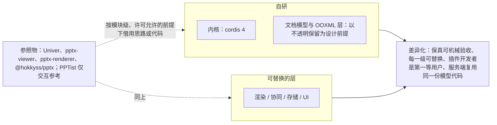
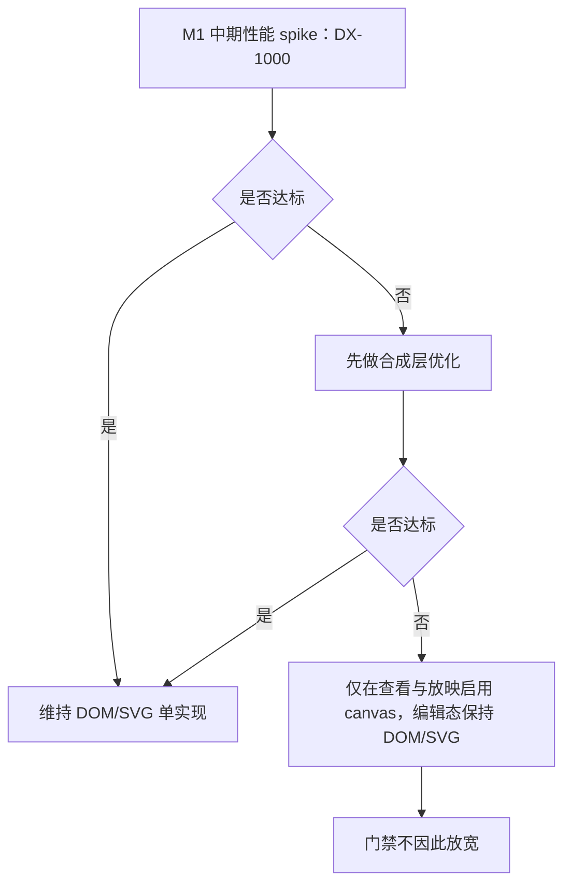

> 状态：草稿 | 负责：产品 | 更新：2026-11-05 | 依赖：charter v0.2；rulings §4.15、§4.16、§4.19、§4.21、§4.23、§4.25、§4.26；设计 03-13；ADR-0020、ADR-0021、ADR-0032；前端 50/03

# 01 背景、问题陈述、目标与成功指标

---

## 1. 背景

### 1.1 我们要做什么（一句话，来自章程 §0）

> 一个以 cordis 4 为内核、每一层都可插拔的办公文档 SDK：先做 PowerPoint（.pptx）的直接读取、高保真渲染与在线协同编辑，并以同一套内核在后续扩展到 Word（.docx）与 Excel（.xlsx）。

### 1.2 市场与技术现状（2026-09）

| 观察 | 对产品的含义 |
|---|---|
| 「在自家产品里嵌一个能编辑 Office 文件的组件」是企业软件（知识库、协作平台、CRM/报价、教育、合同）反复出现的需求，但现有选择要么是整套办公套件（WPS/Office Online/OnlyOffice，重、难定制、许可复杂），要么是只能看不能改的预览器 | 存在「可嵌入、可定制、可自托管的文档编辑 SDK」的空位 |
| pptx 生态没有成熟的「读 → 编辑 → 无损写回」TS 库（章程 §1）：`pptx-viewer` 有保存但有保留限制；`pptx-renderer` 只渲染；`@hokkyss/pptx` 有往返但模型面向生成而非编辑/协同 | 「未修改零丢失」是可差异化的硬指标，而不是理所当然 |
| 浏览器能力已足够：DOM/SVG 渲染清晰缩放、`FontFace` 动态字体、Web Worker 解析、`Intl.Segmenter` 字素与词切分、WebSocket + CRDT（Yjs）协同已被 Google Slides/Figma 类产品验证 | 技术上不需要 Canvas 自绘或原生插件即可达到可用保真度 |
| Univer（14.3k★）证明了「内核 + 插件 + 命令三分法」的架构骨架可行，也暴露了「有正确做法但没有机制保证一致采用」的代价（Univer 教训 §1） | 我们的差异化不在「有插件系统」，而在「每一级都可替换 + 机制保证」 |
| cordis 4（rc.10）提供时间/空间可组合性（effect 清理、反应式依赖、isolate 作用域），是比 DI 容器更贴合「每一级可插拔」的内核 | 插件的挂载/卸载/替换是内核原语，而非事后补的注册表 |

### 1.3 参照物（不是竞品；我们借鉴什么、不借鉴什么）

| 参照物 | 许可 | 借鉴 | 不借鉴 |
|---|---|---|---|
| Univer | Apache-2.0 | 命令三分法、per-unit 作用域、逻辑/UI 分包、DAG 依赖、Disposable 纪律、ResourceHook、token 主题、i18n 键类型（Univer K1–K11） | 内核边界错位、闭合文档类型枚举、104 个 register*、无 manifest、全局注册表、facade 猴子补丁（A1–A34）；`packages/slides` 为 alpha，不作实现参考 |
| ChristopherVR/pptx-viewer | Apache-2.0 | 特性覆盖清单（16 类元素、Strict 48 组命名空间映射、内嵌字体解混淆、EMF 转换）、样式解析链、EMU 内部单位、Yjs 雏形 | 单体核心 + mixin 组合（不可按层替换）、五框架平行绑定的 parity 成本、html2canvas 光栅导出、保存有保留限制、协同不是事实源 |
| aiden0z/pptx-renderer | Apache-2.0 | 以 PowerPoint 真机导出为 oracle 的视觉回归（SSIM/IoU/数据墨迹诊断）、SafeXmlNode、逐节点错误隔离、懒解析/懒媒体/窗口化、ZIP 安全限制、`mc:AlternateContent` 选择策略 | 无编辑、无写回、browser-only、ECharts 近似图表（我们同样近似，但作为可替换插件） |
| @hokkyss/pptx | MIT | 品牌单位类型（`Emu`/`Points`）、reader/writer/core 三分包、模板占位符替换、同构与体积意识 | AST 面向生成，不面向 CRDT/协同编辑；不承诺不透明保留 |
| PPTist | AGPL-3.0 | **仅交互参考**（形状手柄、对齐线、缩略图栏手感） | **禁止引入任何代码**（章程 D13） |

---

## 2. 问题陈述：为什么不直接用现成的

### 2.1 为什么不用 Univer

1. 幻灯片能力是 alpha，且 Univer 的 core 里有 3.4 万行 sheets/docs 模型（A1）。要做 pptx 就得在一个「表格形状」的基座上长出幻灯片，会重演 A2（`unitId + subUnitId` 两级寻址是 workbook 模型）。
2. 文档类型是闭合 protobuf 枚举（A3），第三方无法新增文档类型，直接违反章程 R5。
3. 没有 manifest、懒激活与运行时卸载（lessons §5）：它是「库的插件化」，不是「应用的扩展生态」，与章程 R2「每一级可插拔」的验收口径不符。
4. 声明了但没执行的门禁（A16–A27）意味着继承其代码就继承其滑坡风险；我们要的是「出生即有」的机制（lessons §4）。

### 2.2 为什么不用 PPTist

1. AGPL-3.0，章程 D13 明确禁止引入。
2. 它是 Vue 应用，不是 SDK；自有 JSON 模型，pptx 导入（pptxtojson）有损且不写回原文件，与「未修改零丢失」（R6/D7）冲突。
3. 无协同内核、无服务端。

### 2.3 为什么不用 pptx-viewer 作为核心

1. 它的核心是单体 `PptxHandler` + mixin 运行时，可扩展点是「加一种元素类型要改 7 处」（其 README「Adding a New Element Type」），无法满足「不改内核新增元素类型」（章程 §2.2）。
2. 保存有「preservation limits」（其 README 明示）；我们要的是部件级 diff 零差异的机械验收。
3. 协同是附加的 Yjs 同步，模型不是 CRDT 事实源（与 D5 冲突）；五框架 parity 规则是它的成本，我们用 `ui-core`（无框架）+ 绑定层解决。
4. 但它是**最好的特性清单与命名空间归一化参考**；Apache-2.0 允许在架构评审后按模块借用（保留署名）。

### 2.4 为什么不只做一个渲染器（pptx-renderer 路线）

渲染器解决「看」，不解决「改」与「写回」；其 oracle 测试方法论是我们 M1 保真验收的直接借鉴对象。

### 2.5 结论

自研内核（cordis 4）+ 自研文档模型与 OOXML 层（以不透明保留为设计前提）+ 可替换的渲染/协同/存储/UI 层；参照物按模块级、许可允许的前提下借用思路或代码。**产品差异化 = 保真可机械验收 + 每一级可替换 + 插件开发者是第一等用户 + 服务端复用同一份模型代码。**

**图 2-1 结论：自研部分、可替换部分与参照物**

怎么读：「自研」与「可替换的层」两组是本产品的构成，虚线表示参照物只以思路或代码的形式被按模块借用（PPTist 因 AGPL 禁止引入代码，见 §2.2）；实线表示这些构成共同形成「差异化」。
依据：本节 §2.5；§1.3 参照物表。

---

## 3. 目标与非目标

### 3.1 产品目标（长期，章程 §2.2 的产品化表述）

| 编号 | 目标 | 可度量表述 |
|---|---|---|
| G1 | 直接打开、高保真渲染 pptx | 语料库打开成功率 100%；SSIM 中位数 ≥ 0.90（M1）→ 0.92（M3）；PowerPoint 打开导出文件无修复 100% |
| G2 | 未修改零丢失的编辑与导出 | 零编辑往返部件级 diff 零差异 100%；编辑后未触碰部件字节相同 100% |
| G3 | 多人实时协同 | 20 编辑者 + 50 查看者/文档；A → B p95 ≤ 400 ms；收敛 100%；权限 fail-closed |
| G4 | 每一级可替换、第三方不改内核可扩展 | 章程 §7 每个里程碑的可插拔证据 CI 通过；内部非核心成员（未参与内核开发的同事或全新 AI agent 会话）仅凭公开文档 ≤ 2 人日完成插件（rulings §4.16 Q11） |
| G5 | 同一份模型/格式代码跑在浏览器与 Node | 服务端导出与客户端导出规范化字节一致；`iso` 包 Node 冒烟 100% |
| G6 | 文档类型盲的内核可扩展到 doc/sheet | M5 新增 doc/sheet 骨架时水平层 diff = 0 行 |
| G7 | 可嵌入、可定制、可自托管 | 5 分钟快速开始；查看器 ≤ 350 KB gzip；严格 CSP 下运行；docker-compose 一键部署 |

### 3.2 阶段目标（M0，章程 §2.1）

产出可评审的各线文档：PRD（本目录）、设计、架构（含类型治理）、模块、前端、后端、测试与研发流程（10–80 各线，rulings §4.26 PV-25）；固化硬约束与术语；形成里程碑与待决清单。仓库目录骨架与全部门禁配置就位、并在空骨架上跑通后，才开 M1（章程 §7 M0，rulings §4.25 DP-3、DP-6）；出口条件以 05 M0 为准。

### 3.3 非目标（明确不做）

| 非目标 | 来源 | 产品层补充 |
|---|---|---|
| Canvas 优先的通用绘图引擎 | 章程 §2.3、§6.2 | 渲染介质为 DOM/SVG 单实现（ADR-0021）；canvas 仅用于 toImage 栅格化、`measureText`、预留的 `RenderTarget`（Stable 前以最小 canvas Provider 验证契约），以及媒体与图标预处理（解码、缩放、转码，只产出 Blob）；缩略图与放映同样走 DOM/SVG |
| `.ppt` 97-2003 二进制读写 | 章程 §2.3 | 识别后给出清晰错误码（OF-02） |
| M1–M3 内动画/切换效果的编辑与播放 | 章程 §2.3；rulings §4.15 Q7 | M1–M3 渲染结束态、不播放、原样保留回写；播放为 M4 P2 |
| 移动端整包复刻 | 章程 §2.3 | 移动端为变化点插件；桌面优先、平板只读评审、手机查看 + 评论 M3 P1（rulings §4.16 Q20） |
| 插件安全沙箱 | 章程 §2.3 | 信任模型 = 同源可信；第三方插件须签名或有审核记录，部署时校验（PM-05，rulings §4.23）；能力声明仅展示（PS-13） |
| 加密 pptx 解密 | 章程 Q15（rulings §4.16） | M1–M4 拒绝并提示先去除密码（`format.encrypted`） |
| 宏执行与宏文件 | 章程 Q15（rulings §4.16） | `.pptm` 直接拒绝导入（`format.macro_rejected`，提示「请另存为 .pptx 后再导入」，文案以设计 03-13 为准）；不保留 `vbaProject.bin`，绝不执行 |
| SDK 内置文件管理 / 用户体系（密码、注册表单）/ 通知发送 | 产品 | SDK 不带文件管理与用户体系，存储、身份、通知归集成方或部署方（EM-03、EM-04、EM-05）。参考应用 `apps/web` 是组装样例，文件管理只做到文档目录（开始页、文档列表、最近与固定、回收站、搜索；AS-01、AS-02，05 §0.3），没有文件夹，也没有「移动到…」（rulings §4.25 DS-19）；身份由外置 OIDC IdP 拥有：服务端不持有密码，M4 前只认 OIDC（M4 起另接受集成方签名 JWT 与 API Key，EM-03），账号在 IdP 创建（compose 可选内置 Casdoor，rulings §4.15 Q6） |
| 多租户 / 自营 SaaS | 章程 §2.3（rulings §4.15 T-0/Q10） | 一次部署 = 一个组织，数据模型/API/权限中无租户；M1–M5 只交付自托管 compose；将来做 SaaS 另立项 |
| 插件市场、界面上传与 URL 安装 | 产品；rulings §4.23 裁决 2 | 参考应用里插件只经部署预置（镜像内置，或挂载目录 + 声明文件，PM-04），界面不提供上传、URL 安装或市场。SDK 集成方在自己的组合根装配插件，或在宿主代码里写内联插件（EM-08；装入方式以前端 50/03 §9 为准）；开发者分发走 npm，M4 另有文档站的「已验证目录」（PD-14，P2） |
| AI 生成/改写内容 | 产品 | 不在 M1–M5；作为第三方插件机会（命令 API 已足够） |
| 导入 PDF / Google Slides 原生格式 / Keynote 原生格式 | 产品 | 仅接受它们**导出的 pptx** |
| 拼写检查、翻译 | 产品 | P2 以后；可由插件提供 |
| 离线优先的桌面应用 | 产品 | 离线仅为协同的断线容忍（CO-06） |
| 插入 SmartArt、OLE、3D、墨迹、缩放定位，屏幕录制，自定义几何的顶点编辑 | rulings §4.21 R-d-75 | 导入文件中的这些对象照常「看得见、能摆放、原样写回」；逐项见 [03-features/02-editing.md](./03-features/02-editing.md) §5 |
| 打印入口与讲义打印 | rulings §4.25 DS-104 | 不设打印入口、不排期；需要打印时导出 PDF（OF-19，M3 后半段），再用浏览器或系统打印 |

---

## 4. 成功指标（按里程碑；口径见 `06-metrics-and-analytics.md` 与 `04-non-functional-requirements.md`）

| 里程碑 | 产品成功指标 | 数值 |
|---|---|---|
| M1 | 语料打开成功率 / 零编辑往返零差异 / SSIM 中位数 / D50 首屏 / 降级元素占比 | 100% / 100% / ≥ 0.90 / ≤ 1.5 s / ≤ 3% |
| M2 | 编辑往返（未触碰部件字节相同）/ 键入延迟 p95 / 编辑器体积 / 崩溃自由会话率 / 示例插件零改内核 / 已 ack(db) update 丢失（协同后端在 M2 交付，rulings §4.19 D-M2-CONTENT）/ 服务端导入 D50 | 100% / ≤ 50 ms / ≤ 900 KB / ≥ 99.5% / diff = 0 / 0 / ≤ 5 s |
| M3 | 收敛率 / A→B p95 / 权限撤销生效 / 多实例下已 ack update 丢失 / 服务可用性 / preset 差异白名单 | 100% / ≤ 400 ms / ≤ 2 s / 0 / 99.9% / 通过 |
| M4 | 内部非核心试点者完成插件耗时 / CTK 通过率 / 文档覆盖率 / 提问次数 | ≤ 2 人日 / 100% / 100% / ≤ 3 |
| M5 | 水平层 diff / 横向依赖 / 三类型共存 | 0 行 / 0 / 通过 |
| 上线后（参考应用） | 北极星 WSES 周环比、打开成功率、保真指数、崩溃自由率、同步健康率 | 见 MT-01…MT-08 |

---

## 5. 关键假设与验证方式

| 假设 | 风险若不成立 | 验证时点 |
|---|---|---|
| DOM/SVG 渲染能在 300 元素/页达到 55 fps、1,000 元素/页 30 fps | 回退规则（rulings §4.15 Q4）：DX-1000 不达标时先做合成层优化；仍不达标再**仅在查看/放映**启用 canvas，编辑态保持 DOM/SVG；门禁不因此放宽 | M1 中期性能 spike（DX-1000） |
| 元素级不透明保留可以在「重生成脏部件」时保持 schema 顺序有效 | 编辑后导出 PowerPoint 报修复 | M1 「解析 → 无编辑重生成 → 规范化比对」测试 |
| Yjs 能表达页序/形状序的并发移动且体积可接受 | 需 Loro 或自定义序列 | ADR-0020（已接受）已给出有序实体的移动语义、富文本映射与 WASM 体积的结论，有序集合细则见 ADR-0032（草稿）；并发收敛由协同模拟验证，以 M3 验收 1 `collab:converge` 为出口 |
| 浏览器文本度量 + 字体供给能达到 95% 行数一致 | 需服务端字体度量或自研 shaping | M1 文本专项语料 |
| cordis rc API 在 M1–M3 内不发生破坏性变更 | kernel 吸收成本上升 | kernel 隔离 + 每次 rc 升级的兼容测试 |
| 内部非核心成员（同事或全新 AI agent 会话）仅凭公开文档能做出插件 | M4 验收无法执行 | PD-22（rulings §4.16 Q11）；试点者须未参与内核开发，验收记录声明其背景 |

**图 5-1 DX-1000 性能不达标时的回退规则**

怎么读：自上而下是判定顺序，菱形判定的是否达到第一行假设中的帧率（300 元素/页 55 fps、1,000 元素/页 30 fps）；回退的终点只影响查看与放映，编辑态与门禁数字都不变。
依据：本节第一行假设；rulings §4.15 Q4；章程 §6.2 渲染介质。
