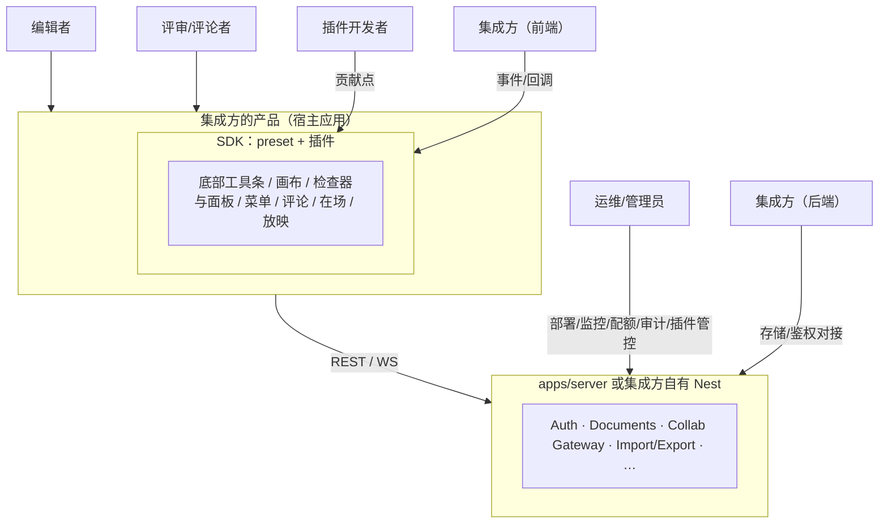

> 状态：草稿 | 负责：产品 | 更新：2026-11-05 | 依赖：charter v0.2；rulings §4.15、§4.16、§4.19、§4.23、§4.25；设计 05；前端 50/03；测试 70/02

# 02 角色、核心场景与用户故事

> 用户故事编号 `US-<角色码>-<序号>`：E 编辑者、R 评审/评论者、P 插件开发者、I 集成方、O 运维/管理员。本文是用户故事编号的唯一出处：功能文件引用故事时沿用这里的编号，新故事在这里取号，编号顺延、不复用。每条故事映射到 PRD 03、04 的需求编号（个别映射到 README 的待决事项）。角色不是「人」而是「帽子」：同一个人可能同时是集成方与插件开发者。

---

## 0. 角色总览

**图 0-1 五个角色与系统的接触面**



怎么读：外层子图是集成方的宿主应用，SDK 嵌在其中；箭头从角色指向其接触面，边上写接触方式；同一个人可以同时戴多顶「帽子」（例如集成方前端与插件开发者）。

| 角色 | 一句话 | 主要里程碑 | 主要功能域 |
|---|---|---|---|
| 编辑者 | 在宿主产品里打开、修改、导出、放映 pptx 的业务用户 | M1–M3 | OF、ED、CO、ML、AS、PM |
| 评审/评论者 | 只看不改（或只评论）的干系人 | M1–M3 | OF、CO |
| 插件开发者 | 不改内核为 SDK 增加能力的工程师（内部垂直束团队亦是） | M2–M5 | PS |
| 集成方 | 把 SDK 嵌入自家产品的前后端工程团队 | M1–M4 | EM、SV |
| 运维/管理员 | 部署、监控、配额、审计、合规、插件管控 | M2–M4 | SV、NF、PM |

---

## 1. 编辑者（Editor）

### 1.1 画像

- 典型：市场/销售/咨询/教师，每周制作或修改 2–10 份演示文稿；熟练 PowerPoint 快捷键；对「排版跑掉」零容忍。
- 环境：公司知识库或协作平台（宿主应用）里直接打开同事上传的 pptx；Chrome/Edge 为主；有时在会议室投屏放映。
- 目标：不下载、不切应用，快速改几页并导出/分享；确信导出的文件在 PowerPoint 里「跟我看到的一样」。
- 痛点：在线预览器「看起来不对」；在线编辑器导出后母版/动画/图表丢失；多人改同一份文件互相覆盖；改完不知道有没有保存。

### 1.2 核心场景

**场景 E-A：打开并核对（M1）**

```
 收到同事上传的 Q3 复盘.pptx（80 页，40 MB）
   → 在知识库点击打开（≤ 3 s 看到首页）
   → 翻页核对图表数字、备注（宿主开启了缩略图条与备注面板，OF-14）
   → 发现某页 Office 2016 瀑布图（chartex）显示为占位（占位上写明原因，查看器的 ⓘ 保真摘要给出受影响内容的计数）
   → 用知识库自带的下载按钮导出副本发给客户（宿主开启 `allowExport` 后调用导出命令，OF-14；零编辑往返，字节相同）
```

**场景 E-B：快速修改并导出（M2）**

```
 打开 → 改封面标题（IME 输入中文）→ 替换第 5 页产品图（选中后从检查器或右键替换，位置、尺寸与裁剪不变，ED-07）
   → 新增一页（选版式）→ 复制第 12 页并移到第 3 页 → 对齐三个形状
   → Ctrl+Z 撤销误删 → Ctrl+S（自动保存已经保存过）→ 导出 pptx
   → PowerPoint 打开无修复，未改的 78 页与原文件字节相同
```

**场景 E-C：多人共同准备提案（M3）**

```
 三人同时在线：A 改文案，B 调图表数据，C 排版第 10–15 页
   → 看到彼此的头像/选区/当前页；A 与 B 同时碰到第 8 页文本框，A 看到文本框上沿外侧出现「● B 也在编辑此文本框」和 B 的插入符，不加锁（CO-08；提示的画法与文案以设计 05 §5 为准）
   → C 断网 3 分钟继续编辑，重连后合并，无丢失；A 移走的形状在 C 端「跳走」并提示
   → 老板以评论者身份 @A 提修改意见；A 修改后标记已解决
   → 会前在版本历史里预览昨晚的命名版本，核对无误后放映（预览只影响自己的视图；需要回退时由所有者恢复到该版本，恢复本身可撤销，CO-07）
```

### 1.3 用户故事

| 编号 | 故事 | 需求 | 里程碑 |
|---|---|---|---|
| US-E-01 | 我希望在浏览器里 3 秒内看到 pptx 首页并能翻页，不必等全部加载 | OF-01、OF-03 | M1 |
| US-E-02 | 我希望文字换行、字体、颜色与 PowerPoint 一致，否则我不敢用 | OF-04、OF-05 | M1 |
| US-E-03 | 我希望渲染不了的东西明确告诉我，而不是悄悄消失 | OF-13 | M1 |
| US-E-04 | 我希望原样导出的文件与原文件完全相同 | OF-18 | M1 |
| US-E-05 | 我希望用中文输入法直接在页面上改字 | ED-02 | M2 |
| US-E-06 | 我希望用熟悉的快捷键（Ctrl+D、Ctrl+G、方向键微移） | ED-16 | M2 |
| US-E-07 | 我希望拖动时有对齐线和吸附 | ED-09 | M2 |
| US-E-08 | 我希望撤销精确到「我刚做的那步」 | ED-14 | M2 |
| US-E-09 | 我希望改完的文件在 PowerPoint 里打开不报错，没改的地方一点不变 | OF-18（编辑后） | M2 |
| US-E-10 | 我希望在浏览器里全屏放映并用键盘翻页 | ED-21 | M2 |
| US-E-11 | 我希望关页面前提醒我还没保存 | ED-23 | M2 |
| US-E-12 | 我希望看到谁在线、在哪一页、选了什么 | CO-03 | M3 |
| US-E-13 | 我希望断网时还能继续改，恢复后自动合并 | CO-06 | M3 |
| US-E-14 | 我希望别人改了我正在改的东西时得到提示，并能「恢复我的值」；我的撤销不会把别人随后的修改撤掉 | CO-08、CO-09 | M3 |
| US-E-15 | 我希望能回到昨天的版本看看 | CO-07 | M3 |
| US-E-16 | 我希望直接改图表里的数字 | ED-15 | M3 |
| US-E-17 | 我希望给表格加一行、合并单元格 | ED-10 | M3 |
| US-E-18 | 我希望把另一份文稿的几页复制过来，图片不丢 | ED-17 | M3 |
| US-E-19 | 我希望切到母版视图看清页面样式从哪来，并一次改所有页的标题字体与页脚 | ML-01（M2）、ML-03（M3） | M2 / M3 |
| US-E-20 | 我希望打开产品就能新建、从模板开始或继续最近的文档 | AS-01、AS-02 | M2 |
| US-E-21 | 插件出了问题，我想知道是哪个插件、能不能自己重试，也想关掉用不上的界面插件而不影响别人；打开用到我这边没有的插件的文档时，我希望照常打开、知道缺了什么、内容不丢 | PM-10、PM-12 | M2 / M3 |

---

## 2. 评审 / 评论者（Reviewer / Commenter）

### 2.1 画像

- 典型：管理者、法务、客户；不制作只审阅；设备可能是平板/手机；时间碎片化。
- 目标：快速看完、在具体位置留下意见、知道意见是否被处理。
- 痛点：预览失真导致误判；意见散落在聊天工具里对不上页；被 @ 了没有通知。

### 2.2 核心场景

**场景 R-A：审阅并评论（M3）**

```
 通过分享链接登录后以评论者身份打开，进入评审模式（画布只读，评审条替换底部创建工具条；不支持匿名）
   → 翻到第 7 页，用评论工具点那段文字所在的文本框发起评论并 @ 作者（评审模式下锚点为元素或整页，CO-04）
   → 收到宿主应用的通知（集成方通过 comment/mentioned 事件实现）
   → 作者修改后标记已解决；评审者在评论面板的「@我」筛选里确认
   → 在手机上再看一眼最终版（查看 + 评论，M3 P1）
```

### 2.3 用户故事

| 编号 | 故事 | 需求 | 里程碑 |
|---|---|---|---|
| US-R-01 | 我希望只看不改时界面干净，没有我用不到的按钮 | OF-14、EM-08 | M1（OF-14 查看器）/ M2（EM-08 编辑器界面裁剪） |
| US-R-02 | 我希望看到的和作者看到的一样（否则我的意见是错的） | OF §4 保真 | M1 |
| US-R-03 | 我希望在具体的元素上留评论，而不是「第 7 页那个图」 | CO-04 | M3 |
| US-R-04 | 我希望 @ 某人后他能收到通知 | CO-04、EM-05 | M3 |
| US-R-05 | 我希望知道我的意见是否被处理 | CO-04（解决/重开） | M3 |
| US-R-06 | 我希望我评论过的元素被删了之后评论别消失 | CO-04（脱离锚点） | M3 |
| US-R-07 | 我希望在手机上也能看和评论 | NF-07（PD-15，rulings §4.16 Q20） | M3 |
| US-R-08 | 我希望作者在 PowerPoint 里也能看到我的评论 | CO-04 导出、PD-04 | M3 |

---

## 3. 插件开发者（Plugin Developer）

### 3.1 画像

- 典型：(a) 我们自己的垂直束团队（`slide-*`、未来 `doc-*`/`sheet-*`）；(b) 集成方的前端工程师，想加一个「插入产品图库」按钮；(c) 独立开发者，想发布一个「图标库」或「Markdown 导出」插件。
- 目标：不读内核源码就能加能力；本地能调试；升级宿主后知道会不会坏；发布流程清楚。
- 痛点（来自 Univer 教训）：不知道能贡献什么（无 manifest）；注册方式有 104 种；插件崩了整个编辑器崩；加载顺序玄学；升级后静默失效。

### 3.2 核心场景

**场景 P-A：新增一种元素（M2 示例 / M4 公开）**

```
 npm create @cordexjs/plugin → 选「element-kind」模板
   → 定义 kind 的 schema（Standard Schema）与默认属性
   → 实现 ElementRenderer（DOM/SVG）+ 编解码（导出为图片回退 + extLst 数据）
   → 贡献工具条「更多」按钮 + 检查器分区 + 快捷键
   → 在 host-playground 加载，热重载调试；开发者面板看到 Fiber 状态与贡献列表
   → cordex ctk run 通过 CTK 全部检查（PS-06，含作用域检查）→ changeset → npm publish
   → 集成方在 preset 配置里加一行启用
```

**场景 P-B：替换一层（M3）**

```
 公司要求用自建 WebRTC 中继 → 实现 `collabTransport` 服务的 Provider（Provider 座）
   → 不改 collab-core / store-yjs；自建的 Provider 须通过 `collabTransport` 契约套件（测试 70/02 §6.1）；移除全部 `collab-*` 插件后仍能以单人模式启动（CO-11，`pluggable:m3`）；CTK 随 M4 公开（PS-06）
```

### 3.3 用户故事

| 编号 | 故事 | 需求 | 里程碑 |
|---|---|---|---|
| US-P-01 | 我想加一种新元素（渲染 + 插入 + 导出 + 协同） | PS-02（`slide.shapeKind`、`render.element`）、PS-04 | M2/M4 |
| US-P-02 | 我想在工具条「更多」或菜单里加一个按钮执行我的命令 | PS-02（`core.command`；工具条「更多」走 `ui.toolbar`，主菜单与右键菜单走 `ui.contextMenu`，`ui.command` 给命令面板与菜单提供标题和图标；rulings §4.25 DS-5、TB-29） | M2 |
| US-P-03 | 我想不运行就知道一个插件提供什么、需要什么 | PS-01 Manifest | M4 |
| US-P-04 | 我想一条命令生成能跑的插件骨架 | PS-03 | M4 |
| US-P-05 | 我想知道升级宿主后插件还能不能用 | PS-06 CTK、PS-07 | M4 |
| US-P-06 | 我的插件崩了不想连累用户，也想让用户知道是我崩了 | PS-11 | M2 |
| US-P-07 | 我想在浏览器与服务端跑同一个导出插件 | PS-14 | M3 |
| US-P-08 | 我想换掉传输/存储/遥测实现而不碰其它层 | PS-02 Provider 座（`collabTransport`/`blobStore`）与 `telemetry.sink`/`errors.sink` 贡献点 | M3 |
| US-P-09 | 我想 30 分钟内跟着文档做出第一个可见的贡献 | PS-05 | M4 |
| US-P-10 | 我想加一种新文档类型 | PS-02 `core.documentType`、M5 | M5 |

---

## 4. 集成方（Integrator）

### 4.1 画像

- 典型：SaaS 或企业内部平台团队（知识库、协作套件、CRM、教育平台）的 3–10 人前后端小组；已有 OIDC 登录、权限、对象存储；自托管部署我们的服务端（一次部署 = 一个组织，多客户隔离由集成方按部署划分）；要求品牌一致、CSP 严格、可自托管、许可清晰。
- 目标：两周内 PoC，一个季度内上线「在线预览 + 编辑 + 评论」；升级不惊吓；出问题能拿到诊断。
- 痛点：SDK 假设自己拥有用户体系；样式泄漏；体积过大拖慢首页；文档里没有 CSP/字体/配额这些上线必答题。

### 4.2 核心场景

**场景 I-A：两周 PoC（M2）**

```
 Day 1  安装 preset + ui-react，5 分钟快速开始跑通预览
 Day 2  接 onSave 回调写回 S3；接 getToken；设品牌 token（暗色）
 Day 3  隐藏工具条的「图表」，在「更多」里加「插入产品图」（内联插件，EM-08）
 Day 5  严格 CSP 测试通过；体积报告 ≤ 预算；a11y axe 零严重
 Day 8  订阅 comment/mentioned 发站内通知（M3）
 Day 10 部署 docker-compose 协同服务，接自家 OIDC IdP（集成方签名 JWT 为 M4）
```

**场景 I-B：服务端批量（M3）**

```
 CRM 每晚为 1,000 个客户生成报价 pptx：调用 fill-template 作业 → 导出 PDF → 回调 webhook
```

### 4.3 用户故事

| 编号 | 故事 | 需求 | 里程碑 |
|---|---|---|---|
| US-I-01 | 我想 ≤ 20 行代码嵌入，且同页能放多个 | EM-01 | M2 |
| US-I-02 | 我想用自己的存储与保存策略 | EM-02、EM-04 | M2 |
| US-I-03 | 我想用自己的 SSO（OIDC）登录，服务端不保存密码；后续还想用自己签的令牌 | EM-03、CO-05、SV-06 | M2（OIDC 登录，rulings §4.19 D-M2-CONTENT）/ M3（权限细化）/ M4（JWT、API Key） |
| US-I-04 | 我想编辑器长得像我的产品 | EM-06 | M2 |
| US-I-05 | 我想订阅事件来做通知/活动流/埋点 | EM-05、EM-13 | M2 |
| US-I-06 | 我想隐藏/替换/新增按钮而不 fork | EM-08 | M2 |
| US-I-07 | 只预览的页面不该加载编辑器与协同代码 | EM-07 | M2 |
| US-I-08 | 我的安全团队要求严格 CSP、无外呼、供应链可查 | EM-14、NF-04 | M2 |
| US-I-09 | 我想从后端批量填模板、转 PDF | EM-09、SV-13 | M3 |
| US-I-10 | 我想把服务端跑在自己的基础设施上 | EM-10、SV-09 | M3 |
| US-I-11 | 我想知道升级会不会坏、快照能不能读 | EM-15 | M2 |
| US-I-12 | 出问题时我想拿到一份不含客户内容的诊断包 | EM-12 | M1 |
| US-I-13 | 我想清楚知道许可与第三方声明 | EM-16、PD-21（rulings §4.16 Q12） | M1 |

---

## 5. 运维 / 管理员（Ops / Admin）

### 5.1 画像

- 典型：集成方的 SRE/平台组，或企业 IT；关注可用性、容量、成本、合规；不关心 pptx 细节。
- 目标：一条命令起测试环境；生产多实例无状态；指标告警齐全；备份恢复有演练；审计能导出。
- 痛点：WebSocket 粘性与多实例；headless 浏览器吃资源；「谁删了文档」查不到；超大文档拖垮房间内存；镜像许可（AGPL）与离线内网部署。

### 5.2 核心场景

**场景 O-A：上线与运行（M3）**

```
 docker compose up → /readyz 200 → Prometheus + 默认告警规则（Grafana 为可选 profile）
   → 设部署级规模与存储配额（200 页 / 20,000 元素、50 GB）→ 压测 2,000 WS
   → 滚动升级：SIGTERM 优雅停机，客户端 5 s 内重连
   → 月末导出审计 CSV 给合规；季度做一次备份恢复演练
```

### 5.3 用户故事

| 编号 | 故事 | 需求 | 里程碑 |
|---|---|---|---|
| US-O-01 | 一条命令起整套服务 | SV-09 | M3 |
| US-O-02 | 看到房间数、连接数、延迟、队列并有告警 | SV-10 | M3 |
| US-O-03 | 宕机不丢已同步的编辑 | SV-03 | M2（单实例，rulings §4.19 D-M2-CONTENT）/ M3（多实例） |
| US-O-04 | 按部署配置规模上限与存储配额 | SV-08 | M3 |
| US-O-05 | 查任意文档一年内的操作记录 | SV-07 | M3 |
| US-O-06 | 处理用户数据删除请求 | SV-11 | M3（擦除 API，评论正文保留）/ M4（按部署策略删除评论正文） |
| US-O-07 | 滚动升级用户无感 | SV-05、SV-09 | M3 |
| US-O-08 | 越权尝试有审计与告警 | SV-07、SV-12 | M3 |
| US-O-09 | 看到服务端加载了哪些插件与版本 | PM-06、SV-14（「管理 › 插件」是 SV-14 管理面板的第一页，由 PM-06 在 M3 先行交付） | M3 |
| US-O-10 | 我想决定本部署启用哪些插件：强制启用、允许个人选择或禁用 | PM-01、PM-03、PM-06 | M3 |
| US-O-11 | 我希望插件清单随部署版本管理，第三方插件须签名或审核过才能进入部署 | PM-04、PM-05 | M3（镜像内置插件的声明文件）/ M4（挂载目录中的第三方插件须签名或审核） |

---

## 6. 故事地图（角色 × 里程碑，P0/P1 故事）

```
            M1 打开与保真    M2 单人编辑                M3 协同        M4 插件 SDK        M5 多类型
 编辑者     E-01..04         E-05..11, 19..21           E-12..19, 21   —                  —
 评审者     R-01, R-02       R-01                       R-03..08       —                  —
 插件开发   （内部垂直束）   P-01（首个示例）, 02, 06   P-07, P-08     P-01, 03..05, 09   P-10
 集成方     I-12, I-13       I-01..08, 11               I-03, 09, 10   I-03               —
 运维       —                O-03（单实例持久化）       O-01..11       O-06, 11           —
```

---

## 7. 反角色（我们不为之优化）

| 反角色 | 原因 | 处理 |
|---|---|---|
| 想要「完整 PowerPoint 替代品」的个人用户 | 我们是 SDK，不是套件；动画编辑/SmartArt 编辑等非目标 | 文档明确能力矩阵（OF §2） |
| 需要 .ppt、加密或宏文件的存量迁移团队 | 非目标（`.ppt` 见章程 §2.3；加密文件 M1–M4 拒绝、宏文件拒绝导入，rulings §4.16 Q15） | 清晰错误码（`format.unsupported_binary`、`format.encrypted`、`format.macro_rejected`）+ 建议在 PowerPoint 中另存为 .pptx 或先去除密码 |
| 想在运行时从任意 URL 加载第三方插件的集成方 | 无运行时沙箱，信任模型为同源可信（章程 §2.3） | 参考应用里插件只经部署预置（镜像内置，或挂载目录 + 声明文件），界面不提供上传、URL 安装或市场，第三方须签名或有审核记录（PM-04、PM-05，rulings §4.23 裁决 2）；SDK 集成方在自己的组合根装配插件，或在宿主代码里写内联插件（EM-08；装入方式以前端 50/03 §9 为准）；开发者分发走 npm，M4 另有文档站的已验证目录（PD-14） |
