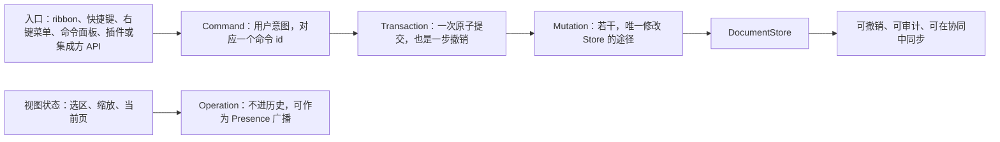
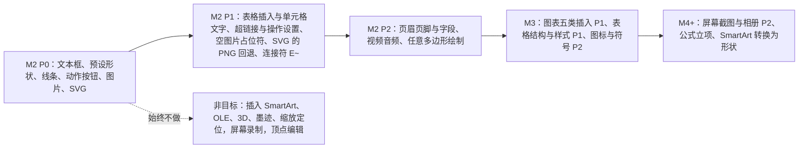
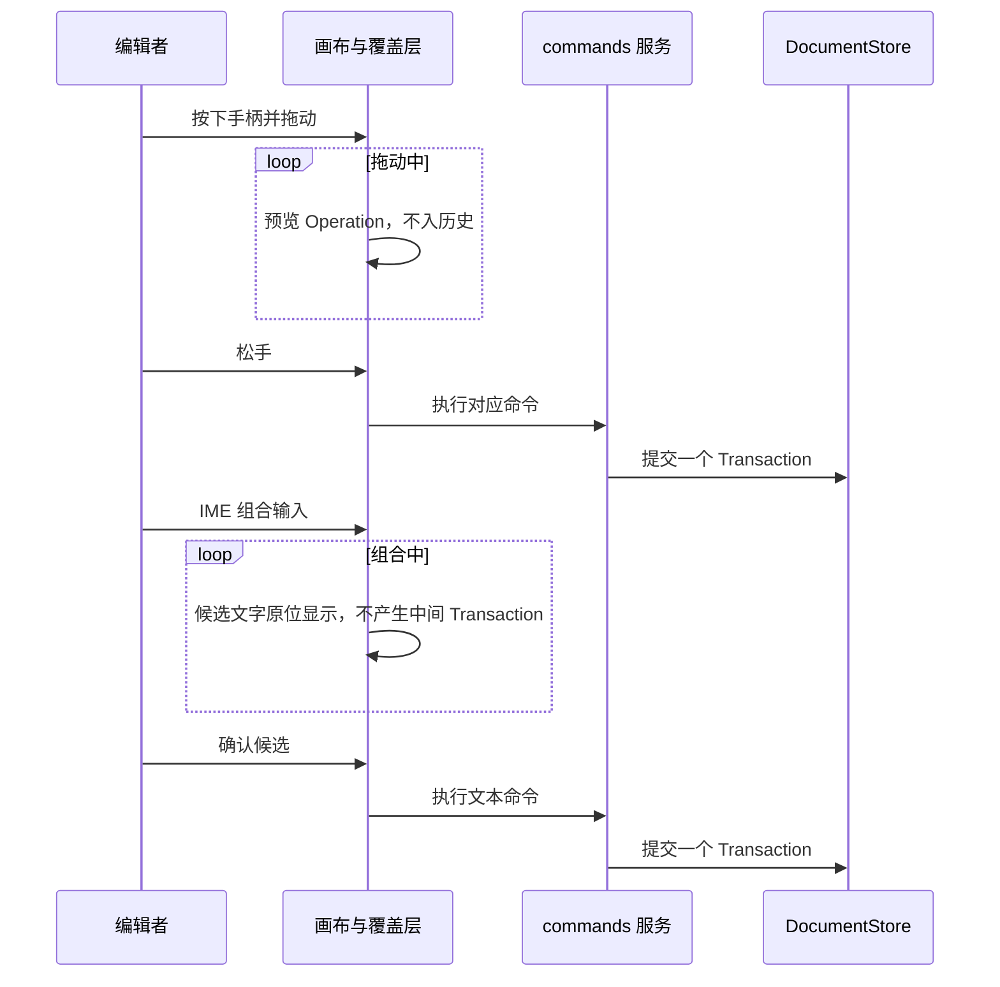
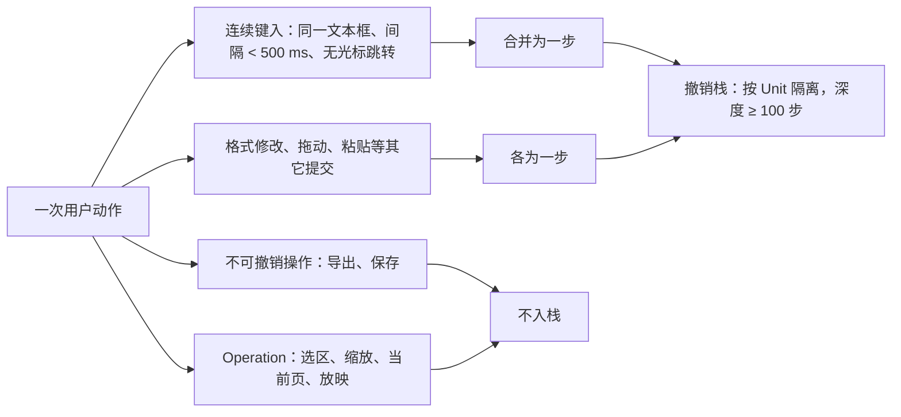
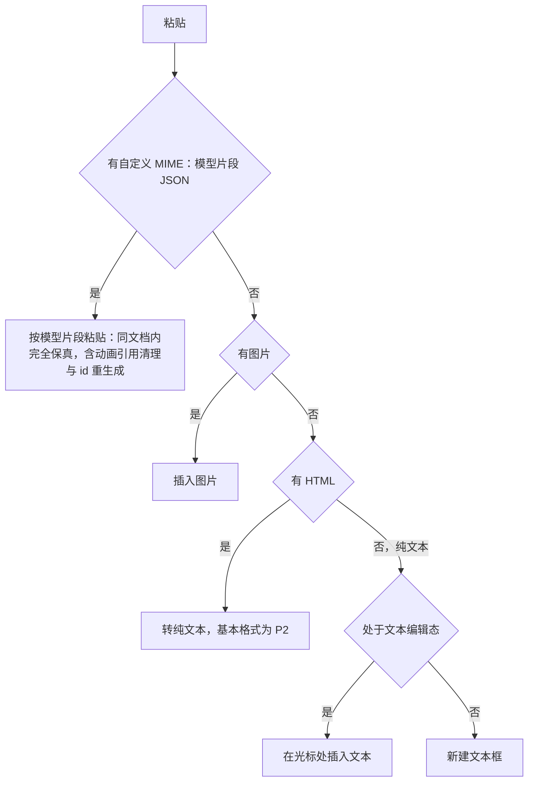
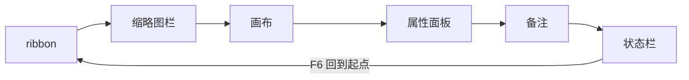

> 状态：草稿 | 负责：产品 | 更新：2026-09-19；2026-09-24（rulings §4.15：Q7 竖排编辑改 E~(P2)、PD-18 结案与 AlternateContent 口径、放映结束态按场景；Q3 撤销语义与软删除墓碑）；2026-09-25（补图）；2026-09-25（矛盾收口，rulings §4.18）；2026-09-25（§4.19）；2026-09-26（§4.20：FE-02 ED-21 删去「远端更新可关闭」）；2026-09-26（§4.21：新增 §1a 可插入元素一览与 §5 非目标；ED-05 形状库约 72 项、线条落 `p:cxnSp`、插入工具态、动作按钮；ED-07 SVG 的 PNG 回退与空图片占位符；ED-10 表格 M2 可插入；ED-19 维持 M2 P1 并补操作设置；新增 ED-15a 插入图表（M3）与 ED-31–ED-35）；2026-09-26（§4.21 整合：ED-03 渐变 / 描边文字收口为 M2 P2；ED-07 补 SVG 与回退同批、EXIF / WebP 口径与相关插入条目；ED-16 登记 Mod+E 冲突待裁；§5 非目标补 a:sym 符号字体插入） | 依赖：charter v0.2；rulings §4.15、§4.18、§4.19、§4.20、§4.21

# 功能域 02：编辑

> 需求编号前缀 `ED-`。本文件是 M2「单人编辑」的主要验收来源。可编辑范围的**上限**由 `01-open-and-fidelity.md` §2 支持矩阵中的 `E`/`E~` 等级决定；本文件不得超出该矩阵。界面布局与交互细节由设计条线负责（设计 01/03/06），本文只定义行为、边界与验收。

---

## 0. 本域的产品立场

1. **一切修改都是命令**：用户的每个编辑意图对应一个 `Command`，在一个 `Transaction` 内落为若干 `Mutation`；视图状态（选区、缩放、当前页）是 `Operation`，不进历史（章程 D4、继承 Univer K1）。这意味着：任何编辑都可撤销、可审计、可在协同中同步、可被插件通过命令面板调用——**没有「UI 私有」的修改路径**。
2. **编辑不破坏保真**：编辑器只写显式覆盖，不把继承来的属性「烤」进元素（OF-04）；不理解的属性原样保留（OF-18）。
3. **能选中就能操作**：任何渲染出来的元素（包括降级占位的 SmartArt/OLE）都可以选中、移动、缩放、删除；能否进入内部编辑由支持矩阵决定（PD-18 已结案，rulings §4.15 Q7）：SmartArt/OLE/3D/公式/墨迹/缩放定位等 `mc:AlternateContent` 内对象只建模变换，删除 M1 起可用（P0），整体移动/缩放 M2 P1，内部不可编辑并提示（OF 矩阵 §2.1 备注 A）；这些对象都不提供插入（§5 非目标，rulings §4.21），逐元素设计见 [50/25](../../50-frontend/25-elements-readonly-and-opaque.md)。
4. **键盘等价**：每个拖拽操作都有键盘等价（WCAG 2.2 2.5.7），每个 ribbon 功能都有命令 id 与可选快捷键。

**图 0-1 一个编辑意图的落库路径**



怎么读：上排是所有文档修改的唯一路径，没有「UI 私有」的旁路；下排的视图状态变化走 `Operation`，不产生事务。
依据：本节 §0 第 1 条；章程 D4。

---

## 1. 编辑对象与操作总览

```
 选择对象            允许的操作（M2）                                     内部编辑
 ───────────────── ─────────────────────────────────────────────────── ────────────
 形状 sp            移动/缩放/旋转/翻转/填充/线条/阴影/文本/层级/对齐/组合   文本 ✓
 连接符 cxnSp       移动/缩放/线条/端点连接                                 –
 图片 pic           移动/缩放/旋转/裁剪/替换/透明度/替代文本                 –
 组合 grpSp         移动/缩放/旋转/组合/取消组合/双击进入                    子元素 ✓
 表格 graphicFrame  插入/移动/缩放/单元格文本（结构编辑 M3）                单元格 ✓
 图表 graphicFrame  移动/缩放（插入与数据编辑 M3）                          –（M3 ✓）
 SmartArt/OLE/3D/   移动/缩放/删除（AlternateContent 内对象同步各分支 xfrm）   –（进入时提示）
 公式/墨迹/缩放定位 不提供插入（§5）
 媒体 pic(video)    移动/缩放/海报替换                                      –
 幻灯片             新建/复制/删除/重排/隐藏/换版式/背景/重置                –
 备注               文本编辑                                                –
 母版 / 版式        母版视图只读（M2，ML-01）；占位符增删/移动/缩放/类型、母版文本样式、背景、版式增删改名（M3，ML-03）  占位符 ✓（M3）
```

### 1a. 可插入元素一览（2026-09-26，rulings §4.21）

插入页签按设计 03-04 与 playground 分七组：文本 / 形状 / 图像 / 表格 / 图表 / 链接与批注 / 插件（rulings §4.21 d-61）。下表是全部可插入元素的入口、里程碑与对应需求；每个元素「有什么作用、怎么设计」（固定 14 栏）见 [50/19 可追加元素目录](../../50-frontend/19-insertable-elements-overview.md) 与 50/20–50/25 六篇族文档。插入的通用行为（插入工具态、默认落点、一次插入一个撤销步、规模守卫）写在 ED-05，其余条目只写差异。

| 元素 | 入口 | 里程碑 / 优先级 | 需求 |
|---|---|---|---|
| 文本框 | 文本 › 文本框 | M2 P0 | ED-05 |
| 预设形状（首批约 72 项、10 类） | 形状 › 形状 ▾ | M2 P0；调整手柄、更改形状 P1 | ED-05 |
| 线条（直线、箭头，写为 `p:cxnSp`） | 形状 ▾ ›「线条」 | M2 P0 | ED-05 |
| 连接符（肘形、曲线） | 形状 ▾ ›「线条」 | M2 P1（E~）/ M3 P1（E） | ED-28 |
| 动作按钮与「操作设置」 | 形状 ▾ ›「动作按钮」 | 插入 M2 P0；操作设置 M2 P1 | ED-05、ED-19 |
| 任意多边形、曲线、自由曲线 | 形状 ▾ ›「线条」末三项 | M2 P2 | ED-05 边界 |
| 图片（本地、拖入、粘贴、URL） | 图像 › 图片 ▾ | M2 P0 | ED-07 |
| SVG（同时生成 PNG 回退） | 同图片 | M2 P0；PNG 回退 P1 | ED-07 |
| 空内容占位符填入 | 占位符中间的图标条 | 图片 M2 P1；表格随 ED-10；图表随 ED-15a；视频随 ED-35 | ED-07 |
| 表格 | 表格 › 表格 ▾ | 插入与单元格文字 M2 P1；结构与样式 M3 P1 | ED-10 |
| 图表（五类） | 图表 › 图表 ▾ | M3 P1 | ED-15a、ED-15 |
| 超链接 | 链接与批注 › 超链接…（Mod+K） | M2 P1 | ED-19 |
| 页眉和页脚、页码、日期 | 文本 › 页眉和页脚… | M2 P2 | ED-31 |
| 视频、音频 | 图像 › 视频 ▾ / 音频 ▾ | M2 P2 | ED-35 |
| 图标 | 形状 › 图标…（2026-09-30 样张确认） | M3 P2 | ED-32 |
| 符号与特殊字符 | 文本 › 符号…（文本编辑态） | M3 P2 | ED-33 |
| 屏幕截图、相册 | 图像 › 屏幕截图；多图「每图一页」 | M4+ P2 | ED-34 |
| 公式 | 文本 › 公式（M2 起灰显「暂不支持」） | M4+ 立项（OMML 往返） | OF §2.7 公式行 |
| 第三方扩展元素 | 插件组或命令面板 | M2 P0（可插拔验收） | PS-02、PS-04 |
| SmartArt、OLE、3D 模型、墨迹、缩放定位；屏幕录制 | 不提供 | 非目标 | §5 |

**图 1a-1 插入能力按里程碑展开**



怎么读：实线从左到右是插入能力逐级展开的顺序，前一级的能力在后续里程碑保留；虚线指向 §5 的非目标，任何里程碑都不提供。
依据：本节 §1a 表；rulings §4.21 q-table-depth、q-chart-route、q-media-insert、q-extra-inserts、d-75。

---

## 2. 需求

### ED-01 选择模型与命中测试

- 优先级：P0 | 目标里程碑：M2 | 依赖能力：`engine-render` 命中测试与覆盖层契约、`Selection` 类型（`model-core`）、`Operation`
- 用户故事：作为编辑者，我希望像在 PowerPoint 里一样点选、框选、Shift 多选、进入组合，以便快速定位要改的对象。
- 验收标准：
  - Given 元素重叠，When 点击，Then 选中 z 序最高且命中其填充/描边/文本的元素；`fill="none"` 的形状仅描边与文本可命中（与 PowerPoint 一致）。
  - Given 拖出框选矩形，Then 完全包含的元素被选中（默认）；按住 Alt 为「相交即选」。
  - Given 选中组合，When 双击子元素，Then 进入组合并选中该子元素；Esc 逐级退出，顺序为：文本编辑 → 选中子元素 → 选中整个组合（退出组合编辑态）→ 取消选择 →（仅在母版视图中且已无选区时）退出母版视图，与 PowerPoint 一致（rulings §4.18 UX-06）。
  - 多选显示统一包围盒；Tab/Shift+Tab 按 z 序循环选择；Ctrl/Cmd+A 全选当前页。
  - 命中测试 p95 ≤ 2 ms（300 元素页）；选择变化是 `Operation`，不进入撤销栈，可作为 `Presence` 广播。
- 边界：锁定（`spLocks`）的元素可选中但对应操作禁用并提示；隐藏元素（`hidden="1"`）默认不可选，可在「选择窗格」（P2）中选中。

### ED-02 文本内联编辑与 IME

- 优先级：P0 | 目标里程碑：M2 | 依赖能力：`render-dom` IME 文本输入宿主、`DocumentStore` 富文本类型、`Command`（`text/insert`、`text/delete` 等）
- 用户故事：作为编辑者，我希望双击文本直接在原位输入中文/日文/英文，光标与换行所见即所得。
- 验收标准：
  - Given 双击文本框，Then 进入文本编辑态，光标落在点击位置；单击空文本占位符直接进入编辑。
  - Given 使用 IME 输入（拼音/日文假名/韩文），Then 组合过程中的候选文字在原位显示，不产生中间 `Transaction`；确认后产生一个 `Transaction`。
  - 键入延迟（keydown → 屏幕更新）p95 ≤ 50 ms；IME 组合更新 p95 ≤ 80 ms。
  - 支持：方向键/Home/End/PageUp-Down、按词跳转（Ctrl/Alt+方向）、Shift 选择、双击选词、三击选段、Ctrl/Cmd+A 选全文本框内容。
  - 文本编辑直接作用于 Store 的富文本类型，不存在第二份编辑缓冲（规避 Univer A32）。
  - 文本框自动增长（`spAutoFit`）在输入时实时更新形状高度（每帧 ≤ 1 次布局）。
- 边界：竖排文本编辑按 OF 矩阵 §2.7 为 M2 **E~ (P2)**（`vert`/`vert270`/`eaVert`/`wordArtVert` 均不承诺 P0/P1，rulings §4.15 Q7）；RTL 文本编辑为 M4/M5。

### ED-03 字符与段落格式

- 优先级：P0 | 目标里程碑：M2 | 依赖能力：`Command`/`Mutation`、`model-slide` 样式继承（写显式覆盖）
- 验收标准（每项 Given 选中文本或文本框 When 操作 Then 导出后 PowerPoint 显示一致）：
  - 字符：字体族（含主题字体选项 `+mj-lt`/`+mn-lt`，东亚字体独立设置）、字号（1–4000 pt，步进按 PowerPoint 阶梯）、粗体、斜体、下划线（单）、删除线（单）、上标/下标、字体颜色（主题色 + 标准色 + 自定义 + 最近使用）、高亮、大写/小型大写、清除格式。
  - 段落：左/中/右/两端/分散对齐、缩进增减、段前/段后距、行距（1.0/1.15/1.5/2.0/自定义倍数与固定值）、文本方向（P2）。
  - 文本框：垂直锚点、内边距、自动换行开关、自动调整模式（不调整/溢出时缩小/根据文字调整形状大小）。
  - Given 光标在文本框内无选区，When 应用字符格式，Then 作用于当前词（与 PowerPoint 一致）；空文本框上应用格式作用于段落结束属性（`a:endParaRPr`）。
  - 字号增大/减小快捷键按 PowerPoint 阶梯（8,9,10,10.5,11,12,14,16,18,20,24,28,32,36,40,44,48,54,60,66,72,80,88,96）。
- 边界：字距（`spc`）、字符缩放为 P2；渐变 / 描边文字为 M2 P2（作为字符格式提供；艺术字样式库 M4+，见 50-frontend/20 §5，2026-09-26 整合收口）。

### ED-04 项目符号与编号

- 优先级：P0 | 目标里程碑：M2 | 依赖能力：同上
- 验收标准：
  - 切换项目符号（默认 •，可选 7 种预设字符）、切换编号（arabicPeriod、alphaLcPeriod、romanUcPeriod、circleNumDbPlain 等 ≥ 8 种预设，含 `ea1ChsPeriod` 中文数字）、无。
  - Tab/Shift+Tab 在段首时升降级（级别 0–8），级别切换后继承对应 `lvlNpPr` 样式。
  - 编号起始值可设（`startAt`）；连续段落编号连续，级别变化重新计数（与 PowerPoint 一致）。
  - 项目符号颜色/大小跟随文字或自定义（P1）；图片项目符号 P2。

### ED-05 形状插入与几何变换

- 优先级：P0 | 目标里程碑：M2 | 依赖能力：`engine-layout` 预设几何、`Command`、`slide.shapeKind` 贡献点
- 用户故事：作为编辑者，我希望从图库插入形状并用手柄拖动，与 PowerPoint 手感一致。
- 验收标准：
  - 图库首批约 72 项预设形状、10 类（最近使用、线条、矩形、基本形状、箭头、公式形状、流程图、星与旗帜、标注、动作按钮；≥ 60 种为验收下限，清单与缩略图在构建期由预设几何表生成，rulings §4.21 d-66）。
  - 插入工具态（rulings §4.21 d-62，所有插入入口共用）：选中工具后光标变十字；在画布单击以默认尺寸插入（形状 1 in × 1 in，左上角落在点击处），位移超过 4 px 视为拖出，按拖出矩形插入（Shift 锁比例、Alt 以中心）；Esc 取消工具且不产生命令；键盘在工具上按 Enter 插到视口中心，连续插入依次错位 0.2 in；插入后选中新元素并按类型进入子编辑态（文本框进入文本编辑）；每次插入一个 `Transaction`、一个撤销步；超出规模上限（单页 1,000 / 全文 20,000 / 200 页）时拒绝并提示 `document.quota_exceeded`，不产生事务。
  - 默认样式只写主题引用（`p:style`，取主题 `objectDefaults` 的形状 / 线条默认项，无则用 PowerPoint 内建引用），不把主题值烤成显式属性；换主题后新插入与既有未覆盖的元素都随之变化（d-63）。
  - 线条：「线条」类的直线、箭头、双箭头与肘形、曲线连接符都以 `p:cxnSp` 写出（d-64）；以拖出为主，单击插入 1 in 水平线；Shift 约束 0° / 45° / 90°；两端各一个端点手柄；导入文件里的 `p:sp` + `prstGeom line` 保持原样、不改写为 `cxnSp`。
  - 动作按钮：「动作按钮」类 12 项插入后立即弹出「操作设置」对话框，并带该按钮的默认动作（首页、上一页、下一页、最后一页、最近观看、结束放映等，规则见 ED-19）；插入与动作设置为同一撤销步（d-77）。
  - 手柄：8 个缩放手柄（Shift 锁比例、Alt 以中心缩放）、旋转手柄（Shift 步进 15°）、黄色调整手柄（`avLst` 每个 `gd` 一个，P1）；ESC 取消当前拖动。
  - 移动：拖拽、方向键微移 1 px（屏幕）/ Shift+方向 10 px；Ctrl/Cmd+拖拽复制。
  - 属性面板可直接输入 x/y/w/h/旋转（单位 cm/in/pt/px 可切换，内部 EMU）。
  - 翻转（水平/垂直）；等比锁定（`noChangeAspect` 或用户设置）。
  - 每次拖动仅产生一个 `Transaction`（拖动中为预览 `Operation`，松手落库）。
  - 文本框工具：点击插入自动增长（不换行、宽随文字）的文本框并立即进入编辑；拖出插入固定宽度自动换行文本框；一个字都没输入就退出编辑时，文本框自动删除，且与插入合并为同一撤销步、不留空步（d-65）。
- 边界：自定义几何顶点编辑为非目标（§5）；任意多边形、曲线、自由曲线的绘制 P2；更改形状与黄色调整手柄 P1。

**图 2-1 拖动与 IME 输入的事务边界**



怎么读：纵向为时间，两段交互各自只在「松手」「确认」时落库一次，即一次拖动或一次 IME 确认各产生一个 Transaction；连续键入如何合并为一步撤销见 ED-14。
依据：ED-05「每次拖动仅产生一个 Transaction」；ED-02 IME 条款。

### ED-06 填充、线条与效果

- 优先级：P0（纯色/线条）/ P1（渐变、阴影） | 目标里程碑：M2 | 依赖能力：`Command`、`ooxml-core` DrawingML 编解码
- 验收标准：
  - 填充：无 / 纯色（颜色选择器：主题色 10 列 × 6 行明暗变体、标准色、最近使用、自定义 HEX/RGB/HSL、取色器 P2）+ 透明度；渐变（线性，2–10 stop，角度，预设 P1）；图片填充（P2）；图案（P2）。
  - 线条：无 / 纯色、宽度（0.25–100 pt）、虚线类型（8 种 `prstDash`）、端点/连接（P2）、箭头首尾类型与尺寸（连接符与线条）。
  - 效果：阴影预设（PowerPoint 外阴影 9 种 + 无）+ 自定义（颜色/透明度/模糊/距离/角度，P1）；其它效果 P2。
  - 形状样式快速库（主题 `fmtScheme` 组合 42 种，P1）。
  - 「设为默认形状」（P2）。
  - 多选时应用属性对所有选中元素生效，一个 `Transaction`。

### ED-07 图片操作

- 优先级：P0 | 目标里程碑：M2 | 依赖能力：`FormatCodec` 媒体部件写入、`Command`
- 验收标准：
  - 插入：本地文件（png/jpg/gif/svg/webp/bmp；单张 ≤ 25 MB 默认；多选时依次错位插入）、拖入画布、粘贴、URL（集成方可禁用；默认不经服务端代抓，浏览器直接下载后内嵌）；插入后按页面适配缩放（最长边不超过页面 60%，缺 DPI 按 96 换算）；上传期间显示占位与进度，失败可重试（字节走资源上传通道，CO-12）。
  - SVG：插入 SVG 时在浏览器中栅格化生成 PNG 回退（2 倍显示尺寸，最长边 ≤ 2048 px），导出同时写 `asvg:svgBlip` 与 `a:blip`，PowerPoint 旧版本显示回退图（P1）；SVG 插入（P0）与 PNG 回退（P1）同批交付，不单独上线无回退的写出（50-frontend/23 §13 Q-5）；导入的无回退 SVG 保持原样写回。
  - 字节口径（50-frontend/23 §13 Q-7）：插入时不按 EXIF 方向规范化、WebP 不转码为 PNG，都不改源字节；插入 WebP 时提示「旧版 PowerPoint 可能无法显示」。
  - 相关插入条目：图标见 ED-32（M3 P2），屏幕截图与相册见 ED-34（M4+ P2，屏幕录制不做，§5），视频与音频见 ED-35（P2，不写 `p:timing`，编辑态可点击临时播放、不写入文档；放映中 M1–M3 一律点击播放，50-frontend/23 §13 Q-9）。
  - 空内容占位符（P1，rulings §4.21 d-69）：页上空的内容 / 图片占位符中间显示图标条，点「图片」图标选择文件或把图片拖到空占位符上即填入；填入后保留占位符身份（`p:ph`），删除图片后恢复为空占位符；表格、图表、视频图标分别随 ED-10（M2）、ED-15a（M3）、ED-35（P2）启用，图标条不显示 SmartArt 与剪贴画。
  - 替换图片保留位置尺寸与裁剪；重置图片。
  - 裁剪：矩形裁剪（拖动裁剪手柄，显示遮罩），裁剪为形状 P2，填充/适合 P1。
  - 透明度（`alphaModFix`），亮度/对比度 P2。
  - 替代文本编辑（用于 a11y 与导出）。
  - 大图（> 4096 px）插入时提示并可选压缩为 ≤ 2048 px（P1，不改变原文件已存图片）。
- 边界：图片编辑不修改源位图字节（除用户显式压缩）；EMF/WMF 图片可移动/缩放/删除但不可裁剪（P2），且不接受插入（文件选择器不列出；粘贴含 EMF 的内容时取剪贴板里的 PNG 项）。

### ED-08 组合、层级顺序与对象操作

- 优先级：P0 | 目标里程碑：M2 | 依赖能力：`Command`
- 验收标准：
  - 组合（≥ 2 个元素，含跨类型）/ 取消组合（一层）；组合后子元素坐标经 `chOff/chExt` 换算正确；取消组合后属性不变。
  - 层级：上移一层 / 下移一层 / 置顶 / 置底；选择窗格显示 z 序列表并可拖动（P2）。
  - 复制（Ctrl/Cmd+D）在原位偏移 0.2 in；删除；重命名（`cNvPr@name`，P1）。
  - 组合内元素编辑（进入模式）支持与顶层相同的操作。
- 边界：跨页组合不支持；占位符参与组合时转为普通形状（与 PowerPoint 一致，提示用户）。

### ED-09 对齐、分布、吸附与参考线

- 优先级：P0（智能参考线与吸附）/ P1（对齐分布）/ P2（标尺与自定义参考线） | 目标里程碑：M2 | 依赖能力：`engine-render` 覆盖层、`Operation`
- 验收标准：
  - 拖动/缩放时显示智能参考线：与页面中心/边缘、与其它元素的边/中心对齐、等间距提示；吸附阈值 4 CSS px（屏幕空间，随缩放不变）；按住 Alt 临时禁用吸附。
  - 对齐：左/水平居中/右/顶/垂直居中/底；分布：横向/纵向等距；参照：所选对象 / 页面（单选时自动为页面）。
  - 网格（可显示/隐藏，间距默认 0.2 in，吸附到网格可开关）；标尺与可拖出的参考线 P2；参考线持久化到 `p15:sldGuideLst`（P2）。
  - 吸附与参考线计算 p95 ≤ 4 ms（300 元素页）。

### ED-10 表格编辑

- 优先级：P1 | 目标里程碑：M2（插入与单元格文本）/ M3（结构与样式）（rulings §4.21 q-table-depth：插入由 M3 提前到 M2） | 依赖能力：`Command`、`tableStyles` 解析、`ElementRenderer`、表格归一化模型（ADR-0018）
- 验收标准：
  - M2 插入：插入 › 表格 ▾ 的 8 × 8 悬停网格（方向键移动、Enter 确认），或「插入表格…」输入行列数（上限 10 × 8，沿用原 ED-10 口径）；也可点空内容占位符的表格图标；默认宽取正文占位符宽（无则页宽 80%）、行高 0.4 in、水平居中；默认样式为内置「中度样式 2 - 强调 1」（`{5C22544A-7EE6-4342-B048-85BDC9FD1C3A}`）并开启标题行与镶边行；插入后选中第一个单元格并进入文本编辑；一次插入一个撤销步。
  - M2：双击单元格编辑文本，Tab/Shift+Tab/方向键在单元格间移动（Tab 于末单元格时新增一行，M3）；单元格内格式同 ED-03。
  - 模型约束（M3 开工前完成）：表格改为归一化结构——行、列各为按分数索引排序的记录表，单元格按「行 id : 列 id」寻址，合并记在锚格上（ADR-0018）；验收口径是协同下两人同时插行、插列或合并后，表格仍规整（每行的有效单元格覆盖全部列、跨度合法），导出 PowerPoint 打开无修复。
  - M3：插入/删除行列；合并/拆分单元格；拖动调整行高列宽（含整体缩放时按比例）；单元格填充/边框（单条/全部/内/外）；套用内置样式与标志（标题行/汇总行/镶边行/第一列/最后一列/镶边列）；文本对齐与垂直锚点；单元格内边距。
  - 表格结构编辑后导出，PowerPoint 打开无修复且样式一致（表格语料 SSIM ≥ 0.90）。
- 边界：对角线边框编辑 P2；表格内嵌图片 P2。

### ED-11 幻灯片管理

- 优先级：P0 | 目标里程碑：M2 | 依赖能力：`Command`、`FormatCodec`（部件新增/删除/rels 更新）、`ResourceHook`
- 验收标准：
  - 新建（基于当前版式或选择版式；Enter 于缩略图栏新建同版式页）、复制（保留全部内容含动画/切换/备注，重新生成 `creationId` 与元素 id）、删除（多选）、拖动重排（缩略图栏，含多选拖动与跨节拖动）、隐藏/取消隐藏、更换版式（占位符重匹配规则见 ML-02）、重置页（规则见 ML-02）、上下移动快捷键。
  - 节（M2 显示，M3 增删改）：节标题显示于缩略图栏，可折叠。
  - 页顺序在协同下的并发移动语义见 CO-08。
  - 删除页时，其独占部件随之删除；撤销删除页恢复全部部件与关系。
  - 删除在 Store 层落为**软删除墓碑**（rulings §4.15 Q3）：元素/页 id 保持稳定，读路径、渲染、导出、不变量一律过滤墓碑；服务端在 TTL（默认 24 h，部署可配）到期后硬删除；墓碑在 TTL 内计入文档总元素上限（SV-08）。撤销删除 = 清除墓碑，id 不变，评论锚点、`stCxn`、动画 `spid` 等引用不断。
  - 200 页缩略图栏滚动 ≥ 55 fps（虚拟化）。
- 边界：页面尺寸修改 P2；从其它文档复制页 M3 P1（ED-17）。

### ED-12 属性面板与上下文工具

- 优先级：P0 | 目标里程碑：M2 | 依赖能力：`ui.panel`/`ui.contextMenu`/`ui.ribbon` 贡献点（`ui-core`）、`slide-ui`
- 验收标准：
  - 属性面板按选区类型切换分组（形状/文本/图片/表格/幻灯片；rulings §4.21 d-72 补整表、图表、媒体、空内容占位符四种；SmartArt、OLE、公式等只读与不透明对象只显示位置与大小、降级说明与替代文本），多选时只显示公共属性，值不一致统一显示「多个值」（与设计 03 属性面板、`MixedValueField` 一致，Ribbon 字体 / 字号控件同样式，rulings §4.18 UX-10）；修改即时生效并可撤销。
  - 右键菜单按选区类型显示相关命令；浮动迷你工具栏（文本选区时显示字体/字号/B/I/颜色，P1）。
  - 全部属性控件有对应命令 id；插件可向面板贡献分组（见 `04-plugin-sdk.md` PS-02）。
  - 面板可折叠/拖宽（240–480 px）；窄屏（< 1024 px）自动收为抽屉（设计 03）。

### ED-13 查找与替换

- 优先级：P1 | 目标里程碑：M2 | 依赖能力：模型文本索引（OF-16）、`Command`
- 验收标准：查找（区分大小写、全字匹配、正则 P2）跨页命中并高亮；替换/全部替换为一个 `Transaction`（全部替换）；替换保留 run 格式（按首个 run）；D200 全部替换 ≤ 500 ms。

### ED-14 撤销 / 重做

- 优先级：P0 | 目标里程碑：M2 | 依赖能力：`history`（UnitScope 内）、`Transaction`、逆操作由 `DocumentStore` 推导（章程 D4）
- 用户故事：作为编辑者，我希望 Ctrl+Z 精确撤销「我刚做的那一步」，并且连续打字被合并成合理的步骤。
- 验收标准：
  - 粒度 = `Transaction`；连续键入（同一文本框、间隔 < 500 ms、无光标跳转）合并为一步（合并窗口即 `history` 的 `coalesceMs`，默认 500 ms，架构 05 §6；原「≤ 1 s」作废）；格式修改、拖动、粘贴各为一步。
  - 历史深度 ≥ 100 步（可配置）；内存占用受 NF-01 约束。
  - 撤销栈随 `Unit` 隔离；切换页不清空栈；撤销时自动跳转到受影响页并选中受影响元素。
  - 撤销/重做 p95 ≤ 50 ms；撤销后再重做，模型哈希与撤销前一致（属性测试：随机 1,000 步命令序列，规避 Univer 缺陷 #3 手写逆操作）。
  - 撤销语义写入 `DocumentStore` 中性契约，`store-memory` 与 `store-yjs` 同语义（rulings §4.15 Q3）：只撤销自己的更改；**同一键已被他人后写 → 跳过该键并提示**，本步其余变更照常撤销；**一整步都被跳过 → 停下并提示，不连带撤销更早一步**。协同细节见 CO-09。
  - 不可撤销操作（导出、保存）不入栈；`Operation` 不入栈。

**图 2-2 什么会进入撤销栈**



怎么读：从左到右按动作类型分流；只有产生 `Transaction` 的动作进入撤销栈，粒度就是 Transaction。协同下只撤销自己的步骤、遇他人后写或删除时的跳过规则见 CO-09。
依据：本条 ED-14；ED-21 放映为纯 Operation。

### ED-15 图表数据编辑

- 优先级：P1 | 目标里程碑：M3 | 依赖能力：`Command`、`FormatCodec`（图表部件 + 内嵌工作簿策略 PD-06）、图表渲染器插件
- 用户故事：作为编辑者，我希望直接修改图表的数值/类别/系列名称，而不必回到 PowerPoint。
- 验收标准：
  - 适用类型：bar / line / pie / area / scatter 五类可编辑（章程 Q18 已裁决，2026-09-19，rulings §4.12 U-06）；其余类型仅查看（可整体移动/缩放/删除）。
  - 数据网格编辑：修改数值、类别名、系列名；增删系列与类别；数据变化后图表即时重绘（≤ 100 ms）。
  - 切换图表类型（bar / line / pie / area / scatter 五类之间）；编辑标题、显示/隐藏图例与位置、显示/隐藏数据标签。
  - 导出后 PowerPoint 显示新数据，且「编辑数据」可用（PD-06 默认策略：重生成最小内嵌工作簿）。
  - 轴范围、数字格式、趋势线、误差线编辑为 P2。
- 实现路线（rulings §4.21 q-chart-route）：渲染用 d3-scale / d3-shape / d3-array（ISC）做底层、按 OOXML 语义自研布局；数据网格用 @tanstack/react-table + shadcn Table；内嵌工作簿用自研最小写出器（ADR-0036）。

### ED-15a 插入图表（新增，2026-09-26，rulings §4.21）

- 优先级：P1 | 目标里程碑：M3 | 依赖能力：`slide-render-chart`（ADR-0036）、`FormatCodec`（新建图表部件、关系与最小内嵌工作簿）、ED-15 数据网格
- 用户故事：作为编辑者，我希望像在 PowerPoint 里一样插入一个图表并填上自己的数据，导出后在 PowerPoint 里还能「编辑数据」。
- 验收标准：
  - 入口：插入 › 图表 ▾ 列出可编辑的五类（柱形 / 条形、折线、饼、面积、散点，含簇状、堆积、百分比堆积子类型）；空内容占位符的图表图标同样可用；图表编辑插件未装载前入口不可用并说明原因。其余图表类型与 chartex 不在列表中。
  - 默认：外框取正文占位符框（无则页面 60% × 60% 居中）；示例数据 4 个类别 × 3 个系列；颜色取主题强调色；插入后自动打开数据网格（ED-15）。
  - 一次插入一个撤销步；撤销后导出不残留图表部件与内嵌工作簿。
  - 导出：新建 `chartN.xml`、对应关系与内嵌工作簿并登记内容类型；PowerPoint 打开无修复且「编辑数据」可用（与 ED-15 同一 PD-06 策略）。
- 边界：M1–M2 不提供插入——设计 03-04 中「M1/M2 可插入静态图表」的口径删除（与章程 D16 冲突，rulings §4.21 d-74）；插入静态图片形式的图表不做。

### ED-16 快捷键

- 优先级：P0 | 目标里程碑：M2 | 依赖能力：`shortcuts` 服务、`ui.shortcut` 贡献点、`i18n`
- 验收标准：
  - 默认快捷键表（Windows/Linux 用 Ctrl，macOS 用 Cmd；下表用 Mod）：

| 功能 | 快捷键 | 功能 | 快捷键 |
|---|---|---|---|
| 撤销 / 重做 | Mod+Z / Mod+Shift+Z、Mod+Y | 复制 / 剪切 / 粘贴 | Mod+C / Mod+X / Mod+V |
| 复制对象 | Mod+D | 全选 | Mod+A |
| 组合 / 取消组合 | Mod+G / Mod+Shift+G | 删除 | Delete / Backspace |
| 粗 / 斜 / 下划线 | Mod+B / Mod+I / Mod+U | 字号增 / 减 | Mod+Shift+> / Mod+Shift+< |
| 左 / 中 / 右 / 两端对齐 | Mod+L / Mod+E / Mod+R / Mod+J | 微移 / 大幅微移 | 方向键 / Shift+方向键 |
| 新建幻灯片 | Mod+M | 上/下移一层 | Mod+] / Mod+[ |
| 置顶 / 置底 | Mod+Shift+] / Mod+Shift+[ | 查找 / 替换 | Mod+F / Mod+H |
| 放映（从头 / 当前页） | F5 / Shift+F5 | 缩放适应 / 100% | Mod+0 / Mod+1 |
| 保存（触发集成方回调） | Mod+S | 命令面板 | Mod+Shift+P |
| 进入 / 退出文本编辑 | Enter / Esc | 退出组合编辑 | Esc |
| 母版视图（进入 / 退出） | Mod+Alt+M（2026-09-17 定稿，ML-01；评审 / 放映 / 窄屏下无效，Q12） | 关闭母版视图 | 母版页签「关闭」组大按钮 / Ribbon 视图分段「普通」/ Esc（无选区时）/ 再按 Mod+Alt+M |
| 设置 | Mod+,（账户菜单，AS-06） | 快捷键面板 | Mod+/（ED-16，D12） |

  - 快捷键在 `ui.shortcut` 贡献点注册，带作用域（全局 / 画布 / 文本编辑 / 缩略图栏）与优先级；同作用域冲突在开发期报错（扫描器），运行期以后注册者失败并上报。
  - 快捷键不依赖键位字符的本地化（用 `KeyboardEvent.code`），但提示文案本地化。
  - 集成方可禁用/重映射任一快捷键；浏览器保留组合（Mod+W/T/N）不注册。
  - 快捷键提示显示在 ribbon tooltip 与命令面板中。
  - `Mod+E` 冲突（2026-09-26 整合登记，待用户裁决）：本表的 `Mod+E` 居中对齐与 [07](../07-design-coverage-and-gaps.md) D27 的「导出…」`Mod+E` 重复。推荐保留居中对齐（PowerPoint 习惯），导出改为 `Mod+Shift+E`；裁决前两处都登记，由 `ui/shortcut-conflict` 在加载期报出（rulings §4.21「待用户裁决项」）。

### ED-17 剪贴板

- 优先级：P0（内部 / 纯文本 / 图片）/ P1（跨文档、HTML）/ P2（PowerPoint 互粘） | 目标里程碑：M2（P0/P1）/ M3（跨文档资源迁移） | 依赖能力：`Command`、`Snapshot` 片段编解码、`FormatCodec` 媒体部件
- 验收标准：
  - 内部复制粘贴（同文档、同页/跨页）完全保真（含动画引用清理、id 重生成）；写入系统剪贴板时同时放入自定义 MIME（模型片段 JSON）、`text/html`、`text/plain`、`image/png`（单图片时）。
  - 粘贴优先级：自定义 MIME → 图片 → HTML（转纯文本 + 基本格式 P2）→ 纯文本（在文本编辑态插入文本，否则新建文本框）。
  - 跨文档（同源两个 `Unit` 或两个标签页）粘贴 M3：引用的媒体/图表/字体部件随片段迁移；目标缺失的版式按名称匹配，否则映射到默认版式并提示。
  - 从 PowerPoint 粘贴：M2 落到图片/纯文本；解析 CF_HTML 为 P2。
  - 粘贴的外部内容一律经过清洗（不引入脚本/外链），大小超限（> 25 MB）拒绝并提示。
  - 剪贴板 API 不可用（权限拒绝）时退化为文档内剪贴板并提示。

**图 2-3 粘贴时的格式选择**



怎么读：自上而下按优先级逐项判定，命中即停；来自外部的内容一律先清洗（不引入脚本与外链），超过 25 MB 拒绝并提示。跨文档粘贴（M3）另有资源迁移与版式匹配规则，见上文。
依据：本条 ED-17。

### ED-18 演讲者备注编辑

- 优先级：P1 | 目标里程碑：M3（2026-09-25 由 M2 调整：备注编辑依赖的 `slide.setNotes` Mutation 在 `40-modules/03` §2.6 排 M3，M1–M2 备注区只读显示，OF-11） | 依赖能力：`Command`、`FormatCodec`（备注部件生成）
- 验收标准：备注面板可展开/收起/拖高；纯文本 + 基本格式（粗斜体、项目符号）；无备注页的幻灯片首次输入时按备注母版生成备注部件；导出后 PowerPoint 备注视图一致。

### ED-19 超链接

- 优先级：P1 | 目标里程碑：M2（rulings §4.21 d-67 维持 M2 P1；模块与前端设计中「链接 P2 禁用」的写法随之改正） | 依赖能力：`Command`、`FormatCodec`（外部关系）
- 验收标准：为文本选区或形状设置 URL（可写入的协议白名单 http/https/mailto/tel，四种都作为外部关系写入并随导出原样保留）、跳转到本文稿某页（`ppaction://hlinksldjump`）、移除；**应用内激活只允许 http(s)**——编辑态 Ctrl/Cmd+点击、放映态点击只打开 http(s) 与页内跳转，mailto/tel 在应用内不激活（显示目标、可复制）；`javascript:`/`data:` 拒绝写入（rulings §4.15 Q7；ADR-0008 决策 5「Relationship 全部保留、仅 http(s) 可激活」）。
- 操作设置（P1，rulings §4.21 d-77）：对形状（含动作按钮）设置单击动作——无动作 / 下一页 / 上一页 / 第一页 / 最后一页 / 最近观看 / 结束放映 / 指定幻灯片 / URL；动作按钮插入后自动弹出并预选该按钮的默认动作（ED-05）；悬停动作 P2；导入文件中不认识的 `ppaction://` 动作原样保留；放映中点击按 ED-21 执行。

### ED-20 幻灯片背景

- 优先级：P1 | 目标里程碑：M2 | 依赖能力：`Command`
- 验收标准：纯色 / 渐变 / 图片（拉伸或平铺，透明度）/ 隐藏背景图形；「应用到全部」写入母版级（`p:bg` 于 `sldMaster`）而非逐页复制（与 PowerPoint 一致，提示用户）；重置为版式背景。

### ED-21 放映模式

- 优先级：P1 | 目标里程碑：M2 | 依赖能力：`RenderTarget`、`slide-ui` 放映模式、`Operation`
- 用户故事：作为编辑者，我希望在浏览器里全屏放映，用键盘/点击翻页，并在演示者视图看到备注。
- 验收标准：
  - 全屏（Fullscreen API，不可用时最大化容器）；翻页：点击/空格/方向键/PageUp-Down/Home/End；跳转到第 n 页（输入数字回车）；黑屏（B）/白屏（W）为切换键——黑屏或白屏时再按同一键、点击画面或按任一翻页键都先恢复到当前页（不翻页），期间控制条照常可浮现（rulings §4.18 UX-07）；退出（Esc，黑屏 / 白屏时同样直接退出）。
  - 隐藏页跳过；超链接与动作可点击；视频/音频可播放（点击）；GIF 动画播放。
  - 动画/切换：M2–M3 不播放（直接切页；章程 §2.3 v0.2，播放为 M4 P2）。放映显示**主序列可见性终态**（只重放 `mainSeq` 中 `p:set` 对 visibility 的设置，交互序列触发的进入元素保持隐藏；P1，成本超出可降 P2；OF 矩阵 §2.3，rulings §4.15 Q7）；元素可见性与 PowerPoint 放映结束态一致（语料抽检）。编辑态与缩略图为静态全部可见。
  - 演示者视图（P2）：当前页 + 下一页 + 备注 + 计时；双屏时可分离窗口。
  - 放映为纯 `Operation`，不触发任何 `Mutation`；放映中远端协同更新始终实时应用（M2–M3 不提供关闭开关、不新增渲染暂停接口；主讲人要屏蔽他人改动时先「创建副本」再放映，随演讲者视图（M4+ P2）再议；rulings §4.20 FE-02）。

### ED-22 视图、缩放与导航

- 优先级：P0 | 目标里程碑：M2 | 依赖能力：`render`（UnitScope 内）、`Operation`
- 验收标准：缩放 10–400%（Mod+滚轮、触控板捏合、下拉预设、适应窗口/适应宽度）；缩放锚定在鼠标位置；平移（空格+拖拽、滚轮、触控板双指）；缩放/平移 ≥ 55 fps；缩略图栏/画布/备注三区尺寸可拖动并按 `Unit` 记忆（localStorage，可禁用）；页导航：Page Up/Down、Home/End（非文本编辑态）。

### ED-23 保存、脏状态与离开保护

- 优先级：P0 | 目标里程碑：M2 | 依赖能力：`store/transaction` 事件、集成方保存回调（EM-04）、`FormatCodec` 导出
- 验收标准：
  - 任一 `Transaction` 提交后 `unit/dirty-changed{dirty:true}`；保存成功后 `dirty:false`。
  - 保存方式：Mod+S / 自动保存（默认间隔 30 s 且仅在 dirty 时，可配置或关闭）/ 集成方主动调用；保存 = 导出 pptx 字节交给集成方回调，或（协同模式）由服务端快照负责（见 CO-01）。参考应用自 M2 起走协同模式：每个更改经协同网关落库（`ack{tier:'db'}`）即视为已保存，不另设 pptx 内容保存端点，「保存态」以同步状态呈现（rulings §4.19 D-M2-CONTENT）；回调式保存用于 SDK 嵌入（EM-02）。
  - dirty 时关闭标签页触发 `beforeunload` 提示（集成方可关闭）；保存失败提示可重试，并保留本地脏状态。
  - 保存过程不阻塞编辑；保存期间的新编辑归入下一次保存。

### ED-24 文本自动调整

- 优先级：P1 | 目标里程碑：M2 | 依赖能力：`engine-layout` 度量、`Command`
- 验收标准：`spAutoFit` 输入时形状随文本增长/缩小；`normAutofit` 溢出时按 PowerPoint 阶梯（fontScale 100→92.5→85→77.5→70→62.5→55→47.5→40→…，lnSpcReduction 0→10→20）缩小并写回属性，允许与 PowerPoint 结果差 1 档；用户可切换三种模式。

### ED-25 母版与版式（索引，正文见 `07-masters-layouts-and-themes.md`）

- 优先级：P0 | 目标里程碑：M2（母版视图 ML-01、版式应用与重置 ML-02）/ M3（母版与版式编辑 ML-03 P0；主题 ML-04 P1）/ M4（备注与讲义母版 ML-05 P2） | 依赖能力：见 ML 各条
- 说明：经总编排裁决（2026-09-15，用户指出编辑器与左侧栏未考虑幻灯片母版），母版/版式/主题从「M2 只读 P2、编辑 M4+」提级为正式需求域 `ML-`。本条仅作索引，验收标准以 `07-masters-layouts-and-themes.md` 为准（2026-09-17 已按设计稿修订：母版视图是同一个编辑器而非专用模式，左侧为缩略图窗格，入口为 Ribbon 视图分段）；ED-11 中「更换版式 / 重置页 / 基于版式新建」的占位符重匹配规则由 ML-02 定义；左侧栏的母版模式规格见该文件 §3。

### ED-26 元素锁定、隐藏与替代文本

- 优先级：P1（替代文本）/ P2（锁定 UI、选择窗格） | 目标里程碑：M2 | 依赖能力：`Command`
- 验收标准：替代文本可在属性面板编辑；锁定属性（移动/缩放/旋转/组合/文本编辑）可查看与切换（P2）；选择窗格列出元素名与可见性（P2）；隐藏元素不渲染但保留。

### ED-27 触控与移动端编辑

- 优先级：P2 | 目标里程碑：M4+ | 依赖能力：`ui.*` 贡献点的变化点插件（章程 §2.3；规避 Univer A7）
- 验收标准：触控选择/拖动/捏合缩放；长按打开上下文菜单；手柄触控尺寸 ≥ 44 px；移动端查看 + 评论为 M3 P1（PD-15 / 章程 Q20），编辑为 M4+ P2。

### ED-28 连接符编辑

- 优先级：P1 | 目标里程碑：M2（E~）/ M3（E） | 依赖能力：`engine-layout` 连接点计算、`Command`
- 验收标准：M2：插入直线/肘形/曲线连接符，端点拖到形状连接点（高亮显示 `cxnLst` 连接点）吸附并写入 `stCxn/endCxn`；移动形状时连接符端点跟随（直线）。M3：肘形/曲线连接符在端点移动后按 PowerPoint 规则重算路径与调整值。

### ED-29 无鼠标编辑（键盘等价）

- 优先级：P0 | 目标里程碑：M2 | 依赖能力：`shortcuts`、属性面板
- 验收标准：所有拖拽操作有键盘或表单等价：移动（方向键）、缩放（Shift+Alt+方向键 P1 或属性面板输入）、重排页（Mod+Shift+上/下）、调整行列宽（属性面板）、裁剪（属性面板数值）；焦点顺序：ribbon → 缩略图栏 → 画布 → 属性面板 → 备注 → 状态栏，F6 循环区域（WCAG 2.2 AA，详见 NF-05）。

**图 2-4 F6 区域焦点循环**



怎么读：每按一次 F6 焦点移到下一个区域，到状态栏后回到 ribbon；区域内部的导航用方向键与 Tab，不在本图范围。
依据：本条 ED-29；NF-05。

### ED-30 命令面板

- 优先级：P2 | 目标里程碑：M2 | 依赖能力：`ui.command` 贡献点、`commands` 服务
- 验收标准：Mod+Shift+P 打开；模糊搜索全部已注册命令（含插件命令）、显示快捷键；执行不可用命令时提示原因（权限/选区类型）。

### ED-31 页眉和页脚（新增，2026-09-26，rulings §4.21）

- 优先级：P2 | 目标里程碑：M2 | 依赖能力：`Command`（新增 `slide.setHeaderFooter`、`slide.insertField`）、页脚族占位符与 `p:hf`（OF §2.2 页码 / 日期 / 页脚字段行）
- 验收标准：
  - 插入 › 文本 › 页眉和页脚… 打开对话框：日期和时间（自动更新并选格式，或固定文本）、幻灯片编号、页脚文字、「标题幻灯片中不显示」；「应用」只作用于当前页，「全部应用」作用于全部页；一次应用一个事务、一个撤销步，新增的页脚族占位符受规模守卫约束（d-70）。
  - 光标在文本中时，「日期和时间」「幻灯片编号」直接在光标处插入字段（`a:fld`），页码按当前位置实时计算。
  - 导出：页脚族占位符按版式位置生成，字段的缓存文字写当前计算值，`p:hf` 往返；PowerPoint 打开无修复且显示一致。母版视图中的页脚复选随 ML-03（M3）。

### ED-32 插入图标（新增，2026-09-26，rulings §4.21）

- 优先级：P2 | 目标里程碑：M3 | 依赖能力：`slide.insertIcons` 命令、图标库 lucide-static（ISC，与界面图标同风格，rulings §4.21 q-extra-inserts）、ED-07 的 SVG 插入路径
- 验收标准：插入 › 形状 › 图标… 打开面板（搜索、分类、网格，可多选，全键盘可达）；每个图标以 SVG 图片插入并同时生成 PNG 回退，默认 1 in × 1 in、颜色取主题文字色，可改色；替代文本默认写图标名；导出后 PowerPoint 打开无修复。

### ED-33 插入符号与特殊字符（新增，2026-09-26，rulings §4.21）

- 优先级：P2 | 目标里程碑：M3 | 依赖能力：`slide.insertText`（不新增命令）、自建 Unicode 符号表
- 验收标准：文本编辑态下插入 › 文本 › 符号… 打开面板（分类、搜索、最近使用）；选中即在光标处插入字符，写入普通文本 run（不写 `a:sym`）；非文本编辑态按钮禁用并提示「先把光标放进文本」。

### ED-34 屏幕截图与相册（新增，2026-09-26，rulings §4.21）

- 优先级：P2 | 目标里程碑：M4+ | 依赖能力：ED-07 图片插入、ED-11 新建页、浏览器屏幕共享授权
- 验收标准：
  - 屏幕截图：插入 › 图像 › 屏幕截图，经浏览器屏幕共享授权抓取一帧，按 ED-07 规则作为图片插入；授权被拒或浏览器不支持时按钮禁用并说明原因。
  - 相册：多选图片选择「每图一页」时，按当前版式批量新建页并各插入一张图片，整体一个事务、一个撤销步；受 200 页与元素上限约束，超限时拒绝并提示。
- 边界：屏幕录制不做（§5）。

### ED-35 插入视频与音频（新增，2026-09-26，rulings §4.21）

- 优先级：P2 | 目标里程碑：M2 | 依赖能力：`slide.insertMedia` 命令、资源上传通道（CO-12）、OF §2.5 视频 / 音频行
- 验收标准：
  - 插入 › 图像 › 视频 ▾ / 音频 ▾ 选择本地文件：视频主推 mp4（H.264/AAC），webm、mov 插入时提示「PowerPoint 可能无法播放」；音频接受 mp3、m4a、wav；视频默认按原始宽高、最长边不超过页面 60% 居中，音频为 0.5 in 图标居中；视频取首帧生成海报，可替换（OF §2.5，M2 P1）。
  - 插入时不写 `p:timing`（rulings §4.21 q-media-insert）：导出后在 PowerPoint 放映中需点击媒体控件播放，不会随单击自动播放；在 Cordex 放映中点击播放（ED-21）。
  - 字节只经资源上传通道，文档中只存引用；导出后 PowerPoint 打开无修复。

---

## 3. 编辑与保真的交叉约束

| 约束 | 说明 | 验证 |
|---|---|---|
| 只写显式覆盖 | 编辑占位符文字颜色时，导出只在 `a:rPr` 写 `solidFill`，不写字体/字号等继承值 | 编辑往返测试：diff 仅含被改属性 |
| 不烤继承 | 更换版式后未被用户覆盖的属性继续继承 | 继承专项语料 |
| 保留未知 | 编辑带 `extLst` 的形状后 `extLst` 仍在 | OF-18 |
| id 稳定 | 编辑不改变未受影响元素的 `cNvPr@id`；新增元素 id 取部件内最大值 + 1 | 部件级 diff |
| 动画引用一致 | 删除被 `p:timing` 引用的元素后清理引用 | OF-12 |

---

## 4. 与其它域的接口

| 本域产出 | 消费方 |
|---|---|
| 命令 id 清单（每个 ED 需求对应 ≥ 1 个命令 id，命名 `slide.<对象>.<动作>`，草案，以架构 05 为准） | 插件 SDK（PS-02 命令面板/快捷键贡献）、埋点（`command/executed`） |
| `Transaction` 粒度定义 | 协同（CO-09 撤销语义）、审计（SV-07） |
| 可编辑对象矩阵 | 设计 03 属性面板与右键菜单 |
| 可插入元素一览（§1a）与非目标（§5） | 前端元素目录 [50/19](../../50-frontend/19-insertable-elements-overview.md) 与 50/20–50/25；设计覆盖缺口 `07-design-coverage-and-gaps.md` §2.7 |

---

## 5. 编辑与插入的非目标（2026-09-26，rulings §4.21 d-75）

下列能力不提供（「M1–M3 插入与编辑公式」一行只限 M1–M3，其余各行 M1–M5 都不做）；对应对象在导入文件中照常「看得见、能摆放、原样写回」（OF 矩阵 §2.5–§2.7，逐元素设计见 [50/25](../../50-frontend/25-elements-readonly-and-opaque.md)）。

| 非目标 | 用户仍能做的 | 说明 / 来源 |
|---|---|---|
| 插入 SmartArt | 查看、整体移动 / 缩放 / 删除；M4+ 「转换为形状」后按普通形状编辑（P2） | 没有可用的 SmartArt 布局引擎；rulings §4.21 q-smartart |
| 插入 OLE 对象 | 查看预览、整体摆放；M4+ 下载原文件与替换负载（P2） | 浏览器无法运行 OLE 服务器 |
| 插入 3D 模型 | 查看海报图、整体摆放 | 不加载 3D 引擎 |
| 笔墨输入（墨迹） | 查看、整体摆放 | M4+ 随触控编辑（ED-27）再评估绘图页签 |
| 插入缩放定位 | 查看缩略图、整体摆放 | 放映中点击跳转随 ADR-0008 白名单修订另议 |
| 屏幕录制 | 插入已录好的视频（ED-35） | 浏览器录制只产出 webm，PowerPoint 兼容差；rulings §4.21 q-extra-inserts |
| 自定义几何的顶点编辑 | 任意多边形、曲线、自由曲线的绘制（P2）与整体变换 | OF §2.4 `custGeom` 行；ED-05 边界 |
| M1–M3 插入与编辑公式 | 查看公式、整体摆放 | M4+ 立项自研 OMML↔MathML（rulings §4.21 q-equation） |
| 插入可编辑五类以外的图表与 chartex | 查看（近似或占位）、整体摆放 | 可编辑与可插入只限五类（rulings §4.12 U-06） |
| 插入 EMF / WMF | 查看（M2 栅格化）、整体摆放 | 粘贴时取剪贴板里的 PNG 项（ED-07 边界） |
| 按符号字体插入（`a:sym`） | 插入 Unicode 符号（ED-33）；导入文件中的 `a:sym` 照常显示并原样写回 | 50-frontend/20 §6（2026-09-26 整合登记） |
