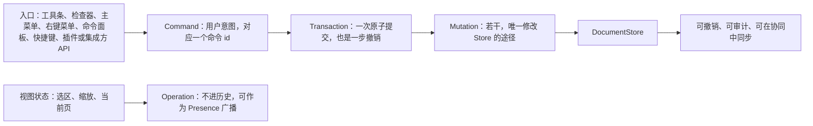
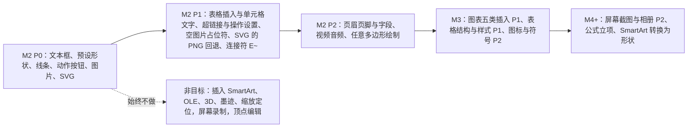
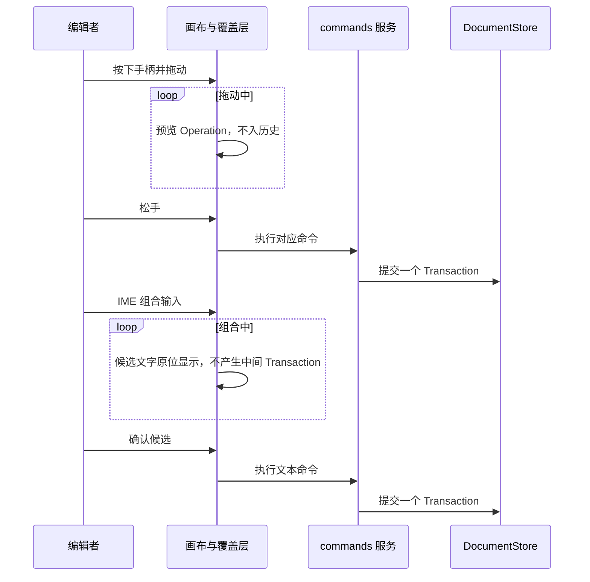
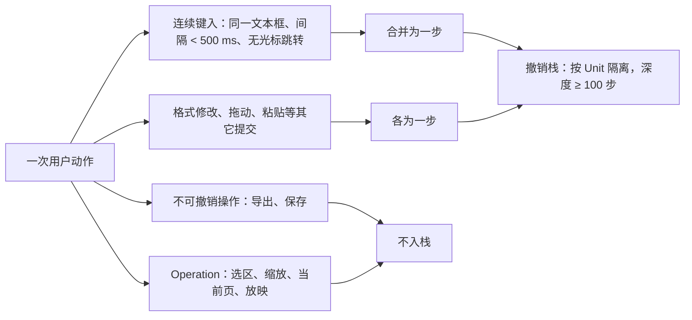
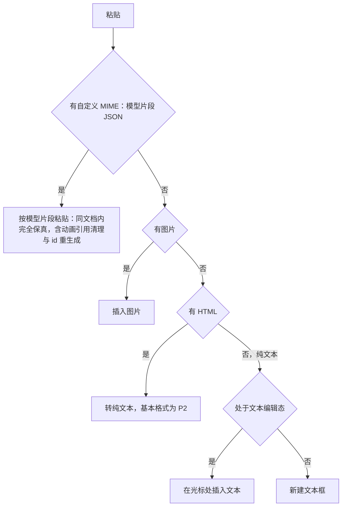
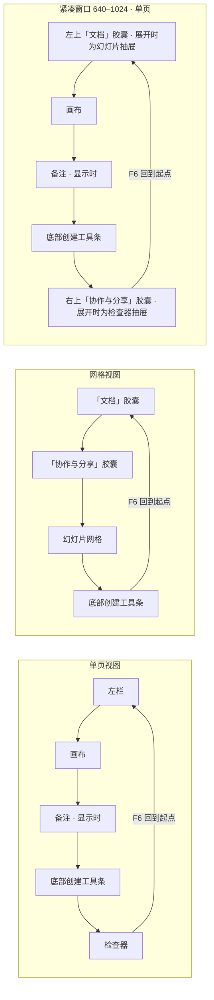

> 状态：草稿 | 负责：产品 | 更新：2026-09-19；2026-09-24（rulings §4.15：Q7 竖排编辑改 E~(P2)、PD-18 结案与 AlternateContent 口径、放映结束态按场景；Q3 撤销语义与软删除墓碑）；2026-09-25（补图）；2026-09-25（矛盾收口，rulings §4.18）；2026-09-25（§4.19）；2026-09-26（§4.20：FE-02 ED-21 删去「远端更新可关闭」）；2026-09-26（§4.21：新增 §1a 可插入元素一览与 §5 非目标；ED-05 形状库约 72 项、线条落 `p:cxnSp`、插入工具态、动作按钮；ED-07 SVG 的 PNG 回退与空图片占位符；ED-10 表格 M2 可插入；ED-19 维持 M2 P1 并补操作设置；新增 ED-15a 插入图表（M3）与 ED-31–ED-35）；2026-09-26（§4.21 整合：ED-03 渐变 / 描边文字收口为 M2 P2；ED-07 补 SVG 与回退同批、EXIF / WebP 口径与相关插入条目；ED-16 登记 Mod+E 冲突待裁；§5 非目标补 a:sym 符号字体插入）；2026-09-30（§4.22 设计待决收口：ED-10 插入落点改为先填空内容占位符、网格与对话框上限改写、行高 0.41 in、边框 10 个预设；ED-07、ED-15a 从插入页签插入同口径）；2026-10-04（design-language-v3 第 0 批：入口与界面结构按 v3 改写（rulings §4.25 DS-1…DS-6），需求、编号、优先级、里程碑不变——§0 第 4 条与图 0-1 的入口；§1a 插入入口改为底部创建工具条与「更多」；ED-05、ED-26、ED-29 的「属性面板」改为检查器对应分区；ED-07、ED-10、ED-15a、ED-31–ED-35 的插入页签改为工具条，样张未列的写「随第 1 批定稿」；ED-12 改称检查器、依赖贡献点改为 `ui.inspectorSection`；ED-16 母版视图退出与快捷键提示位置，补样张未登记快捷键的说明；ED-18 备注开关；ED-22 补单页 / 网格两种视图（归属见 README PD-27）；ED-25 索引说明；ED-29 F6 顺序与图 2-4；ED-30 注明「⌘K」口径；§4、§5 各一处）；2026-10-04（design-language-v3 第 0 批：术语残留清理：ribbon / 状态栏 / `ui.ribbon` / `ui.statusBar` 的历史陈述改用 check-terms 认可的标记措辞（废弃、取代））；2026-10-04（design-language-v3 第 0 批：复验第 2 轮修正——§1a 工具条主行改为「七个工具加『更多』，共八项」（与设计 03-02 §3.4、70/06 断言一致）；页眉和页脚 / 页码 / 日期、图标两行入口改为「入口随第 1 批定稿」，不预设放在「更多」，并注明样张主菜单「插入」已列；ED-12 拖宽与 ED-22 三区可拖动注明 v3 样张为固定宽、是否保留随第 1 批定稿；ED-16 注删去已与本表一致的缩放提示 ⇧1）；2026-10-05（design-language-v3 第 0 批修正：快捷键按 rulings §4.25 DS-11、DS-16 定稿——ED-16 表命令面板改 Mod+K、替换改为 Windows/Linux Ctrl+H 与 macOS ⇧⌘H，新增一行登记超链接 Mod+Shift+K 与工具单键 V / T / S / C，注改写为单键生效条件与改键记录（放映 F5 / Shift+F5、缩放适应 Mod+0 不变，样张 ⌘↵ 作废）；ED-19 补入口与快捷键；ED-30 改 Mod+K；§1a 超链接行同步）；2026-10-05（design-language-v3 第 0 批修正：ED-16 快捷键作用域补「底部工具条」，工具单键注明「只在相关区域获得焦点时生效」即满足 WCAG 2.1.4（NF-05 同步补行））；2026-10-05（design-language-v3 第 0 批修正：§1a 工具条「更多」里样张原列的「组件」按 rulings §4.25 DS-19 改为已从样张删除、不实现；ED-12 无选中的「背景」「页面颜色」两节按 DS-20 合并为「背景」，原「文本选区时浮动迷你工具条（P1）」一条按 DS-13 作废、文字格式只在检查器，需求编号、优先级与里程碑不变）；2026-10-07（design-language-v3 第 1 批：按已拍板样张与 rulings §4.25 DS-21…DS-30、TB-1…TB-30 把「随第 1 批定稿」改为定稿表述，需求编号、优先级、里程碑不变——§1a 引言与入口表（「更多」文本组 / 插图组 / 链接…、「图片 ▾」的屏幕截图与相册、「全部形状 72 ›」、主菜单「插入」）；ED-05 调整手柄改为强调色菱形、补「更改形状 ▸」入口与「位置与大小」分区（DS-24、TB-18、DS-27）；ED-07「来自 URL」只接受 https（TB-7）；ED-09 网格三档 6 / 12 / 18 pt、缺省 12 pt、入口与偏好（DS-27，SR-4 结案）；ED-10 网格读数「R 行 × C 列」与对话框文案、结构命令入口（TB-8、DS-22）；ED-11 隐藏页入口（DS-25）；ED-12 分区定稿、对象一律不设迷你工具条与快速操作条、检查器拖宽 240–480 且不设折叠、窄屏改指设计 03-02 §5a（DS-13、DS-22、TB-4、TB-25、TB-29）；ED-15 数据面板替换检查器栏 280 → 400、类型下拉与确认、只读类型说明卡（DS-26、TB-11、TB-13）；ED-15a 插入后展开「数据」分区（TB-12）；ED-16 登记删除线 / 上标 / 下标、放大 / 缩小与粘贴为纯文本 P2 及作用域，「关闭母版视图」定为画布顶部横幅按钮 + 主菜单「视图」（DS-29、DS-21、TB-19）；ED-18 备注拖高范围；ED-19 命令名「链接…」与形状右键、操作设置入口（TB-6、TB-18）；ED-22 缩放读数与菜单、三条分隔条可拖且按文档记在本机、地址栏视图参数、窄屏形态（TB-24、TB-25、TB-30、DS-17）；ED-23 保存态状态行；ED-25 母版视图不设常驻入口；ED-26 替代文本节与锁定说明；ED-27 手机评论含发表（DS-28）；ED-29 键盘等价落点（含连接符端点下拉，TB-21）与 F6 顺序补紧凑、仅查看形态，图 2-4 加紧凑分组；ED-30 主菜单「帮助」可见入口；ED-31–ED-35 入口定稿，ED-31「应用」作用于所选页、ED-33 不可用原因文案）；2026-10-08（design-language-v3 第 1 批收口：按 rulings §4.25 DS-31 与 TB-20、TB-27、TB-28、TB-31…TB-33、TB-37、TB-41、TB-43、TB-45、TB-47、TB-49、TB-52 回写，需求编号、优先级、里程碑不变——ED-03 段距与固定行距始终按 pt 显示（TB-33）；ED-05 引用的 OOXML 默认值保留原单位（TB-37）；ED-06 快速样式入口（DS-31）、不透明度同时写填充与描边 alpha（TB-47）、图片填充与内阴影留在原位标 P2（TB-43）；ED-09 检查器对齐行与右键同一组命令（TB-20）；ED-11 幻灯片大小入口（DS-31）；ED-12 标题由「与上下文工具」改为「与右键菜单」（对象上下文工具条已取消），形状分区补快速样式与替代文本（DS-31、TB-32），插件分区的收纳随第 2 批（TB-31）；ED-13 补入口、M2 不查备注、只读与降权下不显示替换行（TB-27、TB-28）；ED-20 补入口并注明 TB-45；ED-22 面板尺寸登出与换人时清除（TB-41）；ED-26 形状也有替代文本节（TB-32）；ED-27 平板仍只读评审（TB-49）；ED-31、ED-33 弹层关闭后焦点回到插入符（TB-52））；2026-10-08（design-language-v3 第 1 批评审修改：ED-06 快速样式的 42 格样式库由弹层改为在形状检查器「快速样式」节里原位展开、不遮挡画布，选一格即应用、样式库保持展开（rulings §4.25 DS-34 修订 DS-31，原「样式库弹层」作废）；需求编号、优先级、里程碑不变）；2026-10-15（design-language-v3 第 2 批：按已拍板的协作族样张回写，需求编号、优先级、里程碑不变——§1a「更多」与主菜单「插入」里插件条目很多时分组进子菜单（rulings §4.25 DS-49）；ED-12 检查器插件分区超过 2 个时默认折叠（DS-49，TB-31 结案）、整栏面板按内容分 280 / 400 两档与个人插件面板为对话框（DS-38）、无法显示的对象与缺插件元素共用「降级对象」分区（DS-52）；ED-22 仅查看形态顶部条在离线等同步异常时换成同步状态、窄屏横幅排在最顶上（DS-60）；ED-27 手机评论样张拍板时确认平板仍只读评审（DS-46））；2026-10-15（design-language-v3 第 2 批回写补充：ED-12 整栏面板两档的宽度按 rulings §4.25 TB-60 改写——列表与报告类沿用检查器当前宽度（缺省 280）、开着时分隔条照常可拖，编辑与整页类宽 max(400, 检查器当前宽度)、开着时分隔条不可拖、关闭后回到原宽；ED-12 插件分区补「分区声明了整页面板时宿主画『展开』、面板跟着选中对象」（TB-59）；ED-15 数据面板同一宽度口径；需求编号、优先级、里程碑不变）；2026-10-22（design-language-v3 第 3 批：ED-12 紧凑形态的检查器抽屉从横幅下沿开始、版本历史与保真报告进抽屉、插件整页面板改画布底部 Sheet（rulings §4.25 DS-130）；ED-16 表补「导出…」`Mod+Shift+E`，`Mod+E` 冲突按 DS-78 结案；ED-21 放映的窗口内舞台「全屏」与吞 F5（DS-108）、指针与触控（TB-111）、跳页提示条（TB-104）、退出停在最后显示的页与结束页（DS-109、TB-102）、隐藏页与全部隐藏（TB-111）、指针随控制条隐藏且不做键盘提示浮层与「显示 / 隐藏光标」（DS-107）、放映中的权限变化（TB-112）、跟随主讲人放映（DS-106、TB-113）；ED-22 紧凑抽屉从横幅下沿开始（DS-130），仅查看状态行按触控与嵌入分写（TB-125、DS-112）；ED-27 平板评论面板按方向落位（DS-131）；ED-30 常用命令固定清单（TB-117）、「阅读顺序…」打开偏好设置（DS-116）、不加遮罩（DS-117）；需求编号、优先级、里程碑不变）；2026-10-22（design-language-v3 第 3 批回写补充：ED-18 只读备注没有内容时一律写「这一页没有演讲者备注」（rulings §4.25 DS-138）；ED-21 浏览器或容器不允许全屏时放映「更多」里没有「全屏」（TB-134）；ED-30 命令面板的「帮助中心」只在配置了帮助链接时列出（TB-132）；需求编号、优先级、里程碑不变）；2026-10-22（design-language-v3 第 3 批回写收口：ED-22 仅查看状态行按宽度 < 640 与平板分写，嵌入里的平板以触控为准、仍写「仅查看 · 在电脑上编辑」（rulings §4.25 TB-125、TB-159）；ED-30 导出…、版本历史、保真报告、插件…与帮助中心在命令面板里各有一条（TB-162）；需求编号、优先级、里程碑不变；2026-10-22 复核修正：ED-16 补触控形态的菜单项一律不写键位提示（rulings §4.25 TB-164），ED-22 写明「触控设备」只指平板、手机按窗口窄写（TB-163）；ED-22 仅查看形态里横幅在最顶上推及平板、按钮只在一行放不下时才换到文案下方（TB-172），触控形态的按钮照常 44 高、横幅随之撑高（TB-172；横幅统一的高 40 指非触控形态，DS-75））；2026-11-04（design-language-v3 母版视图改版：ED-12 无选中时「版式」节标题右侧的「编辑版式」与选中对象本身是占位符形状时检查器顶行的「转到版式」，两者只读展示时也留在原位、不可用（rulings §4.25 DS-147、DS-174，DS-15 的例外）；ED-16「母版视图」一行改为不能进入时 `Mod+Alt+M` 不切换、给一次轻提示「母版视图：〈原因〉」，放映中不响应（DS-163），新增「插入版式（母版视图）」「复制所选版式（母版视图的窗格）」一行，「工具（单键）」一行与「工具单键」一条补母版视图的 P（DS-150、DS-152、TB-196）；ED-25 索引补两个上下文入口（DS-147、DS-174）；需求编号、优先级、里程碑不变） | 依赖：charter v0.2；rulings §4.15、§4.18、§4.19、§4.20、§4.21、§4.22、§4.25

# 功能域 02：编辑

> 需求编号前缀 `ED-`。本文件是 M2「单人编辑」的主要验收来源。可编辑范围的**上限**由 `01-open-and-fidelity.md` §2 支持矩阵中的 `E`/`E~` 等级决定；本文件不得超出该矩阵。界面布局与交互细节由设计条线负责（设计 01/03/06），本文只定义行为、边界与验收。

---

## 0. 本域的产品立场

1. **一切修改都是命令**：用户的每个编辑意图对应一个 `Command`，在一个 `Transaction` 内落为若干 `Mutation`；视图状态（选区、缩放、当前页）是 `Operation`，不进历史（章程 D4、继承 Univer K1）。这意味着：任何编辑都可撤销、可审计、可在协同中同步、可被插件通过命令面板调用——**没有「UI 私有」的修改路径**。
2. **编辑不破坏保真**：编辑器只写显式覆盖，不把继承来的属性「烤」进元素（OF-04）；不理解的属性原样保留（OF-18）。
3. **能选中就能操作**：任何渲染出来的元素（包括降级占位的 SmartArt/OLE）都可以选中、移动、缩放、删除；能否进入内部编辑由支持矩阵决定（PD-18 已结案，rulings §4.15 Q7）：SmartArt/OLE/3D/公式/墨迹/缩放定位等 `mc:AlternateContent` 内对象只建模变换，删除 M1 起可用（P0），整体移动/缩放 M2 P1，内部不可编辑并提示（OF 矩阵 §2.1 备注 A）；这些对象都不提供插入（§5 非目标，rulings §4.21），逐元素设计见 [50/25](../../50-frontend/25-elements-readonly-and-opaque.md)。
4. **键盘等价**：每个拖拽操作都有键盘等价（WCAG 2.2 2.5.7），工具条、检查器与菜单里的每个功能都有命令 id 与可选快捷键（2026-10-04 起 ribbon 已被工具条与检查器取代，rulings §4.25 DS-1）。

**图 0-1 一个编辑意图的落库路径**



怎么读：上排是所有文档修改的唯一路径，没有「UI 私有」的旁路；下排的视图状态变化走 `Operation`，不产生事务。
依据：本节 §0 第 1 条；章程 D4。

---

## 1. 编辑对象与操作总览

```
 选择对象            允许的操作（M2）                                     内部编辑
 ───────────────── ─────────────────────────────────────────────────── ────────────
 形状 sp            移动/缩放/旋转/翻转/填充/线条/阴影/文本/层级/对齐/组合   文本 ✓
 连接符 cxnSp       移动/缩放/线条/端点连接                                 –
 图片 pic           移动/缩放/旋转/裁剪/替换/透明度/替代文本                 –
 组合 grpSp         移动/缩放/旋转/组合/取消组合/双击进入                    子元素 ✓
 表格 graphicFrame  插入/移动/缩放/单元格文本（结构编辑 M3）                单元格 ✓
 图表 graphicFrame  移动/缩放（插入与数据编辑 M3）                          –（M3 ✓）
 SmartArt/OLE/3D/   移动/缩放/删除（AlternateContent 内对象同步各分支 xfrm）   –（进入时提示）
 公式/墨迹/缩放定位 不提供插入（§5）
 媒体 pic(video)    移动/缩放/海报替换                                      –
 幻灯片             新建/复制/删除/重排/隐藏/换版式/背景/重置                –
 备注               文本编辑                                                –
 母版 / 版式        母版视图只读（M2，ML-01）；占位符增删/移动/缩放/类型、母版文本样式、背景、版式增删改名（M3，ML-03）  占位符 ✓（M3）
```

### 1a. 可插入元素一览（2026-09-26，rulings §4.21）

插入入口在底部创建工具条（2026-10-04 起，rulings §4.25 DS-1、DS-5；2026-10-07 按已拍板的第 1 批样张定稿，DS-21，设计 03-04 §2）：主行为选择、文本、形状、图片、表格、图表、评论七个工具加「更多」，共八项（未装评论包时没有「评论」，为七项；设计 03-02 §3.4）。低频插入与插件的插入按钮进「更多」，自上而下为「文本」组（页眉和页脚… · 日期和时间… · 幻灯片编号 · 符号… · 公式）、「插图」组（图标… · 视频 · 音频）、链接…（⇧⌘K）与末尾的插件分组（设计 03-04 §4；插件不超过 3 个且每个不超过 3 条时每个插件一组平铺，否则改为「插件 · N」小标题、每个插件一行、条目进子菜单，主菜单「插入」同一规则，2026-10-15，rulings §4.25 DS-49）；屏幕截图、相册在工具条「图片 ▾」里；主菜单「插入」按工具条顺序列出全部插入命令，是不常驻的第二入口（设计 03-04 §6）。本里程碑范围内暂不可用的条目（公式 M4+、视频与音频 P2、屏幕截图与相册 M4+、不在文本编辑态时的「符号…」）留在原位、不可用，右侧写短原因（设计 03-04 §7.3）。样张原列的「组件」没有对应需求，2026-10-05 按 rulings §4.25 DS-19 从样张删除、不实现，以后需要再走新增需求的变更；原插入页签七组（rulings §4.21 d-61）随 ribbon 废弃。下表是全部可插入元素的入口、里程碑与对应需求；每个元素「有什么作用、怎么设计」（固定 14 栏）见 [50/19 可追加元素目录](../../50-frontend/19-insertable-elements-overview.md) 与 50/20–50/25 六篇族文档。插入的通用行为（插入工具态、默认落点、一次插入一个撤销步、规模守卫）写在 ED-05，其余条目只写差异。

| 元素 | 入口 | 里程碑 / 优先级 | 需求 |
|---|---|---|---|
| 文本框 | 工具条「文本」（T）；主菜单「插入 › 文本框」 | M2 P0 | ED-05 |
| 预设形状（首批约 72 项、10 类） | 工具条「形状」（S）弹层：常用 12 个形状，其下「全部形状 72 ›」在同一弹层原位展开完整形状库（设计 03-15 §1–§2）；主菜单「插入 › 形状库…」 | M2 P0；调整手柄、更改形状 P1 | ED-05 |
| 线条（直线、箭头，写为 `p:cxnSp`） | 形状弹层的直线、箭头线；其余线条在形状库「线条」类 | M2 P0 | ED-05 |
| 连接符（肘形、曲线） | 形状库「线条」类 | M2 P1（E~）/ M3 P1（E） | ED-28 |
| 动作按钮与「操作设置」 | 形状库「动作按钮」类；操作设置另有检查器形状分区的「操作」一行与形状右键「操作设置…」（ED-19） | 插入 M2 P0；操作设置 M2 P1 | ED-05、ED-19 |
| 任意多边形、曲线、自由曲线 | 形状库「线条」类末三项（P2 前留在原位不可用并标 P2） | M2 P2 | ED-05 边界 |
| 图片（本地、拖入、粘贴、URL） | 工具条「图片 ▾」：此设备… / 来自 URL…；也可拖入画布或粘贴；主菜单「插入 › 图片 ▸」 | M2 P0 | ED-07 |
| SVG（同时生成 PNG 回退） | 同图片 | M2 P0；PNG 回退 P1 | ED-07 |
| 空内容占位符填入 | 占位符中间的图标条；工具条「图片」「表格」「图表」按 ED-07 的落点规则填入 | 图片 M2 P1；表格随 ED-10；图表随 ED-15a；视频随 ED-35 | ED-07 |
| 表格 | 工具条「表格」：8 行 × 10 列网格 +「插入表格…」；主菜单「插入 › 表格…」 | 插入与单元格文字 M2 P1；结构与样式 M3 P1 | ED-10 |
| 图表（五类） | 工具条「图表」：五类与子类型菜单；主菜单「插入 › 图表…」 | M3 P1 | ED-15a、ED-15 |
| 超链接 | 工具条「更多 › 链接…」、主菜单「插入 › 链接…」、文本与形状右键「链接…」（Mod+Shift+K，2026-10-05 由 Mod+K 改，rulings §4.25 DS-11；命令名 2026-10-07 统一为「链接…」，TB-6） | M2 P1 | ED-19 |
| 页眉和页脚、页码、日期 | 「更多」文本组：页眉和页脚… · 日期和时间… · 幻灯片编号（不在文本编辑态时后两项也打开页眉和页脚对话框，文本编辑态时在光标处插入字段，设计 03-04 §7.4）；主菜单「插入」同组 | M2 P2 | ED-31 |
| 视频、音频 | 「更多」插图组；主菜单「插入」同项（P2 前留在原位不可用并标 P2） | M2 P2 | ED-35 |
| 图标 | 「更多」插图组「图标…」；主菜单「插入 › 图标…」 | M3 P2 | ED-32 |
| 符号与特殊字符 | 「更多」文本组「符号…」；主菜单「插入 › 符号…」（文本编辑态可用，其余时候不可用并写「先在文本框中放置光标」） | M3 P2 | ED-33 |
| 屏幕截图、相册 | 工具条「图片 ▾」里的「屏幕截图」「相册」与主菜单「插入 › 图片 ▸」同项（M4+ 前留在原位不可用并标 M4+）；多图「每图一页」 | M4+ P2 | ED-34 |
| 公式 | 「更多」文本组「公式」与主菜单「插入 › 公式」（M2 起不可用并标 M4+，「暂不支持」口径不变） | M4+ 立项（OMML 往返） | OF §2.7 公式行 |
| 第三方扩展元素 | 工具条「更多」末尾的插件分组（插件项排在内置项之后）、主菜单「插入」末尾同一分组或命令面板 | M2 P0（可插拔验收） | PS-02、PS-04 |
| SmartArt、OLE、3D 模型、墨迹、缩放定位；屏幕录制 | 不提供 | 非目标 | §5 |

**图 1a-1 插入能力按里程碑展开**



怎么读：实线从左到右是插入能力逐级展开的顺序，前一级的能力在后续里程碑保留；虚线指向 §5 的非目标，任何里程碑都不提供。
依据：本节 §1a 表；rulings §4.21 q-table-depth、q-chart-route、q-media-insert、q-extra-inserts、d-75。

---

## 2. 需求

### ED-01 选择模型与命中测试

- 优先级：P0 | 目标里程碑：M2 | 依赖能力：`engine-render` 命中测试与覆盖层契约、`Selection` 类型（`model-core`）、`Operation`
- 用户故事：作为编辑者，我希望像在 PowerPoint 里一样点选、框选、Shift 多选、进入组合，以便快速定位要改的对象。
- 验收标准：
  - Given 元素重叠，When 点击，Then 选中 z 序最高且命中其填充/描边/文本的元素；`fill="none"` 的形状仅描边与文本可命中（与 PowerPoint 一致）。
  - Given 拖出框选矩形，Then 完全包含的元素被选中（默认）；按住 Alt 为「相交即选」。
  - Given 选中组合，When 双击子元素，Then 进入组合并选中该子元素；Esc 逐级退出，顺序为：文本编辑 → 选中子元素 → 选中整个组合（退出组合编辑态）→ 取消选择 →（仅在母版视图中且已无选区时）退出母版视图，与 PowerPoint 一致（rulings §4.18 UX-06）。
  - 多选显示统一包围盒；Tab/Shift+Tab 按 z 序循环选择；Ctrl/Cmd+A 全选当前页。
  - 命中测试 p95 ≤ 2 ms（300 元素页）；选择变化是 `Operation`，不进入撤销栈，可作为 `Presence` 广播。
- 边界：锁定（`spLocks`）的元素可选中但对应操作禁用并提示；隐藏元素（`hidden="1"`）默认不可选，可在「选择窗格」（P2）中选中。

### ED-02 文本内联编辑与 IME

- 优先级：P0 | 目标里程碑：M2 | 依赖能力：`render-dom` IME 文本输入宿主、`DocumentStore` 富文本类型、`Command`（`text/insert`、`text/delete` 等）
- 用户故事：作为编辑者，我希望双击文本直接在原位输入中文/日文/英文，光标与换行所见即所得。
- 验收标准：
  - Given 双击文本框，Then 进入文本编辑态，光标落在点击位置；单击空文本占位符直接进入编辑。
  - Given 使用 IME 输入（拼音/日文假名/韩文），Then 组合过程中的候选文字在原位显示，不产生中间 `Transaction`；确认后产生一个 `Transaction`。
  - 键入延迟（keydown → 屏幕更新）p95 ≤ 50 ms；IME 组合更新 p95 ≤ 80 ms。
  - 支持：方向键/Home/End/PageUp-Down、按词跳转（Ctrl/Alt+方向）、Shift 选择、双击选词、三击选段、Ctrl/Cmd+A 选全文本框内容。
  - 文本编辑直接作用于 Store 的富文本类型，不存在第二份编辑缓冲（规避 Univer A32）。
  - 文本框自动增长（`spAutoFit`）在输入时实时更新形状高度（每帧 ≤ 1 次布局）。
- 边界：竖排文本编辑按 OF 矩阵 §2.7 为 M2 **E~ (P2)**（`vert`/`vert270`/`eaVert`/`wordArtVert` 均不承诺 P0/P1，rulings §4.15 Q7）；RTL 文本编辑为 M4/M5。

### ED-03 字符与段落格式

- 优先级：P0 | 目标里程碑：M2 | 依赖能力：`Command`/`Mutation`、`model-slide` 样式继承（写显式覆盖）
- 验收标准（每项 Given 选中文本或文本框 When 操作 Then 导出后 PowerPoint 显示一致）：
  - 字符：字体族（含主题字体选项 `+mj-lt`/`+mn-lt`，东亚字体独立设置）、字号（1–4000 pt，步进按 PowerPoint 阶梯）、粗体、斜体、下划线（单）、删除线（单）、上标/下标、字体颜色（主题色 + 标准色 + 自定义 + 最近使用）、高亮、大写/小型大写、清除格式。
  - 段落：左/中/右/两端/分散对齐、缩进增减、段前/段后距、行距（1.0/1.15/1.5/2.0/自定义倍数与固定值）、文本方向（P2）；段前、段后与固定行距的显示单位与字号一样始终是 pt，不随度量单位设置换算（同 PowerPoint，rulings §4.25 TB-33）。
  - 文本框：垂直锚点、内边距、自动换行开关、自动调整模式（不调整/溢出时缩小/根据文字调整形状大小）。
  - Given 光标在文本框内无选区，When 应用字符格式，Then 作用于当前词（与 PowerPoint 一致）；空文本框上应用格式作用于段落结束属性（`a:endParaRPr`）。
  - 字号增大/减小快捷键按 PowerPoint 阶梯（8,9,10,10.5,11,12,14,16,18,20,24,28,32,36,40,44,48,54,60,66,72,80,88,96）。
- 边界：字距（`spc`）、字符缩放为 P2；渐变 / 描边文字为 M2 P2（作为字符格式提供；艺术字样式库 M4+，见 50-frontend/20 §5，2026-09-26 整合收口）。

### ED-04 项目符号与编号

- 优先级：P0 | 目标里程碑：M2 | 依赖能力：同上
- 验收标准：
  - 切换项目符号（默认 •，可选 7 种预设字符）、切换编号（arabicPeriod、alphaLcPeriod、romanUcPeriod、circleNumDbPlain 等 ≥ 8 种预设，含 `ea1ChsPeriod` 中文数字）、无。
  - Tab/Shift+Tab 在段首时升降级（级别 0–8），级别切换后继承对应 `lvlNpPr` 样式。
  - 编号起始值可设（`startAt`）；连续段落编号连续，级别变化重新计数（与 PowerPoint 一致）。
  - 项目符号颜色/大小跟随文字或自定义（P1）；图片项目符号 P2。

### ED-05 形状插入与几何变换

- 优先级：P0 | 目标里程碑：M2 | 依赖能力：`engine-layout` 预设几何、`Command`、`slide.shapeKind` 贡献点
- 用户故事：作为编辑者，我希望从图库插入形状并用手柄拖动，与 PowerPoint 手感一致。
- 验收标准：
  - 图库首批约 72 项预设形状、10 类（最近使用、线条、矩形、基本形状、箭头、公式形状、流程图、星与旗帜、标注、动作按钮；≥ 60 种为验收下限，清单与缩略图在构建期由预设几何表生成，rulings §4.21 d-66）。
  - 插入工具态（rulings §4.21 d-62，所有插入入口共用）：选中工具后光标变十字；在画布单击以默认尺寸插入（形状 1 in × 1 in，左上角落在点击处），位移超过 4 px 视为拖出，按拖出矩形插入（Shift 锁比例、Alt 以中心）；Esc 取消工具且不产生命令；键盘在工具上按 Enter 插到视口中心，连续插入依次错位 0.2 in；插入后选中新元素并按类型进入子编辑态（文本框进入文本编辑）；每次插入一个 `Transaction`、一个撤销步；超出规模上限（单页 1,000 / 全文 20,000 / 200 页）时拒绝并提示 `document.quota_exceeded`，不产生事务。
  - 默认样式只写主题引用（`p:style`，取主题 `objectDefaults` 的形状 / 线条默认项，无则用 PowerPoint 内建引用），不把主题值烤成显式属性；换主题后新插入与既有未覆盖的元素都随之变化（d-63）。
  - 线条：「线条」类的直线、箭头、双箭头与肘形、曲线连接符都以 `p:cxnSp` 写出（d-64）；以拖出为主，单击插入 1 in 水平线；Shift 约束 0° / 45° / 90°；两端各一个端点手柄；导入文件里的 `p:sp` + `prstGeom line` 保持原样、不改写为 `cxnSp`。
  - 动作按钮：「动作按钮」类 12 项插入后立即弹出「操作设置」对话框，并带该按钮的默认动作（首页、上一页、下一页、最后一页、最近观看、结束放映等，规则见 ED-19）；插入与动作设置为同一撤销步（d-77）。
  - 手柄：8 个缩放手柄（Shift 锁比例、Alt 以中心缩放）、旋转手柄（Shift 步进 15°）、调整手柄（`avLst` 每个 `gd` 一个，P1；强调色菱形，与选中框同一种彩色，设计 03-15 §4；2026-10-07 起原黄色作废，rulings §4.25 DS-21、DS-24）；ESC 取消当前拖动。
  - 更改形状（P1）：入口为形状右键「更改形状 ▸」（排在「旋转」之后；P1 开放前留在原位不可用，rulings §4.25 TB-18，设计 03-05）。
  - 移动：拖拽、方向键微移 1 px（屏幕）/ Shift+方向 10 px；Ctrl/Cmd+拖拽复制。
  - 检查器「位置与大小」分区（所有对象共用，设计 03-02 §4.2）可直接输入 X / Y / W / H / 旋转（显示单位随设置 cm / in / pt / px，中文默认 cm、英文默认 in，rulings §4.25 DS-27；内部 EMU）。DS-27 只管界面显示值：本文引用 OOXML / PowerPoint 默认值的数字（形状 1 in × 1 in、连续插入错位 0.2 in、表格行高 0.41 in 等）保留原单位（rulings §4.25 TB-37）。
  - 翻转（水平/垂直）；等比锁定（`noChangeAspect` 或用户设置）。
  - 每次拖动仅产生一个 `Transaction`（拖动中为预览 `Operation`，松手落库）。
  - 文本框工具：点击插入自动增长（不换行、宽随文字）的文本框并立即进入编辑；拖出插入固定宽度自动换行文本框；一个字都没输入就退出编辑时，文本框自动删除，且与插入合并为同一撤销步、不留空步（d-65）。
- 边界：自定义几何顶点编辑为非目标（§5）；任意多边形、曲线、自由曲线的绘制 P2；更改形状与调整手柄 P1。

**图 2-1 拖动与 IME 输入的事务边界**



怎么读：纵向为时间，两段交互各自只在「松手」「确认」时落库一次，即一次拖动或一次 IME 确认各产生一个 Transaction；连续键入如何合并为一步撤销见 ED-14。
依据：ED-05「每次拖动仅产生一个 Transaction」；ED-02 IME 条款。

### ED-06 填充、线条与效果

- 优先级：P0（纯色/线条）/ P1（渐变、阴影） | 目标里程碑：M2 | 依赖能力：`Command`、`ooxml-core` DrawingML 编解码
- 验收标准：
  - 填充：无 / 纯色（颜色选择器：主题色 10 列 × 6 行明暗变体、标准色、最近使用、自定义 HEX/RGB/HSL、取色器 P2）+ 透明度；渐变（线性，2–10 stop，角度，预设 P1）；图片填充（P2）；图案（P2）。
  - 线条：无 / 纯色、宽度（0.25–100 pt）、虚线类型（8 种 `prstDash`）、端点/连接（P2）、箭头首尾类型与尺寸（连接符与线条）。
  - 效果：阴影预设（PowerPoint 外阴影 9 种 + 无）+ 自定义（颜色/透明度/模糊/距离/角度，P1）；其它效果 P2。
  - P2 项的呈现：图片填充与内阴影在检查器「填充」「阴影」节里留在原位、不可用并标 P2（rulings §4.25 TB-43、§4.20 FE-06）。
  - 不透明度（形状检查器「不透明度」节）：同时写填充与描边颜色的 alpha（OOXML 形状没有整体不透明度），一次修改一个撤销步（2026-10-08，rulings §4.25 TB-47）。
  - 形状快速样式（主题 `fmtScheme` 组合 42 种，P1）：入口在形状检查器「填充」节上方，一行主题样式缩略图，点开后 42 格样式库（7 列主题色 × 6 行样式强度，设计 04 §4.1a）在「快速样式」节里原位展开、不遮挡画布，选一格即应用（一个撤销步）、样式库保持展开以便连续比较，可随时收起（2026-10-08，rulings §4.25 DS-34 修订 DS-31：原「样式库弹层」作废）；原 ribbon「绘图」组的「快速样式 ▾」随 ribbon 废弃（2026-10-08，rulings §4.25 DS-31）。
  - 「设为默认形状」（P2）。
  - 多选时应用属性对所有选中元素生效，一个 `Transaction`。

### ED-07 图片操作

- 优先级：P0 | 目标里程碑：M2 | 依赖能力：`FormatCodec` 媒体部件写入、`Command`
- 验收标准：
  - 插入：本地文件（png/jpg/gif/svg/webp/bmp；单张 ≤ 25 MB 默认；多选时依次错位插入）、拖入画布、粘贴、URL（只接受 https，rulings §4.25 TB-7、前端 50/14 §5；集成方可禁用；默认不经服务端代抓，浏览器直接下载后内嵌）；插入后按页面适配缩放（最长边不超过页面 60%，缺 DPI 按 96 换算）；上传期间显示占位与进度，失败可重试（字节走资源上传通道，CO-12）。
  - SVG：插入 SVG 时在浏览器中栅格化生成 PNG 回退（2 倍显示尺寸，最长边 ≤ 2048 px），导出同时写 `asvg:svgBlip` 与 `a:blip`，PowerPoint 旧版本显示回退图（P1）；SVG 插入（P0）与 PNG 回退（P1）同批交付，不单独上线无回退的写出（50-frontend/23 §13 Q-5）；导入的无回退 SVG 保持原样写回。
  - 字节口径（50-frontend/23 §13 Q-7）：插入时不按 EXIF 方向规范化、WebP 不转码为 PNG，都不改源字节；插入 WebP 时提示「旧版 PowerPoint 可能无法显示」。
  - 相关插入条目：图标见 ED-32（M3 P2），屏幕截图与相册见 ED-34（M4+ P2，屏幕录制不做，§5），视频与音频见 ED-35（P2，不写 `p:timing`，编辑态可点击临时播放、不写入文档；放映中 M1–M3 一律点击播放，50-frontend/23 §13 Q-9）。
  - 空内容占位符（P1，rulings §4.21 d-69）：页上空的内容 / 图片占位符中间显示图标条，点「图片」图标选择文件或把图片拖到空占位符上即填入；填入后保留占位符身份（`p:ph`），删除图片后恢复为空占位符；表格、图表、视频图标分别随 ED-10（M2）、ED-15a（M3）、ED-35（P2）启用，图标条不显示 SmartArt 与剪贴画。从底部工具条的「图片」「表格」「图表」插入时同一口径：页上有空内容占位符（`obj` 或同类 `pic` / `tbl` / `chart`）就填入阅读序第一个（已选中的空占位符优先），没有才按默认落点插入（rulings §4.22）。
  - 替换图片保留位置尺寸与裁剪；重置图片。
  - 裁剪：矩形裁剪（拖动裁剪手柄，显示遮罩），裁剪为形状 P2，填充/适合 P1。
  - 透明度（`alphaModFix`），亮度/对比度 P2。
  - 替代文本编辑（用于 a11y 与导出）。
  - 大图（> 4096 px）插入时提示并可选压缩为 ≤ 2048 px（P1，不改变原文件已存图片）。
- 边界：图片编辑不修改源位图字节（除用户显式压缩）；EMF/WMF 图片可移动/缩放/删除但不可裁剪（P2），且不接受插入（文件选择器不列出；粘贴含 EMF 的内容时取剪贴板里的 PNG 项）。

### ED-08 组合、层级顺序与对象操作

- 优先级：P0 | 目标里程碑：M2 | 依赖能力：`Command`
- 验收标准：
  - 组合（≥ 2 个元素，含跨类型）/ 取消组合（一层）；组合后子元素坐标经 `chOff/chExt` 换算正确；取消组合后属性不变。
  - 层级：上移一层 / 下移一层 / 置顶 / 置底；选择窗格显示 z 序列表并可拖动（P2）。
  - 复制（Ctrl/Cmd+D）在原位偏移 0.2 in；删除；重命名（`cNvPr@name`，P1）。
  - 组合内元素编辑（进入模式）支持与顶层相同的操作。
- 边界：跨页组合不支持；占位符参与组合时转为普通形状（与 PowerPoint 一致，提示用户）。

### ED-09 对齐、分布、吸附与参考线

- 优先级：P0（智能参考线与吸附）/ P1（对齐分布）/ P2（标尺与自定义参考线） | 目标里程碑：M2 | 依赖能力：`engine-render` 覆盖层、`Operation`
- 验收标准：
  - 拖动/缩放时显示智能参考线：与页面中心/边缘、与其它元素的边/中心对齐、等间距提示（选中框与参考线统一用强调色，以线型与数值角标区分类型，rulings §4.25 DS-24，设计 03-17 §2）；吸附阈值 4 CSS px（屏幕空间，随缩放不变）；按住 Alt 临时禁用吸附（画布提示签说明，设计 03-17 §4）。
  - 对齐：左/水平居中/右/顶/垂直居中/底；分布：横向/纵向等距；参照：所选对象 / 页面（单选时自动为页面）。入口为检查器顶部的对齐行（六向对齐 + 横向、纵向分布两个按钮；单选时分布按钮留在原位不可用）与右键「对齐与分布 ▸」，两处是同一组命令（rulings §4.25 TB-20，设计 03-02 §4.2、03-17 §5）。
  - 网格（可显示/隐藏，吸附到网格可开关）：间距三档 6 / 12 / 18 pt、缺省 12 pt，产品按设置的度量单位显示（中文默认 cm、英文默认 in）；2026-10-07 由「间距默认 0.2 in」改为此口径，rulings §4.25 DS-27，§4.22 SR-4 随之结案。入口为主菜单「视图 › 网格与参考线 ▸」与画布空白处右键的同一张清单；网格、参考线与吸附开关都是个人呈现偏好，只存本机、不同步给协作者、不入撤销历史（设计 03-20 §5、03-17 §7）。标尺与可拖出的参考线 P2；参考线持久化到 `p15:sldGuideLst`（P2）。
  - 吸附与参考线计算 p95 ≤ 4 ms（300 元素页）。

### ED-10 表格编辑

- 优先级：P1 | 目标里程碑：M2（插入与单元格文本）/ M3（结构与样式）（rulings §4.21 q-table-depth：插入由 M3 提前到 M2） | 依赖能力：`Command`、`tableStyles` 解析、`ElementRenderer`、表格归一化模型（ADR-0018）
- 验收标准：
  - M2 插入：底部工具条「表格」（主菜单「插入 › 表格…」打开同一弹层）的悬停网格弹层：悬停范围 8 行 × 10 列，标题行右侧读数「R 行 × C 列」，方向键移动、Enter 确认（2026-10-07 按已拍板样张定稿，rulings §4.25 TB-8，设计 03-30 §2.1）；或网格下的「插入表格…」对话框输入行列数：界面只写当前上限「行数、列数各 1–75」，主按钮「插入」（TB-8，设计 03-30 §2.2）；上限推迟到性能评估定值，触发条件为 M2 表格插入开工前完成大表渲染与协同基准，见 rulings §4.22，定值前暂按 75 × 75 占位，「上限待性能评估」是工程备注、不写进界面。也可点空内容占位符的表格图标，图标旁弹出同一个网格弹层（含「插入表格…」）。落点：页上有空内容占位符（`obj` 或 `tbl`）时填入阅读序第一个（已选中的空占位符优先），保留占位符身份（`p:ph`，同 ED-07 空内容占位符），宽取占位符框宽；没有时默认宽取正文占位符宽（无则页宽 80%）、水平居中（rulings §4.22）；行高 0.41 in（`a:tr@h=370840`，同 PowerPoint 新表格）；默认样式为内置「中度样式 2 - 强调 1」（`{5C22544A-7EE6-4342-B048-85BDC9FD1C3A}`）并开启标题行与镶边行；插入后选中第一个单元格并进入文本编辑；一次插入一个撤销步。
  - M2：双击单元格编辑文本，Tab/Shift+Tab/方向键在单元格间移动（Tab 于末单元格时新增一行，M3）；单元格内格式同 ED-03。
  - 模型约束（M3 开工前完成）：表格改为归一化结构——行、列各为按分数索引排序的记录表，单元格按「行 id : 列 id」寻址，合并记在锚格上（ADR-0018）；验收口径是协同下两人同时插行、插列或合并后，表格仍规整（每行的有效单元格覆盖全部列、跨度合法），导出 PowerPoint 打开无修复。
  - M3：插入/删除行列；合并/拆分单元格；拖动调整行高列宽（含整体缩放时按比例）；单元格填充/边框（10 个预设：无、全部、外侧、内部、内部横、内部竖、上、下、左、右，见设计 03-30 §6.4）；套用内置样式与标志（标题行/汇总行/镶边行/第一列/最后一列/镶边列）；文本对齐与垂直锚点；单元格内边距。结构命令（插删行列、合并拆分、删除表格；其中删除表格 M2 起可用，设计 03-30 §5.3）的入口为右键与命令面板，插行插列另有画布悬停「+」手柄；格式在检查器「表格样式」「单元格」「文本」分区；不设表格或单元格迷你工具条（2026-10-07，rulings §4.25 DS-22，设计 03-30 §5–§6）。
  - 表格结构编辑后导出，PowerPoint 打开无修复且样式一致（表格语料 SSIM ≥ 0.90）。
- 边界：对角线边框编辑 P2；表格内嵌图片 P2。

### ED-11 幻灯片管理

- 优先级：P0 | 目标里程碑：M2 | 依赖能力：`Command`、`FormatCodec`（部件新增/删除/rels 更新）、`ResourceHook`
- 验收标准：
  - 新建（基于当前版式或选择版式；Enter 于缩略图栏新建同版式页）、复制（保留全部内容含动画/切换/备注，重新生成 `creationId` 与元素 id）、删除（多选）、拖动重排（缩略图栏，含多选拖动与跨节拖动）、隐藏/取消隐藏（常驻入口为无选中时检查器「放映」节的「放映时跳过此页」，缩略图右键「隐藏幻灯片 / 取消隐藏」为第二入口；隐藏页的缩略图变淡并带斜线眼睛图标，2026-10-07，rulings §4.25 DS-25，设计 03-14 §3.5）、更换版式（占位符重匹配规则见 ML-02）、重置页（规则见 ML-02）、上下移动快捷键。
  - 节（M2 显示，M3 增删改）：节标题显示于缩略图栏，可折叠。
  - 页顺序在协同下的并发移动语义见 CO-08。
  - 删除页时，其独占部件随之删除；撤销删除页恢复全部部件与关系。
  - 删除在 Store 层落为**软删除墓碑**（rulings §4.15 Q3）：元素/页 id 保持稳定，读路径、渲染、导出、不变量一律过滤墓碑；服务端在 TTL（默认 24 h，部署可配）到期后硬删除；墓碑在 TTL 内计入文档总元素上限（SV-08）。撤销删除 = 清除墓碑，id 不变，评论锚点、`stCxn`、动画 `spid` 等引用不断。
  - 200 页缩略图栏滚动 ≥ 55 fps（虚拟化）。
- 边界：页面尺寸修改 P2（入口为主菜单「文件 › 幻灯片大小…」，P2 前留在原位、不可用并标 P2；2026-10-08，rulings §4.25 DS-31）；从其它文档复制页 M3 P1（ED-17）。

### ED-12 检查器（属性面板）与右键菜单

- 优先级：P0 | 目标里程碑：M2 | 依赖能力：`ui.inspectorSection`/`ui.contextMenu` 贡献点（`ui-core`；`ui.inspectorSection` 取代原 `ui.ribbon` 的格式分组与 `ui.panel` 的属性分组，rulings §4.25 DS-5；原 `ui.toolbar` 的对象上下文槽位随 TB-29 删除）、`slide-ui`
- 验收标准：
  - 检查器「设计」页签按选区类型切换分区（2026-10-04 起按 v3 结构，rulings §4.25 DS-1；2026-10-07 按已拍板的第 1 批样张定稿，DS-21；设计 03-02 §4）：无选中 = 幻灯片属性（版式 / 主题 / 背景 / 放映；「版式」节标题右侧有进入母版视图的「编辑版式」，2026-11-04，rulings §4.25 DS-147，ML-01；「背景」按 rulings §4.25 DS-20 合并了第 0 批样张的「背景」「页面颜色」两节，先选填充方式 纯色 / 渐变 / 图片，再选颜色，常用主题色做成色块快捷项；「放映」节的「放映时跳过此页」是隐藏页的常驻入口，DS-25，切换效果只读展示），形状（对齐行 / 位置与大小 / 快速样式 / 填充 / 描边 / 阴影 / 不透明度 / 操作 / 替代文本；快速样式一行在「填充」节上方、替代文本节在「操作」之后，2026-10-08 补，rulings §4.25 DS-31、TB-32，见 ED-06、ED-26），编辑文字（字体 / 段落 / 颜色 / 列表 / 文本框，设计 03-16 §4.1）；图片与已有视频音频（设计 03-18 §5）、整表与单元格（设计 03-30 §6.1）、图表（设计 03-31「检查器」）、空内容占位符（只放占位符属性与位置与大小，不设插入按钮组，DS-14，设计 03-16 §6.7）的分区以这些界面文档为准（类型清单仍按 rulings §4.21 d-72）；SmartArt、OLE、公式等只读与不透明对象只显示位置与大小、降级说明与替代文本；无法显示的对象与缺插件元素是同一种「降级对象」，检查器最上是对象说明（中性信息图标、标题、一句原因与「保真详情 / 查看详情」），然后是位置与大小（不旋转、不翻转），最后是对象自己的节（2026-10-15，rulings §4.25 DS-52，见 OF-13、PM-12）。选中对象本身是占位符形状时（空占位符，或来自版式占位符的标题、文本框，含正在编辑文字），检查器顶行写「继承自版式「〈版式名〉」」并给「转到版式」，进入母版视图并选中版式上对应的占位符；填进占位符的表格、图表、图片与媒体按各自对象的分区，不出这一行（2026-11-04，rulings §4.25 DS-147、DS-174，ML-01）。评审模式、只读角色与编辑模式已降权时各节只读展示当前值，顶部一行说明权限（DS-15）；例外是「编辑版式」与「转到版式」：只读展示时也留在原位、不可用，写与主菜单「母版视图」同一条原因（2026-11-04，rulings §4.25 DS-147）。多选时只显示公共属性，值不一致统一显示「多个值」（`MixedValueField`，rulings §4.18 UX-10）；修改即时生效并可撤销。
  - 右键菜单按选区类型显示相关命令（设计 03-05）；画布不设任何对象的迷你工具条或快速操作条（2026-10-07 第 1 批定稿：文字 rulings §4.25 DS-13，表格与图表 DS-22，图片同此）——文字格式只在检查器「文本」分区（表格单元格与图表里的文字同样），粗体、斜体等保留快捷键（ED-16）；图片的替换、裁剪、重置与压缩在检查器「图片」分区与右键（设计 03-18 §5）；表格的插删行列、合并拆分与删除表格走右键与命令面板，M3 起画布另有悬停「+」插入手柄（ED-10）；图表的「编辑数据」在检查器「数据」分区的「展开」，「更改类型」是「类型」字段的下拉（ED-15）。画布上唯一的浮条是图片裁剪模式框下的「取消 Esc / 完成 ↵」：「取消」回到进入裁剪前的状态，「完成」算一个撤销步（TB-4，设计 03-18 §6）。
  - 原「文本选区时浮动显示字体 / 字号 / B / I / 颜色（P1）」一条与图片、图表等对象快速操作条的设想一并作废（DS-13、DS-22）。
  - 全部属性控件有对应命令 id；插件可按选中对象类型向检查器贡献分区（`ui.inspectorSection`，见 `04-plugin-sdk.md` PS-02），针对所选对象的命令走检查器分区与右键对象菜单（`ui.contextMenu`，rulings §4.25 TB-29）；插件分区排在内置分区之后，同一选中对象的插件分区超过 2 个时全部默认折叠为一行（标题 + 归属标识），点标题行展开，展开状态按分区记在本机；不超过 2 个时照常展开（2026-10-15 第 2 批定稿，rulings §4.25 DS-49，TB-31 结案，设计 06 §2.12）；分区声明了同一插件的整页面板时，宿主在分区右下画「展开」，打开整栏面板，面板跟着触发它的选中对象（TB-59，PS-02 `ui.panel`）。
  - 检查器缺省宽 280；桌面形态（≥ 1024）左缘分隔条可拖宽 240–480 px（2026-10-07，rulings §4.25 TB-25；可用键盘调整，尺寸按文档记在本机，见 ED-22），不设折叠按钮（已拍板样张没有此控件，要更大的画布用网格视图或把面板拖窄，设计 03-20 §1、§6）；图表数据面板展开时整栏临时加宽到 400（DS-26，ED-15）；整栏面板按内容分两档（2026-10-15，rulings §4.25 DS-38、TB-60）：列表与报告类（版本历史 CO-07、保真报告 OF-13）沿用检查器当前宽度（缺省 280）、不加宽，开着时分隔条照常可拖，拖的就是检查器宽度；编辑与整页类（图表数据面板、插件整页面板 PS-02 `ui.panel`）宽 max(400, 检查器当前宽度)，开着时分隔条不可拖，关闭后回到检查器原宽；个人插件面板是居中对话框、不占检查器（PM-10）；网格视图收为右上「协作与分享」胶囊（ED-22）。窄屏按设计 03-02 §5a：紧凑窗口（640–1024）收为右上胶囊、按需展开为右侧抽屉（宽 280 固定、没有分隔条；从横幅下沿开始、不盖横幅，没有横幅时整高，2026-10-22，rulings §4.25 DS-130）；紧凑形态里版本历史与保真报告进这个抽屉（宽仍 280），图表数据面板与插件整页面板改为画布底部 Sheet（rulings §4.22 D-17、§4.25 DS-130）；仅查看形态（< 640 或触控）不渲染检查器（NF-07）。

### ED-13 查找与替换

- 优先级：P1 | 目标里程碑：M2 | 依赖能力：模型文本索引（OF-16）、`Command`
- 验收标准：入口为主菜单「编辑 › 查找… / 替换…」、快捷键（ED-16）与命令面板，面板是画布右上角的浮动面板、不占检查器（设计 03-21）；查找（区分大小写、全字匹配、正则 P2）跨页命中并高亮，M2 只查幻灯片内容、不含演讲者备注，面板不设「含备注」选项（2026-10-08，rulings §4.25 TB-27）；评审模式、只读浏览与编辑权限降级时不显示替换行与展开按钮，替换快捷键只打开查找（TB-28）；替换/全部替换为一个 `Transaction`（全部替换）；替换保留 run 格式（按首个 run）；D200 全部替换 ≤ 500 ms。

### ED-14 撤销 / 重做

- 优先级：P0 | 目标里程碑：M2 | 依赖能力：`history`（UnitScope 内）、`Transaction`、逆操作由 `DocumentStore` 推导（章程 D4）
- 用户故事：作为编辑者，我希望 Ctrl+Z 精确撤销「我刚做的那一步」，并且连续打字被合并成合理的步骤。
- 验收标准：
  - 粒度 = `Transaction`；连续键入（同一文本框、间隔 < 500 ms、无光标跳转）合并为一步（合并窗口即 `history` 的 `coalesceMs`，默认 500 ms，架构 05 §6；原「≤ 1 s」作废）；格式修改、拖动、粘贴各为一步。
  - 历史深度 ≥ 100 步（可配置）；内存占用受 NF-01 约束。
  - 撤销栈随 `Unit` 隔离；切换页不清空栈；撤销时自动跳转到受影响页并选中受影响元素。
  - 撤销/重做 p95 ≤ 50 ms；撤销后再重做，模型哈希与撤销前一致（属性测试：随机 1,000 步命令序列，规避 Univer 缺陷 #3 手写逆操作）。
  - 撤销语义写入 `DocumentStore` 中性契约，`store-memory` 与 `store-yjs` 同语义（rulings §4.15 Q3）：只撤销自己的更改；**同一键已被他人后写 → 跳过该键并提示**，本步其余变更照常撤销；**一整步都被跳过 → 停下并提示，不连带撤销更早一步**。协同细节见 CO-09。
  - 不可撤销操作（导出、保存）不入栈；`Operation` 不入栈。

**图 2-2 什么会进入撤销栈**



怎么读：从左到右按动作类型分流；只有产生 `Transaction` 的动作进入撤销栈，粒度就是 Transaction。协同下只撤销自己的步骤、遇他人后写或删除时的跳过规则见 CO-09。
依据：本条 ED-14；ED-21 放映为纯 Operation。

### ED-15 图表数据编辑

- 优先级：P1 | 目标里程碑：M3 | 依赖能力：`Command`、`FormatCodec`（图表部件 + 内嵌工作簿策略 PD-06）、图表渲染器插件
- 用户故事：作为编辑者，我希望直接修改图表的数值/类别/系列名称，而不必回到 PowerPoint。
- 验收标准：
  - 适用类型：bar / line / pie / area / scatter 五类可编辑（章程 Q18 已裁决，2026-09-19，rulings §4.12 U-06）；其余类型仅查看（可整体移动/缩放/复制/删除）：选中时检查器显示「此类型仅支持查看」说明卡，双击或 Enter 弹同名轻提示，M2 起即如此（rulings §4.25 TB-13，设计 03-31「只读类型」）；五类图表在 M2 选中时检查器只有只读的「类型」节（标 M3）、位置与大小与替代文本（TB-13）。
  - 数据编辑的入口（2026-10-07 第 1 批定稿，rulings §4.25 DS-22、DS-26，设计 03-31）：检查器「数据」分区是紧凑网格（只显示前 8 类别 × 4 系列，超出时说明行写明总数）；点「展开」后检查器栏由 280 临时加宽到 400、整栏换成完整数据网格（数据面板；检查器已拖宽到 400 以上时保持当前宽度，即 max(400, 检查器当前宽度)，开着时分隔条不可拖、关闭后回到原宽，2026-10-15 rulings §4.25 TB-60），画布相应收窄、图表始终可见，标题行有「收起到检查器」与「关闭」（Esc）；双击图表或图表聚焦时按 Enter 只展开「数据」分区；紧凑窗口（640–1024）里数据面板改为画布底部 Sheet（rulings §4.22 D-17）；评审与查看角色不出数据面板，「数据」只读展示（DS-15）。
  - 数据网格编辑：修改数值、类别名、系列名；增删系列与类别；非法输入就地标出、不提交（DS-26）；数据变化后图表即时重绘（≤ 100 ms）。
  - 切换图表类型（bar / line / pie / area / scatter 五类之间）：入口为检查器「类型」字段的下拉，与插入用同一个类型菜单（DS-22）；切换会移除导入图表部件里的内容（坐标轴格式、趋势线等）时，在下拉底部先确认，确认后仍可撤销（TB-11）。编辑标题、显示/隐藏图例与位置、显示/隐藏数据标签（检查器「图表元素」节）。
  - 导出后 PowerPoint 显示新数据，且「编辑数据」可用（PD-06 默认策略：重生成最小内嵌工作簿）。
  - 轴范围、数字格式、趋势线、误差线编辑为 P2（检查器「坐标轴与格式」一行留在原位不可用并标 P2）。
- 实现路线（rulings §4.21 q-chart-route）：渲染用 d3-scale / d3-shape / d3-array（ISC）做底层、按 OOXML 语义自研布局；数据网格用 @tanstack/react-table + shadcn Table；内嵌工作簿用自研最小写出器（ADR-0036）。

### ED-15a 插入图表（新增，2026-09-26，rulings §4.21）

- 优先级：P1 | 目标里程碑：M3 | 依赖能力：`slide-render-chart`（ADR-0036）、`FormatCodec`（新建图表部件、关系与最小内嵌工作簿）、ED-15 数据网格
- 用户故事：作为编辑者，我希望像在 PowerPoint 里一样插入一个图表并填上自己的数据，导出后在 PowerPoint 里还能「编辑数据」。
- 验收标准：
  - 入口：底部工具条「图表」列出可编辑的五类（柱形 / 条形、折线、饼、面积、散点，含簇状、堆积、百分比堆积子类型）；空内容占位符的图表图标与主菜单「插入 › 图表…」打开同一个类型菜单；图表编辑插件未装载前（含 M2）入口留在原位不可用并说明原因（设计 03-31「禁用原因」）。其余图表类型与 chartex 不在列表中。
  - 默认：页上有空内容占位符时填入（落点规则同 ED-10，rulings §4.22）；否则外框取正文占位符框（无则页面 60% × 60% 居中）；示例数据 4 个类别 × 3 个系列；颜色取主题强调色；插入后检查器「数据」分区展开为紧凑网格、焦点在首个数值格（ED-15），轻提示写「已展开数据」、类型菜单首行写「插入后展开数据」——「数据面板」只指加宽到 400 的完整网格，插入后不打开它（2026-10-07，rulings §4.25 TB-12）。
  - 一次插入一个撤销步；撤销后导出不残留图表部件与内嵌工作簿。
  - 导出：新建 `chartN.xml`、对应关系与内嵌工作簿并登记内容类型；PowerPoint 打开无修复且「编辑数据」可用（与 ED-15 同一 PD-06 策略）。
- 边界：M1–M2 不提供插入——设计 03-04 中「M1/M2 可插入静态图表」的口径删除（与章程 D16 冲突，rulings §4.21 d-74）；插入静态图片形式的图表不做。

### ED-16 快捷键

- 优先级：P0 | 目标里程碑：M2 | 依赖能力：`shortcuts` 服务、`ui.shortcut` 贡献点、`i18n`
- 验收标准：
  - 默认快捷键表（Windows/Linux 用 Ctrl，macOS 用 Cmd；下表用 Mod，两平台不对称的键分别写出）：

| 功能 | 快捷键 | 功能 | 快捷键 |
|---|---|---|---|
| 撤销 / 重做 | Mod+Z / Mod+Shift+Z、Mod+Y | 复制 / 剪切 / 粘贴 | Mod+C / Mod+X / Mod+V |
| 复制对象 | Mod+D | 全选 | Mod+A |
| 组合 / 取消组合 | Mod+G / Mod+Shift+G | 删除 | Delete / Backspace |
| 粗 / 斜 / 下划线 | Mod+B / Mod+I / Mod+U | 字号增 / 减 | Mod+Shift+> / Mod+Shift+< |
| 删除线 / 上标 / 下标 | Mod+Shift+X / Mod+Shift+= / Mod+=（只在文本编辑时生效；2026-10-07 补登，rulings §4.25 DS-29） | 粘贴为纯文本 | Mod+Shift+V（P2，随「粘贴选项」上线，DS-29） |
| 左 / 中 / 右 / 两端对齐 | Mod+L / Mod+E / Mod+R / Mod+J | 微移 / 大幅微移 | 方向键 / Shift+方向键 |
| 新建幻灯片 | Mod+M | 上/下移一层 | Mod+] / Mod+[ |
| 置顶 / 置底 | Mod+Shift+] / Mod+Shift+[ | 查找 / 替换 | Mod+F / 替换：Windows/Linux Ctrl+H，macOS ⇧⌘H（Cmd+Shift+H；2026-10-05，rulings §4.25 DS-16） |
| 放映（从头 / 当前页） | F5 / Shift+F5 | 放大 / 缩小 / 缩放适应 / 100% | Mod+= / Mod+- / Mod+0 / Mod+1（放大、缩小在画布作用域，提示写 ⌘+ / ⌘−；文本编辑中 Mod+= 为下标，DS-29） |
| 保存（触发集成方回调） | Mod+S | 命令面板 | Mod+K（ED-30；2026-10-05 由 Mod+Shift+P 改，rulings §4.25 DS-11） |
| 进入 / 退出文本编辑 | Enter / Esc | 退出组合编辑 | Esc |
| 母版视图（进入 / 退出） | Mod+Alt+M（2026-09-17 定稿，ML-01；评审、不是完整形态等不能进入时（Q12，条件与原因见 ML-01）不切换，给一次轻提示「母版视图：〈原因〉」（2026-11-04，rulings §4.25 DS-163）；放映中不响应（放映没有编辑器外壳，不参与入口判定，前端 50/11 §3）） | 关闭母版视图 | 画布顶部母版视图横幅右端的「关闭母版视图」（唯一的常驻退出入口）/ 主菜单「视图」同一位置的「关闭母版视图」/ Esc（画布无选区时）/ 再按 Mod+Alt+M（2026-10-07 定稿，rulings §4.25 DS-21） |
| 插入版式（母版视图） | Mod+M（母版视图里取代「新建幻灯片」，同左栏「+」；M3，随 ML-03；2026-11-04，rulings §4.25 DS-150、TB-196） | 复制所选版式（母版视图的窗格） | Mod+D（焦点在窗格时，同「新建版式 ▾ › 复制所选版式」；窗格右键「复制母版」不写键位；M3；DS-150、TB-196） |
| 设置 | Mod+,（账户菜单，AS-06） | 快捷键面板 | Mod+/（ED-16，D12） |
| 导出… | Mod+Shift+E（主菜单「文件 › 导出…」，macOS 显示 ⇧⌘E；2026-10-16，rulings §4.25 DS-78） | | |
| 超链接 | Mod+Shift+K（ED-19；2026-10-05 由 Mod+K 改，DS-11） | 工具（单键） | V 选择 / T 文本 / S 形状 / C 评论（2026-10-05 补登，DS-11；其余工具不设单键）；母版视图另有 P 占位符（2026-11-04，rulings §4.25 DS-152、TB-196） |

  - 快捷键在 `ui.shortcut` 贡献点注册，带作用域（全局 / 画布 / 底部工具条 / 文本编辑 / 缩略图栏）与优先级；同作用域冲突在开发期报错（扫描器），运行期以后注册者失败并上报。
  - 快捷键不依赖键位字符的本地化（用 `KeyboardEvent.code`），但提示文案本地化。
  - 集成方可禁用/重映射任一快捷键；浏览器保留组合（Mod+W/T/N）不注册。
  - 快捷键提示显示在工具提示（底部工具条、检查器控件）、菜单项右侧与命令面板中；触控形态（手机与平板）的菜单项一律不写键位提示，快捷键面板里照常列出（2026-10-22，rulings §4.25 TB-164）。
  - `Mod+E` 冲突已裁决（2026-10-16，rulings §4.25 DS-78；2026-09-26 整合登记的 rulings §4.21「待用户裁决项」结案）：本表的 `Mod+E` 居中对齐保留（PowerPoint 习惯，与 Mod+L / Mod+R / Mod+J 成组）；主菜单「文件 › 导出…」改为 `Mod+Shift+E`（macOS 显示 ⇧⌘E，同 Figma「文件 › 导出」），[07](../07-design-coverage-and-gaps.md) D27 写的「导出…」`Mod+E` 按此改读（README §9）；两处不再重复，`ui/shortcut-conflict` 不再报这一对。
  - 工具单键（2026-10-05 补登，rulings §4.25 DS-11）：只登记 V 选择、T 文本、S 形状、C 评论四个，图片、表格、图表、「更多」不设单键；按键等同点击底部工具条上的对应工具，工具不出现或不可用时按键无效（如未装评论包时的 C）；只在焦点位于画布或底部工具条、且不在文本编辑态与 IME 组合态时生效，任何输入框、备注与评论撰写框内一律交给文字输入（设计 07 §1.3）；「只在相关区域获得焦点时生效」即满足 WCAG 2.1.4 字符键快捷键（NF-05）。母版视图另有 P（2026-11-04 补登，rulings §4.25 DS-152、TB-196）：打开底部工具条「占位符 ▾」的菜单，只在母版视图生效（普通视图没有占位符工具），焦点与输入的规则同上四个；M2（ML-03 交付前）、会话内降权、加载中 / 加载失败与多选版式时「占位符」不可用，按键无效（ML-03）。
  - 改键与样张提示（2026-10-05，rulings §4.25 DS-11、DS-16）：命令面板由 Mod+Shift+P 改为 Mod+K，DS-1、DS-5 原文的「⌘K」即命令面板；超链接因此由 Mod+K 改为 Mod+Shift+K；替换在 macOS 改为 ⇧⌘H（Mod+H 被系统「隐藏应用」占用），Windows / Linux 仍为 Ctrl+H。放映仍为 F5 / Shift+F5、缩放适应 / 100% 仍为 Mod+0 / Mod+1，样张工具提示与本表一致（样张原有的放映提示 ⌘↵ 与缩放提示 ⇧1 作废）。开始页另有自己的作用域：Mod+K 聚焦搜索框（AS-01），不在编辑器生效。
  - 文本格式与粘贴（2026-10-07 补登，rulings §4.25 DS-29）：删除线 Mod+Shift+X、上标 Mod+Shift+=、下标 Mod+= 注册在「文本编辑」作用域，只在文本编辑态生效；同一和弦 Mod+= 在「画布」作用域为放大，文本编辑态下按作用域优先级执行下标、退出文本编辑后恢复为放大，不同作用域之间不算冲突；检查器「文本 · 字体」对应按钮的工具提示带这三个键（设计 03-16 §4.1）。粘贴为纯文本 Mod+Shift+V 登记为 P2，随「粘贴选项」（保留源格式 / 仅文本 / 作为图片，设计 03-19）一起上线；上线前主菜单「编辑 › 粘贴选项 ▸」与文本右键「粘贴为纯文本」留在原位、不可用并标 P2（TB-19）。

### ED-17 剪贴板

- 优先级：P0（内部 / 纯文本 / 图片）/ P1（跨文档、HTML）/ P2（PowerPoint 互粘） | 目标里程碑：M2（P0/P1）/ M3（跨文档资源迁移） | 依赖能力：`Command`、`Snapshot` 片段编解码、`FormatCodec` 媒体部件
- 验收标准：
  - 内部复制粘贴（同文档、同页/跨页）完全保真（含动画引用清理、id 重生成）；写入系统剪贴板时同时放入自定义 MIME（模型片段 JSON）、`text/html`、`text/plain`、`image/png`（单图片时）。
  - 粘贴优先级：自定义 MIME → 图片 → HTML（转纯文本 + 基本格式 P2）→ 纯文本（在文本编辑态插入文本，否则新建文本框）。
  - 跨文档（同源两个 `Unit` 或两个标签页）粘贴 M3：引用的媒体/图表/字体部件随片段迁移；目标缺失的版式按名称匹配，否则映射到默认版式并提示。
  - 从 PowerPoint 粘贴：M2 落到图片/纯文本；解析 CF_HTML 为 P2。
  - 粘贴的外部内容一律经过清洗（不引入脚本/外链），大小超限（> 25 MB）拒绝并提示。
  - 剪贴板 API 不可用（权限拒绝）时退化为文档内剪贴板并提示。

**图 2-3 粘贴时的格式选择**



怎么读：自上而下按优先级逐项判定，命中即停；来自外部的内容一律先清洗（不引入脚本与外链），超过 25 MB 拒绝并提示。跨文档粘贴（M3）另有资源迁移与版式匹配规则，见上文。
依据：本条 ED-17。

### ED-18 演讲者备注编辑

- 优先级：P1 | 目标里程碑：M3（2026-09-25 由 M2 调整：备注编辑依赖的 `slide.setNotes` Mutation 在 `40-modules/03` §2.6 排 M3，M1–M2 备注区只读显示，OF-11） | 依赖能力：`Command`、`FormatCodec`（备注部件生成）
- 验收标准：备注区可显示 / 隐藏（主菜单「视图 › 备注」，网格视图与母版视图不显示，rulings §4.25 DS-3）、可拖高（桌面形态 64–320、缺省 120，按文档记在本机，见 ED-22）；纯文本 + 基本格式（粗斜体、项目符号）；无备注页的幻灯片首次输入时按备注母版生成备注部件；导出后 PowerPoint 备注视图一致。备注区只读时（M1–M2 的编辑模式，以及评审与只读浏览）没有备注的页写「这一页没有演讲者备注」，不出现邀请输入的占位；查看器与仅查看形态的备注卡同一句（2026-10-22，rulings §4.25 DS-138，设计 03-02）。

### ED-19 超链接

- 优先级：P1 | 目标里程碑：M2（rulings §4.21 d-67 维持 M2 P1；模块与前端设计中「链接 P2 禁用」的写法随之改正） | 依赖能力：`Command`、`FormatCodec`（外部关系）
- 验收标准：入口为工具条「更多 › 链接…」、主菜单「插入 › 链接…」、文本与形状的右键「链接…」与快捷键 Mod+Shift+K（ED-16；2026-10-05 由 Mod+K 改，Mod+K 归命令面板 ED-30，rulings §4.25 DS-11）；命令名 2026-10-07 统一为「链接…」，对话框标题「插入链接」，右键菜单此前写的「超链接…」随之统一（rulings §4.25 TB-6，设计 03-16 §5）；形状右键里「链接…」「操作设置…」「编辑替代文本…」为一组（TB-18，设计 03-05）；为文本选区或形状设置 URL（可写入的协议白名单 http/https/mailto/tel，四种都作为外部关系写入并随导出原样保留）、跳转到本文稿某页（`ppaction://hlinksldjump`）、移除；**应用内激活只允许 http(s)**——编辑态 Ctrl/Cmd+点击、放映态点击只打开 http(s) 与页内跳转，mailto/tel 在应用内不激活（显示目标、可复制）；`javascript:`/`data:` 拒绝写入（rulings §4.15 Q7；ADR-0008 决策 5「Relationship 全部保留、仅 http(s) 可激活」）。
- 操作设置（P1，rulings §4.21 d-77）：对形状（含动作按钮）设置单击动作——无动作 / 下一页 / 上一页 / 第一页 / 最后一页 / 最近观看 / 结束放映 / 指定幻灯片 / URL；动作按钮插入后自动弹出并预选该按钮的默认动作（ED-05）；其余时候从检查器形状分区的「操作」一行（「单击时 · 〈当前动作〉 ›」）或形状右键「操作设置…」打开同一对话框（rulings §4.25 TB-18，设计 03-15 §5）；悬停动作 P2；导入文件中不认识的 `ppaction://` 动作原样保留；放映中点击按 ED-21 执行。

### ED-20 幻灯片背景

- 优先级：P1 | 目标里程碑：M2 | 依赖能力：`Command`
- 验收标准：入口为无选中时检查器的「背景」节（先选填充方式再选颜色，rulings §4.25 DS-20，ED-12）；纯色 / 渐变 / 图片（拉伸或平铺，透明度）/ 隐藏背景图形；「应用到全部」写入母版级（`p:bg` 于 `sldMaster`）而非逐页复制（与 PowerPoint 一致，提示用户；2026-10-08 由 rulings §4.25 TB-45 重申）；重置为版式背景。

### ED-21 放映模式

- 优先级：P1 | 目标里程碑：M2 | 依赖能力：`RenderTarget`、`slide-ui` 放映模式、`Operation`
- 用户故事：作为编辑者，我希望在浏览器里全屏放映，用键盘/点击翻页，并在演示者视图看到备注。
- 验收标准：
  - 全屏（Fullscreen API，不可用时最大化容器；刷新或直接打开放映、没有用户手势而不能自动全屏时降级为窗口内舞台，此时控制条「更多」多一项「全屏」、只在非全屏时出现，浏览器或容器不允许全屏时不出现、与查看器的全屏按钮同一规则，2026-10-22，rulings §4.25 DS-108、TB-134）；翻页：鼠标单击 / 空格 / 方向键 / PageUp-Down / Home / End，触控单击只显隐控制条、左右轻扫翻页（rulings §4.25 TB-111）；跳转到第 n 页（输入数字回车：舞台顶部出跳页提示条，没有该页时写明共几页，「更多 › 跳至页码…」打开同一提示条，TB-104）；黑屏（B）/白屏（W）为切换键——黑屏或白屏时再按同一键、点击画面或按任一翻页键都先恢复到当前页（不翻页），期间控制条照常可浮现（rulings §4.18 UX-07）；放映中按 F5 / Shift+F5 不刷新页面（DS-108）；退出（Esc，黑屏 / 白屏时同样直接退出）后回到进入前的模式，停在放映里最后显示的那一页（2026-10-22，rulings §4.25 DS-109；PRD 07 D16 的「回到进入前模式与页」按此改读）；末页再前进进入黑底结束页「放映结束，单击退出」，在结束页单击、再前进或按 Esc 都退出（TB-102）。
  - 隐藏页在顺序翻页时跳过，页码按实际页号：敲页码可跳到隐藏页并显示，从隐藏页开始放映也照样显示；全部页都隐藏时「放映」不可用并写原因（rulings §4.25 TB-111）；超链接与动作可点击（单击它们不算翻页）；视频/音频可播放（点击）；GIF 动画播放。
  - 控制条与指针（2026-10-22，rulings §4.25 DS-107）：鼠标静止 3 秒后控制条与指针一起隐藏，键盘焦点进入控制条时照常浮现；控制条「更多」只有「白屏」与「跳至页码…」（窗口内舞台另有「全屏」，不允许全屏时没有，TB-134）；不设进入时的键盘提示浮层与「显示 / 隐藏光标」，键位在快捷键面板「放映」组与按钮提示里查（PRD 07 G-36 的这两项附加不做）。
  - 动画/切换：M2–M3 不播放（直接切页；章程 §2.3 v0.2，播放为 M4 P2）。放映显示**主序列可见性终态**（只重放 `mainSeq` 中 `p:set` 对 visibility 的设置，交互序列触发的进入元素保持隐藏；P1，成本超出可降 P2；OF 矩阵 §2.3，rulings §4.15 Q7）；元素可见性与 PowerPoint 放映结束态一致（语料抽检）。编辑态与缩略图为静态全部可见。
  - 演示者视图（P2）：当前页 + 下一页 + 备注 + 计时；双屏时可分离窗口。
  - 放映为纯 `Operation`，不触发任何 `Mutation`；放映中远端协同更新始终实时应用（M2–M3 不提供关闭开关、不新增渲染暂停接口；主讲人要屏蔽他人改动时先「创建副本」再放映，随演讲者视图（M4+ P2）再议；rulings §4.20 FE-02）；放映中访问被撤销时立即退出放映、换成阻断页，文档被删除或降权时照常放映、退出后按常规提示，版本预览期间「放映」不可用并写「返回当前版本后可用」（2026-10-21，rulings §4.25 TB-112）。
  - 跟随主讲人放映（M3，随 CO-03 跟随）：观众先在编辑器里跟随主讲人，再进入放映即从对方当前页开始并保持跟随，主讲人一侧不变、不另设邀请；放映里的跟随条与编辑器同一个件，跟随中随控制条显隐，转为自由浏览或与主讲人失去连接时常驻（2026-10-22，rulings §4.25 DS-106、TB-113）。

### ED-22 视图、缩放与导航

- 优先级：P0 | 目标里程碑：M2 | 依赖能力：`render`（UnitScope 内）、`Operation`
- 验收标准：缩放 10–400%（Mod+滚轮、触控板捏合、Mod+= / Mod+- 放大缩小、缩放菜单、适应窗口/适应宽度）；缩放读数是实测比例（100% = 页面按 96 DPI 的实际尺寸），菜单含 10–400 比例输入框、放大 / 缩小、适应窗口 / 适应宽度与 50%–200% 预设，单页在检查器页签行右端、网格视图与紧凑形态在右上胶囊，仅查看形态没有读数（2026-10-07 第 1 批定稿，rulings §4.25 DS-21，设计 03-20 §4）；缩放锚定在鼠标位置；平移（空格+拖拽、滚轮、触控板双指）；缩放/平移 ≥ 55 fps；页导航：Page Up/Down、Home/End（非文本编辑态）。
- 面板尺寸（2026-10-07 第 1 批定稿，设计 03-20 §6）：桌面形态（≥ 1024）左栏、检查器与备注各有一条分隔条可拖动——左栏宽 160–420（缺省 240）、检查器宽 240–480（缺省 280，rulings §4.25 TB-25，ED-12）、备注高 64–320（缺省 120），均可用键盘调整（ED-29）；尺寸按文档记在本机（localStorage，集成方可禁用；本机存储不可用时只在本次会话生效；TB-24，原「按 `Unit` 记忆」改为此口径），登出与换人时清除，与分享令牌、离线数据的登出清理一致（本机键见前端 50/02 §10.1，rulings §4.25 TB-41）；不设整栏折叠，要更大的画布用网格视图或把面板拖窄；网格视图与紧凑形态没有分隔条（紧凑形态的抽屉宽度固定，设计 03-02 §5a.1）。
- 视图（2026-10-04 起，rulings §4.25 DS-3、DS-4；归入本条，见 README PD-27）：单页与网格两种。单页 = 左栏 + 画布（含备注）+ 检查器；网格 = 左栏与检查器收起为画布左上「文档」、右上「协作与分享」两个浮动胶囊，画布排开全部幻灯片（列数随画布宽自适应），单击选中、双击或 Enter 回单页并定位到该页；底部创建工具条在两种视图常驻，网格里选创建工具时先打开选中页再放置。切换入口为左栏顶部（单页时）、左上胶囊（网格时）各一个常驻入口 + 主菜单「视图」；视图状态只有一份，切换是 `Operation`、不进历史；切换后焦点交给新视图里的切换按钮（设计 03-02 §2、§5，设计 07 §2.2）。参考应用 `apps/web` 把视图同步到地址栏查询参数 `view`：缺省的单页不写入，切换不新增浏览历史，刷新后保持视图；嵌入场景由宿主决定是否同步（rulings §4.25 TB-30，前端 50/02）。
- 窄屏形态（2026-10-07 第 1 批定稿，rulings §4.25 DS-17、DS-21）：紧凑窗口（640–1024）把两侧面板收为左上、右上两个胶囊、按需展开为抽屉（同一时刻一个；抽屉从横幅下沿开始、不盖横幅，没有横幅时整高，2026-10-22，rulings §4.25 DS-130，原「整高抽屉」改读）；仅查看形态（< 640 或触控）为顶部条 + 当前页全宽 + 只读备注 + 底部翻页条，编辑类入口全部收起；权限、模式、视图与撤销栈不因断点改变（设计 03-02 §5a，NF-07）。仅查看形态顶部条的状态行在线时按原因写：宽度 < 640 写「仅查看 · 在更大窗口中编辑」，平板（触控、≥ 640，因为是触控才只读）写「仅查看 · 在电脑上编辑」（rulings §4.25 TB-125；「触控设备」只指平板，宽度 < 640 的手机不论是否触控都按窗口窄写，TB-163）；嵌入（iframe）里去掉「在更大窗口中编辑」这一句、只写「仅查看」（DS-112，EM-01），嵌入里的平板以触控为准，仍写「仅查看 · 在电脑上编辑」（与形态类不可用原因同一先后，TB-159）；离线等同步异常时换成同步状态（如「离线 · 3 项待同步」）；横幅排在最顶上、顶部条在它下面，手机与平板的仅查看形态都是这样；按钮只在一行放不下时才换到文案下方独占一行，触控高 44，横幅随之撑高（2026-10-15，rulings §4.25 DS-60，CO-06；2026-10-22 按 TB-172 推及平板、按钮放不下才换行，原「宽度 < 640 时」与无条件换行随之改读；横幅统一的高 40 指非触控形态，DS-75、TB-172）。

### ED-23 保存、脏状态与离开保护

- 优先级：P0 | 目标里程碑：M2 | 依赖能力：`store/transaction` 事件、集成方保存回调（EM-04）、`FormatCodec` 导出
- 验收标准：
  - 任一 `Transaction` 提交后 `unit/dirty-changed{dirty:true}`；保存成功后 `dirty:false`。
  - 保存方式：Mod+S / 自动保存（默认间隔 30 s 且仅在 dirty 时，可配置或关闭）/ 集成方主动调用；保存 = 导出 pptx 字节交给集成方回调，或（协同模式）由服务端快照负责（见 CO-01）。参考应用自 M2 起走协同模式：每个更改经协同网关落库（`ack{tier:'db'}`）即视为已保存，不另设 pptx 内容保存端点，「保存态」以同步状态呈现（rulings §4.19 D-M2-CONTENT）；回调式保存用于 SDK 嵌入（EM-02）。
  - dirty 时关闭标签页触发 `beforeunload` 提示（集成方可关闭）；保存失败提示可重试，并保留本地脏状态（回调式保存的保存态显示在左栏文件名下方的状态行，失败时为「保存失败 · 重试」，只在这一行提示、不另弹轻提示；协同模式这一行显示同步状态，设计 03-19 §6）。
  - 保存过程不阻塞编辑；保存期间的新编辑归入下一次保存。

### ED-24 文本自动调整

- 优先级：P1 | 目标里程碑：M2 | 依赖能力：`engine-layout` 度量、`Command`
- 验收标准：`spAutoFit` 输入时形状随文本增长/缩小；`normAutofit` 溢出时按 PowerPoint 阶梯（fontScale 100→92.5→85→77.5→70→62.5→55→47.5→40→…，lnSpcReduction 0→10→20）缩小并写回属性，允许与 PowerPoint 结果差 1 档；用户可切换三种模式。

### ED-25 母版与版式（索引，正文见 `07-masters-layouts-and-themes.md`）

- 优先级：P0 | 目标里程碑：M2（母版视图 ML-01、版式应用与重置 ML-02）/ M3（母版与版式编辑 ML-03 P0；主题 ML-04 P1）/ M4（备注与讲义母版 ML-05 P2） | 依赖能力：见 ML 各条
- 说明：经总编排裁决（2026-09-15，用户指出编辑器与左侧栏未考虑幻灯片母版），母版/版式/主题从「M2 只读 P2、编辑 M4+」提级为正式需求域 `ML-`。本条仅作索引，验收标准以 `07-masters-layouts-and-themes.md` 为准（2026-09-17 已按设计稿修订：母版视图是同一个编辑器而非专用模式，左侧为缩略图窗格；入口原为 Ribbon 视图分段，2026-10-04 起随 ribbon 废弃改为主菜单「视图」、命令面板与 `Mod+Alt+M`，2026-10-07 定为不设常驻进入按钮、画布顶部横幅的「关闭母版视图」是唯一的常驻退出入口，rulings §4.25 DS-21，见 ML-01；2026-11-04 起普通视图检查器「版式」节另有常驻的「编辑版式」，选中对象本身是占位符形状时检查器顶行有「转到版式」（DS-147、DS-174，修订 DS-21 的「不设常驻进入按钮」），母版视图改版的其余口径见 ML-01、ML-03）；ED-11 中「更换版式 / 重置页 / 基于版式新建」的占位符重匹配规则由 ML-02 定义；左侧栏的母版模式规格见该文件 §3。

### ED-26 元素锁定、隐藏与替代文本

- 优先级：P1（替代文本）/ P2（锁定 UI、选择窗格） | 目标里程碑：M2 | 依赖能力：`Command`
- 验收标准：替代文本在检查器「替代文本」节编辑（图片、媒体、表格、图表、只读对象与形状是同一组件：描述框、标记为装饰性、缺失警示——缺失时节末与画布角标提示；形状的这一节在「操作」之后，2026-10-08 补，rulings §4.25 TB-32；右键「编辑替代文本…」把焦点移到这一节，设计 03-18 §5.4、03-05）；锁定属性（移动/缩放/旋转/组合/文本编辑）可查看与切换（P2；锁定对象选中时检查器顶部一行说明、「位置与大小」不可用并写原因，设计 03-17 §6.2）；选择窗格列出元素名与可见性（P2）；隐藏元素不渲染但保留。

### ED-27 触控与移动端编辑

- 优先级：P2 | 目标里程碑：M4+ | 依赖能力：`ui.*` 贡献点的变化点插件（章程 §2.3；规避 Univer A7）
- 验收标准：触控选择/拖动/捏合缩放；长按打开上下文菜单；手柄触控尺寸 ≥ 44 px；移动端查看 + 评论为 M3 P1（PD-15 / 章程 Q20；手机（< 640）的评论含发表与回复，解决在更大窗口中进行，rulings §4.25 DS-28；平板仍只读评审，TB-49；2026-10-15 第 2 批手机评论样张拍板一并确认，DS-46；平板评论面板竖屏在当前页下方、横屏为右侧侧栏，DS-131；见 CO-04、NF-07），编辑为 M4+ P2。

### ED-28 连接符编辑

- 优先级：P1 | 目标里程碑：M2（E~）/ M3（E） | 依赖能力：`engine-layout` 连接点计算、`Command`
- 验收标准：M2：插入直线/肘形/曲线连接符，端点拖到形状连接点（高亮显示 `cxnLst` 连接点）吸附并写入 `stCxn/endCxn`；移动形状时连接符端点跟随（直线）。M3：肘形/曲线连接符在端点移动后按 PowerPoint 规则重算路径与调整值。

### ED-29 无鼠标编辑（键盘等价）

- 优先级：P0 | 目标里程碑：M2 | 依赖能力：`shortcuts`、检查器
- 验收标准：所有拖拽操作有键盘或表单等价：移动（方向键）、缩放（Shift+Alt+方向键 P1 或检查器「位置与大小」分区输入）、重排页（Mod+Shift+上/下）、调整行列宽（检查器单元格态的「行高与列宽」分区，M3，设计 03-30 §6.6）、裁剪（裁剪模式下检查器只留裁剪数值，设计 03-18 §6）、面板尺寸（分隔条可聚焦，方向键调整，设计 03-20 §6）、连接符端点（检查器「连接」节的起点、终点做成下拉，选「形状 · 连接点」，rulings §4.25 TB-21，ED-28）；F6 / Shift+F6 循环区域，顺序取各区域的 DOM 顺序（2026-10-04 起按 v3 结构，rulings §4.25 DS-1、DS-4、DS-6；原「ribbon → 缩略图栏 → 画布 → 属性面板 → 备注 → 状态栏」作废）：单页视图 左栏 → 画布 → 备注（显示时）→ 底部创建工具条 → 检查器，网格视图「文档」胶囊 →「协作与分享」胶囊 → 幻灯片网格 → 底部创建工具条（WCAG 2.2 AA，详见 NF-05；设计 07 §1.1）。
- 窄屏形态的区域顺序（2026-10-07 第 1 批定稿，rulings §4.25 DS-17、DS-21，设计 07 §1.1、03-02 §5a.1）：紧凑窗口（640–1024）沿用桌面的 DOM 顺序，左上「文档」胶囊排在画布之前、右上「协作与分享」胶囊排在底部创建工具条之后（左栏胶囊 → 画布 → 备注 → 工具条 → 检查器胶囊），展开的抽屉占同侧胶囊的位置；仅查看形态（< 640 或触控）只有顶部条 → 当前页与只读备注 → 底部翻页条三块，打开的底部面板排在最后。

**图 2-4 F6 区域焦点循环（v3）**



怎么读：三个分组是同一编辑器的三种呈现——单页、网格两种视图与紧凑窗口下的单页；每按一次 F6 焦点移到同组的下一个区域（Shift+F6 反向），到末尾后回到起点；备注隐藏时跳过；紧凑窗口展开抽屉时，抽屉占同侧胶囊的位置；紧凑窗口的网格视图与桌面网格相同，仅查看形态的三块区域见上文，均未单独画出；区域内部的导航用方向键与 Tab，不在本图范围。
依据：本条 ED-29；NF-05；设计 07 §1.1、03-02 §5a；rulings §4.25 DS-1、DS-4、DS-6、DS-17。

### ED-30 命令面板

- 优先级：P2 | 目标里程碑：M2 | 依赖能力：`ui.command` 贡献点、`commands` 服务
- 验收标准：Mod+K 打开（2026-10-05 由 Mod+Shift+P 改，用户未采用「以 Mod+Shift+P 为准」的推荐，rulings §4.25 DS-11；DS-1、DS-5 原文的「⌘K」即本命令面板；超链接随之改为 Mod+Shift+K，ED-19）；主菜单「帮助 › 命令面板…」是界面上可见的入口（2026-10-07 第 1 批定稿，DS-21，设计 03-02 §2.3）；模糊搜索全部已注册命令（含插件命令）、显示快捷键；执行不可用命令时提示原因（权限/选区类型）。打开时列「常用」一组——产品固定的清单，不记录个人使用；搜索框不加清除按钮（2026-10-21，rulings §4.25 TB-117）；「阅读顺序…」打开偏好设置并把焦点放在「无障碍 › 阅读顺序」上（DS-116，NF-05）；「帮助中心」与主菜单同一规则，只在集成方配置了帮助链接时列出（TB-132，08 AS-04）；面板不加遮罩、层级盖过对话框（DS-117）；主菜单里打开壳界面的几项——导出…、版本历史、保真报告、插件…，以及集成方配置了链接时的帮助中心——在命令面板里各有一条，打开的是同一处（rulings §4.25 TB-162）。

### ED-31 页眉和页脚（新增，2026-09-26，rulings §4.21）

- 优先级：P2 | 目标里程碑：M2 | 依赖能力：`Command`（新增 `slide.setHeaderFooter`、`slide.insertField`）、页脚族占位符与 `p:hf`（OF §2.2 页码 / 日期 / 页脚字段行）
- 验收标准：
  - 工具条「更多」文本组的「页眉和页脚…」与主菜单「插入 › 页眉和页脚…」打开对话框（2026-10-07 第 1 批定稿，rulings §4.25 DS-21，设计 03-04 §4.2、03-15 §6；不在文本编辑态时「日期和时间…」「幻灯片编号…」也打开本对话框）：日期和时间（自动更新并选格式，或固定文本）、幻灯片编号、页脚文字、「标题幻灯片中不显示」；「应用」作用于左栏所选的页（「所选 N 页」），「全部应用」作用于全部页；一次应用一个事务、一个撤销步，新增的页脚族占位符受规模守卫约束（d-70）；版式没有对应的页脚族占位符时该项不可用并写原因。
  - 光标在文本中时，「幻灯片编号」直接在光标处插入页码字段，「日期和时间…」打开格式选择器后在光标处插入日期字段（`a:fld`，设计 03-16 §7），格式选择器关闭后焦点回到文本插入符（rulings §4.25 TB-52）；页码按当前位置实时计算。
  - 导出：页脚族占位符按版式位置生成，字段的缓存文字写当前计算值，`p:hf` 往返；PowerPoint 打开无修复且显示一致。母版视图中的页脚复选随 ML-03（M3）。

### ED-32 插入图标（新增，2026-09-26，rulings §4.21）

- 优先级：P2 | 目标里程碑：M3 | 依赖能力：`slide.insertIcons` 命令、图标库 lucide-static（ISC，与界面图标同风格，rulings §4.21 q-extra-inserts）、ED-07 的 SVG 插入路径
- 验收标准：工具条「更多」插图组的「图标…」与主菜单「插入 › 图标…」（2026-10-07 第 1 批定稿，rulings §4.25 DS-21，设计 03-04 §4.2）打开插入图标对话框（搜索、分类、网格，可多选，全键盘可达，设计 03-15 §7）；每个图标以 SVG 图片插入并同时生成 PNG 回退，默认 1 in × 1 in、颜色取主题文字色，可改色（检查器「图形填充」分区，设计 03-18 §5）；替代文本默认写图标名；导出后 PowerPoint 打开无修复。

### ED-33 插入符号与特殊字符（新增，2026-09-26，rulings §4.21）

- 优先级：P2 | 目标里程碑：M3 | 依赖能力：`slide.insertText`（不新增命令）、自建 Unicode 符号表
- 验收标准：文本编辑态下工具条「更多」文本组的「符号…」（主菜单「插入 › 符号…」同）打开符号面板（分类、搜索、最近使用，设计 03-15 §8）；选中即在光标处插入字符，写入普通文本 run（不写 `a:sym`），面板关闭后焦点回到文本插入符（rulings §4.25 TB-52）；不在文本编辑态时该项留在原位、不可用，右侧写「先在文本框中放置光标」，工具提示「先在文本框中放置光标，再插入符号」（设计 03-04 §7.3）。

### ED-34 屏幕截图与相册（新增，2026-09-26，rulings §4.21）

- 优先级：P2 | 目标里程碑：M4+ | 依赖能力：ED-07 图片插入、ED-11 新建页、浏览器屏幕共享授权
- 验收标准：
  - 入口：工具条「图片 ▾」里的「屏幕截图」「相册」与主菜单「插入 › 图片 ▸」同项（2026-10-07 第 1 批定稿，rulings §4.25 DS-21，设计 03-04 §5）；M4+ 之前两项留在原位、不可用并标 M4+，右侧写「后续版本提供」（设计 03-04 §7.3）。
  - 屏幕截图：经浏览器屏幕共享授权抓取一帧，按 ED-07 规则作为图片插入；授权被拒或浏览器不支持时按钮禁用并说明原因。
  - 相册：多选图片选择「每图一页」时，按当前版式批量新建页并各插入一张图片，整体一个事务、一个撤销步；受 200 页与元素上限约束，超限时拒绝并提示。
- 边界：屏幕录制不做（§5）。

### ED-35 插入视频与音频（新增，2026-09-26，rulings §4.21）

- 优先级：P2 | 目标里程碑：M2 | 依赖能力：`slide.insertMedia` 命令、资源上传通道（CO-12）、OF §2.5 视频 / 音频行
- 验收标准：
  - 工具条「更多」插图组的「视频」「音频」（主菜单「插入」同项；P2 上线前留在原位、不可用并标 P2，设计 03-04 §7.3）选择本地文件：视频主推 mp4（H.264/AAC），webm、mov 插入时提示「PowerPoint 可能无法播放」；音频接受 mp3、m4a、wav；视频默认按原始宽高、最长边不超过页面 60% 居中，音频为 0.5 in 图标居中；视频取首帧生成海报，可替换（OF §2.5，M2 P1）。
  - 插入时不写 `p:timing`（rulings §4.21 q-media-insert）：导出后在 PowerPoint 放映中需点击媒体控件播放，不会随单击自动播放；在 Cordex 放映中点击播放（ED-21）。
  - 字节只经资源上传通道，文档中只存引用；导出后 PowerPoint 打开无修复。

---

## 3. 编辑与保真的交叉约束

| 约束 | 说明 | 验证 |
|---|---|---|
| 只写显式覆盖 | 编辑占位符文字颜色时，导出只在 `a:rPr` 写 `solidFill`，不写字体/字号等继承值 | 编辑往返测试：diff 仅含被改属性 |
| 不烤继承 | 更换版式后未被用户覆盖的属性继续继承 | 继承专项语料 |
| 保留未知 | 编辑带 `extLst` 的形状后 `extLst` 仍在 | OF-18 |
| id 稳定 | 编辑不改变未受影响元素的 `cNvPr@id`；新增元素 id 取部件内最大值 + 1 | 部件级 diff |
| 动画引用一致 | 删除被 `p:timing` 引用的元素后清理引用 | OF-12 |

---

## 4. 与其它域的接口

| 本域产出 | 消费方 |
|---|---|
| 命令 id 清单（每个 ED 需求对应 ≥ 1 个命令 id，命名 `slide.<对象>.<动作>`，草案，以架构 05 为准） | 插件 SDK（PS-02 命令面板/快捷键贡献）、埋点（`command/executed`） |
| `Transaction` 粒度定义 | 协同（CO-09 撤销语义）、审计（SV-07） |
| 可编辑对象矩阵 | 设计 03 检查器分区与右键菜单（v3 检查器见设计 03-02 §4） |
| 可插入元素一览（§1a）与非目标（§5） | 前端元素目录 [50/19](../../50-frontend/19-insertable-elements-overview.md) 与 50/20–50/25；设计覆盖缺口 `07-design-coverage-and-gaps.md` §2.7 |

---

## 5. 编辑与插入的非目标（2026-09-26，rulings §4.21 d-75）

下列能力不提供（「M1–M3 插入与编辑公式」一行只限 M1–M3，其余各行 M1–M5 都不做）；对应对象在导入文件中照常「看得见、能摆放、原样写回」（OF 矩阵 §2.5–§2.7，逐元素设计见 [50/25](../../50-frontend/25-elements-readonly-and-opaque.md)）。

| 非目标 | 用户仍能做的 | 说明 / 来源 |
|---|---|---|
| 插入 SmartArt | 查看、整体移动 / 缩放 / 删除；M4+ 「转换为形状」后按普通形状编辑（P2） | 没有可用的 SmartArt 布局引擎；rulings §4.21 q-smartart |
| 插入 OLE 对象 | 查看预览、整体摆放；M4+ 下载原文件与替换负载（P2） | 浏览器无法运行 OLE 服务器 |
| 插入 3D 模型 | 查看海报图、整体摆放 | 不加载 3D 引擎 |
| 笔墨输入（墨迹） | 查看、整体摆放 | M4+ 随触控编辑（ED-27）再评估绘图入口（原「绘图页签」随 ribbon 废弃，rulings §4.25 DS-1） |
| 插入缩放定位 | 查看缩略图、整体摆放 | 放映中点击跳转随 ADR-0008 白名单修订另议 |
| 屏幕录制 | 插入已录好的视频（ED-35） | 浏览器录制只产出 webm，PowerPoint 兼容差；rulings §4.21 q-extra-inserts |
| 自定义几何的顶点编辑 | 任意多边形、曲线、自由曲线的绘制（P2）与整体变换 | OF §2.4 `custGeom` 行；ED-05 边界 |
| M1–M3 插入与编辑公式 | 查看公式、整体摆放 | M4+ 立项自研 OMML↔MathML（rulings §4.21 q-equation） |
| 插入可编辑五类以外的图表与 chartex | 查看（近似或占位）、整体摆放 | 可编辑与可插入只限五类（rulings §4.12 U-06） |
| 插入 EMF / WMF | 查看（M2 栅格化）、整体摆放 | 粘贴时取剪贴板里的 PNG 项（ED-07 边界） |
| 按符号字体插入（`a:sym`） | 插入 Unicode 符号（ED-33）；导入文件中的 `a:sym` 照常显示并原样写回 | 50-frontend/20 §6（2026-09-26 整合登记） |
