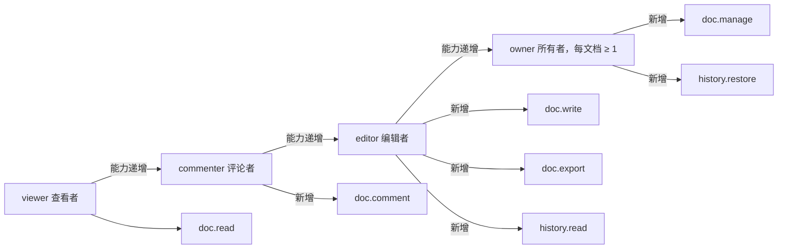
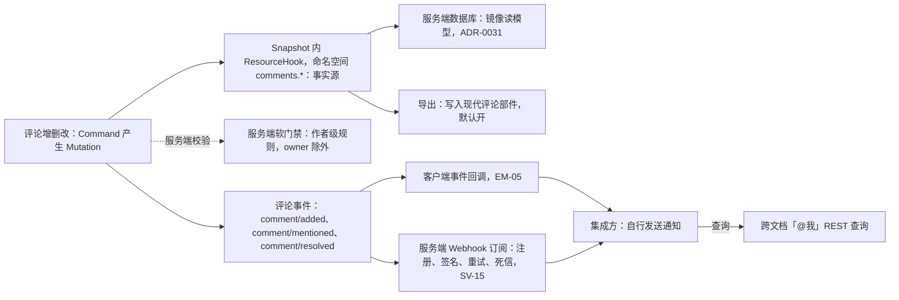
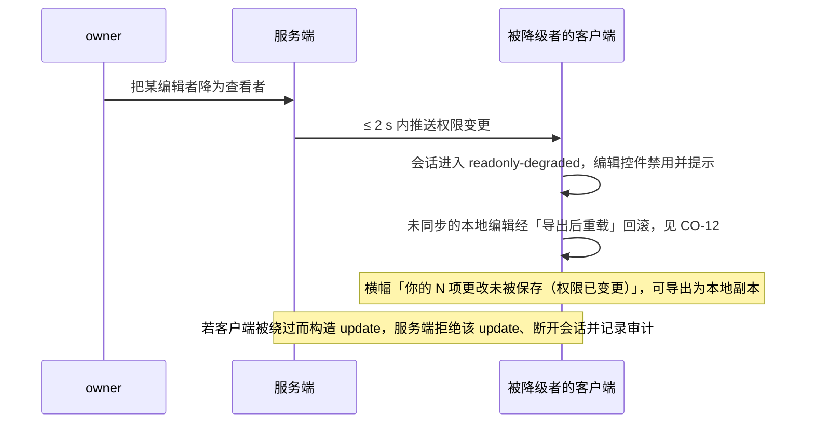
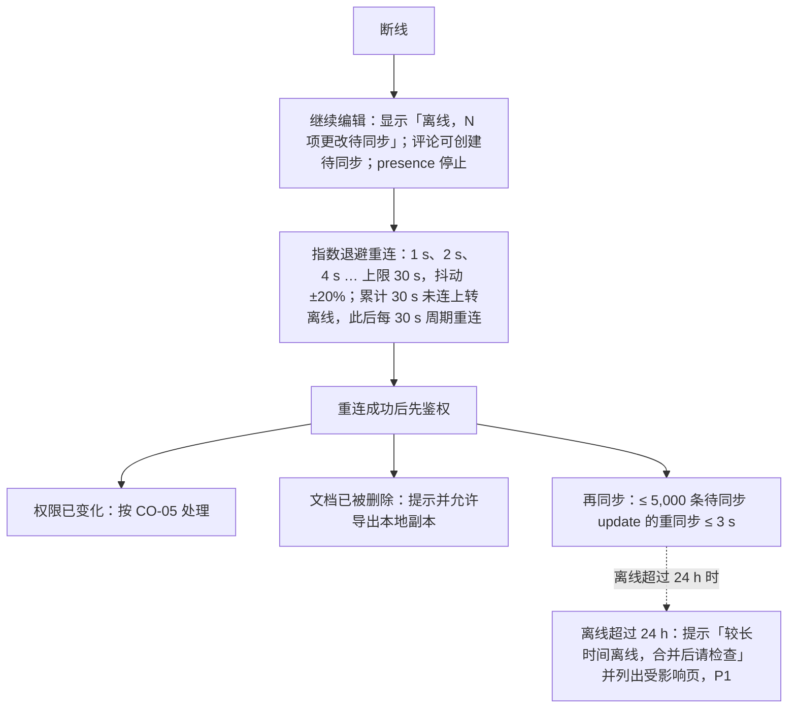
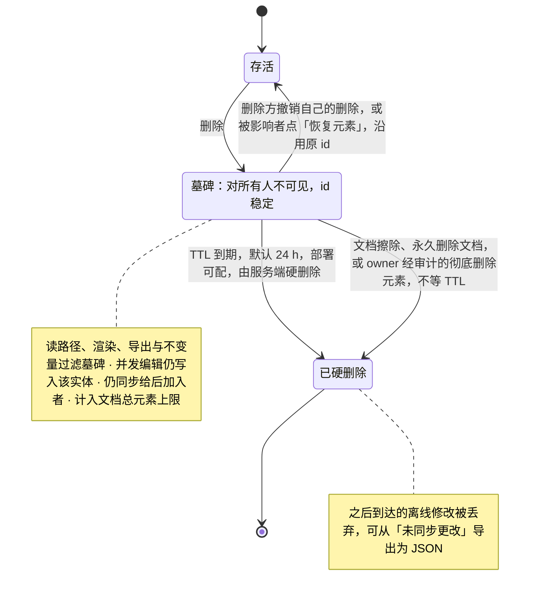
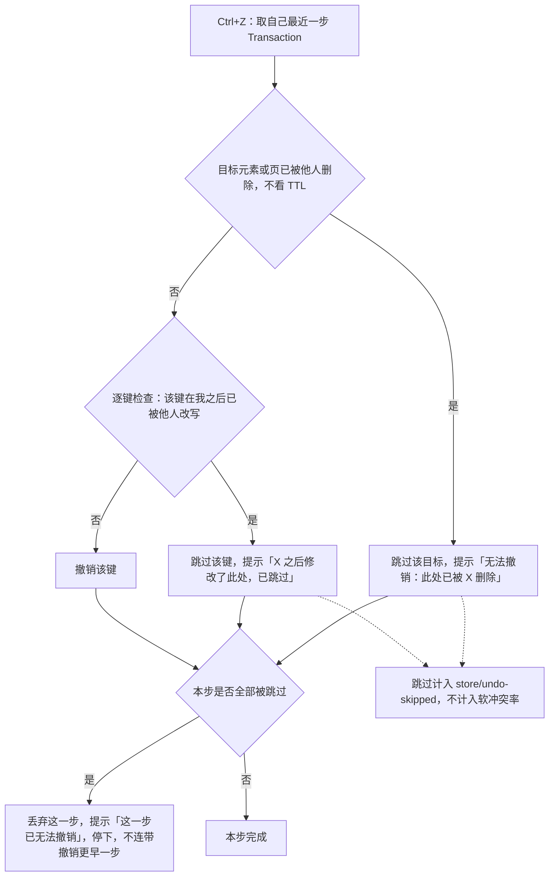
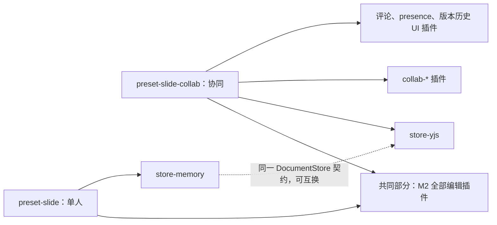
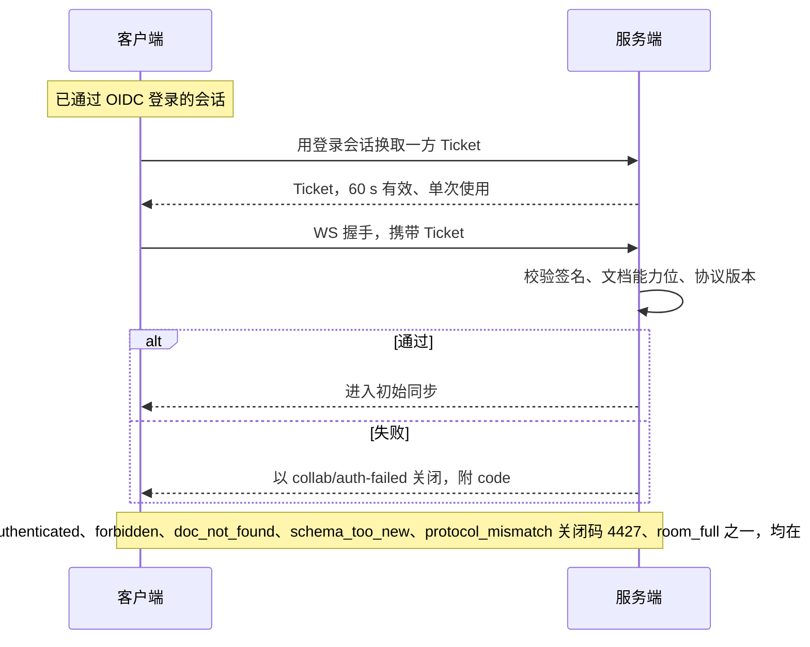
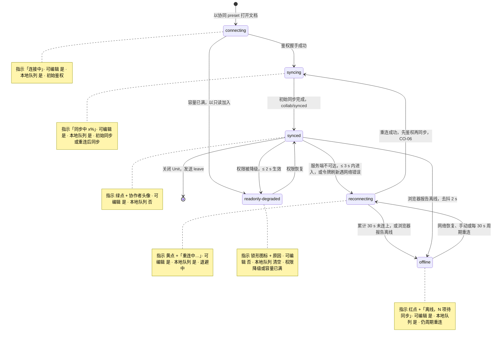

> 状态：草稿 | 负责：产品 | 更新：2026-09-21；2026-09-24（rulings §4.15：T-0 单组织去租户；Q6 OIDC 与组管理推迟，M3 只按人分享；Q3 撤销语义——他人后写跳过并提示、整步跳过即停、软删除墓碑 + TTL 24 h，CO-08「恢复我的值」、CO-09 重写；Q5 名额按用户计）；2026-09-24（rulings §4.16 Q17：CO-07 版本策略标已裁决、部署配置可调；Q16 排他锁标已裁决）；2026-09-24（复核修正，rulings §4.17）；2026-09-25（补图）；2026-09-25（矛盾收口，rulings §4.18） | 依赖：charter v0.2；rulings §4.15、§4.16、§4.18

# 功能域 03：协同

> 需求编号前缀 `CO-`。本文件是 M3「协同」的主要验收来源。协同的技术选型（CRDT、传输、存储）由架构 ADR-0020/0022/0023 决定；本文只定义用户可感知的行为、语义与预算。协同 UX（远端光标样式、冲突可视化、离线态）由设计 05 负责。

---

## 0. 本域的产品立场

1. **CRDT 是唯一事实源**（章程 D5、R6）：协同模式下没有「服务端权威模型 + 客户端副本」，只有一个通过 `DocumentStore`（`store-yjs`）读写的 CRDT 文档。因此不存在「保存冲突」对话框；冲突只以「软冲突提示」出现（§3）。
2. **单人与协同是同一套编辑器**：`preset-slide` 与 `preset-slide-collab` 的差别仅是 `store-memory` → `store-yjs` 与协同插件的加入（章程 §7 M3 可插拔证据）。编辑功能在两种模式下行为一致，差别只在历史（只撤销自己的）与在场信息。
3. **权限 fail-closed**（章程 D12）：无显式允许即拒绝；检查点在客户端命令管线（体验）与服务端网关（安全）两处，**服务端是最终裁决**。
4. **离线不丢工作，但不承诺离线合并无痛**：断线期间的编辑本地排队，重连后合并；长时间离线后的合并结果可能出现软冲突，需要可见提示。
5. **协同对集成方是可选层**：不加载协同插件即为单人模式，SDK 行为不变（章程 §5.4「协同移除后系统能启动」）。

---

## 1. 角色与权限模型（产品定义，服务端实现见 SV-06）

| 角色 | 查看 | 评论 | 编辑 | 管理（分享/权限/删除/版本恢复） | 说明 |
|---|---|---|---|---|---|
| `viewer` 查看者 | ✓ | – | – | – | 可看到 presence（可配置隐藏） |
| `commenter` 评论者 | ✓ | ✓ | – | – | 可创建/回复/解决自己创建的线程 |
| `editor` 编辑者 | ✓ | ✓ | ✓ | – | 可解决任何评论线程 |
| `owner` 所有者 | ✓ | ✓ | ✓ | ✓ | 每文档 ≥ 1 |

- 单组织模型（rulings §4.15 T-0）：一次部署 = 一个组织，权限模型中没有租户概念。用户身份来自外置 OIDC IdP（SV-06、EM-03；集成方签名 JWT / API Key 为 M4），服务端首次登录时 JIT 建号。权限主体为**用户**与**分享链接**两类（M3 只按人分享）；**组管理（U-11）推迟**，不在 M3 范围。SDK 只消费「当前用户对当前 `Unit` 的角色 + 能力位」（服务端实现见 `40-modules/08`）。
- 能力位（草案，最终在 `protocol` 定义）：`doc.read`、`doc.comment`、`doc.write`、`doc.export`、`doc.manage`、`history.read`、`history.restore`。角色是能力位的预设组合；集成方可自定义组合（如「可编辑不可导出」）。`doc.export`/`history.read` 下放至 `editor`（`commenter`/`viewer` 不可，已含在上表"编辑"列内）；`doc.manage`/`history.restore` 仅 `owner`（上表"管理"列已含"版本恢复"）——服务端权威定义见 `40-modules/08` §2.2 `ROLE_CAPABILITIES`（rulings §4.12 U-09）。
- 命令与能力位的映射由命令声明（每个 `Command` 声明所需能力位；未声明 = 拒绝，fail-closed）。

**图 1-1 四个角色与能力位（草案）**

怎么读：四个内置角色由「能力递增」边串起，后一个拥有前一个的全部能力；每个角色向下的边只画它新增的能力位。能力位名为草案，最终在 `protocol` 定义，服务端权威表见 `40-modules/08` §2.2；集成方可自定义组合（如可编辑不可导出）。

---

## 2. 需求

### CO-01 协同会话与房间

- 优先级：P0 | 目标里程碑：M3 | 依赖能力：`collab` 服务（`collab-core` Definition，`collab-yjs` + `collab-transport-ws` Provider）、`UnitScope`、`server-collab`
- 用户故事：作为编辑者，我打开一个共享文稿时希望自动加入协同会话，看到谁在线，并且我的修改被自动保存到服务端。
- 验收标准：
  - Given 集成方以协同 preset 打开文档，When 鉴权握手成功，Then 在 ≤ 2 s（D50，p75）内完成初始同步并触发 `collab/synced`；期间编辑器可用（本地先行），同步完成前显示「同步中」状态。
  - 会话状态机对外可见（`collab/state-changed`）：`connecting → syncing → synced → reconnecting → offline`，以及 `readonly-degraded`（权限被降级时）；路径与退出条件见 §3 图 3-1。以上为 UI 名称：对外事件载荷是 M-05 的 `SyncState` 六态，`reconnecting` = `connecting` 且 `reconnectAttempt > 0`，`readonly-degraded` = `synced` + `role` 降级标志，映射见架构 06 §18.3（rulings §4.18 UX-01）。
  - Given 服务端不可达，Then 在 ≤ 3 s 内进入 `reconnecting`，UI 显示不可打断的状态指示；编辑继续（本地队列，CO-06）。
  - 房间生命周期由服务端管理（SV-05）；同一文档的所有在线用户在同一房间；房间容量：≤ 20 编辑者 + ≤ 50 查看者（章程 Q5 性能保证包络；部署配置可调，超出包络时性能承诺不再成立，见 SV-08），超限时新加入者以只读加入并提示。
  - 名额计数规则（rulings §4.15 Q5）：**按用户计**——同一用户多标签页/多设备只占 1 个名额；`commenter` 计入查看者名额；`owner` 不占编辑者名额，满员时也不会被降级为只读。满员房间由服务端合并 awareness tick，查看者只上报视图（当前页），不上报选区/光标。
  - 关闭 `Unit` 时优雅离开（发送 leave，释放 awareness），`fiber.getEffects()` 为空。

### CO-02 实时同步与收敛

- 优先级：P0 | 目标里程碑：M3 | 依赖能力：`store-yjs`、`collab-yjs`、`Mutation` 可序列化性
- 验收标准：
  - 所有编辑以 `Mutation` 形式经 CRDT 同步；不存在绕过 `DocumentStore` 的同步路径。
  - 延迟预算（同区域，RTT ≤ 50 ms）：客户端 A 提交 → 客户端 B 可见 p50 ≤ 150 ms、p95 ≤ 400 ms；本地回显 ≤ 16 ms。
  - 收敛：协同模拟测试（架构 11）20 个客户端 × 1,000 次随机命令（含文本插入删除、形状增删移、页重排、组合/取消组合）、随机分区与重连，结束后全部客户端模型哈希一致，且导出 pptx 通过 XSD 校验。
  - 大事务（如「全部替换」影响 200 页）在 ≤ 1 s 内传播完成；单条 update ≤ 1 MB，超限拆分或拒绝并提示（如粘贴 50 MB 图片走资源上传通道，CO-12）。
  - 远端变更应用时保持本地选区与文本光标位置（相对位置映射）。

### CO-03 在场信息（Presence / Awareness）

- 优先级：P0 | 目标里程碑：M3 | 依赖能力：`presence` 服务（UnitScope 内）、`Operation` 广播、`render-dom` 覆盖层
- 用户故事：作为编辑者，我希望看到协作者在哪一页、选中了什么、光标在哪，以便避免同时改同一处。
- 验收标准：
  - 每个在线用户显示：头像/名称首字母 + 颜色（由集成方提供或按用户 id 稳定哈希分配 12 色板）、当前页（缩略图栏角标）、选区框（带名称标签）、文本光标（带名称）。
  - 传播延迟 ≤ 200 ms（p95）；节流：选区/光标变化 ≥ 50 ms 合并一次。
  - 离开：主动离开（关闭 `Unit` / 标签页，发送 leave）或服务端检测到会话断开时，**立即**移除其头像与远端光标；静默失联（未发 leave、服务端也未感知断开）时最迟 30 s 移除（awareness 超时）（rulings §4.18 UX-18，依据架构 06 §7）。
  - 空闲：60 s 无活动标记为 idle（灰显），与离开无关、不触发移除。
  - 同页 ≥ 20 个远端选区仍保持 ≥ 55 fps（覆盖层渲染预算）。
  - 「跟随」模式（P1）：点击头像跟随其当前页与视口；被跟随者不感知。
  - 查看者可选择隐身（集成方策略）；presence 不持久化、不入审计。
  - 顶栏协作者列表最多显示 5 个头像 + 「+N」。

### CO-04 评论

- 优先级：P0 | 目标里程碑：M3 | 依赖能力：`ResourceHook`（评论作为 `Snapshot` 内的插件资源）、`Command`（评论增删改为 `Mutation`）、`FormatCodec`（现代评论部件导入/导出）、`permissions`
- 用户故事：作为评论者，我希望针对某一页、某个元素或一段文字发起评论线程，@ 同事，并在问题解决后标记已解决。
- 验收标准：
  - 锚点类型：页、元素、文本范围（同一 run 或跨 run，按相对位置锚定）；元素被删除时线程变为「已脱离锚点」而不是消失，仍可在评论面板查看并可重新锚定（P1）。
  - 线程：创建、回复、编辑自己的、删除自己的（所有者可删任何）、解决 / 重新打开、@提及（集成方提供用户目录回调；无回调则不显示 @ 建议）、表情反应（P2）。
  - 评论内容为纯文本 + 换行 + @提及 + 链接自动识别；长度 ≤ 5,000 字符；附件 P2。
  - 视图：评论面板（全部 / 当前页 / 未解决 / @我）、画布锚点气泡（数量角标）、悬停预览；从缩略图栏可见有评论的页。
  - 权限：`commenter` 及以上可创建；解决权见 §1；`viewer` 只读。
  - 导入：打开含现代评论 / 旧式评论的 pptx 时，评论以只读方式显示（作者名来自 `commentAuthors`），可选择「导入为可编辑线程」（P1）。
  - 存储：评论以 `Snapshot` 内 `ResourceHook`（命名空间 `comments.*`）为事实源；服务端软门禁执行作者级规则（只能修改/删除自己的评论，owner 除外，见 CO-12）；服务端数据库仅为镜像读模型（ADR-0031）。
  - 导出：可选将线程写入现代评论部件（默认开，PD-04）；PowerPoint 365 打开可见评论且作者/时间正确。
  - 通知：评论事件（`comment/added`、`comment/mentioned`、`comment/resolved`）出口为**客户端回调 + 服务端 Webhook**（M3 两者都做，rulings §4.12 U-14）：客户端经事件回调交给集成方（EM-05）；服务端另提供 Webhook 订阅（注册/签名/重试/死信，见 SV-15）供无常驻前端的集成方接收，并提供跨文档「@我」REST 查询；SDK 不发送邮件/推送。
  - 单文档评论线程 ≤ 5,000 条、单线程回复 ≤ 500 条时面板打开 ≤ 300 ms。

**图 2-1 评论的事实源与通知出口**

怎么读：经 Snapshot 的一支是存储路径，事实源只有 Snapshot 内的评论资源，数据库只是镜像；经「评论事件」的一支是通知出口，M3 客户端回调与服务端 Webhook 两者都做，SDK 本身不发送邮件或推送。
依据：本条 CO-04；rulings §4.12 U-14。

### CO-05 权限与只读降级

- 优先级：P0 | 目标里程碑：M3 | 依赖能力：`permissions` 服务（fail-closed）、`commands` 执行管线 `waterfall` 检查点、服务端网关检查点（SV-05）
- 验收标准：
  - Given 用户无 `doc.write`，Then 所有编辑命令在客户端管线被拒绝（不产生 `Transaction`），UI 编辑控件禁用并提示；Given 客户端被绕过（构造消息），Then 服务端拒绝该 update 并断开会话，记录审计。
  - 权限变更（如 owner 把某编辑者降为查看者）在 ≤ 2 s 内传播到该用户：其会话进入 `readonly-degraded`，未同步的本地编辑被回滚（机制：「导出后重载」，见 CO-12）并提示「你的 N 项更改未被保存（权限已变更）」，可导出为本地副本。
  - 令牌过期：提前 60 s 刷新（参考应用走 OIDC 刷新；嵌入场景经集成方回调换取新 Ticket）；刷新失败**按原因分流**（rulings §4.18 UX-02）：网络错误 → `reconnecting`，离线判据与重连计时同 CO-06（不另设计时器）；服务端返回 401（登录已失效）→ 直接显示「登录已过期」横幅，不经过「重连中 → 离线」。
  - 重新登录：横幅「重新登录」在弹窗或新标签完成 OIDC 登录（弹窗被拦截时退化为新标签链接），**原页不跳转、待同步队列保留**；登录完成后原页取新票据重连 → 同步中 → 已恢复。登录回来的用户与原会话不是同一人时不重放队列，按只读处理并提供「导出为本地副本」，防止以他人身份提交更改；该横幅处理前不可关闭。
  - 命令未声明能力位 → 默认拒绝（扫描器保证每个命令声明；架构 05）。
  - 权限判定不依赖 UI 状态；单人模式（无协同）下 `permissions` 由集成方直接配置（如只读嵌入）。
  - 排他锁（形状级/页级）**不做**（章程 Q16 已裁决，rulings §4.16）；只有 awareness 软提示（CO-10）。

**图 2-2 权限降级的传播与本地回滚**

怎么读：纵向为时间；权限在客户端命令管线与服务端网关各检查一次，客户端检查只为体验，服务端检查是安全边界。
依据：本条 CO-05；§0 第 3 条；SV-05 权限即时性。

### CO-06 离线、断线与重连

- 优先级：P0 | 目标里程碑：M3（会话内队列）/ M4（跨刷新持久化，P2） | 依赖能力：`collab-core` 离线队列接口、`collab-transport-ws` 重连退避、`store-yjs` update 编码
- 用户故事：作为编辑者，地铁里断网 5 分钟，我希望继续编辑，恢复网络后自动合并且不丢失。
- 验收标准：
  - 断线期间：编辑继续，状态显示「离线，N 项更改待同步」；评论可创建（待同步）；presence 停止。
  - 重连：指数退避（1 s → 2 s → 4 s → … 上限 30 s，抖动 ±20%）；重连后先鉴权再同步；≤ 5,000 条待同步 update 的重同步 ≤ 3 s。
  - 离线判据（rulings §4.18 UX-03）：自进入重连起**累计 30 s** 仍未连上即转 `offline`；浏览器报告离线（`navigator.onLine=false`）时立即转 `offline`（去抖 2 s）。
  - 离线后自动回到在线（rulings §4.18 CO-03）：进入 `offline` 后不停止重试，每 30 s（±20% 抖动）自动重连一次，浏览器报告离线期间暂停；收到浏览器 online 事件或用户点「立即重连」时立即重连。服务端恢复后，`offline` 会话 ≤ 36 s 内自动回连；断网期间不发起连接。
  - 离线积累的更改超过单帧上限（1 MiB）时，重连后分块同步：全部送达、不因超限被断连、不重复落库（rulings §4.18 CO-10）。
  - 重连时若权限已变化，按 CO-05 处理；若文档已被删除，提示并允许导出本地副本。
  - 会话内队列在页面刷新后丢失（M3 默认，明确提示「刷新将丢失未同步更改」；「重新登录」在新窗口完成、不刷新原页，队列保留，见 CO-05）；跨刷新持久化（IndexedDB，按 `Unit` 隔离，加密可选）为 M4 P2（PD-05；由 `collab-offline-idb` 作为 `OfflineStore` Provider 提供，章程 §5.2、ADR-0033）。
  - 离线超过 24 h 的队列重连时提示「较长时间离线，合并后请检查」并列出受影响页（P1）。
  - 单人模式不存在离线概念（保存走集成方回调）。

**图 2-3 断线、重连与重连后的三种结局**

怎么读：上半为断线期间的行为，下半三条分支是重连鉴权后按情况分流（图中不表示判定先后）；M3 的待同步队列只在内存中，刷新页面即丢失并有明确提示，跨刷新持久化为 M4 P2（`collab-offline-idb`）。进入离线后仍按 30 s 周期自动重连，浏览器报告离线期间暂停。
依据：本条 CO-06；CO-05；rulings §4.18 UX-03、CO-03。

### CO-07 版本历史

- 优先级：P1 | 目标里程碑：M3 | 依赖能力：`Snapshot`（带 `schemaVersion`）、`server-collab` 快照持久化（SV-03）、`migrations`、`permissions`（`history.*`）
- 用户故事：作为所有者，我希望查看文稿的历史版本、预览并恢复到某个版本，且恢复本身可撤销。
- 验收标准：
  - 自动版本：服务端按策略生成（章程 Q17 已裁决，rulings §4.16：默认每 10 分钟且有变更，或每 500 个 update；保留 30 天；全部进入部署配置可调）；命名版本：用户手动创建，附名称与说明，永久保留（受配额）。
  - 版本列表显示时间、创建者（自动版本显示该时段的贡献者集合）、是否命名；分页加载。
  - 预览版本：只读渲染，不影响当前会话；可对比（元素级增删改高亮，P2）。
  - 恢复：作为一个新的 `Transaction` 应用到当前文档（把当前状态替换为该版本内容），因此可撤销、被其它协作者实时看到、进入审计；不重写历史。恢复的撤销（rulings §4.12 U-07 `version-restore-undo`，M3 前出 ADR）以 Q3 撤销子裁决为基线（rulings §4.15）：撤销恢复时不覆盖他人在恢复之后的写入（跳过并提示），整步被跳过即停；不采用绕过命令管线（D4）的 `revertTo` 式整体回滚。
  - 版本读取需 `history.read`，恢复需 `history.restore`。
  - 旧 `schemaVersion` 的版本通过 `migrations` 透明迁移后预览（章程 D6）。

### CO-08 冲突语义（软冲突）

- 优先级：P0 | 目标里程碑：M3 | 依赖能力：`store-yjs` 数据结构映射（ADR-0020）、`telemetry`
- 定义：CRDT 保证收敛，因此没有「硬冲突」；**软冲突**指并发操作虽合并成功但结果可能不符合任一用户意图的情形。产品要求：结果确定、可预测、有提示、可恢复（撤销只作用于自己的部分且不覆盖他人后写；需要取回自己被覆盖的值时用显式命令「恢复我的值」，rulings §4.15 Q3）。

| 场景 | 期望收敛结果（与 ADR-0020 §D、架构 06 冲突表一致） | 用户提示 | 埋点 |
|---|---|---|---|
| 两人同时编辑同一文本框不同位置 | 两处插入都保留（字符级合并，`Y.XmlText`） | 无 | – |
| 两人同时编辑同一文本框同一位置 | 两段插入相邻并存，顺序由 clientID 确定，两端一致 | 预防性即时提示：另一用户在同一文本框有活跃光标时，文本框边缘显示其名字（presence `caret`/`editing`） | `collab/soft-conflict{type:"text-same-pos"}` |
| A 移动形状，B 同时移动同一形状 | `xfrm` 键级后写者胜（LWW），两端一致 | 失败方（本地 60 s 内写过该键且被远端覆盖）看到形状「跳走」并提示「X 移动了该形状」+「恢复我的值」按钮——它是一个新事务（写回我最后一次写入的值），可审计、可再撤销；不是撤销，也不会被 Ctrl+Z 自动执行 | `collab/soft-conflict{type:"prop-lww"}` |
| A 删除元素，B 同时编辑该元素文本 | 删除落为**软删除墓碑**（rulings §4.15 Q3）：元素对所有人不可见（读路径/渲染/导出过滤），B 的编辑仍写入该实体，**id 稳定、零丢失、零重复**；TTL（默认 24 h，部署可配）到期后由服务端硬删除 | B 提示「你编辑的元素已被 X 删除」，提供「恢复元素（含我的编辑）」——清除墓碑的新事务，**沿用原 id**（评论锚点、`stCxn`、动画 `spid` 等引用不断）；A 撤销自己的删除同样是清除墓碑，与 B 的恢复并发也不会产生重复元素（P1） | `collab/soft-conflict{type:"delete-vs-edit"}` |
| A 删除页，B 在该页新增元素 | 同上，页整体落为墓碑，B 新增的元素随页保留在墓碑内 | 同上，粒度为页：「恢复此页」清除页墓碑，原 id、原位置 | 同上 |
| 离线的 A 修改元素，在线的 B 早已删除 | TTL 内重连：A 的修改写入墓碑实体，A 收到同「删除 vs 编辑」的提示并可恢复；TTL 已过（已硬删除）：A 的修改被丢弃 | 同「删除 vs 编辑」；TTL 已过时 A 的离线更改可从「未同步更改」导出为 JSON | `delete-vs-edit` |
| 两人同时重排页顺序 | 每页 `order` 键（fractional index，ADR-0032）LWW：无重复无丢页、顺序确定；两人在同一位置后各插一页时两页相邻，按 `(order, id)` 定序 | 无（缩略图栏动画提示位置变化） | `collab/soft-conflict{type:"reorder"}` |
| A 组合元素，B 同时编辑其中一个子元素 | 两者都保留：组合成功，B 的编辑作用于组合内的子元素 | 无 | – |
| A 取消组合，B 同时移动组合 | 取消组合胜；组变换烤进子元素 `xfrm`，子元素保持视觉位置；B 对已删组合的写入落空 | 无 | – |
| A 把 X 放入组 G，B 同时把 G 放入 X（父子环） | 两个 `parentId` 各自 LWW → 形成环 → **修复规则**（客户端与服务端软门禁执行同一确定性规则）：环上 id 字典序最大者回到页根 | 非阻断提示「已自动修正 1 处结构问题」 | `collab/repair{rule:"cycle"}` |
| A 在段落中回车分段，B 同时给被移动的尾部文本加粗 | 尾部文本被 A 删除 + 重插，B 的格式落空（已知限制，与 y-prosemirror 同）；实现优先「保留头部、移动较短一侧」以降低概率 | 无 | – |
| 两人同时更换同一页版式 | `layoutId` 后写者胜；占位符文本保留并按新版式解析继承 | 提示 | `prop-lww` |
| A 解决评论线程，B 同时回复 | 回复保留，线程为已解决（`resolved` 键与回复实体独立，ADR-0031） | 面板显示「已解决线程有新回复」 | – |
| 两人同时插入图片 | 媒体内容寻址（sha256）；导出时部件名由 MediaId 生成，不会同名 | 无 | – |

- 一致性核对：本表「收敛结果」列已于 2026-09-15 与 ADR-0020 §D 及架构 06 冲突表逐行核对一致；2026-09-24 删除/撤销相关行按 rulings §4.15 Q3 改写（软删除墓碑、不覆盖他人），ADR-0020/0032、架构 06 §8、05 §13.4、设计 05 §6 与 02-user-flows 需同步；如有不一致，以 rulings §4.15 为准。
- 墓碑的附加约束：TTL 内被删内容仍会同步给后加入的协作者（含查看者），相关访问写审计；墓碑计入文档总元素上限（SV-08）；文档级的擦除与「永久删除文档」（SV-11，GDPR）以及元素级经审计的「彻底删除元素」（见本节末条）不等 TTL，立即硬删除。
- 验收标准：以上每一行都有确定性协同模拟用例；提示出现率 100%；提示可关闭且不打断输入；软冲突事件计数进入健康指标（`06-metrics-and-analytics.md`）。
- 「正在编辑」即时提示（第二行）是**预防性**机制：当另一用户在同一文本框有活跃文本光标时，在文本框边缘显示其名字；这是 presence 的一部分而非锁。
- **彻底删除元素**（P1，M3，与墓碑同期；rulings §4.18 CO-07）：术语拆开——文档级称「永久删除文档」（SV-11），元素级称「彻底删除元素」。验收：
  - 只对已删除（墓碑态）的元素开放，**仅 owner** 可发起；执行前确认对话框，写审计 `document.element_purged`。
  - 服务端单写者立即硬删除（与 TTL 到期同一硬删路径）；只清当前文档状态——历史快照与 update 表按保留期存在，引用的图片原件按 30 天无引用回收；确认对话框与结果提示明示「历史版本仍含该内容，要连历史清除请永久删除文档」。
  - 清除后删除方再撤销该步，按「整步被跳过」处理（同 TTL 到期，CO-09）。
  - 入口：版本历史面板的「最近删除」分组（仅所有者可见，设计 03-screens/07；PRD 07 G-52），列出仍在墓碑保留期内的已删除元素。

**图 2-4 元素与页的软删除墓碑生命周期**

怎么读：方框为一个元素或一页在 Store 中的状态，箭头上写触发条件；撤销删除与恢复元素都是「清除墓碑」的新事务，因此评论锚点、`stCxn`、动画 `spid` 等引用不断；他人的撤销永远不会让墓碑复活（CO-09）。
依据：本条 CO-08 表「删除」三行、墓碑附加约束与「彻底删除元素」；SV-03；rulings §4.15 Q3、§4.17 D4、§4.18 CO-07。

### CO-09 协同下的撤销 / 重做

- 优先级：P0 | 目标里程碑：M3 | 依赖能力：`history`（按 origin 区分的 `UndoManager`，`store-yjs`）
- 验收标准：
  - 撤销语义写入 `DocumentStore` 中性契约（字段名与 CRDT 无关，`store-memory` 同语义并通过 `runDocumentStoreConformance`；rulings §4.15 Q3）。
  - Ctrl+Z 只撤销**自己**提交的 `Transaction`；他人的更改不受影响，**撤销永不覆盖他人**。
  - Given 我要撤销的一步中，某个键（属性）在我之后已被他人改写，Then 跳过该键，本步其余键照常撤销，并提示「X 之后修改了此处，已跳过」；我若仍想取回自己的值，使用 CO-08 提示条上的「恢复我的值」（新事务）。他人改动的其它属性不受影响。
  - Given 我要撤销的一步**全部**被跳过（所有键都已被他人改写，或目标已被他人删除），Then 丢弃这一步并提示「这一步已无法撤销」，**停下，不连带撤销更早一步**（契约用例 `undo-skip-no-cascade`）；下一次 Ctrl+Z 才处理更早一步。
  - Given 我要撤销的一步的目标元素/页**已被他人删除**（无论是否仍在墓碑 TTL 内），Then 跳过并提示「无法撤销：此处已被 X 删除」，**不看 TTL、撤销永不复活他人删除的元素**（rulings §4.17 D4）；若本步因此全部被跳过，按上一条停下。恢复只能由删除方撤销自己的删除，或由我显式使用 CO-08 的「恢复元素」（新事务）完成。
  - Given 我撤销自己的删除，Then 清除墓碑、沿用原 id（CO-08）；TTL 已过，或该元素已被 owner「彻底删除元素」（CO-08），则按「整步被跳过」处理（`wholeStep:true`）。
  - 验收：每种跳过情形都有确定性协同模拟用例与提示断言；提示出现率 100%，不打断输入；跳过**单独**计入 `store/undo-skipped`（跳过次数、整步跳过次数 `wholeStep`），**不计入** `collab/soft-conflict` 与软冲突率 MT-15（rulings §4.17 D5）。
  - 撤销栈深度与单人模式一致（≥ 100 步）；重连后本地撤销栈保留。
  - 版本恢复（CO-07）作为普通事务可撤销，其撤销语义见 rulings §4.12 U-07（以本条为基线）。

**图 2-5 协同下撤销一步的判定**

怎么读：自上而下是一次 Ctrl+Z 的处理；`q2` 对本步的每个键各判定一次，全部键判定完再进入 `q3`；「停下」后下一次 Ctrl+Z 才处理更早一步。撤销自己的删除是清除墓碑（图 2-4），TTL 已过则按整步被跳过处理；想取回被覆盖的值用 CO-08 的「恢复我的值」新事务。
依据：本条 CO-09；rulings §4.15 Q3、§4.17 D4 与 D5。

### CO-10 编辑中软提示（无排他锁）

- 优先级：P2 | 目标里程碑：M3 | 依赖能力：`presence`（awareness）
- 验收标准：不存在形状级/页级排他锁（章程 Q16 已裁决「不做」，rulings §4.16）。可选策略（集成方开启）：当用户进入他人正在编辑（有活跃文本光标）的文本框时，显示内联强提示「X 正在编辑」，**不阻止**输入；提示为 awareness 级、非持久，断线即消失；不影响移动/缩放；CO-08 的预防性提示是其默认弱形态。（PD-19 → Q16，已裁决）

### CO-11 单人模式回退与可插拔证据

- 优先级：P0 | 目标里程碑：M3 | 依赖能力：`Preset` 组合、`DocumentStore` Provider 替换
- 验收标准：
  - `preset-slide-collab` 与 `preset-slide` 的 `Manifest` 差异仅为：`store-memory` ↔ `store-yjs`、新增 `collab-*` 与评论/presence/版本历史 UI 插件；CI 脚本比对两者插件清单并断言差异集合恰为白名单。
  - 移除全部 `collab-*` 插件后 `preset-slide-collab` 仍能启动并以单人模式工作（`collab/state-changed` 不触发，UI 隐藏协作区域）。
  - 用 `store-yjs` 但不连接服务端（本地 CRDT）时，全部 M2 编辑功能测试通过（同一套 e2e 在两种 store 下各跑一遍）。

**图 2-6 单人 preset 与协同 preset 的插件差异**

怎么读：两个 preset 指向各自装入的插件，共同部分完全相同；CI 比对两者 Manifest，差异集合必须恰好是「store-memory 换成 store-yjs，加上 collab-* 与三类 UI 插件」（白名单）。移除全部 `collab-*` 后协同 preset 仍能以单人模式启动。
依据：本条 CO-11；§0 第 2 条；`05-milestones-and-scope.md` M3 `pluggable:m3`。

### CO-12 协同安全、门禁与资源

- 优先级：P0 | 目标里程碑：M3 | 依赖能力：`protocol`（WS 握手/消息 schema）、`server-collab`（硬门禁 + 软门禁，ADR-0034）、`blobStore`（资源上传通道）、`permissions`
- 用户故事：作为管理员，我希望任何客户端（包括有 bug 或恶意的）都不能把非法结构或越权修改留在共享文档里，同时正常用户不会因此丢失工作或看到分叉。
- 验收标准：
  - 握手：OIDC 登录会话换取的一方 Ticket（Ticket 60 s 单次；集成方签名 JWT ≤ 1 h（M4），ADR-0029）→ 服务端校验签名、文档能力位、协议版本；失败以 `collab/auth-failed{code}` 关闭，`code ∈ collab.unauthenticated | collab.forbidden | collab.doc_not_found | collab.schema_too_new | collab.protocol_mismatch | collab.room_full`（WS 关闭码见架构 10 §1.4，协议不匹配 4427）。
  - **硬门禁（应用前，服务端）**：信封/schema/大小/速率（单帧 ≤ 1 MiB；每连接 ≤ 200 帧/s，突发 500）、角色与能力位（`doc.write`、锁定窗口）、update 可解析性与结构数上限；任一失败 → 不广播、不落库，返回类型化错误或关闭连接；未知消息类型丢弃并计数。
  - **软门禁（应用后，服务端；章程 D12「数据完整性边界」，ADR-0034）**：
    - `softGate.mode = repair`（M3 默认）：只修复**不变量**违规——父子环、悬空 `parentId`/`layoutId`、非法 `order` 键、`schemaVersion`/`epoch` 被改、实体 id 与键不一致、`commenter` 触及评论以外路径、修改他人评论（owner 除外）。修复由确定性纯函数生成补偿事务（origin=`repair`），服务端应用并广播，同时通知来源会话（`collab/repair{reason, paths}`）。
    - `softGate.schemaMode = report-only`（M3 默认）：zod 类型校验只计数/告警，不修复（避免 schema 演进期误修复）。
    - 修复**不改变用户内容语义**：不改文本、不改样式值、不移动用户放置的元素（环修复仅把节点放回页根）；不透明保留内容只校验为字串，不受修复影响。
    - 同一会话 10 分钟内触发 ≥ 5 次修复 → 隔离（关闭码 4409）并审计。预算：软门禁 p95 ≤ 5 ms/update（只校验变更路径）。
  - **用户可见行为**：
    - 被硬门禁**拒绝**（仅发生在降权或锁定窗口）：客户端执行「导出后重载」（架构 06 §18.4）——把未被 ack 的本地更改与事务摘要写入本地「未同步更改」区（可导出为 JSON / 本地 pptx 副本），丢弃本地 CRDT 副本并从服务端快照重新引导，撤销栈清空；横幅「你的 N 项更改未被保存（权限已变更）」+ 导出按钮（与 CO-05 一致）；事件 `collab/update-rejected`。
    - 被软门禁**修复**：用户看到自己的操作被「纠正」（低频），非阻断提示「已自动修正 1 处结构问题」；事件 `collab/repair`；撤销栈不清空。
  - 大二进制（图片/媒体）不走 CRDT，走资源上传通道（集成方 `uploadAsset` 或预签名 PUT，≥ 10 MB 分片，SV-01/EM-04）；CRDT 内只存 `BlobRef`；上传中/失败元素显示占位并可重试。
  - 审计与指标：硬门禁拒绝（`collab.update_rejected`）与软门禁修复（`collab.repaired`）进入审计（SV-07）与指标（`cordex_collab_updates_rejected_total{reason}`、`cordex_collab_repairs_total{rule}`）；所有协同操作的 `Transaction` 摘要进入审计（命令 id、影响元素数，不含内容）。
  - 协同模拟（架构 11）：注入 5% 非法 update（环/悬空引用/越权路径），所有端最终一致且合法；每条修复规则有输入/输出黄金用例。

**图 2-7 WS 握手**

怎么读：纵向为时间；M1–M3 只有这一种握手凭据，集成方签名 JWT（≤ 1 h）为 M4 的另一形态，见 ADR-0029。
依据：本条 CO-12 握手条款；EM-03。

**图 2-8 服务端对 update 的两道门禁**

怎么读：自上而下是一条 update 在服务端的处理顺序，菱形是两道门禁；修复只改不变量、不改用户内容语义；软门禁预算为 p95 ≤ 5 ms/update。
依据：本条 CO-12；ADR-0034；SV-05 门禁。

### CO-13 协同诊断与遥测

- 优先级：P1 | 目标里程碑：M3 | 依赖能力：`telemetry`、`logger`
- 验收标准：客户端暴露诊断面板（开发者模式）：连接状态、RTT、待同步 update 数、最近 100 条同步事件、awareness 快照；事件：`collab/synced`、`collab/state-changed`、`collab/latency`（采样）、`collab/soft-conflict`、`collab/reconnect`、`collab/auth-failed`；不含文档内容。

### CO-14 大规模只读广播

- 优先级：P2 | 目标里程碑：M4+ | 依赖能力：`server-collab` 只读订阅通道
- 验收标准：面向「1 人讲、200 人看」场景：查看者以只读订阅加入（不占编辑者名额），presence 仅上报计数；服务端每房间 ≤ 500 只读订阅；查看者延迟 p95 ≤ 1 s。

### CO-15 分享与访问入口（参考应用范围）

- 优先级：P1 | 目标里程碑：M3 | 依赖能力：`apps/web`（组装层，零业务逻辑）+ `apps/server` Documents/Auth 模块
- 说明：SDK 本身不含「分享对话框」；但 M3 验收需要一个可演示的宿主。参考应用 `apps/web` 提供最小：文档列表、按人（邮箱/用户）与链接分享并设置角色、权限变更即时生效的演示；**按组分享不在 M3**（组管理 U-11 推迟，rulings §4.15 Q6）。该范围已回写章程 §5.2 `apps/web` 职责（CS-09）。
- 访问语义（rulings §4.13 S-1，按 §4.15 T-0/Q6 修订）：分享链接**不支持匿名访问**——访问者需先登录本部署（任意已登录账号即可）；无账号者：部署开启 `auth.selfSignup`（默认关）时可在 IdP 自助注册，否则需管理员在 IdP 建号，见 SV-06；按人分享的邀请只对已存在账号生效，不存在待接受邀请（rulings §4.17 D1）；登录后凭链接自动获得链接角色（与直接授权取高者）；链接收紧、撤销或到期时，凭该链接在线的协同会话 ≤ 1 s 降权，他人修改其他成员的权限不会踢出或打断凭链接进入的会话（rulings §4.18 BE-02，设计 03-screens/08）；每次外部访问（非文档常规协作者凭链接进入）写审计。不新增 `Principal.kind='shareLink'`，服务端实现见 `40-modules/08` `ShareLinkGuard`（叠加角色，不产出匿名 Principal）。

---

## 3. 状态与提示一览（供设计 05 承接）

**图 3-1 会话状态与提示**

怎么读：方框为对外可见的会话状态（事件 `collab/state-changed`，UI 名称；对外载荷为 `SyncState` 六态，映射见 CO-01），箭头上写触发条件，出处为 CO-01、CO-05、CO-06；每个状态旁的注释保留原「状态与提示一览」表的指示、可编辑、本地队列与备注四列。每次重连都先重新鉴权、再经 `syncing` 回到 `synced`（架构 06 §5.1）；令牌刷新遇 401 不走本图，直接显示「登录已过期」横幅（CO-05）。设计侧投影见设计 05 §7 与 12 横幅。
依据：CO-01、CO-05、CO-06；架构 06 §5.1、§18.3；rulings §4.18 UX-01、UX-02、UX-03、CO-03。

---

## 4. 与其它域的接口

| 本域产出 | 消费方 |
|---|---|
| 角色与能力位模型 | SV-06 鉴权与权限；EM-03 鉴权对接 |
| 软冲突场景表 | 设计 05 冲突可视化；架构 06 CRDT 映射；协同模拟测试（架构 11） |
| 会话状态机 | 设计 05；EM-05 事件回调；埋点 |
| 版本策略默认值 | SV-03 快照持久化；SV-08 配额 |
