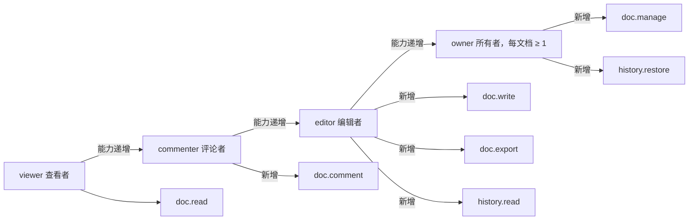
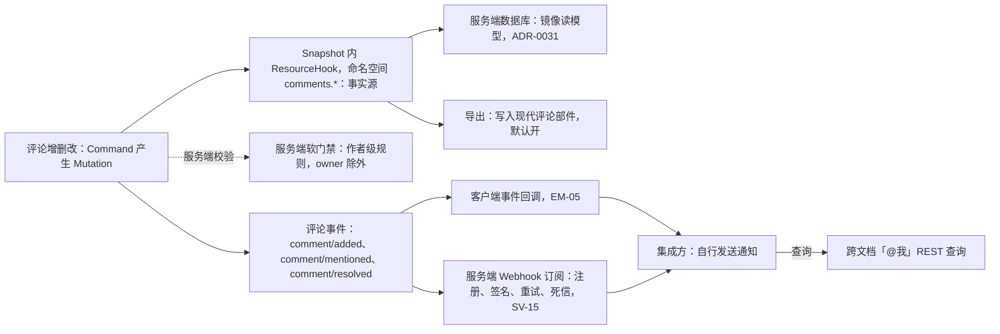
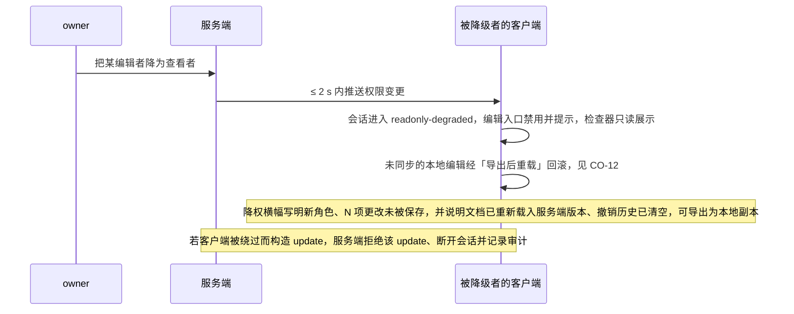
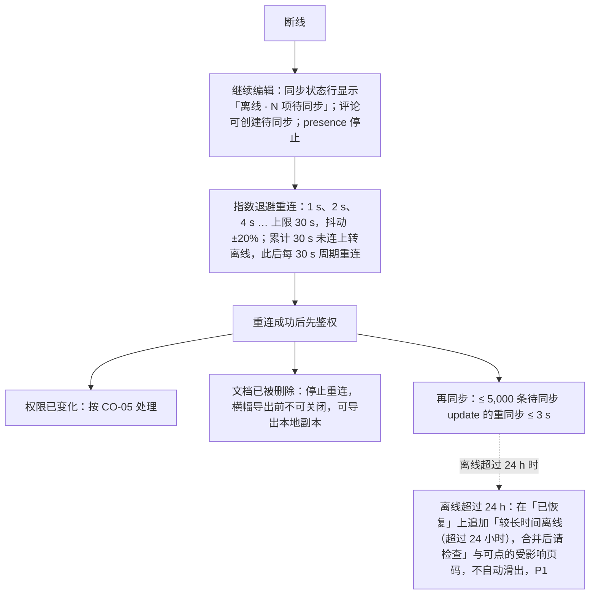
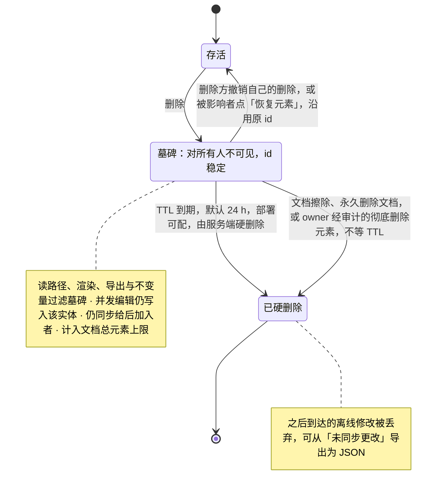
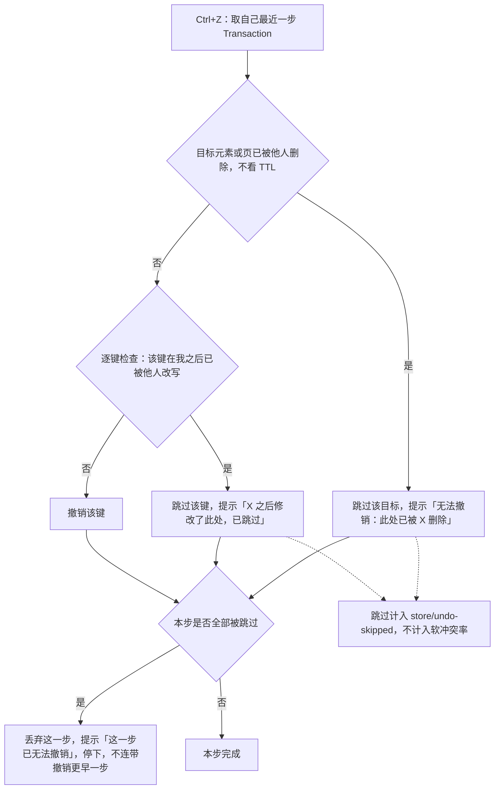
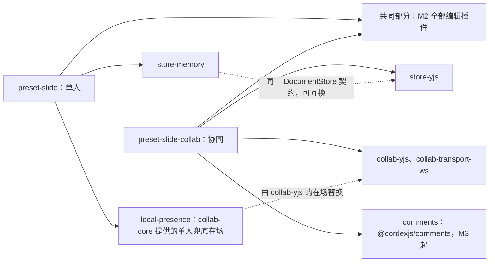
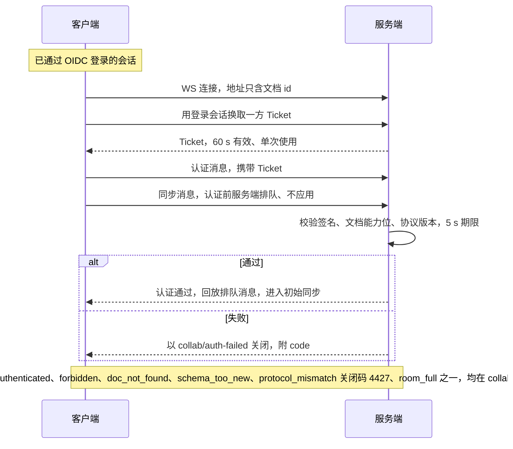
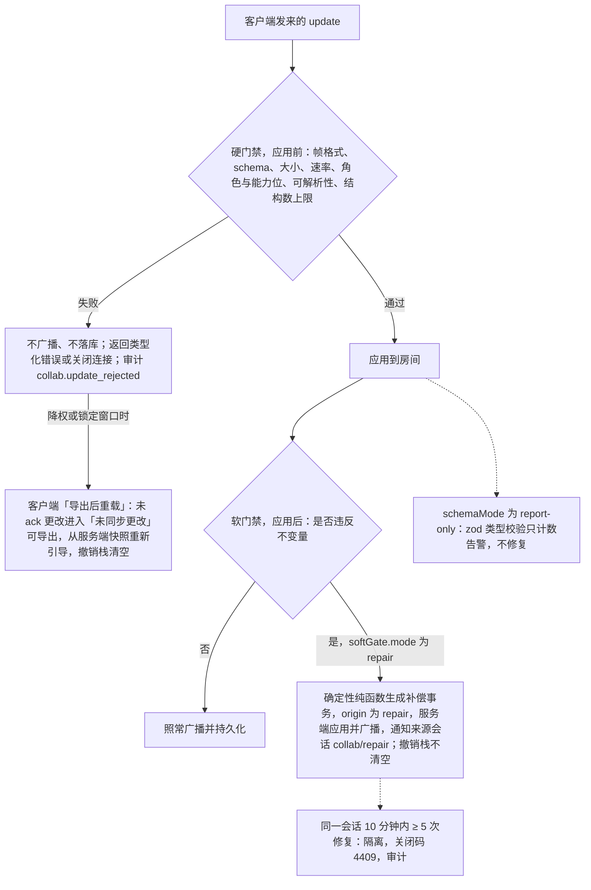
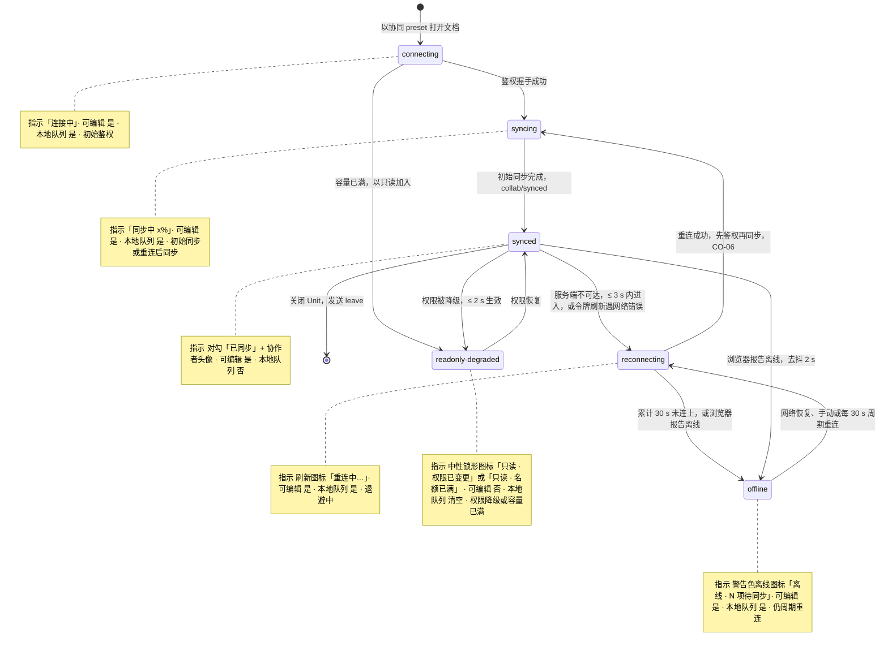

> 状态：草稿 | 负责：产品 | 更新：2026-09-21；2026-09-24（rulings §4.15：T-0 单组织去租户；Q6 OIDC 与组管理推迟，M3 只按人分享；Q3 撤销语义——他人后写跳过并提示、整步跳过即停、软删除墓碑 + TTL 24 h，CO-08「恢复我的值」、CO-09 重写；Q5 名额按用户计）；2026-09-24（rulings §4.16 Q17：CO-07 版本策略标已裁决、部署配置可调；Q16 排他锁标已裁决）；2026-09-24（复核修正，rulings §4.17）；2026-09-25（补图）；2026-09-25（矛盾收口，rulings §4.18）；2026-09-25（§4.19）；2026-09-26（§4.20：TX-01+BE-10 CO-07 恢复的撤销改指 ADR-0038 并写明基线与检查名）；2026-09-26（§4.21：协同改用 Hocuspocus 4 后的行为级核对——CO-12 握手改为「认证前排队、不应用」、图 2-7 同步改；CO-06 长离线差量改为一次送达、单设 16 MiB；用户可见行为除超 16 MiB 的极端情形外不变）；2026-10-04（design-language-v3 第 0 批：入口与状态位置按 v3 结构改写（rulings §4.25 DS-1、DS-6），需求、编号、优先级、里程碑不变——CO-01 状态指示在文件名旁的同步状态行；CO-03 协作者头像组改在检查器顶部协作行 / 网格右上胶囊，在线人数并入头像组；CO-04 评论入口为底部工具条「评论」、查看在检查器「评论」页签，缩略图与网格的评论数角标；图 3-1「怎么读」注明指示位置）；2026-10-04（design-language-v3 第 0 批：术语残留清理：ribbon / 状态栏 / `ui.ribbon` / `ui.statusBar` 的历史陈述改用 check-terms 认可的标记措辞（废弃、取代））；2026-10-04（design-language-v3 第 0 批：复验第 2 轮修正——CO-01 状态图注里同步状态各态的 v3 视觉由「第 2 批」改为「第 1 批补齐」，以归属文档设计 03-02 §3.1 为准（与 50/18 COL-01 一致））；2026-10-05（design-language-v3 第 0 批修正：CO-05 验收与图 2-2 的「UI 编辑控件禁用并提示」按 rulings §4.25 DS-15 改为创建与编辑入口禁用并提示、检查器只读展示当前值（设计 03-02 §6.2）；需求、编号、优先级、里程碑不变）；2026-10-07（design-language-v3 第 1 批：图 3-1 状态注释与怎么读里同步状态各态的 v3 视觉由「随第 1 批补齐」改为定稿——12px 图标 + 文字、只有离线用警告色，原绿 / 黄 / 红点作废（rulings §4.25 DS-21，设计 03-02 §3.1）；CO-06 与图 2-3 的离线指示文案对齐同步状态行「离线 · N 项待同步」；需求、编号、优先级、里程碑不变）；2026-10-15（design-language-v3 第 2 批：按已拍板的协作族样张（评论、版本历史、分享、离线与冲突）与 rulings §4.25 DS-38…DS-62 回写，需求、编号、优先级、里程碑不变——CO-01 编辑者名额已满与查看人数已满的呈现（DS-58、DS-60）；CO-03 身份色 12 色定稿与取色规则（DS-42）；CO-04 整条讨论串只有所有者能删（DS-40）、筛选分段与缺省「当前页」、钉不编号、导入批注（DS-43）、撰写与发表后工具保持按下（DS-44）、页级评论只用评论工具（DS-45）、手机与平板（DS-46）、加载（DS-53）；CO-05 降权横幅正文与导出对话框（DS-58）、登录已过期与登录账号已变更（DS-58、DS-61）、访问被撤销改为阻断页与申请访问（DS-48、DS-50）；CO-06 离线文案、应用内离开与刷新拦截、长时间离线提示（DS-59）、文档已被删除与更改过大（DS-58、DS-61、DS-62）；CO-07 整栏面板、预览、命名、收组、恢复确认、不做副本（DS-38、DS-39、DS-40、DS-53、DS-57）；CO-08 同一文本框与同时更换版式的提示、彻底删除元素的确认与入口（DS-40、DS-57、DS-60）；CO-12 降权与隔离的用户可见行为（DS-58、DS-59、DS-61）；CO-15 链接区、有效期、撤销、移除成员、非所有者只读视图与访问申请（DS-40、DS-47、DS-48、DS-53、DS-62）；图 2-2、图 2-3 与图 3-1 的注释同步；PRD 07 G-56 的「待处理申请 N」统一为「访问申请 N」（DS-48））；2026-10-15（design-language-v3 第 2 批回写补充：按 rulings §4.25 DS-65…DS-68 与 TB-60、TB-62、TB-64、TB-65、TB-68、TB-69、TB-74 补改，需求、编号、优先级、里程碑不变——CO-04 写了内容的撰写框换页后草稿按页保留、回到那一页原样恢复（DS-65），键盘 ↵ 只在评论工具开着或焦点在「评论」上时落钉、没开工具时选中对象按 C（TB-62），只有已解决线程的页不带角标；CO-05 申请被拒不告知申请人（DS-68），换账号重新登录的横幅与降权同一条、只留「导出为本地副本」、导出后降级为「已导出本地副本」（TB-69）；CO-07 整栏宽度沿用检查器当前宽度（缺省 280）、开着时分隔条可拖（TB-60），命名说明不超过 200 字（TB-64），经 API 直接建的空文档首次压缩前只有「当前版本」一行（TB-74）；CO-15 链接到期等同收紧（DS-66）、非所有者只读视图里的链接角色与「复制链接」复制文档地址（TB-65）、「分享」圆点的取数（TB-68）、新申请经 M3 Webhook 事件 `access_request.created` 由集成方通知所有者（DS-67）、申请被拒不告知（DS-68））；2026-10-15（design-language-v3 第 2 批回写再补充：按 rulings §4.25 DS-69、DS-70 与 TB-79、TB-84、TB-86 补改，需求、编号、优先级、里程碑不变——CO-04 进入网格视图、切到评审模式与换页同样处理，撰写框收起、草稿按页保留，回到单页的那一页时恢复（TB-84），恢复的撰写框不抢焦点、评论工具是否按下不因恢复而改变（TB-79）；CO-07 版本列表最早一条按建文档的来源写（导入、新建空白、从模板新建、创建副本四种），来源与显示名由服务端记在导入快照的元数据里（DS-70）；CO-15 非所有者只读视图的说明行与所有者相同，链接授予角色时「复制链接」复制分享链接、「仅邀请」时复制文档地址，能读文档的成员随成员列表拿到当前有效链接的令牌（DS-69 修订 TB-65 的「非所有者复制文档地址」，TB-86））；2026-10-15（design-language-v3 第 2 批回写收口：按 rulings §4.25 TB-87、TB-90 与 DS-69 补改，需求、编号、优先级、里程碑不变——CO-04 草稿按页存、不按模式存，切到评审模式（或从评审回到编辑）后仍停在同一页的单页画布时，撰写框当场原样恢复（TB-87）；CO-07 源文档未命名时，副本在版本历史里最早那一条写「创建自『未命名演示文稿』的副本」（TB-90）；CO-15 非所有者只读视图里「说明行与所有者相同」一句的依据改注 DS-69）；2026-10-22（design-language-v3 第 3 批：CO-03 头像一律身份色首字（rulings §4.25 TB-123）、同色序号角标的位置与尺寸、多窗口称「窗口」且会话数不上头像（DS-132、TB-124，原「角标画法随第 3 批复核」结案）、跟随的进入方式与跟随条「停止跟随」（DS-106、TB-113）；CO-04 平板评论面板按方向落位（DS-131，原「随第 3 批窄屏复核」结案）、嵌入手机形态「解决」的不可用原因（DS-112）；CO-06「已导出本地副本」与导出对话框说明的第二句按原因写（DS-129）；CO-15 分享对话框另可从开始页与文档列表的卡片打开（TB-109）；§3 同步状态行补触控、嵌入两种写法与「需要刷新」「只读 · 文档已达元素上限」两态（TB-125、DS-112、DS-126、DS-128）；需求、编号、优先级、里程碑不变）；2026-10-22（design-language-v3 第 3 批回写补充：CO-05 降权期间文档菜单的「重命名」「创建副本」「版本历史」与「文件 › 导出…」不可用并写「需要编辑权限」（rulings §4.25 TB-138、DS-105）；CO-06「已导出本地副本」第二句里没有点名的原因用中性句（TB-139）；CO-15 新增「M2 的入口」一条：编辑器「分享」按钮与卡片菜单「分享…」留在原位、不可用并写「后续版本提供」（DS-137）；需求、编号、优先级、里程碑不变）；2026-10-22（design-language-v3 第 3 批回写收口：CO-15「M2 的入口」补阻断页上的「申请访问」M2 留在原位、不可用并写「后续版本提供」（rulings §4.25 TB-156），SDK 宿主两样都不给时不渲染「分享」（TB-161）；§3 仅查看状态行的平板写法与嵌入里的平板（TB-125、TB-159）；需求、编号、优先级、里程碑不变；2026-10-22 复核修正：CO-05 降权时「创建副本」不可用补引用户裁决 rulings §4.25 DS-139，CO-15 M2 的「申请访问」补阻断页说明句不变、设计出处改指 03-08 §4.5 与 03-13（TB-156）；§3 图 3-1 读法里「离线等同步异常时状态行换成同步状态」一句由只写宽度 < 640 改为仅查看形态（手机与平板）都如此，与 02 ED-22、设计 03-02 §5a.2 一致（DS-60、TB-125））；2026-11-04（design-language-v3 母版视图改版：CO-03「跟随」补进入母版视图时停止跟随，母版视图里他人的头像与「+N」在线列表不能用来跟随、留在原位不可用，头像外观不变（rulings §4.25 DS-157、DS-167、DS-177、TB-203）；需求、编号、优先级、里程碑不变） | 依赖：charter v0.2；rulings §4.15、§4.16、§4.18、§4.19、§4.20、§4.21（q-ws-gateway、H:q-hp-persist-ack、H:q-hp-step2-cap）、§4.25

# 功能域 03：协同

> 需求编号前缀 `CO-`。本文件是 M3「多人协同」的主要验收来源；协同会话、唯一同步路径与握手 / 门禁 / 资源通道（CO-01、CO-02 的单人部分与 CO-12）随协同后端自 M2 起交付（rulings §4.19 D-M2-CONTENT，逐项边界见 `05-milestones-and-scope.md` §0.3）。协同的技术选型（CRDT、传输、存储）由架构 ADR-0020/0022/0023 决定；本文只定义用户可感知的行为、语义与预算。协同 UX（远端光标样式、冲突可视化、离线态）由设计 05 负责。

---

## 0. 本域的产品立场

1. **CRDT 是唯一事实源**（章程 D5、R6）：协同模式下没有「服务端权威模型 + 客户端副本」，只有一个通过 `DocumentStore`（`store-yjs`）读写的 CRDT 文档。因此不存在「保存冲突」对话框；冲突只以「软冲突提示」出现（§3）。
2. **单人与协同是同一套编辑器**：`preset-slide` 与 `preset-slide-collab` 的差别仅是 `store-memory` → `store-yjs` 与协同插件的加入（章程 §7 M3 可插拔证据）。编辑功能在两种模式下行为一致，差别只在历史（只撤销自己的）与在场信息。
3. **权限 fail-closed**（章程 D12）：无显式允许即拒绝；检查点在客户端命令管线（体验）与服务端网关（安全）两处，**服务端是最终裁决**。
4. **离线不丢工作，但不承诺离线合并无痛**：断线期间的编辑本地排队，重连后合并；长时间离线后的合并结果可能出现软冲突，需要可见提示。
5. **协同对集成方是可选层**：不加载协同插件即为单人模式，SDK 行为不变（章程 §5.4「协同移除后系统能启动」）。

---

## 1. 角色与权限模型（产品定义，服务端实现见 SV-06）

| 角色 | 查看 | 评论 | 编辑 | 管理（分享/权限/删除/版本恢复） | 说明 |
|---|---|---|---|---|---|
| `viewer` 查看者 | ✓ | – | – | – | 可看到 presence（可配置隐藏） |
| `commenter` 评论者 | ✓ | ✓ | – | – | 可创建/回复/解决自己创建的线程 |
| `editor` 编辑者 | ✓ | ✓ | ✓ | – | 可解决任何评论线程 |
| `owner` 所有者 | ✓ | ✓ | ✓ | ✓ | 每文档 ≥ 1 |

- 单组织模型（rulings §4.15 T-0）：一次部署 = 一个组织，权限模型中没有租户概念。用户身份来自外置 OIDC IdP（SV-06、EM-03；集成方签名 JWT / API Key 为 M4），服务端首次登录时 JIT 建号。权限主体为**用户**与**分享链接**两类（M3 只按人分享）；**组管理（U-11）推迟**，不在 M3 范围。SDK 只消费「当前用户对当前 `Unit` 的角色 + 能力位」（服务端实现见 `40-modules/08`）。
- 能力位（草案，最终在 `protocol` 定义）：`doc.read`、`doc.comment`、`doc.write`、`doc.export`、`doc.manage`、`history.read`、`history.restore`。角色是能力位的预设组合；集成方可自定义组合（如「可编辑不可导出」）。`doc.export`/`history.read` 下放至 `editor`（`commenter`/`viewer` 不可，已含在上表"编辑"列内）；`doc.manage`/`history.restore` 仅 `owner`（上表"管理"列已含"版本恢复"）——服务端权威定义见 `40-modules/08` §2.2 `ROLE_CAPABILITIES`（rulings §4.12 U-09）。
- 命令与能力位的映射由命令声明（每个 `Command` 声明所需能力位；未声明 = 拒绝，fail-closed）。

**图 1-1 四个角色与能力位（草案）**

怎么读：四个内置角色由「能力递增」边串起，后一个拥有前一个的全部能力；每个角色向下的边只画它新增的能力位。能力位名为草案，最终在 `protocol` 定义，服务端权威表见 `40-modules/08` §2.2；集成方可自定义组合（如可编辑不可导出）。

---

## 2. 需求

### CO-01 协同会话与房间

- 优先级：P0 | 目标里程碑：M2（会话建立、初始同步、修改自动持久化到服务端、基础重连，rulings §4.19 D-M2-CONTENT）/ M3（多人：名额与房间容量、满员只读加入、在场） | 依赖能力：`collab` 服务（`collab-core` Definition，`collab-yjs` + `collab-transport-ws` Provider）、`UnitScope`、`server-collab`
- 用户故事：作为编辑者，我打开一个共享文稿时希望自动加入协同会话，看到谁在线，并且我的修改被自动保存到服务端。
- 验收标准：
  - Given 集成方以协同 preset 打开文档，When 鉴权握手成功，Then 在 ≤ 2 s（D50，p75）内完成初始同步并触发 `collab/synced`；期间编辑器可用（本地先行），同步完成前显示「同步中」状态。
  - 会话状态机对外可见（`collab/state-changed`）：`connecting → syncing → synced → reconnecting → offline`，以及 `readonly-degraded`（权限被降级时）；路径与退出条件见 §3 图 3-1。以上为 UI 名称：对外事件载荷是 M-05 的 `SyncState` 六态，`reconnecting` = `connecting` 且 `reconnectAttempt > 0`，`readonly-degraded` = `synced` + `role` 降级标志，映射见架构 06 §18.3（rulings §4.18 UX-01）。
  - Given 服务端不可达，Then 在 ≤ 3 s 内进入 `reconnecting`，UI 显示不可打断的状态指示（文件名旁的同步状态行，任何宽度下常驻、不被截断隐藏；原状态栏随 rulings §4.25 DS-6 废弃）；编辑继续（本地队列，CO-06）。
  - 房间生命周期由服务端管理（SV-05）；同一文档的所有在线用户在同一房间；房间容量：≤ 20 编辑者 + ≤ 50 查看者（章程 Q5 性能保证包络；部署配置可调，超出包络时性能承诺不再成立，见 SV-08），超限时新加入者以只读加入并提示：编辑者名额已满时出中性底横幅（可关闭，写明上限与「你已以只读身份加入」）+「重试以编辑身份加入」，由用户重试、服务端不自动升回，横幅关闭后同步状态行仍保留「只读 · 名额已满」（rulings §4.25 DS-58、DS-61，设计 03-12）；查看者名额也满时打开即被拒，显示阻断页「文档当前查看人数已达上限」，写明「有名额空出时会自动打开，保持此页即可」，后台按退避继续重试（DS-60）。
  - 名额计数规则（rulings §4.15 Q5）：**按用户计**——同一用户多标签页/多设备只占 1 个名额；`commenter` 计入查看者名额；`owner` 不占编辑者名额，满员时也不会被降级为只读。满员房间由服务端合并 awareness tick，查看者只上报视图（当前页），不上报选区/光标。
  - 关闭 `Unit` 时优雅离开（发送 leave，释放 awareness），`fiber.getEffects()` 为空。

### CO-02 实时同步与收敛

- 优先级：P0 | 目标里程碑：M2（唯一同步路径、单 update 上限与拆分、本地回显）/ M3（多客户端延迟预算与收敛验收） | 依赖能力：`store-yjs`、`collab-yjs`、`Mutation` 可序列化性
- 验收标准：
  - 所有编辑以 `Mutation` 形式经 CRDT 同步；不存在绕过 `DocumentStore` 的同步路径。
  - 延迟预算（同区域，RTT ≤ 50 ms）：客户端 A 提交 → 客户端 B 可见 p50 ≤ 150 ms、p95 ≤ 400 ms；本地回显 ≤ 16 ms。
  - 收敛：协同模拟测试（架构 11）20 个客户端 × 1,000 次随机命令（含文本插入删除、形状增删移、页重排、组合/取消组合）、随机分区与重连，结束后全部客户端模型哈希一致，且导出 pptx 通过 XSD 校验。
  - 大事务（如「全部替换」影响 200 页）在 ≤ 1 s 内传播完成；单条 update ≤ 1 MB，超限拆分或拒绝并提示（如粘贴 50 MB 图片走资源上传通道，CO-12）。
  - 远端变更应用时保持本地选区与文本光标位置（相对位置映射）。

### CO-03 在场信息（Presence / Awareness）

- 优先级：P0 | 目标里程碑：M3 | 依赖能力：`presence` 服务（UnitScope 内）、`Operation` 广播、`render-dom` 覆盖层
- 用户故事：作为编辑者，我希望看到协作者在哪一页、选中了什么、光标在哪，以便避免同时改同一处。
- 验收标准：
  - 每个在线用户显示：头像（身份色底 + 名称首字；界面一律用身份色首字，不显示头像图片，2026-10-21，rulings §4.25 TB-123）+ 颜色（由集成方提供或按用户 id 稳定哈希分配 12 色板）、当前页（缩略图栏角标）、选区框（带名称标签）、文本光标（带名称）。
  - 身份色 12 色已定稿（2026-10-15，rulings §4.25 DS-42；取值与对比度口径见设计 04 §2.4）：按用户 id 哈希取色，哈希顺序即 12 色的编号顺序，同一房间里撞色时顺延到下一色；第 13 位起复用颜色，同色的第二位起在头像上写同色序号（「2」「3」…，第一位不画）：头像组里挂在头像下沿中线、在线列表里在右下（24 px 头像配 14 px 角标、20 px 配 12 px）；画布名签不加序号，同色两人靠名签里的名字区分（2026-10-22，rulings §4.25 DS-132、TB-124；原「角标画法随第 3 批复核」结案）。同一账号开多个窗口仍只占一个头像、一个名额，会话数不上头像：在线列表那一行写「2 个窗口」，画布名签写「（你 · 窗口 2）」（DS-132、TB-124：统一称「窗口」）。账户头像与协作者头像同一颜色（AS-06）。
  - 传播延迟 ≤ 200 ms（p95）；节流：选区/光标变化 ≥ 50 ms 合并一次。
  - 离开：主动离开（关闭 `Unit` / 标签页，发送 leave）或服务端检测到会话断开时，**立即**移除其头像与远端光标；静默失联（未发 leave、服务端也未感知断开）时最迟 30 s 移除（awareness 超时）（rulings §4.18 UX-18，依据架构 06 §7）。
  - 空闲：60 s 无活动标记为 idle（灰显），与离开无关、不触发移除。
  - 同页 ≥ 20 个远端选区仍保持 ≥ 55 fps（覆盖层渲染预算）。
  - 「跟随」模式（P1）：点击头像跟随其当前页与视口；被跟随者不感知。2026-10-22 按已拍板样张定稿（rulings §4.25 DS-106、TB-113）：头像组里他人的头像就是「跟随〈姓名〉」按钮，点按进入跟随、再点停止；跟随中这枚头像外圈换成对方身份色，画布顶部出跟随条「正在跟随〈姓名〉┊ 停止跟随」（编辑器与放映两处按钮都写「停止跟随」）；跟随只同步「看什么」（当前页与视口），不同步选中与编辑，自己翻页、滚动、缩放或点「停止跟随」即退出，对方离开协同时退出并轻提示；不改协议。跟随中进入放映即从对方当前页开始并保持跟随（ED-21）。进入母版视图时停止跟随；母版视图里检查器协作行他人的头像与「+N」在线列表各行的「跟随」留在原位、不可用，写「母版视图下不可用」，点了不跟随，头像外观不变（身份色不变灰）（2026-11-04，rulings §4.25 DS-157、DS-167、DS-177、TB-203，ML-01）。
  - 查看者可选择隐身（集成方策略）；presence 不持久化、不入审计。
  - 协作者头像组（v3：检查器顶部协作行，网格视图在右上「协作与分享」胶囊；在线人数并入头像组，原顶栏与状态栏里的在线人数随 rulings §4.25 DS-1、DS-6 废弃）最多显示 5 个头像 + 「+N」。

### CO-04 评论

- 优先级：P0 | 目标里程碑：M3 | 依赖能力：iso 包 `@cordexjs/comments`（文档类型盲：threads / replies 实体、ResourceHook `comments.threads`、`comments.*` 命令、`comment/*` 事件、锚点抽象；slide 专属锚点解析、检查器评论页签与画布评论钉由 `slide-ui` 贡献，rulings §4.19 D-COMMENTS-PKG）、`ResourceHook`（评论作为 `Snapshot` 内的插件资源）、`Command`（评论增删改为 `Mutation`）、`FormatCodec`（现代评论部件导入/导出）、`permissions`
- 用户故事：作为评论者，我希望针对某一页、某个元素或一段文字发起评论线程，@ 同事，并在问题解决后标记已解决。
- 验收标准：
  - 锚点类型：页、元素、文本范围（同一 run 或跨 run，按相对位置锚定）；元素被删除时线程变为「已脱离锚点」而不是消失，仍可在评论面板查看并可重新锚定（P1）。
  - 线程：创建、回复、编辑自己的、删除自己的评论与回复（先隐藏、轻提示里 5 秒内可撤销）、解决 / 重新打开（已解决的线程要先「重新打开」才能回复）、@提及（集成方提供用户目录回调；无回调则不显示 @ 建议；候选只列人，在场的排在最前，其余按最近协作）、表情反应（P2）。**整条讨论串只有文档所有者能删**，发起人只能删自己的评论与回复；所有者删除整条讨论串（或他人的回复）前弹模态确认框「删除此讨论串？将同时删除 N 条回复，删除后无法恢复。」，初始焦点在「取消」（rulings §4.25 DS-40）。
  - 评论内容为纯文本 + 换行 + @提及 + 链接自动识别；长度 ≤ 5,000 字符；附件 P2。
  - 视图（2026-10-15 按已拍板的第 2 批样张定稿，rulings §4.25 DS-43、DS-62，设计 03-06）：评论面板为检查器「评论」页签，筛选是分段控件「全部 / 当前页 / 未解决 / @我」，缺省「当前页」（与画布上的评论钉一一对应），有已脱离锚点的线程时多一个临时筛选「已脱离锚点 N」；排序为最新 / 最旧 / 按页码；未解决在前，已解决收在末尾一行「已解决 N」，点开逐条列出；选中的线程铺强调色淡底、对应的钉加外圈；钉与列表都不编号，同一位置的钉过密时合并为写数量的聚合钉；悬停或聚焦钉出预览卡；编辑模式照常显示评论钉，只有放映与母版视图不显示；左栏缩略图与网格视图的评论数角标只计未解决的线程（只有已解决线程的页不带角标），读屏名带计数。评论随文档一起打开（ADR-0031），加载中筛选与排序随整栏不可用；不设面板级的加载失败，只有单条线程的「锚点无法解析」（DS-53）。
  - 发起与撰写（rulings §4.25 DS-44、DS-45）：新评论的常驻入口只有底部创建工具条「评论」（C，rulings §4.25 DS-1）——点对象落元素锚点，点空白处落页级锚点；画布右键（含 ⇧F10 / 菜单键）菜单里的「添加评论 C」是不常驻的第二入口，效果同按 C；评论面板里不常驻撰写框，空态提示写「用工具条的「评论」（C）点选对象或空白处添加评论」。点选后在落点放临时钉、钉旁出浮动撰写框，不自动切检查器页签（点评论钉自动切到「评论」页签仍是唯一的自动切换）；发表后评论工具保持按下，可以接着落下一条，没有撰写框时按 Esc 或 V 回到「选择」（插入工具用后回到「选择」的规则不适用于评论）；编辑文字时对选中的文字发起评论是例外：撰写时工具仍是「选择」，发表或取消后回到文字编辑。桌面 ↵ 发送、⇧↵ 换行。写了内容的撰写框遇到换页时随旧页收起，草稿按页留在内存；回到那一页时临时钉与撰写框原样恢复，已写的内容与 @ 提及都在；关闭文档即丢弃（rulings §4.25 DS-65）。进入网格视图、切到评审模式与换页同样处理：撰写框随单页（或原模式）收起，草稿按页留在内存，回到单页的那一页时原样恢复（rulings §4.25 TB-84）；草稿按页存、不按模式存，切到评审模式（或从评审回到编辑）后仍停在同一页的单页画布时，撰写框当场原样恢复（rulings §4.25 TB-87）。恢复的撰写框不抢焦点，焦点留在换页的地方（左栏缩略图、翻页键或评审条「上一处 / 下一处」），撰写框照常能用指针与键盘到达；评论工具是否按下也不因恢复而改变，在别的页按 V 回到「选择」后，回来时仍是「选择」（rulings §4.25 TB-79）。键盘等价（ED-29）：焦点在工具条「评论」上按 ↵，或评论工具开着、焦点在画布上按 ↵，放临时钉并打开撰写框——有选中对象时落元素锚点，否则在当前页落页级锚点；没开评论工具时，选中对象后按 C 落元素锚点，此时按 ↵ 仍是进入文字编辑（rulings §4.25 TB-62）。
  - 手机与平板（rulings §4.25 DS-46，NF-07）：手机（< 640，仅查看形态）的底部评论面板可发表与回复（↵ 换行、只用「发送」提交），解决在更大窗口中进行；平板（触控、≥ 640）维持只读评审；平板评论面板按方向落位——竖屏在当前页与只读备注卡下方、与当前页同宽贴底（有空间时保留备注卡），横屏为右侧整高侧栏（2026-10-22，rulings §4.25 DS-131；原「落位随第 3 批窄屏复核」结案），两向状态行都写「仅查看 · 在电脑上编辑」（TB-125）。嵌入（iframe）的手机形态里，「解决」不可用的原因写「当前区域太窄，暂不能解决评论」（DS-112，EM-01；`apps/web` 自身不变）。
  - 权限：`commenter` 及以上可创建；解决权见 §1；`viewer` 只读。
  - 导入：打开含现代评论 / 旧式评论的 pptx 时，评论以只读方式显示：作者名来自 `commentAuthors`，头像与画布钉用中性色（不是协作者、不占身份色），每条线程标「来自原文件」、不能回复与解决，底部各一个「导入为可编辑评论」按钮（P1，即「导入为可编辑线程」这项能力，导入后可回复与解决；rulings §4.25 DS-43）。
  - 存储：评论以 `Snapshot` 内 `ResourceHook`（命名空间 `comments.*`）为事实源；服务端软门禁执行作者级规则（只能修改/删除自己的评论，owner 除外，见 CO-12）；服务端数据库仅为镜像读模型（ADR-0031）。
  - 导出：可选将线程写入现代评论部件（默认开，PD-04）；PowerPoint 365 打开可见评论且作者/时间正确。
  - 通知：评论事件（`comment/added`、`comment/mentioned`、`comment/resolved`）出口为**客户端回调 + 服务端 Webhook**（M3 两者都做，rulings §4.12 U-14）：客户端经事件回调交给集成方（EM-05）；服务端另提供 Webhook 订阅（注册/签名/重试/死信，见 SV-15）供无常驻前端的集成方接收，并提供跨文档「@我」REST 查询；SDK 不发送邮件/推送。
  - 单文档评论线程 ≤ 5,000 条、单线程回复 ≤ 500 条时面板打开 ≤ 300 ms。

**图 2-1 评论的事实源与通知出口**

怎么读：经 Snapshot 的一支是存储路径，事实源只有 Snapshot 内的评论资源，数据库只是镜像；经「评论事件」的一支是通知出口，M3 客户端回调与服务端 Webhook 两者都做，SDK 本身不发送邮件或推送。
依据：本条 CO-04；rulings §4.12 U-14。

### CO-05 权限与只读降级

- 优先级：P0 | 目标里程碑：M3 | 依赖能力：`permissions` 服务（fail-closed）、`commands` 执行管线 `waterfall` 检查点、服务端网关检查点（SV-05）
- 验收标准：
  - Given 用户无 `doc.write`，Then 所有编辑命令在客户端管线被拒绝（不产生 `Transaction`），创建与编辑入口（工具条创建工具、菜单与右键中的编辑命令）禁用并提示，检查器只读展示当前值、不显示禁用控件（rulings §4.25 DS-15，设计 03-screens/02 §6.2）；Given 客户端被绕过（构造消息），Then 服务端拒绝该 update 并断开会话，记录审计。
  - 权限变更（如 owner 把某编辑者降为查看者）在 ≤ 2 s 内传播到该用户：其会话进入 `readonly-degraded`，未同步的本地编辑被回滚（机制：「导出后重载」，见 CO-12）并显示降权横幅：标题写明新角色（如「你的权限已变更为「可评审」」），正文「N 项更改未被保存；文档已重新载入服务端版本，撤销历史已清空」，处理前不可关闭；「导出为本地副本」打开导出对话框，列出未保存的更改（命令 + 所在页，点某项切到该页对照），格式可选演示文稿副本 .pptx 或更改摘要 .json；导出后横幅降级为可关闭的「已导出本地副本」，并说明可另行申请编辑权限后重新应用、系统不会把副本自动合并回文档（rulings §4.25 DS-58，设计 03-12）。降权时本端没有未同步的更改：不出横幅，只给一条写明新角色的轻提示；被提权：轻提示「你现在可以编辑此文档」，工具与检查器立即解锁（DS-58）。降权期间编辑器文档菜单的「重命名」「创建副本」「版本历史」与主菜单「文件 › 导出…」留在原位、不可用，原因写「需要编辑权限」（2026-10-22，rulings §4.25 TB-138、DS-139、DS-105；「创建副本」一项由用户按 DS-139 定为不可用，推翻第 1 批拍板时「降权时创建副本照常」的样张修正；这几项的能力只给编辑者及以上，§4.12 U-09），未保存的更改仍经横幅「导出为本地副本」带走。
  - 访问被撤销与降权分开处理：降为仍有读权限的角色（`viewer` / `commenter`）时，未同步的本地更改可导出为本地副本（上条）；访问被撤销（降为无任何角色）时**不提供**本地副本导出：整个工作区换成与「打开失败 · 没有访问权限」同一布局的阻断页，「申请访问」为主操作、另有「返回文档列表」，内存里的文档与待同步更改一并清空、画布上不再留着文档内容（2026-10-15，rulings §4.25 DS-50，取代 2026-09-24 起写的「阻断横幅」）——此时文档已不在该用户可读范围内，安全优先，与下文「登录回来换了人不重放队列」同一原则（设计 03-screens/12）。「申请访问」打开留言弹层（可选留言 ≤ 200 字）；发送后按钮留在原位、不可用（24 小时内不能重复申请），页上写「已发送申请，等待文档所有者批准」；所有者一侧见 CO-15「访问申请」（DS-48）。申请被拒绝时不另行告知申请人：再打开文档看到的阻断页与第一次相同，满 24 小时后可以再申请（rulings §4.25 DS-68）。
  - 令牌过期（随网关自 M2 起生效）：提前 60 s 刷新（参考应用走 OIDC 刷新；嵌入场景经集成方回调换取新 Ticket）；刷新失败**按原因分流**（rulings §4.18 UX-02）：网络错误 → `reconnecting`，离线判据与重连计时同 CO-06（不另设计时器）；服务端返回 401（登录已失效）→ 直接显示「登录已过期」横幅，不经过「重连中 → 离线」。登录已过期期间写命令被拒：创建工具与检查器字段留在原位、不可用，检查器顶部一行写原因（「重新登录后恢复」），不隐藏控件；同步状态行「登录已过期 · N 项待同步」（警告色图标）（rulings §4.25 DS-58、DS-61）。
  - 重新登录：横幅「重新登录」在弹窗或新标签完成 OIDC 登录（弹窗被拦截时退化为新标签链接），**原页不跳转、待同步队列保留**；登录完成后原页取新票据重连 → 同步中 → 已恢复。登录回来的用户与原会话不是同一人时不重放队列，按只读处理并提供「导出为本地副本」，防止以他人身份提交更改；与权限降级同一条横幅、只有这一个动作，处理前不可关闭，导出后降级为可关闭的「已导出本地副本」（rulings §4.25 TB-69），同步状态行「只读 · 登录账号已变更」（中性图标，DS-61）。
  - 命令未声明能力位 → 默认拒绝（扫描器保证每个命令声明；架构 05）。
  - 权限判定不依赖 UI 状态；单人模式（无协同）下 `permissions` 由集成方直接配置（如只读嵌入）。
  - 排他锁（形状级/页级）**不做**（章程 Q16 已裁决，rulings §4.16）；只有 awareness 软提示（CO-10）。

**图 2-2 权限降级的传播与本地回滚**

怎么读：纵向为时间；权限在客户端命令管线与服务端网关各检查一次，客户端检查只为体验，服务端检查是安全边界。
依据：本条 CO-05；§0 第 3 条；SV-05 权限即时性。

### CO-06 离线、断线与重连

- 优先级：P0 | 目标里程碑：M3（会话内队列与离线体验；M2 只有基础重连——指数退避自动重连、先鉴权再同步、补发未获 db 确认的更改、有未确认更改时离开保护，见 `05-milestones-and-scope.md` §0.3）/ M4（跨刷新持久化，P2） | 依赖能力：`collab-core` 离线队列接口、`collab-transport-ws` 重连退避、`store-yjs` update 编码
- 用户故事：作为编辑者，地铁里断网 5 分钟，我希望继续编辑，恢复网络后自动合并且不丢失。
- 验收标准：
  - 断线期间：编辑继续，同步状态行显示「离线 · N 项待同步」（警告色图标，设计 03-02 §3.1）；评论可创建（待同步）；presence 停止。离线横幅文案维持第 1 批已拍板的「更改已保存在本地，将在重新连接后同步」；写明「关闭或刷新会丢失」的文案在 M4 启用跨刷新持久化之前再定（rulings §4.25 DS-59）。
  - 重连：指数退避（1 s → 2 s → 4 s → … 上限 30 s，抖动 ±20%）；重连后先鉴权再同步；≤ 5,000 条待同步 update 的重同步 ≤ 3 s。
  - 离线判据（rulings §4.18 UX-03）：自进入重连起**累计 30 s** 仍未连上即转 `offline`；浏览器报告离线（`navigator.onLine=false`）时立即转 `offline`（去抖 2 s）。
  - 离线后自动回到在线（rulings §4.18 CO-03）：进入 `offline` 后不停止重试，每 30 s（±20% 抖动）自动重连一次，浏览器报告离线期间暂停；收到浏览器 online 事件或用户点「立即重连」时立即重连。服务端恢复后，`offline` 会话 ≤ 36 s 内自动回连；断网期间不发起连接。
  - 离线积累的更改在重连后以一次差量同步送达（rulings §4.21 H:q-hp-step2-cap，改写 §4.18 CO-10 的「超过单帧 1 MiB 先分块」）：累计不超过 16 MiB 时全部送达、不因超过普通单帧 1 MiB 被断连、不重复落库（离线 5 MiB 的验收场景照常通过）；超过 16 MiB 属极少见的长时间大批量离线编辑，提示「有更改过大无法同步」并提供导出为本地副本（与 CO-05 的导出同一路径），横幅导出前不可关闭（rulings §4.25 DS-58），不自动重试。
  - 重连时若权限已变化，按 CO-05 处理（访问被撤销、降为无任何角色时不提供本地副本导出）；若文档已被删除，会话结束、停止重连，横幅「文档已被删除」提供「导出为本地副本」与「返回文档列表」，导出前不可关闭，编辑器只读展示，同步状态行「文档已被删除」（中性图标），「分享」不可用（rulings §4.25 DS-58、DS-61、DS-62）。处理前不可关闭的横幅由四类加到六类：权限降级、访问权限已变更（已改为阻断页，CO-05）、隔离态、登录已过期，加上「文档已被删除」与「有更改过大无法同步」；导出后降级为可关闭的「已导出本地副本」（DS-58）。这条提示与导出对话框说明的第二句按原因写：降权与换账号写「获得编辑权限后…」，换纪元与更改过大写「可以对照重做」，文档已删除写「可以另存为新文档」，离线与退出登录写「恢复连接后可以对照重做」（2026-10-22，rulings §4.25 DS-129）；其余没有点名的原因（登录已过期、协同已暂停、未保存到服务器时的离开或刷新、「文档正忙」等）用中性句「导出的副本不会自动合并回文档，可以对照重做。」（TB-139，设计 03-12）。
  - 会话内队列在页面刷新后丢失（M3 默认，明确提示：应用内的离开与刷新——主菜单「返回首页」、隔离态「刷新」、插件设置「重新加载」、发现新版本「刷新」——先尝试同步，仍有未同步项时弹应用内确认框（如「刷新将丢失 N 项未同步更改」，可先「导出为本地副本」），初始焦点在安全项：离开为「留下」，刷新为「取消」；浏览器刷新与关闭标签页只能用浏览器原生提示，文案不能定制（rulings §4.25 DS-59）；「重新登录」在新窗口完成、不刷新原页，队列保留，见 CO-05）；跨刷新持久化（IndexedDB，按 `Unit` 隔离，加密可选）为 M4 P2（PD-05；由 `collab-offline-idb` 作为 `OfflineStore` Provider 提供，章程 §5.2、ADR-0033）。
  - 重连并同步完成后横幅换成「已恢复」：中性底加成功色图标，3 秒后自动滑出、也可手动关闭（rulings §4.25 DS-41）。离线超过 24 h 的队列重连合并后，在「已恢复」上追加「较长时间离线（超过 24 小时），合并后请检查」与可点的受影响页码（超过 3 页时只列前 3 页，其余写「等 N 页」，N 为受影响页总数）；这一条不自动滑出、看完手动关闭，图标换成中性信息图标（P1，rulings §4.25 DS-59）。
  - 单人模式不存在离线概念（保存走集成方回调）。

**图 2-3 断线、重连与重连后的三种结局**

怎么读：上半为断线期间的行为，下半三条分支是重连鉴权后按情况分流（图中不表示判定先后）；M3 的待同步队列只在内存中，刷新页面即丢失并有明确提示，跨刷新持久化为 M4 P2（`collab-offline-idb`）。进入离线后仍按 30 s 周期自动重连，浏览器报告离线期间暂停。
依据：本条 CO-06；CO-05；rulings §4.18 UX-03、CO-03。

### CO-07 版本历史

- 优先级：P1 | 目标里程碑：M3 | 依赖能力：`Snapshot`（带 `schemaVersion`）、`server-collab` 快照持久化（SV-03）、`migrations`、`permissions`（`history.*`）
- 用户故事：作为所有者，我希望查看文稿的历史版本、预览并恢复到某个版本，且恢复本身可撤销。
- 验收标准：
  - 自动版本：服务端按策略生成（章程 Q17 已裁决，rulings §4.16：默认每 10 分钟且有变更，或每 500 个 update；30 天内全量保留，此后每天保留最后一个，至 `retention.autoSnapshotDailyDays`（默认 365，0 = 永久），rulings §4.19 C-06；全部进入部署配置可调）；命名版本：用户手动创建，附名称与说明，永久保留，每文档上限 200。命名（需 `doc.manage`，即只有所有者，见 §1）在版本历史面板顶部原位展开：名称 ≤ 30 字；说明可选、不超过 200 字——到上限后不再接收输入，接近上限时才显示计数，服务端建快照时同样校验（rulings §4.25 TB-64）；达到上限时表单留着、名称不丢，错误走轻提示（上限属于整份文档，不是名称写错了）（rulings §4.25 DS-57）。
  - 版本列表显示时间、创建者（自动版本显示该时段的贡献者集合）、是否命名；分页加载（列表末尾「加载更早版本」）。界面（2026-10-15 按已拍板的第 2 批样张定稿，rulings §4.25 DS-38、DS-53、DS-57，设计 03-07）：文档菜单「版本历史」打开后检查器整栏换成版本列表，宽度沿用检查器当前宽度（缺省 280）、不加宽，画布不跳动，开着时检查器左缘分隔条照常可拖（rulings §4.25 TB-60；原「打开时检查器临时加宽到 560」作废）；按天分组、按月折叠（缺省只展开最近一个月）；同一天里相邻两条及以上的自动版本收成一行「N 个自动版本」，只有一条时单列，标「恢复前」的自动版本也单列、不并进组；30 天以前每天只留最后一个、标「当日最后版本」；命名版本用加粗名称区分；所有者的列表顶部另有缺省收起的「最近删除」（CO-08）。列表加载为「转圈 + 一句文字」，加载失败为面板内居中的整块状态（图标、标题、说明、「重试」）；用户可见的建文档路径（导入、新建空白、从模板新建、创建副本）都会先写一个导入快照，所以列表不会是空的——只有它时显示导入快照加一句说明；这条最早的版本按建文档的来源写：导入为「导入自『文件名.pptx』」，新建空白为「新建演示文稿」，从模板新建为「从模板『〈模板名〉』新建」，创建副本为「创建自『〈原文档名〉』的副本」（源文档未命名时为「创建自『未命名演示文稿』的副本」，rulings §4.25 TB-90），来源与显示名由服务端记在这条导入快照的元数据里（字段以 60-backend/15 §3.8 为准，rulings §4.25 DS-70）；直接调接口建的空文档（只用于 API 集成与测试）在首次压缩前，列表只有「当前版本」一行与同一句说明（rulings §4.25 TB-74）。
  - 预览版本：只读渲染，不影响当前会话（只影响自己的视图、不广播）；预览时画布与左栏换成所选版本的只读内容，底部创建工具条收起；预览横幅是模式横幅、常驻在上，带唯一的「恢复此版本 / 返回当前版本」，离线等横幅在它下方另占一条，最多两条（rulings §4.25 DS-39；原「缩略图迷你条」作废）；可对比（元素级增删改高亮，P2）。
  - 恢复：作为一个新的 `Transaction` 应用到当前文档（把当前状态替换为该版本内容），因此可撤销、被其它协作者实时看到、进入审计；不重写历史。确认用锚在「恢复此版本」下方的非模态确认卡（不用模态对话框）：写明将以这个版本的内容创建一个新版本、当前更改不会丢失，有协作者正在编辑时一并列出、不阻止操作；恢复前服务端先把当前内容存成一个标「恢复前」的自动版本，恢复后列表最前出现「恢复自『X』」与这个「恢复前」版本，找回走版本历史；其他在线协作者收到带恢复者的轻提示（rulings §4.25 DS-40、DS-57）。恢复的撤销以 [ADR-0038 `version-restore-undo`](../../30-architecture/adr/0038-version-restore-undo.md)（提议，rulings §4.12 U-07、§4.20 TX-01+BE-10）为准：M2 期间起草、M2 出口评审前定稿，**未定稿则本条的版本恢复不开工**。基线以 Q3 撤销子裁决为准（rulings §4.15）：恢复与撤销恢复都在持有 Room 的实例内单事务执行、不加锁、走命令管线（D4，不采用 `revertTo` 式整体回滚）；撤销恢复时不覆盖他人在恢复之后的写入（跳过并提示），「他人后写」看当前值是否仍出自恢复事务写入的范围、不比较值是否相等；整步被跳过即停；恢复时删掉的元素以原 id 复活。「谁能撤销恢复」与「可撤销时效」在 ADR 定稿时由用户拍板。验收检查名 `history:restore-revert`（`05-milestones-and-scope.md` M3 验收 18）。
  - 版本读取需 `history.read`，恢复需 `history.restore`。
  - 旧 `schemaVersion` 的版本通过 `migrations` 透明迁移后预览（章程 D6）。
  - 不做「以此版本创建副本」：PRD、设计与后端都没有这项能力，没有能力的入口不放；需要时另走新增需求的变更（rulings §4.25 DS-57）。

### CO-08 冲突语义（软冲突）

- 优先级：P0 | 目标里程碑：M3（软删除墓碑与 TTL 清扫随协同后端自 M2 起就位，`05-milestones-and-scope.md` §0.3「持久化与快照」行） | 依赖能力：`store-yjs` 数据结构映射（ADR-0020）、`telemetry`
- 定义：CRDT 保证收敛，因此没有「硬冲突」；**软冲突**指并发操作虽合并成功但结果可能不符合任一用户意图的情形。产品要求：结果确定、可预测、有提示、可恢复（撤销只作用于自己的部分且不覆盖他人后写；需要取回自己被覆盖的值时用显式命令「恢复我的值」，rulings §4.15 Q3）。

| 场景 | 期望收敛结果（与 ADR-0020 §D、架构 06 冲突表一致） | 用户提示 | 埋点 |
|---|---|---|---|
| 两人同时编辑同一文本框不同位置 | 两处插入都保留（字符级合并，`Y.XmlText`） | 无 | – |
| 两人同时编辑同一文本框同一位置 | 两段插入相邻并存，顺序由 clientID 确定，两端一致 | 预防性即时提示：另一用户在同一文本框有活跃光标时，文本框上沿外侧出提示签「● 〈姓名〉也在编辑此文本框」（色点为对方身份色）并画出对方的插入符，不加锁、不阻止输入（presence `caret`/`editing`；rulings §4.25 DS-60） | `collab/soft-conflict{type:"text-same-pos"}` |
| A 移动形状，B 同时移动同一形状 | `xfrm` 键级后写者胜（LWW），两端一致 | 失败方（本地 60 s 内写过该键且被远端覆盖）看到形状「跳走」并提示「X 移动了该形状」+「恢复我的值」按钮——它是一个新事务（写回我最后一次写入的值），可审计、可再撤销；不是撤销，也不会被 Ctrl+Z 自动执行 | `collab/soft-conflict{type:"prop-lww"}` |
| A 删除元素，B 同时编辑该元素文本 | 删除落为**软删除墓碑**（rulings §4.15 Q3）：元素对所有人不可见（读路径/渲染/导出过滤），B 的编辑仍写入该实体，**id 稳定、零丢失、零重复**；TTL（默认 24 h，部署可配）到期后由服务端硬删除 | B 提示「你编辑的元素已被 X 删除」，提供「恢复元素（含我的编辑）」——清除墓碑的新事务，**沿用原 id**（评论锚点、`stCxn`、动画 `spid` 等引用不断）；A 撤销自己的删除同样是清除墓碑，与 B 的恢复并发也不会产生重复元素（P1） | `collab/soft-conflict{type:"delete-vs-edit"}` |
| A 删除页，B 在该页新增元素 | 同上，页整体落为墓碑，B 新增的元素随页保留在墓碑内 | 同上，粒度为页：「恢复此页」清除页墓碑，原 id、原位置 | 同上 |
| 离线的 A 修改元素，在线的 B 早已删除 | TTL 内重连：A 的修改写入墓碑实体，A 收到同「删除 vs 编辑」的提示并可恢复；TTL 已过（已硬删除）：A 的修改被丢弃 | 同「删除 vs 编辑」；TTL 已过时 A 的离线更改可从「未同步更改」导出为 JSON | `delete-vs-edit` |
| 两人同时重排页顺序 | 每页 `order` 键（fractional index，ADR-0032）LWW：无重复无丢页、顺序确定；两人在同一位置后各插一页时两页相邻，按 `(order, id)` 定序 | 无（缩略图栏动画提示位置变化） | `collab/soft-conflict{type:"reorder"}` |
| A 组合元素，B 同时编辑其中一个子元素 | 两者都保留：组合成功，B 的编辑作用于组合内的子元素 | 无 | – |
| A 取消组合，B 同时移动组合 | 取消组合胜；组变换烤进子元素 `xfrm`，子元素保持视觉位置；B 对已删组合的写入落空 | 无 | – |
| A 把 X 放入组 G，B 同时把 G 放入 X（父子环） | 两个 `parentId` 各自 LWW → 形成环 → **修复规则**（客户端与服务端软门禁执行同一确定性规则）：环上 id 字典序最大者回到页根 | 非阻断提示「已自动修正 1 处结构问题」 | `collab/repair{rule:"cycle"}` |
| A 在段落中回车分段，B 同时给被移动的尾部文本加粗 | 尾部文本被 A 删除 + 重插，B 的格式落空（已知限制，与 y-prosemirror 同）；实现优先「保留头部、移动较短一侧」以降低概率 | 无 | – |
| 两人同时更换同一页版式 | `layoutId` 后写者胜；占位符文本保留并按新版式解析继承 | 失败方的检查器「版式」字段处写明「〈姓名〉同时把这一页改成了「〈版式〉」，你选的「〈版式〉」没有生效」并给「恢复我的值」（新事务），不弹轻提示——与「远端覆盖正在输入的字段」同一画法（rulings §4.25 DS-60） | `prop-lww` |
| A 解决评论线程，B 同时回复 | 回复保留，线程为已解决（`resolved` 键与回复实体独立，ADR-0031） | 只在面板里这条线程处内联写明「解决之后又有新回复」（收起时摘要行写「有新回复」），不出全局轻提示与横幅（设计 03-06） | – |
| 两人同时插入图片 | 媒体内容寻址（sha256）；导出时部件名由 MediaId 生成，不会同名 | 无 | – |

- 一致性核对：本表「收敛结果」列已于 2026-09-15 与 ADR-0020 §D 及架构 06 冲突表逐行核对一致；2026-09-24 删除/撤销相关行按 rulings §4.15 Q3 改写（软删除墓碑、不覆盖他人），ADR-0020/0032、架构 06 §8、05 §13.4、设计 05 §6 与 02-user-flows 需同步；如有不一致，以 rulings §4.15 为准。
- 墓碑的附加约束：TTL 内被删内容仍会同步给后加入的协作者（含查看者），相关访问写审计；墓碑计入文档总元素上限（SV-08）；文档级的擦除与「永久删除文档」（SV-11，GDPR）以及元素级经审计的「彻底删除元素」（见本节末条）不等 TTL，立即硬删除。
- 验收标准：以上每一行都有确定性协同模拟用例；提示出现率 100%；提示可关闭且不打断输入；软冲突事件计数进入健康指标（`06-metrics-and-analytics.md`）。
- 「正在编辑」即时提示（第二行）是**预防性**机制：当另一用户在同一文本框有活跃文本光标时，在文本框上沿外侧显示「● 〈姓名〉也在编辑此文本框」并画出对方的插入符（rulings §4.25 DS-60）；这是 presence 的一部分而非锁，断线即消失。
- **彻底删除元素**（P1，M3；墓碑与 TTL 硬删路径自 M2 起已就位；rulings §4.18 CO-07）：术语拆开——文档级称「永久删除文档」（SV-11），元素级称「彻底删除元素」。验收：
  - 只对已删除（墓碑态）的元素开放，**仅 owner** 可发起；执行前模态确认框（不可撤销的销毁，初始焦点在安全项「取消」，rulings §4.25 DS-40），写审计 `document.element_purged`。
  - 服务端单写者立即硬删除（与 TTL 到期同一硬删路径）；只清当前文档状态——历史快照与 update 表按保留期存在，引用的图片原件按 30 天无引用回收；确认对话框与结果提示明示「历史版本仍含该内容，要连历史清除请永久删除文档」。
  - 清除后删除方再撤销该步，按「整步被跳过」处理（同 TTL 到期，CO-09）。
  - 入口：版本历史面板的「最近删除」分组（仅所有者可见，设计 03-screens/07；PRD 07 G-52），列出仍在墓碑保留期内的已删除元素（元素与所在页 · 删除者 · 删除时间与剩余保留时长）；分组缺省收起，「彻底删除」是中性次按钮，危险色只给确认框的主按钮；分组里不设恢复按钮，找回走删除方撤销或被影响者的「恢复元素」（rulings §4.25 DS-57）。

**图 2-4 元素与页的软删除墓碑生命周期**

怎么读：方框为一个元素或一页在 Store 中的状态，箭头上写触发条件；撤销删除与恢复元素都是「清除墓碑」的新事务，因此评论锚点、`stCxn`、动画 `spid` 等引用不断；他人的撤销永远不会让墓碑复活（CO-09）。
依据：本条 CO-08 表「删除」三行、墓碑附加约束与「彻底删除元素」；SV-03；rulings §4.15 Q3、§4.17 D4、§4.18 CO-07。

### CO-09 协同下的撤销 / 重做

- 优先级：P0 | 目标里程碑：M3 | 依赖能力：`history`（按 origin 区分的 `UndoManager`，`store-yjs`）
- 验收标准：
  - 撤销语义写入 `DocumentStore` 中性契约（字段名与 CRDT 无关，`store-memory` 同语义并通过 `runDocumentStoreConformance`；rulings §4.15 Q3）。
  - Ctrl+Z 只撤销**自己**提交的 `Transaction`；他人的更改不受影响，**撤销永不覆盖他人**。
  - Given 我要撤销的一步中，某个键（属性）在我之后已被他人改写，Then 跳过该键，本步其余键照常撤销，并提示「X 之后修改了此处，已跳过」；我若仍想取回自己的值，使用 CO-08 提示条上的「恢复我的值」（新事务）。他人改动的其它属性不受影响。
  - Given 我要撤销的一步**全部**被跳过（所有键都已被他人改写，或目标已被他人删除），Then 丢弃这一步并提示「这一步已无法撤销」，**停下，不连带撤销更早一步**（契约用例 `undo-skip-no-cascade`）；下一次 Ctrl+Z 才处理更早一步。
  - Given 我要撤销的一步的目标元素/页**已被他人删除**（无论是否仍在墓碑 TTL 内），Then 跳过并提示「无法撤销：此处已被 X 删除」，**不看 TTL、撤销永不复活他人删除的元素**（rulings §4.17 D4）；若本步因此全部被跳过，按上一条停下。恢复只能由删除方撤销自己的删除，或由我显式使用 CO-08 的「恢复元素」（新事务）完成。
  - Given 我撤销自己的删除，Then 清除墓碑、沿用原 id（CO-08）；TTL 已过，或该元素已被 owner「彻底删除元素」（CO-08），则按「整步被跳过」处理（`wholeStep:true`）。
  - 验收：每种跳过情形都有确定性协同模拟用例与提示断言；提示出现率 100%，不打断输入；跳过**单独**计入 `store/undo-skipped`（跳过次数、整步跳过次数 `wholeStep`），**不计入** `collab/soft-conflict` 与软冲突率 MT-15（rulings §4.17 D5）。
  - 撤销栈深度与单人模式一致（≥ 100 步）；重连后本地撤销栈保留。
  - 版本恢复（CO-07）作为普通事务可撤销，其撤销语义见 [ADR-0038](../../30-architecture/adr/0038-version-restore-undo.md)（rulings §4.12 U-07、§4.20 TX-01+BE-10，以本条为基线）。

**图 2-5 协同下撤销一步的判定**

怎么读：自上而下是一次 Ctrl+Z 的处理；`q2` 对本步的每个键各判定一次，全部键判定完再进入 `q3`；「停下」后下一次 Ctrl+Z 才处理更早一步。撤销自己的删除是清除墓碑（图 2-4），TTL 已过则按整步被跳过处理；想取回被覆盖的值用 CO-08 的「恢复我的值」新事务。
依据：本条 CO-09；rulings §4.15 Q3、§4.17 D4 与 D5。

### CO-10 编辑中软提示（无排他锁）

- 优先级：P2 | 目标里程碑：M3 | 依赖能力：`presence`（awareness）
- 验收标准：不存在形状级/页级排他锁（章程 Q16 已裁决「不做」，rulings §4.16）。可选策略（集成方开启）：当用户进入他人正在编辑（有活跃文本光标）的文本框时，显示内联强提示「X 正在编辑」，**不阻止**输入；提示为 awareness 级、非持久，断线即消失；不影响移动/缩放；CO-08 的预防性提示是其默认弱形态。（PD-19 → Q16，已裁决）

### CO-11 单人模式回退与可插拔证据

- 优先级：P0 | 目标里程碑：M3 | 依赖能力：`Preset` 组合、`DocumentStore` Provider 替换
- 验收标准：
  - `preset-slide-collab` 与 `preset-slide` 的 `Manifest` 差异恰为白名单 `{-store-memory, +store-yjs, -collab-core#local-presence, +collab-yjs, +collab-transport-ws, +comments}`：`store-memory` ↔ `store-yjs`、单人兜底在场换成 `collab-yjs`、新增 `collab-transport-ws` 与评论包 `@cordexjs/comments`（rulings §4.19 D-COMMENTS-PKG）；CI 脚本比对两者插件清单并断言差异集合恰为白名单。
  - 移除全部 `collab-*` 插件后 `preset-slide-collab` 仍能启动并以单人模式工作（`collab/state-changed` 不触发，UI 隐藏协作区域）。
  - 用 `store-yjs` 但不连接服务端（本地 CRDT）时，全部 M2 编辑功能测试通过（同一套 e2e 在两种 store 下各跑一遍）。

**图 2-6 单人 preset 与协同 preset 的插件差异**

怎么读：两个 preset 指向各自装入的插件，共同部分完全相同；CI 比对两者 Manifest，差异集合必须恰好是白名单 `{-store-memory, +store-yjs, -collab-core#local-presence, +collab-yjs, +collab-transport-ws, +comments}`（可选的 `collab-offline-idb` 不计入）。在场、版本历史等界面由 `ui-react` / `slide-ui` 提供，两个 preset 都装、单人时隐藏，因此不在差异中。自 M2 起参考应用编辑器用 `preset-slide-collab` 接协同网关（M2 时尚不含 `comments`）；移除全部 `collab-*` 后协同 preset 仍能以单人模式启动。
依据：本条 CO-11；§0 第 2 条；`05-milestones-and-scope.md` M3 `pluggable:m3`；rulings §4.19 D-COMMENTS-PKG、D-M2-CONTENT。

### CO-12 协同安全、门禁与资源

- 优先级：P0 | 目标里程碑：M2（随协同网关提前，rulings §4.19 D-M2-CONTENT；`commenter` 相关修复规则随评论在 M3 补黄金用例） | 依赖能力：`protocol`（WS 握手/消息 schema）、`server-collab`（硬门禁 + 软门禁，ADR-0034）、`blobStore`（资源上传通道）、`permissions`
- 用户故事：作为管理员，我希望任何客户端（包括有 bug 或恶意的）都不能把非法结构或越权修改留在共享文档里，同时正常用户不会因此丢失工作或看到分叉。
- 验收标准：
  - 握手：OIDC 登录会话换取的一方 Ticket（Ticket 60 s 单次；集成方签名 JWT ≤ 1 h（M4），ADR-0029）→ 服务端校验签名、文档能力位、协议版本；Ticket 只放在连接建立后的认证消息里，不进 URL 或请求头。认证通过前客户端已发出的同步消息由服务端**排队、不应用**，认证通过后按序处理；5 s 内未完成认证即断开（rulings §4.21，协同服务端改用 Hocuspocus 4，[ADR-0039](../../30-architecture/adr/0039-collab-server-hocuspocus.md)：官方客户端发完认证消息即发同步消息、不等结果，原「首条消息必须是认证、认证前的同步消息即拒绝」相应改写；用户可见行为不变——未认证的内容从不生效、不被他人看到）。失败以 `collab/auth-failed{code}` 关闭，`code ∈ collab.unauthenticated | collab.forbidden | collab.doc_not_found | collab.schema_too_new | collab.protocol_mismatch | collab.room_full`（WS 关闭码见架构 10 §1.4，协议不匹配 4427）。
  - **硬门禁（应用前，服务端）**：帧格式/schema/大小/速率（单帧 ≤ 1 MiB，重连时的一次差量同步单设 ≤ 16 MiB；每连接 ≤ 200 帧/s，突发 500）、角色与能力位（`doc.write`、锁定窗口）、update 可解析性与结构数上限；任一失败 → 不广播、不落库，返回类型化错误或关闭连接；未知消息类型丢弃并计数。
  - **软门禁（应用后，服务端；章程 D12「数据完整性边界」，ADR-0034）**：
    - `softGate.mode = repair`（默认，随协同后端自 M2 生效）：只修复**不变量**违规——父子环、悬空 `parentId`/`layoutId`、非法 `order` 键、`schemaVersion`/`epoch` 被改、实体 id 与键不一致、`commenter` 触及评论以外路径、修改他人评论（owner 除外）。修复由确定性纯函数生成补偿事务（origin=`repair`），服务端应用并广播，同时通知来源会话（`collab/repair{reason, paths}`）。
    - `softGate.schemaMode = report-only`（默认，自 M2 起）：zod 类型校验只计数/告警，不修复（避免 schema 演进期误修复）。
    - 修复**不改变用户内容语义**：不改文本、不改样式值、不移动用户放置的元素（环修复仅把节点放回页根）；不透明保留内容只校验为字串，不受修复影响。
    - 同一会话 10 分钟内触发 ≥ 5 次修复 → 隔离（关闭码 4409）并审计。预算：软门禁 p95 ≤ 5 ms/update（只校验变更路径）。
  - **用户可见行为**：
    - 被硬门禁**拒绝**（发生在降权、锁定窗口或合并后超出元素上限时）：同一连接此后的写入也不再保存、不再确认，直到客户端重新载入（服务端连接污染规则，rulings §4.21；避免出现「已确认但他人不可见」的更改）；客户端执行「导出后重载」（架构 06 §18.4）——把未被 ack 的本地更改与事务摘要写入本地「未同步更改」区（可导出为 JSON / 本地 pptx 副本），丢弃本地 CRDT 副本并从服务端快照重新引导，撤销栈清空；降权横幅写明「N 项更改未被保存；文档已重新载入服务端版本，撤销历史已清空」+「导出为本地副本」，导出对话框与导出后的「已导出本地副本」同 CO-05（rulings §4.25 DS-58）；事件 `collab/update-rejected`。
    - 被软门禁**修复**：用户看到自己的操作被「纠正」（低频），非阻断提示「已自动修正 1 处结构问题」+「查看」（定位到受影响元素）；事件 `collab/repair`；撤销栈不清空。
    - 被**隔离**（4409）：阻断式横幅「你的会话已被暂停协同」，始终不可关闭，只能「刷新」退出；写命令被拒，工具与检查器字段留在原位、不可用，检查器顶部一行写原因；同步状态行「协同已暂停 · N 项未同步」（警告色图标）；待同步更改留在内存里供导出，「刷新」先尝试同步，仍有未同步项时弹应用内确认框（CO-06）（rulings §4.25 DS-58、DS-59、DS-61，设计 03-12）。
  - 大二进制（图片/媒体）不走 CRDT，走资源上传通道（集成方 `uploadAsset` 或预签名 PUT，≥ 10 MB 分片，SV-01/EM-04）；CRDT 内只存 `BlobRef`；上传中/失败元素显示占位并可重试。
  - 审计与指标：硬门禁拒绝（`collab.update_rejected`）与软门禁修复（`collab.repaired`）进入审计（SV-07）与指标（`cordex_collab_updates_rejected_total{reason}`、`cordex_collab_repairs_total{rule}`）；所有协同操作的 `Transaction` 摘要进入审计（命令 id、影响元素数，不含内容）。
  - 协同模拟（架构 11）：注入 5% 非法 update（环/悬空引用/越权路径），所有端最终一致且合法；每条修复规则有输入/输出黄金用例。

**图 2-7 WS 握手**

怎么读：纵向为时间；换取 Ticket 发生在连接建立之后（客户端每次连接都现换一张），Ticket 只出现在认证消息里；认证结果出来之前客户端可能已发出同步消息，服务端先排队、不应用，认证失败则连同排队消息一并丢弃，所以用户可见行为与「认证前一律拒绝」相同（rulings §4.21）。M1–M3 只有这一种握手凭据，集成方签名 JWT（≤ 1 h）为 M4 的另一形态，见 ADR-0029。
依据：本条 CO-12 握手条款；EM-03；rulings §4.21 q-ws-gateway（ADR-0039）。

**图 2-8 服务端对 update 的两道门禁**

怎么读：自上而下是一条 update 在服务端的处理顺序，菱形是两道门禁；修复只改不变量、不改用户内容语义；软门禁预算为 p95 ≤ 5 ms/update。
依据：本条 CO-12；ADR-0034；SV-05 门禁。

### CO-13 协同诊断与遥测

- 优先级：P1 | 目标里程碑：M3 | 依赖能力：`telemetry`、`logger`
- 验收标准：客户端暴露诊断面板（开发者模式）：连接状态、RTT、待同步 update 数、最近 100 条同步事件、awareness 快照；事件：`collab/synced`、`collab/state-changed`、`collab/latency`（采样）、`collab/soft-conflict`、`collab/reconnect`、`collab/auth-failed`；不含文档内容。

### CO-14 大规模只读广播

- 优先级：P2 | 目标里程碑：M4+ | 依赖能力：`server-collab` 只读订阅通道
- 验收标准：面向「1 人讲、200 人看」场景：查看者以只读订阅加入（不占编辑者名额），presence 仅上报计数；服务端每房间 ≤ 500 只读订阅；查看者延迟 p95 ≤ 1 s。

### CO-15 分享与访问入口（参考应用范围）

- 优先级：P1 | 目标里程碑：M3 | 依赖能力：`apps/web`（组装层，零业务逻辑）+ `apps/server` Documents/Auth 模块
- 说明：SDK 本身不含「分享对话框」；但 M3 验收需要一个可演示的宿主。参考应用 `apps/web` 提供最小：文档列表、按人（邮箱/用户）与链接分享并设置角色、权限变更即时生效的演示；**按组分享不在 M3**（组管理 U-11 推迟，rulings §4.15 Q6）。该范围已回写章程 §5.2 `apps/web` 职责（CS-09）。
- 访问语义（rulings §4.13 S-1，按 §4.15 T-0/Q6 修订）：分享链接**不支持匿名访问**——访问者需先登录本部署（任意已登录账号即可）；无账号者：部署开启 `auth.selfSignup`（默认关）时可在 IdP 自助注册，否则需管理员在 IdP 建号，见 SV-06；按人分享的邀请只对已存在账号生效，不存在待接受邀请（rulings §4.17 D1）；登录后凭链接自动获得链接角色（与直接授权取高者）；链接收紧、撤销或到期时，凭该链接在线的协同会话 ≤ 1 s 降权，他人修改其他成员的权限不会踢出或打断凭链接进入的会话（rulings §4.18 BE-02，设计 03-screens/08）；每次外部访问（非文档常规协作者凭链接进入）写审计。不新增 `Principal.kind='shareLink'`，服务端实现见 `40-modules/08` `ShareLinkGuard`（叠加角色，不产出匿名 Principal）。
- M2 的入口（2026-10-22，rulings §4.25 DS-137，§4.20 FE-06「禁用而不隐藏」）：分享随本条在 M3 开放；M2 里编辑器的「分享」按钮（检查器顶部协作行，网格视图与紧凑窗口在右上胶囊）与开始页、文档列表卡片菜单的「分享…」都留在原位、不可用——按钮的工具提示写「分享 · 后续版本提供」，菜单项标 M3、右侧写「后续版本提供」，与回收站「永久删除…」在 M2 的画法一致（08 AS-02，设计 03-08）；用户未采用「M2 不显示」与「M2 只给只读的『谁能访问…』」两个备选。阻断页「你没有权限访问此文档」上的「申请访问」同一规则：M2 留在原位、不可用，写「后续版本提供」，「返回文档列表」照常，M3 起可用；阻断页的说明句不变，三个里程碑同一版式与文案（rulings §4.25 TB-156，设计 03-08 §4.5、03-13）。SDK 里这颗「分享」按钮由宿主决定：宿主声明「后续版本提供」时留在原位、不可用（参考应用 M2 这样做），接上分享回调时可用（M3 起），两样都不给时不渲染（TB-161，宿主属性见 `40-modules/10` §6）。
- 分享对话框（2026-10-15 按已拍板的第 2 批样张定稿，rulings §4.25 DS-40、DS-47、DS-48、DS-53、DS-62，回写中补 DS-66…DS-69、TB-65、TB-68、TB-86，设计 03-08；2026-10-22 起开始页与文档列表卡片的「分享…」也打开同一个对话框，叠在当前列表页上、不进编辑器，关闭后回到原列表，TB-109，08 AS-02）：
  - 链接区不显示链接地址，只留「链接权限下拉 + 复制链接」一行；有效期（永久 / 7 天 / 30 天）只在链接授予角色时出现。改回「仅邀请的用户可访问」即撤销：换新令牌、旧链接永久失效，再放宽时生成新链接；收紧前在这一节里行内确认，写明不在成员列表中、凭链接打开的人将立即失去访问权限，原链接将永久失效（DS-47）。链接到期等同收紧：到期后所有者再打开对话框，链接权限下拉回到「仅邀请的用户可访问」，说明行在含义之后补一句「原链接已于〈日期〉到期」；再放宽时生成新链接，与撤销相同（DS-66）。
  - 成员行的移除入口在角色下拉里，移除前在该行行内确认，不另开模态（DS-40）。
  - 非所有者点「分享」打开只读的「谁能访问…」：只列成员姓名与角色、不显示邮箱，没有邀请、改角色与移除，顶部一行「只读 · 只有所有者可以更改分享设置」；链接只读一行 +「复制链接」（DS-48）：显示当前有效链接授予的角色，不显示有效期与到期日，已撤销、已到期的不列（TB-65）。说明行写的含义与所有者看到的相同，「复制链接」复制的也与所有者相同（rulings §4.25 DS-69，同 Figma；修订 TB-65 的「非所有者复制文档地址」）：链接授予角色时复制的就是分享链接，打开的效果与说明行一致；链接为「仅邀请」时复制文档地址（列表里的人都能打开）。为此能读文档的成员随成员列表一起拿到当前有效链接的令牌，只在链接授予角色时给，仍不含邮箱与有效期（以 60-backend/15 §3.4 为准，rulings §4.25 TB-86）；所有者改回「仅邀请」时这条链接照样作废，先前复制出去的分享链接不再授予角色（DS-47）。
  - 加载为「转圈 + 一句文字」，加载失败为内联错误行「成员与链接设置加载失败，请稍后重试」+「重试」，邀请一节仍可用、链接一节写「暂时无法设置」（DS-53、DS-62）；文档已被删除时「分享」不可用（DS-62）。
  - 访问申请（DS-48，07 G-56 的定稿）：申请人是已登录、对该文档没有任何角色的用户，在阻断页（打开时就没有权限，或会话中访问被撤销，CO-05）点「申请访问」，留言弹层可选留言 ≤ 200 字；发送后「申请访问」留在原位、不可用（24 小时内不能重复申请），页上常驻「已发送申请，等待文档所有者批准」，不另出轻提示。所有者在分享对话框顶部「访问申请 N」一节逐条选角色后「批准」（等同按人邀请）或「拒绝」；有待处理的申请时，检查器顶行（网格视图为右上胶囊）的「分享」按钮右上角带一个强调色小圆点（不用红色），读屏名「分享（N 个待处理的访问申请）」，批准或拒绝后随条数减少、清零即消失；只有所有者看到。圆点的计数在所有者打开编辑器时随文档详情取一次，打开分享对话框时以申请列表为准，本端批准或拒绝后直接减一，不做实时推送（TB-68）。
  - 新申请的及时通知靠集成方（DS-67）：M3 服务端为每条新申请推送 Webhook 事件 `access_request.created`，与评论事件同一套签名、重试与死信（SV-15），载荷不含留言正文（事件与载荷以 `60-backend/07` §4.2、§5.1 为准）；集成方据此通知所有者，本系统不直接发邮件或推送（07 G-56「通知由集成方发送」保留）。
  - 申请被拒不告知申请人（DS-68）：申请人再打开文档时看到的阻断页与第一次相同，满 24 小时后可以再申请；不提供申请人查询本人申请状态的接口。

---

## 3. 状态与提示一览（供设计 05 承接）

**图 3-1 会话状态与提示**

怎么读：方框为对外可见的会话状态（事件 `collab/state-changed`，UI 名称；对外载荷为 `SyncState` 六态，映射见 CO-01），箭头上写触发条件，出处为 CO-01、CO-05、CO-06；每个状态旁的注释保留原「状态与提示一览」表的指示、可编辑、本地队列与备注四列。每次重连都先重新鉴权、再经 `syncing` 回到 `synced`（架构 06 §5.1）；令牌刷新遇 401 不走本图，直接显示「登录已过期」横幅（CO-05）。设计侧投影见设计 05 §7 与 12 横幅。指示显示在文件名旁的同步状态行，协作者头像在检查器顶部协作行（rulings §4.25 DS-6 废弃状态栏）；各态的 v3 视觉已在 2026-10-07 第 1 批定稿：同步状态行以 12px 图标 + 文字区分各态，网格视图与紧凑窗口里非缺省状态跟在左上胶囊的文件名后（原绿 / 黄 / 红点作废，rulings §4.25 DS-21，设计 03-02 §3.1、§5.1）。2026-10-15 第 2 批补齐其余各态的文案与着色（rulings §4.25 DS-61）：还带着待同步计数的几态用警告色图标——「离线 · N 项待同步」「登录已过期 · N 项待同步」「协同已暂停 · N 项未同步」与发起方的「未保存到服务器 N 项」；转为只读或文档已不存在时用中性图标——「只读 · 权限已变更」「只读 · 名额已满」「只读 · 登录账号已变更」「文档已被删除」（有更改时已移入导出区，由横幅提醒导出）；其余协作者的「服务器保存延迟」（可悬停看说明）同样中性；重连中与打开、加载、同步这类进度提示仍为中性。仅查看形态（手机与平板）在离线等同步异常时，顶部条的状态行换成同步状态（如「离线 · 3 项待同步」，DS-60），在线时按原因写：宽度 < 640 写「仅查看 · 在更大窗口中编辑」，平板（触控、≥ 640）写「仅查看 · 在电脑上编辑」（rulings §4.25 TB-125）；嵌入（iframe）里只写「仅查看」（DS-112），嵌入里的平板以触控为准、仍写「仅查看 · 在电脑上编辑」（TB-159，ED-22）。2026-10-22 第 3 批另补两态：发现新版本而会话已关闭时「需要刷新 · N 项未同步」（警告色图标，转为写入不可用，DS-126），元素数超过部署天花板而只读加入时「只读 · 文档已达元素上限」（中性图标，DS-128）。
依据：CO-01、CO-05、CO-06；架构 06 §5.1、§18.3；rulings §4.18 UX-01、UX-02、UX-03、CO-03。

---

## 4. 与其它域的接口

| 本域产出 | 消费方 |
|---|---|
| 角色与能力位模型 | SV-06 鉴权与权限；EM-03 鉴权对接 |
| 软冲突场景表 | 设计 05 冲突可视化；架构 06 CRDT 映射；协同模拟测试（架构 11） |
| 会话状态机 | 设计 05；EM-05 事件回调；埋点 |
| 版本策略默认值 | SV-03 快照持久化；SV-08 配额 |
