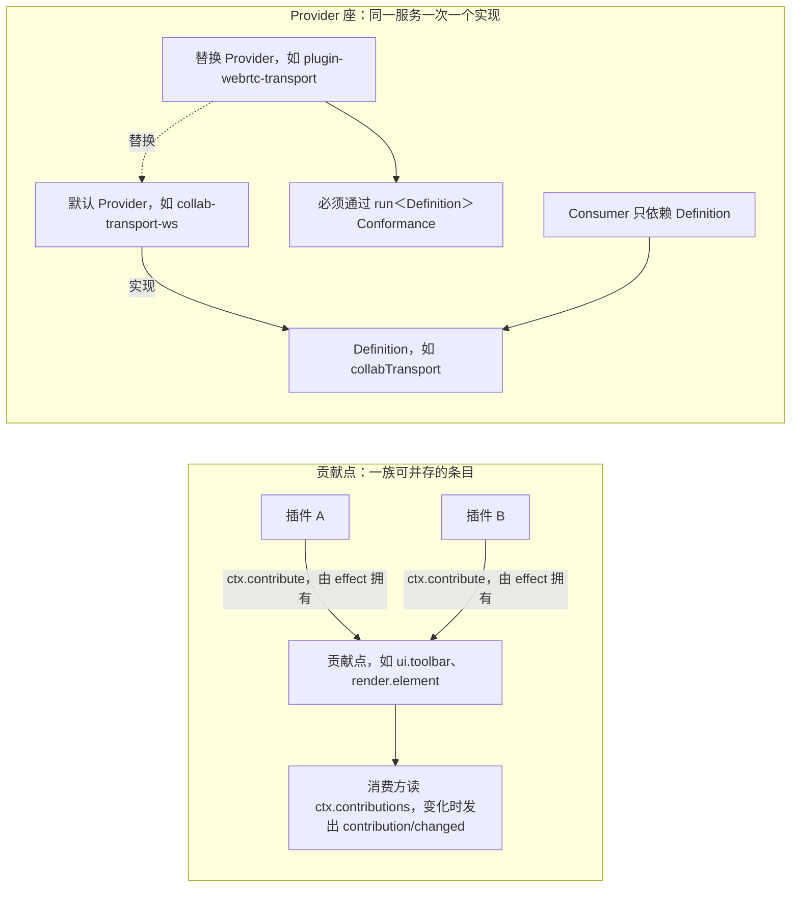
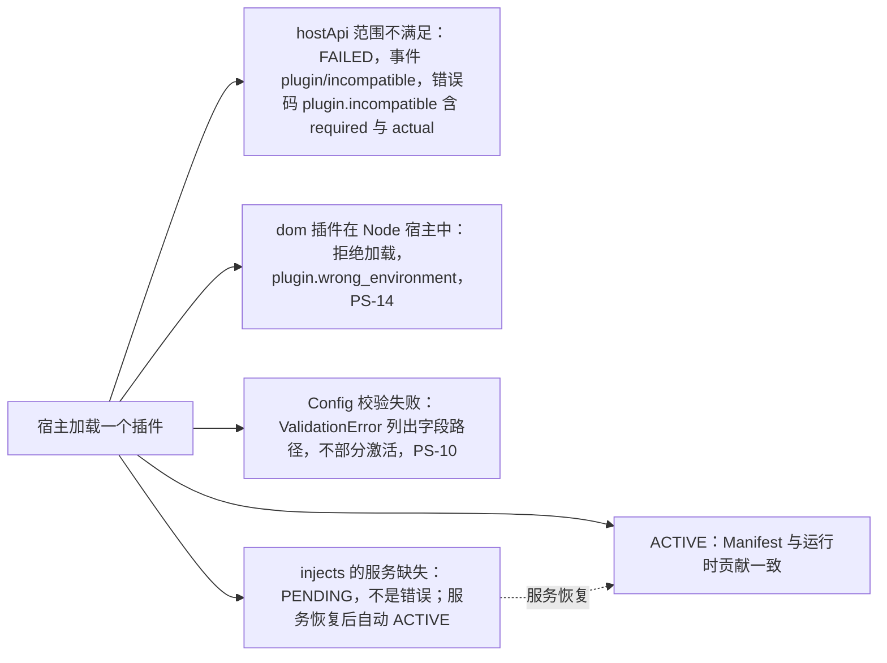
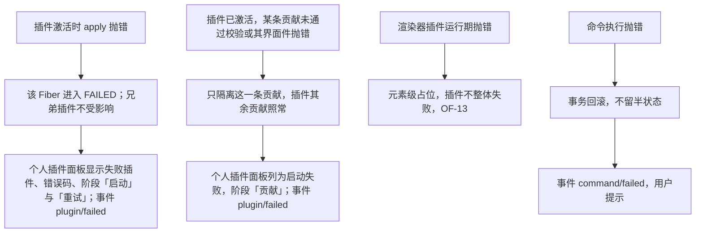

> 状态：草稿 | 负责：产品 | 更新：2026-11-05 | 依赖：charter v0.2；rulings §4.12、§4.15、§4.16、§4.23、§4.25、§4.26；架构 03；ADR-0001、ADR-0002、ADR-0003；设计 06、03-02、03-09、03-22、03-23

# 功能域 04：插件 SDK（面向插件开发者）

> 需求编号前缀 `PS-`。本文件是 M4「插件 SDK 公开」的主要验收来源。P0 项多数在公开前就是内部开发者的工作方式（起点见各条目标里程碑：PS-01 为 M1；PS-02、PS-04、PS-07、PS-11、PS-15 为 M2；PS-03 从 M2 起内部使用；PS-05、PS-06 在 M4）。我们自己的垂直束就是第一批插件。插件机制本身（ContributionPoint、Manifest、UnitScope、生命周期）由架构 03 与 ADR-0001/0002/0003 定义；本文定义插件开发者作为**用户**的需求。

---

## 0. 本域的产品立场

1. **插件开发者是第一等用户**：章程 §2.2 的长期目标是「第三方不改内核即可新增元素类型/渲染方式/UI/存储/协同/文档类型」。这是产品能力，不只是架构属性：需要文档、脚手架、示例、测试套件与版本承诺。
2. **可发现性靠 Manifest，不靠运行**（规避 Univer A9）：不运行系统就能知道一个插件提供什么、需要什么、贡献了什么、能在哪些环境跑。
3. **一个失败的插件不能拖垮编辑器**（规避 Univer A11）：失败被隔离、被展示、可诊断。
4. **信任模型是「同源可信 + 审核」，不是沙箱**（章程 §2.3）：SDK 不假装隔离第三方代码；集成方决定加载哪些插件。
5. **每个公开贡献点都有文档、示例与兼容性测试**，否则不算公开。

---

## 1. 插件开发者的旅程（M4 验收基线）

**图 1-1 插件开发者的旅程**

怎么读：箭头为旅程先后，每个节点「·」后是该阶段依托的产品能力；M4 验收要求试点者仅凭文档站走完全程。

- **M4 机械化验收**：内部非核心成员（未参与内核开发的同事或全新 AI agent 会话，rulings §4.16 Q11）仅凭公开文档站与示例，在 ≤ 2 人日内完成「新增一种元素渲染 + 一个底部工具条『更多』按钮 + 一个检查器分区」的插件，CTK 全部通过，过程中不向核心团队提问超过 3 次（提问记录为文档缺陷）。

---

## 2. 需求

### PS-01 插件包结构与 Manifest

- 优先级：P0 | 目标里程碑：M1（内部）/ M4（公开与文档） | 依赖能力：`Manifest`（`kernel`）、ADR-0003 清单生成、同构类声明
- 用户故事：作为插件开发者，我希望按一个固定的包结构写插件，工具自动生成清单，让集成方在不运行的情况下知道我的插件提供什么。
- 验收标准：
  - 包结构遵循 primer §5.3（`plugin.ts`/`manifest.ts`/`*.contribution.ts`/`services/`/`contracts/`/`__tests__/`）；脚手架生成即符合。
  - `cordex-manifest.json` 由源码静态生成，至少给出：插件 id 与版本、显示名与一句说明、提供 / 必需 / 可选的服务、按贡献点 id 列出的贡献、声明的事件、同构类（`iso` / `dom` / `node`）、宿主兼容范围（`hostApi`，兼容的 kernel 版本范围）、适用的文档类型（空 = 通用）、能力声明（PS-13）、提供的语言、作用域 `scope`（`content` 内容级 \| `ui` 界面级，PM-02）；字段名与格式以架构 03 §4.1 为准。
  - `scope` 由作者声明、生成器按贡献与实现推出最低作用域并校验：贡献文档内容、渲染、格式、Mutation、资源、迁移、写命令或实现 Provider 座的一律为内容级，按部署统一启停；只贡献 `ui.*`、`i18n.bundle`、`render.overlay` 与只读命令的才可声明为界面级，允许用户个人启停。声明低于推出结果即生成失败。判定规则与管理口径见 [09-plugin-manager.md](09-plugin-manager.md) §2.2、PM-02。
  - CI 校验清单与运行时一致（加载后实际贡献 == 清单声明），不一致即失败。
  - 集成方能用 CLI（`cordex manifest inspect <pkg>`，命名草案）打印清单摘要。

### PS-02 公开贡献点目录与稳定性分级

- 优先级：P0 | 目标里程碑：M2（内部使用）/ M4（公开） | 依赖能力：`ContributionPoint`（`defineContributionPoint` / `ctx.contribute` / `ctx.contributions`）
- 用户故事：作为插件开发者，我希望有一份「能贡献什么」的清单，每项带 schema、示例与稳定性承诺。
- 验收标准：
  - M4 公开的贡献点共 26 个，与章程 §5.5 的列表一致（逐 id 以 40-modules/16 §4 为准；id 用 camelCase，D15；schema 见架构 03 §3.6）：

| 贡献点 id | 用途 | 稳定级 | 首次可用 |
|---|---|---|---|
| `core.documentType` | 注册新文档类型（模型/编解码/单元插件束） | Stable @M5 | M1 |
| `core.format` | 注册 `FormatCodec`（导入/导出，按 MIME）；**导出专用编解码器亦在此**（`canImport:false`，如 Markdown 导出） | Stable @M4 | M1 |
| `core.command` | 注册命令的可执行定义（声明能力位、参数 schema） | Stable @M4 | M2 |
| `core.mutation` | 注册 `Mutation` 定义（可序列化、可权限校验；逆操作由 Store 推导） | Stable @M4 | M2 |
| `core.migration` | 注册 `Snapshot` 迁移 | Stable @M4 | M1 |
| `core.resource` | 把插件数据挂进 `Snapshot`（`ResourceHook`） | Stable @M4 | M1 |
| `core.permissionPolicy` | 注册权限策略（能力位 → 命令/路径规则） | Beta @M4 | M3 |
| `render.scene` | 页级场景合成阶段的贡献 | Beta @M4 | M1 |
| `render.target` | 注册 `RenderTarget`：`dom`（HTML+SVG，唯一实现）；`canvas` 预留：对外 Stable 前须有最小 canvas Provider 通过契约测试（M3 末，rulings §4.15 Q4） | Stable @M4 | M1 |
| `render.element` | 注册 `ElementRenderer`（按 kind） | Stable @M4 | M1 |
| `render.overlay` | 注册覆盖层（选区/参考线/presence 类） | Beta @M4 | M2 |
| `layout.measurer` | 文本度量器（浏览器 canvas 度量 / Node 字体解析度量） | Beta @M4 | M1 |
| `slide.shapeKind` | 注册新元素 kind 的模型 schema + 编解码 + 默认属性 | Stable @M4 | M2 |
| `comments.anchorResolver` | 评论锚点解析：按文档类型解析与描述锚点（评论包本身不区分文档类型，新文档类型须贡献自己的解析器） | Beta @M4 | M3 |
| `i18n.bundle` | 语言包（按插件命名空间） | Stable @M4 | M2 |
| `errors.sink` | 错误上报出口（console / Sentry / server-api） | Stable @M4 | M1 |
| `telemetry.sink` | 遥测出口（no-op / OTel / 自定义） | Stable @M4 | M1 |
| `ui.toolbar` | 底部创建工具条「更多」项与评审条条目：工具条上插件的创建类入口只进「更多」，主行只放内置条目；`reviewBar` 槽位只承载评论、高亮与上一处 / 下一处评论；评审条的「浏览」、模式标识「评审模式」「返回编辑」与浏览条的「只读浏览中」由外壳内置（rulings §4.25 TB-1）；创建工具条的「选择」等内置条目由 slide-ui 贡献（TB-38）。槽位只有 `create`、`create.more`、`reviewBar`，没有对象上下文槽位：插件针对所选对象的命令走 `ui.inspectorSection` 与 `ui.contextMenu` 的对象菜单（TB-29） | Beta @M4 | M2 |
| `ui.panel` | 检查器整栏面板与次级浮动面板（格式分区走 `ui.inspectorSection`）。整栏面板承载插件真正需要宽度的整页内容（如数据网格、长表单）：打开时检查器整栏换成面板，宽 max(400, 检查器当前宽度)，开着时分隔条不可拖、关闭后回到原宽，与图表「编辑数据」面板同一落位；紧凑形态（640–1024）里与图表数据面板一样以画布底部 Sheet 呈现，不进检查器抽屉；不做检查器页签：检查器页签只由内置包贡献（当前只有「评论」），第三方插件的整页面板只作整栏面板；设置型插件缺省只在检查器的插件分区里，分区声明了对应的整页面板时由宿主在分区右下画「展开」，点了才进整栏，命令或快捷键打开同一面板走 Operation `ui.openPanel{id}`；面板跟着触发它的选中对象，选中别的对象即收起。评审模式、只读角色与降权时宿主按「只读就地展示」：顶部一行权限说明、写操作不出现、不加禁用蒙版，画布上的插件元素选中时只画 1px 强调色框（rulings §4.25 DS-38、DS-56、DS-130、TB-59、TB-60；画法以设计 06 §2.2、03-09 §10 为准） | Stable @M4 | M2 |
| `ui.inspectorSection` | 检查器分区：按选中对象类型（`selectionKind`）挂到检查器「设计」页签；分区可声明同一插件的一个整页面板（`ui.panel`），宿主据此在分区右下画「展开」（rulings §4.25 DS-5、TB-59；字段定义以前端 50/09 §6.1 为准） | Beta @M4 | M2 |
| `ui.contextMenu` | 菜单项：右键菜单（画布上的对象与空白处按选区类型过滤，即对象菜单；缩略图）、主菜单各子菜单、文档菜单与账户菜单；第三方条目默认归入菜单末尾的「插件」分组，主菜单「插入」末尾的插件分组与工具条「更多」同一收纳规则（DS-49）；主菜单顶层单项只收内置（槽位全集以前端 50/09 §6.1 为准） | Stable @M4 | M2 |
| `ui.shortcut` | 快捷键绑定（带作用域） | Stable @M4 | M2 |
| `ui.command` | 命令的**呈现元数据**（title/icon/when/keybinding 展示，命令面板与菜单可见性） | Beta @M4 | M2 |
| `ui.dialog` | 对话框 | Beta @M4 | M2 |
| `ui.notification` | 通知（toast） | Beta @M4 | M2 |
| `ui.theme` | 设计 token 覆盖集 | Beta @M4 | M2 |

  - 三类入口的分工：创建类入口走 `ui.toolbar`（插件按钮只进底部工具条「更多」），格式类入口走 `ui.inspectorSection`，其余命令经 `ui.command` 进命令面板，主菜单、文档菜单与右键里的条目走 `ui.contextMenu`；状态只走 `ui.notification` 与横幅，不设常驻状态位（rulings §4.25 DS-5、DS-6）。槽位规范见设计 06 §2.1–§2.6、§2.12，条目字段以前端 50/09 §6.1 为准。
  - 插件条目很多时的收纳：工具条「更多」与主菜单「插入」在插件不超过 3 个、且每个不超过 3 条时每个插件一组平铺、排在内置项之后，否则插件区换成「插件 · N」小标题、每个插件一行、条目进子菜单，内置条目的位置和长短不随插件数量变化；检查器的插件分区排在内置分区之后，同一选中对象的插件分区超过 2 个时全部默认折叠为一行（标题 + 归属标识），展开状态按分区记在本机（rulings §4.25 DS-49）。
  - 第三方插件的界面贡献一律带归属标识（插件名与来源），由宿主统一画出，插件不能去掉；内置贡献不带（设计 06 §1、§4）。
  - **`ui.*` 贡献形态**（rulings §4.15 Q2）：第三方 UI 贡献 = 声明式描述（id/title/icon/when/位置）+ 可选 React 19 组件；组件一律经 ErrorBoundary 包裹并在 CTK 中跑 axe 夹具；SDK 对宿主 React 的要求为 `^19.0`。框架无关宿主（形态 B）由宿主自绘 UI，只消费声明式部分（`UiRenderer('vanilla')` 契约）。上述形态在 M4 Stable 时冻结。

  - **Provider 座**（可替换的服务实现，**不是**贡献点；通过 Definition / Provider / Consumer 三角色替换，替换后必须通过对应的 `run<Definition>Conformance` 契约套件，章程 §5.5；Definition 与 Provider 以 40-modules/16 §3 为准）：

| 服务 | Definition 所在 | 默认 Provider | 可替换示例 | 首次可用 |
|---|---|---|---|---|
| `store`（`DocumentStore`） | model-core | store-memory | store-yjs（协同） | M1 |
| `collabTransport` | collab-core | collab-transport-ws | WebRTC 传输（示例 `plugin-webrtc-transport`） | M3 |
| `offlineStore`（`OfflineStore`） | collab-core | collab-offline-idb（M4，P2） | 自定义持久化 | M4 |
| `blobStore` | model-core（契约）· server-storage（服务端实现） | S3 兼容（compose 默认 SeaweedFS）/ 本地 | 任意 S3 兼容服务、集成方自定义（示例 `plugin-s3-storage`） | M3 |
| `layout.measurer`（同时是贡献点） | engine-layout | render-dom canvas 度量 | server-headless 字体度量 | M1 |

**图 2-1 两种扩展方式：贡献点与 Provider 座**

怎么读：「贡献点」子图是「加东西」：多个插件向同一个贡献点添加条目，插件卸载即撤销；「Provider 座」子图是「换东西」：同一服务只保留一个实现，替换者须通过契约套件，Consumer 不感知替换。协同传输与 Blob 存储属于 Provider 座，不是贡献点。
依据：本条 PS-02；章程 §5.5。

  - 稳定级语义：`Stable` = 破坏性变更需主版本且提前 ≥ 1 个次版本弃用；`Beta` = 次版本可破坏但有迁移说明；`Experimental` = 不承诺。包级稳定级字段 `package.json#cordex.stability`（章程 §5.2）出现在文档与 api-extractor 报告中（继承 Univer K10 反面：A21）。
  - 每个贡献点有：schema（Standard Schema，用于加载期校验）、TS 类型、文档页、≥ 1 个示例、CTK 用例。
  - 贡献在 `ctx.effect` 内注册，插件卸载即撤销（primer MUST #2）；贡献点变化触发 `contribution/changed`。
  - **第三方前缀规则**（章程 §5.5、D15；能力位见架构 03 §3.6）：第一方保留域以章程 §5.5 为准（与架构 03 §3.6 是同一份名单）；第三方插件的事件名、贡献点 id 与能力位必须以其 npm scope（去 `@`）为前缀：事件 `<vendor>:<域>/<动作>`，贡献点 `<vendor>:<域>.<名>`，能力位 `<vendor>:<域>.<动作>`；扫描器拒绝无前缀的非保留域。脚手架（PS-03）按包 scope 自动生成前缀。

### PS-03 脚手架

- 优先级：P0 | 目标里程碑：M4（M2 起内部使用） | 依赖能力：`tooling/*`、Manifest 生成
- 用户故事：作为插件开发者，我希望一条命令生成可编译、可测试、可发布的插件骨架。
- 验收标准：
  - 脚手架包定名 `@cordexjs/create-plugin`（rulings §4.15 Q1），命令 `npm create @cordexjs/plugin`（等价 `pnpm create @cordexjs/plugin`）交互式选择模板：`element-kind`（新元素 + 渲染器 + 工具条「更多」按钮 + 检查器分区）、`inspector-section`（检查器分区，可声明 `expandPanel` 打开整栏面板）、`format-codec`、`format-export`（`core.format`，`canImport:false`）、`telemetry-sink`、`blob-store-provider`（`blobStore` Provider 座）、`document-type`（其贡献点 `core.documentType` Stable @M5）、`i18n-bundle`。
  - 生成物：TS 严格配置（继承 `tooling/tsconfig`）、eslint/depcruise 配置、Vitest 测试（含「卸载后无 effect」「缺依赖进入 PENDING」「多实例」三件套）、Manifest 生成脚本、Changesets、README 模板、示例 e2e（Playwright，可选）。
  - 生成物的 `package.json` 与仓库工具链一致（rulings §4.15 Q9）：`packageManager` 钉 pnpm 11 精确版本、`devEngines`（packageManager/runtime，`onFail: error`）、`engines.node >=26`；内部依赖用 `workspace:` 协议（peer `workspace:^`，其余 `workspace:*`）。
  - 生成后 `pnpm install && pnpm test && pnpm build` 一次通过；生成 ≤ 30 s。

### PS-04 示例插件仓库

- 优先级：P0 | 目标里程碑：M2（首个示例作为可插拔证据）/ M4（完整集） | 依赖能力：全部公开贡献点
- 验收标准：
  - `examples/` 目录（独立于 `packages/`，只能 import 公开入口，depcruise 强制）至少包含：

| 示例 | 演示的可插拔层 | 计划提供 |
|---|---|---|
| `plugin-qr-shape` | 新元素 kind（二维码）：模型 schema + 编解码（导出为回退图片 `p:pic` 加 `p:extLst` 里的插件数据，再次导入时按扩展 URI 还原）+ `ElementRenderer` + 工具条「更多」按钮 + 检查器分区 | M2 |
| `plugin-word-count` | 命令与对话框：命令面板中的「字数统计」（`ui.command`）打开对话框（`ui.dialog`），显示本页与全文字数 + 事件订阅（`store/transaction` 后刷新）。状态类信息不放进检查器分区：检查器只放当前选中对象的属性，`ui.inspectorSection` 只承载格式类分区（DS-1、DS-5） | M2 |
| `plugin-markdown-export` | `core.format`（`canImport:false`）：导出 Markdown | M2 |
| `plugin-otel-telemetry` | `telemetry.sink` 替换（OpenTelemetry） | M2 |
| `plugin-brand-theme` | `ui.theme` token 覆盖 + 品牌形状库 | M2 |
| `plugin-locale-ja` | `i18n.bundle` | M2 |
| `plugin-webrtc-transport` | `collabTransport` 服务 Provider 座替换 | M3 |
| `plugin-s3-storage` | `blobStore` 服务 Provider 座 | M3 |
| `plugin-json-format` | `core.format`：JSON 导入导出 | M3 |
| `doc-type-skeleton` | `core.documentType`（M5 骨架） | M5 |

  - 「计划提供」是各示例的计划节奏，出口条件以本条的目标里程碑与 PRD 05 为准：M2 只要求 `plugin-qr-shape`（`pluggable:m2`），完整集在 M4。
  - 每个示例：README（目标、用到的贡献点、运行方式）、单测、CTK 通过、≤ 500 行实现。
  - M2 可插拔证据：`plugin-qr-shape` 合入时对 `packages/{kernel,model-core,engine-render,render-dom,ui-core,ui-react}` 的 diff 为 0 行（CI 在该 PR 上断言，PRD 05 M2 `pluggable:m2`）。

### PS-05 文档站

- 优先级：P0 | 目标里程碑：M4 | 依赖能力：api-extractor 输出、Manifest、贡献点 schema
- 验收标准：
  - 结构：快速开始（≤ 30 分钟到第一个可见贡献）、概念（Plugin/Fiber/Service/ContributionPoint/Manifest/UnitScope，用产品语言解释 primer）、贡献点参考（由 schema 自动生成 + 手写说明）、API 参考（api-extractor → 文档）、指南（新元素/新检查器分区/新格式/新存储/新文档类型/服务端 headless）、示例索引、版本与兼容策略、迁移指南、故障排查（`PENDING` 不是错误、常见错误码）、术语表（与章程 §4 同步）。
  - 每个公开 API 与贡献点在文档站有页面，缺页 CI 失败（文档覆盖率 100%）。
  - 文档内代码示例可执行（从 `examples/` 提取，CI 编译）。
  - 中英双语（zh-CN 源，en-US 同步；PD-11）。
  - 搜索；版本切换（每个次版本一份）。

### PS-06 兼容性测试套件（CTK）

- 优先级：P0 | 目标里程碑：M4 | 依赖能力：架构 11 插件兼容套件、`kernel` 诊断（`dumpFiberTree`、`assertNoLiveEffects`）
- 用户故事：作为插件开发者，我希望一条命令告诉我插件在哪些宿主版本下能正确加载、卸载、共存。
- 验收标准：
  - `cordex ctk run <pkg>`（草案）在宿主版本矩阵（当前次版本 + 前两个次版本）上执行并输出报告（JSON + Markdown 徽章）：
    1. 加载：进入 `ACTIVE`；Manifest 与运行时一致；Config schema 校验通过/失败路径。
    2. 卸载：`fiber.getEffects()` 为空；贡献点条目消失；无残留 DOM 节点/timer/listener。
    3. 缺依赖：移除其 `injects` 的任一服务后进入 `PENDING` 而非抛错；服务恢复后自动 `ACTIVE`。
    4. 多实例：同一进程两个 `Unit` 各激活一次，互不污染（规避 Univer A10）。
    5. 同构：声明 `iso` 的包在 Node 下 `import` 冒烟通过（Univer A20）。
    6. 失败隔离：注入抛错版本，宿主其余功能可用。
    7. 版本协商：`hostApi` 范围外的宿主拒绝加载并给出事件 `plugin/incompatible` 与错误码 `plugin.incompatible`。
    8. 贡献 schema：每个贡献条目通过对应贡献点 schema。
    9. 作用域（PRD [09-plugin-manager](09-plugin-manager.md) PM-02）：`cordex-manifest.json` 的 `scope` 不低于按贡献与实现推出的最低作用域；界面级插件执行带写能力位的命令被命令管线拒绝并记 `plugin/scope-violation`。
  - CTK 本身有负向测试（故意违规的插件样例必须失败；规避 Univer A17）。
  - 运行时间：单插件全矩阵 ≤ 3 min。

### PS-07 版本协商与兼容策略

- 优先级：P0 | 目标里程碑：M2（内部）/ M4（公开） | 依赖能力：ADR-0002 版本策略、`kernel` 加载期校验
- 验收标准：
  - 内核层（`kernel`/`model-core`/`engine-render`/`ui-core` 等水平层）lockstep 版本；插件独立 semver，`peerDependencies` 显式声明水平层范围，Manifest `hostApi` 与之一致（生成时校验）。
  - 加载期：宿主检查 `hostApi` 范围，不满足 → 插件 `FAILED` + 事件 `plugin/incompatible` + 错误码 `plugin.incompatible{required, actual}`，不静默加载（与 Univer「仅 log 不阻断」不同）。
  - 弃用：`@deprecated` 必带移除版本；文档站标注；到期版本扫描器失败（Univer A22）。
  - 兼容窗口：每个次版本的贡献点 `Stable` API 至少向后兼容 2 个次版本；主版本升级提供迁移指南与 codemod（P1）。
  - `Snapshot` `schemaVersion` 变化对插件透明（迁移由 `migrations` 负责）；插件的 `ResourceHook` 数据自带版本号与迁移函数（PS-01 schema）。

**图 2-2 插件加载时的出口**

怎么读：一个加载动作的五种结局，每个节点写明对外可见的状态、事件或错误码；图中不表示检查先后。开发者面板与个人插件面板据此展示原因（PS-09、PM-10）。
依据：PS-06 第 1、3、7 项；本条 PS-07；PS-10；PS-14。

### PS-08 发布流程

- 优先级：P1 | 目标里程碑：M4 | 依赖能力：Changesets、npm provenance
- 验收标准：
  - 官方插件与示例：Changesets 生成版本与 changelog；npm 发布走 OIDC trusted publishing 并带 provenance（与 NF-04 对齐）；npm org 在首次公开发布前注册（rulings §4.15 Q1）；包名约定 `@cordexjs/plugin-*`（官方）/ 任意（第三方，建议 `cordexjs-plugin-*` 关键字 `cordexjs-plugin`）。
  - 第三方插件「已验证」目录（PD-14，P2）：提交 CTK 报告 + 许可证声明 + 源码链接，人工审核后列入文档站；不做运行时市场。
  - 发布前检查：`publint`、`attw`、api-extractor 基线、许可证白名单（章程 D13）。

### PS-09 开发体验：调试与诊断

- 优先级：P1 | 目标里程碑：M2（内部）/ M4（公开） | 依赖能力：`kernel` 诊断工具、Fiber 状态机、`fiber.restart()`/`update()`
- 验收标准：
  - 开发者面板（编辑器内）：入口为主菜单「帮助」最后一组（分隔线之后）与偏好设置「关于」里的「开发者面板 · 打开」（设计 03-02 §2.3、03-23 §4.6），两处只在开发构建或部署打开 `features.developerMenu`（RuntimeConfig，前端 50/02 §3）时出现，生产缺省不出现（rulings §4.12 U-16、§4.25 TB-40）。内容：Fiber 树（状态 `PENDING/LOADING/ACTIVE/FAILED`、依赖快照）、每个插件的贡献列表、effect 树、最近错误、事件流（可过滤域）。开发构建下另有命令「切换贡献槽位高亮」：把当前页面上全部已解析的贡献点槽位（不论有没有内容）用虚线描边并标出槽位 id（设计 06 §6）。
  - 热重载：修改插件源码后宿主 `fiber.restart()`，效果 ≤ 1 s 可见，无重复注册（靠 effect 清理）。
  - 常见错误有可操作提示：`PENDING` 列出缺失服务名；`ValidationError` 列出 Config 路径；`plugin.incompatible` 列出版本。
  - 示例宿主 `examples/host-playground`：一键启动、加载任意本地插件、内置 3 个语料文件。

### PS-10 插件配置

- 优先级：P1 | 目标里程碑：M4 | 依赖能力：`Plugin.Config`（Standard Schema）、`ctx.intercept`
- 验收标准：Config 在激活前校验，失败不部分激活（primer MUST #4）；集成方以 preset 配置传入；Config schema 可自动生成配置表单（字段说明取 `description`）：参考应用的管理员配置表单（「管理 › 插件」，部署级一份，[09](09-plugin-manager.md) PM-09，P1，M4）由此生成，面向集成方的通用表单生成器为 P2（rulings §4.26 PV-26）；每个 Config 字段必须有读取点（扫描器，规避 Univer A26）。

### PS-11 失败隔离与用户可见性

- 优先级：P0 | 目标里程碑：M2 | 依赖能力：`kernel` 捕获 `apply` 异常 → `FAILED` + `errors` 上报
- 验收标准：
  - 插件激活抛错 → 该 Fiber `FAILED`，兄弟插件不受影响；个人插件面板（[09-plugin-manager.md](09-plugin-manager.md) PM-10，主菜单「插件…」打开的居中对话框，rulings §4.25 DS-38）显示失败插件、错误码、阶段与「重试」；`plugin/failed` 事件。谁能重试、谁能关闭、失败时找谁，启动失败时的按需横幅（一个失败写插件名、多个写数量，DS-55），以及打开文档缺插件时的降级提示（PM-12），均以 09 为准。
  - 贡献失败（插件已激活，但某条贡献未通过贡献点 schema，或其界面件抛错被错误边界接住）→ 只隔离这一条贡献（按设计 06 §3 就地降级：条目与分区不显示，已打开的面板换成「该面板不可用」整块状态，覆盖层停止渲染），插件其余贡献照常；个人插件面板同样把它列为启动失败，阶段写「贡献」；错误码与激活失败同为 `kernel.plugin_failed`，以 `phase` 区分（错误码以架构 10 §1.1a 为准，rulings §4.25 TB-77）。
  - 渲染器插件运行期抛错 → 元素级占位（OF-13），插件不整体失败。
  - 命令执行抛错 → 事务回滚（不留半状态），`command/failed` 事件，用户提示。

**图 2-3 四种失败与各自的隔离边界**

怎么读：四列分别是插件级、贡献级、元素级与事务级失败，每列只影响自己所在的边界，编辑器其余部分继续可用（规避 Univer A11）。
依据：本条 PS-11；OF-13；rulings §4.25 TB-77。

### PS-12 插件国际化

- 优先级：P1 | 目标里程碑：M4 | 依赖能力：`i18n` 服务、`i18n.bundle` 贡献点
- 验收标准：插件文案 key 带插件命名空间（`<pluginId>.<key>`），缺 key 编译失败（继承 Univer K8）；插件提供的语言包按需加载；宿主语言切换时插件文案同步切换。

### PS-13 能力声明（仅展示）

- 优先级：P2 | 目标里程碑：M4 | 依赖能力：Manifest
- 验收标准：清单里的能力声明列出插件用途（`network:<host>`、`storage:local`、`clipboard`、`export`）；集成方文档、个人插件面板（PM-10）与管理员插件详情（[09](09-plugin-manager.md) PM-06）展示；**不**做运行时强制（章程 §2.3 无沙箱），文档明确说明。

### PS-14 服务端 / headless 插件

- 优先级：P1 | 目标里程碑：M3 | 依赖能力：`server-headless` cordis 宿主、同构类
- 验收标准：`iso` 插件（编解码、迁移、导出格式）可在 `server-headless` 中加载并参与导入/导出/校验；`dom` 插件在 Node 宿主中被拒绝加载并给出 `plugin.wrong_environment`；示例 `plugin-markdown-export` 在浏览器与服务端产出一致；插件贡献的导出格式（注册了 `canExport` 的 `core.format`）出现在参考应用导出对话框格式列表的末尾，右侧写明来自哪个插件，只导整份，在浏览器生成，与服务端产出一致，没有专属图标时画通用文件图标（画法与文案以设计 03-22 §4.1 为准，rulings §4.25 TB-182）。

### PS-15 类型安全的开发体验

- 优先级：P0 | 目标里程碑：M2 | 依赖能力：ADR-0001 声明合并桥接、`isolatedDeclarations`、api-extractor
- 验收标准：插件只 `declare module '@cordexjs/kernel'`（或 ADR-0001 退路），不直接依赖 `cordis`；事件与服务名有类型；贡献条目类型由贡献点泛型推导；`any` 不出现在公开 d.ts（type-coverage 100%）。

### PS-16 支持与生命周期政策

- 优先级：P1 | 目标里程碑：M4 | 依赖能力：—
- 验收标准：文档站公布：LTS 次版本（每 6 个月一个，支持 12 个月安全修复）、弃用最短周期（≥ 1 个次版本且 ≥ 3 个月）、破坏性变更公告渠道、问题分级与响应目标（安全 ≤ 72 h，兼容性 ≤ 2 周）。

---

## 3. 插件开发者的用户故事汇总

编号与故事以 PRD [02](../02-personas-and-scenarios.md) §3.3 为准；「例」是本域的具体场景，不另占编号。

| 编号 | 故事 | 对应需求 |
|---|---|---|
| US-P-01 | 我想加一种新元素（渲染 + 插入 + 导出 + 协同）。例：加一种二维码元素；在检查器里为我的元素加一组属性 | PS-02 `slide.shapeKind` + `render.element`、`ui.inspectorSection`（可选 `ui.panel` 整栏面板）；PS-04 示例 `plugin-qr-shape` |
| US-P-02 | 我想在工具条「更多」或菜单里加一个按钮执行我的命令 | PS-02 `core.command` + `ui.toolbar` / `ui.contextMenu` / `ui.command` |
| US-P-03 | 我想不运行就知道一个插件提供什么、需要什么 | PS-01 Manifest |
| US-P-04 | 我想一条命令生成能跑的插件骨架 | PS-03 |
| US-P-05 | 我想知道升级宿主后插件还能不能用 | PS-06 CTK、PS-07 |
| US-P-06 | 我的插件崩了不想连累用户，也想让用户知道是我崩了 | PS-11 |
| US-P-07 | 我想在浏览器与服务端跑同一个导出插件。例：导出 Markdown；在服务端批量处理文档 | PS-14（示例 `plugin-markdown-export`）、PS-02 `core.format`（`canImport:false`） |
| US-P-08 | 我想换掉传输/存储/遥测实现而不碰其它层。例：把遥测送到公司的 OTel；换掉 WebSocket 用 WebRTC | PS-02 Provider 座 `collabTransport` / `blobStore` 与贡献点 `telemetry.sink` / `errors.sink` |
| US-P-09 | 我想 30 分钟内跟着文档做出第一个可见的贡献 | PS-05 |
| US-P-10 | 我想加一种新文档类型 | PS-02 `core.documentType`、M5 |

---

## 4. 与其它域的接口

| 本域产出 | 消费方 |
|---|---|
| 贡献点目录与稳定级 | 架构 03（贡献点定义）、类型治理 09（贡献/清单类型规约）、设计 06（UI 槽位规范） |
| CTK 用例清单 | 架构 11 测试策略 |
| 示例仓库 | M2/M3/M5 可插拔证据（`05-milestones-and-scope.md`） |
| 文档站结构 | 集成方文档（`05-embedding-and-integration.md`）共用站点 |
