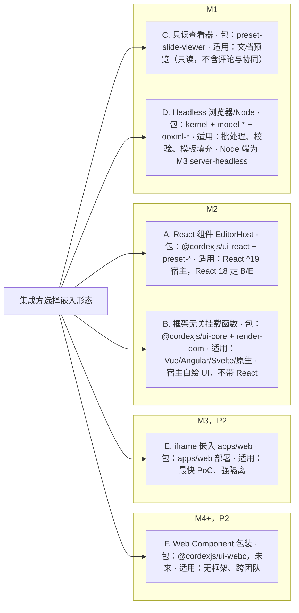
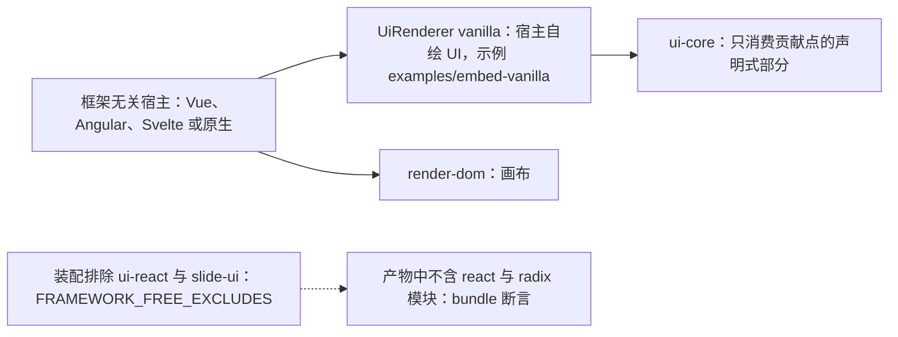
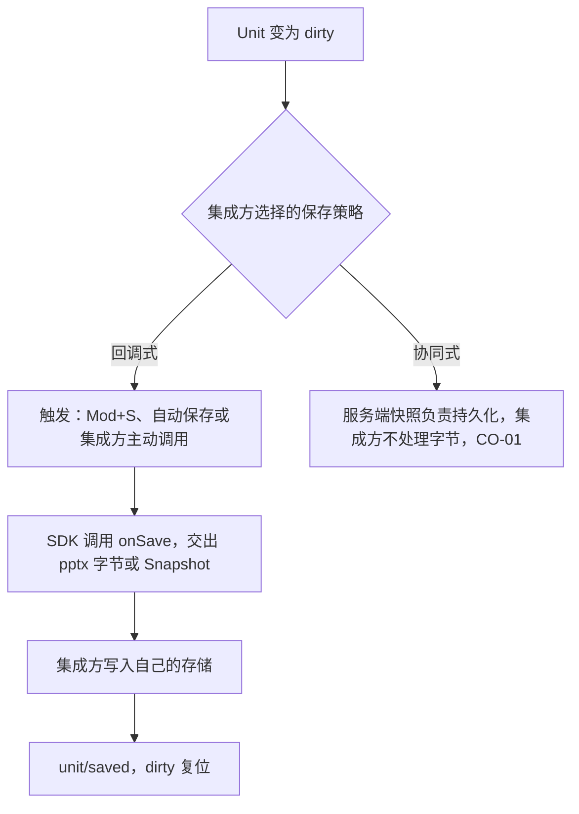
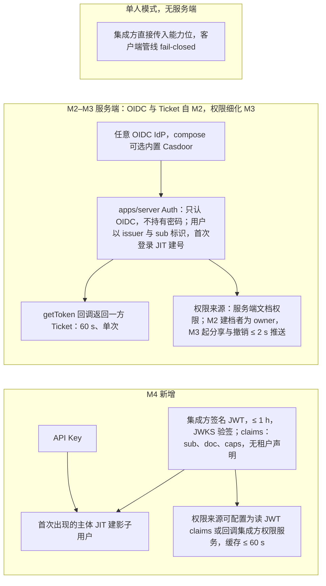
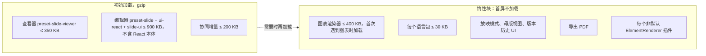
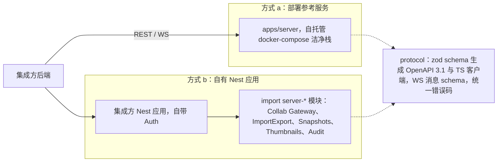

> 状态：草稿 | 负责：产品 | 更新：2026-11-05 | 依赖：charter v0.2；rulings §4.15、§4.16、§4.17、§4.18、§4.19、§4.20（FE-06）、§4.21（q-nest-major）、§4.25（DS-1、DS-2、DS-5、DS-17、DS-21、DS-73、DS-76、DS-90、DS-112；TB-115、TB-118、TB-123、TB-145、TB-159、TB-161、TB-163、TB-176）、§4.26（PV-12、PV-13、PV-14、PV-30）

# 功能域 05：嵌入与集成（面向集成方）

> 需求编号前缀 `EM-`。集成方 = 把 SDK 嵌入自家产品的工程团队（前端 + 后端）。本文件定义「把编辑器放进自己的产品」需要的一切：嵌入方式、鉴权、存储、事件、主题、按需加载、升级。服务端部署与运维见 `06-server-and-ops.md`；插件开发见 `04-plugin-sdk.md`。

---

## 0. 本域的产品立场

1. **SDK 优先**（章程关键词一）：交付的是 `Preset` + 插件 + 内核，`apps/web` 只是组装样例。集成方不应该需要复制 `apps/web` 的任何代码才能嵌入。
2. **身份由外置 OIDC IdP 拥有（服务端不持有密码），存储与业务由集成方/部署方拥有；SDK 拥有文档模型、编辑与协同**。边界上的一切通过 Definition/Provider（可替换）或回调（事件）交互，不通过全局变量或 DOM 约定。
3. **默认安全、默认离线（无外呼）、默认无遥测**：SDK 不主动联网（除集成方配置的协同端点与资源 URL，以及文档内 `http(s)` 外链资源；外链资源默认自动加载，部署配置 `externalResources` 可收紧为 `confirm` / `never`，见 EM-14），遥测默认 no-op（PD-10）。
4. **按需加载是产品承诺**（规避 Univer A33）：只看不编辑的场景不该为编辑器、协同、图表付出体积。

---

## 1. 嵌入形态一览

**图 1-1 六种嵌入形态：包、适用场景与里程碑**

怎么读：每个子图是形态首次可用的里程碑，节点内依次写形态、所用的包与适用场景。要看评论与在场的只读嵌入用编辑器的查看模式：形态 A 以只读配置挂载（EM-08），形态 E 用 `/embed/:id?mode=view`（设计 03-02 §5a.4）。

**图 1-2 形态 B：框架无关宿主的装配**

怎么读：实线为宿主实际装配的部分，虚线为装配排除带来的可验收结果；验收还包括 `ui-core` 与各 `*-ui` 的 domain/application 层不 import React（depcruise 规则）以及 UI 渲染契约测试通过。

- 形态 B（rulings §4.15 Q2）：宿主自绘 UI，只消费 `ui-core` 贡献点的声明式部分；装配时排除 `ui-react` 与 `slide-ui`（`FRAMEWORK_FREE_EXCLUDES`），因此不带入 React/Radix。M2 只交付 React 绑定（章程 D10）；B 的验收是「`ui-core` 与各 `*-ui` 的 domain/application 层不 import React（depcruise 规则）+ `examples/embed-vanilla` 实现 `UiRenderer('vanilla')` 并通过 UI 渲染契约测试 + 产物中不含 react/radix 模块（bundle 断言）」。

---

## 2. 需求

### EM-01 嵌入与初始化

- 优先级：P0 | 目标里程碑：M2（M1 为查看器） | 依赖能力：`kernel.createHost`、`Preset`、`UnitScope`、`Plugin.Config`（Standard Schema）
- 用户故事：作为集成方前端工程师，我希望 ≤ 20 行代码把编辑器放进我的页面，并能在同一页放多个实例。
- 验收标准：
  - 「5 分钟快速开始」：安装一个 preset 包 + 一个 UI 绑定包，创建宿主、打开字节、挂载到容器；示例可复制运行。
  - 初始化配置经 Standard Schema 校验，错误在启动前抛出（不部分激活），错误信息含字段路径。
  - 同页 ≥ 4 个编辑器实例（各自 `Unit`）互不干扰：快捷键按焦点实例分派、样式不泄漏（CSS 作用域前缀或 Shadow DOM，P1）、事件按实例订阅。
  - 销毁：`dispose()` 后无残留 DOM、timer、WS、blob URL（`fiber.getEffects()` 为空）；20 次创建/销毁循环内存增长 ≤ 5%。
  - 容器尺寸变化（`ResizeObserver`）自动重排；编辑器按断点切换三种形态：≥ 1024 完整、640–1024 紧凑（两侧面板收为胶囊、按需展开为抽屉；紧凑形态的最小可用高度 400 px）、< 640 或触控设备为仅查看（rulings §4.25 DS-17、DS-21，NF-07；画法与尺寸以设计 03-02 §5a 为准）。
  - 形态 E（iframe 嵌入 `apps/web` 的 `/embed/:id`，M3 P2）按容器宽度取同样的三种形态，只有出口与说法不同（rulings §4.25 DS-112、TB-115；界面以设计 03-02 §5a.4、03-33 §9 为准，消息协议以前端 50/12 §9 为准）：
    - 「返回首页」只在宿主经 `cordex:init` 的 `intents` 声明 `navigate-back` 时出现，点了交给宿主；账户菜单的「退出登录」只在宿主声明 `sign-out` 时可用、点了交给宿主，没声明时留在原位、不可用并写「由宿主应用管理登录」（TB-145，rulings §4.20 FE-06，AS-06）。
    - 「在更大窗口中编辑」一类说法改写：仅查看形态的状态行只写「仅查看」；因区域太窄而不可用的入口（如母版视图）写「当前区域太窄，暂不可用」；手机评论面板里「解决」的原因写「当前区域太窄，暂不能解决评论」。嵌入里又是平板（触控、宽 ≥ 640）时以触控为准，状态行仍写「仅查看 · 在电脑上编辑」、形态类不可用原因写「在电脑上编辑」；宽度 < 640 的手机不论是否触控都按窗口窄算，写「当前区域太窄，暂不可用」（TB-159、TB-163）。
    - iframe 里没有会话时显示「请在新窗口登录」，分未登录、登录窗口已打开、弹窗被拦截三态（DS-73）；打开失败只给「重试」与「复制诊断信息」并通知宿主，离开交给宿主（TB-115）。
    - 导出、保真报告、版本历史、「插件…」等应用级条目在 iframe 里照常；参考应用 `apps/web` 不在嵌入里时界面不变（DS-112）。
    - M3 的形态 E 只支持与部署同站（same-site）的宿主：iframe 里只认 `apps/web` 自己的会话 cookie（跨站 iframe 不携带）；跨站宿主随 M4 的集成方签名令牌握手（EM-03）。允许嵌入的宿主源由部署配置列出，缺省不允许任何宿主嵌入（配置键以后端 60/17 §5.15 为准）。
  - SSR：SDK 包在服务端 import 不抛错（`dom` 包在无 DOM 环境下惰性初始化，P2）。

### EM-02 打开、保存与文档来源

- 优先级：P0 | 目标里程碑：M2 | 依赖能力：`FormatCodec`、`Unit`、`unit/*` 事件
- 验收标准：
  - 输入：`ArrayBuffer`/`Blob`/`File`/`ReadableStream`/URL（带自定义 `fetch` 与请求头回调）；输出：`exportPptx(options?): Promise<Blob>`、`exportSnapshot(): Snapshot`、`exportImage(pageIndex, options)`；`exportPptx` 的选项可关闭评论写入，缺省写入，参考应用的导出对话框不提供这个开关（CO-04，rulings §4.26 PV-12；参数名以架构与前端为准）。
  - 保存策略由集成方选择：(a) 回调式，SDK 在 dirty + 触发条件（Mod+S / 自动保存 / 主动调用）时调用 `onSave(bytes | snapshot)`；(b) 协同式，由服务端快照负责，集成方不处理字节（CO-01）。参考应用 `apps/web` 自 M2 起只走 (b)：文档内容以协同快照为唯一事实源，不设 pptx 内容版本端点（rulings §4.19 D-M2-CONTENT）。
  - `Snapshot` 可作为「热保存」格式（比 pptx 导出快 ≥ 5 倍），带 `schemaVersion`，旧快照打开时自动迁移并上报 `unit/migrated`。
  - 打开进度、dirty 状态、保存结果均有事件（EM-05）。

**图 2-1 两种保存策略**

怎么读：自上而下是一次保存的路径；回调式下 `Snapshot` 可作为比 pptx 导出快 ≥ 5 倍的「热保存」格式，旧快照打开时自动迁移并上报 `unit/migrated`。
依据：本条 EM-02；ED-23。

### EM-03 鉴权与身份对接

- 优先级：P0 | 目标里程碑：M2（OIDC 登录与一方 Ticket 随协同后端交付，rulings §4.19 D-M2-CONTENT；单人嵌入模式只需身份信息）/ M3（服务端文档权限细化：按人分享、撤销 ≤ 2 s）/ M4（集成方签名 JWT、API Key） | 依赖能力：`protocol` 鉴权握手、`permissions`、`collab-transport-ws`
- 用户故事：作为集成方，我已有自己的登录体系（任意标准 OIDC IdP），我希望服务端直接信任它，不要求我迁移用户或让服务端保存密码。
- 验收标准（rulings §4.15 Q6）：
  - 客户端：集成方提供 `getToken(): Promise<string>` 回调（Ticket 60 s 单次；集成方签名 JWT ≤ 1 h（M4）。M2–M3 只返回 OIDC 登录后换取的一方 Ticket；ADR-0029）与 `user: { id, displayName, avatarUrl?, color? }`（界面上的头像一律身份色底 + 首字，`avatarUrl` 只存不显示，rulings §4.25 TB-123，AS-06）；SDK 在握手与刷新时调用；不持久化令牌。
  - 服务端（M2–M3）：`apps/server` Auth 模块**只认 OIDC**（可接任意 OIDC IdP；docker-compose 可选内置 **Casdoor**，国内 IM 登录经 Casdoor 代理）；服务端不持有密码与凭据；用户以 `(issuer, sub)` 标识，首次登录 JIT 建号。
  - 服务端 M4：新增「集成方签名 JWT」与「API Key」两种模式（JWKS 验签；首次出现的主体 JIT 建影子用户）；JWT claims 约定（草案）：`sub`、`doc`、`caps[]`（能力位）、`exp`（单组织，无租户声明）。
  - 权限来源：服务端文档权限（章程 D12；M2 建档者为 owner，M3 起按人分享、撤销 ≤ 2 s 通过推送实现，CO-05）；M4 起可配置为从 JWT claims 读或回调集成方权限服务（缓存 ≤ 60 s）。
  - 注册策略为部署级开关 `auth.selfSignup`（默认关：管理员在 IdP 建号；文档分享邀请只对已存在账号生效，rulings §4.17 D1）；分享链接始终要求登录（CO-15）。
  - 单人模式（无服务端）：集成方直接传入能力位；SDK 客户端管线据此 fail-closed。
  - 鉴权失败错误码：`server.auth.invalid_token`、`server.auth.expired`、`server.auth.forbidden`（HTTP 401/401/403，WS 4401/4401/4403；架构 10 §11.2），均触发 `error/raised` 且不泄露内部细节。

**图 2-2 身份与权限的来源，按里程碑**

怎么读：三个子图分别是单人模式、M2–M3 服务端（M1 无服务端）与 M4 新增的来源；箭头为身份到凭据、身份到权限的推导方向。注册策略为部署级开关 `auth.selfSignup`（默认关），分享链接始终要求登录。
依据：本条 EM-03；SV-06；rulings §4.15 Q6。

### EM-04 存储对接

- 优先级：P0 | 目标里程碑：M2（字节回调；参考应用的服务端 `blobStore` 本地 Provider 与资源上传通道随协同后端交付，rulings §4.19 D-M2-CONTENT）/ M3（S3 兼容 Provider，compose 默认 SeaweedFS） | 依赖能力：`server-storage` Definition + Provider（S3 兼容，compose 默认 SeaweedFS / 本地）、资源上传通道（CO-12）
- 验收标准：
  - 前端：文档字节来源与去向由集成方掌握（EM-02）；图片/媒体插入时的二进制走「资源上传回调」`uploadAsset(file) → { url | assetId }`（协同模式必需，单人模式可选：不提供则内嵌到 pptx）。
  - 服务端：`blobStore` 服务的 Provider 座可替换（任意 S3 兼容服务（自托管 compose 默认 SeaweedFS）、本地文件系统、集成方自定义），接口含 put/get/head/delete/presign；切换 Provider 只改配置并通过 `runBlobStoreConformance`。
  - 元数据（文档、版本、评论索引、审计）默认 Postgres（ADR-0022）；集成方可只用 SDK 的协同网关而自管元数据（P2，需公开表结构与迁移脚本）。
  - 大文件：≥ 10 MB 上传走分片/预签名直传，不经 Nest 进程内存。

### EM-05 事件回调

- 优先级：P0 | 目标里程碑：M2 | 依赖能力：`Events` 接口声明（章程 §5.5，扫描器保证）、`telemetry`
- 用户故事：作为集成方，我希望订阅编辑器的关键事件来驱动我的业务（自动保存、活动流、通知、埋点）。
- 验收标准：
  - 公开事件（`<域>/<动作>`；定稿名单与载荷要点以架构 10 §11.1 为准，浏览器侧的发布者与公开订阅面见前端 50/15 §2–§3）：

| 域 | 事件 | 载荷要点 | 里程碑 |
|---|---|---|---|
| unit | `unit/opened`、`unit/loaded`、`unit/open-progress`、`unit/open-failed`、`unit/closed`、`unit/dirty-changed`、`unit/saved`、`unit/migrated` | unitId、阶段/百分比、错误码、schemaVersion；`unit/opened` 在首批装载后触发、`unit/loaded` 在全部页到齐后触发（OF-03，rulings §4.18 CO-12） | M1/M2 |
| command | `command/executed`、`command/rejected`、`command/failed`、`command/audited` | 命令 id、耗时、拒绝原因（权限/校验）、审计摘要 | M2 |
| store | `store/transaction`（公开订阅 ≥ 50 ms 合并）、`store/loaded`、`store/undo-skipped`（M3：协同下撤销时某键已被他人后写或目标已被他人删除而跳过，CO-09；单独统计、不计入软冲突，rulings §4.17 D5） | 事务 id、`origin{kind, via?}`（`local(via: undo/redo)` / `remote` / `system(load/import/migration/repair/restore)` / `replay`）、影响元素数；跳过的键与原因、是否整步跳过 | M2 / M3 |
| history | `history/changed` | canUndo / canRedo / depth | M2 |
| selection | `selection/changed` | 选区摘要（类型、数量、页；无文本） | M2 |
| view | `view/page-changed`、`view/zoom-changed`、`view/mode-changed`（视图模式：普通 / 母版 / 放映；编辑与评审的切换不发这个事件） | | M2 |
| render | `render/first-paint`、`render/frame`（帧完成；公开订阅 ≥ 50 ms 合并，帧级数据只走遥测 `perf/frame`）、`render/element-degraded`、`render/element-failed`、`render/font-fallback` | 页、kind、原因、字体名 | M1 |
| layout | `layout/fonts-ready`、`layout/measurer-changed` | 字体族、度量器 id | M1 |
| export | `export/started`、`export/completed`、`export/failed` | 格式、页数、耗时、字节数 | M2 |
| collab | `collab/state-changed`、`collab/synced`、`collab/soft-conflict`、`collab/auth-failed`、`collab/reconnect`、`collab/update-rejected`、`collab/repair` | 状态、类型、code、reason、paths | M2（`collab/soft-conflict` M3） |
| presence | `presence/joined`、`presence/left`、`presence/changed` | clientId、用户 id、页 | M3 |
| comment | `comment/added`、`comment/replied`、`comment/resolved`、`comment/reopened`、`comment/deleted`、`comment/mentioned` | 线程 id、作者、被提及用户、锚点摘要；正文默认不带（只给长度），集成方开启 `comments.events.includeBody` 后才带 | M3 |
| permission | `permission/changed`、`permission/denied` | 能力位差异、被拒命令 | M3 |
| plugin | `plugin/loaded`、`plugin/failed`、`plugin/incompatible` | 插件 id、版本、错误码 | M2 |
| error | `error/raised` | 错误码（点式，EM-12）、severity、可重试性、关联 unitId | M1 |

  - 里程碑列指集成方可订阅该事件的承诺时间；内部可先行发布（如 M1 查看器已用 `view/page-changed`、`view/zoom-changed`）；遥测采集起点见 `06-metrics-and-analytics.md` §3.2，可早于此。
  - 事件载荷不含文档文本内容；评论正文默认也不带，集成方显式开启后才带，形态 E 跨 origin 转发时默认不转发正文（前端 50/15 §3）；所有事件类型化、可在 TS 中订阅；订阅返回 disposer（`ctx.on` 语义）。
  - 事件顺序保证：同一 `Unit` 内按发生顺序；`store/transaction` 在 `command/executed` 之前。
  - `waterfall` 拦截点（如命令执行前置钩子）属命令管线内部契约（架构 05），不在公开事件表中。
  - 第三方插件事件须带 `<vendor>:` 前缀（章程 §5.5）；遥测事件 `perf/frame` 由 `render/frame` 抽样派生，两者并存（`06-metrics-and-analytics.md`）。

### EM-06 主题与外观定制

- 优先级：P0 | 目标里程碑：M2 | 依赖能力：`@cordexjs/design` 契约变量（CSS 变量单向契约，继承 Univer K7）、`theme` 服务、`ui.theme` 贡献点
- 用户故事：作为集成方，我希望编辑器看起来像我产品的一部分：品牌色、圆角、字体、暗色模式一致。
- 验收标准：
  - 颜色、圆角、阴影、z-index、动效时长 / 曲线、UI 字体族与控件尺寸经契约变量提供，集成方通过 CSS 变量覆盖或 `theme` 服务传入 token 对象；间距与界面字号沿用固定刻度、不开放覆盖（单档尺寸，rulings §4.25 DS-76；§4.26 PV-13）；契约变量以 playground `src/v3/v3.css` 为准（设计 04 §8 展示，前端 50/09 §2 登记）；运行时切换 ≤ 100 ms 无闪烁。
  - 内置 light/dark + `prefers-color-scheme` 跟随，并响应宿主 `data-theme` 标记；高对比（`forced-colors`）可用（NF-05）。用户入口为账户菜单「主题」与偏好设置「外观 › 主题」，两处同一偏好、同为「浅色 / 深色 / 跟随系统」三项，出厂缺省跟随系统（rulings §4.25 DS-90，AS-06）。
  - 集成方可锁定个人偏好：主题、界面语言、度量单位、阅读顺序与单人 preset 的自动保存间隔可经 preset 选项锁定并给定取值；锁定项在偏好设置里显示为只读行并写「由宿主应用设置」，主题被锁定时账户菜单的主题三项也留在原位、不可用，组顶写同一句（rulings §4.25 TB-118；选项名以模块 40/10 §2.5 为准，界面以设计 03-23 §5 为准）。
  - 组件基座：shadcn/ui 复制件（Radix）+ `@cordexjs/design` 主题变量（章程 D10、ADR-0017）。视觉为 v3 中性平面：面板一律实色，只有浮层带阴影（NF-01 §1.8）；强调色为品牌蓝，亮 `#3A5CE6` / 暗 `#5B7CFF`（rulings §4.25 DS-2，取值见设计 04 §2.3）。
  - 密度：只有单档紧凑尺寸，不设密度切换，设置里没有「密度」一行；要更大的界面用浏览器缩放（rulings §4.25 DS-76；200% 缩放的验收口径见 NF-05）。
  - 字体：UI 字体族可配置；画布内容字体不受 UI 主题影响（内容保真优先）。
  - 图标可替换（图标集作为 token 引用，P1）。
  - z-index：编辑器所有浮层使用 token 化层级，集成方可整体平移以适配自家浮层；浮层默认渲染到编辑器容器内（可选 `portal` 到 body）。
  - 样式隔离：Cordex 自有类名一律带 `cordex-` 前缀、自有 data 属性一律为 `data-cordex-*`，嵌入样式只作用于编辑器根容器 `[data-cordex-root]` 之内、不外溢到宿主；shadcn/ui 复制件使用的 Tailwind 工具类不加前缀（ADR-0017 已接受：复制模型、变量裸名；落地见 `50-frontend/09` §10）；P1 提供 Shadow DOM 模式。

### EM-07 按需加载与体积

- 优先级：P0 | 目标里程碑：M2 | 依赖能力：`Preset` 组合、垂直束按需加载、动态 import 的贡献
- 验收标准（gzip，不含字体与集成方自带依赖；初始预算，M2 校准）：

| 组合 | 初始加载预算 | 说明 |
|---|---|---|
| 查看器（preset-slide-viewer：kernel + model + ooxml + layout + render-dom + slide-render） | ≤ 350 KB | 不含图表渲染块 |
| 编辑器（preset-slide + ui-react + slide-ui） | ≤ 900 KB | 不含 React 本体（peer） |
| 协同增量（store-yjs + collab-* + 评论/presence UI） | ≤ 200 KB | yjs 单点引入 |
| 图表渲染器（惰性块） | ≤ 400 KB | 首次遇到图表元素时加载 |
| 单个语言包 | ≤ 30 KB | 惰性 |
| 单个示例插件 | ≤ 50 KB | |

  - 惰性边界：图表渲染器、放映模式、母版视图、版本历史 UI、导出 PDF、每个语言包、每个非默认 `ElementRenderer` 插件均为独立块；首屏不加载。
  - 包为 ESM、`sideEffects: false`（除必要样式入口）、显式 `exports`（无 `./*` 通配，Univer A27）、`publint`/`attw` 通过；支持 Vite、webpack 5、Rspack、Next.js（客户端组件）。
  - CI 体积门禁：任一组合超预算 5% 失败；报告每个 PR 的体积变化。

**图 2-3 初始加载与惰性块**

怎么读：「初始加载」组是三个组合的首屏预算（初始预算，M2 校准），「惰性块」组是各自独立、首屏不加载的块，虚线表示需要时再加载；单个示例插件预算 ≤ 50 KB。
依据：本条 EM-07；NF-01 §1.5（体积）。

### EM-08 UI 裁剪与扩展

- 优先级：P0 | 目标里程碑：M2 | 依赖能力：`ui.*` 贡献点、`ctx.intercept`（子树级配置）、`permissions`
- 验收标准：
  - 可隐藏 / 禁用任一内置底部工具条工具（含「更多」项）、检查器分区、主菜单 / 文档菜单 / 右键菜单项、面板、快捷键（按 id，配置化；rulings §4.25 DS-1、DS-5）；可整体隐藏底部工具条与备注；可隐藏左栏的缩略图列表与检查器的页签，左栏上部（主菜单与「单页 / 网格」、文件名、同步状态）、检查器顶行（头像组与账户菜单、放映、分享）与页签行右端的缩放读数不随之隐藏（rulings §4.26 PV-14；位置以设计 03-02 §3.1、§3.5 为准）；要完全自绘界面就不加载内置 UI（形态 B / D，见本条「不用内置 UI」）。
  - 可通过贡献点新增自家按钮（工具条「更多」、菜单项）、检查器分区与面板（无需写「插件包」，允许在宿主代码内以内联插件形式贡献）。
  - 应用级入口由宿主承接（rulings §4.25 DS-112、TB-161，§4.20 FE-06）：导出…、保真报告、版本历史、插件…、帮助中心、重命名、创建副本以壳意图交给宿主，宿主不处理的意图不出现对应条目；「返回首页」只在宿主提供返回回调时出现；「分享」在宿主提供分享回调时可用，宿主声明「后续版本提供」时留在原位、不可用，两者都没有时不出现；「退出登录」没有登出回调时留在原位、不可用并写「由宿主应用管理登录」（AS-06）。iframe 嵌入见 EM-01 形态 E；属性、回调与意图清单以前端 50/03 §8、50/12 §6 为准。
  - 只读嵌入：一个配置项进入查看模式（等价于无 `doc.write`），UI 自动收敛。
  - 不用内置 UI：形态 B 不加载 UI 绑定，只挂画布与命令 API，集成方自绘工具条与面板；形态 D（headless）连画布也不加载，只有模型、编解码与命令（前端 50/12 §7、§8）。
  - 内置文案可覆盖（按 i18n key）。

### EM-09 程序化 API（命令与模型）

- 优先级：P0 | 目标里程碑：M2 | 依赖能力：`commands` 服务、`DocumentStore.observe`、`Snapshot`
- 用户故事：作为集成方，我希望从我的业务代码执行编辑（如「把封面标题替换为客户名」）并读取模型（如「列出所有图片」）。
- 验收标准：
  - 执行命令：`commands.execute(id, params)`，参数经 schema 校验，权限 fail-closed，返回结果或类型化错误；批量命令可合成一个 `Transaction`。
  - 读取模型：只读、类型化的遍历 API（页、元素、文本、备注、评论）；`store.observe` 订阅变化（按路径过滤）。
  - 模板填充：headless 下按占位符类型/名称替换文本与图片（继承 @hokkyss/pptx 的模板能力思路），批量 100 份 D50 ≤ 60 s（Node）。
  - 公共 API 由 api-extractor 基线守护（Univer A21）；`internal` 标记的 API 不在类型入口导出。

### EM-10 服务端集成方式

- 优先级：P0 | 目标里程碑：M3 | 依赖能力：`apps/server`（NestJS 12，rulings §4.21 q-nest-major）、`server-*` 包、`protocol`（zod schema → OpenAPI）
- 验收标准：
  - 两种方式：(a) 部署参考服务 `apps/server`（自托管 docker-compose 洁净栈，Q10；不提供自营 SaaS）并通过 REST/WS 集成；(b) 在自有 Nest 应用中 import `server-*` 模块（Collab Gateway、ImportExport、Snapshots、Thumbnails、Audit），自带 Auth。
  - `protocol` 生成 OpenAPI 3.1 与 TS 客户端；WS 消息 schema 有文档；错误码统一。
  - 单组织（rulings §4.15 T-0）：一次部署 = 一个组织，接口与数据模型中没有租户概念；数据访问兜底 = 文档权限检查（章程 D12）+ **文档级 Postgres RLS**（Q6）。将来若做 SaaS 另立项。
  - 反向代理/WS 粘性与跨实例 pub/sub 要求写入部署指南（SV-09）。

**图 2-4 服务端的两种集成方式**

怎么读：两条路径二选一，虚线表示两种方式共用同一份 `protocol` 契约；无论哪种方式都是单组织，数据访问兜底为文档权限检查加文档级 Postgres RLS。
依据：本条 EM-10；SV-09。

### EM-11 国际化对接

- 优先级：P1 | 目标里程碑：M2 | 依赖能力：`i18n` 服务、`i18n.bundle` 贡献点
- 验收标准：初始化指定语言或跟随浏览器；运行时切换（≤ 200 ms）；覆盖任意 key；新增语言包（插件形式）；日期/数字格式用 `Intl`；文案缺失回退 zh-CN 并上报 `i18n/missing-key`（开发模式抛错）；集成方锁定界面语言时用户不能在偏好设置里改（EM-06）。

### EM-12 错误处理与诊断

- 优先级：P0 | 目标里程碑：M1 | 依赖能力：`errors` 服务（类型化错误码，禁止裸 `throw new Error`，章程 D11）、`logger`
- 验收标准：
  - 所有对外错误为类型化对象：`code`（点式 `<domain>.<snake_case_name>`，如 `format.limit_exceeded`、`server.auth.expired`、`collab.room_full`；架构 10 §1.1）、`severity`（`fatal/error/warning`）、`retryable`、`user`（可否向用户展示）、`details`（结构化、无敏感数据）、`cause`。
  - 错误码表随文档发布并由 CI 与源码同步；面向用户（`user: true`）的每个错误码有 zh-CN / en-US 文案与建议动作，其余显示通用文案并附「查看详情」（前端 50/15 §4.2，rulings §4.25 TB-176）。
  - `errors` 为可替换 Provider：默认控制台；可接 Sentry 等（章程 §5.4）。
  - 诊断包：`diagnostics.dump()` 输出 Fiber 树、插件清单、版本、最近 200 条事件、性能标记（不含文档内容），用于支持工单。
  - 日志结构化（JSON）、按 `Unit` 打标、级别可配。

### EM-13 遥测对接

- 优先级：P1 | 目标里程碑：M2 | 依赖能力：`telemetry` 服务 + `telemetry.sink` Provider
- 验收标准：默认 no-op（PD-10）；集成方接入自家管道（OTel 示例见 PS-04）；事件清单与属性 schema 见 `06-metrics-and-analytics.md`；采样率可配；隐私：无文档内容、无明文用户名（用集成方传入的不透明 id）。

### EM-14 安全与 CSP 约束

- 优先级：P0 | 目标里程碑：M2 | 依赖能力：`render-dom`、`ooxml-core` 输入限制（OF-24）
- 验收标准：
  - 本条是一份**客户端安全基线**（M2 P0，rulings §4.15 Q2、Q4、Q7）：
  - 在严格 CSP 下工作：`script-src 'self'`（无 `unsafe-eval`/`unsafe-inline` 脚本）；样式以 CSS 变量与类名注入，需要内联样式时走 **CSP nonce（M2）**；**Trusted Types：M2 report-only → M3 强制**；Worker 以同源脚本加载（`blob:` Worker 可选；EMF 栅格化 chunk 同样同源）。
  - 内容安全：文档内 SVG（`asvg:svgBlip` 等）**只以图像上下文渲染**（`` / SVG `<image>`），禁止以 `innerHTML`/`insertAdjacentHTML`/`DOMParser` 注入文档内容（由类型治理扫描器强制）；客户端 SVG 处理归属渲染层（M-07）；超链接协议白名单；粘贴内容清洗（ED-17）。
  - 外链资源（OF 矩阵 §2.5）：外部关系全部原样保留，仅 `http(s)` 可激活；部署配置 `externalResources = auto`（默认）/ `confirm` / `never`，CSP 的 `img-src`/`media-src` 随配置收紧；`never` 即满足「不许外呼」的安全要求。默认 `auto` 会向外链域名暴露查看者 IP 与打开行为，集成检查清单（EM-18）须提示。服务端与 headless 永不加载外链。
  - 无第三方外呼：SDK 不加载 CDN 资源、不发遥测（除集成方配置与上述外链资源）。
  - 可在 `sandbox` iframe（`allow-scripts allow-same-origin`）内运行；剪贴板/全屏等需要的权限在文档列出。
  - 依赖：许可证白名单（D13）、`npm audit`/OSV 门禁；SBOM 自 M1 起在 CI 中生成，属供应链门禁（NF-04）；随每次发布对外提供 SBOM 为 P1（rulings §4.26 PV-30）；镜像 SBOM 随 M3 `ops:compose` 验收（`05-milestones-and-scope.md` M3 验收 10）。

### EM-15 版本升级与兼容

- 优先级：P0 | 目标里程碑：M2 | 依赖能力：ADR-0002、`migrations`
- 验收标准：语义化版本；水平层 lockstep（一个版本号）；升级指南按次版本；`Snapshot` 向后兼容读（旧 → 新自动迁移），向前不承诺；弃用 API 在类型层标记并在 ≥ 1 个次版本后移除；每次发布附兼容矩阵（浏览器、Node（基线 26）、React（`^19.0`）、插件 API、CSP/Trusted Types 要求）。

### EM-16 许可与合规

- 优先级：P0 | 目标里程碑：M1 | 依赖能力：—
- 验收标准：SDK 许可证 **Apache-2.0**（rulings §4.16 Q12，README PD-21；根 `LICENSE` + `NOTICE`，可发布包 `license: Apache-2.0`）；第三方 NOTICE 随包；无 AGPL 代码（D13；PPTist 仅作交互参考）；借用 Apache-2.0 代码保留署名。

### EM-17 参考集成与快速开始

- 优先级：P0 | 目标里程碑：M2 | 依赖能力：`apps/web`
- 验收标准：`apps/web` 演示登录、**开始页（AS-01：新建 / 模板 / 最近，指南在左侧导航「帮助」菜单，AS-04）、账户菜单（AS-06）**、文档列表、打开/编辑/导出（M2 起经协同网关持久化，rulings §4.19 D-M2-CONTENT）、（M3）分享与多人协同；`examples/embed-react`、`examples/embed-vanilla`（形态 B 最小示例）、`examples/headless-node`；每个示例 ≤ 200 行且 CI 可运行。

### EM-18 集成检查清单（文档交付物）

- 优先级：P1 | 目标里程碑：M3 | 依赖能力：—
- 验收标准：文档站提供「上线前检查清单」：CSP、外链资源策略（`externalResources`；缺省 `auto` 会向外链域名暴露查看者 IP 与打开行为，EM-14）、形态 E 的宿主源允许列表（缺省不允许任何宿主嵌入，EM-01）、字体供给（OF-25）、令牌刷新、资源上传、自动保存策略、配额、错误上报、a11y 声明、浏览器矩阵、备份。

---

## 3. 集成方用户故事汇总

编号与故事以 PRD 02 §4.3 为准；「例」是本域的具体场景，不另占编号。

| 编号 | 故事 | 对应需求 |
|---|---|---|
| US-I-01 | 我想 ≤ 20 行代码嵌入，且同页能放多个 | EM-01 |
| US-I-02 | 我想用自己的存储与保存策略。例：让用户在我的产品里编辑并保存回我的对象存储 | EM-02、EM-04 |
| US-I-03 | 我想用自己的 SSO（OIDC）登录，服务端不保存密码；后续还想用自己签的令牌 | EM-03、CO-05、SV-06 |
| US-I-04 | 我想编辑器长得像我的产品 | EM-06 |
| US-I-05 | 我想订阅事件来做通知/活动流/埋点。例：有人评论时给被 @ 的人发通知（`comment/mentioned`） | EM-05、EM-13 |
| US-I-06 | 我想隐藏/替换/新增按钮而不 fork。例：隐藏「图表」按钮，加一个「插入产品图」按钮 | EM-08 |
| US-I-07 | 只预览的页面不该加载编辑器与协同代码。例：在我的 React 后台里预览客户上传的 pptx（形态 C） | EM-07 |
| US-I-08 | 我的安全团队要求严格 CSP、无外呼、供应链可查。例：不许外呼时把 `externalResources` 设为 `never` | EM-14、NF-04 |
| US-I-09 | 我想从后端批量填模板、转 PDF。例：在服务端批量把 1,000 份模板填上客户名 | EM-09、SV-13 |
| US-I-10 | 我想把服务端跑在自己的基础设施上。例：把协同网关跑在我们的 K8s 里（M3 为 compose；Helm 为 M4 P1） | EM-10、SV-09 |
| US-I-11 | 我想知道升级会不会坏、快照能不能读 | EM-15 |
| US-I-12 | 出问题时我想拿到一份不含客户内容的诊断包 | EM-12 |
| US-I-13 | 我想清楚知道许可与第三方声明 | EM-16、PD-21（rulings §4.16 Q12） |

---

## 4. 与其它域的接口

| 本域产出 | 消费方 |
|---|---|
| 事件清单 | `06-metrics-and-analytics.md`（遥测事件镜像运行时事件）、架构 10 §11.1、前端 50/15 |
| 体积预算 | NF-01；架构 02 分包 |
| 鉴权 claims 草案 | SV-06；后端 60/02 §14（集成方签名 JWT 的 claims）、§8（协同票据）；`protocol` |
| 主题 token 要求 | 设计 04 |
| 嵌入形态 B（框架无关） | 架构 02 `ui-core` 无 React 的验收 |
