> 状态：草稿 | 负责：产品 | 更新：2026-09-21；2026-09-24（rulings §4.15：T-0 单组织去租户——SV-06/07/08/09/11/14 删租户；Q6 OIDC + 可选 Casdoor、`auth.selfSignup`、文档级 RLS、组管理推迟、JWT/API Key 降 M4；Q5 两层口径与超包络拒绝导入、名额按用户、按权重准入、部署配置完全可调；S-3a 两级 ack；Q8 缩略图与 PDF 时点、独立 renderer sidecar；Q10 自托管洁净栈 Valkey/SeaweedFS、M3 出口；Q3 墓碑 TTL 与擦除）；2026-09-24（rulings §4.16：Q17 保留默认值全部进入部署配置可调、Q19 服务端字体包与自有授权字体目录标已裁决）；2026-09-24（复核修正，rulings §4.17）；2026-09-25（补图）；2026-09-25（矛盾收口，rulings §4.18）；2026-09-25（§4.19）；2026-09-26（§4.20：SV-05 连接限制先扣后退与每用户连接上限（BE-01+TX-03）；SV-08 补上传、未登录端点与 WS 连接限额（BE-02）；SV-11、SV-14 唯一 owner 空窗的运维转移命令（BE-05+TX-22））；2026-09-26（§4.21：SV-05 协同网关改由 Hocuspocus 4 实现后的行为级核对，用户可见行为不变；多实例改为 extension-redis 加文档哈希偏好亲和；重连差量单设 16 MiB；SV-15 Webhook 签名改为 Standard Webhooks）；2026-09-26（§4.21 Remap：原 30/08 引用按 60-backend/README §6.1 改指新位置，30/08 已删除）；2026-09-26（§4.21 复核：正文与图 1-1 的 `apps/server` 改为 NestJS 12（纯 ESM，Fastify 5），q-nest-major）；2026-10-03（rulings §4.24 AL-7：SV-13 细节不再推到 M4，随 M3 交付）；2026-10-04（design-language-v3 第 0 批：SV-05「未保存到服务器」的弱提示位置由「状态胶囊」改为文件名旁的同步状态（rulings §4.25 DS-6），图同步；需求、编号、优先级、里程碑不变）；2026-10-04（design-language-v3 第 0 批：复验修正——原「状态胶囊」改称文件名旁的同步状态行（rulings §4.25 DS-6），带作废标记的历史陈述统一措辞）；2026-10-15（design-language-v3 第 2 批回写：SV-15 的 M3 范围按用户裁决补访问申请事件 `access_request.created`——只走 Webhook、与评论事件同一套签名、重试与死信，载荷不含留言正文，集成方据此通知所有者（rulings §4.25 DS-67）；同一句补列 SV-13 自动化作业的结果回调 `automation.job_finished`（rulings §4.24 AL-7），注明 Webhook 对外事件名为点式、以 60-backend/07 §4.2、§5.1 为准；依赖能力补访问申请，M4 展望注明访问申请事件已提前；图 2-13 事件节点同步；需求编号、优先级、里程碑不变）；2026-10-22（design-language-v3 第 3 批：SV-02 写明服务端 PNG 只接界面的「全部页」、JPEG 与质量只经 API（rulings §4.25 DS-102、DS-103），导出作业可取消且不做后台继续、完成后的轻提示带「下载」（DS-100、DS-101）；SV-11 补参考应用回收站的界面口径——永久删除只在回收站视图、模态确认不输文档名，回收站里的文档不能打开、按三类人分别呈现（DS-85、DS-122、TB-73）；需求编号、优先级、里程碑不变）；2026-10-22（design-language-v3 第 3 批回写补充：SV-02 与图 2-2 读法写清下载地址每次现签、默认 1 h 有效、产物保留 24 h，界面不提示链接时效（rulings §4.25 DS-100）；SV-06 自助注册开启时须配注册地址、否则拒绝启动（TB-143）；SV-11 回收站天数由服务端下发（TB-141）；需求编号、优先级、里程碑不变）；2026-10-22（design-language-v3 第 3 批回写收口：SV-04 运行时单页渲染出错与超时同算失败、整页无法解析的保真占位照常生成（rulings §4.25 TB-151、TB-157），SV-02 有页渲染失败时导出作业失败（TB-157）；SV-11 回收站「恢复」失败在阻断页与卡片上的两种画法（TB-155）；需求编号、优先级、里程碑不变；2026-10-22 复核修正：SV-01 过渡页的路由写法由旧的 `#/import` 改为 `/import`，与 08 AS-01、前端 50/02 一致；SV-02 补因页面渲染出错失败时，对话框的原因与浏览器生成同一句（rulings §4.25 TB-173）；SV-02 失败判定写明含单页超时（与 SV-04 同一判定），补因单页超时失败时的原因句「生成文件时超时，请重试；文档本身不受影响」（TB-175），其余失败（renderer 忙、注入超时、浏览器崩溃、网络与存储）显示通用文案（TB-176））；2026-10-23（design-language-v3 第 3 批评审修改：SV-01 参考应用的导入展示由 `/import` 过渡页改为叠在原页上的「导入」对话框，上传与解析中对话框的「取消」、×、Esc 与浏览器后退都按取消处理（rulings §4.25 DS-140、TB-179，取代 DS-97 的整屏过渡页）；需求编号、优先级、里程碑不变） | 依赖：charter v0.2；rulings §4.15、§4.16、§4.18、§4.19、§4.20、§4.21（q-ws-gateway、q-webhook-sig、H:q-hp-persist-ack、H:q-hp-fanout、H:q-hp-step2-cap）、§4.24 AL-7、§4.25（DS-67、DS-140、TB-179）

# 功能域 06：服务端能力与运维

> 需求编号前缀 `SV-`。服务端 = `apps/server`（NestJS 12 传输壳：纯 ESM，Fastify 5；rulings §4.21 q-nest-major）+ `server-collab`/`server-storage`/`server-headless`（业务逻辑，章程 D8、R4）。本文定义服务端对外提供的产品能力（导入导出、快照、缩略图、审计、配额）与运维/管理员的需求；模块划分、存储结构、部署拓扑由后端架构 60/01 与 60-backend 各篇、ADR-0022/0023 决定。

---

## 0. 本域的产品立场

1. **服务端与客户端跑同一份模型/格式代码**（章程 §2.2）：导入、导出、校验、迁移在 `server-headless` 的 cordis 宿主中用 `iso` 插件完成，不存在「服务端另一套解析器」。
2. **服务端是权限与持久化的最终裁决者**：客户端体验优先，服务端安全兜底（D12）。
3. **可运维即产品能力**：健康检查、指标、审计、配额、备份恢复是 M3 验收项，不是「上线后再补」。
4. **单体起步、可水平扩展**：M3 交付自托管 docker-compose 洁净栈（Q10），同一镜像按 `CORDEX_ROLE`（`all`/`api`/`collab`/`worker`/`renderer`）运行；协同网关从第一天支持多实例（Valkey pub/sub，Redis 协议兼容），不做架构返工。M1–M5 只交付集成方/自有部署，**不自营 SaaS**。协同后端提前到 M2（rulings §4.19 D-M2-CONTENT）：OIDC 登录、协同网关与 Room（单实例）、update 持久化与快照、服务端导入自 M2 起交付，参考应用的文档内容自 M2 起只以协同快照为事实源、不设过渡的 pptx 内容版本端点；单实例的 Postgres 故障溢写与两级 ack 同在 M2；多实例扩展（含跨实例溢写认领）、服务端导出与缩略图、洁净栈出口仍为 M3。逐项边界见 `05-milestones-and-scope.md` §0.3。
5. **单组织**（rulings §4.15 T-0）：一次部署 = 一个组织；数据模型、API、权限中没有租户（tenant）概念。将来若做 SaaS 另立项，以迁移加回。

---

## 1. 能力总览

**图 1-1 服务端能力总览**

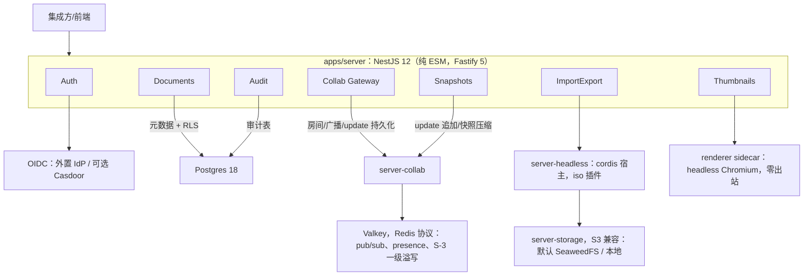

怎么读：子图内是 Nest 模块（传输壳），箭头指向该模块依托的业务包或外部组件，边上写用途；`server-collab` 同时承接协同网关与快照两类职责。本图由原 ASCII 总览转换，内容不变。

---

## 2. 需求

### SV-01 文档导入（服务端）

- 优先级：P0 | 目标里程碑：M2（由 M3 提前，rulings §4.19 D-M2-CONTENT） | 依赖能力：`server-headless`（cordis 宿主加载 `ooxml-pptx` 等 `iso` 插件）、`server-storage`、`FormatCodec`、`Snapshot`
- 用户故事：作为集成方后端工程师，我希望上传一个 pptx 后服务端生成协同所需的初始 `Snapshot` 与资源清单，客户端打开时直接加入房间而不必各自解析原文件。
- 验收标准：
  - 上传：预签名直传到 blob 存储（≥ 10 MB 分片），随后调用「导入」API；也支持小文件（≤ 10 MB）直接 multipart。浏览器经反向代理的存储子域（`s3.<域名>`）直达对象存储，预签名 URL 按对外端点生成，对象存储本身不开宿主端口（rulings §4.18 BE-01，见 SV-09）。
  - 导入为异步作业：返回 `jobId`；状态 `queued → running → succeeded | failed | cancelled`（用户在上传或解析阶段取消即取消作业，清理导入原件与已生成产物，不留文档；rulings §4.18 UX-14）；进度阶段与客户端 OF-01 一致，参考应用经叠在原页上的「导入」对话框展示（`/import`；上传与解析中对话框的「取消」、×、Esc 与浏览器后退都按取消处理，rulings §4.25 DS-140、TB-179；设计 03-13）；D50 ≤ 5 s（p95）、D200 ≤ 20 s（p95）；并发导入队列可配置（默认 4/实例）。
  - 输出：初始 `Snapshot`（`schemaVersion` 当前值）、资源清单（媒体部件 → `BlobRef`）、不透明保留的部件原字节（以 `BlobRef` 内容寻址保存，构成 `SnapshotBundle`，即「基线包」，随文档生命周期保留、不受原件保留期限制）、诊断报告（降级项、缺失字体、限制命中）；上传的原始文件（导入原件）另存 30 天（章程 Q17）。
  - 输入限制与客户端一致（OF-24）；文档规模超出系统天花板（页数 / 单页元素 / 文档总元素，SV-08）时**直接拒绝导入**，返回 `format.quota_exceeded{dimension, limit, actual}` 并指明超出哪一项，不做只读降级打开（rulings §4.15 Q5）。上限取自部署配置。
  - 失败：类型化错误码（与客户端同一张表）；保留失败样本（可配置、脱敏路径）用于排障。
  - 病毒扫描钩子（P2）：导入前调用集成方扫描回调，拒绝即失败。
  - 参考应用「新建空白 / 模板」（AS-01）走同一导入作业：服务端以内置模板字节为导入源建档，文档内容自此以协同快照为唯一事实源（rulings §4.19 D-M2-CONTENT）。

**图 2-1 服务端导入：上传、作业与产物**

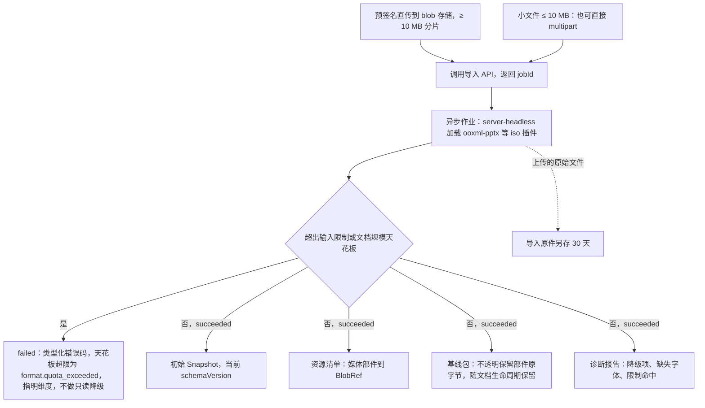

怎么读：自上而下是一次导入，上传有两种方式，都先上传再调用导入 API；成功时四类产物同时生成，基线包即以 `BlobRef` 内容寻址保存的不透明保留部件原字节（正文称其构成 `SnapshotBundle`），客户端打开时直接加入房间而不必各自解析原文件。
依据：本条 SV-01；OF-24；SV-08。

**图 2-2 导入与导出作业的状态**

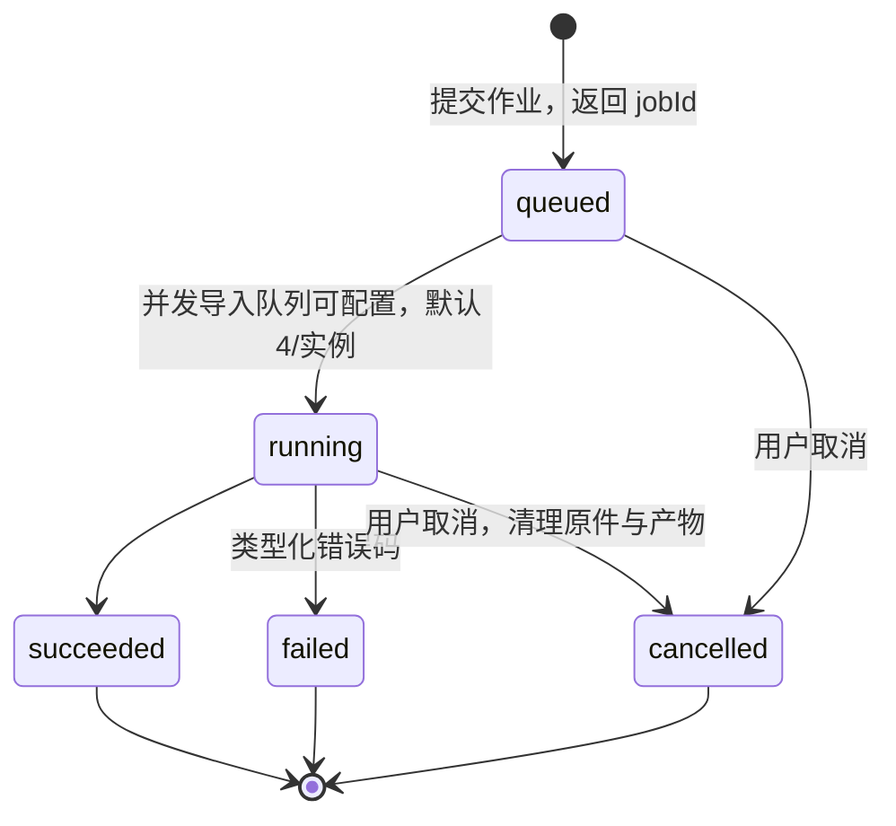

怎么读：方框为作业对外可见的状态；进度阶段与客户端 OF-01 一致；取消后不留文档、原件与产物。导出作业（SV-02）沿用同一状态机，成功结果经下载地址取得，每次取时现签、默认 1 h 有效，产物保留 24 h。
依据：本条 SV-01；SV-02；rulings §4.18 UX-14。

### SV-02 文档导出（服务端）

- 优先级：P0 | 目标里程碑：M3 | 依赖能力：`server-headless`、`FormatCodec` 导出、`RenderTarget`（headless Chromium 中的 `render-dom`）、导出专用 `core.format`（`canImport:false`）
- 验收标准：
  - 导出 pptx：从最新快照（或指定版本）+ 基线包生成；与客户端导出**字节级一致**（同一代码路径，CI 断言同一 Snapshot 在浏览器与 Node 导出的规范化结果相同；`docProps/thumbnail.jpeg` 是 `encode()` 的显式输入、缺省保留原部件，因此不破坏确定性，OF 矩阵 §2.1）；D50 ≤ 3 s、D200 ≤ 12 s（p95）。
  - 导出 PDF（**M3 后半段**，rulings §4.15 Q8；引擎见 PD-16）：与缩略图共用独立 renderer sidecar 与 `/render?mode=print`，走独立的 `render-export` 队列（优先级：首页缩略图 > PDF > 批量缩略图）；headless Chromium 打印全部/选定页，A4/16:9 原始尺寸，嵌入字体子集；动画按「静态全部可见」；与 oracle PDF 逐页 SSIM ≥ 0.85；D50 ≤ 10 s（p95）。
  - 导出 PNG/JPEG（server-png，M3）：按页，宽度 1280/1920/3840；D200 全量 ≤ 90 s。参考应用的导出对话框只经它导出 PNG「全部页」（只含已同步的内容，其余范围与 SVG 仍在浏览器生成）；JPEG 与质量参数只经 API 与自动化（SV-13），对话框不放（2026-10-22，rulings §4.25 DS-102、DS-103）。
  - 导出为异步作业（同 SV-01），结果经下载地址取得：每次取地址都现签预签名 URL（有效期可配，默认 1 h），产物保留 24 h（部署可配，`60-backend/06` §7.3），会话内不会遇到链接过期，界面不提示链接时效（2026-10-22，rulings §4.25 DS-100）。作业可取消，与导入取消同一口径：对话框生成中只有「取消」一个出口（Esc、关闭等同），取消即停止作业，不做后台继续（2026-10-22，rulings §4.25 DS-101；状态机见图 2-2）；完成即开始下载并关闭对话框，服务端格式的轻提示带「下载」，每次点都现签地址（DS-100）。有页渲染出错或单页超时（与 SV-04 同一判定）、重试 1 次后仍失败时，导出作业失败，不产出缺页的文件（rulings §4.25 TB-157）；导出对话框失败态的原因按错误码写：因页面渲染出错（`render.page_failed`）而失败时与浏览器生成同一句「有一页暂时无法生成，请重试；文档本身不受影响」（rulings §4.25 TB-173，01 OF-19），因单页超时（`headless.render_timeout`）而失败时写「生成文件时超时，请重试；文档本身不受影响」（TB-175），其余失败（renderer 忙、注入超时、浏览器崩溃、网络与存储）显示通用文案（TB-176；文案均以前端 50/15 §4.2、§4.3 为准）。
  - 字体：服务端默认字体包内置 Noto（含 CJK）+ Liberation + Carlito/Caladea，均开源，不内置商业字体（章程 Q19 已裁决，rulings §4.16；随 renderer 镜像发布）；**部署方可挂载自有授权字体目录**（只读卷挂入 renderer，与内置包合并解析）；受限内嵌字体按 OF-17 只用于只读渲染（PDF/缩略图可用）；缺失字体按 OF-05 回退并在导出报告中列出。
  - 插件贡献的导出专用 `core.format`（`canImport:false`，如 Markdown）在服务端同样可用（PS-14）。

### SV-03 快照与 update 持久化

- 优先级：P0 | 目标里程碑：M2（update 追加与两级 ack、Postgres 故障溢写与回放、压缩与 `auto` 快照、快照引导打开、墓碑 TTL 清扫、schema 迁移与换纪元、配套保留期作业，rulings §4.19 D-M2-CONTENT）/ M3（命名版本、版本列表与恢复（CO-07）、「彻底删除元素」、多实例一致性与溢写认领） | 依赖能力：`server-collab`（update 追加、快照压缩）、ADR-0022 存储、`Snapshot`、`migrations`
- 用户故事：作为管理员，我希望任何时刻服务器宕机都不会丢失用户已同步的编辑，并且历史版本可追溯。
- 验收标准：
  - 每条被服务端接受的 CRDT update 在返回 ack 前持久化（追加表/日志）；RPO ≤ 1 s（已 ack 的 update 不丢）。Postgres 故障溢写期采用**两级 ack**（rulings §4.15 S-3a，见 SV-05）：只有 `ack{seq, tier:'db'}` 才表示已落库并允许客户端清除 pending。
  - 软删除墓碑（rulings §4.15 Q3）：服务端作为单写者，在墓碑 TTL（默认 24 h，部署可配）到期后执行硬删除（普通事务，origin=`system`）；文档擦除与「永久删除文档」（SV-11）不等 TTL；元素级「彻底删除元素」（CO-08，仅 owner、只对墓碑态）由服务端单写者以同一硬删路径立即执行并写审计 `document.element_purged`，只清当前文档状态，历史快照与 update 表按保留期存在（rulings §4.18 CO-07）。
  - 压缩（Compaction）：按策略（章程 Q17 默认，部署配置可调：每 500 个 update 或 10 分钟）把 update 折叠为新的快照并保留 update 尾巴用于重连；压缩 10,000 update ≤ 2 s。
  - 版本（CO-07）与保留（章程 Q17 已裁决，rulings §4.16：默认值不变，**全部进入部署配置可调**）：自动版本 = 压缩点的快照 + 元数据（贡献者集合、时间），30 天内全量保留；此后每天保留最后一个，保留至 `retention.autoSnapshotDailyDays`（默认 365，0 = 永久）；import / migration / restore / epoch 事件快照按自动版本口径（rulings §4.19 C-06）；命名版本 = 用户触发的快照，永久保留，每文档上限 200；update 追加表保留 7 天（压缩后）；导入原件保留 30 天；元素墓碑 TTL 24 h；以上均为部署配置默认值；过期清理为后台作业。不透明保留所需的部件 Blob 随文档生命周期保留，不在此列。
  - 新客户端加入：下发最新快照 + 尾巴 update；D50 初始同步 ≤ 2 s、D200 ≤ 5 s（p75）。
  - 迁移：服务端启动时对旧 `schemaVersion` 的快照惰性迁移（读取时），并可运行「全量迁移」作业；迁移失败的文档标记并告警，不影响其它文档。
  - 一致性：多实例场景下同一文档的 update 顺序由 CRDT 保证，持久化只需「至少一次」；重复 update 幂等。

**图 2-3 快照、update 与保留期**

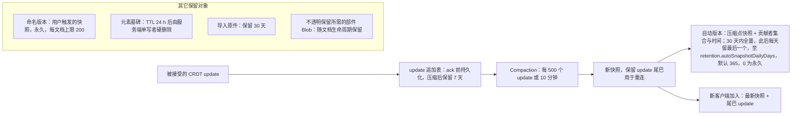

怎么读：实线为数据从 update 到快照的流动，「其它保留对象」子图列出不在这条路径上的保留对象；图中所有期限都是部署配置默认值、全部可调，过期清理为后台作业。
依据：本条 SV-03；CO-07；章程 Q17，rulings §4.16；自动版本稀疏化见 rulings §4.19 C-06。

### SV-04 缩略图服务

- 优先级：P0 | 目标里程碑：M2（过渡封面）/ M3 前半段（权威缩略图，章程 Q8，rulings §4.15） | 依赖能力：`server-headless` 的 headless Chromium 适配（ADR-0026 已接受）、独立 renderer sidecar（SV-09）、`RenderTarget('dom')`（与客户端同一份渲染代码）
- 验收标准：
  - **M2 过渡封面**：服务端导入时（SV-01，含以内置模板字节新建的文档）取包内 `docProps/thumbnail.jpeg` 作为文档卡片封面；M2 没有 pptx 内容版本保存路径（rulings §4.19 D-M2-CONTENT），封面只在导入时生成；服务端**不解码**，只做 JPEG 头校验（SOI/SOF 中的尺寸不超过 OF-24 像素上限，体积 ≤ 1 MB），原字节以 `image/jpeg` + `nosniff` + CSP `sandbox` 头下发，标记 `source=embedded`；包内没有时显示占位。已知限制：M2 编辑后封面会过时（同一设备用本地 dom-scaled 缓存覆盖）；该来源纳入 SV-11 purge。导入完成即有过渡封面（NF-01）。
  - **M3 权威缩略图**：headless Chromium 运行与客户端同一份渲染代码；导入完成后首页高优先生成 ≤ 10 s，其余页按需惰性生成；全量 D200 ≤ 90 s（统一预算）。
  - 规格：只存一档——卡片 640 px WebP（在沙箱内直接输出，不用 sharp/libvips）；分享预览与版本预览按需生成 1280 px。
  - 失效：按**页内容哈希**失效，哈希输入 = 页子树 + 版式/母版/主题依赖闭包 + 媒体 `BlobRef` + `slideSize` + 页序号 + 内嵌字体集合 + `layoutAlgoVersion` + `fontProfile`；外链资源一律占位、不计入哈希；Compaction 之后只把哈希变化的页入队。
  - 并发与隔离：在独立 renderer sidecar 中执行（安全要求见 SV-09）；每个任务新建 BrowserContext，定期回收浏览器；单页超时 10 s，失败重试 1 次后返回占位图并上报；运行时单页渲染出错（渲染层在纸面里画了「此页内容暂时无法显示」）同算失败，该页不回传、按同一规则重试后用占位图，整页无法解析的保真占位「此页内容无法解析」是确定内容、照常生成（2026-10-22，rulings §4.25 TB-151、TB-157，`60-backend/06` §11.3）。并发口径与 ADR-0026 一致。
  - 不再有「客户端上传缩略图」路径（rulings §4.15 Q8）；客户端侧栏缩略图见 OF-15。

**图 2-4 文档卡片封面：M2 过渡与 M3 权威缩略图**

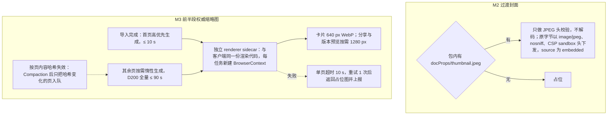

怎么读：两个子图是两个阶段的做法，M3 取代 M2 成为权威来源；render-export 队列的优先级为首页缩略图 > PDF > 批量缩略图（SV-02）。外链资源一律占位且不计入页内容哈希。
依据：本条 SV-04；SV-02；rulings §4.15 Q8。

### SV-05 协同网关

- 优先级：P0 | 目标里程碑：M2（单实例：握手、Room 生命周期与按权重准入、门禁、两级 ack、Postgres 故障溢写与降级期广播、`room.persist` 信号、awareness 中继、消息限额，rulings §4.19 D-M2-CONTENT）/ M3（多实例扇出与跨实例传播、容量验收、名额按用户计与满员只读、优雅停机跨实例重连、溢写行认领回放） | 依赖能力：`server-collab`（§4.21 起为嵌入 Nest 的 Hocuspocus 4 加自有扩展：房间、门禁与先落库、awareness 中继、控制面，[ADR-0039](../../30-architecture/adr/0039-collab-server-hocuspocus.md)）、`protocol`（CONTROL 载荷、认证字段）、Valkey（Redis 协议兼容；M3 起承载 `@hocuspocus/extension-redis` 的跨实例同步）
- 验收标准：
  - 房间生命周期：首个连接创建、最后一个连接离开后延迟 60 s 销毁（期间保留内存状态以应对快速重连）；房间状态可查询（管理 API）。
  - 握手：令牌校验（EM-03）、文档能力位加载、容量检查（20 编辑者 + 50 查看者，名额按用户计、owner 不占编辑者名额、commenter 计查看者，CO-01；超限只读加入，再超 → `collab.room_full`，关闭码 4503）、协议版本协商（不兼容 → `collab/auth-failed{code: collab.protocol_mismatch}`，关闭码 4427）。
  - 门禁：硬门禁（应用前）与软门禁（应用后，ADR-0034：`softGate.mode = repair`、`schemaMode = report-only`）的行为与用户可见结果见 CO-12。
  - 权限即时性：权限变更事件（来自 Documents 模块；M4 起也可来自集成方回调）在 ≤ 2 s 内推送到房间内该用户的所有连接，降级为只读或断开。
  - 消息限制：单消息 ≤ 1 MB（重连时的一次差量同步单设 ≤ 16 MiB，超限提示导出本地副本，rulings §4.21 H:q-hp-step2-cap）；速率 ≤ 200 msg/s/连接；awareness 广播节流 ≥ 50 ms；超限限流并记录。
  - 连接限制（rulings §4.20 BE-01+TX-03）：WS 升级按来源 IP 限流，**先扣后退**——Origin 校验通过后、升级前扣 1 次额度，票据验签通过即退还（之后因满员、文档不可用等准入规则被拒也已退还），票据无效或重放、5 s 内未发认证、协议不符、升级后未认证就断开的不退；所以该额度实际只约束未通过认证的升级，同一办公出口 IP 后的多人集体重连不被它拖慢。另设每用户单实例并发连接上限（默认 32，部署可调），超出时拒绝认证（`collab.rate_limited`，关闭码 4429），客户端按常规退避重连。数值与配置键以 `60-backend/16` §1、§13 为准。
  - 多实例：同一文档的连接可落在不同实例；反代按 documentId 一致性哈希**偏好**把同一文档的连接送到同一实例（按文档哈希的偏好亲和，不是会话粘性，扩缩容时部分文档迁移），跨实例状态经 Valkey（Redis 协议）由 `@hocuspocus/extension-redis` 同步 update 与 awareness（rulings §4.21 H:q-hp-fanout）；跨实例传播 ≤ 50 ms（同机房）。Valkey 故障时各实例内协同照常、服务进程不退出，跨实例同步暂停，恢复后自动补齐（NF-03）。
  - 房间准入（rulings §4.15 Q5）：按文档**实测权重**准入（Y 结构数或堆估算，乘以 ADR-0035 的副本数），不再用固定 MB/房间；实测基线 D200 ≈ 85 MB、D50 ≈ 17.8 MB（墓碑计入）。满员房间由服务端合并 awareness tick，查看者只上报视图。
  - 容量（collab 单实例 2 vCPU / 4 GB，RM-S）：≥ 2,000 并发 WS；活跃房间数按文档规模分档、按文档实测权重准入（见上条；各档房间数 M1 实测后回填，只收紧；原「RSS > 75% 时新房间转其它实例」的**判定方式**作废，rulings §4.15 Q5；75% 作为权重预算比例保留——实例内存预算 = 容器内存上限（cgroup 限额，无限额取物理内存）× `room.memoryAdmissionPct`（默认 75，部署可调），rulings §4.18 BE-29）；p95 广播延迟 ≤ 100 ms、CPU < 70%。
  - 优雅停机：收到 SIGTERM 后停止接受新连接、通知客户端重连（`collab/reconnect{reason:"server-shutdown"}`）、flush 持久化、≤ 30 s 退出；客户端在 ≤ 5 s 内重连到其它实例（同一出口 IP 后数十人同时被驱逐时约分 3 波在 5 s 内重连完；更大的出口由部署调高 `limits.ws.connectPerIpPerMin`，rulings §4.20 BE-01+TX-03）。
  - Postgres 持续故障韧性（rulings §4.13 S-3，§4.15 S-3a 细化）：已在线房间**不拒绝新编辑**——超过第一阈值溢写 Valkey，超过第二阈值分块落对象存储（BlobStore）；两级阈值与回放耗时预算见 60/01 §12、NF-01 §1.7、NF-03。
  - 降级期照常广播（rulings §4.18 CO-08）：PG 写失败即进入降级期，update 通过门禁、进入任一降级档（内存退避重试、Valkey、对象存储）后**立即**在本实例广播并跨实例扇出，不等持久化，协作者互相可见；「先落库后广播」只约束 PG 可用时的顺序。持久性由发起方 pending 兜底（收到 `tier:'db'` 才清），其他客户端重连时经 step2 回填；降级广播次数计入指标 `cordex_collab_broadcast_before_persist_total`（SV-10）。
  - 「未保存到服务器」的判定与受众（rulings §4.19 INC-09）：服务端经 `CONTROL.room` 的可选字段 `persist: 'ok' | 'degraded'` 显式通知（PG 写失败 ≤ 1 s 内推 `degraded`，回放完成且无溢写后推 `ok`），不新增帧类型；客户端判据 = `room.persist==='degraded'` ∨ 在途含仅获 spill 确认的项 ∨ 最老在途 ≥ `unsavedWarnAfterMs`（`collab-yjs` 配置，默认 15000）；有本地未获 db 确认项的**发起方**显示横幅「未保存到服务器 N 项」，**其余协作者**只在文件名旁的同步状态显示弱提示「服务器保存延迟」（原「状态胶囊」随 rulings §4.25 DS-6 作废）。该信号与分级提示随协同网关自 M2 起生效（`05-milestones-and-scope.md` M2 验收 17）。
  - **两级 ack**（S-3a）：溢写成功回 `ack{tier:'spill'}`，客户端**保留 pending**；落库成功回 `ack{seq, tier:'db'}` 才清除 pending。正式 `seq` 在回放时由 Postgres 分配；溢写行按 `(instanceId, localCounter)` 排序回放；回放 bootstrap 之后断言无 `pendingStructs`。即使溢写数据丢失，客户端也能在重连 step2 凭 update 幂等性自动补齐，NF-03「已 ack 零丢失」以 `tier:'db'` 为口径。

- **行为级核对（rulings §4.21，协同网关改用 Hocuspocus 4 实现）**：本条验收的用户可见行为不变，下表逐项核对实现变化；只有「单消息 ≤ 1 MB」对重连差量同步单设 16 MiB 上限，超过时的用户可见结果是导出本地副本（PRD 03 CO-06）。

| 验收项 | §4.21 起的实现 | 用户可见行为 |
|---|---|---|
| 房间生命周期（60 s 延迟销毁） | Hocuspocus 的文档卸载加自有 draining 宽限：`beforeUnloadDocument` 抛错取消卸载，60 s 后主动卸载；有未落库内容时继续钉住 | 不变 |
| 握手与容量检查 | 票据改放认证消息，`onAuthenticate` 钩子内按原顺序完成验签、能力位、名额与权重准入；认证前的同步消息排队、不应用 | 不变（PRD 03 CO-12 图 2-7） |
| 门禁 | L1 在接入适配层，L2 / L3 在应用前的钩子里并先落库，L4 应用后修复；拒绝后该连接的写入不再保存直到重载 | 不变（CO-12 导出后重载） |
| 权限即时性 | 自有权限同步扩展：订阅权限变更，逐会话重算，≤ 1 s 推送 | 不变 |
| 两级 ack 与 PG 故障 | 逐帧落库取 `seq` 后经 Stateless 回 `ack{tier}`；溢写三档保留；不用 Hocuspocus 的整文档快照存储 | 不变（NF-03） |
| 多实例 | extension-redis + 按文档哈希的偏好亲和，替代原自研 pub/sub 扇出 | 不变（跨实例传播 ≤ 50 ms） |
| 优雅停机 | 自写停机顺序：readyz 503 → 停接入 → 通知 draining → flush 并补 ack → 关闭码 1012 | 不变 |

**图 2-5 房间生命周期**

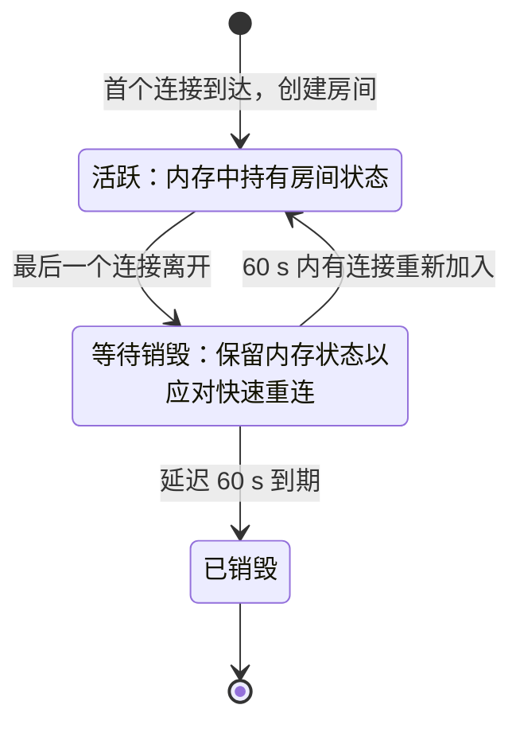

怎么读：方框为房间在网关中的状态，箭头上写触发条件；房间状态可经管理 API 查询。
依据：本条 SV-05 房间生命周期。

**图 2-6 握手时的准入判定**

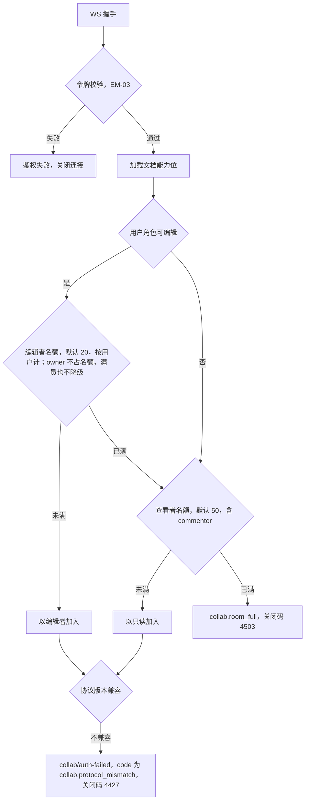

怎么读：按本条列举的顺序（令牌、能力位、容量、协议版本）自上而下绘制，实现中的检查先后以架构 06/08 为准；出口写明对外错误码与关闭码。房间另按文档实测权重准入，满员房间由服务端合并 awareness tick，查看者只上报视图。
依据：本条 SV-05 握手、房间准入；CO-01 名额规则；SV-08 配额表。

**图 2-7 Postgres 故障期的两级 ack**

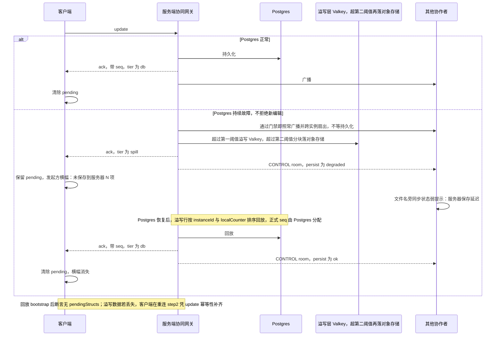

怎么读：纵向为时间；只有 `tier` 为 `db` 的 ack 才允许客户端清除 pending，NF-03「已 ack 零丢失」以此为口径。PG 正常时先落库后广播；故障期不等持久化照常广播，协作不中断。两级阈值与回放耗时预算见 60/01 §12。
依据：本条 SV-05 韧性、降级期广播与两级 ack；rulings §4.13 S-3、§4.15 S-3a、§4.18 CO-08、§4.19 INC-09。

**图 2-8 滚动升级时的优雅停机**

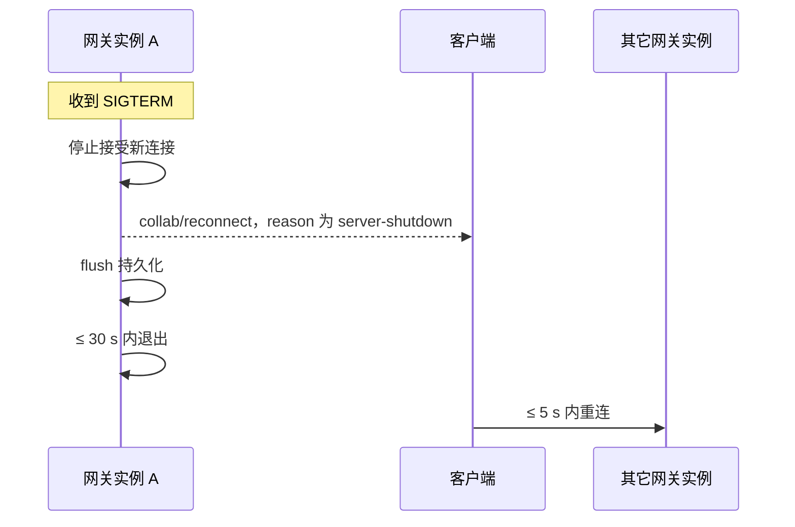

怎么读：纵向为时间；同一文档的连接常态落在按文档哈希选中的实例，被驱逐后可以落到其他实例，跨实例状态经 Valkey 同步（§4.21 起由 extension-redis 承担），因此客户端换实例后会话照常继续；协议版本向后兼容一个次版本（SV-09）。
依据：本条 SV-05 优雅停机与多实例；SV-09 零停机发布。

### SV-06 鉴权与权限

- 优先级：P0 | 目标里程碑：M2（OIDC 登录、会话、JIT 建号、建档者为 owner 与能力位校验、一方 Ticket，rulings §4.19 D-M2-CONTENT）/ M3（按人分享、分享链接、权限管理 API、权限即时生效、RLS 出口测试）/ M4（集成方签名 JWT、API Key） | 依赖能力：`apps/server` Auth 模块、`protocol` 权限模型（能力位，无 `enum`，规避 Univer A3）
- 验收标准（rulings §4.15 T-0 / Q6）：
  - 单组织：一次部署 = 一个组织；资源、API、权限中**没有租户**（无 `tenantId`、无租户解析、无租户角色、无跨租户访问语义）；部署级配置（配额、保留策略、字体目录、存储桶）即全局配置。将来若做 SaaS 另立项。
  - 身份：服务端 M1–M3 **只认 OIDC**（授权码 + PKCE，用于 `apps/web`，**由服务端 auth 模块完成换码**并以 httpOnly cookie 建立会话，浏览器只负责跳转、不持有 PKCE verifier 与 IdP 令牌，rulings §4.18 BE-09；JWKS 轮换支持），不持有密码与凭据；可接任意 OIDC IdP，docker-compose 可选内置 **Casdoor**（国内 IM 登录经 Casdoor 代理）；用户以 `(issuer, sub)` 标识，首次登录 JIT 建号。
  - 注册策略：部署级开关 `auth.selfSignup`，**默认关**——由管理员在 IdP（如 Casdoor）建号；开启后在 IdP 自助注册、首次登录 JIT 建号；开启时须同时配置 IdP 的自助注册地址（`auth.signupUrl`），缺了服务拒绝启动，免得登录页出现点了没去处的「注册」（2026-10-22，rulings §4.25 TB-143，`60-backend/17` §5.5）。分享链接始终要求登录（S-1，不支持匿名）。
  - 文档分享邀请**只对已存在账号生效**（rulings §4.17 D1）：邀请即直接授予权限；服务端不保存「待接受邀请」（无 `pending_invitations` 表），没有账号的邮箱返回错误并提示联系管理员（`auth.selfSignup` 开时提示对方先注册），文案见设计 08。
  - 文档权限：角色 → 能力位（CO §1）；权限主体为**用户**与**分享链接**（M3 只按人分享）；管理 API：授予/撤销/列出；分享链接（P1，参考应用）：可设角色与过期。
  - **组管理（U-11）推迟**，不在 M3 范围；按组授予权限随之推迟。
  - 数据访问兜底：应用层文档权限检查（章程 D12）+ **文档级 Postgres RLS**（M3 出口，安全测试覆盖「绕过应用层直接查询越权文档被 RLS 拒绝」）。
  - fail-closed：未知能力位、缺 claim、过期令牌一律拒绝；权限检查覆盖 REST 与 WS 两处（架构 05/08）。
  - CI 分层认证：PR 跑 Casdoor 容器 + oidc-provider mock；nightly 跑 Keycloak / Entra ID / 飞书等外部 IdP 兼容。
  - **M4**：集成方签名 JWT（嵌入场景）与 API Key（scoped、可轮换，用于集成方后端调用导入/导出/管理 API）；首次出现的主体 JIT 建影子用户。

**图 2-9 账号从哪来、分享邀请给谁**

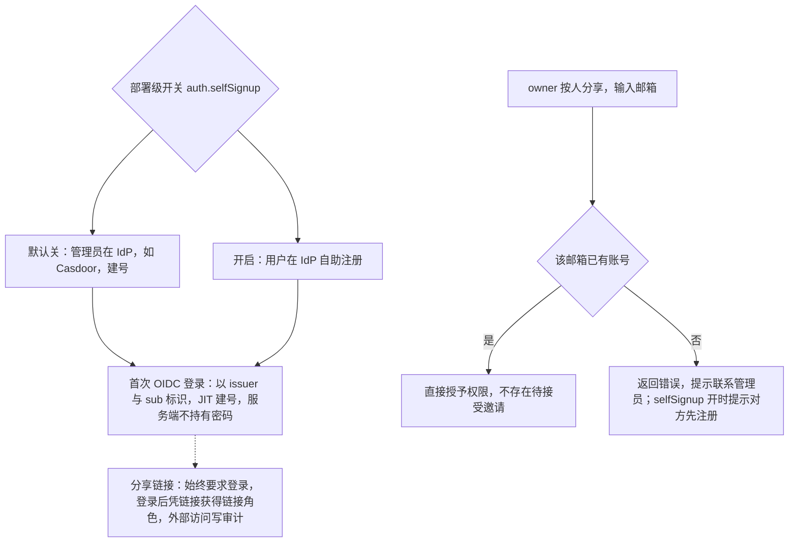

怎么读：上半是账号的两种来源，下半是按人分享时的判定；单组织部署中没有租户与组，按组授予随组管理（U-11）推迟。
依据：本条 SV-06；CO-15；rulings §4.15 Q6、§4.17 D1。

### SV-07 审计

- 优先级：P0 | 目标里程碑：M2（随 M2 端点写入：登录登出、建档、导入、打开、硬门禁拒绝与软门禁修复等，登记表见 `60-backend/07` §9）/ M3（查询、导出、哈希链与每日封存） | 依赖能力：`commands` 管线 `waterfall` 审计检查点（章程 D12/K1）、Audit 模块
- 用户故事：作为管理员，我需要回答「谁在什么时候对哪个文档做了什么」，以满足合规与排查。
- 验收标准：
  - 事件类别：访问（打开/加入房间/导出/下载）、编辑（`Transaction` 摘要：命令 id、影响页与元素数，不含内容）、评论（增删改解决）、权限（授予/撤销/变更）、版本（创建/恢复）、管理（删除/配额变更）、安全（鉴权失败、限流、越权尝试、硬门禁拒绝 `collab.update_rejected`、软门禁修复 `collab.repaired`，ADR-0034）。
  - 每条：时间（服务端）、文档、主体（用户 id；M4 起含 API key id）、来源 IP（可配置脱敏）、客户端版本、结果。
  - 保留：默认 365 天（可配）；导出 CSV/JSON（按文档、主体、时间范围、类别）；不可篡改（追加写 + 哈希链 `prevHash`/`hash`，**P1，M3 即实现**，含校验工具与每日封存作业，rulings §4.12 U-15）；数据库角色隔离照旧（无 UPDATE/DELETE）。
  - 编辑审计吞吐：每文档 ≤ 50 事务/s 时无背压；超出时按事务合并（每用户每秒一条汇总）。

### SV-08 配额与限制

- 优先级：P0 | 目标里程碑：M3（导入限制——系统天花板与 200 MB——随 SV-01、WS 消息与速率限制随网关自 M2 生效，rulings §4.19 D-M2-CONTENT；存储配额、名额与管理查询为 M3） | 依赖能力：部署配置、网关容量检查（按权重准入）、导入限制
- 两层口径（rulings §4.15 Q5）：
  - **性能保证包络**：D200（200 页 × 平均 30 ≈ 6,000 元素）、DX-1000 单页 1,000 元素、20 编辑者 + 50 查看者、200 MB。NF-01 性能门禁只在包络内成立，只收紧不放宽。
  - **系统天花板**：200 页（软警告 150）/ 单页 1,000 元素 / **文档总元素 20,000**（软警告 15,000，软删除墓碑计入）；服务端房间按文档实测权重准入（SV-05）。
  - **超出系统天花板（页数 / 单页元素 / 总元素）或文件超过 200 MB 的导入直接拒绝**（`format.quota_exceeded{dimension, limit, actual}`），不做只读降级打开；包络外、天花板内的文档可以导入，只是不承诺性能（rulings §4.18 UX-13，依据 ADR-0035 复核修正）。
  - 所有规模数字**由部署配置完全可调**（无租户层）；调到包络之外时启动告警并在 `/readyz` 中标记，性能承诺不再成立。
  - 数字按对标定稿（暂无客户数据），M1 中期以 T3 语料实测后只收紧。
- 验收标准（默认值，部署级可调；PD-17）。`dimension` 取值照抄架构 10 §3「配额三码并列与 `dimension` 取值表」（rulings §4.17 D2）：导入 `format.quota_exceeded` 与编辑期 `document.quota_exceeded` 用 `slides` / `elementsPerSlide` / `elementsTotal`（导入另有 `fileSize`），存储 `storage.quota_exceeded` 用 `bytes` / `documents`：

| 维度 | 默认上限 | 超限行为 |
|---|---|---|
| 单文件大小（含媒体） | 200 MB（Q5 包络） | 导入拒绝 `format.quota_exceeded{dimension:"fileSize"}`（413） |
| 单文档页数 | 200（Q5）；软警告 150 | 导入超限拒绝（`format.quota_exceeded{dimension:"slides"}`）；编辑中超软警告提示，超硬上限拒绝新增页（`document.quota_exceeded{dimension:"slides"}`，409） |
| 单页元素数 | 1,000（Q5） | 导入超限拒绝（`dimension:"elementsPerSlide"`）；编辑中拒绝新增元素并提示（`document.quota_exceeded{dimension:"elementsPerSlide"}`） |
| 文档总元素数（含墓碑） | 20,000（Q5）；软警告 15,000 | 导入超限拒绝（`format.quota_exceeded{dimension:"elementsTotal"}`）；编辑中超软警告提示，超硬上限拒绝新增（`document.quota_exceeded{dimension:"elementsTotal"}`） |
| 每文档并发编辑者（按用户计） | 20（Q5） | 新加入者只读；owner 不占名额 |
| 每文档并发查看者（按用户计，含 commenter） | 50（Q5） | 拒绝加入 `collab.room_full`（503 / 4503） |
| 评论线程 / 文档 | 5,000 | 拒绝新增 |
| 版本数 / 文档（命名） | 200 | 提示删除旧版本 |
| 部署总存储 | 由部署方设置 | 导入/插入媒体拒绝（`storage.quota_exceeded{dimension:"bytes"}`） |
| 单用户存储（P1） | 由部署方设置，默认不限 | 同上 |
| 每用户文档数（P1） | 由部署方设置，默认不限 | 新建/导入拒绝（`storage.quota_exceeded{dimension:"documents"}`） |
| 导入/导出作业速率 | 60/分钟/用户 | 429 + `Retry-After` |
| REST API 速率 | 600/分钟/用户（M4 起另有每 API key） | 429 |
| 资源上传与导入上传（预签名与确认，rulings §4.20 BE-02） | 60/分钟/用户，突发 20（一次插入 20 张图约 20 s 传完） | 429 + `Retry-After`，客户端按 `Retry-After` 等待后继续 |
| 未登录端点（登录配置、登录、回调，BE-02） | 300/分钟/来源 IP，突发 100（百人办公出口的登录高峰与离线探测不撞限） | 429 |
| WS 升级（按来源 IP，先扣后退，BE-01+TX-03） | 10/分钟，只净计未通过认证的升级；部署可调高 | 429（浏览器只见 1006，客户端按退避重连） |
| 每用户单实例 WS 并发连接（BE-01+TX-03） | 32 | 拒绝认证 `collab.rate_limited`，关闭码 4429 |
| WS 消息速率 | 200/s/连接 | 限流 + 计数 |
| 资源上传单文件 | 100 MB | 拒绝 |

  - 所有配额有读取点（规避 Univer A26，`scan-config-usage` 覆盖）与测试；配额用量可查询（管理 API 与管理面板）。错误码以架构 10 为准。本表是产品口径；对应的部署配置键与默认值以后端设计线 `60-backend/17` 为准（REST 限流档的主体、默认值与适用路由见 `60-backend/15` §8，WS 连接限额见 `60-backend/16` §1）。

**图 2-10 规模两层口径与配额三码**

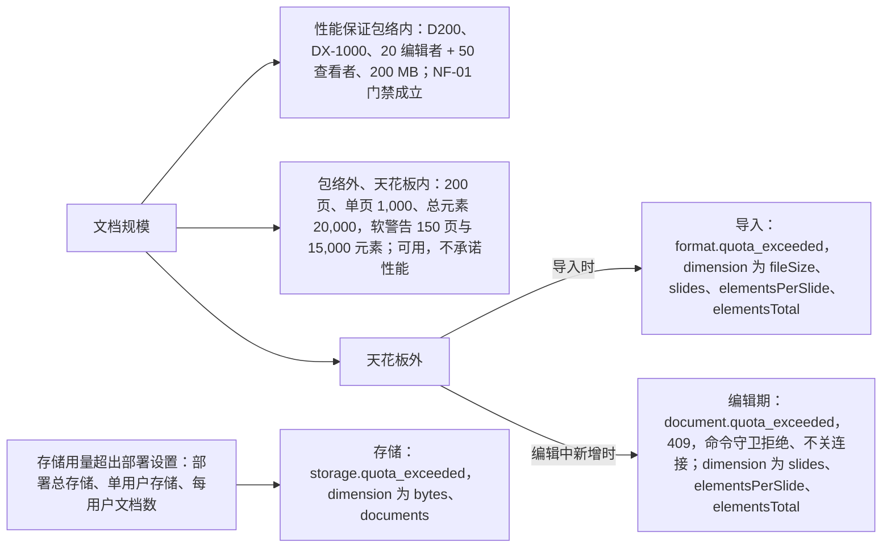

怎么读：文档规模分三档，天花板外按发生场景映射到导入与编辑期两个错误码，存储用量另成一路，三码并列；导入超限直接拒绝，不做只读降级打开。所有数字都是部署配置默认值，调到包络之外时启动告警并在 `/readyz` 标记。
依据：本条 SV-08；rulings §4.15 Q5、§4.17 D2。

### SV-09 部署与运维

- 优先级：P0 | 目标里程碑：M3 | 依赖能力：`apps/server` 配置 schema、健康探针、迁移脚本、ADR-0022
- 验收标准：
  - 部署形态（rulings §4.15 Q10，自托管洁净栈）：docker-compose 一条命令启动；M1–M5 只面向集成方/自有部署，不自营 SaaS。组件：同一应用镜像按 `CORDEX_ROLE`（`all`/`api`/`collab`/`worker`/`renderer`）运行 + **Postgres 18** + **Valkey**（Redis 协议兼容）+ **SeaweedFS**（S3 兼容，替换 MinIO：上游归档、镜像下架、AGPL）+ 独立 **renderer** sidecar + 可选 **Casdoor**（IdP profile；未启用时接外部 OIDC IdP）。compose 全家桶的主机规格另立（ADR-0037），与 RM-S（collab 单实例口径）分开。M3 的实例已无状态（除内存房间缓存）。
  - 对外入口（rulings §4.18 BE-01）：浏览器需要直达 IdP 登录页与对象存储预签名 URL，反向代理按子域转发——`idp.<域名>` → Casdoor，`s3.<域名>` → SeaweedFS S3 网关（保持 Host 头）；两者仍只在内部网络、不开宿主端口，TLS 证书相应多两个域名。OIDC issuer 用对外 URL；预签名 URL 用配置 `storage.s3.publicEndpoint` 生成，服务端自身读写走内网端点；存储桶配 CORS（允许应用源 PUT/GET、暴露 ETag），参考应用 CSP 相应放行存储源；Casdoor 管理后台建议在反代上按来源 IP 限制。
  - renderer sidecar 安全要求（rulings §4.15 Q8，作为 NF-04/SV-12 M3 出口的自动化安全测试）：非 root；`chromiumSandbox=true` 并加载 seccomp；**零出站**——state、`/render` 静态包、字体都经注入/内置提供，只接受 worker 的鉴权内部 RPC 入站，不暴露无鉴权的 Playwright run-server；不挂任何凭据；每任务新建 BrowserContext、定期回收；用 `--shm-size` 而非 `--ipc=host`；自建镜像，每周跟随 Chrome 稳定版重建，与 worker 锁步发布。自带 Nest 的集成方（EM-10 b）保留本地 launch 模式。
  - 镜像许可（章程 D13 对镜像按主组件许可白名单解释）：默认 compose 不含 AGPL 组件；Grafana/Loki 等 AGPL 组件只作为显式开启的可选 profile。
  - **M3 出口**：断网（air-gapped）compose e2e 通过；所有镜像以 digest 钉死；随发布提供 SBOM；镜像许可门禁通过。
  - **M4 P1**：离线安装包、多架构镜像（amd64/arm64）、K8s Helm chart。
  - 配置：全部环境变量经 Standard Schema 校验，启动失败即打印字段路径；密钥仅从环境/密钥管理器读取；`--dry-run` 校验配置。
  - 探针：`/healthz`（进程存活）、`/readyz`（DB/Valkey/Blob 可达 + 迁移已应用；规模配置超出 Q5 包络时附标记）；就绪前不接流量。
  - 数据库迁移：版本化、幂等、可回滚一步；启动时检查未应用迁移并（可选）自动应用。
  - 备份/恢复：文档基线包与 blob 在对象存储（依赖其版本化/复制；SeaweedFS 的 `snapshots/` 版本化必须开启，不可选）；Postgres 定时逻辑备份 + WAL（RPO ≤ 1 min、RTO ≤ 15 min 的操作手册）；演练脚本可从备份恢复整个部署（或指定文档）并通过导出校验。更换对象存储 Provider 后，S-2 purge、S-3 二级溢写、导入原件与缩略图须重跑 `runBlobStoreConformance`。
  - 零停机发布：滚动更新 + 优雅停机（SV-05）；协议版本向后兼容一个次版本。
  - 日志：结构化 JSON，含 `requestId`/`documentId`/`userId`（可脱敏）；级别可调；不记录文档内容。
  - 运维手册：容量规划（每 1,000 并发编辑者所需实例）、常见故障（Valkey 断连、renderer/Chromium 僵尸进程、磁盘满）、升级步骤。

**图 2-11 自托管 compose 洁净栈的组成**

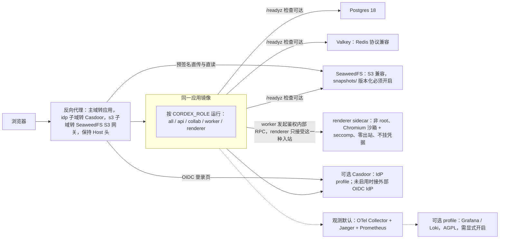

怎么读：实线为调用或依赖，虚线为观测链路与可选的 AGPL profile；默认 compose 不含 AGPL 镜像。浏览器只经反向代理进入，Casdoor 与 SeaweedFS 不开宿主端口，由反代按子域转发。M3 出口为断网 compose e2e、镜像 digest 钉死、SBOM 与镜像许可门禁；离线包、多架构与 Helm 为 M4 P1。
依据：本条 SV-09；SV-10 观测栈；rulings §4.15 Q8、Q10，§4.18 BE-01。

### SV-10 监控与告警

- 优先级：P0 | 目标里程碑：M3 | 依赖能力：`telemetry` 服务（服务端 Provider：Prometheus/OTel）、`logger`
- 验收标准：
  - 指标（Prometheus 命名草案；Prometheus 只暴露统一名 `cordex_<子系统>_<名称>_<单位>`，下列旧名作为别名列登记在 `60-backend/18` §4）：`cordex_ws_connections`、`cordex_rooms_active`、`cordex_update_apply_seconds`（直方图）、`cordex_broadcast_latency_seconds`、`cordex_import_duration_seconds`、`cordex_export_duration_seconds`、`cordex_thumbnail_duration_seconds`、`cordex_job_queue_depth`、`cordex_persist_lag_seconds`、`cordex_auth_failures_total`、`cordex_rate_limited_total`、`cordex_collab_soft_conflicts_total{type}`、`cordex_collab_updates_rejected_total{reason}`、`cordex_collab_repairs_total{rule}`、`cordex_collab_broadcast_before_persist_total`（PG 降级期未落库即广播的次数，rulings §4.18 CO-08）、`cordex_permission_denied_total{action}`、`cordex_plugin_failures_total`、进程/DB/Valkey 标准指标（命名与架构 10 §11.3 一致）。
  - 浏览器侧指标不在服务端 `/metrics`：`cordex_collab_soft_conflicts_total{type}` 与协同撤销跳过计数 `cordex_store_undo_skipped_total{whole_step}`（CO-09）由浏览器产生，浏览器 OTLP 代理只转发 traces，两项由客户端遥测与开发者面板采集（`50-frontend/15`，`60-backend/18` §4.3）。
  - SLO（初始）：协同服务可用性 99.9%/月；广播延迟 p95 ≤ 100 ms；导入成功率 ≥ 99.5%；导出成功率 ≥ 99.5%；持久化滞后 p99 ≤ 1 s。
  - 告警（默认规则随 compose 提供）：就绪探针失败 > 1 min；p95 广播延迟 > 300 ms 持续 5 min；队列深度 > 100 持续 5 min；鉴权失败突增（> 10× 基线）；磁盘 > 85%；Chromium 池耗尽。
  - 观测栈（Q10）：compose 默认 OTel Collector + Jaeger + Prometheus + node-exporter（宿主磁盘与内存指标，供「磁盘 > 85%」告警，Apache-2.0，`60-backend/18` §1），默认告警规则随 compose 提供；仪表盘模板（Grafana JSON：总览、协同、作业、安全）随可选 Grafana/Loki profile 提供（AGPL，需显式开启）。
  - 追踪：导入/导出/握手链路 OTel trace（采样可配）。

### SV-11 数据保留、删除与合规

- 优先级：P1 | 目标里程碑：M3（回收站移入与恢复、配套保留期作业随 M2 文档目录与持久化先行，rulings §4.19 D-M2-CONTENT；永久删除文档、回收站到期清理与用户数据擦除为 M3） | 依赖能力：Documents 模块、后台作业
- 验收标准：文档软删除（默认 30 天可恢复）→ 硬删除（快照、update、版本、评论、缩略图（含 M2 包内过渡封面）、blob、索引全部清除，审计保留）；文档擦除与**永久删除文档**（回收站中永久删除，或跳过 30 天宽限直接永久删除）立即硬删除，**不等**元素墓碑 TTL（CO-08）；术语：文档级称「永久删除文档」，元素级称「彻底删除元素」（CO-08，rulings §4.18 CO-07）；永久删除时该文档的在线会话被踢出、之后拒绝加入（rulings §4.18 BE-15）；用户数据擦除 API（GDPR：用 `deleted-user` 替换主体标识，评论正文按部署策略保留/删除）；数据驻留：存储与数据库位置由部署决定，SDK 无隐式跨区调用；导出部署全部数据（P2）。保留期（软删除宽限 30 天；自动快照 30 天内全量，此后每天保留最后一个，至 `retention.autoSnapshotDailyDays`（默认 365，0 = 永久），rulings §4.19 C-06；命名版本永久、每文档上限 200；update 7 天；导入原件 30 天；墓碑 TTL 24 h）均为部署配置默认值，全部可调（章程 Q17，rulings §4.16）。
  - 参考应用的回收站（2026-10-22，rulings §4.25 DS-85）：永久删除只在回收站视图发起（「永久删除…」，模态确认、初始焦点在「取消」，不要求输入文档名；M2 只有移入与恢复，这一项留在原位、不可用并标 M3）；回收站里的文档不能打开——所有者从旧链接打开看到「此文档在回收站中」阻断页、可就地恢复，有角色的非所有者看到「找不到该文档」，从未获授权的人看到「你没有权限访问此文档」（rulings §4.25 DS-122、TB-73）。「恢复」失败时：阻断页沿用登录页的内联错误画法，主按钮上方一行「无法恢复「〈名〉」，请稍后重试」、按钮恢复可用；回收站卡片上的「恢复」失败为轻提示「无法恢复「〈名〉」」+「重试」，与永久删除失败同一画法（TB-155，设计 03-01）。回收站的说明与卡片上的天数读同一个部署配置（`retention.trashDays`，缺省 30），由服务端经 `GET /auth/config` 下发，前端不另配（TB-141，`60-backend/15` §3.1）。
  - 级联清单（编排式，rulings §4.13 S-2，§4.18 BE-15 细化）：`documents` 宽限期满（或永久删除 / 擦除时立即）发起 `schedule-purge`，以单个持久作业编排；`permissions`、`share-links`、`media`、`thumbnails`、`comments`、最近 / 固定记录（`user-marks`，rulings §4.18 BE-31）、`document_updates`/`document_snapshots`（server-collab）各自执行 purge 用例清理自己的表，谁的表谁写；最后删除对象存储中该文档的全部对象版本；失败整作业重试、结果一致，可审计；GDPR 擦除复用同一编排，仅把"清除"换成"用 `deleted-user` 替换主体标识"。
  - 唯一 owner 空窗（rulings §4.20 BE-05+TX-22）：用户被停用或擦除后，他作为**唯一 owner** 的文档在 M4 管理面板（SV-14）之前无人可管，他建的有效分享链接也无人能撤（链接是否有效只看撤销与过期）。M3 起由运维命令 `cordex-ops documents:reassign-owner --doc <id> --to <userId>` 处理：以系统上下文调用权限模块的同一用例写入新 owner 授权、权限版本加 1（在线会话随之重算），写审计 `admin.owner_reassigned`；新 owner 即可撤销链接、调整授权或删除文档。擦除与停用的响应和审计都附「唯一 owner 文档数」提醒管理员；M4 管理面板复用同一用例。命令语义见 `60-backend/17` §9。

**图 2-12 文档删除的级联清理**

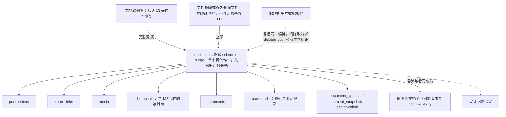

怎么读：上方三个入口汇入同一个编排，编排向各模块发起 purge，各模块只清理自己的表（谁的表谁写），全部完成后才删除对象版本与文档行；失败整作业重试、结果一致，可审计；审计记录不在清理范围内。
依据：本条 SV-11；rulings §4.13 S-2，§4.18 BE-15、BE-31、CO-07。

### SV-12 服务端安全

- 优先级：P0 | 目标里程碑：M2（随 M2 端点的安全基线：输入校验、CSRF、WS Origin、速率限制，rulings §4.19 D-M2-CONTENT）/ M3（渗透测试出口、renderer 沙箱与镜像供应链） | 依赖能力：OF-24 输入限制、`protocol` schema、Nest 守卫
- 验收标准：全部输入 schema 校验（REST/WS/文件）；zip 与 XML 限制同客户端；WS Origin 校验与令牌绑定——WS 升级校验 Origin 白名单，拒绝返回 403 `server.auth.origin_rejected` 并计数；CSRF 对 cookie 会话防护——cookie 会话（HttpOnly、Secure、SameSite=Lax）下所有非安全方法要求 Origin 命中 `security.allowedOrigins`（缺 Origin 时 `Sec-Fetch-Site` 必须为 `same-origin`）且带自定义头 `X-Cordex-Request: 1`，否则 403 `server.auth.csrf_rejected`，Bearer（M4）豁免，跨源 POST 与跨源 WS 升级各有 e2e（设计线遗留口径 INC-24）；速率限制（SV-08）；TLS 终止在代理层，内部可选 mTLS；密钥轮换不停机；依赖漏洞门禁（高危阻断）；渗透测试清单（OWASP ASVS L2）作为 M3 出口条件之一；安全事件进入审计。

### SV-13 Headless 自动化 API

- 优先级：P1 | 目标里程碑：M3 | 依赖能力：`server-headless`、`commands`（模板填充命令）、作业队列
- 用户故事：作为集成方后端，我希望调用 API 把模板中的占位符批量替换为业务数据并导出 pptx/PDF。
- 验收标准：作业类型：`fill-template`（按占位符类型/名称替换文本/图片/表格数据）、`convert`（pptx → pdf/png/markdown）、`validate`（结构校验 + 保真诊断报告）、`migrate`（快照迁移）；四种作业类型**归属统一为 `import-export` 模块**，不新设独立模块，usecase / 队列 / REST 细节随 M3 交付、设计见 60-backend/06 与 15（rulings §4.24 AL-7，覆盖 §4.12 U-13「M4 一起定」）；幂等键；批量 100 份 D50 填充 + 导出 ≤ 60 s（4 worker）；结果回调（webhook，签名，P1）。

### SV-14 管理面板（参考应用）

- 优先级：P2 | 目标里程碑：M4 | 依赖能力：`apps/web` 管理路由（组装层）
- 验收标准：部署配额（规模配置）与用量、用户管理（停用；`auth.selfSignup` 关闭时跳转 IdP 建号入口——账号在 IdP 创建，本系统不保存待接受邀请，rulings §4.17 D1；为唯一 owner 文档指定新 owner，复用 SV-11 的 `documents:reassign-owner` 用例，rulings §4.20 BE-05）、房间列表与强制断开、作业队列、审计查询、插件清单（服务端加载的 `iso` 插件及版本）、健康状态。

### SV-15 Webhook 与事件出口

- 优先级：P1（**由 P2/M4 提前，rulings §4.12 U-14**） | 目标里程碑：M3 | 依赖能力：Comments/Documents/Audit 模块事件、访问申请（CO-15）、新增 `webhooks` 模块（`40-modules/12` §2.1/§4.11）
- 用户故事：作为无常驻前端的集成方后端，我希望通过 Webhook 而非事件回调接收评论等协同事件，以便离线处理通知与审批流程。
- 验收标准：
  - **M3 范围**：以签名 Webhook 推送三类事件——评论事件（`comment/added`、`comment/mentioned`、`comment/resolved`，与客户端 EM-05 事件回调并行，两者都做，CO-04）；访问申请事件 `access_request.created`（2026-10-15，rulings §4.25 DS-67；只走 Webhook）：每条新申请产生一个事件，投递走与评论事件同一套签名、重试与死信，载荷带文档、申请与申请人的标识、申请时间与是否附留言，不含留言正文，集成方据此通知文档所有者（CO-15）；SV-13 自动化作业的结果回调 `automation.job_finished`（rulings §4.24 AL-7）。Webhook 上的对外事件名一律为点式（评论事件即 `comment.added` 等），事件名与载荷以 `60-backend/07` §4.2、§5.1 为准。管理 API：注册/更新/删除订阅（目标 URL、事件过滤、状态）；投递采用 HMAC 签名 + 指数退避重试 + 死信队列（超限转死信，不再自动重试）；投递日志可查询；服务端另提供跨文档「@我」REST（无需 `docId`）。
  - 事件 schema 版本化；订阅签名密钥明文仅在创建响应出现一次，落库以部署 KEK（`CORDEX_SECRETS_KEK_FILE`）经 AES-256-GCM 加密存储并带密钥版本，轮换期新旧双密钥并存；签名采用 **Standard Webhooks** 规范（rulings §4.21 q-webhook-sig）：请求头 `webhook-id`（投递 id，重试不变，集成方据此去重）、`webhook-timestamp`（unix 秒）、`webhook-signature: v1,<base64(HMAC-SHA256)>`，轮换宽限期内同一头以空格分隔携带新旧两个签名，集成方可直接用各语言现成的 Standard Webhooks 校验库验签（原 `X-Cordex-Signature: t=…, v1=<hex>` 自定义头废止，由 `webhook-signature` 取代；HMAC 须持有密钥本体，只存 hash 无法签名，设计线遗留口径 C-16/INC-30；细节以 `60-backend/07` §5.2 为准）。
  - 出站 SSRF 防护（rulings §4.13 S-4）：默认严格拒绝私网（RFC1918）/回环/链路本地（含云元数据端点 `169.254.169.254`）目标；订阅创建/更新与每次实际投递前均解析主机名并校验，投递前锁定解析出的 IP 再建连以防 DNS 重绑定；提供部署级配置项放宽为显式白名单（面向自托管内网场景）。
  - **M4 展望**：文档事件（创建/更新/删除/导出完成/权限）以同一 Webhook 机制推送，扩大事件覆盖面（访问申请事件已按 DS-67 提前到 M3，见上）；重试退避 ≤ 24 h。

**图 2-13 Webhook 投递与 SSRF 防护**

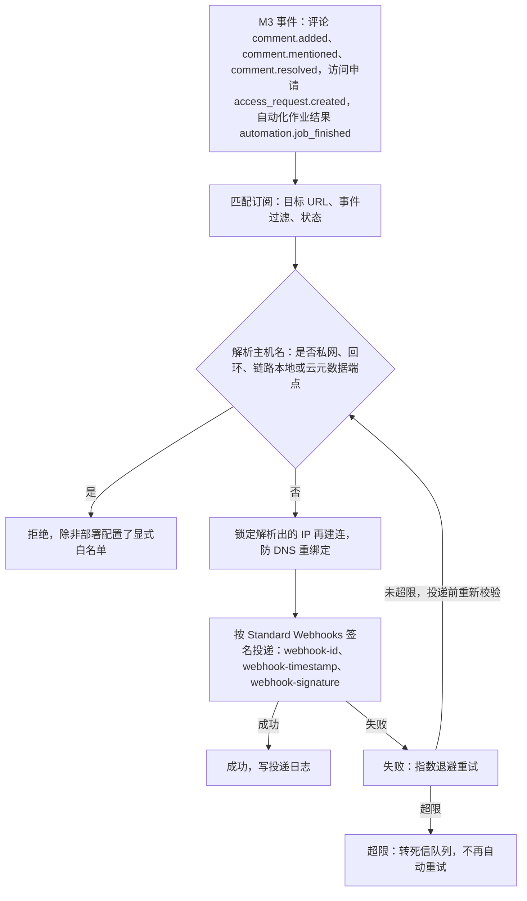

怎么读：自上而下是一次投递；同样的主机名校验也在订阅创建与更新时执行，每次实际投递前再做一次。订阅的签名密钥明文只在创建响应中出现一次，落库为部署 KEK 加密后的密文（C-16）。
依据：本条 SV-15；rulings §4.13 S-4。

---

## 3. 运维 / 管理员用户故事汇总

| 编号 | 故事 | 对应需求 |
|---|---|---|
| US-O-01 | 我要一条命令把整套服务在测试环境跑起来 | SV-09 |
| US-O-02 | 我要知道现在有多少人在协同、延迟多少 | SV-10 |
| US-O-03 | 服务器重启后不能丢用户已同步的编辑 | SV-03 |
| US-O-04 | 我要把部署存储限制在 50 GB、每文档 200 页 / 20,000 元素 | SV-08 |
| US-O-05 | 合规要我拿出某文档过去一年的操作记录 | SV-07 |
| US-O-06 | 用户申请删除个人数据 | SV-11 |
| US-O-07 | 我要滚动升级而用户无感 | SV-05、SV-09 |
| US-O-08 | 安全团队要审计所有越权尝试 | SV-07、SV-12 |

---

## 4. 与其它域的接口

| 本域产出 | 消费方 |
|---|---|
| 作业 API（导入/导出/缩略图/填充） | EM-10 服务端集成；OF-19 服务端 PDF |
| 配额表 | NF-01 容量；README 待决 PD-17 |
| 指标与 SLO | `06-metrics-and-analytics.md` 健康指标 |
| 权限即时性 ≤ 2 s | CO-05；ADR-0023 |
