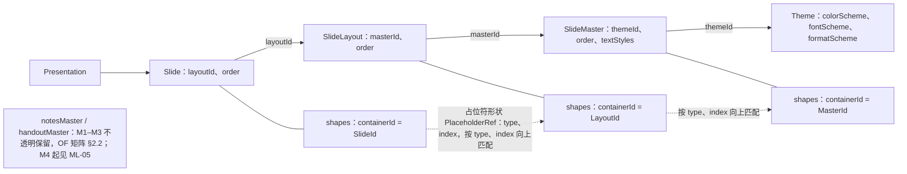
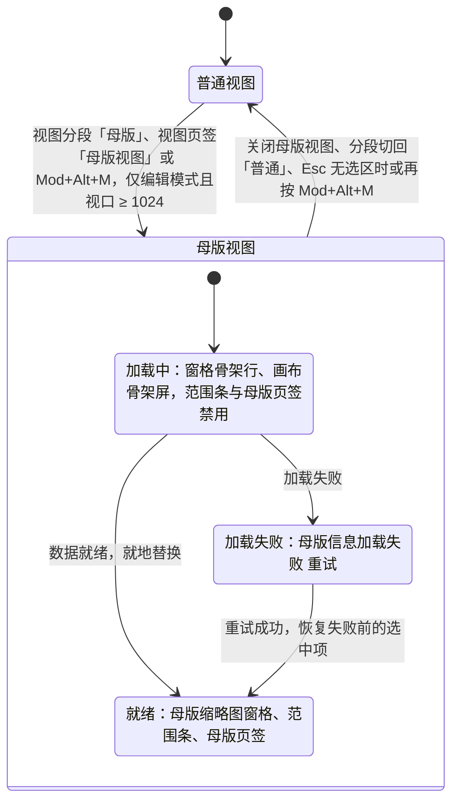
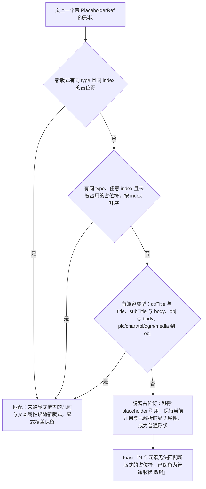
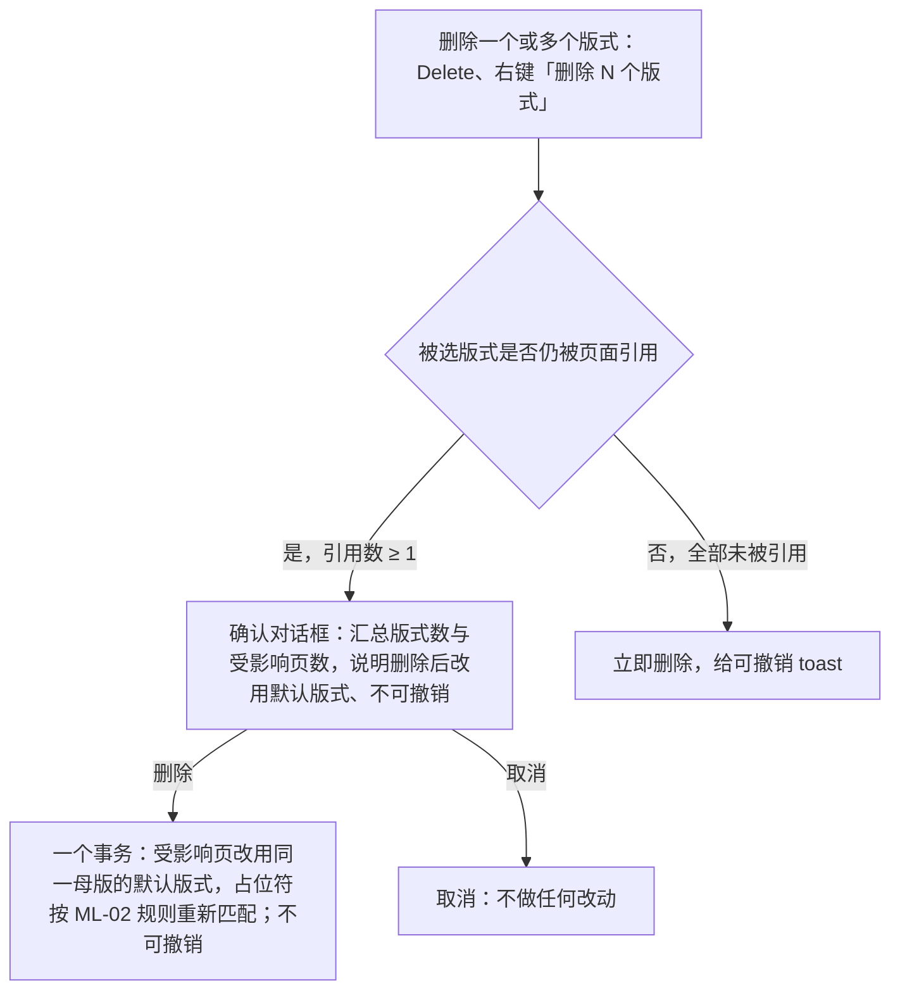

> 状态：草稿 | 负责：产品（2026-09-17 由总编排按设计稿同步；2026-09-18 按用户裁决 Q11–Q20 回写） | 更新：2026-09-18；2026-09-25（补图）；2026-09-25（矛盾收口，rulings §4.18）；2026-09-25（§4.19） | 依赖：charter v0.2；设计 03-screens/26 v16、27、28；rulings §4.8 Q8 / §4.9 / §4.10

# 功能域 07：母版、版式与主题

> 需求编号前缀 `ML-`。来源：总编排裁决（2026-09-15，用户指出编辑器与左侧栏未考虑母版），将母版/版式/主题从 ED-25 的「M2 只读 P2、编辑 M4+」提级为正式需求域。本文件是 ML 需求的唯一正文；`02-editing.md` ED-25 仅为索引，ED-11 的「更换版式 / 重置页 / 基于版式新建」交叉引用本文 ML-02；导入/导出保真（母版/版式/主题部件的建模与往返）由 `01-open-and-fidelity.md` 矩阵 §2.2 承担，本文不重复。

> **2026-09-17 修订**：按用户在设计稿上的裁决回写——(1) 母版视图**不是专用模式**：功能区最左新增「母版」页签，开始/插入/切换/视图/插件页签照常可用，仅隐藏「设计」页签；(2) 左侧仍是**缩略图窗格**（母版大缩略图 + 缩进的版式缩略图），不是文字树；(3) 主入口为 Ribbon 页签行右侧常驻的「普通 | 母版」视图分段，状态栏不再放切换器；(4) 快捷键定稿 `Mod+Alt+M`；(5) 主题组留在母版页签。对应设计文档 `20-design/03-screens/26`，playground `#/editor/masters`。

> **2026-09-18 修订**（rulings §4.10，用户逐项确认；逐项处置见 `../09-prd-design-alignment-2026-09-18.md`）：(1) 删除被引用版式改为「确认对话框 → 受影响页自动改用同母版默认版式，不可撤销」（Q11；原「阻断确认 + 全部改为」作废）；(2) 母版视图**仅编辑模式（有 `doc.write`）且视口 ≥ 1024 提供入口**，评审 / 放映 / 窄屏不提供（Q12；原 2026-09-17 版「评审模式可进入」「< 1024 改为侧边抽屉」两条作废）；(3) 换版式不匹配提示统一为 toast + 撤销（Q13）；(4) 补入设计独有的 8 项——范围条「编辑版式 | 母版」、版式选择器搜索框、跨母版选版式语义、加载骨架与失败重试、版式多选批量删除、同类占位符上限、应用栏「改动将影响 N 页」徽标、「重置为版式默认」确认卡 + 可撤销 toast 双层（Q16）；(5) 术语：左侧为「母版缩略图窗格」，视图页签次入口按钮名统一为「母版视图」。

---

## 0. 本域的产品立场

1. **PowerPoint 用户以母版思考**：「为什么这页标题是这个字体」「怎么一次改所有页的页脚」——答案都在母版视图。没有母版视图的编辑器会被认为「功能不全」。
2. **母版是继承链的可见端**：OF-04 的解析链 Element → Placeholder → Layout → Master → Theme 在 M1 已经存在于模型中；本域只是让用户**看见并修改**这条链，不新增模型概念。
3. **只写显式覆盖仍然成立**：母版/版式编辑改的是被继承的定义；页上未被用户显式覆盖的属性自动跟随（OF-04、ED §3「不烤继承」），显式覆盖保留。
4. **删除有引用的东西必须确认，不能静默**：版式 / 母版被页引用时删除需确认对话框并明示后果（受影响页自动改用同母版的默认版式、不可撤销，2026-09-18 Q11），未被引用时立即删除并可撤销；协同场景下若仍出现悬空引用，由不变量修复兜底（CO-12、ADR-0034）并提示。
5. **母版视图是视图状态，不是文档状态**：进入/退出母版视图是 `Operation`，不入历史、不广播为文档变更（可作为 presence 的一部分）。
6. **母版视图是同一个编辑器，不是专用模式**（与 PowerPoint 一致，2026-09-16 用户裁决）：切换到母版视图只改变「正在编辑的对象」（母版/版式而非页），功能区、检查器、画布、缩略图窗格都是同一套；差异仅为新增「母版」页签、隐藏「设计」页签、缩略图窗格显示母版与版式、评论不可用。

---

## 1. 概念与关系（沿用架构 04 的实体命名）

**图 1-1 母版、版式与主题的实体关系**



怎么读：带箭头的实线是引用链（字段名写在边上），无箭头的实线把每一层挂上它自己的形状集合；虚线是占位符按 (type, index) 逐层向上匹配的继承关系；备注母版与讲义母版单独成节点，本域 M1–M3 不涉及。本图由原 ASCII 概念图转换，内容不变。

| 占位符类型（`PlaceholderRef.type`） | 用户可见名称 | 备注 |
|---|---|---|
| `title` / `ctrTitle` | 标题 / 居中标题 | 互为兼容匹配 |
| `body` / `subTitle` / `obj` | 正文 / 副标题 / 内容 | `obj` 为通用内容占位符，可承载文本、表格、图表、图片 |
| `pic` / `chart` / `tbl` / `dgm` / `media` / `clipArt` | 图片 / 图表 / 表格 / SmartArt / 媒体 / 剪贴画 | 类型专属内容占位符 |
| `dt` / `ftr` / `sldNum` / `hdr` | 日期 / 页脚 / 页码 / 页眉 | 「页脚三件套」（页眉仅备注/讲义母版） |

术语：**母版视图**（Slide Master View，本域新增，见 README 术语补充）= 编辑器的一种视图状态，左侧缩略图窗格显示母版与版式的缩略图、画布显示所选母版/版式、功能区新增「母版」页签；**版式引用数** = 使用该版式的页数；**孤儿版式/母版** = 引用数为 0 的版式/母版；**范围条** = 母版视图画布上方常驻的「编辑版式 | 母版」双态单选 + 当前对象名称与继承来源 + 图例（实线 = 此版式定义 / 虚线 = 继承自母版）；**默认版式** = 删除版式或修复悬空 `layoutId` 时受影响页改用的同母版版式，选取函数与 ADR-0034「`layoutId` 不存在」修复规则共用（当前为该母版首个版式，架构 04 可调整但两处必须一致）。

---

## 2. 需求

### ML-01 母版视图

- 优先级：P0 | 目标里程碑：M2 | 依赖能力：`model-slide` 的 `SlideMaster`/`SlideLayout` 实体与 `Shape.containerId ∈ {LayoutId, MasterId}`（架构 04）；`SceneProvider('slide')`（贡献点 `render.scene`）以版式或母版为根合成场景（母版层 + 版式层，遵循 `showMasterSp`）；`Operation`（视图模式为非持久化视图状态，可进 `Presence`）；`ui.ribbon`（页签行右侧的视图模式分段、「母版」页签、「视图」页签内的次入口）、`ui.shortcut`、`ui.statusBar`（文案）、`slide-ui` 缩略图窗格的母版模式、画布上方的范围条、应用栏「改动将影响 N 页」徽标
- 用户故事：作为编辑者，我希望像在 PowerPoint 里一样切换到母版视图，看到每个母版及其下的版式，理解页面的样式从何而来，并从版式回到引用它的页面。
- 验收标准：
  - Given **编辑模式（有 `doc.write`）且视口 ≥ 1024**（2026-09-18 Q12），When 通过 **Ribbon 页签行右侧常驻的「普通 | 母版」视图分段**（主入口，普通与母版视图同位置）、「视图」页签「母版视图」按钮（次入口）或快捷键 `Mod+Alt+M`（ED-16 定稿）进入，Then 编辑器进入母版视图：功能区最左新增「母版」页签（强调色）并默认选中，开始 / 插入 / 切换 / 视图 / 插件页签照常可用，「设计」页签隐藏（其主题控件在母版页签「主题」组）；左侧缩略图窗格由页缩略图切换为**母版缩略图窗格**（每个母版一张大缩略图：编号 · 母版 · 名称，右侧「N 版式 · M 页」；其版式作为缩进的小缩略图挂在下方，左侧连接线，标签为名称 + 引用页数（0 显示「未使用」）；卡片、选中环与页缩略图同款；当前页所用版式默认选中并滚入视口）；画布显示所选节点的合成结果，画布上方常驻**范围条**（见下条）；应用栏出现「母版视图」徽标与「改动将影响 N 页」徽标（见下文）；状态栏左侧「编辑版式 · 〈版式名〉 · 未保存改动 · 影响 N 页」，右侧同步状态 + 「关于母版继承」。
  - Given 母版视图，Then 画布上方常驻**范围条**（2026-09-18 Q16）：「编辑版式 | 母版」双态单选（`role="radiogroup"`，决定当前编辑对象是窗格所选版式还是其母版）+ 当前对象名称与继承来源（「〈版式名〉 · 继承自「〈母版名〉」」）+ 右侧图例（实线 = 此版式定义 / 虚线 = 继承自母版）；切换范围不改变窗格选中项（「选中某版式但编辑其母版」是正交操作），画布与检查器随范围切换 ≤ 100 ms；M2（ML-03 交付前）范围可切换但对象只读。
  - Given 选中母版节点，Then 画布显示母版内容（背景、母版形状、母版占位符与母版文本样式占位符）；Given 选中版式节点，Then 显示版式合成（母版层按 `showMasterSp` 叠加，可切换「显示母版形状」）；占位符以虚线框 + 类型标签 + 提示文本呈现。
  - Given 母版视图，Then **与普通视图共用同一编辑器**：页缩略图、页级评论图钉、他人页级光标不显示（对象不是页），检查器「评论」页签禁用并提示「母版与版式不支持评论」，属性 / 历史 / 插件页签照常；继承自母版的占位符以虚线 + 「母版 · 〈类型〉」徽标标出；M2（ML-03 交付前）占位符可选中（属性面板显示类型、索引、继承说明）但不可编辑，拖动手柄显示锁形并 tooltip「版式编辑将在后续版本提供」（协同后端已随 rulings §4.19 D-M2-CONTENT 提前到 M2，文案不再提「协同版本」）——这是里程碑限制而非权限态：不存在评审模式下的只读母版视图（无 `doc.write` 时不提供入口，见下文 Q12 条）。
  - Given 点击母版页签最右「关闭」组的「关闭母版视图」大按钮、把视图分段切回「普通」、按 Esc（无选区时）或再次按快捷键，Then 回到进入前的页、缩放与滚动位置，选区清空；进入/退出不产生历史项，`view/mode-changed{mode:"master"}` 事件触发。
  - Given 评审模式、放映模式、无 `doc.write` 或视口 < 1024（2026-09-18 Q12），Then **不提供入口**：Ribbon 视图分段不显示，`Mod+Alt+M` 无效，命令面板中该命令显示不可用原因；评审与放映模式没有 Ribbon，「视图」页签不存在；编辑模式但已降权（`readonly-degraded`，Ribbon 仍在）时「视图」页签「母版视图」按钮禁用、tooltip「需要编辑权限」，窄屏时按钮禁用、tooltip「需要 ≥ 1024 宽度」（与设计 03-screens/20 状态矩阵一致，rulings §4.18 UX-11）；已在母版视图中时缩窄窗口**不强制退出**（窗格与检查器沿用普通视图的紧凑规则，NF-07 / 设计 IA §6）；查看器 preset 无此入口。
  - Given 进入母版视图时母版 / 版式数据尚未就绪（Store 同步中，2026-09-18 Q16），Then 缩略图窗格显示骨架行、画布显示骨架屏、范围条与母版页签控件禁用，就绪后就地替换（不闪回普通视图）；Given 加载失败，Then 主体替换为「母版信息加载失败 [重试]」，视图分段保留可切回「普通」；重试成功后恢复到失败前的选中项。
  - Given 应用栏「改动将影响 N 页」徽标（2026-09-18 Q16），Then N = 当前范围对象的引用页数（版式 = 使用该版式的页数；母版 = 其全部版式引用页数之和），随窗格选中项与范围切换即时更新；与状态栏「未保存改动 · 影响 N 页」**并存**（徽标常驻提示影响范围，状态栏文案仅在有未提交改动时出现），两处数字一致。
  - 性能：进入母版视图 ≤ 300 ms（D50，p75）；窗格内切换节点 ≤ 100 ms（已缓存）；多母版文档（≥ 3 个母版、≥ 30 个版式）窗格虚拟化（母版分组折叠为 P2）。
- 边界：文档只有一个母版时窗格仍显示母版缩略图（不隐藏层级，保证心智一致）；母版/版式名称为空时显示「未命名版式 n」；版式引用数实时随页的 `layoutId` 变化更新。

**图 2-1 普通视图与母版视图的切换**



怎么读：外层是两种视图状态，内层是进入母版视图后的数据加载状态；返回普通视图时回到进入前的页、缩放与滚动位置并清空选区。进入与退出都是 `Operation`，不产生历史项，触发 `view/mode-changed`；评审、放映、无 `doc.write` 或视口 < 1024 时没有进入入口，已在母版视图中缩窄窗口不强制退出。
依据：本条 ML-01；§0 第 5、6 条；rulings §4.10 Q12、Q16。

### ML-02 版式应用与重置

- 优先级：P0 | 目标里程碑：M2 | 依赖能力：`Slide.layoutId` 单键 `Mutation`（LWW，ADR-0020）；占位符匹配纯函数（`model-slide`）；`composeSlide()` 重合成与 `invalidate` 页级失效（架构 04/07，「版式切换复用元素实例」）；`history`；命令族（草案，命名以架构 05 为准）：`slide.slide.applyLayout`、`slide.slide.reset`、`slide.slide.insert{layoutId}`
- 用户故事：作为编辑者，我希望给一页换版式时，标题和正文自动落到新版式的位置，换不了的内容也不会丢；重置页能把我改乱的占位符位置恢复到版式定义。
- 验收标准：
  - **版式选择器**（「新建 ▾」/「版式 ▾」flyout 与缩略图右键「版式 ▸」，设计 27）：按母版分组的版式画廊，顶部**搜索框**按名称模糊过滤全部分组（不区分大小写），命中 0 项的分组标题连带隐藏，全部无匹配时主体显示「未找到匹配的版式」；Esc 先清空搜索再关闭；方向键在结果中导航、Enter 应用（2026-09-18 Q16）。
  - **跨母版选版式**（2026-09-18 Q16）：Given 选择另一母版下的版式，Then 该页的 `layoutId` 与解析链一并切换——所属母版、主题（颜色 / 字体 / 效果）按新版式所属母版解析，页面级显式覆盖（含背景覆盖）本身不丢失、只是继承基准变化；占位符按下条规则重匹配；全部在**一个事务**内完成，撤销一步回到原版式与原母版；画廊中其它母版的分组带说明「选择其它母版下的版式会同时把本页所属母版切换为『X』」；导出时页 rels 指向新版式部件。
  - **占位符重匹配规则**（更换版式时对页上每个带 `PlaceholderRef` 的形状依次尝试）：(1) 同 `type` 且同 `index` → 匹配；(2) 同 `type` 任意 `index`（按 index 升序未被占用者）→ 匹配；(3) 兼容类型：`ctrTitle ↔ title`、`subTitle ↔ body`、`obj ↔ body`、`pic/chart/tbl/dgm/media → obj` → 匹配；(4) 无匹配 → 该形状脱离占位符（移除 `placeholder` 引用，保持当前几何与已解析的显式属性，成为普通形状）。全部结果在一个 `Transaction` 内完成。
  - Given 匹配成功的占位符，Then 未被用户显式覆盖的几何与文本属性跟随新版式；显式覆盖保留（只写显式覆盖原则）；Given 有形状脱离占位符，Then toast「N 个元素无法匹配新版式的占位符，已保留为普通形状 [撤销]」（2026-09-18 Q13：版式选择器、缩略图右键「版式 ▸」与 playground 三处统一为此 toast，不用内联条或对话框）。
  - Given 「重置页」（设计称「重置为版式默认」，位于版式选择器左下角与缩略图右键），Then 先弹**确认卡**（内嵌卡片，非对话框）「重置『〈版式名〉』占位符？将清除本页占位符的位置 / 大小与继承样式覆盖，文本内容不变 [取消] [确认重置]」；确认后页上占位符形状的几何与文本样式覆盖被清除（回到版式定义），文本内容与非占位符形状不变，一个事务；执行后仍给**可撤销 toast**「已重置占位符属性 [撤销]」——「确认卡 + 可撤销 toast」双层是 D9（可逆用 toast、不可逆用确认）的**显式例外**（2026-09-18 Q16）；无任何覆盖时命令禁用。
  - Given 「基于版式新建」（ED-11 的「新建 ▾」），Then 新页包含该版式全部占位符的空实例（显示提示文本、不导出提示文本），插入到当前页之后并选中；默认版式 = 当前页版式（首页之后默认「标题和内容」，见 `07-design-coverage-and-gaps.md` §4 D14）。
  - 导出：更换版式后页部件的 rels 指向新版式部件；脱离占位符的形状不再带 `p:ph`；PowerPoint 365 打开无修复且占位符位置一致（语料抽检 ≥ 30 个「页 × 目标版式」组合，规则表 100% 一致）。
  - 协同：`layoutId` 后写者胜（CO-08 已列），提示 `prop-lww`。

**图 2-2 更换版式时的占位符重匹配**



怎么读：对页上每个占位符形状按规则 (1)→(4) 依次尝试，命中即停；一页的全部结果在一个 `Transaction` 内完成，撤销一步回到原版式（跨母版时也回到原母版）。
依据：本条 ML-02 占位符重匹配规则；rulings §4.10 Q13。

### ML-03 母版与版式编辑

- 优先级：P0 | 目标里程碑：M3 | 依赖能力：形状命令族在 `containerId = LayoutId | MasterId` 下复用（`slide.shape.*`）；新增命令族（草案）：`slide.layout.insert/duplicate/remove/rename/setOrder/setBackground/setShowMasterSp`、`slide.master.insert/remove/rename/setOrder/setBackground/setPreserve/setTextStyles`、`slide.placeholder.insert/setType/setPrompt`；`invalidate(changeSet)` 的反向索引 layout → slides → shapes 使全部引用页与缩略图即时失效（架构 04 §「派生缓存」、07 模板层缓存）；不变量 `layoutId`/`masterId` 存在、占位符引用有效（ADR-0034 修复规则）；`permissions`（`doc.write`）；`FormatCodec` 重生成母版/版式脏部件与 `sldMasterIdLst`/`sldLayoutIdLst`
- 用户故事：作为编辑者，我希望在母版视图里增删和调整占位符、统一修改所有页的标题字体与页脚，并管理版式（新建、复制、重命名、删除），改动立刻反映到所有引用页。
- 验收标准：
  - **母版页签分组**（2026-09-17 定稿，与 PowerPoint 母版页签（Slide Master）对应；每组「左侧大按钮 + 右侧两行小控件」）：**编辑母版**（新建母版、插入版式；删除版式、重命名；保留母版开关 M3）、**母版版式**（插入占位符 ▾；标题 / 页脚复选）、**主题**（编辑主题…；颜色、字体——用户裁决留在母版页签，因母版视图下隐藏「设计」页签）、**背景**（背景样式 ▾；隐藏背景图形、背景格式…）、**关闭**（关闭母版视图，独立成组、靠右）。
  - **占位符增删与属性**：Given 选中版式，When 「插入占位符 ▾」选择类型（内容 / 标题 / 正文 / 图片 / 图表 / 表格 / 媒体 / SmartArt / 日期 / 页脚 / 页码），Then 在画布拖出或点击插入默认尺寸的占位符形状；Given 所选类型在当前版式已达上限（标题 / 居中标题、日期、页脚、页码各至多 1 个；内容族上限以架构 04 模型约束为准），Then 阻止插入并 toast「该版式已包含〈类型〉占位符」（菜单项同时禁用并 tooltip，2026-09-18 Q16）；占位符可移动 / 缩放 / 旋转、设填充 / 线条 / 文本样式（含各级列表样式）、编辑提示文本、修改类型（同族内）、方向（横 / 竖）、尺寸变体。Given 删除版式上的占位符，Then 引用该版式且拥有对应占位符的页：占位符形状脱离为普通形状（内容保留），toast「已影响 N 页，其中的占位符已保留为普通形状 [撤销]」。
  - **母版文本样式**：Given 选中母版，Then 母版文本样式占位符（标题 / 正文 / 其他）逐级（1–9）可点选，ribbon 字体与段落控件作用于所选级别（字体 / 字号 / 颜色 / 项目符号字符与缩进 / 行距 / 段距）；修改后所有继承该级别的页与版式在 ≤ 500 ms（D50）内更新。
  - **背景**：版式与母版背景（纯色 / 渐变 / 图片 / 隐藏背景图形）可编辑；页级背景覆盖优先；版式「显示母版形状」开关。
  - **版式管理**：重命名（≤ 64 字，同母版内唯一，冲突内联提示）；复制（含占位符与形状，名称加「副本」）；插入新版式（空版式仅含标题 + 页脚三件套，或基于所选版式）；拖拽重排（`order` 键）；**删除**（2026-09-18 Q11，按设计 26）：引用数 > 0 → 确认对话框「该版式仍被 N 个页面使用，删除后这些页面将改用「与当前页相同」的默认版式，操作不可撤销」[删除] [取消]（D9 不可逆 → 确认）；确认后受影响页改用同一母版的默认版式（选取函数与 ADR-0034 修复规则共用，见 §1 术语）、占位符按 ML-02 规则以类型 / 索引重新匹配，一个事务、**不可撤销**；引用数 = 0 → 立即删除 + 可撤销 toast。**多选批量删除**（2026-09-18 Q16）：窗格中 Shift / Mod 多选版式后按 Delete 或右键「删除 N 个版式」，一次确认对话框汇总版式数与受影响页数，规则同上（全部未被引用时直接删除 + 一条可撤销 toast）；多选态画布显示「已选中 N 个版式」占位提示。
  - **母版管理**：至少保留一个母版（仅剩一个时「删除」禁用，设计 26 §6）；删除被引用母版需确认，对话框形态沿用 Q11（受影响页改用剩余母版的默认版式，不可撤销），目标版式选取细则待设计 26 补稿（登记于 G-73 待补）；插入母版 = 复制当前母版（含版式）或从模板导入（ML-04 模式 B）；「保留母版」开关（`preserve`）：关闭且引用数 = 0 时导出前提示「未使用的母版『X』将被移除 [保留] [移除]」。
  - **即时更新**：Given 母版 / 版式任一属性修改，Then 全部引用页与缩略图 ≤ 500 ms（D50）更新，撤销一步回退全部；状态栏常驻「未保存改动 · 影响 N 页」，应用栏「改动将影响 N 页」徽标（ML-01）与之并存且数字一致，提交后弱提示「已更新 N 页」。
  - **协同冲突语义**（补入 CO-08 表）：

| 场景 | 收敛结果 | 提示 |
|---|---|---|
| A 删除版式 L（已确认，L 的原引用页已改用默认版式），B 同时把页 P 改为版式 L | 删除胜；P 的 `layoutId` 悬空 → 不变量修复：置为该母版的默认版式（与 Q11 删除时的选取函数相同，当前为该母版首个版式；ADR-0034 规则「`layoutId` 不存在」） | B 端 toast「版式『L』已被 A 删除，第 P 页已改用『首个版式名』」；`collab/repair{rule:"layout-missing"}` |
| A 修改版式占位符文本样式，B 同时在页上显式覆盖同一属性 | 两者共存：页显式覆盖优先（继承语义），其余页跟随 A | 无 |
| A 删除版式占位符，B 同时在页上编辑该占位符文本 | 删除胜；B 的形状脱离为普通形状，文本保留 | B 端 toast「占位符已被 A 删除，你的文本已保留为普通形状」 |
| A、B 同时重命名同一版式 | 键级 LWW | `prop-lww` |
| A、B 同时编辑同一版式的同一占位符几何 | 键级 LWW（同形状移动） | `prop-lww` + 撤销 |

  - 权限：需要 `doc.write`，无独立能力位；集成方可通过 `core.permissionPolicy`（P2）把母版编辑收紧为 `owner` 专有。
  - 导出：母版 / 版式部件作为脏部件重生成，`sldMasterIdLst`/`sldLayoutIdLst` 按 `order`；未触碰的母版 / 版式部件字节相同；PowerPoint 365 母版视图与我们一致（抽样 ≥ 20 个编辑脚本，SSIM ≥ 0.90）。
- 边界：占位符类型修改只允许同族（文本族：title/ctrTitle/body/subTitle/obj；内容族：pic/chart/tbl/dgm/media 与 obj 互转；页脚族：dt/ftr/sldNum 互转），跨族需删除后新建；母版文本样式修改不改变页上已显式覆盖的文字。

**图 2-3 删除版式的判定**



怎么读：自上而下是一次删除，对应上文验收标准「版式管理」中的删除条款；默认版式的选取函数与 ADR-0034「layoutId 不存在」修复规则共用（当前为该母版首个版式），这是 D9「可逆用 toast、不可逆用确认」的一个实例。
依据：本条 ML-03 版式管理；§1 术语「默认版式」；rulings §4.10 Q11、Q16。

### ML-04 主题

- 优先级：P1 | 目标里程碑：M3 | 依赖能力：`Theme{colorScheme, fontScheme, formatScheme}` 实体、`colorMapOverride`；`resolveColor`/`resolveShapeVisual` 纯函数（架构 04）；`invalidate` 命中 `themes.<id>` → 使用该主题的全部形状失效；命令族（草案）：`slide.theme.setColor`、`slide.theme.setFonts`、`slide.theme.applyVariant`、`slide.theme.applyFromTemplate`；`FormatCodec`（`.potx`/`.pptx` 主题与母版提取）
- 用户故事：作为编辑者，我希望查看并修改当前主题的 12 个主题色与标题 / 正文字体，一次换掉全文档的品牌色，或直接套用公司模板的主题。
- 验收标准：
  - 查看：「设计」页签「主题」分组显示当前主题名、12 主题色（`dk1 lt1 dk2 lt2 accent1–6 hlink folHlink`）色板、主题字体（标题 `+mj` / 正文 `+mn`，分 latin / ea）、效果方案名（只读）。
  - 编辑主题色：Given 点选任一主题色，Then 颜色选择器修改；确认后所有引用 `schemeClr` 的元素（含经 `colorMap` 映射与 `lumMod` 等修饰）在 ≤ 300 ms（D50）内重算，显式 `srgbClr` 元素不变；「重置为原主题」一键回退；一个事务可撤销。
  - 主题字体：替换 major / minor（分 latin / ea）→ 所有引用 `+mj-*`/`+mn-*` 的文本重排（行数变化在保真诊断中不计为降级）。
  - 主题变体：内置默认主题的 4 个色板变体；切换变体 = 批量替换 12 色（一个事务）；「另存当前为变体」为本地个人偏好（P2）。
  - 从模板应用主题：Given 上传 `.potx` / `.pptx`，Then 预览（模板首页缩略 + 主题色条 + 字体），选择模式 A「仅应用主题」（母版 / 版式不变）或模式 B「导入母版与版式并应用」（新增母版，页版式按名称映射，未匹配按 ML-02 规则并 toast 统计）。
  - 效果方案（`fmtScheme`）与背景填充方案：M3 只读展示，编辑 P2。
  - 导出：`ppt/theme/theme*.xml` 作为脏部件重生成；`extraClrSchemeLst`、`custClrLst`、`objectDefaults` 原样保留（不透明）；PowerPoint 365 「设计 → 变体 → 颜色」显示一致。
  - 协同：主题色 / 字体键级 LWW，提示 `prop-lww`；他人修改主题 → 本地重算 + 状态栏弱提示。
- 边界：多主题文档（每母版一个主题）按母版分别展示与编辑；主题名重复允许。

### ML-05 备注母版与讲义母版

- 优先级：P2 | 目标里程碑：M4 | 依赖能力：`notesMaster`/`handoutMaster` 部件建模（M1–M3 为不透明保留，OF 矩阵 §2.2）、`SceneProvider` 备注页合成、服务端 PDF（SV-02）
- 用户故事：作为编辑者，我希望预览并导出带备注的讲义页，且备注页的排版与 PowerPoint 一致。
- 验收标准：
  - M4：「视图 → 备注页」以备注母版合成预览（页缩略 + 备注文本），只读；备注页 PDF 导出（服务端）；讲义母版预览（每页 1/2/3/4/6/9 版式）只读。
  - 编辑备注母版 / 讲义母版：P2（M5 之后），不承诺。
  - 导出：不透明保留不变；生成备注页 PDF 不修改文档。

---

## 3. 缩略图窗格的母版模式（产品规格，设计承接见 `20-design/03-screens/26`；2026-09-17 由「母版 → 版式树」改为缩略图窗格）

```
 普通视图（页缩略图）                      母版视图（母版 / 版式缩略图，同一窗格）
 ┌───────────┐                             ┌──────────────────────────┐
 │ 1 ▪ 当前   │   视图分段「母版」──►         │ 1 · 母版 · 公司主题  7 版式 · 11 页│
 │ [缩略图]  │   Mod+Alt+M / 视图页签       │ ┌──────────────────────┐ │
 │ 2         │                             │ │      [母版大缩略图]     │ │
 │ [缩略图]  │   ◄── 关闭母版视图 / 分段    │ └──────────────────────┘ │
 │ 3         │       「普通」/ Esc           │   │ 标题幻灯片        1 页  │
 │ [+ 新建 ▾]│                             │   │ [小缩略图]              │
 └───────────┘                             │   │ 标题和内容 ▪当前   4 页  │
                                           │   │ [小缩略图·选中环]        │
                                           │   │ 比较            未使用  │
                                           │ 2 · 母版 · 简约主题（导入） …  │
                                           │ [+ 新建母版]               │
                                           └──────────────────────────┘
```

| 元素 | M2 | M3 |
|---|---|---|
| 母版缩略图 | 编号 · 「母版」· 名称（导入的母版带「导入」徽标）、「N 版式 · M 页」、大缩略图；卡片与选中环同页缩略图 | + 右键：重命名 / 复制 / 插入母版 / 删除 / 保留母版开关；拖拽重排 |
| 版式缩略图 | 缩进 16 px、左侧连接线；名称 + 引用页数（0 为「未使用」灰字）、当前页所用版式选中环；悬停列出引用页 | + 右键：重命名 / 复制 / 插入版式 / 删除 / 在普通视图查看引用页；Shift / Mod 多选 → 批量删除（走 Q11 确认规则）；拖拽重排；他人编辑中 presence 标签 |
| 键盘 | ↑/↓ 遍历母版与版式（列表式），Enter 选中，Esc 关闭母版视图 | 同 + Shift+↑/↓ 扩展多选版式、Delete 删除（走 ML-03 确认规则） |
| 底部 | 「新建母版」虚线按钮 | 同 |
| 加载 / 失败 | 数据未就绪：骨架行 + 画布骨架屏、范围条禁用；失败：「母版信息加载失败 [重试]」，视图分段可切回「普通」 | 同 |
| 窄屏 | < 1024 不提供母版视图入口（Q12）；已在母版视图中缩窄不强制退出，窗格沿用普通视图的紧凑规则（640–1024 收为图标条、< 640 按 IA §6 仅查看态处理） | 同 |

## 4. 与其它域的接口

| 本域产出 / 依赖 | 对应位置 |
|---|---|
| 母版 / 版式 / 主题部件的导入导出保真（M1）、矩阵支持等级 | `01-open-and-fidelity.md` §2.2「母版 / 版式继承链」「主题」「讲义母版 / 备注母版」三行（已按本域更新为 M2 V / M3 E、M3 E~、M4 V~） |
| 更换版式 / 重置页 / 基于版式新建的 UI 入口 | `02-editing.md` ED-11（规则引用 ML-02）；ED-25 为索引 |
| 快捷键 `Mod+Alt+M`（2026-09-17 定稿） | `02-editing.md` ED-16 快捷键表；设计 03-screens/26 与 playground 已同步 |
| 协同冲突语义 5 行 | `03-collaboration.md` CO-08（M3 实现时并入软冲突表与 ADR-0020 §D 核对） |
| 里程碑范围与验收（`master:view`、`layout:apply`、`master:edit`、`theme:edit`） | `05-milestones-and-scope.md` M2 / M3 |
| 设计承接 | `20-design/03-screens/26`（母版视图与编辑）、`27`（版式选择与重置）、`28`（设计页签与主题）；playground `#/editor/masters`、`#/editor/layouts`、`#/editor/design`；缺口条目 `07-design-coverage-and-gaps.md` G-70–G-75 已于 2026-09-17 按实现回写、2026-09-18 按 Q11 / Q12 / Q13 / Q16 修订（D26 母版视图可用范围） |
| 事件 | `view/mode-changed{mode:"master"}`（EM-05 已含母版）；埋点复用 `command/executed{id:"slide.layout.*" \| "slide.master.*" \| "slide.theme.*"}` |
| 架构承接请求 | 母版视图的 `SceneProvider` 根为版式 / 母版（架构 07）；`invalidate` 反向索引在 D200 上的成本预算（架构 07 性能预算）；命令族命名（架构 05）；`layoutId` 悬空修复规则的 toast 载荷（ADR-0034） |
