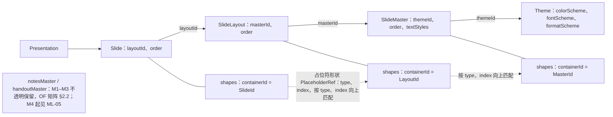
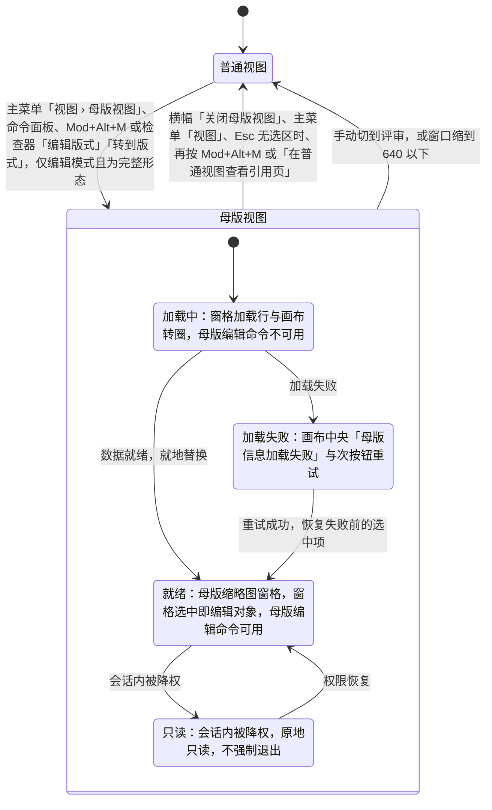
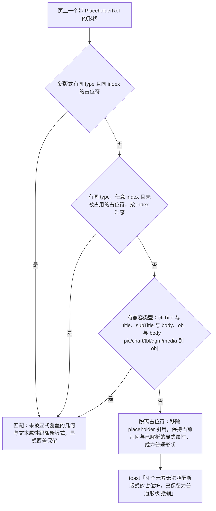
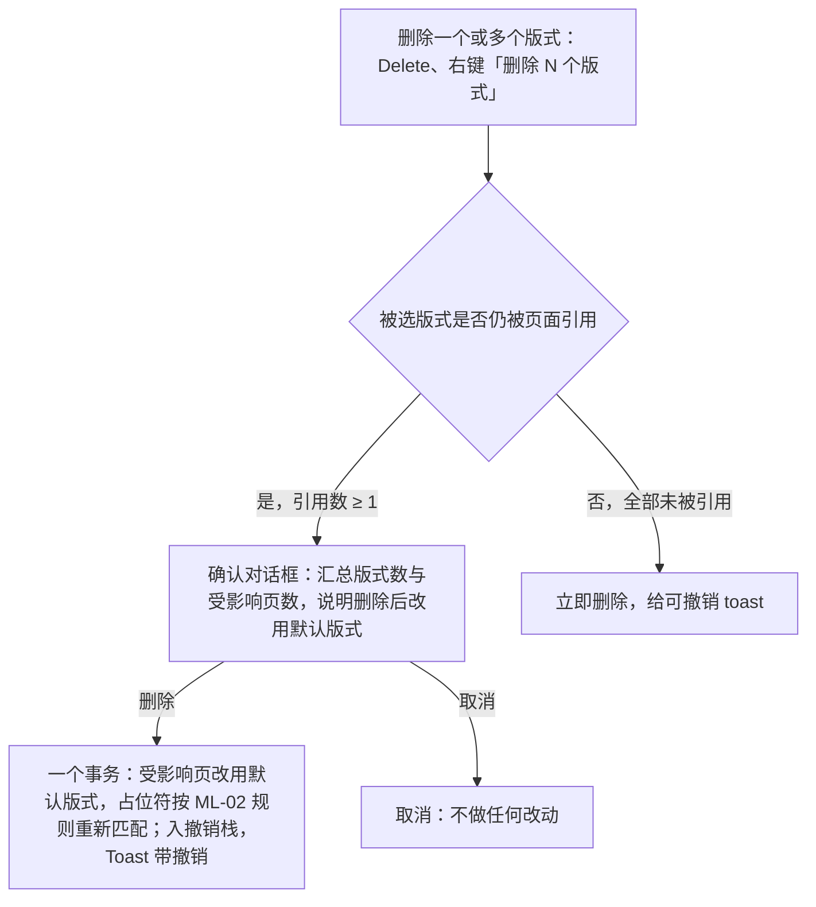

> 状态：草稿 | 负责：产品（2026-09-17 由总编排按设计稿同步；2026-09-18 按用户裁决 Q11–Q20 回写） | 更新：2026-09-18；2026-09-25（补图）；2026-09-25（矛盾收口，rulings §4.18）；2026-09-25（§4.19）；2026-09-26（§4.20：删除被引用版式 / 母版改为确认后可撤销（FE-05）、删除母版的版式选取与对话框文案（FE-23，G-73 结案）、默认版式统一为 I-ML2 与 `defaultLayoutOf`（FE-03）、墓碑期读时容错与 `dangling-layout`（FE-04、FE-14）、状态栏文案（FE-14））；2026-10-04（design-language-v3 第 0 批：编辑器去掉 ribbon 与状态栏后按 v3 改写本域入口（rulings §4.25 DS-1、DS-5、DS-6），需求、优先级、里程碑不变——新增「2026-10-04 修订」说明；§0 第 6 条、§1 术语；ML-01 依赖能力、进入 / 退出入口改为主菜单「视图」/ 命令面板 / `Mod+Alt+M`，不可用时菜单项禁用并注明原因，检查器只剩「设计 / 评论」页签，应用栏徽标与状态栏文案的落位随第 1 批定稿；图 2-1 标签；ML-02 版式选择器入口；ML-03 母版页签五组改为「母版编辑命令的去处」、母版文本样式改由检查器分区作用；ML-04 主题查看入口与协同弱提示；ML-05 备注页入口；§3 线框与表格两行）；2026-10-04（design-language-v3 第 0 批：术语残留清理：ribbon / 状态栏 / `ui.ribbon` / `ui.statusBar` 的历史陈述改用 check-terms 认可的标记措辞（废弃、取代））；2026-10-07（design-language-v3 第 1 批：按已拍板样张与 rulings §4.25 DS-21、DS-30、TB-14…TB-16 定稿，需求、优先级、里程碑不变——新增「2026-10-07 修订」说明，2026-10-04 修订中三处「随第 1 批」改为已定；§0 第 6 条与 §1 术语、占位符类型表；ML-01 进入不设常驻按钮、母版视图横幅（说明文案、TB-14 横幅叠放、TB-15「关于母版继承」）、横幅「关闭母版视图」为唯一常驻退出、范围条「版式 | 母版」、M2 占位符锁形标签、查看者不可用原因、缩到 640–1024 不退出而 < 640 退出（TB-16）与会话内降权只读、影响页数两种说明取同一计数，图 2-1 加只读态与自动退出；ML-02 版式画廊入口改为检查器「版式」字段与右键「更换版式…」、无匹配文案、重置改为确认对话框 + 可撤销轻提示且入口为画廊左下 / 主菜单「编辑」/ 画布右键、基于版式新建的标题页例外；ML-03 母版编辑命令去处（「新建版式 ▾」、工具条「占位符」、检查器各节、窗格右键）、占位符类型按 DS-30、已含类型预先不可用、母版文本样式改用检查器「级别」下拉与背景节「跟随母版」、删除版式 / 母版对话框文案；ML-04 主题卡 + 主题画廊 +「调整主题」弹层与 M2 只展示；§3 线框与表格（去掉母版编号、「新建版式 ▾」取代底部「新建母版」、键盘 Esc、窄屏）；§4 设计承接行）；2026-10-08（design-language-v3 第 1 批收口：按 rulings §4.25 DS-32、DS-33、TB-34、TB-39、TB-44 回写，需求、优先级、里程碑不变——新增「2026-10-08 修订」说明；§1 占位符类型表 `body` 的用户可见名称改为「文本」、ML-03 母版文本样式里的该占位符同名（TB-34）；ML-01 与图 2-1、§3 窄屏行：不是完整形态（视口 < 1024 或触控设备）即不提供入口，不可用原因统一为「在更大窗口中编辑」、原「需要 ≥ 1024 宽度」作废（TB-44），「关于母版继承」与帮助中心同一入口机制（TB-39）；ML-04 主题画廊内置主题改为与开始页模板同一套的简约 / 商务 / 暗色 / 学术 / 活力 5 套（DS-33），色板变体由 4 个改为 3 个（DS-32））；2026-10-15（design-language-v3 第 2 批：ML-01 中「原「历史」「插件」页签的去向随第 2 批定稿」改为定稿——版本历史与插件整页面板都不设检查器页签，打开时检查器整栏换成面板（版本历史 280、插件整页面板 400），个人插件面板为居中对话框（rulings §4.25 DS-38）；需求、优先级、里程碑不变）；2026-10-15（design-language-v3 第 2 批：ML-01「页级评论图钉」改称「页级评论钉」，与 rulings §4.25 DS-43 的统一名称一致；需求、编号、优先级、里程碑不变）；2026-10-15（design-language-v3 第 2 批回写补充：ML-01 同一条中的整栏宽度按 rulings §4.25 TB-60 改写——版本历史沿用检查器宽度（缺省 280），插件整页面板宽 max(400, 检查器当前宽度)；需求、优先级、里程碑不变）；2026-10-22（design-language-v3 第 3 批：ML-01 不是完整形态时的不可用原因在嵌入（iframe）里改写「当前区域太窄，暂不可用」（rulings §4.25 DS-112）；已在母版视图中缩到 640–1024 时抽屉从横幅下沿开始、不盖母版横幅（DS-130）；需求、优先级、里程碑不变）；2026-10-22（design-language-v3 第 3 批回写补充：新增「2026-10-22 修订」说明；ML-01 不是完整形态时的不可用原因按原因分写，平板（触控、≥ 640，含外接键盘按快捷键时的提示）写「在电脑上编辑」（rulings §4.25 TB-136），「关于母版继承」只在集成方配置了对应指南链接时出现（TB-132）；需求、优先级、里程碑不变）；2026-10-22（design-language-v3 第 3 批回写收口：「2026-10-22 修订」(1) 与 ML-01 补嵌入里又是平板时以触控为准、仍写「在电脑上编辑」（rulings §4.25 TB-159）；需求、优先级、里程碑不变；2026-10-22 复核修正：「2026-10-22 修订」(1) 与 ML-01 补「触控设备」只指平板、手机按窗口窄写（rulings §4.25 TB-163）；状态头里一条 2026-10-15 的更新记录原先误插在 2026-10-07 那条的范围条名称中间，移回日期顺序）；2026-11-04（design-language-v3 母版视图改版：新增「2026-11-04 修订」说明；§0 第 6 条；§1 术语（横幅写明正在编辑的对象、注明设计称「上下文条」，原术语「范围条」作废）；ML-01 依赖能力、进入（检查器「编辑版式」与「转到版式」）、横幅的对象段、原范围条一条改为窗格选中即编辑对象、继承项点线与「在母版中编辑」、M2 锁形标签与检查器顶行（选中继承项时两者怎么画指向设计 03-26 §4.2、§5）、选中版式时的合成（「隐藏背景图形」M3 起在检查器「背景」节切换，M2 时留在原位、不可用；占位符写类型名）、母版视图里普通视图的入口不可用、退出（Esc 逐级、整栏面板恢复、「在普通视图查看引用页」）、不能进入时的轻提示与放映中不响应、新增版本历史开着与文档打开中不能进入、新增跟随中进入即停止跟随、降权说明（原「，可以切换范围」半句标作废）、加载与失败、影响页数，图 2-1 与「怎么读」「依据」；ML-03 母版编辑命令的去处、「占位符 ▾」与多选时创建工具不可用、母版文本样式的级别跟随、背景（「跟随母版」与「隐藏背景图形」只在版式上，与同条「母版编辑命令的去处」一致）、版式管理（就地改名、`Mod+M` / `Mod+D`）与多选画布；§3 引言与母版缩略图、版式缩略图、键盘、加载 / 失败四行；§4 快捷键与设计承接两行；「保留母版」在 ML-03 母版编辑命令的去处、母版管理与 §3 母版缩略图一行写勾选项（与设计 03-26 §3、§5 一致，产品含义不变）；rulings §4.25 DS-144…DS-157、DS-162…DS-164、DS-167、DS-174、TB-190、TB-195、TB-196、TB-200、TB-203、TB-205、TB-209；需求、优先级、里程碑不变） | 依赖：charter v0.2；设计 03-screens/26 v16、27、28；rulings §4.8 Q8 / §4.9 / §4.10 / §4.20 / §4.25（DS-39、DS-53、DS-112、DS-130、DS-144…DS-157、DS-162…DS-164、DS-167、DS-174、TB-132、TB-136、TB-159、TB-163、TB-190、TB-195、TB-196、TB-200、TB-203、TB-205、TB-209）

# 功能域 07：母版、版式与主题

> 需求编号前缀 `ML-`。来源：总编排裁决（2026-09-15，用户指出编辑器与左侧栏未考虑母版），将母版/版式/主题从 ED-25 的「M2 只读 P2、编辑 M4+」提级为正式需求域。本文件是 ML 需求的唯一正文；`02-editing.md` ED-25 仅为索引，ED-11 的「更换版式 / 重置页 / 基于版式新建」交叉引用本文 ML-02；导入/导出保真（母版/版式/主题部件的建模与往返）由 `01-open-and-fidelity.md` 矩阵 §2.2 承担，本文不重复。

> **2026-09-17 修订**：按用户在设计稿上的裁决回写——(1) 母版视图**不是专用模式**：功能区最左新增「母版」页签，开始/插入/切换/视图/插件页签照常可用，仅隐藏「设计」页签；(2) 左侧仍是**缩略图窗格**（母版大缩略图 + 缩进的版式缩略图），不是文字树；(3) 主入口为 Ribbon 页签行右侧常驻的「普通 | 母版」视图分段，状态栏不再放切换器；(4) 快捷键定稿 `Mod+Alt+M`；(5) 主题组留在母版页签。对应设计文档 `20-design/03-screens/26`，playground `#/editor/masters`。其中页签、视图分段与状态栏的写法已被下文「2026-10-04 修订」取代。

> **2026-09-18 修订**（rulings §4.10，用户逐项确认；逐项处置见 `../09-prd-design-alignment-2026-09-18.md`）：(1) 删除被引用版式改为「确认对话框 → 受影响页自动改用同母版默认版式，不可撤销」（Q11；原「阻断确认 + 全部改为」作废）；(2) 母版视图**仅编辑模式（有 `doc.write`）且视口 ≥ 1024 提供入口**，评审 / 放映 / 窄屏不提供（Q12；原 2026-09-17 版「评审模式可进入」「< 1024 改为侧边抽屉」两条作废）；(3) 换版式不匹配提示统一为 toast + 撤销（Q13）；(4) 补入设计独有的 8 项——范围条「编辑版式 | 母版」、版式选择器搜索框、跨母版选版式语义、加载骨架与失败重试、版式多选批量删除、同类占位符上限、应用栏「改动将影响 N 页」徽标、「重置为版式默认」确认卡 + 可撤销 toast 双层（Q16）；(5) 术语：左侧为「母版缩略图窗格」，视图页签次入口按钮名统一为「母版视图」。

> **2026-09-26 修订**（rulings §4.20，用户逐条确认）：(1) 删除被引用的版式 / 母版改为「**确认后可撤销**」——保留 Q11 的确认对话框（撤销栈只在会话内有效、墓碑 24 h 后硬删，所以仍要事前确认），对话框文案删去「操作不可撤销」；执行后入撤销栈并给带 [撤销] 的 Toast（同 Q16 先例），撤销时各页引用回退、版式以原 id 复活，协同下他人后写的键按 Q3 跳过并提示（FE-05，Q11 修订；上面 2026-09-18 修订 (1) 中「不可撤销」一句随之作废）；(2) 删除被引用母版时，各页改用目标母版中与原版式同 `type` 的版式，界面不加母版选择器（FE-23，G-73 结案）；(3) 「默认版式」统一为架构 04 §12.3 I-ML2 的回退链、单一纯函数 `defaultLayoutOf`（FE-03）；(4) 并发下版式已成墓碑时的引用：墓碑期读时容错、硬删时同事务修复（FE-04），信号与文案按 FE-14 对齐。

> **2026-10-04 修订**（rulings §4.25 DS-1、DS-5、DS-6，变更 `design-language-v3` 第 0 批；需求、优先级、里程碑不变）：编辑器去掉 ribbon 与状态栏后，本域入口按 v3 改写——(1) 进入母版视图改为主菜单「视图」中的「母版视图」、命令面板与 `Mod+Alt+M`，原 Ribbon 页签行「普通 | 母版」视图分段与「视图」页签按钮作废，是否另设常驻入口当时未定（2026-10-07 第 1 批定为不设，见下条）；(2) 原「母版」页签五组命令按 DS-1 拆分：插入类走底部创建工具条，格式类（主题、背景、占位符属性、母版文本样式）走检查器分区，其余（新建母版、插入版式、删除、重命名、保留母版、关闭母版视图）走主菜单、右键与快捷键，具体落位当时未定（第 1 批已定，见下条），「隐藏『设计』页签」随之失去对象；(3) 原应用栏「母版视图」「改动将影响 N 页」两枚徽标与状态栏「编辑版式 · … · 影响 N 页」文案的落位当时未定（第 1 批已定为母版视图横幅，见下条），数字一致等行为要求不变；(4) v3 检查器只有「设计 / 评论」两页签，母版视图下「评论」仍禁用。上面 2026-09-17 修订的 (1)(3)(5) 与 2026-09-18 修订 (4) 中的「应用栏徽标」、(5) 中的「视图页签次入口」按本条改读。设计 03-26…03-28 已于 2026-10-07 按第 1 批样张改写。

> **2026-10-07 修订**（rulings §4.25 DS-21、DS-30、TB-14…TB-16，变更 `design-language-v3` 第 1 批；需求、优先级、里程碑不变）：按已拍板的第 1 批样张（场景 `master-view`、`layout-picker`、`design-themes`，设计 03-26…03-28）定稿——(1) 母版视图不设常驻进入按钮，入口为主菜单「视图 › 母版视图」、`Mod+Alt+M` 与命令面板；(2) 画布列顶部常驻母版视图横幅（「母版视图」标识 + 说明 + 右端「关闭母版视图」），横幅上的「关闭母版视图」是唯一的常驻退出入口；原应用栏两枚徽标与状态栏文案并入这条横幅的说明，其余横幅在它下方另占一条（TB-14）；「关于母版继承」是母版视图中主菜单「帮助」多出的一项（TB-15）；(3) 母版编辑命令落在左栏「新建版式 ▾」与「+」、工具条「占位符」（在「评论」的位置）、检查器「版式 / 母版 / 占位符 / 背景 / 主题」各节与母版窗格右键（设计 03-26 §1.2，ML-03）；(4) 「占位符」菜单的类型以样张为准：「文本」一项取代「正文」，不提供 SmartArt 占位符（DS-30）；(5) 版式画廊的入口为检查器「版式」字段、缩略图与画布空白处右键「更换版式…」与左栏「新建幻灯片 ▾」，重置页改为确认对话框 + 可撤销轻提示，入口为画廊左下、主菜单「编辑 › 重置页…」与画布空白处右键（设计 03-27，ML-02）；(6) 已在母版视图中缩到 640–1024 不退出、窗格与检查器收成抽屉，缩到 < 640 时退出（TB-16）。上面 2026-09-18 修订 (4) 中的「『重置为版式默认』确认卡」按本条 (5) 改读为确认对话框。

> **2026-10-08 修订**（rulings §4.25 DS-32、DS-33、TB-34、TB-39、TB-44，变更 `design-language-v3` 第 1 批收口；需求、优先级、里程碑不变）：(1) 编辑器主题画廊的内置主题与开始页模板统一为简约 / 商务 / 暗色 / 学术 / 活力 5 套（模板 = 主题 + 母版 + 版式包，AS-03），原 Office / 极简灰 / 暖色商务 / 深色科技 4 套作废（DS-33）；主题色板变体按已拍板样张为 3 个，原「4 个色板变体」作废（DS-32，ML-04）；(2) `body` 占位符的用户可见名称统一为「文本」：插入占位符菜单、母版检查器的占位符勾选项与 ML-03 母版文本样式里指这一占位符的地方都用「文本」，同一个占位符不出现两个名字（TB-34，ML-03）；(3) 能否进入母版视图按「是否完整形态」判定：视口 < 1024 或触控设备（仅查看形态）都不提供入口，不可用原因统一为「在更大窗口中编辑」，原窄屏文案「需要 ≥ 1024 宽度」作废（TB-44，ML-01）；(4) 「关于母版继承」与帮助中心走同一入口机制（TB-39）。

> **2026-10-22 修订**（rulings §4.25 DS-112、DS-130、TB-132、TB-136、TB-159、TB-163，变更 `design-language-v3` 第 3 批；需求、优先级、里程碑不变）：(1) 不是完整形态时母版视图入口的不可用原因按原因分写——窄窗口（含宽度 < 640 的手机，不论是否触控，TB-163）仍为「在更大窗口中编辑」，平板（触控、≥ 640）是因为触控才不能编辑，写「在电脑上编辑」（TB-136，与平板仅查看形态的状态行同一口径；「触控设备」只指平板，TB-163），嵌入（iframe）里容器尺寸由宿主定，写「当前区域太窄，暂不可用」（DS-112），嵌入里又是平板时以触控为准、仍写「在电脑上编辑」（TB-159）；上面 2026-10-08 修订 (3) 的「统一为『在更大窗口中编辑』」按此改读；(2) 已在母版视图中缩到 640–1024 时，窗格与检查器的抽屉从横幅下沿开始、不盖母版横幅（DS-130）；(3) 「关于母版继承」与帮助中心同一规则，只在集成方配置了「母版与版式」指南的链接时出现，在新标签页打开、带外链图标（TB-132，DS-89）。

> **2026-11-04 修订**（rulings §4.25 DS-144…DS-157、DS-162…DS-164、DS-167、DS-174、TB-190、TB-195、TB-196、TB-200、TB-203、TB-205、TB-209，变更 `design-language-v3` 母版视图改版；需求、优先级、里程碑不变）：2026-10-23 用户反馈母版视图「切换是切换不过去的」，选择按标杆重新设计（DS-144），2026-11-02 至 11-04 逐题裁决后按样张定稿——(1) 画布列顶部的母版视图横幅写明正在编辑的母版或版式与继承来源（DS-145）；(2) 不设「版式 | 母版」编辑范围单选，窗格选中即编辑对象，从版式改母版上的项走继承项检查器顶行的「在母版中编辑」（DS-146）；(3) 普通视图有两个上下文入口：检查器无选中时「版式」节标题右侧的「编辑版式」，选中对象本身是占位符形状时检查器顶行的「转到版式」，与主菜单「母版视图」同一可用性，只读展示时也留在原位、不可用（DS-147、DS-174）；(4) 画布上的占位符一律虚线 + 类型名，继承项点线 +「母版 · 〈类型〉」，不设图例，画布太小放不下的类型名不写（DS-148）；(5) 工具条「占位符 ▾」在「选择」之后第 2 位、单键 P，多选版式时画布排出所选版式的真实渲染、创建工具不可用（DS-152、DS-153）；窗格里就地改名、`Mod+M` 插入版式与 `Mod+D` 复制所选版式、「在普通视图查看」与级别跟随（DS-150）；(6) 加载为转圈 + 一句文字，失败为次按钮「重试」（DS-154）；(7) M2 的原因写在检查器顶行，字段留在原位、不可用（含选中版式时「背景」节的「隐藏背景图形」，原 ML-01「可切换『显示母版形状』」作废，M3 起随 ML-03 可改），锁形标签放不下时不画（DS-156）；(8) 母版视图里版本历史、保真报告、插件、跟随与重置页留在原位、不可用（DS-157），进入时停止跟随（DS-167）；版本历史开着或文档仍在打开中不能进入，不可用时按 `Mod+Alt+M` 给一次轻提示，进入时收起的整栏面板退出后恢复到进入前的样子（DS-162…DS-164）。上面 2026-09-18 修订 (4) 的「范围条」「加载骨架」与 2026-10-07 修订 (1)「不设常驻进入按钮」、(3)「工具条『占位符』（在『评论』的位置）」按本条改读（原写法作废）。

---

## 0. 本域的产品立场

1. **PowerPoint 用户以母版思考**：「为什么这页标题是这个字体」「怎么一次改所有页的页脚」——答案都在母版视图。没有母版视图的编辑器会被认为「功能不全」。
2. **母版是继承链的可见端**：OF-04 的解析链 Element → Placeholder → Layout → Master → Theme 在 M1 已经存在于模型中；本域只是让用户**看见并修改**这条链，不新增模型概念。
3. **只写显式覆盖仍然成立**：母版/版式编辑改的是被继承的定义；页上未被用户显式覆盖的属性自动跟随（OF-04、ED §3「不烤继承」），显式覆盖保留。
4. **删除有引用的东西必须确认，不能静默**：版式 / 母版被页引用时删除需确认对话框并明示后果（受影响页自动改用默认版式；确认后执行、仍可撤销，2026-09-18 Q11，2026-09-26 rulings §4.20 FE-05 修订），未被引用时立即删除并可撤销；协同场景下若仍出现指向已删版式的引用，墓碑期读时容错、硬删时由不变量修复兜底（CO-12、ADR-0034，FE-04）并提示。
5. **母版视图是视图状态，不是文档状态**：进入/退出母版视图是 `Operation`，不入历史、不广播为文档变更（可作为 presence 的一部分）。
6. **母版视图是同一个编辑器，不是专用模式**（与 PowerPoint 一致，2026-09-16 用户裁决）：切换到母版视图只改变「正在编辑的对象」（母版/版式而非页），左栏、画布、检查器、底部工具条都是同一套；差异仅为左栏缩略图窗格显示母版与版式、画布列顶部常驻母版视图横幅（写明正在编辑的母版或版式）、底部工具条去掉「评论」并在「选择」之后第 2 位放「占位符 ▾」、检查器按窗格选中的母版 / 版式切换分区、评论不可用（原「新增『母版』页签、隐藏『设计』页签」随 ribbon 废弃，2026-10-04 rulings §4.25 DS-1；横幅与「占位符」2026-10-07 定稿，DS-21；2026-11-04 按母版视图改版定稿：横幅的对象段 DS-145，窗格选中即编辑对象 DS-146，「占位符 ▾」的位置 DS-152）。

---

## 1. 概念与关系（沿用架构 04 的实体命名）

**图 1-1 母版、版式与主题的实体关系**



怎么读：带箭头的实线是引用链（字段名写在边上），无箭头的实线把每一层挂上它自己的形状集合；虚线是占位符按 (type, index) 逐层向上匹配的继承关系；备注母版与讲义母版单独成节点，本域 M1–M3 不涉及。本图由原 ASCII 概念图转换，内容不变。

| 占位符类型（`PlaceholderRef.type`） | 用户可见名称 | 备注 |
|---|---|---|
| `title` / `ctrTitle` | 标题 / 居中标题 | 互为兼容匹配 |
| `body` / `subTitle` / `obj` | 文本 / 副标题 / 内容 | `obj` 为通用内容占位符，可承载文本、表格、图表、图片；`body` 的用户可见名称为「文本」，插入占位符菜单与母版检查器的占位符勾选项同名，同一个占位符不出现两个名字（2026-10-07 起，rulings §4.25 DS-30、TB-34，ML-03；原名「正文」作废） |
| `pic` / `chart` / `tbl` / `dgm` / `media` / `clipArt` | 图片 / 图表 / 表格 / SmartArt / 媒体 / 剪贴画 | 类型专属内容占位符；`dgm`、`clipArt` 只出现在导入的文件里，不提供插入（DS-30） |
| `dt` / `ftr` / `sldNum` / `hdr` | 日期 / 页脚 / 页码 / 页眉 | 「页脚三件套」（页眉仅备注/讲义母版） |

术语：**母版视图**（Slide Master View，本域新增，见 README 术语补充）= 编辑器的一种视图状态，左侧缩略图窗格显示母版与版式的缩略图、画布显示所选母版/版式，画布列顶部常驻母版视图横幅（写明正在编辑的母版或版式与继承来源、影响页数，右端是唯一的常驻出口；设计称「上下文条」；2026-10-04 起不再有「母版」页签，母版编辑命令的去处见 ML-03；横幅见 ML-01）；**版式引用数** = 使用该版式的页数；**孤儿版式/母版** = 引用数为 0 的版式/母版；原术语「范围条」（画布上方的「版式 | 母版」编辑范围单选 + 对象名 + 线型图例）2026-11-04 作废：窗格选中即编辑对象，对象名并入母版视图横幅（rulings §4.25 DS-145、DS-146，见 ML-01）；**默认版式** = 删除版式或母版、修复悬空 `layoutId` 时受影响页改用的版式，统一按架构 04 §12.3 I-ML2 的回退链选取：目标母版下与原版式同 `type` 的首个版式 → 该母版首个版式 → 首个母版的首个版式（跳过墓碑与正被删除的版式）；实现为 `model-slide` 导出的单一纯函数 `defaultLayoutOf`，删除命令、不变量修复（ADR-0034「`layoutId` 不存在」）、渲染与导出共用同一符号（rulings §4.20 FE-03）。

---

## 2. 需求

### ML-01 母版视图

- 优先级：P0 | 目标里程碑：M2 | 依赖能力：`model-slide` 的 `SlideMaster`/`SlideLayout` 实体与 `Shape.containerId ∈ {LayoutId, MasterId}`（架构 04）；`SceneProvider('slide')`（贡献点 `render.scene`）以版式或母版为根合成场景（母版层 + 版式层，遵循 `showMasterSp`）；`Operation`（视图模式为非持久化视图状态，可进 `Presence`）；`ui.command`（主菜单「视图」与命令面板中的「母版视图」；原 `ui.ribbon` 的视图模式分段、「母版」页签与「视图」页签次入口随 rulings §4.25 DS-5 废弃）、`ui.shortcut`、`ui.inspectorSection`（母版 / 版式选中态的检查器分区；另含普通视图「版式」节的「编辑版式」与占位符顶行的「转到版式」，2026-11-04，rulings §4.25 DS-147）、`slide-ui` 缩略图窗格的母版模式、画布列顶部的母版视图横幅（取代原应用栏徽标与 `ui.statusBar` 文案，`ui.statusBar` 随 DS-6 废弃；2026-10-07 定稿，DS-21；原「画布上方的范围条」2026-11-04 随 DS-146 作废）
- 用户故事：作为编辑者，我希望像在 PowerPoint 里一样切换到母版视图，看到每个母版及其下的版式，理解页面的样式从何而来，并从版式回到引用它的页面。
- 验收标准：
  - Given **编辑模式（有 `doc.write`）且为完整形态（视口 ≥ 1024 且不是触控设备）**（2026-09-18 Q12；触控设备 2026-10-08 按 rulings §4.25 TB-44 补入），When 通过**主菜单「视图 › 母版视图」**、命令面板「母版视图」、快捷键 `Mod+Alt+M`（ED-16 定稿），或普通视图检查器的两个上下文入口——无选中时「版式」节标题右侧的「编辑版式」（工具提示「编辑版式 ⌥⌘M」，进入并选中当前页的版式）、选中对象本身是占位符形状时（空占位符，或来自版式占位符的标题、文本框，含正在编辑文字；填进占位符的表格、图表、图片与媒体不出）检查器顶行「继承自版式「〈版式名〉」」后的「转到版式」（进入并选中版式上对应的占位符，焦点落在画布上那个占位符）——进入（2026-10-04 起，rulings §4.25 DS-1；2026-10-07 定为不设常驻进入按钮（DS-21），2026-11-04 起检查器的「编辑版式」是普通视图里唯一的常驻进入入口（DS-147、DS-174、TB-205），设计 03-02 §2.4、03-26 §1.1；原 Ribbon 页签行右侧常驻的「普通 | 母版」视图分段与「视图」页签「母版视图」按钮随 ribbon 废弃），Then 编辑器进入母版视图：左栏缩略图窗格由页缩略图切换为**母版缩略图窗格**（每个母版一张整宽大缩略图，标题行「母版 〈名称〉」，导入的母版带「导入」标记，右侧「N 版式 · M 页」，没有页面使用时「N 版式 · 未使用」；其版式作为缩进、带左侧连接线的小缩略图挂在下方，标签为名称 + 引用页数（0 显示「未使用」）；选中环与页缩略图同款；当前页所用版式默认选中并滚入视口；原母版标签前的编号去掉，设计 03-26 §3），左栏「新建幻灯片 ▾ / +」换成「新建版式 ▾ / +」（ML-03）；画布显示所选节点的合成结果，窗格选中即编辑对象（见下文）；底部工具条去掉「评论」，「选择」之后第 2 位是「占位符 ▾」（单键 P，ML-03）；检查器按母版 / 版式选中态切换分区，原「母版」页签五组命令的去处见 ML-03。
  - Given 母版视图，Then 画布列顶部常驻**母版视图横幅**（2026-10-07 第 1 批定稿，rulings §4.25 DS-21，设计 03-02 §2.4、03-26 §6.3）：图标 + 粗体「母版视图」+ 正在编辑的对象与继承来源（选中版式时「版式「〈版式名〉」· 继承自母版「〈母版名〉」」，选中母版时「母版「〈母版名〉」· N 个版式继承此母版」；多选版式、加载中与加载失败时不写）+ 说明 + 右端「关闭母版视图」。对象段是纯文字、不可点，横幅的主语是正在编辑的对象，与版本预览的模式横幅同形（DS-39）；各段的排法与换行以设计 03-26 §6.3 为准（2026-11-04，rulings §4.25 DS-145）。说明按状态取一条：有未提交改动时为「未保存改动 · 影响 N 页」，否则为「改动将影响 N 页」（引用数为 0 时写「此版式 / 此母版还没有页面使用」），加载中、加载失败、会话内被降权、M2 与多选版式另有专门文案，先后以设计 03-26 §6.3 为准。原应用栏「母版视图」「改动将影响 N 页」两枚徽标与状态栏「编辑版式 · 〈版式名〉 · 未保存改动 · 影响 N 页」文案并入这条横幅（DS-6、DS-21 取代）。母版横幅常驻在上，其余横幅按设计 03-12 的优先级在它下方另占一条，母版视图中最多两条（TB-14）；「关于母版继承」帮助是母版视图中主菜单「帮助」多出的一项（TB-15），打开帮助中心的母版与版式指南，与「帮助中心」走同一入口机制（TB-39，AS-04）；与「帮助中心」同一规则，只在集成方配置了这条指南的链接时出现，在新标签页打开、带外链图标，没配置时母版视图的「帮助」不多这一项（2026-10-22，rulings §4.25 TB-132，DS-89）。
  - Given 母版视图，Then **窗格选中即编辑对象**：选中母版行编辑母版，选中版式行编辑版式，画布、检查器与横幅的对象段随之换成该对象（窗格内切换节点的时限见下文性能）；不设「版式 | 母版」编辑范围单选，也不设线型图例——每个占位符自带类型名，继承自母版的项用点线与「母版 · 〈类型〉」标出（见下条）；从版式出发改母版上的项（如统一改页脚样式），用继承项检查器顶行的「在母版中编辑」（2026-11-04，rulings §4.25 DS-146、DS-148，设计 03-26 §4.1；2026-09-18 Q16 补进的范围条、图例与范围切换的时限随之作废）。
  - Given 选中母版节点，Then 画布显示母版内容（背景、母版形状、母版占位符与母版文本样式占位符）；Given 选中版式节点，Then 显示版式合成：母版层按 `showMasterSp` 叠加，「隐藏背景图形」M3 起在检查器「背景」节切换（ML-03），M2 时与其余字段一样留在原位、不可用（2026-11-04，rulings §4.25 DS-156）；占位符以虚线框 + 类型名 + 提示文本呈现（继承项的点线见下条）。
  - Given 母版视图，Then **与普通视图共用同一编辑器**：页缩略图、页级评论钉、他人页级光标不显示（对象不是页），检查器「评论」页签禁用并提示「母版与版式不支持评论」，「设计」页签照常（v3 检查器只有「设计 / 评论」两页签；原「历史」「插件」页签不再设：版本历史由文档菜单打开、检查器整栏换成版本列表（宽度沿用检查器，缺省 280），插件整页面板由插件分区的「展开」打开、整栏宽 max(400, 检查器当前宽度)，个人插件面板为居中对话框，2026-10-15 第 2 批定稿，rulings §4.25 DS-38、TB-60，设计 01 §2.3）；母版视图里文档菜单「版本历史」、主菜单「文件 › 保真报告」「插件…」与「编辑 › 重置页…」、检查器协作行头像组与「+N」在线列表里的「跟随」留在原位、不可用，写「母版视图下不可用」，命令面板里的同名命令同一可用性（2026-11-04，rulings §4.25 DS-157、TB-203；跟随另见 CO-03；原因的先后以设计 03-26 §1.1 为准）；继承自母版的页脚、日期、页码以点线 +「母版 · 〈类型〉」标出，可以选中、不能在版式上移动或修改（选中框没有手柄），检查器顶行写「〈类型〉继承自母版「〈母版名〉」」并给「在母版中编辑」——选中母版行与母版上对应的占位符，焦点落在画布上那个占位符（M2 同样可用，只是换查看对象）；画布太小、放不下类型名时不写，点线与虚线仍区分继承项与本版式，选中后检查器顶行写继承来源（2026-11-04，rulings §4.25 DS-146、DS-148、TB-205；类型名的落位以设计 03-26 §4.2 为准）；M2（ML-03 交付前）占位符可选中但不能移动和编辑：选中框不画手柄，旁边是锁形标签「版式编辑将在后续版本提供」，放不下时不画；检查器顶行写同一原因，字段（含填充与描边）留在原位、不可用；锁签的落位，以及选中继承项时锁签与检查器顶行怎么画，以设计 03-26 §4.2、§5 为准（2026-11-04，rulings §4.25 DS-151、DS-156、TB-190；协同后端已随 rulings §4.19 D-M2-CONTENT 提前到 M2，文案不再提「协同版本」）——这是里程碑限制而非权限态：不存在评审模式下的只读母版视图（无 `doc.write` 时不提供入口，见下文 Q12 条）。
  - Given 点母版视图横幅右端的「关闭母版视图」（唯一的常驻退出入口，2026-10-07，DS-21；原母版页签最右「关闭」组大按钮随 ribbon 废弃）、主菜单「视图」同一位置的「关闭母版视图」（命令面板同一命令）、按 Esc（画布无选区时；先逐层收起菜单、弹层、对话框与紧凑形态的抽屉，再取消占位符选中，每按一次只退一级，各级以设计 03-26 §1.1 为准，2026-11-04，rulings §4.25 TB-195）或再次按快捷键，Then 回到进入前的页、缩放、滚动与视图（单页或网格），选区清空，焦点交给画布；进入时收起的整栏面板（如保真报告）退出后恢复到进入前的样子，当前条目与画布定位一起还原、不抢焦点，依附选中对象的整栏面板（如图表数据面板）随选区清空不恢复（2026-11-04，DS-162）；从版式的「在普通视图查看」或窗格右键「在普通视图查看引用页」退出时，回到普通视图并选中这些页（M3，DS-150，ML-03）；进入/退出不产生历史项，`view/mode-changed{mode:"master"}` 事件触发。
  - Given 评审模式、放映模式、无 `doc.write` 或不是完整形态（视口 < 1024，或触控设备；2026-09-18 Q12，触控设备 2026-10-08 按 rulings §4.25 TB-44 补入），Then **不提供入口**：按 `Mod+Alt+M` 不切换，给一次轻提示「母版视图：〈原因〉」，同一原因还在显示时不另出一条，进入母版视图时清掉这条（2026-11-04，rulings §4.25 DS-163；放映中不响应，见本条末）；主菜单「视图」与命令面板中的「母版视图」项禁用并注明原因（普通视图检查器的「编辑版式」与「转到版式」同一可用性与原因，只读展示时也留在原位、不可用，DS-147）——评审模式「评审模式下不可用」、只读浏览（查看者）「只有查看权限」、编辑模式已降权（`readonly-degraded`）「需要编辑权限」、不是完整形态「在更大窗口中编辑」（与仅查看形态的状态说明同一口径，rulings §4.25 TB-44；原窄屏文案「需要 ≥ 1024 宽度」作废）——平板（触控、≥ 640）是因为触控才不能编辑，这一句写「在电脑上编辑」（2026-10-22，rulings §4.25 TB-136，与平板状态行同一口径，TB-125）；嵌入（iframe）里容器尺寸由宿主定，这一句改写「当前区域太窄，暂不可用」（2026-10-22，DS-112，EM-01），嵌入里的平板仍写「在电脑上编辑」——以触控为准，嵌入只改写「在更大窗口中编辑」这一句（TB-159）；仅查看形态（< 640 或触控设备）没有主菜单，外接键盘按快捷键时给同一口径的提示（即上面这条轻提示；宽度 < 640「在更大窗口中编辑」，平板「在电脑上编辑」，TB-136；「触控设备」只指平板，宽度 < 640 的手机不论是否触控都按窗口窄写，TB-163）；放映模式没有编辑器界面，不出现该项，按快捷键也不响应、不给提示（放映没有编辑器外壳，不参与入口判定）（2026-10-04 起按 v3，设计 03-02 §2.4；rulings §4.18 UX-11 的分档不变，与设计 03-screens/20 状态矩阵一致）；查看器 preset 无此入口。
  - Given 版本历史开着或文档仍在打开中，Then 同样不能进入母版视图：入口留在原位、不可用，原因分别为「关闭版本历史后可用」「文档打开后可用」，按 `Mod+Alt+M` 同样只给一次轻提示（2026-11-04，rulings §4.25 DS-162、DS-164、TB-209；几种不能进入的情形的先后以设计 03-26 §1.1 为准）。
  - Given 正在跟随协作者，Then 进入母版视图时停止跟随（2026-11-04，rulings §4.25 DS-167，CO-03）。
  - Given 已在母版视图中，Then 缩窄到 640–1024 **不强制退出**：窗格与检查器收成抽屉，横幅与「关闭母版视图」照常（设计 03-26 §6.6、03-02 §5a.1；抽屉从横幅下沿开始、不盖母版横幅，2026-10-22，rulings §4.25 DS-130）；缩到 < 640 进入仅查看形态时退出母版视图，与切到评审同理（2026-10-07，rulings §4.25 TB-16）；会话内被降权不强制退出、原地只读（横幅说明为「只能查看母版与版式」（原「，可以切换范围」半句 2026-11-04 随 rulings §4.25 DS-146 作废），创建类入口不可用并写原因，检查器只读展示，设计 03-26 §6.5）；手动切到评审（主菜单「视图 › 模式」）即退出并回到进入前的位置（rulings §4.18 UX-20）。
  - Given 进入母版视图时母版 / 版式数据尚未就绪（Store 同步中，2026-09-18 Q16），Then 超过 300 ms 才显示加载画面：横幅说明「正在加载母版与版式…」，窗格一行加载行、画布中央转圈、检查器一行说明，不画占位块（2026-11-04 按 rulings §4.25 DS-154 改为 DS-53 的「转圈 + 一句文字」，原「窗格与画布显示占位、范围条禁用」作废）；母版编辑命令不可用，就绪后就地替换（不闪回普通视图）；Given 加载失败，Then 窗格一行「母版与版式未能加载」，画布中央整块状态「母版信息加载失败」+ 次按钮「重试」（只此一处），横幅「关闭母版视图」、主菜单「视图」与 `Mod+Alt+M` 仍可切回普通视图；重试成功后恢复到失败前的选中项（设计 03-26 §6.1、§6.2）。
  - Given 横幅里的影响页数（2026-09-18 Q16；原应用栏徽标与状态栏文案已被横幅取代，DS-21），Then N = 窗格选中的版式或母版的引用页数（版式 = 使用该版式的页数；母版 = 其全部版式引用页数之和），随窗格选中即时更新（2026-11-04，rulings §4.25 DS-146）；「改动将影响 N 页」与「未保存改动 · 影响 N 页」是同一横幅在无 / 有未提交改动时的两种说明，N 取同一计数（未保存且 N = 0 时只写「未保存改动」）；提交后轻提示「已更新 N 页」并回到「改动将影响 N 页」（ML-03）。
  - 性能：进入母版视图 ≤ 300 ms（D50，p75）；窗格内切换节点 ≤ 100 ms（已缓存）；多母版文档（≥ 3 个母版、≥ 30 个版式）窗格虚拟化（母版分组折叠为 P2）。
- 边界：文档只有一个母版时窗格仍显示母版缩略图（不隐藏层级，保证心智一致）；母版/版式名称为空时显示「未命名版式 n」；版式引用数实时随页的 `layoutId` 变化更新。

**图 2-1 普通视图与母版视图的切换**



怎么读：外层是两种视图状态，内层是进入母版视图后的数据加载与只读状态；返回普通视图时回到进入前的页、缩放、滚动与视图并清空选区（从「在普通视图查看引用页」退出时改为选中这些页）。进入与退出都是 `Operation`，不产生历史项，触发 `view/mode-changed`；评审、放映、无 `doc.write` 或不是完整形态（视口 < 1024 或触控设备，TB-44）时没有进入入口，版本历史开着或文档仍在打开中同样不能进入（DS-162、DS-164）；已在母版视图中缩到 640–1024 或被降权不强制退出，手动切到评审或缩到 640 以下才自动退出。普通视图里常驻的进入入口只有检查器「版式」节的「编辑版式」（2026-11-04，DS-147；原「不设常驻进入按钮」作废），横幅上的「关闭母版视图」是唯一的常驻退出入口，内层每个状态里都可用（2026-10-07，DS-21）；加载中画转圈、不画占位块（DS-154）。
依据：本条 ML-01；§0 第 5、6 条；rulings §4.10 Q12、Q16，§4.18 UX-20，§4.25 DS-1、DS-21、DS-146、DS-147、DS-150、DS-154、DS-162、DS-164、TB-16、TB-44；设计 03-26 §1.1。

### ML-02 版式应用与重置

- 优先级：P0 | 目标里程碑：M2 | 依赖能力：`Slide.layoutId` 单键 `Mutation`（LWW，ADR-0020）；占位符匹配纯函数（`model-slide`）；`composeSlide()` 重合成与 `invalidate` 页级失效（架构 04/07，「版式切换复用元素实例」）；`history`；命令族（草案，命名以架构 05 为准）：`slide.slide.applyLayout`、`slide.slide.reset`、`slide.slide.insert{layoutId}`
- 用户故事：作为编辑者，我希望给一页换版式时，标题和正文自动落到新版式的位置，换不了的内容也不会丢；重置页能把我改乱的占位符位置恢复到版式定义。
- 验收标准：
  - **版式选择器**（版式画廊，2026-10-07 按已拍板样张定稿，rulings §4.25 DS-21，设计 03-27 §0–§1、03-14 §3.1、§3.6）：更换模式的入口为无选中时检查器「版式」字段、缩略图与画布空白处右键「更换版式…」（打开画廊，不是子菜单）；新建模式的入口为左栏「新建幻灯片 ▾」（网格视图在左上胶囊）；两种模式是同一个组件，只换标题、默认高亮与主按钮（「应用版式」/「新建幻灯片」）。画廊按母版分组，当前页所用母版置顶，顶部**搜索框**按名称模糊过滤全部分组（不区分大小写），命中 0 项的分组连同标题隐藏，全部无匹配时正文显示「未找到匹配「〈搜索词〉」的版式」；Esc 先清空搜索再关闭；方向键在结果中导航、Enter 或双击执行主按钮（2026-09-18 Q16）。原 ribbon「开始」页签的「新建 ▾」/「版式 ▾」flyout 与缩略图右键「版式 ▸」子菜单作废（rulings §4.25 DS-1）。
  - **跨母版选版式**（2026-09-18 Q16）：Given 选择另一母版下的版式，Then 该页的 `layoutId` 与解析链一并切换——所属母版、主题（颜色 / 字体 / 效果）按新版式所属母版解析，页面级显式覆盖（含背景覆盖）本身不丢失、只是继承基准变化；占位符按下条规则重匹配；全部在**一个事务**内完成，撤销一步回到原版式与原母版；画廊中其它母版的分组带说明「选择其它母版下的版式会同时把本页所属母版切换为『X』」；导出时页 rels 指向新版式部件。
  - **占位符重匹配规则**（更换版式时对页上每个带 `PlaceholderRef` 的形状依次尝试）：(1) 同 `type` 且同 `index` → 匹配；(2) 同 `type` 任意 `index`（按 index 升序未被占用者）→ 匹配；(3) 兼容类型：`ctrTitle ↔ title`、`subTitle ↔ body`、`obj ↔ body`、`pic/chart/tbl/dgm/media → obj` → 匹配；(4) 无匹配 → 该形状脱离占位符（移除 `placeholder` 引用，保持当前几何与已解析的显式属性，成为普通形状）。全部结果在一个 `Transaction` 内完成。
  - Given 匹配成功的占位符，Then 未被用户显式覆盖的几何与文本属性跟随新版式；显式覆盖保留（只写显式覆盖原则）；Given 有形状脱离占位符，Then 警告档轻提示「N 个元素无法匹配新版式的占位符，已保留为普通形状 [撤销]」（2026-09-18 Q13：版式画廊的各入口与幻灯片管理统一为此一条，不用内联条或对话框，设计 03-27 §4.1）。
  - Given 「重置页」（设计称「重置为版式默认」；入口为版式画廊左下「重置为版式默认…」、主菜单「编辑 › 重置页…」与画布空白处右键「重置页…」，缩略图右键不提供，2026-10-07 按已拍板样张定稿，设计 03-27 §0、§3），Then 先弹**确认对话框**（confirm 形态，带当前版式预览）「重置「〈版式名〉」占位符？」+「已对占位符做的位置、样式改动将恢复为版式定义；你新增的形状、图片不受影响。」[取消] [确认重置]；确认后页上占位符形状的几何与文本样式覆盖被清除（回到版式定义），文本内容、非占位符形状与页面级背景覆盖不变，一个事务；执行后仍给**可撤销轻提示**「已重置占位符属性 [撤销]」——「确认 + 可撤销」双层是 D9（可逆用 toast、不可逆用确认）的**显式例外**（2026-09-18 Q16；当时的内嵌确认卡按已拍板样张改为确认对话框，DS-21）；无任何覆盖时三个入口留在原位、不可用并写原因。
  - Given 「基于版式新建」（ED-11 的左栏「新建幻灯片 ▾」），Then 新页包含该版式全部占位符的空实例（显示提示文本、不导出提示文本），插入到当前页之后并选中；默认版式 = 当前页版式，当前页为「标题幻灯片」版式时改用「标题和内容」（见 `07-design-coverage-and-gaps.md` §4 D14，设计 03-14 §3.1）。
  - 导出：更换版式后页部件的 rels 指向新版式部件；脱离占位符的形状不再带 `p:ph`；PowerPoint 365 打开无修复且占位符位置一致（语料抽检 ≥ 30 个「页 × 目标版式」组合，规则表 100% 一致）。
  - 协同：`layoutId` 后写者胜（CO-08 已列），提示 `prop-lww`。

**图 2-2 更换版式时的占位符重匹配**



怎么读：对页上每个占位符形状按规则 (1)→(4) 依次尝试，命中即停；一页的全部结果在一个 `Transaction` 内完成，撤销一步回到原版式（跨母版时也回到原母版）。
依据：本条 ML-02 占位符重匹配规则；rulings §4.10 Q13。

### ML-03 母版与版式编辑

- 优先级：P0 | 目标里程碑：M3 | 依赖能力：形状命令族在 `containerId = LayoutId | MasterId` 下复用（`slide.shape.*`）；新增命令族（草案）：`slide.layout.insert/duplicate/remove/rename/setOrder/setBackground/setShowMasterSp`、`slide.master.insert/remove/rename/setOrder/setBackground/setPreserve/setTextStyles`、`slide.placeholder.insert/setType/setPrompt`；`invalidate(changeSet)` 的反向索引 layout → slides → shapes 使全部引用页与缩略图即时失效（架构 04 §「派生缓存」、07 模板层缓存）；不变量 `layoutId`/`masterId` 存在、占位符引用有效（ADR-0034 修复规则）；`permissions`（`doc.write`）；`FormatCodec` 重生成母版/版式脏部件与 `sldMasterIdLst`/`sldLayoutIdLst`
- 用户故事：作为编辑者，我希望在母版视图里增删和调整占位符、统一修改所有页的标题字体与页脚，并管理版式（新建、复制、重命名、删除），改动立刻反映到所有引用页。
- 验收标准：
  - **母版编辑命令的去处**（2026-10-04 起按 v3 改写，rulings §4.25 DS-1、DS-5；2026-10-07 按已拍板样张定稿，DS-21，设计 03-26 §1.2；原 2026-09-17 定稿、与 PowerPoint 母版页签对应的「母版」页签五组——编辑母版 / 母版版式 / 主题 / 背景 / 关闭——随 ribbon 废弃，命令集合不变）：插入版式、复制所选版式、新建母版、从模板导入母版…在左栏「新建版式 ▾」（「+」= 插入版式）；插入占位符在底部工具条「占位符 ▾」（「选择」之后第 2 位、后接竖分隔，单键 P；母版与版式不支持评论，「评论」工具不出现；2026-11-04，rulings §4.25 DS-152、TB-196；原「位于普通视图『评论』的位置」作废）；名称（重命名）、「保留母版」勾选项（M3）、版式的标题 / 页脚复选与母版的占位符复选、背景（版式多「跟随母版」与「隐藏背景图形」）与主题（主题卡、主题画廊与「调整主题」，ML-04）在检查器「版式 / 母版 / 占位符 / 背景 / 主题」各节，版式的「使用此版式」下方有「在普通视图查看」——退出母版视图并在普通视图选中这些页，与右键「在普通视图查看引用页」同一条命令（DS-150）；重命名、复制、插入、删除、保留母版与「在普通视图查看引用页」另在母版窗格右键（§3，各项写快捷键），窗格里双击名称或右键「重命名」就地改名、检查器「名称」字段保留，母版视图里 `Mod+M` 插入版式、焦点在窗格时 `Mod+D` 复制所选版式（ED-16，DS-150、TB-196）；关闭母版视图见 ML-01。M2、会话内降权与加载中 / 加载失败时这些入口留在原位、不可用并写原因（设计 03-26 §3、§4.3）。原「主题组留在母版页签」的裁决因不再有「设计」页签可隐藏而失去对象。
  - **占位符增删与属性**：Given 选中版式，When 工具条「占位符 ▾」选择类型——内容 / 文本 / 图片 / 表格 / 图表 / 媒体（P2）┊ 标题 / 页脚 / 日期 / 页码（2026-10-07 以样张为准，rulings §4.25 DS-30，设计 03-26 §4.3：「文本」一项即 `body`，取代原清单的「正文」；不提供 SmartArt 占位符，产品只渲染导入的 SmartArt、不支持创建；媒体占位符随 P2），Then 在画布拖出或点击插入默认尺寸的占位符形状；Given 所选类型在当前版式已达上限（标题 / 居中标题、日期、页脚、页码各至多 1 个；内容族上限以架构 04 模型约束为准），Then 菜单里对应项预先不可用并写「已包含」，竞态下命令仍超限时阻止插入并轻提示「该版式已包含〈类型〉占位符」（2026-09-18 Q16）；多选版式时「占位符」不可用，写「多选版式时不能插入占位符」，其余创建工具（文本、形状、图片、表格、图表与「更多」）同样留在原位、不可用，写「多选版式时不能插入」（2026-11-04，rulings §4.25 DS-152、DS-153、TB-200）；占位符可移动 / 缩放 / 旋转、设填充 / 线条 / 文本样式（含各级列表样式）、编辑提示文本、修改类型（同族内）、方向（横 / 竖）、尺寸变体。Given 删除版式上的占位符，Then 引用该版式且拥有对应占位符的页：占位符形状脱离为普通形状（内容保留），toast「已影响 N 页，其中的占位符已保留为普通形状 [撤销]」。
  - **母版文本样式**：Given 选中母版，Then 母版文本样式占位符（标题 / 文本 / 其他；「文本」即 `body`，原称「正文」，2026-10-08 按 rulings §4.25 TB-34 统一）可选中，检查器占位符的「文本样式（大纲级别）」节用「级别」下拉选择第 1–9 级，其下的字体 / 字号 / 颜色 / 项目符号字符与缩进 / 行距 / 段距作用于所选级别（2026-10-07 按已拍板样张，设计 03-26 §5）；编辑提示文本时，画布上插入符所在的级别同步到「级别」（2026-11-04，rulings §4.25 DS-150）；修改后所有继承该级别的页与版式在 ≤ 500 ms（D50）内更新。
  - **背景**：版式与母版背景（纯色 / 渐变 / 图片）在检查器「背景」节编辑，版式另有「跟随母版」（缺省选中）与节末的「隐藏背景图形」，母版没有这两项（设计 03-26 §1.2、§5）；页级背景覆盖优先；版式「显示母版形状」开关（即「隐藏背景图形」，`showMasterSp`）。
  - **版式管理**：重命名（在窗格里就地改或用检查器「名称」字段，≤ 64 字，同母版内唯一，冲突内联提示；2026-11-04，rulings §4.25 DS-150）；复制（焦点在窗格时 `Mod+D`；含占位符与形状，名称加「副本」）；插入新版式（`Mod+M`；空版式仅含标题 + 页脚三件套，或基于所选版式）；拖拽重排（`order` 键）；**删除**（2026-09-18 Q11，按设计 26；2026-09-26 rulings §4.20 FE-05 修订为确认后可撤销；对话框文案 2026-10-07 按已拍板样张定稿，设计 03-26 §8）：引用数 > 0 → 确认对话框「删除版式「〈版式名〉」？」+「该版式仍被 N 个页面使用（第 x 页），删除后这些页面将改用默认版式，占位符里的内容会保留。删除后可以撤销。」[取消] [删除]（从右键打开时焦点在「取消」；D9 的「确认 + 可撤销」双层例外：影响批量页面、撤销栈只在会话内有效，所以事前确认）；确认后受影响页改用默认版式（`defaultLayoutOf`，见 §1 术语）、占位符按 ML-02 规则以类型 / 索引重新匹配，一个事务、**可撤销**——入撤销栈并给 Toast「已删除版式，N 页已改用默认版式 [撤销]」（有无法匹配的元素时改用 Q13 统一文案「N 个元素无法匹配新版式的占位符，已保留为普通形状 [撤销]」），撤销一步恢复各页引用、版式以原 id 复活，协同下他人后写的键按 Q3 跳过并提示；引用数 = 0 → 立即删除 + 可撤销 toast。**多选批量删除**（2026-09-18 Q16）：窗格中 Shift / Mod 多选同一母版内的版式后按 Delete 或右键删除，一次确认对话框汇总版式数与受影响页数，规则同上（全部未被引用时直接删除 + 一条可撤销 toast）；多选态画布按网格视图的画法排出所选版式的真实渲染（名称与页数写在下面），横幅说明「已选中 N 个版式」，操作说明在检查器节末（2026-11-04，rulings §4.25 DS-153；原「画布显示『已选中 N 个版式』占位提示」作废，ML-01）。
  - **母版管理**：至少保留一个母版（仅剩一个时右键「删除母版」不可用并写「至少保留一个母版」，设计 03-26 §3）；删除被引用母版需确认，对话框形态沿用 Q11，文案「删除母版「〈母版名〉」？」+「N 个页面将改用剩余母版「〈目标母版名〉」中对应的版式，母版下的 K 个版式会一起删除。删除后可以撤销。」[取消] [删除]（2026-10-07 按已拍板样张定稿，设计 03-26 §8）；命令 `slide.deleteMaster{masterId, reassignTo?}` 的 `reassignTo` 是**目标母版**，界面不加母版选择器，默认取按 `order` 排序的首个剩余母版；每个受影响页取 `defaultLayoutOf`（目标母版下与原版式同 `type` 的首个版式 → 目标母版首个版式），占位符按 ML-02 规则重新匹配，整个删除一个事务，确认后同样可撤销（rulings §4.20 FE-23、FE-05；G-73 结案）；插入母版 = 复制当前母版（含版式）或从模板导入（ML-04 模式 B）；「保留母版」勾选项（`preserve`）：没勾且引用数 = 0 时导出前提示「未使用的母版『X』将被移除 [保留] [移除]」。
  - **即时更新**：Given 母版 / 版式任一属性修改，Then 全部引用页与缩略图 ≤ 500 ms（D50）更新，撤销一步回退全部；有未提交改动时母版视图横幅的说明为「未保存改动 · 影响 N 页」，提交后回到「改动将影响 N 页」，两者 N 取同一计数（ML-01，设计 03-26 §6.3；原状态栏文案与应用栏徽标已被横幅取代，DS-6、DS-21），提交后弱提示「已更新 N 页」（通知，`ui.notification`）。
  - **协同冲突语义**（补入 CO-08 表）：

| 场景 | 收敛结果 | 提示 |
|---|---|---|
| A 删除版式 L（已确认，L 的原引用页已改用默认版式），B 同时把页 P 改为版式 L | 删除胜（L 成墓碑）；墓碑期内 P 的 `layoutId` 仍为 L，读时容错——渲染与导出用 `defaultLayoutOf` 给出的默认版式（架构 04 §12.3 I-ML2）；A 撤销删除则 P 显示 L；墓碑到期硬删时由不变量修复在同一事务把 P 的 `layoutId` 写为默认版式，只写一次（ADR-0034 规则「`layoutId` 不存在」，rulings §4.20 FE-04） | B 端 toast「版式『L』已被 A 删除，第 P 页已改用『〈默认版式名〉』」，墓碑期信号 `collab/soft-conflict{type:"delete-vs-reference"}`；硬删时写修复并发 `collab/repair{rule:"dangling-layout"}`（规则名以架构 04 §12.3 为准，FE-14） |
| A 修改版式占位符文本样式，B 同时在页上显式覆盖同一属性 | 两者共存：页显式覆盖优先（继承语义），其余页跟随 A | 无 |
| A 删除版式占位符，B 同时在页上编辑该占位符文本 | 删除胜；B 的形状脱离为普通形状，文本保留 | B 端 toast「占位符已被 A 删除，你的文本已保留为普通形状」 |
| A、B 同时重命名同一版式 | 键级 LWW | `prop-lww` |
| A、B 同时编辑同一版式的同一占位符几何 | 键级 LWW（同形状移动） | `prop-lww` + 撤销 |

  - 权限：需要 `doc.write`，无独立能力位；集成方可通过 `core.permissionPolicy`（P2）把母版编辑收紧为 `owner` 专有。
  - 导出：母版 / 版式部件作为脏部件重生成，`sldMasterIdLst`/`sldLayoutIdLst` 按 `order`；未触碰的母版 / 版式部件字节相同；PowerPoint 365 母版视图与我们一致（抽样 ≥ 20 个编辑脚本，SSIM ≥ 0.90）。
- 边界：占位符类型修改只允许同族（文本族：title/ctrTitle/body/subTitle/obj；内容族：pic/chart/tbl/dgm/media 与 obj 互转；页脚族：dt/ftr/sldNum 互转），跨族需删除后新建；母版文本样式修改不改变页上已显式覆盖的文字。

**图 2-3 删除版式的判定**



怎么读：自上而下是一次删除，对应上文验收标准「版式管理」中的删除条款；默认版式按架构 04 §12.3 I-ML2 的回退链由 `defaultLayoutOf` 选取，与 ADR-0034「layoutId 不存在」修复规则共用。被引用时先确认（影响批量页面，撤销栈只在会话内有效），执行后仍可撤销，是 D9「确认 + 可撤销」双层例外的又一实例。
依据：本条 ML-03 版式管理；§1 术语「默认版式」；rulings §4.10 Q11、Q16，§4.20 FE-03、FE-05。

### ML-04 主题

- 优先级：P1 | 目标里程碑：M3 | 依赖能力：`Theme{colorScheme, fontScheme, formatScheme}` 实体、`colorMapOverride`；`resolveColor`/`resolveShapeVisual` 纯函数（架构 04）；`invalidate` 命中 `themes.<id>` → 使用该主题的全部形状失效；命令族（草案）：`slide.theme.setColor`、`slide.theme.setFonts`、`slide.theme.applyVariant`、`slide.theme.applyFromTemplate`；`FormatCodec`（`.potx`/`.pptx` 主题与母版提取）
- 用户故事：作为编辑者，我希望查看并修改当前主题的 12 个主题色与标题 / 正文字体，一次换掉全文档的品牌色，或直接套用公司模板的主题。
- 验收标准：
  - 查看：无选中时检查器「主题」节显示当前主题的主题卡（主题缩略、名称与字体；2026-10-04 起按 v3，rulings §4.25 DS-1，原「设计」页签「主题」分组随 ribbon 废弃）；母版视图里版式 / 母版选中态的「主题」节是同一张卡（预览对象为当前母版）。点卡片展开主题画廊（内置主题为简约 / 商务 / 暗色 / 学术 / 活力 5 套，与开始页模板是同一套，模板 = 主题 + 母版 + 版式包（AS-03、README PD-23）；其下为当前主题的色板变体；真实预览，点即应用，D9；内置清单 2026-10-08 按 rulings §4.25 DS-33 定，原 Office / 极简灰 / 暖色商务 / 深色科技 4 套作废）；卡片右侧「调整主题」打开「主题颜色与字体」弹层（颜色 / 字体两页：12 主题色 `dk1 lt1 dk2 lt2 accent1–6 hlink folHlink` 以产品化名称列出，主题字体标题 `+mj` / 正文 `+mn`；编辑只在画布上预览，「应用」才写入，「取消」丢弃）——2026-10-07 按已拍板样张定稿（DS-21，设计 03-28 §0–§2）；效果方案名（只读）、「重置为原主题」与主题字体分 latin / ea 的呈现随 M3 出稿（设计 03-28 §6）。M2 只展示当前主题：主题卡照常显示，「调整主题」不可用，卡片不展开画廊（设计 03-28 §3.8）。
  - 编辑主题色：Given 点选任一主题色，Then 颜色选择器修改；确认后所有引用 `schemeClr` 的元素（含经 `colorMap` 映射与 `lumMod` 等修饰）在 ≤ 300 ms（D50）内重算，显式 `srgbClr` 元素不变；「重置为原主题」一键回退；一个事务可撤销。
  - 主题字体：替换 major / minor（分 latin / ea）→ 所有引用 `+mj-*`/`+mn-*` 的文本重排（行数变化在保真诊断中不计为降级）。
  - 主题变体：每个主题 3 个色板变体，主题画廊里列出当前主题的这 3 个（2026-10-08 按已拍板样张由「内置默认主题的 4 个色板变体」改为 3 个，rulings §4.25 DS-32，设计 03-28 §1）；切换变体 = 批量替换 12 色（一个事务）；「另存当前为变体」为本地个人偏好（P2）。
  - 从模板应用主题：Given 上传 `.potx` / `.pptx`，Then 预览（模板首页缩略 + 主题色条 + 字体），选择模式 A「仅应用主题」（母版 / 版式不变）或模式 B「导入母版与版式并应用」（新增母版，页版式按名称映射，未匹配按 ML-02 规则并 toast 统计）。
  - 效果方案（`fmtScheme`）与背景填充方案：M3 只读展示，编辑 P2。
  - 导出：`ppt/theme/theme*.xml` 作为脏部件重生成；`extraClrSchemeLst`、`custClrLst`、`objectDefaults` 原样保留（不透明）；PowerPoint 365 「设计 → 变体 → 颜色」显示一致。
  - 协同：主题色 / 字体键级 LWW，提示 `prop-lww`；他人修改主题 → 本地重算 + 弱提示（通知，`ui.notification`；状态栏随 rulings §4.25 DS-6 废弃）。
- 边界：多主题文档（每母版一个主题）按母版分别展示与编辑；主题名重复允许。

### ML-05 备注母版与讲义母版

- 优先级：P2 | 目标里程碑：M4 | 依赖能力：`notesMaster`/`handoutMaster` 部件建模（M1–M3 为不透明保留，OF 矩阵 §2.2）、`SceneProvider` 备注页合成、服务端 PDF（SV-02）
- 用户故事：作为编辑者，我希望预览并导出带备注的讲义页，且备注页的排版与 PowerPoint 一致。
- 验收标准：
  - M4：主菜单「视图 › 备注页」（入口按 v3，rulings §4.25 DS-1）以备注母版合成预览（页缩略 + 备注文本），只读；备注页 PDF 导出（服务端）；讲义母版预览（每页 1/2/3/4/6/9 版式）只读。
  - 编辑备注母版 / 讲义母版：P2（M5 之后），不承诺。
  - 导出：不透明保留不变；生成备注页 PDF 不修改文档。

---

## 3. 缩略图窗格的母版模式（产品规格，设计承接见 `20-design/03-screens/26`；2026-09-17 由「母版 → 版式树」改为缩略图窗格）

2026-10-04 起入口按 v3 结构（rulings §4.25 DS-1）：进入为主菜单「视图 › 母版视图」/ 命令面板 / `Mod+Alt+M` / 普通视图检查器的「编辑版式」与「转到版式」（2026-11-04，DS-147），退出为横幅「关闭母版视图」/ 主菜单「视图」/ Esc / 「在普通视图查看引用页」（M3，退出并选中这些页，DS-150）；左侧普通视图窗格按 v3 左栏示意，「新建幻灯片 ▾」在缩略图列表上方（设计 03-02 §3.1）；母版缩略图窗格的 v3 呈现 2026-10-07 按已拍板样张定稿（DS-21，设计 03-26 §3）。

```
 普通视图（页缩略图）                        母版视图（母版 / 版式缩略图，同一窗格）
 ┌──────────────────┐                        ┌─────────────────────────────────────┐
 │[新建幻灯片 ▾] [+]│  主菜单「视图」──►     │ [新建版式 ▾]                    [+] │
 │ 1 ▪ 当前         │  Mod+Alt+M / 命令面板  │ 母版 公司主题        7 版式 · 11 页 │
 │ [缩略图]         │                        │ ┌─────────────────────────────────┐ │
 │ 2                │  ◄── 横幅「关闭母版    │ │      [母版大缩略图]             │ │
 │ [缩略图]         │      视图」/ 主菜单    │ └─────────────────────────────────┘ │
 │ 3                │      「视图」/ Esc     │   │ 标题幻灯片        1 页          │
 │ [缩略图]         │                        │   │ [小缩略图]                      │
 └──────────────────┘                        │   │ 标题和内容 ▪当前  4 页          │
                                             │   │ [小缩略图·选中环]               │
                                             │   │ 比较          未使用            │
                                             │ 母版 简约 [导入]    4 版式 · 未使用 │
                                             └─────────────────────────────────────┘
```

| 元素 | M2 | M3 |
|---|---|---|
| 母版缩略图 | 「母版」· 名称（导入的母版带「导入」标记）、「N 版式 · M 页」或「N 版式 · 未使用」、整宽大缩略图；选中环同页缩略图；原母版标签前的编号去掉（设计 03-26 §3） | + 右键：重命名 / 复制母版 / 插入母版 / 保留母版（勾选） / 删除母版；双击名称就地改名（2026-11-04，DS-150）；拖拽重排 |
| 版式缩略图 | 缩进、左侧连接线；名称 + 引用页数（0 为「未使用」灰字）、当前页所用版式选中环；悬停列出引用页 | + 右键（各项写快捷键：复制版式 ⌘D、插入版式 ⌘M、删除版式 ⌫）：重命名 / 复制版式 / 插入版式 / 在普通视图查看引用页 / 删除版式；双击名称或右键「重命名」就地改名（2026-11-04，DS-150）；同一母版内 Shift / Mod 多选 → 批量删除（走 Q11 确认规则）；拖拽重排；他人编辑中 presence 标签 |
| 键盘 | ↑/↓ 遍历母版与版式（列表式），Enter 把焦点送到画布，Esc 回到画布（画布无选区时再按 Esc 才退出母版视图，ML-01） | 同 + Shift+↑/↓ 扩展多选版式、Delete 删除（走 ML-03 确认规则）、`Mod+M` 插入版式、`Mod+D` 复制所选版式（2026-11-04，DS-150、TB-196；窗格键位与读屏名以设计 03-26 §3、§9 为准） |
| 新建 | 窗格顶部「新建版式 ▾」（插入版式 · 复制所选版式 ┊ 新建母版 · 从模板导入母版…）与「+」（插入版式）留在原位不可用，写「版式编辑将在后续版本提供」；原窗格底部的「新建母版」虚线按钮由它取代（设计 03-26 §3） | 可用 |
| 加载 / 失败 | 数据未就绪（超过 300 ms 才显示）：窗格一行加载行、画布中央转圈，不画占位块；失败：窗格一行「母版与版式未能加载」，画布中央「母版信息加载失败」+ 次按钮「重试」，横幅「关闭母版视图」、主菜单「视图」与 `Mod+Alt+M` 可切回普通视图（2026-11-04，rulings §4.25 DS-154；原「窗格与画布占位、范围条禁用」作废） | 同 |
| 窄屏 | 不是完整形态（< 1024 或触控设备）不提供母版视图入口（Q12、rulings §4.25 TB-44）；已在母版视图中缩到 640–1024 不强制退出，窗格与检查器收成抽屉（开关在窗口两个外角），横幅与「关闭母版视图」照常（设计 03-26 §6.6、03-02 §5a.1）；缩到 < 640 时退出母版视图（rulings §4.25 TB-16） | 同 |

## 4. 与其它域的接口

| 本域产出 / 依赖 | 对应位置 |
|---|---|
| 母版 / 版式 / 主题部件的导入导出保真（M1）、矩阵支持等级 | `01-open-and-fidelity.md` §2.2「母版 / 版式继承链」「主题」「讲义母版 / 备注母版」三行（已按本域更新为 M2 V / M3 E、M3 E~、M4 V~） |
| 更换版式 / 重置页 / 基于版式新建的 UI 入口 | `02-editing.md` ED-11（规则引用 ML-02）；ED-25 为索引 |
| 快捷键 `Mod+Alt+M`（2026-09-17 定稿）；母版视图的 P（打开「占位符 ▾」）、`Mod+M`（插入版式）、`Mod+D`（复制所选版式，焦点在窗格时）（2026-11-04，rulings §4.25 DS-150、DS-152、TB-196） | `02-editing.md` ED-16 快捷键表；设计 03-screens/26 与 playground 已同步；快捷键面板里的写法见设计 03-24 §4 |
| 协同冲突语义 5 行 | `03-collaboration.md` CO-08（M3 实现时并入软冲突表与 ADR-0020 §D 核对） |
| 里程碑范围与验收（`master:view`、`layout:apply`、`master:edit`、`theme:edit`） | `05-milestones-and-scope.md` M2 / M3 |
| 设计承接 | `20-design/03-screens/26`（母版视图与编辑）、`27`（版式选择与重置）、`28`（设计主题）——2026-10-07 已按已拍板的第 1 批样张改写为 v3（rulings §4.25 DS-21）；2026-11-04 按母版视图改版的裁决重写 03-26，03-27 的缩略图与 03-28「主题颜色与字体」弹层的位置随之改（DS-144、DS-149、DS-155）；样张路由 `#/v3/editor?state=master-view.*`、`layout-picker.*`、`design-themes.*`；旧版 playground `#/editor/masters`、`#/editor/layouts`、`#/editor/design` 在全量迁移后删除（DS-7）；缺口条目 `07-design-coverage-and-gaps.md` G-70–G-75 已于 2026-09-17 按实现回写、2026-09-18 按 Q11 / Q12 / Q13 / Q16 修订（D26 母版视图可用范围），其中按 ribbon 描述的入口已被取代，以本文与 README §9 为准；其中的范围条、加载骨架与多选画布的占位提示 2026-11-04 起同样已被取代，见 README §9 母版视图改版改读表 |
| 事件 | `view/mode-changed{mode:"master"}`（EM-05 已含母版）；埋点复用 `command/executed{id:"slide.layout.*" \| "slide.master.*" \| "slide.theme.*"}` |
| 架构承接请求 | 母版视图的 `SceneProvider` 根为版式 / 母版（架构 07）；`invalidate` 反向索引在 D200 上的成本预算（架构 07 性能预算）；命令族命名（架构 05）；`layoutId` 悬空修复规则的 toast 载荷（ADR-0034） |
