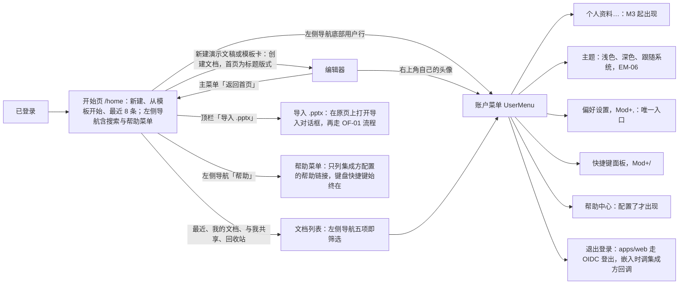

> 状态：草稿 | 负责：产品（2026-09-17 由总编排按设计稿补写；2026-09-18 按裁决修订 AS-06 措辞） | 更新：2026-09-19；2026-09-24（rulings §4.15：AS-02 M2 封面改为包内过渡封面（Q8）；AS-06 登录/登出走 OIDC（Q6））；2026-09-24（复核修正，rulings §4.17）；2026-09-25（补图）；2026-09-25（§4.19）；2026-10-01（§4.23 插件管理样张回写：AS-06 账户菜单为平台管理员增加「管理」项（M3 直接进 `/admin/plugins`「管理 › 插件」，普通成员不显示），补一条验收；§2 接口表补设计 03-32）；2026-10-04（design-language-v3 第 0 批：开始页与编辑器入口按 v3 首页样张与编辑器结构改写（rulings §4.25 DS-1、DS-2、DS-6；设计 03-29），需求、编号、优先级、里程碑不变——§0 第 4 条与图 0-1；AS-01 布局改为左侧导航 + 顶栏「导入 .pptx」「新建演示文稿」+「从模板开始」与「最近」两段，去掉问候语与日期、主题分段、「指南与帮助」卡片区，离线 / 加载 / 窄屏同步；AS-02 最近区网格 / 列表与排序、空态文案；AS-03 模板行；AS-04 指南入口改为左侧导航「帮助」与账户菜单「帮助中心」；AS-05 引导；AS-06 用户行、编辑器内账户入口与快捷键面板入口；§2 接口表；样张与本域口径的差异登记 README PD-28）；2026-10-04（design-language-v3 第 0 批：术语残留清理：ribbon / 状态栏 / `ui.ribbon` / `ui.statusBar` 的历史陈述改用 check-terms 认可的标记措辞（废弃、取代））；2026-10-04（design-language-v3 第 0 批：复验修正——AS-01 搜索框不再自写文案，改为引用设计 03-29 §2.1）；2026-10-04（design-language-v3 第 0 批：复验第 2 轮修正——AS-01 图与验收、AS-06 验收里编辑器「返回首页」与模式下拉的 v3 入口改为样张已起草的主菜单首项与「视图 › 模式」（待第 1 批拍板），账户入口仍随第 1 批）；2026-10-05（design-language-v3 第 0 批修正：以已拍板的 v3 首页改写 AS-01…AS-06（rulings §4.25 DS-10、DS-11、DS-12、DS-18），需求编号、优先级、里程碑不变——§0 第 2–4 条与图 0-1；AS-01 左侧导航宽 220、不设「设置」项、不显示问候语，开始页作用域 `Mod+K` 聚焦搜索框，编辑器「返回首页」在主菜单；AS-02 最近改为最多 8 条（网格四列两行、可切列表），元信息改为「编辑者 · 相对时间」并叠放共享者头像；AS-03 M2 内置模板按样张改为简约 / 商务 / 暗色 / 学术 / 活力 5 套；AS-04 原「指南与帮助」条目收进左侧导航「帮助」菜单；AS-05 引导经帮助菜单；AS-06 编辑器账户入口为右上角自己的头像、菜单加亮暗主题、设置只在账户菜单；§2 接口表；README PD-28 结案）；2026-10-05（design-language-v3 第 0 批修正：AS-06 账户菜单条目按样张写全——头部头像、姓名与邮箱，「个人资料…」、设置（菜单文案「偏好设置…」）、亮暗主题（浅色 / 深色）、键盘快捷键、管理、帮助中心、退出登录，注明样张未画的三项与「个人资料…」内容随第 3 批（rulings §4.25 DS-18），补「个人资料…」M2 行为的待决；AS-06 头像改为身份色底 + 白色首字（DS-9，取代「主色淡底首字母」）；AS-03「更多模板 →」M2 不显示、随 M3 模板库页提供；§0 第 4 条与图 0-1 补个人资料与帮助菜单的「键盘快捷键」；§2 接口表补个人资料行）；2026-10-07（design-language-v3 第 0 批修正收尾：AS-06 账户菜单条目次序改为个人资料、亮暗主题、偏好设置，与 DS-18 和样张一致）；2026-10-07（design-language-v3 第 1 批：§0 第 4 条与 AS-06 第 1 条验收的编辑器主菜单「帮助」与「视图 › 模式」由「第 1 批起草」改为定稿（rulings §4.25 DS-21、DS-23）——「帮助」写全为命令面板… ⌘K · 键盘快捷键 ⌘/ ┊ 帮助中心，模式切换为编辑 / 评审单选、评审条替换底部工具条并带「返回编辑」；需求、编号、优先级、里程碑不变）；2026-10-08（design-language-v3 第 1 批收口：AS-03 注明编辑器主题画廊的内置主题与开始页 5 套模板是同一套（rulings §4.25 DS-33，ML-04）；AS-04 注明账户菜单「帮助中心」、编辑器主菜单「帮助 › 帮助中心」与母版视图「关于母版继承」走同一壳意图管线（TB-39）；需求、编号、优先级、里程碑不变）；2026-10-15（design-language-v3 第 2 批回写：AS-01「加载中显示骨架」一条注明第 2 批的统一加载画法只覆盖第 2 批画面，开始页的加载画法随第 3 批样张复核（rulings §4.25 DS-53、TB-67）；需求、编号、优先级、里程碑不变）；2026-10-22（design-language-v3 第 3 批：按已拍板的应用壳族样张回写 AS-01…AS-06（rulings §4.25 DS-79…DS-93、DS-97、DS-98、DS-113、DS-115，TB-107…TB-110、TB-122、TB-123、TB-127、TB-129），需求编号、优先级、里程碑不变——§0 第 2–4 条与图 0-1；AS-01 左侧导航五项（补「回收站」）即文档列表的筛选、搜索框下拉与「查看全部结果」、「导入 .pptx」先进导入页与拖入导入、导入过渡页全屏且「取消」回到来处、离线横幅的位置与正文、加载中改为加载行、紧凑窗口抽屉与手机 / 触控不提供新建与导入；AS-02 同一份卡片菜单（评审者与查看者没有「创建副本」）、卡片第二行与头像、角色徽标、开始页排序是本机视图偏好、空态只留引导句；AS-03 M3 只做来源分段与预览，删去「分类、搜索」（DS-93）；AS-04 只列配置了链接的帮助条目，删去「内置指南」（DS-89）；AS-05 措辞；AS-06 三处同一份条目、主题三项、「个人资料…」M2 不显示（原待决结案，DS-91）、帮助中心按配置出现、主题被锁定与嵌入未配置登出回调时条目不可用、退出登录前先同步、头像只用身份色首字；§2 接口表）；2026-10-22（design-language-v3 第 3 批回写补充：按 rulings §4.25 DS-137 与 TB-130…TB-133、TB-137、TB-142、TB-144、TB-145 补改——AS-01 搜索框下拉按组合框操作、手机与触控同用下拉（TB-130），导入页与过渡页同一路由、「取消」回到发起导入的那一页（TB-133）；AS-02 M2 的「分享…」留在原位、不可用并写「后续版本提供」（DS-137），网格 / 列表是开始页「最近」与文档列表共用的本机视图偏好（TB-131），文档列表各视图的次序（TB-144）；AS-04 命令面板的「帮助中心」与母版视图的「关于母版继承」只在配置了对应链接时出现（TB-132）；AS-06「个人资料…」M3 起打开个人资料对话框、只改显示名（TB-137、TB-142），iframe 嵌入里「返回首页」与「退出登录」按宿主声明的壳意图（TB-145）；§2 接口表个人资料一行；需求编号、优先级、里程碑不变）；2026-10-22（design-language-v3 第 3 批回写收口：按 rulings §4.25 TB-153、TB-154、TB-160 补改——§0 第 4 条快捷键面板在手机为贴底的底部面板、平板沿用浮动面板，触控形态的菜单不写 ⌘/ 键位（TB-154）；AS-01 手机与平板的顶部提示分写（TB-153），手机搜索框不写 ⌘K；AS-03 在 PD-23 定之前，集成方模板源按部署配置的静态来源列表设计（TB-160）；AS-06「键盘快捷键」与「偏好设置…」在触控形态不写键位（TB-154）；§2 接口表个人资料一行补请求体 `{ displayName }`（TB-142）；需求编号、优先级、里程碑不变；2026-10-22 复核修正：§0 第 4 条与 AS-06 改为触控形态的菜单项一律不写键位提示（rulings §4.25 TB-164），AS-01 补「触控设备」只指平板（TB-163）、平板上左侧导航与「最近」列数按窗口宽度（TB-165）、手机与平板直接打开 `/import` 照常显示导入页（TB-167），AS-03 补跨源模板清单由 CSP 放行（TB-168），§2 接口表「管理」入口的样张路由改为 v3；AS-01 补平板上网格 / 列表切换与开始页「最近」的排序照常保留、只有手机不放，平板的搜索框随左侧导航（TB-170），AS-02 补卡片第二行缺最近编辑者时只写相对时间、两者都缺时按创建时间写（TB-171）；AS-01 搜索下拉与结果页每一行、AS-02 列表形态的编辑者与时间两列同第二行的规则，开始页排序「最近编辑」与第二行取同一时间（内容更新时间，还没有快照时取创建时间，TB-171），AS-01 离线横幅的高 40 指非触控形态、触控形态随 44 高的按钮撑高（TB-172））；2026-10-23（design-language-v3 第 3 批评审修改：按 rulings §4.25 DS-140、DS-141、TB-179…TB-181 改写导入——图 0-1 与 AS-01 的「导入 .pptx」改为在原页上打开「导入」对话框，选文件、拖入、上传、服务端解析与失败都在框里原位切换，成功后关闭并进编辑器（DS-140，取代 2026-10-22 的 DS-97 整屏导入过渡页与 DS-98 整屏导入页）；`/import` 叠在来路之上、浏览器后退即关闭，上传与解析中「取消」、× 与 Esc 中止并关闭、留在原页，成功后以替换方式进编辑器，直接打开时背后是文档列表「最近」，失败后的出口只有「关闭」（TB-179，修订 TB-129、TB-133）；主区拖入落区拖入悬停为强调色虚线加淡底、松开即打开对话框的上传态，只有选文件阶段接收拖入（DS-141、TB-180）；手机为贴底的底部面板、平板为对话框，直接打开 `/import` 照常显示（TB-181，修订 TB-167）；§2 接口表导入入口与设计承接两行；需求编号、优先级、里程碑不变） | 依赖：charter v0.2 §5.2 `apps/web`；rulings §4.15、§4.25（DS-1、DS-2、DS-6、DS-9、DS-10、DS-11、DS-12、DS-18、DS-21、DS-23、DS-33、DS-53、TB-39、TB-67、DS-71、DS-79…DS-93、DS-97、DS-98、DS-113、DS-115、TB-107…TB-110、TB-122、TB-123、TB-127、TB-129、DS-137、TB-130…TB-133、TB-137、TB-142、TB-144、TB-145、TB-153、TB-154、TB-160、TB-163…TB-165、TB-167、TB-168、TB-170…TB-172、DS-140、DS-141、TB-179…TB-181）；设计 03-screens/29、01、03-screens/02、03-screens/01、03-screens/33、03-screens/13；09 v4.0 T-07；rulings §4.10（Q14、快捷键面板入口）

# 功能域 08：应用壳（开始页、最近、模板、指南、账户）

> 需求编号前缀 `AS-`。来源：用户于 2026-09-17 指出"少了进入编辑器的官方首页，最好带指南入口"，设计线先行交付开始页（`20-design/03-screens/29`、playground `#/home`），本文按已定型的设计回填需求，使 PRD 与设计稿一致。归属遵循 D22：这些界面是 SDK 交付的可复用应用壳组件（`slide-ui` / `ui-react` 之上），`apps/web` 只组装；登录、用户目录、模板与帮助内容由集成方提供（回调 / 配置）。

---

## 0. 本域的产品立场

1. **打开应用先到开始页，而不是文档列表或空白编辑器**：与 PowerPoint 开始页、Keynote / Google Slides 开始页一致，用户在一屏内完成"新建 / 继续上次 / 学会用"三件事。
2. **最近优先于全部**：开始页只放最近 8 条（网格四列两行；2026-10-05 由 5 条改，rulings §4.25 DS-12），全量列表在文档列表（EM-17）；左侧导航「最近 / 我的文档 / 与我共享 / 回收站」就是文档列表的筛选，列表页不另设页内筛选条（2026-10-22，rulings §4.25 DS-79）。
3. **指南入口是产品的一部分**：入口固定在开始页与账户菜单——开始页左侧导航「帮助」打开帮助菜单，原「指南与帮助」卡片区的条目都收在这个菜单里（rulings §4.25 DS-12，AS-04）；账户菜单有「帮助中心」。指南与帮助的内容由集成方配置链接提供：菜单只列配置了链接的条目、在新标签页打开，没配置的不出现，「键盘快捷键」始终都在；不做站内指南页（2026-10-22，rulings §4.25 DS-89；原「内容可由集成方替换（站内或外链）」随之改读）。
4. **设置只有一个入口**：账户菜单承载个人资料（M3 起）、主题、偏好设置、快捷键、帮助中心（配置了才出现）、退出登录（个人资料与亮暗主题 2026-10-05 按 rulings §4.25 DS-18 加入；2026-10-22 主题定为浅色 / 深色 / 跟随系统三项、「个人资料…」M2 不显示，DS-90、DS-91）；不在侧栏、顶栏另放设置按钮，开始页左侧导航同样不设「设置」项（2026-10-05 用户裁决，rulings §4.25 DS-10，样张原画的该项删除）。快捷键面板不受此限——编辑器主菜单「帮助 › 键盘快捷键」（2026-10-04 取代原 Ribbon 页签行右侧「?」，rulings §4.25 DS-1；2026-10-07 第 1 批定稿，「帮助」为「命令面板… ⌘K · 键盘快捷键 ⌘/ ┊ 帮助中心」，DS-21，设计 03-02 §2.3；其中「帮助中心」2026-10-22 起按集成方配置出现，DS-89）、账户菜单「键盘快捷键」、`Mod+/` 三个入口并存（D12，2026-09-18 确认）；开始页帮助菜单里的「键盘快捷键」打开同一个面板（AS-04）；面板是画布浮动面板（非模态，开着时画布照常可点、可试键），在开始页上浮在主区右上（2026-10-22，rulings §4.25 DS-115）；手机（< 640）改用贴底的底部面板（同偏好设置的手机形态），平板（触控、≥ 640）沿用这块浮动面板，手机与平板上的入口照常保留（DS-89）；触控形态（手机与平板）的菜单项一律不写键位提示——「键盘快捷键」不写 ⌘/、「偏好设置…」不写 ⌘,，快捷键面板里的键位照常列出，与手机搜索框不写 ⌘K 一致（rulings §4.25 TB-154、TB-164）。

**图 0-1 应用壳导航**

怎么读：箭头为用户可走的导航路径，边上写入口；账户菜单在开始页左侧导航底部用户行、编辑器右上角自己的头像与文档列表左侧导航底部用户行（文档列表与开始页是同一个左侧导航，2026-10-22，rulings §4.25 DS-79）三处打开同一个 `UserMenu`，条目相同。快捷键面板另有编辑器主菜单「帮助 › 键盘快捷键」入口（D12），开始页帮助菜单里的「键盘快捷键」同样打开它；离线时新建、模板与导入入口不可用，最近列表中本会话内仍保活的文档仍可打开。
依据：本文 AS-01、AS-04、AS-06；§0 第 2–4 条；rulings §4.25 DS-1、DS-2、DS-10、DS-12、DS-18、DS-79、DS-89、DS-90、DS-91、DS-140；设计 03-29 §1。

## 1. 需求

### AS-01 开始页

- 优先级：P0 | 目标里程碑：M2 | 依赖能力：`apps/web` 路由 `/home`；文档列表 API（EM-17 / SV）；主题模板清单（AS-03）；`ui.theme`
- 用户故事：作为编辑者，我打开产品就能新建、从模板开始或继续最近的文档，入门指南在左侧导航「帮助」里，不用先找菜单。
- 验收标准：
  - Given 已登录，When 打开应用或从编辑器主菜单（logo ▾）「返回首页」（rulings §4.25 DS-18，设计 03-02 §2.3），Then 显示开始页（以已拍板的 v3 首页为准，rulings §4.25 DS-2、DS-12，设计 03-29 §2）：左侧导航宽 220 px、贴边，自上而下为品牌、搜索框（文案以设计 03-29 §2.1 为准）、主导航「首页 / 最近 / 我的文档 / 与我共享 / 回收站」（「回收站」2026-10-22 补入，rulings §4.25 DS-79），底部为「帮助」（打开帮助菜单，AS-04）与账户行（AS-06）；左侧导航不设「设置」项（设置只在账户菜单，rulings §4.25 DS-10）。主区顶栏为页面标题「首页」与「导入 .pptx」「新建演示文稿」两个按钮，其下依次为「从模板开始」一行（AS-03）与「最近」段（AS-02）。开始页不显示问候语与日期（DS-12）；原主题分段与「指南与帮助」卡片区随 v3 取消——亮暗切换在账户菜单（AS-06，DS-18），指南收进帮助菜单（AS-04）。
  - Given 开始页，When 按 `Mod+K`，Then 焦点移到左侧导航的搜索框（开始页作用域，与搜索框右侧按平台显示的 ⌘K / Ctrl+K 提示一致；编辑器内 `Mod+K` 为命令面板 ED-30，rulings §4.25 DS-11、DS-12）。
  - Given 在左侧导航的搜索框里输入，Then 搜索框下方弹出前 5 条即时结果（小封面 · 标题 · 编辑者与时间）与末行「查看全部结果」，选它进完整的搜索结果页（范围为能访问的全部文档、不含回收站，结果用同一张文档卡片）；没有命中时下拉里一行「没有匹配「…」的文档」；下拉、结果页与列表头都不写数量（游标分页没有总数）（2026-10-22，rulings §4.25 DS-80，用户未采用「主区换成搜索结果页、边输边搜」的推荐；设计 03-01、03-29）。下拉按组合框操作：焦点留在搜索框，↓ / ↑ 在 5 条结果与「查看全部结果」之间移动，↵ 打开当前项（还没移动时等于「查看全部结果」），Esc 先收起下拉、再按一次清空，点外面收起；在结果页改搜索词时下拉照常弹出，↵ 或「查看全部结果」按新词刷新结果页（rulings §4.25 TB-130）。下拉与结果页每一行的编辑者与时间与卡片第二行同一规则：缺最近编辑者时只写时间，还没有快照时按创建时间写、不写编辑者（AS-02，rulings §4.25 TB-171）。
  - Given 新建入口——顶栏「新建演示文稿」与「从模板开始」一行（16:9 真实渲染封面：首张为空白演示文稿，其后为 M2 内置的 5 套主题模板，AS-03），Then 点击直接创建文档并进入编辑器（首页为标题版式，D14）；顶栏「导入 .pptx」在当前页上打开「导入」对话框（同 Figma 文件浏览器的 Import 对话框；2026-10-23，rulings §4.25 DS-140；原「新建」段的导入卡随 v3 改为顶栏按钮）：落区正中写「把 PowerPoint 演示文稿带进 Cordex」与「把 .pptx 文件拖到这里，单个文件最大 200 MB」（上限读部署配置，缺省 200 MB，SV-08），主按钮「从电脑选择文件…」，选好文件后走 OF-01 流程；选文件、拖入、上传、服务端解析与失败都在这个框里原位切换，成功后关闭对话框、进入编辑器（尺寸、文案与各阶段画法以设计 03-13 为准）。2026-10-22 定的整屏导入页（DS-98）与整屏导入过渡页（DS-97）自 2026-10-23 起由 DS-140 取代。把 .pptx 直接拖进开始页或文档列表的主区同样导入：落区「松开以导入」，拖入悬停为强调色虚线加淡底，松开即打开对话框的上传态（rulings §4.25 DS-141、TB-180）；对话框只在选文件阶段接收拖入，上传、解析与失败中不接收，一次拖着不止一个文件也不接收（要换文件先「关闭」，TB-180）。实现口径（rulings §4.19 D-M2-CONTENT）：服务端以内置模板字节为导入源走服务端导入（SV-01）建档，建档者为 owner，文档内容自此只以协同快照为事实源；编辑器经协同网关打开，不存在过渡的 pptx 内容版本端点；导入 .pptx 同走 SV-01。对话框的地址是 `/import`，叠在来路（开始页或文档列表）之上，从选文件到失败都在这一个地址上、不新增浏览历史，浏览器后退等于关闭；上传与解析中「取消」、× 与 Esc 都是中止导入并关闭对话框、留在原页，不留卡片也不留原件（rulings §4.18 UX-14），这时点遮罩不关闭（TB-180）；导入成功后以替换方式把 `/import` 换成编辑器的地址，在编辑器里按后退回到来路页；直接打开 `/import` 时背后是文档列表「最近」，并先在它前面补一条列表的历史（rulings §4.25 TB-179，修订 TB-129、TB-133）。失败在框里原位显示，出口只有底栏的「关闭」：可重试的失败（网络中断、超时、服务暂时不可用等）在正文里有次按钮「重试」，确定性失败（不支持的格式、加密、含宏、不是有效的演示文稿、超出规模上限、文件过于复杂等）不给重试，「复制诊断信息」的反馈写在对话框底栏（TB-179，rulings §4.25 DS-53、DS-56；按错误码的文案以设计 03-13 为准）。
  - Given 主导航，Then 「首页」为当前项；「最近 / 我的文档 / 与我共享 / 回收站」进入文档列表的对应视图——左侧导航就是文档列表的筛选，列表页不另设页内筛选条，`/documents` 不带筛选时落「最近」，「全部」只用于搜索结果（2026-10-22，rulings §4.25 DS-79；原「进入文档列表并预置筛选」随之改读，原「新建」「指南」页内锚点随 v3 取消）；回收站视图的卡片、恢复与永久删除见设计 03-01（DS-85；永久删除与到期清理为 M3，SV-11）。
  - Given 离线，Then 主区顶栏之下出离线横幅（与编辑器离线横幅同一个件，高 40——指非触控形态，触控形态（手机与平板）里按钮照常 44 高、横幅随之撑高，rulings §4.25 TB-172；应用壳页面的横幅只横跨主区，导航不动、标题不跳，最多两条叠放，2026-10-22，rulings §4.25 DS-92、DS-75），正文「本次打开过的文档可以继续编辑；新建、模板与导入将在恢复连接后可用」（原正文「当前离线：可打开最近文档继续编辑…」随之改读：M2 只有本会话仍保活的文档能打开）；「新建演示文稿」、模板卡与「导入 .pptx」留在原位、不可用并 tooltip「离线时不可用」；最近列表来自本地缓存，其中本会话内仍保活的文档可打开，其余变淡、不能打开并 tooltip「离线时只能打开本次打开过的文档」（文档内容只在服务端协同快照中，跨刷新的离线库为 M4 P2，`50-frontend/02`）。
  - Given 加载中，Then 真实加载超过 300 ms 才在「最近」区居中出一行加载行「正在加载最近的文档…」，不画骨架、不显示空态，「最近」标题行的网格 / 列表与排序不放，模板行、顶栏与左侧导航照常可用（2026-10-22，rulings §4.25 DS-86，沿用 DS-53；原「最近区显示骨架」作废，文档列表与管理员插件清单同此）；性能：开始页可交互 ≤ 1.0 s（p75，已登录、列表 ≤ 50 条）。
  - Given 紧凑窗口（640–1024 且非触控，与编辑器紧凑形态同一判据），Then 左侧导航收成左侧抽屉：顶栏左端「显示导航」开关，展开的抽屉就是左侧导航本身（整高、不加遮罩、非模态），「收起导航」与开关在同一位置；模板一行照常、「最近」改三列（2026-10-22，rulings §4.25 DS-87；原「窄屏（< 1024）折叠为抽屉入口、卡片自动换列」随之改读）；平板（触控）在这一宽度下左侧导航与「最近」的列数同此，其余按下条（rulings §4.25 TB-165）。
  - Given 手机或触控设备（< 640 或触控，与编辑器仅查看形态同一判据，rulings §4.25 DS-17；「触控设备」只指平板——触控、≥ 640，宽度 < 640 的手机不论是否触控都按窗口窄算，TB-163），Then 不提供新建与导入（2026-10-22，rulings §4.25 DS-87：手机上新建出来的文档当场不能编辑，不如不给入口）：不渲染「从模板开始」一行与顶栏「导入 .pptx」「新建演示文稿」，顶部一行提示按原因写——宽度 < 640 写「在更大窗口中新建或导入演示文稿」，平板（触控、≥ 640）是因为触控才不能新建，写「在电脑上新建或导入演示文稿」（rulings §4.25 TB-153，与仅查看形态状态行的 TB-125 同一理由；文档列表顶部同此，设计 03-01）；直接打开 `/import` 时照常显示「导入」对话框、不另拦——背后是文档列表的触控形态，手机（< 640）为贴底的底部面板、平板为对话框，触控下按钮写「选择文件…」、说明只写「只支持 .pptx，单个文件最大 200 MB」（不写「从电脑」与「拖到这里」），导入完成后按设备进编辑器的仅查看形态（2026-10-23，rulings §4.25 TB-181，修订 TB-167）。左侧导航与「最近」的列数按窗口宽度取：手机（< 640）左侧导航收进抽屉、「最近」单列；平板与桌面、紧凑窗口同一规则——≥ 1024 左侧导航常驻、四列，640–1024 收成抽屉、三列（TB-165）。网格 / 列表切换（开始页「最近」标题行与文档列表的列表头）与开始页「最近」的排序菜单在平板上照常保留，同桌面与紧凑窗口，只有手机不放（rulings §4.25 TB-170）。搜索框触控高 44、不写 ⌘K 提示（TB-154、TB-170），输入同样弹出下拉（行高 44，rulings §4.25 TB-130），手机上搜索框在主区（提示行之下）、抽屉里不再放，平板的搜索框随左侧导航（常驻或在抽屉里，TB-170）；卡片「⋯」常显、命中区 44，导航各行触控高 44（DS-87、TB-165）。

### AS-02 最近与固定

- 优先级：P1 | 目标里程碑：M2 | 依赖能力：最近打开记录（本地 + 服务端合并，SV）；文档卡片封面——M2 为包内 `docProps/thumbnail.jpeg` 过渡封面（无则占位，同设备可用本地 dom-scaled 缓存覆盖），M3 起为服务端 640 px WebP（SV-04，rulings §4.15 Q8）
- 验收标准：
  - Given 「最近」段（默认网格、可切列表，右侧排序菜单「最近打开 / 最近编辑 / 名称 / 创建时间」，设计 03-29 §2.2；排序菜单是开始页这一段的本机视图偏好，不带到文档列表——文档列表复用网格 / 列表切换、不排序，各视图次序固定，2026-10-22，rulings §4.25 DS-84、TB-127；网格 / 列表的选择同为本机视图偏好，开始页「最近」与文档列表共用一份，TB-131），Then 最多 8 条（网格四列两行；2026-10-05 由 5 条改，以已拍板的 v3 首页为准，rulings §4.25 DS-12）：卡片为封面、标题与第二行「编辑者 · 相对时间」（最近一次编辑的人与时间，由服务端在文档摘要里提供，DS-83），缺最近编辑者（系统作业建的文档）时只写相对时间，最近编辑者与内容更新时间都缺（还没有快照）时按创建时间写相对时间、不写编辑者，不拿所有者顶替编辑者（rulings §4.25 TB-171）；排序菜单的「最近编辑」按第二行的同一时间排——内容更新时间，还没有快照时取创建时间，与「我的文档」「与我共享」的次序同口径（TB-171、TB-144）；我拥有的共享文档右下叠 2 位协作者，别人共享给我的文档是一枚所有者头像（DS-83，rulings §4.24 TA-10 不改）；列表每行为封面 · 标题 · 编辑者 · 相对时间 · 头像，编辑者与时间两列同第二行的规则，缺最近编辑者时编辑者一列空着（TB-171）。标题后带固定图钉与角色徽标——评审者「可评论」、查看者「仅查看」（rulings §4.18 UX-19；原「『仅查看』徽标（无 `doc.write`）」按两种角色分写），呈现见设计 03-29 §4、03-01（2026-10-22 第 3 批补齐）。开始页按缺省「最近打开」排序时，这 8 条就是文档列表「最近」的前 8 条（TB-127）；全量列表经左侧导航「最近 / 我的文档 / 与我共享」进入文档列表（原「全部文档」链接随 v3 取消）。文档列表各视图的次序：「最近」固定的在前、其后按我打开的时间倒序；「我的文档」「与我共享」按内容更新时间倒序，与卡片第二行的时间同源，改名、移入与恢复回收站不改变次序（rulings §4.25 TB-144）；回收站按移入时间倒序（设计 03-01）。
  - Given 卡片的「⋯」菜单（悬停或焦点在卡片里时出现；开始页「最近」、文档列表与回收站用同一个卡片、同一份菜单，按视图与角色增减，2026-10-22，rulings §4.25 DS-81），Then 所有者为：分享… · 创建副本 · 重命名 ┊ 固定（已固定的写「取消固定」）· 从最近移除（只在开始页「最近」与文档列表「最近」视图）┊ 移到回收站（只给所有者，单独最后一组、危险色）；可编辑的共享文档有「创建副本」「重命名」、没有「移到回收站」；评审者与查看者没有「创建副本」（副本是一份可编辑、可导出的完整拷贝，按 rulings §4.12 U-09 只给编辑者及以上，DS-82），只剩「分享…」（打开只读的「谁能访问…」，DS-48）┊ 固定（「从最近移除」只看视图、不看角色，在「最近」里照常有）；回收站视图换成「恢复 ┊ 永久删除…」（DS-85）。原「『更多』菜单（固定 / 分享 / 从最近移除）」就是这份菜单在开始页的条目，不另设一份。「分享…」在当前列表上打开分享对话框、不进编辑器，关闭后回到原列表与滚动位置、焦点回卡片（rulings §4.25 TB-109）；分享在 M3 开放（CO-15），M2 里这一项对各角色都留在原位、不可用，标 M3、右侧写「后续版本提供」，与回收站「永久删除…」在 M2 的画法一致（2026-10-22，rulings §4.25 DS-137，§4.20 FE-06）；卡片本身是指向文档的链接，浏览器原生的新标签页打开与复制链接地址照常可用，菜单不另加「在新标签页打开」（TB-108）；卡片网格只占一个 Tab 停靠点、方向键在卡片间移动，焦点在卡片上按 Shift+F10 / 菜单键也能打开「⋯」（TB-107）。
  - Given 固定，Then 置顶并持久（**M2 服务端同步**，IndexedDB 仅作离线缓存，rulings §4.12 U-04）；Given 从最近移除，Then 可撤销 toast 5 s；不删除文档。
  - Given 最近为空，Then 最近区显示空态「还没有最近打开的文档」+「从上方的模板开始，或新建一份空白演示文稿」，只留引导句、不放按钮——顶栏已有「新建演示文稿」、模板行第一张就是「空白」，同一操作不放第三处（2026-10-22，rulings §4.25 DS-88；原空态里的新建按钮删去，原文案「从上方新建一份，或先看看指南」随 v3 删除「指南与帮助」卡片区而作废，引导文案由此定稿，AS-05）；空态时「最近」标题行不放网格 / 列表与排序。文档列表的空态同一取舍（「这里还没有任何文档」+「新建一份演示文稿，或导入已有的 .pptx 文件」，设计 03-01）。

### AS-03 模板库

- 优先级：P1 | 目标里程碑：M3（M2 内置 5 套主题模板卡） | 依赖能力：ML-04 主题（模板 = 主题 + 母版 + 版式包）；集成方模板源（配置）
- 验收标准：
  - Given M2，Then 开始页「从模板开始」一行（首张为空白演示文稿，封面为真实渲染，rulings §4.25 DS-2；样张行右端的「更多模板 →」随 M3 模板库页提供，M2 不显示，见下条）固定展示 5 套内置主题模板卡片：简约 / 商务 / 暗色 / 学术 / 活力（2026-10-05 按样张，取代原 Office / 极简灰 / 暖色商务 / 深色科技 4 套，rulings §4.25 DS-12，PD-23）；点击 = 以该主题新建。编辑器主题画廊的内置主题与这 5 套是同一套（2026-10-08，rulings §4.25 DS-33，ML-04）。
  - Given M3，Then 「从模板开始」一行右端出现「更多模板 →」，点击进入模板库页（壳内页面，入口只有这一个，rulings §4.25 DS-72）：模板网格同开始页模板卡；集成方配置了模板源时顶部出现来源分段「全部 · 内置 ·〈集成方来源〉」，「全部」按来源分组、组标题不写数量，没配置时只有内置模板的网格；点模板打开预览对话框（首页大图、主题色条、字体、按这套模板自己的母版画的版式）与「使用此模板」（以该模板新建并进入编辑器，首页为标题版式，D14）；集成方模板源加载失败时只在它那一组内联报错并给「重试」，内置模板照常可用；离线时可以预览、「使用此模板」不可用。模板库只做从模板新建：顶栏不放「导入 .pptx」「新建演示文稿」，网格不含「空白」（新建空白与导入在开始页，rulings §4.25 TB-110）。M3 只做来源分段与预览，原「分类、搜索」删去（2026-10-22，rulings §4.25 DS-93：模板数量小，等模板多了再走需求变更）；上传 .potx 作为模板见 G-18 / ML-04 模式 B。
- 待决：模板库内容来源与审核（PD-23）。在它定之前，集成方模板源按部署配置的静态来源列表设计：每个来源有标识、名称与一份模板清单的地址，随运行时配置下发，浏览器分别去取各来源的清单，某一来源取不到只影响它那一组（rulings §4.25 TB-160，DS-72、DS-93；配置项以前端 50/02 为准）；跨源的清单地址由部署一并放行进内容安全策略的 `connect-src`（TB-168，占位以前端 50/14 §2.2 为准）。

### AS-04 指南与帮助入口

- 优先级：P1 | 目标里程碑：M2 | 依赖能力：帮助内容配置（集成方可替换链接）；快捷键面板（ED-16 / G-21）
- 验收标准：
  - Given 开始页左侧导航底部「帮助」，When 点击，Then 向上打开帮助菜单，原「指南与帮助」卡片区的条目都收在这里（2026-10-05，rulings §4.25 DS-12；卡片区随 v3 首页改版删除，设计 03-29 §2.1）。2026-10-22 定稿（rulings §4.25 DS-89）：菜单只列集成方配置了链接的条目，都在新标签页打开、带外链图标——5 分钟快速入门 · 母版与版式 · 协同编辑 ┊ 帮助中心 · 新功能（发布说明，取代原右上「vX.Y 新功能」徽标）；「键盘快捷键」始终都在（打开快捷键面板，`Mod+/`）；集成方什么都没配置时菜单只剩「键盘快捷键」。
  - Given 账户菜单，Then 含「帮助中心」项（AS-06）；它与编辑器主菜单「帮助 › 帮助中心」打开同一目标，编辑器内这两项与母版视图里的「关于母版继承」（ML-01）走同一壳意图管线，权限、审计与遥测经同一入口（2026-10-08，rulings §4.25 TB-39）；这两处的「帮助中心」同样只在配置了帮助链接时出现、在新标签页打开并带外链图标（2026-10-22，DS-89；编辑器主菜单「帮助 › 帮助中心」第 1 批定稿的常在画法随之改）；命令面板里的「帮助中心」与母版视图的「关于母版继承」同一规则，只在集成方配置了对应链接时出现（rulings §4.25 TB-132）。
  - Given 集成方未配置帮助内容，Then 帮助菜单只剩「键盘快捷键」，账户菜单、编辑器主菜单与命令面板都不出现「帮助中心」，母版视图的「帮助」里也没有「关于母版继承」（它打开「母版与版式」指南，没配这条链接就不出现，TB-132）；不做站内指南页（2026-10-22，rulings §4.25 DS-89；原「显示内置指南（站内页，M2 为占位文案，M3 完整）」删去）。
- 待决：指南的内容来源（PD-23）。原「指南承载方式（站内 / 外链）」2026-10-22 结案：按 DS-89 为集成方配置的外链、在新标签页打开。

### AS-05 首次使用引导

- 优先级：P2 | 目标里程碑：M3 | 依赖能力：AS-02 空态、AS-04
- 验收标准：Given 首次登录且无文档，Then 最近区显示空态，引导句「从上方的模板开始，或新建一份空白演示文稿」指向顶栏「新建演示文稿」与上方的「从模板开始」一行，空态里不另放按钮（2026-10-22，rulings §4.25 DS-88，AS-02；原「突出『新建演示文稿』与『从模板开始』」由这句引导落地）；指南经左侧导航「帮助」菜单进入（原「指南卡」收进帮助菜单，rulings §4.25 DS-12，AS-04；菜单只列集成方配置了链接的条目，DS-89）；不做交互式分步引导（P2 之外，避免打扰）。

### AS-06 账户菜单

- 优先级：P0 | 目标里程碑：M2 | 依赖能力：集成方用户信息与登出回调（EM-17 / G-66）；设置（G-30）；快捷键面板（G-21）
- 验收标准：
  - Given 开始页或文档列表左侧导航底部的用户行（头像 + 姓名，邮箱在菜单头部显示，设计 03-29 §2.1；文档列表与开始页是同一个左侧导航，2026-10-22，rulings §4.25 DS-79；单组织自托管无套餐概念）或编辑器右上角自己的头像（2026-10-05，rulings §4.25 DS-18；编辑器族全部路由共用 `UserMenu`），When 点击，Then 弹出同一个账户菜单，三处条目相同（以已拍板的 v3 首页样张为准，rulings §4.25 DS-12、DS-18；2026-10-22 按已拍板的第 3 批样张写全，DS-89、DS-90、DS-91，原「样张未画的三项随第 3 批补齐」结案）：头部为头像、姓名与邮箱（只作标识、不可聚焦）┊「个人资料…」（M3 起，见下条）┊ 主题（小标题）浅色 / 深色 / 跟随系统三项单选——与偏好设置「外观 › 主题」是同一偏好、同一组取值与顺序，出厂缺省「跟随系统」，选了即时换肤、菜单不关（DS-90，EM-06；原「浅色 / 深色」两项作废）；集成方锁定主题时三项留在原位、不可用，组顶一行「由宿主应用设置」（rulings §4.20 FE-06，与偏好设置的锁定同一句）┊ 偏好设置…（`Mod+,`）· 键盘快捷键（`Mod+/`；触控形态——手机与平板——的菜单项一律不写键位提示，这两项的 ⌘/、⌘, 都不写，rulings §4.25 TB-154、TB-164，设计 03-29 §2.5）·（仅平台管理员）管理 · 帮助中心（只在集成方配置了帮助链接时出现，在新标签页打开、带外链图标，DS-89，AS-04）┊ 退出登录。2026-10-04 起编辑器没有应用栏，原「在场头像 · 分享 · 模式下拉 · ⋯ · 账户头像」的右侧顺序（2026-09-18 Q14）作废：在场头像与分享在检查器顶部协作行（网格视图与紧凑窗口在右上胶囊），模式切换在主菜单「视图 › 模式」（编辑 / 评审单选；评审时评审条替换底部工具条，有编辑权限时评审条另有「返回编辑」；2026-10-07 定稿，rulings §4.25 DS-23），主菜单另放「插件…」与「返回首页」（rulings §4.25 DS-1、DS-18；嵌入（iframe）时不渲染「返回首页」，宿主在 `cordex:init` 声明能处理「返回」时才出现，DS-112、TB-145，EM-01）。设置的**唯一**入口为账户菜单（D13；侧栏、顶栏与开始页左侧导航都不放设置项，rulings §4.25 DS-10）；快捷键面板另有编辑器主菜单「帮助 › 键盘快捷键」（「帮助」另有「命令面板… ⌘K」与按配置出现的「帮助中心」，2026-10-07 定稿，DS-21、DS-89，设计 03-02 §2.3）与 `Mod+/`（D12）。
  - Given 「个人资料…」（2026-10-22，rulings §4.25 DS-91，原待决结案；用户未采用「M2 留在原位、不可用并标 M3」的推荐），Then M2 不显示这一项与它下面的分隔线，菜单从头部直接到「主题」；M3 起出现，打开个人资料对话框（rulings §4.25 TB-137，样张 `account-menu.profile-dialog`）：显示名可改（1–128 字；服务端 `PATCH /users/me/profile` 只改显示名、不接收头像，TB-142，`60-backend/15` §3.2），邮箱只读（由组织账号提供），头像为身份色首字、只读、不上传（TB-123）。
  - Given 退出登录，Then 参考应用 `apps/web` 走 OIDC 登出（RP-initiated logout，rulings §4.15 Q6）：`POST /auth/logout` 返回 200 `{endSessionUrl?}`，有 `endSessionUrl` 时整页跳往 IdP 结束会话、否则回到 `/login`（`60-backend/15` §3.1、`50-frontend/02` §13）；退出前本用户还有未同步的更改时先尝试同步，仍有未同步项才弹模态确认（与应用内离开、刷新的确认同一走向，rulings §4.25 DS-59），可先「导出为本地副本」，导出后回到原页、不自动退出（rulings §4.25 TB-122）；嵌入场景把退出交给集成方——SDK 嵌入调用集成方的登出回调，iframe 嵌入（形态 E）在宿主经 `cordex:init` 声明了 `sign-out` 时把这一意图发给宿主（rulings §4.25 TB-145，前端 50/12 §9）；集成方没配置登出回调、或宿主没声明时「退出登录」留在原位、不可用，原因写「由宿主应用管理登录」（rulings §4.20 FE-06；原「未配置时提示」随之改读）。
  - Given 账户头像（开始页与文档列表的用户行、编辑器右上角自己的头像），Then 圆形、该用户的身份色底 + 白色首字，与协作者头像同一组件、同一颜色（CO-03；身份色按 rulings §4.25 DS-9 加深到对白字 ≥ 4.5:1；2026-10-05 按 v3 样张取代原「主色淡底首字母」）；界面一律用身份色首字，不显示 IdP 提供的头像图片（`avatar_url` 只存不显示，rulings §4.25 TB-123）；用户行的头像不带在场标记，在场与空闲灰显只用于编辑器的协作者头像组（CO-03）。
  - Given `platformRole='admin'`（2026-10-01，rulings §4.23；[09-plugin-manager](09-plugin-manager.md) PM-01、PM-06），Then 菜单在「键盘快捷键」与「帮助中心」之间多一项「管理」（盾牌图标，右侧弱化小字「插件」），点击进 `/admin/plugins`「管理 › 插件」（M3 管理面板只有这一页，不经中转页）；Given `platformRole='member'`，Then 不显示该项、不占位；普通成员直接访问 `/admin/plugins` 时回到开始页并 toast「需要管理员权限」（设计 [03-32](../../20-design/03-screens/32-admin-plugin-management.md) §1）。
- 原待决「『个人资料…』在 M2 的行为」已结案（2026-10-22，rulings §4.25 DS-91）：M2 不显示、M3 起出现，见上。

## 2. 与其它域的接口

| 本域产出 / 依赖 | 对应位置 |
|---|---|
| 文档列表与筛选、导入入口 | EM-17；设计 03-01（文档列表：左侧导航五项即筛选，rulings §4.25 DS-79）；`01-open-and-fidelity.md` OF-01（三种入口之一为开始页与文档列表顶栏「导入 .pptx」，在原页上打开「导入」对话框，也可把文件拖进主区、松开即打开对话框的上传态，rulings §4.25 DS-140、TB-180；原「导入 .pptx」卡随 v3 首页改版）；「导入」对话框见设计 03-13 |
| 偏好设置、快捷键面板 | `07-design-coverage-and-gaps.md` G-30 / G-21（偏好设置为居中模态对话框、快捷键面板为画布浮动面板，rulings §4.25 DS-113、DS-115，改读见 README §9）；D12 / D13；默认快捷键表 `02-editing.md` ED-16（开始页作用域的 `Mod+K` 聚焦搜索只在开始页生效，编辑器内 `Mod+K` 为 ED-30 命令面板） |
| 主题（亮暗） | `05-embedding-and-integration.md` EM-06（用户入口为账户菜单「主题」三项与偏好设置「外观 › 主题」，同一偏好，rulings §4.25 DS-18、DS-90） |
| 个人资料 | 账户菜单「个人资料…」（rulings §4.25 DS-18；M2 不显示、M3 起打开个人资料对话框，DS-91、TB-137）；服务端只改显示名 `PATCH /users/me/profile { displayName }`（M3，`60-backend/15` §3.2；`avatarUrl` 入参删去，TB-142）；头像只读、按身份色首字（TB-123） |
| 主题模板 | `07-masters-layouts-and-themes.md` ML-04 |
| 登录、会话与错误页 | G-66（EM-17 M3 P1）；落点为设计 03-33「登录、会话与错误页」（rulings §4.25 DS-71） |
| 设计承接 | `20-design/03-screens/29-home-start-page.md`（2026-10-04 按 v3 重写；其 §6 所列样张与本域口径的差异已由 rulings §4.25 DS-10、DS-11、DS-12 裁决，本域 2026-10-05 按裁决改写）；09 v4.0 T-07；playground `#/v3/home`（v3 样张；旧版 `#/home` 在全量迁移后删除，rulings §4.25 DS-7）；账户菜单「管理」入口见 `20-design/03-screens/32-admin-plugin-management.md` §1（v3 样张 `#/v3/admin/plugins?state=admin-plugins.<状态 id>`）；2026-10-22 第 3 批另有设计 03-01（文档列表与回收站）、03-33（登录、会话与错误页），模板库写在 03-29，样张场景为 `home`、`documents`、`account-menu`、`templates`、`shell-pages`（rulings §4.25 DS-71、DS-79…DS-93）；2026-10-23 起「导入」对话框写在设计 03-13，样张 `import.dialog`、`import.dialog-documents`、`import.dialog-phone`（rulings §4.25 DS-140） |
| 里程碑 | `05-milestones-and-scope.md` M2 P0：AS-01、AS-06；M2 P1：AS-02、AS-04；M3 P1：AS-03；M3 P2：AS-05 |
