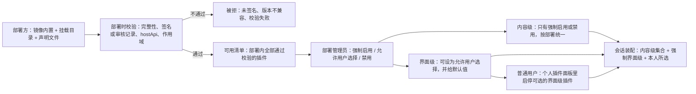
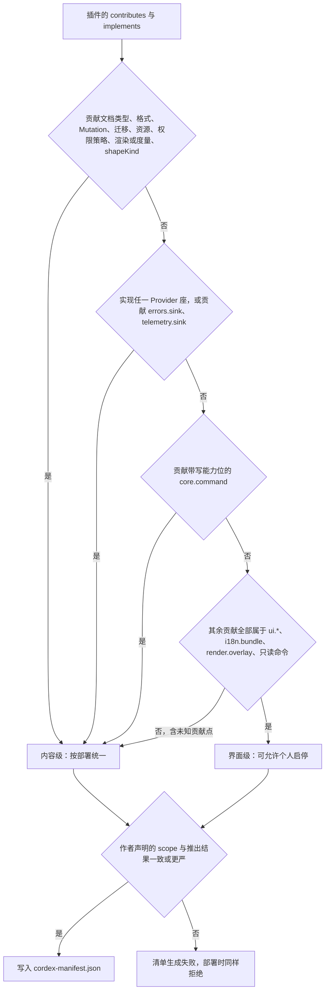
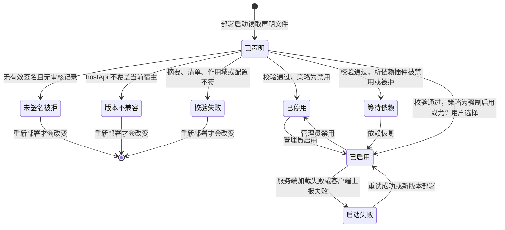
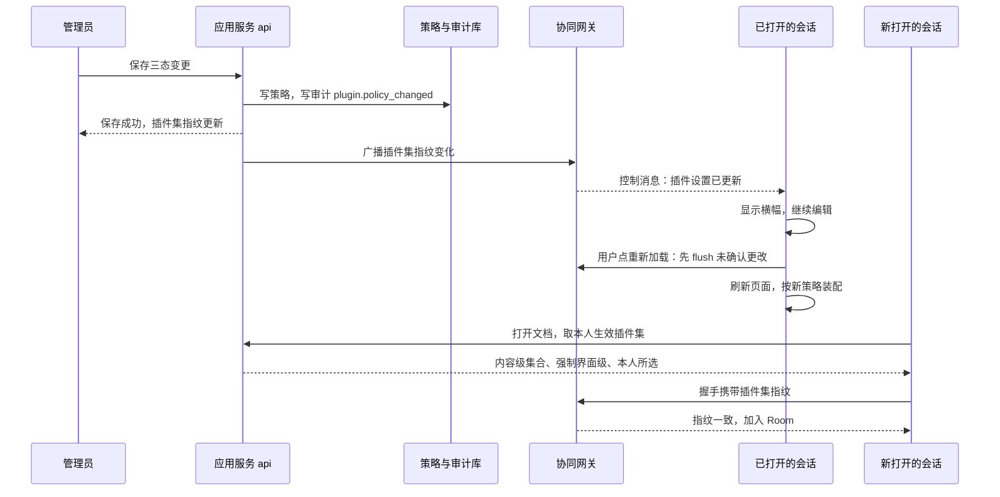
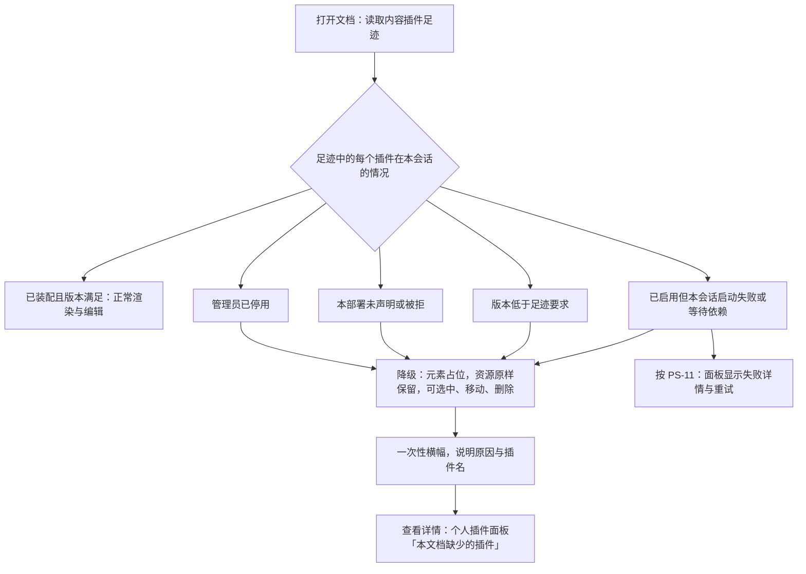

> 状态：草稿 | 负责：产品（2026-10-01 按用户交互裁决新建，rulings §4.23） | 更新：2026-10-01（§4.23 插件管理：新建本域 PM-01…PM-16，两级管理、只认部署预置、内容级按部署统一 / 界面级个人启停、打开文档缺插件降级提示）；2026-10-01（§4.23 插件管理：O-1…O-4 经用户确认定稿，§7 改为已定稿，PM-08、PM-10、PM-12 引用落点）；2026-10-01（§4.23 插件管理样张回写：§6 设计承接与 AS-06 入口两行改为已回写的设计 03-09 / 03-32；PM-06 依赖能力中的 AS-06 改为已定稿）；2026-10-01（40/16 重算：cordis 插件单元 46 → 48）；2026-10-01（插件口径仅计 cordis 插件：rulings §4.23 补充裁决 PC-1…PC-4，§2.1 与 PM-02 验收的「cordis 插件单元」改称 cordis 插件，指 40/16 §2「插件」列为「是」的 48 行）；2026-10-04（design-language-v3 第 0 批：§2.2 界面级作用域的「状态栏项」改为检查器分区（`ui.statusBar` 删除、`ui.inspectorSection` 新增，rulings §4.25 DS-5、DS-6）；PM-10 入口改为主菜单中的插件入口与插件启动失败的按需横幅（原应用栏「⋯ › 插件管理器」与状态栏插件图标随 DS-1、DS-6 取消）；需求、编号、优先级、里程碑不变）；2026-10-04（design-language-v3 第 0 批：术语残留清理：ribbon / 状态栏 / `ui.ribbon` / `ui.statusBar` 的历史陈述改用 check-terms 认可的标记措辞（废弃、取代））；2026-10-05（design-language-v3 第 0 批修正：PM-10 入口改为主菜单顶层项「插件…」（rulings §4.25 DS-18，位置随第 1 批），删去「子菜单随第 1 批定稿」；需求、编号、优先级、里程碑不变）；2026-10-07（design-language-v3 第 1 批：PM-10 主菜单「插件…」的位置定稿为「排列 ▸」之后、「帮助 ▸」之前，上下各一条分隔线、自成一组，评审、只读浏览与降权时照常可用（rulings §4.25 DS-21，设计 03-02 §2.3）；需求、编号、优先级、里程碑不变）；2026-10-15（design-language-v3 第 2 批：按已拍板的插件样张与 rulings §4.25 DS-38、DS-41、DS-52、DS-54…DS-56、DS-59 回写，需求、编号、优先级、里程碑不变——§1 管理员在面板里的入口（DS-56）；PM-08「重新加载」先同步、仍有未同步项时弹应用内确认框（DS-59），设置已更新横幅排在插件横幅最后（DS-54）；PM-10 个人插件面板为居中对话框 640、反馈写在底栏、开关用安静样式，启动失败横幅单个写名字（DS-38、DS-55、DS-56）；PM-11 冲突说明行吸顶并自动滚到冲突那一行（DS-56）；PM-12 插件横幅改中性底加状态色图标（DS-41）、多类横幅的先后与重现（DS-54）、单个与多个失败的标题（DS-55）、缺插件元素的选中、右键与不能改大小（DS-52）；PM-16 对话框形态的状态播报（DS-56））；2026-10-15（design-language-v3 第 2 批回写补充：PM-06「加载中骨架行」一条注明第 2 批的统一加载画法只覆盖第 2 批画面，管理员插件清单的加载与出错画法随第 3 批样张复核（rulings §4.25 DS-53、TB-67）；PM-12 缺插件元素的右键补评审、只读浏览与降权下照常出现（同 OF-13，DS-64）；需求、编号、优先级、里程碑不变）；2026-10-15（design-language-v3 第 2 批回写再补充：PM-10「本部署统一启用」与「我的界面插件」两组都把启动失败 → 版本不兼容 → 等待依赖的行排在组内最前（rulings §4.25 TB-78）；管理员行尾直达管理页插件详情的入口注明地址形式登记在前端 50/02 §2（TB-76）；需求、编号、优先级、里程碑不变）；2026-10-22（design-language-v3 第 3 批：按已拍板的管理员插件样张改表述——PM-05 非生产警示与被拒横幅的位置与画法（主区顶栏之下、不可关闭、两条叠放，被拒横幅不带「只看被拒插件」，rulings §4.25 DS-92、DS-96、TB-119）；PM-06 行内 `id` 一律为 cordis 插件 id（TB-121）、「已声明」行只读与只按桌面设计（TB-119）、详情改为右侧模态抽屉 480（DS-94，原「展开一行」改读）、首次启用第三方的确认卡（TB-120）、加载中改为加载行（DS-86，原「骨架行」作废）；PM-07 变更确认卡里界面级插件改为强制启用 / 禁用时的两句与当下确认卡的主按钮（TB-120）；PM-12 查看器里缺插件的那一行说明放进 ⓘ 卡（DS-110）；PM-15 管理员视图补失败阶段（TB-119）；PM-16 两张当下确认卡初始焦点在「取消」、管理页状态横幅用 status（TB-119、TB-120）；需求、编号、优先级、里程碑不变）；2026-10-22（design-language-v3 第 3 批回写补充：PM-10 入口与 PM-11 验收里快捷键冲突条目的写法与按钮按第 3 批设计 03-24 改为「在插件中查看」，两侧都标冲突、未生效的一侧标「未生效」；只改表述，需求、编号、优先级、里程碑不变）；2026-10-22（design-language-v3 第 3 批回写收口：PM-10 入口补命令面板里的「插件…」（rulings §4.25 TB-162）；只改表述，需求、编号、优先级、里程碑不变）；2026-11-04（design-language-v3 母版视图改版：PM-10 入口补主菜单与命令面板的「插件…」在母版视图里留在原位、不可用，写「母版视图下不可用」（rulings §4.25 DS-157、TB-203）；依赖补 rulings §4.25 与 PRD ML-01；只改表述，需求、编号、优先级、里程碑不变） | 依赖：charter v0.2 §2.3（同源可信、无沙箱）、§5.2；rulings §4.23、§4.25；PRD PS-01、PS-07、PS-10、PS-11、PS-13、OF-13、SV-07、SV-14、AS-06、ML-01；[40/16](../../40-modules/16-plugin-catalog.md) §1–§2；[50/03](../../50-frontend/03-preset-assembly-and-plugins.md) §3、§10；[60/02](../../60-backend/02-auth-chain.md) §1、§3；[60/17](../../60-backend/17-deployment-and-config.md) §5–§6

# 功能域 09：插件管理（面向管理员与用户）

> 需求编号前缀 `PM-`。来源：用户于 2026-10-01 指出「产品设计方案上没有插件管理器的部分」——[04-plugin-sdk.md](04-plugin-sdk.md) 的 PS-01…PS-16 全部面向插件开发者，设计 [03-09](../../20-design/03-screens/09-plugin-manager.md) 是 2026-09-15 的旧草稿（插件由用户本地即时启停、首次启用第三方弹确认卡），与「单组织私有部署、第三方走审核 / 签名」的定位不一致。用户当日交互裁决三题（rulings §4.23）：**两级管理**、**只认部署预置**、**内容级按部署统一、界面级允许个人启停**。本文把这三条写成可验收需求。
>
> 适用范围：参考应用 `apps/web` + `apps/server` 的一次部署（= 一个组织，T-0）。嵌入场景的集成方在自己的组合根决定加载哪些插件（EM-08），本域的管理界面组件同样作为 SDK 交付物（D22）供其复用，但策略存储与审计由参考应用的服务端承担。

---

## 0. 本域的产品立场

1. **插件从哪里来由部署决定，不由界面决定**：插件只能经部署配置加入（镜像内置，或挂载目录 + 声明文件）。界面上没有「上传插件」「从市场安装」，只有启停与配置。这与章程 §2.3「同源可信、第三方走审核 / 签名、不做沙箱」一致：能进部署的代码都已在部署这一关被审核或验签。
2. **两级管理**：部署管理员决定「哪些可用、哪些强制、哪些由用户选择」；普通用户只在「可选」范围内个人启停。
3. **影响协作者的，按部署统一；只影响自己的，个人决定**：会改文档内容或渲染的插件（内容级）只能由管理员统一启停，保证同一文档的协作者看到同一份内容；只影响个人界面的插件（界面级）在管理员允许时由用户自己启停。
4. **缺插件不等于打不开**：文档用到的插件缺席、被停用或版本过旧时，文档照常打开，相关内容降级显示并保留原数据，提示说清缺的是哪个插件、找谁处理（OF-13、PS-11 的延伸）。
5. **管理变更可追溯**：管理员的每一次启停、改配置都写审计。

**图 0-1 插件从部署到会话的两级管理**

怎么读：左起是插件进入部署的唯一通道，校验不通过的插件停在「被拒」，不会出现在任何会话里；中段是管理员对可用清单的三态决定，内容级插件没有「允许用户选择」这一档；右端是一次会话实际装配的集合，个人选择只能落在界面级、且管理员允许的范围内。
依据：rulings §4.23 三题；本文 PM-02、PM-03、PM-04、PM-10。

## 1. 角色与权限

平台角色沿用鉴权链的既有口径：`platformRole` 只有 `member` 与 `admin` 两值，`admin` 只授予部署级管理动作、不隐含任何文档角色（[60/02](../../60-backend/02-auth-chain.md) §1）；首个管理员由 `auth.bootstrapAdmins` 在部署内没有 active admin 时产生（60/02 §3），其后由平台管理员经 `PATCH /users/:id` 改平台角色（[60/03](../../60-backend/03-modules-identity-and-access.md) §3.2）。本域**不新增**平台角色。

| 角色 | 判定 | 能看到 | 能做 |
|---|---|---|---|
| 部署管理员 | `platformRole='admin'`，经 `PlatformAdminGuard` | 管理 › 插件：全部已声明插件（含被拒的）、部署级状态、依赖、贡献与能力声明、客户端失败计数、变更历史 | 三态设置、插件配置、依赖冲突处理；不能安装或卸载插件（部署方的事） |
| 普通用户 | `platformRole='member'`，已登录 | 个人插件面板：本会话已装配的插件、各自状态与失败详情、本文档缺少的插件 | 在管理员允许的范围内启停界面级插件；对本会话失败的插件「重试」 |
| 只读访问者 | 对当前文档没有 `doc.write`（查看者、评审者、凭链接查看），或查看器 preset 页面 | 缺插件提示与降级占位；个人插件面板（查看器 preset 除外） | 同普通用户的个人启停（只影响自己的界面）；不能触发任何会写文档的插件动作 |

- 管理员在编辑器里仍是普通用户：个人插件面板对他与对别人一样，只在面板里多一个「去管理 › 插件」的链接（整个面板一个，在计数行右端）；「本文档缺少的插件」与内容级失败行的行尾另有直达管理页里该插件详情的入口，管理员看到的失败说明写「请在管理页查看」（2026-10-15，rulings §4.25 DS-56，设计 03-09）。
- 查看器 preset（`preset-slide-viewer`）与 `/render` 页面不渲染个人插件面板，只显示缺插件提示（PM-12）。

## 2. 插件分类：必需性 × 作用域

### 2.1 必需性（沿用 40/16）

必需性取自 [40/16](../../40-modules/16-plugin-catalog.md) §2 主表的「必需性」列，只对 cordis 插件（host / definition / provider / plugin / bundle）适用；纯库与 Nest 模块不是插件，不计入插件数，也不进入插件管理（40/16 §1，rulings §4.23 补充裁决）。

| 必需性 | 例子（40/16 §2） | 管理员可设的状态 |
|---|---|---|
| 内核必需 | `kernel`、`model-core`、`engine-layout` | 只能「强制启用」，界面显示锁定；要换只能改部署 |
| 契约必需·Provider 可换 | `store-memory` / `store-yjs`、`render-dom`、`server-storage` | 只能「强制启用」；同一 Provider 座的备选实现在声明文件里二选一，界面只读 |
| 可选·降级 | `i18n`、`ooxml-pptx`、`slide-render`、`slide-ui` | 三态；设为「禁用」时先展示 [50/03](../../50-frontend/03-preset-assembly-and-plugins.md) §3 的缺席后果并二次确认 |
| 可选扩展 | `slide-render-chart`、`collab-offline-idb`、第三方插件 | 三态 |

表中「三态」指强制启用 / 允许用户选择 / 禁用（PM-03）；内容级插件没有「允许用户选择」，只有两态（§2.2）。

### 2.2 作用域：内容级与界面级（新增）

| 作用域 | 含义 | 谁来启停 | 生效范围 |
|---|---|---|---|
| 内容级（`content`） | 会改变文档内容、文档的渲染结果、导入导出结果，或部署的基础行为（存储、协同传输、遥测出口） | 只有管理员，按部署统一 | 全部用户、全部文档、客户端与服务端 headless 同一集合 |
| 界面级（`ui`） | 只改变本人看到的界面：按钮（工具条「更多」、菜单项）、面板、检查器分区、覆盖层、主题、语言包、只读命令（原「状态栏项」随 `ui.statusBar` 废弃，rulings §4.25 DS-6） | 管理员设为「允许用户选择」后，用户个人启停 | 只影响启停者本人，不进入文档、不影响协作者 |

**判定规则**（按插件的贡献与实现机械判定，不靠自报）：

1. 贡献或实现以下任一项即为**内容级**：`core.documentType`、`core.format`、`core.mutation`、`core.migration`、`core.resource`、`core.permissionPolicy`、`render.scene`、`render.target`、`render.element`、`layout.measurer`、`slide.shapeKind`；声明了写能力位（需要 `doc.write` 或 `doc.comment`）的 `core.command`；任一 Provider 座（`store`、`collabTransport`、`OfflineStore`、`blobStore` 等，PS-02）；`errors.sink`、`telemetry.sink`。
2. 只贡献 `ui.*`、`i18n.bundle`、`render.overlay`，以及不带写能力位的 `core.command`，才可能是**界面级**。
3. 拿不准就是内容级：规则 2 之外的任何新贡献点（含第三方自定义贡献点）默认按内容级处理。

**谁来声明**：插件作者在插件定义里声明 `scope`，由清单生成器写进 `cordex-manifest.json`（PS-01 新增字段）；生成器按上面的规则从 `contributes` 与 `implements` 推出「最低作用域」，声明为 `ui` 而推出为 `content` 时生成失败（CI 与部署时校验各查一次，PM-05）。部署声明文件只能把 `ui` 升为 `content`（管理员希望某个界面插件也全员统一），不能反向降级。

不放进 `package.json#cordex` 的理由：那八个键是构建期的分层元数据，schema 拒绝未知键（章程 §5.2），且粒度是包；而作用域是运行时、按插件的属性——同一个包可以含两个作用域不同的插件（如 `@cordexjs/model-slide` 的主插件与 `/editing` 子插件，40/16 §2）。

**图 2-1 作用域判定**

怎么读：自上而下依次问四个问题，任一命中内容级就停；只有四问都指向界面类贡献才判为界面级。最后一步把推出结果与作者声明比较，作者只能声明得更严（把界面级声明为内容级），不能更松。
依据：rulings §4.23 第 3 题；PS-01、PS-02；40/16 §4 贡献点总账。

---

## 3. 需求

### PM-01 角色与权限

- 优先级：P0 | 目标里程碑：M2（只读查看与失败诊断，全体用户）/ M3（管理员管控） | 依赖能力：`PlatformAdminGuard`（60/02 §6）；`Principal.platformRole`
- 用户故事：作为部署管理员，我希望只有我能决定哪些插件可用；作为普通用户，我希望能关掉我用不上的界面插件，但不会改到别人看到的文档。
- 验收标准：
  - Given `platformRole='member'` 的用户，When 调用任何插件策略写接口，Then 403 `server.auth.forbidden`，策略不变、不写审计之外的记录。
  - Given 管理员，When 打开「管理 › 插件」，Then 可见 §1 表所列全部内容；Given 普通用户直接访问该路由，Then 回到开始页并 toast「需要管理员权限」。
  - Given 管理员被降为 `member`（60/03 §3.2 `AdminUpdateUserUseCase`），Then 其会话在复核周期（≤ 5 s，60/02 §4.2）后失去管理 › 插件的访问。
  - Given 只读访问者，Then 个人插件面板里不出现任何会写文档的动作，缺插件提示照常出现。

### PM-02 作用域声明与校验

- 优先级：P0 | 目标里程碑：M2（内部：第一方插件全部声明，清单生成器校验）/ M4（公开：文档站、脚手架模板默认值、CTK 检查项） | 依赖能力：PS-01 清单生成；PS-06 CTK
- 验收标准：
  - Given 任一插件，Then `cordex-manifest.json` 含 `scope`（`content` \| `ui`）；缺失时生成器按 §2.2 推出并警告，M4 起缺失即失败。
  - Given 声明 `scope:'ui'` 但贡献了 §2.2 规则 1 中任一项，Then 清单生成失败，错误列出越界的贡献点 id。
  - Given 部署声明文件把某插件的作用域从 `content` 改为 `ui`，Then 部署校验拒绝该条目（PM-05）；从 `ui` 改为 `content` 允许，管理员界面标「部署指定为内容级」。
  - Given 40/16 §2 的 48 个 cordis 插件中作用域为内容级或界面级的 43 个（「作用域」列为「不适用」的 2 个纯装配 host 与 3 个 bundle 不声明 `scope`），Then 各自的 `scope` 与本文 §2.2 的判定一致（CI 表驱动断言）。

### PM-03 管控三态

- 优先级：P1 | 目标里程碑：M3 | 依赖能力：插件策略存储与 REST（新增，60-backend 落地）；`create-editor-host` 按策略计算 `exclude`（50/03 §2、§5）
- 用户故事：作为部署管理员，我希望把每个插件设为强制启用、允许用户选择或禁用，并给可选插件一个默认值。
- 验收标准：
  - Given 可用清单里的插件，Then 管理员可设三态之一：**强制启用**（所有会话装配，用户不可关）、**允许用户选择**（仅界面级；附默认值「默认开 / 默认关」）、**禁用**（任何会话都不装配）。
  - Given 内容级插件，Then 只出现「强制启用 / 禁用」两个选项，「允许用户选择」不可选并 tooltip「会影响文档内容或渲染的插件按部署统一」。
  - Given 内核必需或契约必需插件，Then 状态固定为「强制启用」并显示锁形图标与「核心组件，更换需修改部署」；无可操作控件（§2.1）。
  - Given 声明文件对某插件写了 `lockPolicy`，Then 管理员界面对它只读并注明「由部署配置锁定」。
  - Given 新声明、尚未被管理员设置过的插件，Then 取声明文件给出的初始状态；声明文件未给出时，第一方可选插件默认「强制启用」（保持 preset 默认组成），第三方插件默认「禁用」。
  - Given 用户已关闭某个「允许用户选择」的插件，When 管理员把它改为「强制启用」，Then 用户的个人选择失效（保留记录，改回「允许用户选择」时恢复）。

### PM-04 部署预置与声明文件

- 优先级：P1（第一方镜像内置）/ P0（第三方挂载目录） | 目标里程碑：M3 / M4 | 依赖能力：[60/17](../../60-backend/17-deployment-and-config.md) §5 配置 schema 与 §6 启动校验；web 容器静态路径（60/17 §3.1）
- 用户故事：作为部署方，我希望用一份随部署版本管理的声明文件列出本部署的插件，而不是让人在界面上上传代码。
- 验收标准：
  - **来源只有两种**：① 镜像内置（随 `cordex-web` 与 `cordex-server` 构建的第一方插件，含 preset 默认条目与第一方可选插件）；② 挂载目录（部署方把审核过的插件包放进只读挂载目录，M4 起）。界面不提供上传、URL 安装或在线下载。
  - **声明文件**：一份只读挂载的文件，路径由配置键给出（键名由 60/17 登记，建议 `plugins.catalogFile`）；应用容器与 web 容器读同一份。每个条目至少含：插件 `id`、精确版本 `version`、来源（`builtin` 或挂载目录内的相对路径）、包完整性摘要（SHA-256）、签名或审核记录（PM-05）、初始状态与默认值（PM-03）、可选的 `lockPolicy`、可选的作用域升级（PM-02）、可选的初始配置（PM-09）。
  - **版本**：同一插件在一次部署里只有一个版本；升级 = 替换挂载目录中的包并改声明文件后重新部署。声明文件变更在容器重启后生效，不支持运行中热加载声明文件。
  - **格式错误即拒绝启动**：声明文件不存在（已配置路径时）、不可解析或违反 schema，按 60/17 §6 的口径以退出码 78 退出；`--dry-run` 同样覆盖。**单个插件**校验失败只拒绝该插件（PM-05），部署照常启动。
  - **浏览器可加载**：挂载目录中的浏览器侧产物由 web 容器以同源静态路径提供（CSP `script-src 'self'` 不放宽，[50/14](../../50-frontend/14-client-security.md) §2）；`iso` / `node` 产物由应用容器与 renderer / worker 读取，服务端 headless 导入导出与客户端用同一内容级集合（PM-13）。
  - Given 未配置声明文件，Then 部署只含镜像内置插件，行为与 M2 相同。

### PM-05 签名、审核与部署时校验

- 优先级：P0 | 目标里程碑：M4（第三方随挂载目录一起）；M3 对镜像内置插件只做 manifest 与 hostApi 校验 | 依赖能力：PS-07 版本协商；PS-08 发布（npm provenance）；PS-01 清单
- 用户故事：作为部署管理员，我希望未经签名或审核的第三方代码根本进不了部署，而不是靠运行时沙箱兜底。
- 验收标准：
  - **信任来源**：镜像内置插件随镜像 digest 与 SBOM 受信（60/17 §4）；挂载目录中的第三方插件须满足其一：(a) 带分离签名，且签名公钥在部署配置的受信公钥文件里；(b) 声明文件里有审核记录（审核人、日期、依据链接）并钉住 SHA-256。两者都没有 → **未签名被拒**。
  - 非生产部署可显式允许未签名插件（配置开关，生产环境拒绝其为真，与 60/17 §5.15 `web.diagnostics.e2eTrace` 同类约束）；允许时管理员界面在主区顶栏之下常显一条非生产警示横幅（中性底加警告色盾牌、不可关闭；与被拒横幅同时成立时两条叠放、它在上；2026-10-22，rulings §4.25 DS-92、TB-119，原「整页警示条」改读）。
  - **部署时逐项校验**（任一不通过 → 该插件被拒，原因写进管理员界面）：包摘要与声明一致；签名或审核记录有效；`cordex-manifest.json` 存在且与包内一致；`hostApi` 覆盖当前宿主版本（否则**版本不兼容**，PS-07）；同构类与装载位置相符（`dom` 插件不交给 Node，PS-14）；第三方前缀规则（PS-02）；作用域声明不低于推出结果（PM-02）；初始配置通过 Config schema（PS-10）；`id` 不重复、同一 Provider 座不被两个插件同时声明为启用。
  - Given 有插件被拒且其初始状态为强制启用，Then 启动日志告警，`/readyz` 附 `pluginsRejected`（不置为未就绪），管理员界面主区顶栏之下出被拒横幅（危险浅底、不可关闭，只陈述事实、不带按钮——筛选里的「未通过部署校验」就在下方；`/readyz` 与「重新部署」的说明写在这一分组的常驻说明里；2026-10-22，rulings §4.25 DS-92、DS-96，原「顶部红条列出」改读）。
  - 校验结果按插件落库，管理员界面与 `cordex-ops plugins:check`（命名草案）输出一致。

**图 3-1 插件在部署级的状态**

怎么读：左侧三种「被拒」只能靠重新部署改变，管理员界面上对它们没有开关；通过校验的插件在「已停用 / 等待依赖 / 已启用」之间由管理员策略与依赖决定；「启动失败」来自服务端加载或客户端失败上报（PM-15），不改变管理员策略。会话内的 Fiber 状态（`PENDING` / `FAILED`）另由个人插件面板展示（PM-10）。
依据：本条 PM-05；PS-07、PS-11；[50/03](../../50-frontend/03-preset-assembly-and-plugins.md) §10。

### PM-06 管理员界面：插件清单与状态

- 优先级：P1 | 目标里程碑：M3（SV-14 管理面板的第一页，其余页仍按 SV-14 在 M4） | 依赖能力：PM-03、PM-05；`apps/web` 管理路由（建议 `/admin/plugins`）；账户菜单为管理员增加「管理」入口（AS-06，已由设计 [03-32](../../20-design/03-screens/32-admin-plugin-management.md) §1 定稿）
- 验收标准：
  - Given 管理员打开「管理 › 插件」，Then 列表每行：图标（缺失用默认拼图）、显示名、`id`、版本、来源（内置 / 第三方 · 供应商）、作用域徽标（内容级 / 界面级）、必需性、三态控件、部署级状态（PM-05 图 3-1 的八种之一）、近 24 h 客户端失败会话数（PM-15）。界面与深链 `?plugin=` 显示的 `id` 一律是 cordis 插件 id（如 `comments`、`kernel`；`model-slide`、`ooxml-pptx` 写 `@cordexjs/…`；2026-10-21，rulings §4.24 TA-5、§4.25 TB-121）；「已声明」（校验尚未完成）的行只读，策略列写「校验中」（TB-119）。管理页只按桌面设计，窗口更窄时表格在主区里横向滚动（TB-119）。
  - Given 列表，Then 可按状态分组筛选：已启用 / 已停用 / 等待依赖 / 启动失败 / 版本不兼容 / 未签名被拒（被拒类合并显示在「未通过部署校验」分组下，含校验失败）；空分组隐藏标题；支持按名称与 `id` 搜索。
  - Given 点一行行尾的「›」打开详情（2026-10-22，rulings §4.25 DS-94：右侧贴边整高、宽 480、带遮罩的模态抽屉，只读，策略只在清单行里改；Esc / × / 点遮罩关闭、焦点回这一行；原「展开一行」随之改读，深链 `?plugin=` 见 TB-76；界面不设「恢复部署默认」，TB-119），Then 详情：宿主兼容范围、依赖（`injects` 与由谁提供）、被谁依赖、按贡献点分组的贡献计数（PS-01 `contributes`）、能力声明（PS-13，注明「仅展示，不做运行时限制」）、信任来源（内置 / 签名公钥指纹 / 审核记录）、最近 5 次策略变更（来自审计）。
  - Given 版本不兼容，Then 文案「需要宿主 x.y–x.z，当前 a.b」；Given 未签名被拒，Then「未找到有效签名或审核记录，请由部署方处理」，均无开关、无重试。
  - Given 管理员把第三方插件首次从「禁用」改为启用，Then 当下弹出确认卡（模态，宽 480，标题下一句清单里的插件说明；初始焦点在「取消」，2026-10-22，rulings §4.25 TB-120），列出将新增的贡献与能力声明，并写明「同源可信、无运行时沙箱：启用即允许该插件以本应用身份运行」；确认后进草稿，随保存条一起保存（PM-07；原「内嵌确认卡」「确认后才保存」随之改读；原设计 03-09 的首次启用确认卡移到这里，普通用户不再看到）。
  - Given 加载中，Then 真实加载超过 300 ms 才在表头下居中出一行加载行「正在加载插件清单…」，表头照常，不画骨架行（2026-10-22，rulings §4.25 DS-86，沿用 DS-53；原「骨架行」作废）；Given 列表加载失败，Then 整区错误态 + 重试。

### PM-07 依赖、冲突与变更影响提示

- 优先级：P1 | 目标里程碑：M3 | 依赖能力：PM-05 部署校验的依赖图；[50/03](../../50-frontend/03-preset-assembly-and-plugins.md) §3 缺席后果表；30/03 §3.6 冲突策略
- 验收标准：
  - **禁用被依赖者**：Given 禁用一个被其他已启用插件依赖的插件，Then 确认卡「N 个插件依赖它，禁用后它们将进入等待依赖：A、B…」[取消] [仍要禁用]。
  - **启用缺依赖者**：Given 启用一个所依赖插件已禁用的插件，Then 提示「需要先启用『X』」并提供「一并启用」。
  - **互斥**：Given 两个插件争用同一 Provider 座或注册同一 `slide.shapeKind`，Then 不能同时启用，保存按钮禁用并说明冲突对象；快捷键、菜单位置等可并存的冲突只警告（PM-11）。
  - **缺席后果**：Given 禁用可选·降级插件，Then 确认卡引用 50/03 §3 对应行的「缺席后用户可见结果」（如禁用 `slide-render-chart`：图表显示为占位）。
  - **影响与生效时机提示**：保存前的确认卡按作用域写明——内容级：「将在新打开的文档会话中生效；已打开的会话会收到重新加载提示；停用后，用到该插件的文档内容保留、以占位显示」；界面级：「将在新会话中生效；已关闭它的用户不受默认值变化影响」，界面级插件改为强制启用时追加「；改为强制启用时，个人选择暂时失效（保留记录）」，改为禁用时追加「；改为禁用时，所有人都不再装配，个人选择暂时失效（保留记录）」（两句对称，2026-10-22，rulings §4.25 TB-120，PM-03）。禁用被依赖者与首次启用第三方两张当下确认卡确认后只进草稿，主按钮用强调色、不用危险实底（TB-120）。
  - 一次保存可包含多项变更，确认卡合并列出；保存是一个整体，失败不部分生效。

### PM-08 生效时机

- 优先级：P1 | 目标里程碑：M3 | 依赖能力：协同握手 Auth 帧（[50/07](../../50-frontend/07-collaboration-client.md) §2、[60/16](../../60-backend/16-ws-protocol-server-view.md) §12 版本协商）；版本漂移处理（[50/02](../../50-frontend/02-app-shell-routing-and-session.md) §12）
- 定稿口径（rulings §4.23 O-1，用户 2026-10-01 确认）：**管理员变更在新会话生效，个人界面插件启停即时热切换。**
- 验收标准：
  - Given 管理员保存变更，Then 策略立即落库并写审计；此后新打开文档或刷新页面的会话按新策略装配（`create-editor-host` 的 `exclude` 集合由策略算出）。
  - Given 已打开文档的会话，Then 在 ≤ 60 s 内或下次重连时收到非阻断横幅「管理员更新了插件设置，重新加载后生效」[重新加载]（与其他插件横幅同时成立时按 PM-12 的先后，排在最后）；点击后先 flush 未确认的更改再刷新（复用版本漂移流程），flush 后仍有未同步项时弹应用内确认框、初始焦点在「取消」（rulings §4.25 DS-59，CO-06）。不强制踢出、不中断编辑。
  - Given 内容插件**版本**因重新部署而变化，Then 走既有版本漂移流程：重连握手判定不一致，先 flush 再提示刷新，刷新前不接受该会话的新写入（50/02 §12；关闭码见 60/16 §10）。
  - Given 用户在个人插件面板启停界面级插件，Then 当前会话立即装配或卸载该插件（Fiber 启动或 dispose，卸载后贡献消失、无残留，PS-06 第 2 项），无需刷新；选择随账号保存，下次会话沿用。
  - 不做「对在线会话立即强制生效」：紧急下线某插件的途径是部署方从声明文件移除并重新部署（全部会话随之走版本漂移流程）。

**图 3-2 管理员变更与在线会话**

怎么读：纵线是参与方，自上而下是时间；管理员的保存只改数据库与指纹，不直接动任何在线会话。已打开的会话收到提示后由用户决定何时重新加载，过渡期里新旧会话可在同一 Room 共存，靠 PM-13 的「未知内容保留」兜底；新会话一开始就按新策略装配。
依据：本条 PM-08；PM-13；50/02 §12 版本漂移；rulings §4.23 O-1。

### PM-09 插件配置（管理员）

- 优先级：P1 | 目标里程碑：M4（随 PS-10） | 依赖能力：`Plugin.Config`（Standard Schema）；PS-10「Config schema 带 description 时可自动生成设置 UI」
- 验收标准：
  - Given 插件带 Config schema，Then 详情里出现「配置」表单，由 schema 自动生成（字段说明取 `description`），初值取声明文件里的初始配置。
  - Given 保存配置，Then 激活前校验，失败时逐字段报错且不保存（PS-10「失败不部分激活」）；成功后按 PM-08 在新会话生效、写审计（只记变更的字段路径，不记值，防止泄漏密钥）。
  - Given 配置字段是机密（schema 标 `secret`），Then 界面只写不读、显示为 `***`；机密值优先经部署文件提供（60/17 §6 机密只从文件读），界面只允许「使用部署文件中的值」。
  - 配置只有部署级一份；不做按用户、按文档的配置（非目标）。

### PM-10 个人插件面板

- 优先级：P0（只读查看与失败诊断）/ P1（个人启停） | 目标里程碑：M2 / M3 | 依赖能力：`PresetReport` 与 `plugin/*` 事件（[50/03](../../50-frontend/03-preset-assembly-and-plugins.md) §10）；个人选择的服务端存储（O-2 已确认：按账号保存，[60/09](../../60-backend/09-ddl-identity-and-access.md) `user_plugin_prefs`）
- 用户故事：作为普通用户，我想知道编辑器里哪个插件出了问题、能不能自己修；想关掉用不上的界面插件，不影响别人。
- 入口：编辑器主菜单（logo ▾）的顶层项「插件…」（2026-10-05，rulings §4.25 DS-18：不在「文件」等子菜单下；2026-10-07 第 1 批定稿位置，DS-21，设计 03-02 §2.3：排在「排列 ▸」之后、「帮助 ▸」之前，上下各一条分隔线、自成一组，评审、只读浏览与编辑权限降级时照常可用；母版视图里留在原位、不可用，写「母版视图下不可用」，命令面板里的「插件…」同此（2026-11-04，rulings §4.25 DS-157、TB-203，ML-01）；原应用栏「⋯ › 插件管理器」，D27，随应用栏取消）、插件启动失败时的按需横幅的「查看详情」（一个插件失败时标题「插件「X」未能启动」，多个时「N 个插件启动失败」，rulings §4.25 DS-55；失败行排在各组最前；原状态栏插件图标随 rulings §4.25 DS-6 废弃，设计 06 §3）、快捷键面板冲突条目的「在插件中查看」（PM-11；原「查看插件管理器」随面板改名为「插件」作废）、缺插件横幅的「查看详情」（PM-12），以及命令面板里的「插件…」一条（2026-10-22，rulings §4.25 TB-162，ED-30）。本面板即 PS-11 所称「扩展」面板，二者合一。
- 形态（2026-10-15 按已拍板的第 2 批样张定稿，rulings §4.25 DS-38、DS-53、DS-56，设计 03-09）：居中的模态对话框，宽 640（一行放得下状态、开关与展开，说明保持一行）；各状态同一个固定高度，列表在框内滚动，加载与数据到达时框体不跳。对话框形态的反馈（开关结果与「撤销」、重试成功、保存失败、复制诊断信息）写在对话框底栏并 polite 播报，不用画布轻提示（遮罩会盖住画布轻提示）；开关用安静样式。列表加载为「转圈 + 一句文字」，加载失败为框内居中的整块状态（图标、「插件列表加载失败」、说明编辑器本身与已装配插件不受影响、「重试」）。
- 验收标准：
  - Given 打开面板，Then 三个分组：**本部署统一启用**（内容级与强制启用的界面级，只读，徽标「由管理员统一」）、**我的界面插件**（允许用户选择的界面级插件，开关 + 「管理员默认开 / 关」说明）、**本文档缺少的插件**（仅当 PM-12 触发时出现）；空分组隐藏。「本部署统一启用」与「我的界面插件」两组都把启动失败 → 版本不兼容 → 等待依赖的行排在组内最前（rulings §4.25 TB-78）。
  - Given 每行，Then 名称、版本、来源、本会话状态（运行中 / 等待依赖 / 启动失败 / 未加载（惰性））；展开详情同 PM-06 的贡献与能力声明，外加本会话的错误码、摘要、traceId 与「复制诊断信息」（50/03 §10）。
  - Given 本会话里某插件启动失败，Then 任何用户可「重试」（仅本会话 `fiber.restart()`，不改部署状态，PS-11）；重试中 spinner、其余按钮临时禁用；版本不兼容与等待依赖不提供重试。
  - Given 失败的是界面级且允许用户选择，Then 额外提供「为我关闭」；Given 失败的是内容级或强制启用，Then 显示「如持续失败，请联系管理员」，管理员看到「请在管理页查看」并在行尾有直达管理页该插件详情的入口（§1，DS-56；进页后打开该插件的详情，地址形式登记在前端 50/02 §2，rulings §4.25 TB-76）。
  - M2：只有上述只读、诊断与重试（与 PS-11 同一交付；M2–M3 不提供禁用，50/03 §10）；M3 起「我的界面插件」开关可用，切换即时生效（PM-08）。
  - Given 管理员尚未把任何界面级插件设为「允许用户选择」，Then「我的界面插件」分组隐藏，面板顶部一行说明「可选插件由管理员设置」。

### PM-11 快捷键冲突入口

- 优先级：P1 | 目标里程碑：M2（冲突可见并跳转）/ M3（在面板里关掉冲突的个人插件） | 依赖能力：`shortcuts` 服务加载期冲突检测（设计 06 §2.4）；快捷键面板冲突标记（设计 [03-24](../../20-design/03-screens/24-keyboard-shortcuts-panel.md)）
- 验收标准：
  - Given 加载期检测到两个贡献绑定同一快捷键且作用域重叠，Then 快捷键面板两侧都标出冲突、不隐藏：被占的内置条目下一行警告色图标 +「与插件「〈插件〉」冲突，当前由「〈内置〉」生效」与文字按钮「在插件中查看」，插件组里没生效的那一条标「未生效」（2026-10-22 按第 3 批改写的设计 03-24 §6；原「与『插件 A：聚焦搜索』冲突 [查看插件管理器]」作废）；点「在插件中查看」打开个人插件面板并高亮相关插件：面板顶部的冲突说明行吸顶，写明冲突键、双方与当前生效的一方，打开时自动滚到冲突那一行（rulings §4.25 DS-56）。
  - Given 冲突一方是允许用户选择的界面级插件，Then 高亮行提供「为我关闭」；Given 双方都不可由用户关闭，Then 显示「请联系管理员」，管理员在 PM-06 详情里看到同一冲突。
  - 不提供自定义改键（不在本域）。

### PM-12 打开文档时缺少插件：降级与提示

- 优先级：P1 | 目标里程碑：M2（降级已由 OF-13 在 M1 保证，M2 补「缺哪个插件」的提示）/ M3（区分管理员已停用与未安装） | 依赖能力：文档的「内容插件足迹」（O-3 已确认，形态见 [ADR-0050](../../30-architecture/adr/0050-content-plugin-footprint.md)）；OF-13 元素级占位；未注册资源命名空间原样保留（[50/04](../../50-frontend/04-document-commands-and-undo.md) §1）
- 用户故事：作为协作者，我打开一份用到了我这边没有的插件的文档，我希望文档照常打开、我知道缺了什么、内容不会被我弄丢。
- 内容插件足迹：内容级插件第一次把自己的数据（元素 kind、资源命名空间）写进文档时，文档记下「插件 `id` + 所需最低版本 + 它负责的 kind 与命名空间」；打开时据此判断缺什么。足迹随文档保存与导出，不含插件代码。
- 验收标准：
  - Given 文档足迹里的插件在本部署**已停用**，Then 文档正常打开，相关元素以 OF-13 占位显示（带插件名），资源数据原样保留；顶部一次性非阻断横幅「本文档用到了『二维码形状』，管理员已停用该插件：N 处内容以占位显示，内容已保留」[查看详情]。
  - Given 足迹里的插件在本部署**未声明**或**被拒**，Then 同上降级，横幅写「本文档用到了本部署没有的插件 `acme:qr-shape`（≥ 1.2）」。
  - Given 本部署的插件版本**低于**足迹要求，Then 同上降级，横幅写「版本过旧：需要 ≥ 1.2，当前 1.0」。
  - Given 插件已启用但本会话启动失败或等待依赖，Then 按 PS-11 处理，横幅改为启动失败横幅并链到个人插件面板：只有一个插件失败时标题「插件「X」未能启动」、说明行只写「暂时不可用，其余功能照常」；多个时标题「N 个插件启动失败」、说明行列出插件名（2026-10-15，rulings §4.25 DS-55，与设计 03-02 §6.2 统一）。
  - 横幅画法（rulings §4.25 DS-41）：缺少插件、插件启动失败这类不阻断的插件横幅为中性底加状态色图标——缺少插件用警告色拼图图标，启动失败用危险色图标；文案与按钮不随之改变。
  - Then 降级元素可选中、移动、删除，内部不可编辑（OF-13）；导出 pptx 时保留原数据（字节级不丢）；不因缺插件而改写或删除任何足迹里的数据。缺插件元素与 OF-13 的保真降级元素是同一种「降级对象」（rulings §4.25 DS-52）：画布占位为虚线框 + 图标 + 插件名一行 + 原因一行（「内容已保留」并进原因行，如「插件已停用，内容已保留」）；不能改大小——不画缩放手柄，只留 1px 选中框与尺寸角标，检查器的 W / H 留在原位不可用并写原因；检查器最上是对象说明（中性信息图标、标题、一句原因、「查看详情」），然后是位置与大小，最后是「缺少的插件」一节；右键与保真降级元素同一份「能摆放」菜单，末组入口为「查看详情」（打开个人插件面板），「编辑替代文本」留在原位不可用并写「插件不可用时不能修改」；评审、只读浏览与降权下这份菜单照常出现，编辑类命令留在原位不可用（同 OF-13，rulings §4.25 DS-64）。选中缺插件元素时横幅与检查器各有一个「查看详情」、去处相同，两处都留（横幅不为选中而收起）。
  - Given 打开者是管理员，Then 横幅多一个「去管理 › 插件」；Given 查看器 preset，Then 只显示占位与一行说明，无面板入口——这一行说明放进 ⓘ 保真摘要卡、排在最前（警告色拼图图标 +「N 处内容需要插件「X」，以占位显示」，与编辑器缺插件横幅同一个图标），不加横幅、不占画布（2026-10-22，rulings §4.25 DS-110，OF-14）。
  - 横幅每个文档每会话只出现一次；「查看详情」打开个人插件面板的「本文档缺少的插件」分组，逐个列出插件、原因与受影响的页。
  - 先后与重现（2026-10-15，rulings §4.25 DS-54；原 50/10 §11 规则 10 推迟到第 2 批的一项）：多类插件横幅同时成立时同一时刻只放一条，按「缺少插件 > 启动失败 > 设置已更新」取第一条没关过的；本会话里关过的不再出现。启动失败横幅关掉后，只在有新插件进入失败时再出现一次、只写新失败的插件，之前失败的仍在个人插件面板里。插件横幅整体排在连接、权限、保存类横幅之后（设计 03-12）。

**图 3-3 打开文档时的插件足迹比对**

怎么读：足迹中的插件逐个比对，只有「已装配且版本满足」一种情况正常；其余四种都先降级（内容保留、元素占位），再用同一个横幅说明原因，横幅文案随原因不同。启动失败的情况额外走 PS-11 的失败详情与重试。
依据：本条 PM-12；OF-13；PS-11；50/04 §1 未注册资源命名空间的保留规则。

### PM-13 协同一致性规则

- 优先级：P0 | 目标里程碑：M3（多人协同与管理员管控同期） | 依赖能力：协同握手；未知内容保留（50/04 §1）；服务端 headless 宿主的插件清单（[60/01](../../60-backend/01-service-overview-and-roles.md) §5 装配矩阵）
- 验收标准：
  1. **内容级集合按部署统一**：同一时刻，同一部署的全部新会话装配相同的内容级插件集合（相同 `id`、版本与配置）；服务端 headless 导入、导出、缩略图与 PDF 使用同一集合的 `iso` 部分——客户端导出与服务端导出结果一致（SV-02 口径不变）。
  2. **插件集指纹**：内容级集合（`id@版本` + 配置摘要）算出一个指纹，随会话下发、随协同握手上送；服务端据此判定会话是否过期（PM-08）。
  3. **界面级不进文档**：界面级插件不得产生文档写入——作用域判定（PM-02）保证它不贡献 Mutation 与带写能力位的命令；运行期若界面级插件尝试执行写命令，命令管线按未授权拒绝，并记诊断事件 `plugin/scope-violation`。个人启停因此不会让协作者看到不同的文档内容。
  4. **过渡期的共存**：管理员变更后到在线会话重新加载之前，同一 Room 里可能有新旧两种内容级集合；缺少某内容插件的一方把对方写入的新元素显示为占位、原样保留其数据，不改写、不删除（PM-12 同一规则）。协同门禁对「未知 kind / 未知命名空间」只做结构校验，不因本端缺插件而拒绝对方的合法写入。
  5. **版本变化不共存**：内容插件版本变化（重新部署）后，旧版本会话在重连握手时被判为过期，先 flush 再刷新，刷新前不接受其新写入（PM-08），避免两个版本的迁移与 schema 在同一文档里交错。
  6. **不按文档启用**：同一部署内不存在「这份文档启用、那份文档不启用」的内容插件；需要隔离时用不同部署。
- 用例：Given A、B 同在一个 Room，When 管理员启用内容插件 P、A 重新加载后插入 P 的元素，Then B（未重新加载）看到占位、B 的编辑不改动该元素的数据；B 重新加载后正常显示；两端模型哈希一致。

### PM-14 审计

- 优先级：P1（随 PM-03，不能单独裁掉） | 目标里程碑：M3 | 依赖能力：SV-07；审计 action 登记表（[60/07](../../60-backend/07-modules-comments-webhooks-audit.md) §9，新增 action 须先登记）
- 验收标准：
  - 管理员的每次策略变更写 `plugin.policy_changed`（主体 `user`，details：插件 `id`、版本、作用域、`from` / `to` 三态与默认值、同批变更的批次号）；配置变更写 `plugin.config_changed`（details 只含字段路径，不含值）。
  - 部署启动时每个被拒插件写一条 `plugin.rejected`（主体 `system`，details：`id`、版本、原因码）；同一部署版本内不重复写。
  - 个人界面插件启停**不写审计**（个人偏好，不影响他人），只进产品事件（PM-15）。
  - 管理员界面详情的「最近 5 次策略变更」直接读审计查询（SV-07 M3 查询能力）。

### PM-15 可观测

- 优先级：P1 | 目标里程碑：M2（失败上报）/ M3（管理员视图聚合） | 依赖能力：`plugin/*` 事件（[50/15](../../50-frontend/15-events-errors-and-telemetry.md) §2）；客户端错误上报 `/api/v1/telemetry/errors`（50/15 §6）；服务端指标 `cordex_plugin_failures_total{plugin}`、`cordex_fiber_state{plugin,state}`（[60/18](../../60-backend/18-observability-and-ops-endpoints.md) §4.2）
- 验收标准：
  - Given 客户端插件 `FAILED` 或 `plugin/incompatible`，Then 经既有错误上报管线上报（带插件 `id`、版本、错误码、插件集指纹），不含文档内容。
  - Given 管理员视图，Then 每个插件显示近 24 h 客户端失败会话数与最近一次错误码及其失败阶段（服务端在管理清单与详情里补这一项，2026-10-21，rulings §4.25 TB-119）；超过阈值（默认 ≥ 5 个会话）标为「启动失败」（PM-05 图 3-1）。
  - 新增产品事件：`plugin/policy-changed`（管理员保存）、`plugin/user-toggled`（个人启停）、`plugin/missing-in-document`（PM-12 横幅出现，带原因）；按 PRD 06 事件清单登记。
  - 默认告警（60/18 §5.2 增补）：强制启用的插件在服务端 `FAILED`，或 `pluginsRejected` 非空。

### PM-16 无障碍

- 优先级：P0（随所在界面） | 目标里程碑：M2 / M3 | 依赖能力：NF-05；[50/16](../../50-frontend/16-i18n-and-accessibility.md) §5–§6
- 验收标准：
  - 管理员清单与个人面板以表格 / 列表语义呈现；三态控件为单选组（`radiogroup`），锁定项用 `aria-disabled` 并可聚焦读出锁定原因；开关为 `switch` 并读出「个人设置，只影响你」。
  - 分组标题为标题元素，状态变化（重试成功、依赖恢复、保存成功）以 polite 方式播报——个人插件面板是对话框，这些反馈写在对话框底栏并由底栏播报（PM-10，rulings §4.25 DS-56）；缺插件横幅为 `role=status`，不抢焦点；管理页的被拒与非生产警示横幅是页面一打开就成立的状态，同样用 `role=status`（rulings §4.25 TB-119）。
  - 确认卡为模态对话框（宽 480）：禁用被依赖者与首次启用第三方两张当下确认卡打开时焦点落在「取消」（2026-10-22，rulings §4.25 TB-120），保存前的变更确认卡打开时焦点落在首个操作；Esc 取消、关闭后焦点回到触发控件。
  - 状态不只靠颜色：失败、被拒、锁定各有图标与文字。
  - axe 零严重 / 重大违规，键盘可完成 PM-03、PM-07、PM-10 的全部操作（纳入 M2 验收 6 `a11y:axe` 与 M3 新增验收）。

---

## 4. 里程碑与优先级

| 里程碑 | 本域范围 | 依据 |
|---|---|---|
| M2 | PM-01（只读部分）、PM-02（内部）、PM-10 只读查看 + 失败诊断 + 本会话重试（P0，与 PS-11 同一交付）、PM-11 冲突可见并跳转（P1）、PM-12 缺插件提示（P1）、PM-15 失败上报（P1）、PM-16（随界面） | PS-11 已是 M2 P0（PRD 05 §0.2）；50/03 §13.2 把插件管理器页排在 M2，且写明 M2–M3 不提供禁用；M2 已有惰性与可选插件（图表渲染器、语言包、`plugin-qr-shape` 首个示例），缺插件提示在 M2 就有用 |
| M3 | PM-01 管理员部分、PM-03 三态、PM-04 镜像内置插件的声明文件、PM-05 的 manifest 与 hostApi 校验、PM-06 管理员清单、PM-07、PM-08、PM-10 个人启停、PM-11 在面板里关闭、PM-12 区分停用与未安装、PM-13（P0）、PM-14、PM-15 管理员聚合 | M3 是多人协同与权限细化的里程碑，协作者一致性（PM-13）从这里开始有实际意义；平台管理员自 M2 已存在（60/02 §3），M3 已有运维命令 `documents:reassign-owner` 等管理动作；M3 起 `comments` 等第一方可选插件入场，组织有停用需求 |
| M4 | PM-02 公开（文档站、脚手架、CTK 检查项）、PM-04 挂载目录中的第三方插件（P0）、PM-05 签名 / 审核校验（P0）、PM-09 插件配置（随 PS-10） | 第三方插件在 M4 随 SDK 公开才出现（PS 域 M4；50/03 §13.2「M4 第三方插件启用 / 停用」）；签名与审核只对第三方有意义；PS-10 插件配置为 M4 |

- M3 管理员页先于 SV-14 管理面板（M4 P2）交付：「管理 › 插件」是管理面板的第一页，SV-14 其余页不提前。
- 优先级取值：PM-13 为 M3 P0（多人协同的一致性底线）；PM-03、PM-06、PM-07、PM-08、PM-14 为 M3 P1——M3 出口可以在管理员只能「看」、还不能「改」的情况下通过，但一旦交付「改」，审计与生效时机必须同时交付。

## 5. 非目标

| 非目标 | 理由 | 替代做法 |
|---|---|---|
| 界面上传、URL 安装、在线下载插件 | 用户裁决「只认部署预置」（rulings §4.23 第 2 题）；上传即执行任意代码，而本产品不做沙箱 | 部署方把审核过的包放进挂载目录并改声明文件 |
| 运行时插件市场 | PS-08 注「不做运行时市场」；PD-14 已验证目录只在文档站 | 文档站「已验证」目录（M4 P2） |
| 插件安全沙箱、运行时能力强制 | 章程 §2.3「同源可信」；PS-13 能力声明仅展示 | 部署时签名 / 审核（PM-05） |
| 按文档启用内容插件 | 用户裁决「内容级按部署统一」；按文档启用会让同一部署内的文档渲染规则不一致 | 需要隔离时用不同部署 |
| 按用户、按组的内容插件 | 同上；组管理已推迟（rulings §4.15 U-11） | — |
| 个人插件配置 | 配置只有部署级一份（PM-09），避免个人配置影响导出结果 | 若出现明确需求再议（P2） |
| 普通用户看到被拒插件的细节 | 被拒是部署问题，与编辑无关 | 管理员界面与 `cordex-ops` 输出 |
| 在线会话立即强制生效 | 打断编辑、增加协同复杂度（PM-08） | 横幅提示重新加载；紧急情况重新部署 |

## 6. 与其它域的接口

| 本域产出 / 依赖 | 对应位置 |
|---|---|
| 清单字段 `scope`；作用域判定规则 | PS-01、PS-02（[04-plugin-sdk.md](04-plugin-sdk.md)）；40/16 §4 贡献点总账 |
| 失败隔离的用户可见面（个人插件面板即「扩展」面板） | PS-11；设计 06 §3 降级表 |
| 版本不兼容文案与状态 | PS-07 |
| 插件配置表单 | PS-10 |
| 能力声明展示 | PS-13 |
| 缺插件降级 | OF-13（[01-open-and-fidelity.md](01-open-and-fidelity.md)）；50/04 §1 未注册命名空间保留 |
| 管理员身份 | 60/02 §1、§3；60/03 §3.2 |
| 声明文件、配置键、启动校验、`/readyz` | 60/17 §5、§6；60/18 §6 |
| 审计 action | SV-07；60/07 §9 |
| 管理面板 | SV-14（「管理 › 插件」于 M3 先行） |
| 账户菜单「管理」入口 | AS-06（[08-app-shell.md](08-app-shell.md)），2026-10-01 已按设计 03-32 §1 回写（仅平台管理员可见，M3 直接进 `/admin/plugins`） |
| 设计承接 | 设计 [03-09](../../20-design/03-screens/09-plugin-manager.md) 已重写为「个人插件面板」，管理员侧为新建的 [03-32](../../20-design/03-screens/32-admin-plugin-management.md)「管理 › 插件」（2026-10-01 样张确认后回写）；缺口 G-84…G-87 已回写（[07-design-coverage-and-gaps.md](../07-design-coverage-and-gaps.md)） |
| 里程碑 | [05-milestones-and-scope.md](../05-milestones-and-scope.md) M2 验收 19 `plugins:diagnose`、M3 验收 20 `plugins:admin` 与 21 `plugins:consistency`、M4 验收 7 `plugins:trust` |

## 7. 已定稿的开放问题（rulings §4.23，用户 2026-10-01 确认全部按推荐）

| # | 问题 | 定稿（原推荐） | 未采用的备选 |
|---|---|---|---|
| O-1 | 管理员变更的生效时机 | 新会话生效 + 在线会话横幅提示重新加载；个人界面插件即时热切换（PM-08） | 即时热切换全部变更（内容级会在同一 Room 内出现迁移交错，不推荐）；或全部要求刷新（个人启停体验差） |
| O-2 | 个人插件选择存在哪里 | 服务端按用户保存（跨设备一致，随账号走），本地只作缓存 | 与设置一样只存本地（D13 口径，换设备要重选） |
| O-3 | 内容插件足迹记在哪里、导出 pptx 时如何保留 | 记在文档快照的资源命名空间 `core.pluginFootprint`，由内核在内容插件首次写入时并入同一事务维护；导出时写 `p:presentation/p:extLst` 扩展（ADR-0050，提议） | 不记足迹，只按未知 kind / 命名空间报「未知插件」（无法告诉用户缺的是哪个插件与版本） |
| O-4 | 管理员页的里程碑 | M3 交付「看 + 改」（本文 §4） | M3 只交付「看」，「改」与第三方一起推到 M4 |
