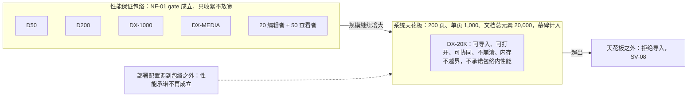
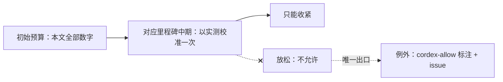
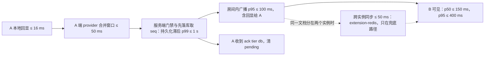

> 状态：草稿 | 负责：产品 | 更新：2026-09-21；2026-09-24（rulings §4.15：Q5 两层口径、DX-20K、按权重准入与 RM-S 口径；Q9 Node 26；S-3a 两级 ack；Q8 缩略图 M2/M3 口径；Q7 EMF chunk；Q2/Q4/Q7 客户端安全基线；Q10 Valkey、镜像供应链；T-0/Q6 去租户、文档级 RLS）；2026-09-24（rulings §4.16 Q20：a11y 分阶段口径与移动端范围标已裁决）；2026-09-24（复核修正，rulings §4.17）；2026-09-25（补图）；2026-09-25（矛盾收口，rulings §4.18）；2026-09-25（§4.19）；2026-09-26（§4.21：协同改用 Hocuspocus 4——§1.5 注明 provider 体积，§1.6、§1.7 注脚补跨实例传播机制与更新回显，NF-03「已 ack」定义随持久化与确认裁决写明；预算数值不变）；2026-09-26（§4.21 Remap：原 30/08 与 30/07 迁出节的引用改指新位置，30/08 已删除）；2026-10-04（design-language-v3 第 0 批：NF-01 第二个 §1.5 由「材质层（玻璃面板）」改为「材质与层次（v3 中性平面）」，同屏 `backdrop-filter` 门禁由 ≤ 4 改为 0、透明度退化行作废、正文对比改按前景 / 背景 token 配对（rulings §4.25 DS-2）；NF-03 降级期弱提示改在文件名旁的同步状态（DS-6）；NF-05 适用范围与 4.1.2 语义按 v3 区域改写（DS-1、DS-4、DS-6），焦点不被遮挡补浮动胶囊与工具条，对比度注明 v3 待复核项；NF-06 RTL 镜像对象改为左栏 / 检查器 / 工具条；需求、编号、优先级、里程碑不变）；2026-10-04（design-language-v3 第 0 批：术语残留清理：ribbon / 状态栏 / `ui.ribbon` 的历史陈述改用 check-terms 认可的标记措辞（废弃、取代、原名））；2026-10-04（design-language-v3 第 0 批：复验修正——原「状态胶囊」改称文件名旁的同步状态行（rulings §4.25 DS-6），带作废标记的历史陈述统一措辞；对比度待复核由 4 项增为 5 项（设计 04 §2.6 新增待复核 5：状态色只在 panel 上达到文字线，随第 2 批））；2026-10-05（design-language-v3 第 0 批修正：NF-05 补「字符键快捷键」一行（WCAG 2.1.4）——ED-16 新登记的工具单键 V / T / S / C 只在焦点位于画布或底部工具条时生效（rulings §4.25 DS-11）；需求、编号、优先级、里程碑不变）；2026-10-05（design-language-v3 第 0 批修正：NF-01 §1.5 正文对比度行与 NF-05 对比度行按 rulings §4.25 DS-9 改为缺口已调整 token 结案、配对以设计 04 §2.6 为准，删去「5 项缺口待复核——1–4 随第 1 批、5 随第 2 批」；阈值与门禁不变）；2026-10-07（design-language-v3 第 1 批：NF-07 移动端一行按 rulings §4.25 DS-28 写明手机的「评论」包含发表——M3 起仅查看形态（< 640）的评论面板可发表与回复、解决在更大窗口，手机评论样张随第 2 批；「屏幕」行与 NF-05「缩放 / 重排」行改指已定稿的窄屏形态（DS-17、DS-21，设计 03-02 §5a）；需求、编号、优先级、里程碑不变）；2026-10-08（design-language-v3 第 1 批收口：NF-05「画布内容可访问」行注明「阅读顺序」M2 只经命令面板进入（rulings §4.25 TB-42），「门禁」行注明 axe 与严格 CSP 门禁的对象含测试环境挂出的产品 `/styleguide` 组件全状态页（TB-3、TB-50）；NF-07 移动端一行补平板在仅查看形态仍为只读评审（TB-49）；阈值、门禁与需求编号不变）；2026-10-08（design-language-v3 第 1 批评审修改：NF-05「对比度」行按 rulings §4.25 DS-35 改写——识别控件与状态所需的图形（复选框与单选圈的外框、插入表格网格未选格的边界、焦点环、自己头像的外圈）仍 ≥ 3:1，数字与文本输入、下拉、分段控件与按下态靠底色、标签与当前值识别、边界不要求 ≥ 3:1，选中与按下另有字重与图标描边等非颜色线索；修订 DS-9 的「输入框加 1px 独立边界」，原「UI 组件 ≥ 3:1」一律要求改为本口径；文字对比度、阈值与门禁不变，需求编号不变）；2026-10-15（design-language-v3 第 2 批：NF-05「状态消息」行写明每条轻提示与页级提示条自身是 polite 的 `status` 区、不靠外层容器统一设 `aria-live`，模态对话框打开时反馈写在对话框底栏（rulings §4.25 DS-56）；NF-07 移动端一行补第 2 批拍板——手机底部评论面板可发表与回复、平板维持只读评审、平板面板落位随第 3 批（DS-46）；阈值、门禁与需求编号不变）；2026-10-15（design-language-v3 第 2 批回写补充：NF-05「画布内容可访问」一行的「阅读顺序」检查器入口由「随第 2 或第 3 批定」改为第 2 批未涉及、并入第 3 批复核（rulings §4.25 TB-42、TB-67，设计 README D15）；阈值、门禁与需求编号不变）；2026-10-22（design-language-v3 第 3 批：NF-05「目标尺寸」一行按单档紧凑尺寸改写（rulings §4.25 DS-76），「画布内容可访问」一行的阅读顺序入口定为偏好设置「无障碍」组、命令面板为第二入口、检查器不设（DS-116，原「并入第 3 批复核」结案）；NF-07 移动端一行补平板评论面板按方向落位与平板状态行（DS-131、TB-125）；NF-11「同意」一行补隐私与诊断两项按账户记（TB-118）；阈值、门禁与需求编号不变）；2026-10-22（design-language-v3 第 3 批回写补充：NF-07 移动端一行补平板上不可用入口的原因同写「在电脑上编辑」（rulings §4.25 TB-136）；阈值、门禁与需求编号不变）；2026-10-22（design-language-v3 第 3 批回写收口：NF-07 移动端一行补嵌入（iframe）里的平板同样写「在电脑上编辑」（rulings §4.25 TB-159）；阈值、门禁与需求编号不变；2026-10-22 复核修正：NF-07 移动端一行去掉已结案的「落位随第 3 批窄屏复核」、补「触控设备」只指平板（rulings §4.25 TB-163），依赖补第 3 批引用的 DS、TB 编号）；2026-10-23（design-language-v3 第 3 批评审修改：NF-05「对比度」一行补导入对话框的虚线落区靠正中的文字与按钮识别，静止时的虚线与分隔线同档、不要求 ≥ 3:1，拖入悬停为强调色虚线加淡底（rulings §4.25 DS-141，理由同 DS-35）；阈值、门禁与需求编号不变） | 依赖：charter v0.2；rulings §4.15、§4.16、§4.18、§4.19、§4.21（q-ws-gateway、H:q-hp-persist-ack、H:q-hp-fanout、H:q-hp-provider、H:q-hp-step2-cap）、§4.25（DS-1、DS-2、DS-4、DS-6、DS-11、DS-17、DS-21、DS-28、DS-35、DS-46、DS-56、DS-76、DS-116、DS-131、DS-141、TB-3、TB-42、TB-49、TB-50、TB-67、TB-118、TB-125、TB-136、TB-159、TB-163）；[ADR-0039](../30-architecture/adr/0039-collab-server-hocuspocus.md)

# 04 非功能需求

> 需求编号前缀 `NF-`。本文件给出全部**具体数字**。所有数字均为**初始预算**：在对应里程碑中期以实测校准一次，校准只能收紧不能放松（ratchet；例外需 `cordex-allow` 标注 + issue）。度量方法由架构 11 实现，本文只定义口径。

---

## 0. 参考环境与参考文稿

### 0.1 参考机

| 代号 | 规格 | 用途 |
|---|---|---|
| RM-A（基线） | 2021 款 MacBook Air M1 / 8 GB，或同级 Windows 笔记本（4 核 x86，8 GB），Chrome 稳定版，1920 × 1080 @1x | 全部客户端预算的 p75 口径 |
| RM-B（低端） | 2018 款 4 核 / 4 GB Windows 笔记本，Chrome 稳定版 | 「可用」下限：预算 × 2 仍须满足 |
| RM-S（服务端） | collab 单实例：2 vCPU / 4 GB 容器，Node 26（项目基线，rulings §4.15 Q9） | 服务端单实例预算；docker-compose 全家桶（含 renderer、可选 Casdoor）的主机规格另立，见 ADR-0037 |
| 网络 | 客户端预算默认**文件字节已在内存**（排除下载）；协同预算按同区域 RTT ≤ 50 ms | |

CI 中的实现（rulings §4.19 D-TEST-INFRA）：M1 以 GitHub larger runner（4 核）承担 RM-A 口径的性能门禁；协同与服务端压测所需的自托管专用 runner 在 M2 开工前落地（随协同后端提前）；RM-B 以 CDP CPU 4× 节流近似。视觉 oracle 基线由一台 Windows + PowerPoint 365 维护机生成（不进 CI，脚本生成基线后提 PR 并评审签字），macOS 基线自 M2 起加入。测量与判定细则见 `70-testing/09`、`04`。

### 0.2 参考文稿（语料库 T3 的固定成员）

| 代号 | 规格 |
|---|---|
| D50 | 50 页、20 MB、平均 25 元素/页、30 张图片（合计 12 MB）、5 个图表、3 个表格、2 个 SmartArt、1 段视频（海报） |
| D200 | 200 页、120 MB、平均 30 元素/页、150 张图片、20 个图表、10 个表格、10 个 SmartArt、3 段视频 |
| DX-1000 | 1 页、1,000 个形状（含文本） |
| DX-DEEP | 20 页、每页 300 元素、组合嵌套 8 层 |
| DX-MEDIA | 30 页、200 MB 媒体（Q5 上限） |
| DX-20K | 200 页 × 100 元素 = 20,000 元素（Q5 系统天花板，rulings §4.15）；只用于天花板验证——断言可导入、可打开、可协同、不崩溃、内存不越界，**不承诺**包络内的性能预算 |

> 两层口径（rulings §4.15 Q5）：D50/D200/DX-1000/DX-MEDIA 与「20 编辑者 + 50 查看者」构成**性能保证包络**，NF-01 各表的 gate 只在包络内成立，只收紧不放宽；DX-20K 代表**系统天花板**（200 页 / 单页 1,000 / 文档总元素 20,000，墓碑计入），超出即拒绝导入（SV-08）。部署配置可调整这些数字，调到包络之外时性能承诺不再成立。

**图 0-1 参考文稿与两层口径**

怎么读：「性能保证包络」组是门禁所依据的参考文稿与并发规模，「系统天花板」组是只做可用性验证的天花板文稿，再往外即拒绝导入；虚线表示部署配置可以移动这些边界，但移出包络后门禁不再代表性能承诺。§0.2 的两层口径未提及 DX-DEEP，故未画入。
依据：本节 §0.2；rulings §4.15 Q5；SV-08。

**图 0-2 预算数字的校准规则**

怎么读：实线为校准的正常路径，带叉虚线表示放松被禁止，例外必须显式标注并关联 issue（ratchet）；度量方法由架构 11 实现。
依据：本文开头说明；`05-milestones-and-scope.md` §6 性能预算校准。

---

## NF-01 性能预算

> 本节只定 gate 数值；测量方法、场景、样本数与判定规则见测试设计线 `70-testing/09`（2026-09-25 起为唯一事实源），客户端预算的分解与 chunk 地图见 `50-frontend/13`，服务端预算总览见 `60-backend/01` §12。

### 1.1 打开与首屏（客户端，RM-A，p75）

| 指标 | D50 | D200 | 说明 |
|---|---|---|---|
| 首页可见（`render/first-paint`） | ≤ 1.5 s | ≤ 3.0 s | 从 `open()` 调用起 |
| 首页可交互（可选中/编辑） | ≤ 2.0 s | ≤ 3.5 s | 首批装载后即触发 `unit/opened`，其余页后台追加（OF-03，rulings §4.18 CO-12） |
| 视口内缩略图就绪 | ≤ 2.5 s | ≤ 4.0 s | |
| 全部缩略图就绪 | ≤ 4.0 s | ≤ 15 s | 后台，可被导航抢占 |
| 后台全部解析完成 | ≤ 6 s | ≤ 20 s | 全部到齐触发 `unit/loaded`；此前全文类命令等待或禁用（OF-03） |
| 跳转到未解析页可见 | ≤ 300 ms | ≤ 300 ms | |
| 跳转到已解析页可见 | ≤ 100 ms | ≤ 100 ms | gate；target ≤ 50 ms（架构 07，模板已缓存） |
| 主线程最长阻塞任务 | ≤ 50 ms | ≤ 50 ms | 解析在 Worker 或分片 |
| 打开 DX-1000 首页可见 | ≤ 2.5 s | — | |
| 打开 DX-MEDIA 首页可见 | ≤ 3.0 s | — | 懒媒体 |

### 1.2 交互与渲染（客户端）

> 双口径：**gate** = PRD 门禁值（CI 超出即失败）；**target** = 架构 07 的内部目标值（观测、不门禁）。未标注者 gate = target。

| 指标 | 预算 | 条件 |
|---|---|---|
| 拖动 / 缩放 / 平移平均帧率 | ≥ 55 fps；p95 帧时间 ≤ 33 ms | ≤ 300 元素页 |
| 同上（DX-1000） | ≥ 30 fps | |
| 键入延迟（keydown → paint） | gate p95 ≤ 50 ms（PRD）/ target p50 ≤ 16 ms、p95 ≤ 33 ms（架构 07） | 拉丁；自绘文本只重排被编辑的 txBody |
| IME 组合更新 | p95 ≤ 80 ms | CJK |
| 命令执行（不含渲染） | p95 ≤ 10 ms | 常见单元素命令 |
| 批量命令（对齐 100 元素） | ≤ 100 ms | |
| 撤销 / 重做 | p95 ≤ 50 ms | |
| 命中测试 | p95 ≤ 2 ms | 300 元素页 |
| 吸附与参考线计算 | p95 ≤ 4 ms | 300 元素页 |
| 局部变更重绘范围 | 仅受影响元素 + 覆盖层 | 断言脏区被消费（规避 Univer A28） |
| 缩略图更新（编辑后） | ≤ 500 ms | 脏页驱动 |
| 缩略图栏滚动（200 页） | ≥ 55 fps | 虚拟化 |
| 文本搜索（D200 全文） | ≤ 200 ms | 模型索引 |
| 全部替换（D200） | ≤ 500 ms | 一个事务 |
| 主题切换 | ≤ 100 ms | 无闪烁 |

### 1.3 内存（客户端，Chrome JS heap + 可回收资源）

| 指标 | D50 | D200 |
|---|---|---|
| 打开后稳态（编辑器） | ≤ 250 MB | ≤ 700 MB |
| 打开峰值 | ≤ 350 MB | ≤ 1.0 GB |
| 查看器稳态 | ≤ 150 MB | ≤ 450 MB |
| 20 次打开/关闭循环 heap 增长 | ≤ 5% | ≤ 5% |
| DX-20K 打开后稳态 / 协同 Y.Doc 堆 | M1 以 T3 实测回填（与架构 07 客户端堆预算的关系由架构 07 说明）；不越界即通过 | — |
| 关闭后 `fiber.getEffects()` | 空 | 空 |
| blob URL 泄漏 | 0 | 0 |

### 1.4 导出（客户端）

| 指标 | D50 | D200 |
|---|---|---|
| 导出 pptx（Worker 编码） | ≤ 3 s | ≤ 12 s |
| 导出单页 PNG @1920（主线程 `toImage`，按页分片） | ≤ 300 ms | ≤ 300 ms |
| 导出全部 PNG @1280（M2 客户端，只作报告） | ≤ 15 s | ≤ 60 s |
| 导出期间 UI 可编辑 | 是 | 是 |

口径（2026-09-25 按前端设计线 `50-frontend/05` §10.3 与 `13` §3 回写，50-frontend/13 §1、§12）：PNG 需要 DOM 布局与 SVG 序列化，只能在主线程按页分片完成（每片 ≤ 50 ms 让出主线程），不进 Worker；M2 位图 spike（把用到的字体子集内联进序列化 SVG）结论前，单页 PNG 预算只对「单页、无 Web 字体依赖」场景门禁；「导出全部 PNG」自 M3 起由服务端 `server-png` 承担（SV-02），客户端批量导出不再门禁。

### 1.5 体积（gzip，初始加载，不含字体与 peer 依赖）

| 组合 | 预算 |
|---|---|
| 查看器 preset | ≤ 350 KB |
| 编辑器 preset（含 ui-react + slide-ui，不含 React 本体） | ≤ 900 KB |
| 协同增量 | ≤ 200 KB（§4.21 起含官方 `@hocuspocus/provider` 4.7.0，连同 `@hocuspocus/common` 与 `@lifeomic/attempt` 约 10 KB gzip；`yjs`、`y-protocols`、`lib0` 为既有依赖，不重复计） |
| 图表渲染器（惰性） | ≤ 400 KB |
| 语言包（每个，惰性） | ≤ 30 KB |
| EMF/WMF 栅格化 chunk（惰性 Worker，M2，OF 矩阵 §2.5） | 不计入查看器 350 KB 基线；预算由 M2 spike 定后回填，此后只收紧 |
| 放映模式 / 母版视图 / 版本历史 UI（各，惰性） | ≤ 60 KB |
| CI 门禁 | 超预算 5% 失败 |

### 1.6 协同（同区域 RTT ≤ 50 ms）

| 指标 | 预算 |
|---|---|
| 本地回显 | ≤ 16 ms |
| A 提交 → B 可见 | p50 ≤ 150 ms，p95 ≤ 400 ms |
| presence 传播 | p95 ≤ 200 ms |
| 初始同步（加入房间到 `collab/synced`） | D50 ≤ 2 s，D200 ≤ 5 s（p75） |
| 重连重同步（≤ 5,000 待同步 update） | ≤ 3 s |
| 权限变更生效 | ≤ 2 s |
| 20 远端选区覆盖层 | ≥ 55 fps |
| 单 update 大小 | ≤ 1 MB（超限拆分/走资源通道）；重连 step2 单设 ≤ 16 MiB（§4.21，超限导出后重载） |

协同后端自 M2 起交付（rulings §4.19 D-M2-CONTENT）：本地回显、初始同步、单 update 大小三行自 M2 起门禁（单人经网关）；其余多人口径（A→B、presence、重连重同步、权限变更、远端选区）为 M3。

注脚（rulings §4.21，协同服务端改用 Hocuspocus 4，ADR-0039；数值不变，只写明机制与计量口径）：

- **更新回显**：服务端把每个 update 广播给房间内全部连接，**包括发送者本人**（Hocuspocus 不按来源过滤，合并批次中混有他人更新时也无法可靠过滤，已接受）；回显在本端幂等应用、不产生变更，但发送者的下行字节约等于其上行字节，大帧时下行翻倍。客户端下行带宽与移动端流量按「他人更新 + 本端回显」计量，A → B 时延不受影响。
- **合并窗口**：客户端 provider 以 50 ms 固定窗口合并 update 与 awareness，已含在「A 提交 → B 可见」与「presence 传播」预算内（窗口是固定批次，持续键入也不会被推迟超过 50 ms）。
- **重连重同步**：离线差量由 provider 以一个 step2 送达（≤ 16 MiB），不再先切块；「≤ 5,000 待同步 update ≤ 3 s」的计时口径不变。

**图 1-1 一次编辑从 A 到 B 经过的预算段（§4.21）**

怎么读：实线是常态路径（按文档哈希亲和，同一文档只在一个实例）；虚线是跨实例兜底。PG 可用时广播发生在落库之后，所以 A → B 的时延包含一次 PG 提交；PG 故障降级期改为通过门禁即广播（NF-03），不受这一段约束。各段数值即上表与 §1.7 表，未新增预算。
依据：本节 §1.6、§1.7；rulings §4.15 S-3a、§4.21 H:q-hp-persist-ack、H:q-hp-fanout；ADR-0039。

### 1.7 服务端（RM-S，单实例）

| 指标 | 预算 |
|---|---|
| 导入 D50 / D200 | p95 ≤ 5 s / ≤ 20 s |
| 导出 pptx D50 / D200 | p95 ≤ 3 s / ≤ 12 s |
| 导出 PDF D50（M3 后半段） | p95 ≤ 10 s |
| 缩略图 D200 全量（M3） | ≤ 90 s |
| 首页缩略图（导入后，M3 服务端 headless） | ≤ 10 s |
| 过渡封面（M2，包内 `thumbnail.jpeg`，SV-04） | 导入完成即可用（无则占位） |
| 快照压缩（10,000 update） | ≤ 2 s |
| 并发 WS | ≥ 2,000，CPU < 70% |
| 活跃房间（按文档规模分档，rulings §4.15 Q5） | 按文档实测权重准入（实测基线 D50 ≈ 17.8 MB、D200 ≈ 85 MB/房间，乘以副本数）；各档房间数在 M1 实测后回填，只收紧 |
| 广播延迟（房间内） | p95 ≤ 100 ms（注脚：§4.21 起满员房间的 awareness 合并只包装出站发送、只合并 awareness 帧，不拖慢文档更新） |
| 跨实例传播 | ≤ 50 ms（注脚：§4.21 起经 `@hocuspocus/extension-redis`，每次变更一轮状态向量往返，Valkey 8.1 实测 2.6–7.1 ms；反代按 documentId 一致性哈希偏好亲和，常态同一文档只由一个实例持有，跨实例传播只在扩缩容迁移与兜底路径出现） |
| 持久化滞后（update 接收 → `ack{tier:'db'}`） | p99 ≤ 1 s（注脚：§4.21 起在 `beforeSync` 钩子内先落库取 `seq`、再放行应用与广播，PG 提交时延因此同时限制单连接帧率与「A 提交 → B 可见」，二者按同一基准验证） |
| 优雅停机 | ≤ 30 s |
| 模板填充 + 导出 100 × D50（4 worker） | ≤ 60 s |
| Postgres 故障溢写两级阈值与恢复后回放（rulings §4.13 S-3） | 见 60/01 §12（超阈值依次溢写 Valkey→对象存储，不拒绝新编辑；溢写期回 `ack{tier:'spill'}`、落库后回 `ack{seq, tier:'db'}`（S-3a）；恢复后回放 `document_updates`，正式 `seq` 由 Postgres 分配，耗时预算同处） |

里程碑（rulings §4.19 D-M2-CONTENT）：导入、快照压缩、持久化滞后、过渡封面与 Postgres 故障溢写（单实例）自 M2 起门禁（`all` 角色）；导出、缩略图、PDF、并发 WS、活跃房间、广播与跨实例传播、优雅停机、模板填充与多实例溢写认领为 M3。

---

### 1.5 材质与层次（v3 中性平面；原「材质层（玻璃面板）」，2026-10-04 按 rulings §4.25 DS-2 改写）

v3 去掉毛玻璃、渐变背景与光晕：面板实色贴边、1px 分隔，只有浮层（底部工具条、网格视图浮动胶囊、菜单与弹层）带阴影（设计 04 §2、09 §6）。2026-09-17 起按设计 09 v3.0 §6 设的玻璃材质门禁随之改写：

| 指标 | 门禁 | 说明 |
|---|---|---|
| 同屏 `backdrop-filter` 元素数 | 0 | 原「≤ 4（壳 3 块 + 1 个浮层）」作废；编辑器与开始页路由扫描断言（样张 `src/v3` 扫描 0 处，见变更 `design-language-v3` docs-sync） |
| 拖拽分栏 / 画布缩放动画期间帧时间 | ≤ 16.7 ms（p95） | v3 面板本为实色，原「交互期间面板临时切换为不透明（`data-interacting`）」不再需要 |
| `prefers-reduced-transparency: reduce` / 不支持 `backdrop-filter` | — | 作废：v3 没有半透明材质，无需退化 |
| 面板与画布上的正文对比度 | ≥ 4.5:1 | `design/__tests__` 对前景 / 背景 token 配对机械校验（配对清单与核算以设计 04 §2.6 为准；v3 样张的对比度缺口已按 rulings §4.25 DS-9 调整 token 结案，设计 README D12；门禁不放宽） |
| 高对比主题（`forced-colors`） | **M3：门禁上线**，对比度与关键控件轮廓需通过 NF-05 WCAG 2.2 AA 专项用例 | M1–M2 仅 `@media (forced-colors: active)` 系统色兜底，不计入门禁（rulings §4.12 U-08） |

## NF-02 保真指标

（口径全文见 `03-features/01-open-and-fidelity.md` §4；此处为汇总门禁。）

| 指标 | M1 门禁 | M2 | M3 |
|---|---|---|---|
| 零编辑往返部件级 diff（T1+T2） | 100% 零差异 | 100% | 100% |
| 编辑后未触碰部件字节相同 | — | 100% | 100% |
| 重生成部件 XSD 有效 | 100%（T1 保留专项） | 100% | 100% |
| PowerPoint 365 打开无修复 | 100% | 100% | 100% |
| SSIM 全语料中位数 / P10 | ≥ 0.90 / ≥ 0.80 | ≥ 0.91 / ≥ 0.82 | ≥ 0.92 / ≥ 0.84 |
| 文本行数一致率 | ≥ 95% | ≥ 96% | ≥ 97% |
| 图表数据墨迹 IoU | ≥ 0.85 | ≥ 0.87 | ≥ 0.88 |
| 降级元素占比（T2 全部元素） | ≤ 3% | ≤ 2% | ≤ 1.5% |
| 打开失败率（T2） | 0 | 0 | 0 |
| 语料规模 | T1 ≥ 80、T2 ≥ 200、T3 ≥ 10 | T2 ≥ 300 | T2 ≥ 400 |

- 保真回归：任一矩阵行的 SSIM 中位数相对上一里程碑下降 > 0.01 即 CI 失败。
- 语料库中的真实文件须脱敏且获得使用许可；语料清单（指纹、生产者、特性标签）入库，二进制不入 git。

---

## NF-03 可用性、可靠性与数据安全

| 指标 | 目标 | 里程碑 |
|---|---|---|
| 客户端崩溃自由会话率（无 `fatal`） | ≥ 99.5% | M2 |
| 插件失败不影响其它功能 | 100%（CTK） | M2 |
| 已 ack 的协同 update 丢失 | 0（RPO ≤ 1 s；「已 ack」指服务端落库取 `seq` 之后经 Stateless 下发的 `ack{seq, tier:'db'}`，`tier:'spill'` 时客户端保留 pending，rulings §4.15 S-3a；§4.21 H:q-hp-persist-ack 保留逐帧落库 + 两级 ack：Hocuspocus 原生的 `SyncStatus` 与 provider 的 `unsyncedChanges` / `synced` 只表示「已应用到服务端内存」，**不算** ack；丢过写入帧的连接之后不再落库也不回 ack（连接污染规则），因此不存在「已 ack 但不可见」的更新） | M2（单实例，随协同后端提前，rulings §4.19 D-M2-CONTENT）/ M3（多实例） |
| 协同服务月可用性 | ≥ 99.9% | M3 |
| 灾难恢复 | RPO ≤ 1 min（含 DB）、RTO ≤ 15 min | M3 |
| 客户端崩溃后重开 | 最近已同步状态可用；单人模式最多丢失一次自动保存间隔（30 s）的编辑 | M2/M3 |
| 导出失败可重试且不损坏源 | 100% | M2 |
| 并发上限行为 | 超限只读/拒绝并提示，不崩溃 | M3 |
| Postgres 持续故障期间编辑连续性（rulings §4.13 S-3；单实例自 M2 起，rulings §4.19 D-M2-CONTENT） | 不拒绝新编辑：两级阈值溢写 Valkey→对象存储，两级 ack（S-3a），恢复后回放并断言无 `pendingStructs`；降级期 update 通过门禁即照常广播、协作者互见，发起方横幅「未保存到服务器 N 项」、其余协作者在文件名旁的同步状态见「服务器保存延迟」（rulings §4.19 INC-09；原「状态胶囊」随 rulings §4.25 DS-6 作废），「已 ack(db) 零丢失」不受影响（rulings §4.18 CO-08，SV-05）；集成测试：PG 断开时两客户端互见编辑、恢复后 seq 连续不丢；阈值与回放耗时预算见 60/01 §12 | M2（单实例）/ M3（多实例认领回放） |

---

## NF-04 安全

| 领域 | 要求 | 里程碑 |
|---|---|---|
| 输入 | 所有文件/消息/参数经 schema 或限制校验（OF-24、CO-12）；XML 无实体扩展；zip 限制 | M1 |
| 内容 | 文档内 SVG 只以图像上下文渲染、禁止 `innerHTML`/`insertAdjacentHTML`/`DOMParser` 注入文档内容（扫描器强制）；超链接协议白名单；外部关系全部保留、仅 http(s) 可激活，外链资源按部署配置 `externalResources`（默认 auto）加载，服务端永不加载；粘贴清洗 | M1/M2 |
| 权限 | fail-closed；客户端 + 服务端双检查点；越权尝试进入审计 | M2（客户端与服务端 REST / 网关检查点，随协同后端提前，rulings §4.19 D-M2-CONTENT）/ M3（分享与权限细化） |
| 传输 | TLS；WS Origin 校验；令牌短期、不落地（WS 握手 Ticket 60 s 单次；集成方签名 JWT ≤ 1 h，M4；ADR-0029） | M2（随协同网关，rulings §4.19 D-M2-CONTENT） |
| 存储 | 静态加密由存储 Provider 提供；密钥不入库；文档级 Postgres RLS 越权测试 100% 通过（单组织，无租户隔离概念，rulings §4.15 T-0/Q6） | M3 |
| 供应链 | 许可证白名单（D13）；漏洞门禁（高危阻断）；npm OIDC trusted publishing + provenance；SBOM；内部依赖 `workspace:` 协议校验 | M1 起 |
| 镜像 | 镜像按主组件许可白名单（D13 对镜像的解释，rulings §4.15 Q10）；镜像 digest 钉死；镜像 SBOM；renderer sidecar 沙箱与零出站自动化测试（SV-09） | M3 |
| 依赖单点 | `cordis`/`yjs`/`react`/`@nestjs` 单点引入（章程 §5.3） | M0 |
| CSP | 严格 CSP 下可运行（EM-14 客户端安全基线）；CSP nonce M2；Trusted Types M2 report-only → M3 强制 | M2/M3 |
| 隐私 | 遥测无内容、无明文身份；默认 no-op | M2 |
| 评估 | OWASP ASVS L2 自评 + 第三方渗透测试作为 M3 出口条件 | M3 |
| 沙箱 | 明确不做插件运行时沙箱（章程 §2.3）；文档写明信任模型 | M4 |

---

## NF-05 可访问性（WCAG 2.2 AA）

适用范围：编辑器 UI（左栏、底部创建工具条、检查器、网格视图的浮动胶囊与幻灯片网格、主菜单与右键等菜单、对话框、横幅；2026-10-04 起按 v3 结构，原 ribbon 与状态栏随 rulings §4.25 DS-1、DS-6 废弃）为 P0；画布内容的可访问性（以文档树/朗读顺序暴露内容）为 P1；放映模式为 P1。分阶段口径（章程 Q20 已裁决，按默认，rulings §4.16）：M2 必达「键盘可达 + 基本朗读」，WCAG 2.2 AA 其余条款按下表里程碑列分阶段达成。

| 要求 | WCAG 2.2 条款 | 具体口径 | 里程碑 |
|---|---|---|---|
| 全键盘操作 | 2.1.1 | 所有功能可无鼠标完成（ED-29）；F6 循环区域；无键盘陷阱（2.1.2） | M2 |
| 字符键快捷键 | 2.1.4 | 单键快捷键（ED-16 的工具单键 V / T / S / C，2026-10-05 按 rulings §4.25 DS-11 补登）只在焦点位于画布或底部工具条时生效；文本编辑态、IME 组合态与任何输入框、备注、评论撰写框内不触发，按键交给文字输入 | M2 |
| 拖拽替代 | 2.5.7 | 每个拖拽有键盘/表单等价 | M2 |
| 目标尺寸 | 2.5.8 | 可点击目标 ≥ 24 × 24 CSS px（v3 只有单档紧凑尺寸，2026-10-16 按 rulings §4.25 DS-76 取代原「紧凑密度亦然」）；触控 ≥ 44 px | M2 |
| 焦点可见 / 不被遮挡 | 2.4.7 / 2.4.11 | 焦点环 token 化，对比 ≥ 3:1；浮层不遮挡焦点元素（含底部工具条与网格视图的浮动胶囊：网格的上下内边距与 scroll-padding 让焦点页落在胶囊下方、工具条上方，设计 07 §2.2） | M2 |
| 对比度 | 1.4.3 / 1.4.11 | 文本 ≥ 4.5:1；识别控件与状态所需的图形 ≥ 3:1（复选框与单选圈的外框、插入表格网格未选格的边界、焦点环、自己头像的外圈等）；数字与文本输入、下拉、分段控件与按下态有可见标签或读屏名与当前值，靠底色、标签与当前值识别，边界不要求 ≥ 3:1，选中与按下另有字重与图标描边这类非颜色线索（1.4.1；2026-10-08，rulings §4.25 DS-35 修订 DS-9 的「输入框加 1px 独立边界」，原「UI 组件 ≥ 3:1」一律要求改为本口径）；导入对话框的虚线落区靠正中的文字与按钮识别，静止时的虚线与分隔线同档、不要求 ≥ 3:1，拖入悬停改为强调色虚线加淡底，落区里的文字照常 ≥ 4.5:1（2026-10-23，rulings §4.25 DS-141，理由同 DS-35）；两套主题均达标（token 校验脚本，配对以设计 04 §2.6 为准；v3 样张的对比度缺口已按 rulings §4.25 DS-9 结案，设计 README D12；门禁不放宽） | M2 |
| 名称 / 角色 / 值 | 4.1.2 | 底部创建工具条用 `toolbar`，检查器页签用 `tablist`，主菜单 / 文档菜单 / 右键用 `menu`，视图切换为带名称的 `group` + `aria-pressed`，网格视图两胶囊为带名称的 `group`（原「ribbon 用 `toolbar`/`menubar`/`tablist`」随 ribbon 废弃，设计 07 §3）；所有图标按钮有名称 | M2 |
| 状态消息 | 4.1.3 | 保存/同步/协作者加入/软冲突用 `aria-live`（polite）；每条轻提示与画布页级提示条自身是一个 polite 的 `status` 区，内容在出现后才放进无障碍树、保证读屏播报一次，不靠外层容器统一设 `aria-live`（2026-10-15 第 2 批定，设计 07 §3、前端 50/16）；个人插件面板这类模态对话框打开时（遮罩盖住画布轻提示），反馈写在对话框底栏并由底栏播报（rulings §4.25 DS-56） | M2/M3 |
| 画布内容可访问 | 1.1.1 / 1.3.1 / 1.3.2 | 每页暴露为有序元素列表：元素类型 + 名称（替代文本/文本内容）+ 位置描述；阅读顺序按 z 序或占位符顺序（可切换）；图片 alt 缺失时提示作者；「阅读顺序」是个人偏好，常驻入口为偏好设置「无障碍 › 阅读顺序」（按叠放次序：从底层到顶层 / 按占位符次序：标题 → 副标题 → 正文 → 其余），命令面板「阅读顺序…」是第二入口、选它打开偏好设置并把焦点放在这一控件上，检查器不设入口（2026-10-22，rulings §4.25 DS-116；原「M2 只经命令面板进入、检查器入口并入第 3 批复核」结案，TB-42、TB-67，设计 README D15） | M2（P1） |
| 一致帮助 / 冗余输入 / 可访问认证 | 3.2.6 / 3.3.7 / 3.3.8 | 适用于 `apps/web` | M3 |
| 动效 | 2.3.3 | 尊重 `prefers-reduced-motion`；无 3 次/秒以上闪烁 | M2 |
| 缩放 / 重排 | 1.4.4 / 1.4.10 | UI 200% 缩放不丢功能；窄屏抽屉化（紧凑窗口收为胶囊与抽屉、< 640 为仅查看形态，设计 03-02 §5a） | M2 |
| 高对比模式 | — | `forced-colors` 下可用（P1） | M2 |
| IME | — | 组合态可见、候选不被遮挡、Esc 取消组合不退出编辑 | M2 |
| 屏幕阅读器矩阵 | — | NVDA + Chrome、VoiceOver + Safari、JAWS + Edge（P1） | M2/M3 |
| 门禁 | — | axe-core 零严重/重大违规；每个页面/面板有键盘 e2e；门禁对象含产品的 `/styleguide` 组件全状态页（只在测试环境挂出，与生产包、生产 CSP 相同，rulings §4.25 TB-3、TB-50） | M2 |
| 声明 | — | 发布 VPAT/ACR（P2） | M4 |

---

## NF-06 国际化与本地化

| 要求 | 口径 | 里程碑 |
|---|---|---|
| 源语言 | zh-CN（编译期 key 类型反推，继承 Univer K8） | M1 |
| 首批语言 | zh-CN、en-US（PD-11） | M2 |
| 语言包按需加载 | 每个 ≤ 30 KB，切换 ≤ 200 ms | M2 |
| 缺 key | 编译失败；运行时回退 zh-CN 并上报 | M1 |
| 复数 / 性别 / 插值 | ICU MessageFormat 子集 | M2 |
| 日期 / 数字 | `Intl` | M2 |
| 伪本地化测试 | 长文本（×1.5）与 RTL 伪语言不破版 | M2 |
| UI RTL 镜像 | 布局镜像（左栏与检查器左右互换、工具条与面板、方向图标；原「ribbon」随 rulings §4.25 DS-1 废弃） | M4（P2） |
| 内容 bidi | 依赖浏览器原生；`rtl` 段落方向可编辑 | M4（P2） |
| 字体回退 | CJK/阿拉伯/天城文回退链可配；SDK 不内置 CJK 字体（PD-12） | M1 |
| 插件文案 | 插件命名空间 key；随宿主切换 | M4 |
| 文案规范 | 见设计 07 | — |

---

## NF-07 浏览器与运行时矩阵

| 环境 | 支持级别 | 版本 | 里程碑 |
|---|---|---|---|
| Chrome / Edge（桌面） | 完整（编辑 + 协同） | 最近 2 个稳定版 | M1 |
| Firefox（桌面） | 完整 | 最近 2 个稳定版 + 当前 ESR | M2 |
| Safari（macOS） | 完整 | 17+（PD-09） | M2 |
| Chrome（Android）/ Safari（iOS/iPadOS） | 桌面优先；平板只读评审、手机查看 + 评论（M3，P1）；编辑 M4+（P2）（章程 Q20 已裁决，按默认，rulings §4.16）。手机的「评论」包含发表：M3 起仅查看形态（< 640）的评论面板可发表与回复，解决仍在更大窗口中进行；手机评论的样张随 design-language-v3 第 2 批（协作族）出并拍板（2026-10-07，rulings §4.25 DS-28）；平板（触控、宽 ≥ 640）同为仅查看形态，评论仍只读、不能发表，手机评论样张拍板时一并确认（2026-10-08，TB-49）。2026-10-15 第 2 批拍板（DS-46）：手机底部评论面板可发表与回复（↵ 换行、只用「发送」提交），解决在更大窗口中进行；平板维持只读评审（CO-04）。2026-10-22 第 3 批定稿平板评论面板的落位（DS-131）：竖屏在当前页与备注卡下方、横屏为右侧整高侧栏；平板的仅查看形态状态行写「仅查看 · 在电脑上编辑」（TB-125），平板上不可用入口的原因同写「在电脑上编辑」（含外接键盘按快捷键时的提示，TB-136；嵌入（iframe）里同样以触控为准，TB-159）；「触控设备」只指平板（触控、宽 ≥ 640），宽度 < 640 的手机不论是否触控都按窗口窄写「在更大窗口中编辑」（TB-163） | 最近 2 个 | M3 |
| IE / 旧 Edge（EdgeHTML） | 不支持 | — | — |
| 必需 Web 能力 | ES2022、`WebSocket`、Web Workers、`IndexedDB`（离线持久化 P2）、`ResizeObserver`、`IntersectionObserver`、`Intl.Segmenter`（缺失时退化）、`FontFace` API、Fullscreen API（缺失时降级） | | |
| 可选能力 | `OffscreenCanvas`、Clipboard API（缺失时文档内剪贴板）、`navigator.locks` | | |
| Node（服务端 / headless / 工具链） | 26 基线（开发、CI、镜像统一；`engines >=26`，rulings §4.15 Q9） | | M1 |
| React | `^19.0`（peer；React 18 宿主走嵌入形态 B/E，EM §1） | | M2 |
| 屏幕 | ≥ 1024 px 宽完整 UI；640–1024 紧凑；< 640 仅查看（两种窄屏形态 2026-10-07 按第 1 批样张定稿，rulings §4.25 DS-17、DS-21，设计 03-02 §5a） | | M2 |
| 输入 | 鼠标、触控板、键盘（M2）；触控（查看 M3，编辑 M4+）；触控笔（P2） | | |

---

## NF-08 互操作性

| 目标 | 口径 | 里程碑 |
|---|---|---|
| PowerPoint 365（Win/Mac，当前通道） | 导出文件打开无修复 100%；编辑往返语料 SSIM ≥ 0.95（相对导出前渲染） | M1（Windows）/ M2（加入 macOS，rulings §4.19 D-TEST-INFRA） |
| PowerPoint 2016/2019 | 打开无修复（best-effort，抽样 20%） | M2 |
| LibreOffice Impress 24.x | 打开不崩溃；差异记录 | M1 |
| Google Slides / Keynote / WPS 导出的 pptx | 作为输入：打开成功率 100%（T2 含 ≥ 5 生产者） | M1 |
| 我们导出 → PowerPoint 保存 → 我们再打开 | 不崩溃；SSIM ≥ 首次的 0.98 倍 | M2 |

---

## NF-09 可维护性与质量门禁（产品层约束，机制见类型治理 09）

| 要求 | 口径 |
|---|---|
| 需求可追溯 | 每条 P0 需求 id 出现在 ≥ 1 个测试的元数据中；CI 生成「需求 ↔ 测试」矩阵并对缺失的 P0 失败（与「规范 ↔ 执行」矩阵同机制） |
| 新代码测试 | patch 覆盖率 ≥ 80%（规避 Univer A19） |
| 语料回归 | 每 PR 跑 T1 子集（≤ 10 min）；每日跑全量 T1+T2 |
| 性能回归 | 每 PR 跑 D50 关键指标（首屏、键入延迟、导出）；超 NF-01 绝对预算即失败（原「超预算 5% 失败」按更严口径执行，5% 容差只保留在体积预算），相对 main 基线的回归只作 PR 注释；main 与 nightly 相对滚动中位数回归 > 10% 失败并自动建 issue；内存 20 次开关增长 ≤ 5%（设计线遗留口径 T-PERF-GATE；测量与判定见 `70-testing/09` §10） |
| 体积回归 | EM-07 |
| 文档覆盖 | 公开 API / 贡献点 / 错误码 100% 有文档 |
| 无 `any` / 无裸 throw / 无 register* / 无模块级可变状态 | 类型治理扫描器（ADR-0040） |

---

## NF-10 容量与可扩展性（服务端）

| 维度 | M3 目标 | 扩展方式 |
|---|---|---|
| 并发编辑者（全系统） | 5,000 | 网关水平扩展（无状态 + Valkey） |
| 活跃文档 | 2,000 | 同上 |
| 文档总量 | 100 万 | Postgres 分区 + 对象存储 |
| 单文档 update 日志 | 压缩后 ≤ 10 × 快照大小 | 定期压缩 |
| 导入/导出吞吐 | 每实例 4 并发作业 | 作业 worker 水平扩展 |
| 大文档隔离 | 按文档实测权重准入、单文档规模天花板、作业与 API 按用户限流（单组织，无租户） | SV-05、SV-08 |

---

## NF-11 隐私与合规

| 要求 | 口径 |
|---|---|
| 数据最小化 | 遥测与审计不含文档内容；用户标识为不透明 id（OIDC 主体经哈希，或集成方传入） |
| 数据驻留 | 由部署决定；SDK 无隐式跨区调用；文档写明数据流 |
| 擦除 | SV-11 API；评论正文策略可配 |
| 同意 | 遥测默认关闭（PD-10）；集成方负责用户告知；参考应用偏好设置「隐私与诊断」组的两项（发送错误报告、M3 起部署开了遥测出口时的发送使用统计）按账户记，换人时回到部署默认值——同意须由本人作出，是「偏好按设备记」的例外（2026-10-21，rulings §4.25 TB-118） |
| 加密 | 传输 TLS；静态由存储 Provider；密钥管理外置 |
| 记录 | 数据处理清单（DPIA 输入）随 M3 发布 |

---

## NF-12 文档与支持（产品交付物）

| 交付物 | 里程碑 |
|---|---|
| 集成方快速开始（≤ 5 分钟）与集成检查清单 | M2 / M3 |
| 插件开发者文档站（PS-05） | M4 |
| 错误码手册（自动生成） | M1 |
| 运维手册与部署指南（SV-09） | M3 |
| 发布说明与升级指南（每次发布） | M1 起 |
| 已知限制与支持矩阵（随每版更新） | M1 起 |
