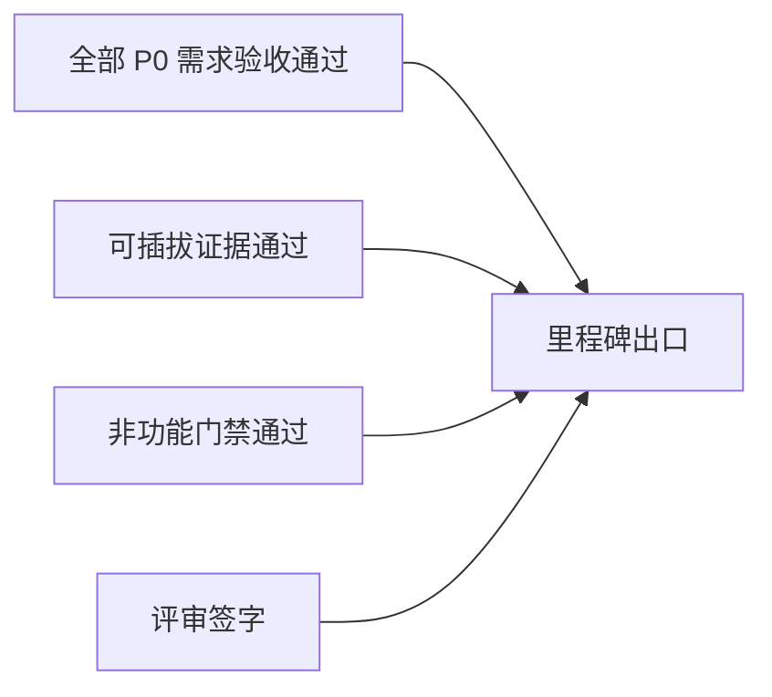
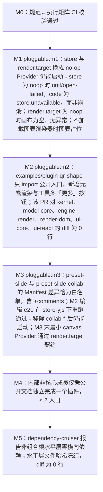

> 状态：草稿 | 负责：产品 | 更新：2026-11-05 | 依赖：charter v0.2；rulings §4.3、§4.6、§4.10、§4.12、§4.13、§4.15、§4.16、§4.18、§4.19、§4.20、§4.21、§4.23、§4.25、§4.26；80-process/01

# 05 里程碑与范围

> 里程碑骨架来自章程 §7（M0–M5），本文细化每个里程碑的**范围（按需求编号）**、**机械/半机械可验证的验收标准**、**必含的可插拔证据**、**依赖**与**风险**。范围变更是 L2 变更，走 OpenSpec 变更流程（80-process/01 §1、§2）：提案写明需求编号与文档影响矩阵，回写本文与相关文档，用户在 docs-sync 评审行确认；尚未裁决的取舍在 README §5 登记；不得在里程碑内静默加减。周期：**不定周期**，按范围与验收推进，每个里程碑开工前再估（rulings §4.16 Q13）。

---

## 0. 总览

**图 0-1 里程碑总览**

怎么读：箭头为里程碑先后，节点「·」后为主交付；每个里程碑都要满足下图的出口条件才能进入下一个。协同后端（网关、Room、update 持久化与快照、服务端导入）自 M2 起交付，M3 是多人协同体验层，边界见 §0.3（rulings §4.19 D-M2-CONTENT）。

**图 0-2 每个里程碑的出口**

怎么读：每个里程碑的出口 = 全部 P0 需求验收通过 + 可插拔证据通过 + 非功能门禁通过 + 评审签字，四个条件缺一不可；P1 可在里程碑内延后，P2 不影响出口，见 §0.1。

### 0.1 优先级在里程碑中的含义

| 优先级 | 含义 | 滑动规则 |
|---|---|---|
| P0 | 里程碑出口条件；缺一不可 | 不可滑动；砍 P0 = 经 L2 变更修订本文 + 章程评审 |
| P1 | 里程碑目标 | 可在该里程碑内延后，但不可跨里程碑；跨里程碑须经 L2 变更，并在 README 待决事项登记 |
| P2 | 机会项 | 可自由滑动，不影响出口 |

### 0.2 需求 → 里程碑总表（P0 / P1 摘要；P2 只列里程碑范围里点名的，并标「P2」）

本表与各里程碑的「范围」是需求块的摘要：优先级与目标里程碑以各需求块为准，两处不一致时改本文（rulings §4.26 PV-26）。

| 域 | M1 | M2 | M3 | M4 | M5 |
|---|---|---|---|---|---|
| 打开/保真 OF | 01–15、18 零编辑、20、24、25（P0） | 18 编辑后导出（P0）；13 保真报告、16、17、19 PNG/SVG、22（P1）；21、23（P2） | 19 PDF（服务端，后半段，P1） | 保真副线（矩阵 M4+ 列） | — |
| 编辑 ED | — | 01–09、11、12、14、16、17、22、23、25 母版与版式（索引，见 ML 行）、29（P0，部分条目含 P1 分项）；10 插入与单元格文本、13、19（含操作设置）、20、21、24、26 替代文本与锁定对象的呈现、28 E~、30 命令面板（P1）；05 任意多边形、曲线与自由曲线绘制、26 锁定属性（查看与切换）与选择窗格、31 页眉和页脚、35 视频与音频（P2，不阻塞出口；视频与音频交付前入口留在原位、不可用） | 10 结构与样式、15、15a 插入图表、17 跨文档资源迁移、18 备注编辑、28 E（P1）；32 图标、33 符号（P2） | 27 触控（P2）；34 屏幕截图与相册（P2） | — |
| 母版/版式/主题 ML | — | 01 母版视图、02 版式应用与重置（P0） | 03 母版与版式编辑（P0）、04 主题（P1） | 05 备注/讲义母版（P2） | — |
| 应用壳 AS | — | 01 开始页、06 账户菜单（P0）；02 最近与固定、04 指南与帮助入口（P1） | 06 账户菜单的「个人资料…」（P0）；03 模板库（P1）；05 首次使用引导（P2） | — | — |
| 协同 CO | — | 01 会话建立与自动持久化、02 唯一同步路径、12 握手 / 门禁 / 资源通道（P0，协同后端在 M2，rulings §4.19 D-M2-CONTENT） | 01 多人名额与容量、02 多人延迟与收敛、03–06、08、09、11（P0）；03 跟随、04 重新锚定与导入为可编辑评论、07、08 彻底删除元素、13、15（P1）；10 编辑中软提示（P2） | 06 跨刷新持久化、14（P2） | — |
| 插件 PS | 01（内部） | 02（内部）、04（首个示例）、07（内部）、11、15；09（内部，P1） | 14（P1） | 01–09、10、12、16（公开） | 02 `core.documentType` Stable；04 示例 `doc-type-skeleton` |
| 插件管理 PM | — | 01（只读）、02（内部）、10 只读查看与失败诊断、16（P0）；11、12、15（P1） | 13 协同一致性（P0）；01 管理员、03、04（镜像内置）、05（清单与 hostApi 校验）、06、07、08、10 个人启停、11、12、14、15（P1） | 02（公开）、04（挂载目录第三方）、05（签名 / 审核，P0）；09（P1） | — |
| 嵌入 EM | 01（查看器）、12、16 | 01、02、03（OIDC 与一方 Ticket）、04（字节回调与资源上传通道）、05–09、14、15、17（P0）；11、13、14 随每次发布对外提供 SBOM（P1） | 03（服务端文档权限细化）、04（S3 兼容 Provider）、10（P0）；18（P1）；01 形态 E（P2） | 03（集成方签名 JWT / API Key，rulings §4.15 Q6）；形态 F（P2） | — |
| 服务端 SV | — | 01 导入、03 快照与 update 持久化、05 网关（单实例）、06 鉴权（OIDC 与 owner）、07 审计写入、12 安全基线（P0，rulings §4.19 D-M2-CONTENT）；04 过渡封面（包内 `thumbnail.jpeg`，P0，随 SV-01 导入）；11 回收站移入与恢复（P1） | 02 服务端导出、04 权威缩略图、05 多实例与容量、06 按人分享与权限细化、07 查询与导出、08、09、10、12 渗透出口（P0）；02 的 PDF 与插件导出格式（随 OF-19、PS-14）、03 的版本历史与彻底删除元素（随 CO-07、CO-08）、06 分享链接（随 CO-15）、07 哈希链与每日封存、11、13、15（P1；15 见 rulings §4.12 U-14） | 06（JWT / API Key）、09（离线包 / 多架构 / Helm，P1）、11 擦除时按部署策略删除评论正文（P1）；14、15 M4 展望（文档事件扩面）（P2） | — |
| 非功能 NF | 01 打开、02、04 输入与供应链（含 CI 中生成 SBOM）、06 源语言、07 Chrome、08 PowerPoint 365（Windows）/ LibreOffice / 第三方生产者、09（M1 起全程）、12 错误码手册 / 发布说明 / 支持矩阵 | 01 交互/体积/服务端导入与持久化、02（M2 列）、03（含已 ack(db) 零丢失与单实例 PG 故障连续性）、04 CSP、05、06 首批语言、07 全矩阵、08 加入 macOS、PowerPoint 2016/2019 与经 PowerPoint 保存后再打开、12 集成方快速开始 | 01 多人协同与服务端扩展、02（M3 列）、03 SLO 与多实例连续性、04 渗透、镜像供应链与 Trusted Types 强制、05 高对比门禁与 3.2.6 / 3.3.7 / 3.3.8、07 移动端查看 + 评论（P1）、10、11、12 运维手册（集成检查清单随 EM-18，P1） | 06 RTL（P2）、12 插件开发者文档站 | — |

**图 0-3 各里程碑必含的可插拔证据**

怎么读：自上而下按里程碑排列，每个节点写该里程碑 CI 检查或验收项所断言的内容；`pluggable:mN` 等是检查名，作为既有 CI job（13 个封闭集合，如 `test`、`e2e`、`depcruise`）的步骤运行，不新增 job 名（rulings §4.18 GV-14）；no-op Provider 只证明「可移除」，不替代「第二个 Provider 过契约」（章程 §7）。
依据：本文各里程碑「可插拔证据」条；章程 §7；rulings §4.15 Q4、§4.18 FE-01、GV-14。

### 0.3 M2 / M3 边界（rulings §4.19 D-M2-CONTENT）

协同网关、Room、update 持久化与快照、服务端导入在 M2 交付（与 `40-modules/09` §11「M2 切片」一致），与之直接相关的服务端模块与测试同在 M2。**自 M2 起，参考应用中文档内容只以协同快照为事实源**：新建、导入、打开、编辑都经服务端快照与协同网关，不设过渡的 pptx 内容版本端点（M2 没有 `…/content/uploads`、`…/content/commit` 一类接口）。M3 是多人协同体验层。下表是各设计线（50 前端、60 后端、70 测试）标注里程碑时的依据，冲突时以本表为准。

| 能力 | M2（协同后端） | M3（多人协同体验层） |
|---|---|---|
| 身份与会话 | OIDC 登录（服务端换码、httpOnly cookie 会话、JIT 建号、登出）；一方 Ticket（60 s 单次）签发与续期；登录过期「重新登录」（UX-02） | —（集成方签名 JWT / API Key 为 M4） |
| 文档目录 | 新建（空白 / 内置模板）、创建副本、列表与元数据、改名、回收站（移入与恢复）、最近与固定（rulings §4.12 U-04）；左侧导航「最近 / 我的文档 / 与我共享 / 回收站」四项即列表筛选，搜索框下拉与搜索结果页（AS-01，rulings §4.25 DS-79、DS-80） | 永久删除文档（含回收站到期清理）与用户数据擦除（SV-11，P1）；唯一 owner 被停用或擦除后的空窗由运维命令 `cordex-ops documents:reassign-owner` 转移 owner（SV-11，rulings §4.20 BE-05+TX-22） |
| 权限 | 建档者即 owner；REST 与网关按能力位 fail-closed 校验；分享与访问申请不开放：编辑器「分享」按钮与卡片菜单「分享…」留在原位、不可用，写「后续版本提供」（rulings §4.25 DS-137），「你没有权限访问此文档」阻断页上的「申请访问」同此（TB-156）；画法与文案以设计 03-08 §2、§4.5 为准 | 按人分享、分享链接、四种角色、权限变更 ≤ 2 s 生效、降权与被拒回滚、查看者变体（rulings §4.18 UX-19）；访问申请与分享链接有效期（CO-15，rulings §4.25 DS-47、DS-48）；文档级 RLS 测试自 M3 起阻断合并（GV-16） |
| 协同网关与 Room | 单实例：握手、Room 生命周期与按权重准入、硬门禁与软门禁（CO-12）、update 落库后回 `ack{seq, tier:'db'}`、awareness 中继（服务端转发随网关就位）；同一用户多标签页经网关互见 | 多实例扇出（Valkey pub/sub）、容量验收（`server:scale`）、名额按用户计与满员只读、在场的多人体验、优雅停机跨实例重连 |
| 持久化与快照 | update 追加表、压缩生成 `auto` 快照、「最新快照 + 尾巴 update」引导打开；kill -9 后已 ack(db) 零丢失；墓碑 TTL 清扫；schema 迁移与换纪元；配套保留期作业（`auto` 快照按天稀疏化，rulings §4.19 C-06；update 7 天） | 版本历史（CO-07，P1）：命名版本、版本列表、预览与恢复，服务端用例与界面都在 M3；恢复的撤销按 ADR-0038（M2 出口评审前定稿，未定稿则版本恢复不开工，rulings §4.20 TX-01+BE-10）；「彻底删除元素」（CO-08，P1） |
| Postgres 故障 | 单实例：两级溢写（Valkey → 对象存储）与 `ack{tier:'spill'}`（客户端保留 pending）、降级期照常广播、恢复后回放并补 `ack{seq, tier:'db'}`；`CONTROL.room.persist` 信号；发起方横幅「未保存到服务器 N 项」与其余协作者在文件名旁同步状态行的弱提示「服务器保存延迟」（rulings §4.18 CO-08、§4.19 INC-09；文案以设计 03-12 §5 为准） | 多实例：只回放本实例溢写行、心跳过期实例遗留行由下一个加载该文档的实例认领回放（rulings §4.18 CO-16）；降级期跨实例扇出 |
| 连接中断 | 基础重连：指数退避自动重连，先鉴权再同步，补发未获 db 确认的更改；文件名旁的同步状态行显示重连中、同步中与已同步（各态与文案以设计 03-02 §3.1 为准）；有未确认更改时离开保护（`beforeunload`） | 离线体验（CO-06）：30 s 离线判据与离线横幅、周期重连、离线积累更改的分块同步、长时间离线提示 |
| 导入 | 服务端导入（SV-01）：两步上传、异步作业、可取消、超天花板拒绝；参考应用的「导入」对话框（`/import`，叠在开始页或文档列表之上，选文件、拖入、上传、服务端解析与失败都在框里，rulings §4.25 DS-140、TB-179；画法以设计 03-13 为准）；新建空白 / 模板 = 服务端导入内置模板字节（AS-01）；创建副本走同一导入处理器；导入即得包内过渡封面（SV-04） | — |
| 导出 | 客户端导出（pptx 只导整份；PNG / SVG 的全部页、当前页、选定页与自定义页码，多页打成一个 .zip，rulings §4.25 DS-102、DS-103），内容取本地 Store；导出对话框不放 JPEG 与质量参数（DS-103） | 服务端导出：pptx（SV-02）、PDF（后半段，P1，随 OF-19）、PNG「全部页」（只含已同步的内容，其余范围与 SVG 仍在浏览器，DS-102）；JPEG 与质量参数只经 API 与自动化（SV-02、SV-13，DS-103） |
| 媒体 | 资源上传通道：预签名 PUT，CRDT 只存 `BlobRef`（CO-12） | — |
| 缩略图 | 包内过渡封面 | 服务端权威缩略图（前半段，renderer sidecar） |
| 在场、评论与软冲突 | 单人撤销在 `store-yjs` 下与 `store-memory` 同契约 | 在场（CO-03）、评论（CO-04，`@cordexjs/comments`）、Webhook（SV-15）、软冲突提示（CO-08）、协同撤销跳过（CO-09） |
| 审计与安全 | M2 端点的审计写入；输入 schema 校验、CSRF、WS Origin 校验、速率限制（SV-12 基线） | 审计查询与导出（SV-07）、哈希链与每日封存（SV-07，P1）；渗透测试出口、renderer 沙箱与镜像供应链 |
| 部署与观测 | 单实例 `all` 角色，用于开发与内部环境（Postgres 18 + Valkey，对象存储可用本地 Provider）；`/healthz`、`/readyz`；M1–M2 环境不承诺库内升级 | compose 洁净栈出口（断网 e2e、digest、镜像 SBOM、镜像许可）、按角色拆分部署、SeaweedFS、监控与告警（SV-10） |
| 装配 | 参考应用编辑器用 `preset-slide-collab`（不含 `comments`）接网关；SDK 嵌入仍可用 `preset-slide`（`store-memory`，回调式保存，EM-02） | `preset-slide-collab` 加 `comments`；`pluggable:m3` 白名单 |
| 测试基础设施 | 协同与服务端压测所需的自托管专用 runner 在 M2 前落地；macOS PowerPoint 基线加入（rulings §4.19 D-TEST-INFRA） | — |

依据：rulings §4.19 D-M2-CONTENT、INC-09、C-06、D-COMMENTS-PKG、D-TEST-INFRA；`40-modules/09` §11（「M2 切片」即 M2 交付）；服务端逐模块落点见 `60-backend/01` §3。

---

## M0 蓝图（本阶段）

- **目标**：各线文档（10–80，含类型治理）通过评审；仓库目录骨架与全部门禁配置就位（无业务代码）。
- **范围**：本 PRD 全部文件；设计 20-design；架构 30-architecture（含 ADR-0001/0002/0003/0020/0021/0022/0023/0040 至少「已提议」状态）；模块 40-modules；前端 50-frontend、后端 60-backend、测试 70-testing；研发流程 80-process；`tooling/*` 门禁配置（rulings §4.26 PV-25）。
- **验收标准（机械/半机械）**：
  1. 文档评审：各线 README（10、20、30、40、50、60、70、80）的「待决事项」全部有决策人，「对章程的异议」全部有总编排裁决记录（人工，评审纪要）。
  2. 术语一致：术语表登记的旧名在正文中残留 0 处，即 `python3 docs/_tools/check-terms.py` 退出码 0（旧名 → 正名登记在 `docs/_tools/terms.json`；豁免规则见 `docs/_tools/README.md`；rulings §4.20 TX-02）。新术语仍按章程 §9.2 第 5 条在各线 README「术语补充」中定义。
  3. 需求可追溯：本 PRD 每条 P0 需求有唯一 id、优先级、里程碑、验收标准（脚本校验字段齐全）。
  4. 门禁就位：「规范 ↔ 执行」矩阵 CI 校验通过（章程 §7 M0 可插拔证据）；dependency-cruiser、eslint、tsconfig、扫描器、lefthook 在空骨架上跑通；研发流程门禁 G1–G7（`80-process/03`）在空骨架上跑通（rulings §4.25 DP-6）。
  5. ADR-0001 声明合并 spike 有结论（可行 / 退路）。
- **依赖**：章程 v0.2；章程 §10 Q1–Q10 的裁决（rulings §4.15）；其中 Q1（npm org 注册，首次公开发布前）与 Q9（pnpm 11 + Node 26 工具链）须在「首个可运行切片」之前落地。
- **风险**：R-M0-1 ADR-0001 类型方案不可行 → 退路（primer §5.2）已定义；R-M0-2 各条线术语漂移 → 更名裁决回写时登记 `docs/_tools/terms.json`，由 `check-terms.py` 检查旧名残留（rulings §4.20 TX-02）。

---

## M1 打开与保真

- **一句话验收（章程 v0.2）**：任意合法 pptx：打开 → 高保真只读渲染 → 未修改导出与原文件语义等价（D7 口径）；`preset-slide-viewer` 可用。
- **范围（P0）**：OF-01、02、03、04、05、06、07、08、09、10、11（保留）、12、13、14、15、18（零编辑往返）、20、24、25；PS-01（内部）；EM-01（查看器形态）、EM-12、EM-16；NF-01（打开、内存）、NF-02（M1 列）、NF-04（输入/供应链，含 CI 中生成 SBOM）、NF-06（源语言）、NF-07（Chrome/Edge）、NF-08（PowerPoint 365 Windows、LibreOffice、第三方生产者）、NF-09（M1 起全程）、NF-12（错误码手册、发布说明、支持矩阵）。
- **范围（P1）**：矩阵中标 P1 的 M1 项（分栏、bidi、组合图表、TIFF 占位）。
- **明确不做**：任何编辑 UI；协同；服务端（除 CI 用的 Node 冒烟与 headless 导出校验）。
- **验收标准（机械/半机械）**：
  1. `fidelity:roundtrip`：T1（≥ 80）+ T2（≥ 200）零编辑往返，部件级 diff 零差异 100%（OF-18 §4.1）。
  2. `fidelity:visual`：SSIM 全语料中位数 ≥ 0.90、P10 ≥ 0.80；各矩阵行阈值达标（OF §4.2）；文本行数一致率 ≥ 95%。
  3. `fidelity:interop`：导出文件在 PowerPoint 365（Windows）打开无修复 100%（半机械：在 Windows 维护机上以 COM 自动化打开并截图，人工复核失败项）；macOS 基线与 Mac 互操作抽检自 M2 起（rulings §4.19 D-TEST-INFRA）。
  4. `perf:open`：D50 首页 ≤ 1.5 s、D200 ≤ 3.0 s（RM-A，p75，5 次取中位）；内存稳态达标；20 次开关无泄漏。
  5. `errors:codes`：`.ppt`/加密/损坏/超限四类各 ≥ 3 个样本返回正确错误码。
  6. `degrade:isolate`：注入抛错的 `ElementRenderer`，同页其它元素渲染，事件 `render/element-failed` 触发。
  7. 187 种 `prstGeom` IoU ≥ 0.95。
  8. 多实例：同页 4 个 `Unit` 打开不同文件，各自渲染正确，关闭一个不影响其它。
  9. `viewer:preset`：`preset-slide-viewer` 打开 T1 语料 100% 成功，初始加载 ≤ 350 KB gzip，包内无编辑命令（扫描器）。
  10. `fidelity:objects`（rulings §4.15 Q7）：表格、图表（D16 只读解析，非预览位图）与 SmartArt（`dsp:drawing`）为 M1 gated，阈值按 OF-08/09/10；OLE 必须显示 `mc:Fallback` 预览图；chartex 与未知 `graphicData` 显示诊断占位；`mc:AlternateContent` 对象可删除且导出后 PowerPoint 打开无修复；含 `mailto:`/`file://` 等非 http(s) 外部关系的文件零编辑往返关系全部保留。
- **可插拔证据（章程）**：`store-memory` 与 `render-dom` 均可被 no-op Provider 替换后仍能启动。CI 检查 `pluggable:m1`：以 `store=noop` 启动宿主并打开文件 → 触发 `unit/open-failed{code:"store.unavailable"}` 而非崩溃；以 `render.target=noop` 启动 → `unit/opened` 触发、画布为空、无异常。另：不加载图表渲染器插件时图表占位（OF-09）。
- **依赖**：架构 04（模型 + 不透明保留）、07（渲染）、ADR-0021、ADR-0003（清单生成，内部）、类型治理全套门禁；oracle 生成脚本与一台 Windows + PowerPoint 365 维护机（不进 CI，脚本生成基线后提 PR 并评审签字；macOS 基线自 M2 起加入）；性能门禁用 GitHub larger runner（4 核），低配机型以 CDP CPU 4× 节流近似（rulings §4.19 D-TEST-INFRA）。
- **风险**：

| 编号 | 风险 | 缓解 |
|---|---|---|
| R-M1-1 | 文本度量与 PowerPoint 差异导致换行不一致 | 早期建立文本专项语料；度量器可插拔，允许用 Canvas 度量与字体解析度量对比；阈值 95% 允许尾部差异 |
| R-M1-2 | 元素级不透明保留（脏部件重生成时带回 `extLst`）实现复杂，M1 只做零编辑往返可能掩盖问题 | M1 增加「解析 → 无编辑重生成 → 规范化比对」测试（不依赖编辑），提前暴露 |
| R-M1-3 | 真实语料获取与脱敏 | 内部文档 + 公开领域文件 + 生成器（python-pptx）合成；T2 允许 M1 中期从 100 增至 200 |
| R-M1-4 | 图表渲染的体积、许可与保真 | 路线已定为 d3-scale / d3-shape / d3-array（ISC，约 30 KB）+ 自研 OOXML 布局（ADR-0036，rulings §4.21 q-chart-route）；图表块按需加载；许可按 ADR-0049 分级；保真靠语料迭代，SSIM 门槛见 OF-09 |
| R-M1-5 | Strict 文件占比未知 | T2 统计；归一化表沿用 pptx-viewer 的 48 组映射思路（自研实现） |

---

## M2 单人编辑

- **一句话验收（章程 v0.2；rulings §4.6、§4.19 D-M2-CONTENT）**：文本/形状/图片/幻灯片增删排序/属性编辑/撤销重做/导出；表格单元格文本编辑（P1）；基础放映（P1，无动画）；母版视图（只读）与版式应用/重置（ML-01/02，P0）；**协同后端**：OIDC 登录、协同网关与 Room（单实例）、update 持久化与快照、服务端导入，参考应用的文档内容以协同快照为唯一事实源（无过渡的 pptx 内容版本端点，边界见 §0.3）；性能预算达标。
- **范围（P0）**：ED-01、02、03、04、05、06（纯色/线条）、07、08、09（吸附）、11、12、14、16、17（内部/文本/图片）、22、23、29；OF-18（编辑后导出）；EM-01、02、03（OIDC 与一方 Ticket）、04（资源上传通道）、05、06、07、08、09、14、15、17；**AS-01 开始页、AS-06 账户菜单**；PS-02（内部）、PS-04 首个示例、PS-07、PS-11、PS-15；NF-01（交互/体积/服务端导入与持久化）、NF-02（M2 列）、NF-03（含已 ack(db) 零丢失与单实例 PG 故障连续性）、NF-04（CSP）、NF-05（UI P0 项）、NF-07 全矩阵、NF-08（加入 macOS、PowerPoint 2016/2019 与经 PowerPoint 保存后再打开）、NF-12（集成方快速开始）；**ML-01 母版视图、ML-02 版式应用与重置**（`03-features/07-masters-layouts-and-themes.md`；ED-25 为其索引）；**协同后端（rulings §4.19 D-M2-CONTENT）**：SV-01 服务端导入、SV-03 快照与 update 持久化、SV-04 包内过渡封面、SV-05（单实例网关与 Room）、SV-06（OIDC 登录与 owner 权限）、SV-07（M2 端点的审计写入）、SV-12（安全基线）；CO-01（会话建立、初始同步与自动持久化）、CO-02（唯一同步路径与单 update 上限）、CO-12（握手、硬 / 软门禁、资源上传通道）；**插件管理（rulings §4.23）**：PM-01（只读部分）、PM-02（内部）、PM-10 只读查看与失败诊断（与 PS-11 同一交付）、PM-16。
- **范围（P1）**：ED-06（渐变/阴影、快速样式）、09（对齐分布、显示文件里存的参考线）、10（插入表格与单元格文本，rulings §4.21 q-table-depth）、13、19（含动作按钮的操作设置）、20、21（基础放映，含放映主序列可见性终态）、24、26（替代文本、锁定对象的呈现）、28（E~）、30 命令面板；ED-04 的项目符号颜色与大小、ED-05 的调整手柄、更改形状与「插入后自动进入文本编辑」选项（缺省关，rulings §4.26 PV-29）、ED-07 的裁剪、SVG PNG 回退、空图片占位符填入与大图压缩、ED-08 的对象重命名、ED-11 的节显示与折叠；OF-13 保真报告、OF-16、17、19（PNG/SVG）、22；矩阵 M2 列 P1 项（含 EMF/WMF 惰性栅格化、`mc:AlternateContent` 对象移动/缩放）；EM-11 国际化对接、EM-13 遥测对接、EM-14 随每次发布对外提供 SBOM（rulings §4.26 PV-30）；PS-09 调试与诊断（内部）；NF-06 首批语言；SV-11 回收站移入与恢复（随 M2 文档目录先行）；**AS-02 最近与固定、AS-04 指南与帮助入口**；PM-11 快捷键冲突可见并跳转、PM-12 缺插件提示、PM-15 失败上报。
- **范围（P2，不影响出口）**：ED-31 页眉和页脚、ED-35 插入视频与音频（不写 `p:timing`）、ED-05 边界的任意多边形、曲线与自由曲线绘制、ED-26 的锁定属性（查看与切换）与选择窗格（含显隐切换，rulings §4.26 PV-28）；OF-21 演示文稿元信息与文件属性、OF-23 打开 URL 与断点续传。
- **明确不做**：表格结构编辑、图表插入与数据编辑（M3）、动画播放、SmartArt / OLE / 3D / 墨迹 / 缩放定位的插入与屏幕录制（非目标，`03-features/02-editing.md` §5）、母版/版式**编辑**与主题编辑（母版视图只读与版式应用在范围内）、演讲者备注编辑（ED-18，M3）；多人协同体验层：在场、评论、分享与权限细化、离线体验、软冲突提示、版本历史（命名 / 列表 / 恢复）、多实例扩展、服务端导出与服务端缩略图（§0.3 右列，均为 M3）。
- **验收标准（机械/半机械）**：
  1. `e2e:editing`：每条 P0/P1 ED 需求 ≥ 1 个 Playwright 用例，全部通过；用例元数据含需求 id（需求 ↔ 测试矩阵无缺失 P0）。
  2. `fidelity:edit-roundtrip`：编辑脚本语料（≥ 50 个「打开 → 执行 N 个命令 → 导出」脚本）：未触碰部件字节相同 100%，脏部件 XSD 有效 100%，规范化 diff 仅在被编辑子树 100%，PowerPoint 打开无修复 100%（Windows 全量；macOS 基线自本里程碑加入，Mac 互操作抽检，rulings §4.19 D-TEST-INFRA）。
  3. `history:property`：随机 1,000 步命令序列 → 全部撤销 → 模型哈希 == 初始；再全部重做 == 终态（100 个随机种子）。
  4. `perf:interact`：键入 p95 ≤ 50 ms、拖动 ≥ 55 fps、撤销 ≤ 50 ms、导出 D50 ≤ 3 s（RM-A）。
  5. `size:budget`：查看器 ≤ 350 KB、编辑器 ≤ 900 KB gzip。
  6. `a11y:axe`：全部 UI 面板零严重/重大违规，门禁对象含产品的 `/styleguide` 组件全状态页（`apps/web` 只在测试环境挂出，rulings §4.25 TB-3、TB-50，NF-05）；键盘 e2e 覆盖左栏 / 画布 / 备注 / 底部创建工具条 / 检查器、网格视图的两个浮动胶囊与幻灯片网格，以及紧凑窗口（640–1024）的两个胶囊与抽屉（F6 顺序见 ED-29；紧凑形态 rulings §4.25 DS-17、DS-21；网格视图归 ED-22，README PD-27）。
  7. `embed:multi`：同页 4 个编辑器实例、快捷键按焦点分派、销毁无残留。
  8. `csp:strict`：在 `script-src 'self'` + CSP nonce 的测试页中编辑器全部 e2e 通过，并在同一份生产包与生产 CSP 下覆盖测试环境挂出的 `/styleguide` 组件全状态页（rulings §4.25 TB-3、TB-50）；Trusted Types 以 report-only 运行且零违规报告；`externalResources` 三档（auto/confirm/never）下 CSP `img-src`/`media-src` 随之收紧（EM-14）；文档内容注入扫描器零命中。
  9. `master:view`：进入母版视图 ≤ 300 ms（D50，p75）；缩略图窗格显示全部母版与版式缩略图，窗格各行与检查器「使用此版式」的引用页数与实际引用一致；选中任一节点的画布合成与 PowerPoint 母版视图截图 SSIM ≥ 0.90（抽样 20 个版式）；画布列顶部的母版视图横幅在 M2 的说明为「可以查看并选中占位符，版式编辑将在后续版本提供」（rulings §4.25 DS-156）；数据未就绪显示转圈与一句说明（不画占位块）、加载失败显示次按钮「重试」且可切回普通视图（rulings §4.25 DS-154）；经任一退出入口（横幅「关闭母版视图」是唯一的常驻退出入口，另有主菜单「视图」、Esc 与再按 `Mod+Alt+M`，ML-01）关闭后回到原页与原缩放；进入/退出不产生历史项；**评审模式、放映模式、无 `doc.write`、不是完整形态（视口 < 1024 或触控设备，rulings §4.25 TB-44）、版本历史开着或文档仍在打开中（DS-162、DS-164）时不能进入**（按 `Mod+Alt+M` 不切换、给一次轻提示「母版视图：〈原因〉」，放映中不响应，rulings §4.25 DS-163；主菜单「视图」与命令面板的「母版视图」项禁用并注明原因，原因文案以 ML-01 为准，放映模式不出现该项；评审模式、编辑模式已降权、不是完整形态、放映模式、版本历史开着与文档仍在打开中各 ≥ 1 条 e2e；rulings §4.10 Q12、§4.18 UX-11）；已在母版视图中缩窄到 640–1024 不退出、缩到 < 640 时退出（rulings §4.25 TB-16）。画法与文案以设计 03-26 §1.1、§6 为准。
  10. `layout:apply`：更换版式脚本语料（≥ 30 个「页 × 目标版式」组合，含 ≥ 5 个跨母版组合）的占位符重匹配结果与 ML-02 规则表 100% 一致；跨母版选版式为一个事务（撤销一步回到原版式与原母版，主题解析链随之切换）；不匹配提示为带「撤销」的轻提示；版式选择器搜索框过滤结果正确；重置页走「确认对话框 + 可撤销轻提示」双层（rulings §4.25 DS-32，ML-02；画法以设计 03-27 为准），重置后与「基于版式新建 + 填入同文本」的渲染 SSIM ≥ 0.98；导出后 PowerPoint 打开无修复。
  11. `shell:home`：开始页四态（已登录默认 / 加载中 / 最近为空 / 离线）各 ≥ 1 个 e2e 用例（加载中为「最近」区一行加载行、不画骨架，rulings §4.25 DS-86）；可交互 ≤ 1.0 s（p75，已登录、列表 ≤ 50 条）；空白 / 模板经服务端导入内置模板字节建档后进入编辑器（首页为标题版式，D14），「导入 .pptx」打开叠在原页上的「导入」对话框（主区拖入松开即打开它的上传态），上传 → 服务端解析在框里原位切换，成功后关闭对话框并进入编辑器（SV-01；`/import` 叠在来路之上、浏览器后退即关闭，上传与解析中「取消」、× 与 Esc 中止并关闭、留在原页，rulings §4.25 DS-140、TB-179、TB-180）；离线时三类入口禁用且 tooltip 正确，本会话内仍保活的最近文档可打开（跨刷新离线库为 M4 P2；AS-01 / AS-02）。画法与文案以设计 03-29、03-13 为准，`/import` 路由以前端 50/02 §2 为准。
  12. `shell:account-menu`：开始页左侧导航底部用户行、编辑器右上角自己的头像（rulings §4.25 DS-18）与文档列表中的账户入口三处打开同一 `UserMenu`、条目相同；主题三项（浅色 / 深色 / 跟随系统，与偏好设置同一偏好，rulings §4.25 DS-90）/ 偏好设置（`Mod+,`）/ 键盘快捷键（`Mod+/`）/ 帮助中心（集成方配置了帮助链接时出现，DS-89）/ 退出登录各有 e2e，M2 不显示「个人资料…」（DS-91）；退出登录在参考应用走 OIDC 登出、嵌入时调用集成方回调，集成方未配置回调时「退出登录」留在原位、不可用并写「由宿主应用管理登录」（rulings §4.20 FE-06）；偏好设置（居中对话框，DS-113）的常驻入口只有账户菜单，另有 `Mod+,`；命令面板里的「偏好设置…」（列在「常用」一组，TB-117）与「阅读顺序…」（搜索可得，DS-116）是不常驻的第二入口，不计入（80-process/01 §4 检查项 Q2）；UI 树扫描断言侧栏、顶栏与开始页左侧导航都没有「设置」项（DS-10）；快捷键面板三个入口（编辑器主菜单「帮助」/ 账户菜单 / `Mod+/`，rulings §4.25 DS-1）均可达（AS-06）。画法与条目以设计 03-29 §2.5、03-23、03-24 为准。
  13. `embed:framework-free`（rulings §4.15 Q2）：`examples/embed-vanilla` 以 `UiRenderer('vanilla')` 通过 UI 渲染契约；形态 B 产物中不含 react/radix 模块。
  14. `server:import`（SV-01，rulings §4.19 D-M2-CONTENT）：导入 D50 ≤ 5 s、D200 ≤ 20 s（p95，RM-S）；超出系统天花板（页数 / 单页元素 / 总元素，DX-20K 之外；或文件超过 200 MB）的导入被拒绝并返回 `format.quota_exceeded`（SV-08）；包络外、天花板内的文件可导入（rulings §4.18 UX-13）；上传或解析阶段可取消，取消后作业为 `cancelled` 且不留原件与产物（UX-14）；新建空白 / 模板与导入走同一作业，导入完成即有包内过渡封面（SV-04）。
  15. `collab:persist`（SV-03、SV-05 单实例、CO-01）：参考应用打开文档 = 「最新快照 + 尾巴 update」引导后加入 Room，初始同步 D50 ≤ 2 s、D200 ≤ 5 s（p75）；每个被接受的 update 落库后才回 `ack{seq, tier:'db'}`，持久化滞后 p99 ≤ 1 s；写入 ≥ 500 个 update 触发一次压缩（新增 `kind='auto'` 快照、update 表相应裁剪），压缩 10,000 update ≤ 2 s；kill -9 网关后重启，已 ack(db) update 零丢失（混沌测试 50 次）；关闭后重开的模型哈希与关闭前一致；同一用户两个标签页经网关互见编辑；参考应用的编辑 e2e 在该路径（`preset-slide-collab` + 网关）上运行。
  16. `collab:gate`（CO-12）：Ticket 握手（60 s 单次）及六种失败码各 ≥ 1 个用例；硬门禁（单帧 ≤ 1 MiB、速率、能力位、可解析性、结构数上限）拒绝即不广播、不落库；注入 5% 非法 update（父子环 / 悬空引用 / 越权路径），最终全部合法；每条修复规则有黄金用例；修复与拒绝进入审计（ADR-0034）；图片与媒体只经资源上传通道，CRDT 内只有 `BlobRef`。
  17. `collab:degraded`（单实例 Postgres 故障，rulings §4.13 S-3、§4.15 S-3a、§4.18 CO-08、§4.19 INC-09）：PG 写失败注入下不拒绝新编辑，超阈值依次溢写 Valkey → 对象存储，溢写期只回 `ack{tier:'spill'}`、客户端保留 pending，恢复后回放补 `ack{seq, tier:'db'}`，回放后断言无 `pendingStructs`、seq 连续不丢、不重复落库；降级期两个客户端（同一用户两标签页即可）仍互见编辑；服务端 ≤ 1 s 推 `room.persist:'degraded'`、回放完成且无溢写后推 `ok`；发起方在满足判据（`degraded` ∨ 仅获 spill 确认 ∨ 最老在途 ≥ `unsavedWarnAfterMs`，默认 15000）时显示横幅「未保存到服务器 N 项」，其余会话只在文件名旁的同步状态行见「服务器保存延迟」，恢复后二者消失；有未确认更改时刷新或关闭标签页触发离开保护。文案以设计 03-12 §5 为准。
  18. 插入元素（`e2e:editing` 与 `fidelity:edit-roundtrip` 的子集，rulings §4.21；元素清单与里程碑以 `03-features/02-editing.md` §1a 与 [50/18](../50-frontend/18-editor-capabilities.md) 插入域为准）：文本框（单击与拖出两种、空框退出即删除且不留撤销步）、预设形状（形状库 ≥ 60 项，首批约 72 项全部可插入）、线条（导出为 `p:cxnSp`）、动作按钮（插入即弹操作设置，P1）、图片（本地 / 拖入 / 粘贴 / URL）、SVG（P1：导出同时含 `asvg:svgBlip` 与 PNG 回退）、表格（P1：网格与对话框两种入口，插入后可编辑单元格文字）、超链接（P1）、空图片占位符填入（P1）各 ≥ 1 个 e2e 用例；每次插入恰好一个撤销步；插入使元素数越过规模上限时返回 `document.quota_exceeded`、不产生事务；插入后导出 PowerPoint 打开无修复。底部创建工具条（含「更多」）、形状库与空占位符图标条中不出现 SmartArt、OLE、3D、墨迹、缩放定位与屏幕录制入口，公式入口在「更多」文本组与主菜单「插入」留在原位不可用并标 M4+（`03-features/02-editing.md` §1a；画法以设计 03-04 §7.3 为准）；断言由 slide-ui 的 `toolbar-spec.test.ts` 承担（40-modules/10 §9）。
  19. `plugins:diagnose`（PM-10、PM-12、PS-11，rulings §4.23）：个人插件面板三分组与空分组隐藏；注入激活抛错的插件 → 面板「启动失败」行含错误码（`kernel.plugin_failed`）、阶段（启动 / 贡献）、版本、traceId 与「复制诊断信息」（rulings §4.25 TB-77、TB-96），本会话「重试」成功后移入运行中；等待依赖与版本不兼容无重试按钮；打开带 `plugin-qr-shape` 足迹的文档而本会话未装配该插件 → 元素占位、导出后原数据字节不变，横幅写明插件 `id` 与所需版本（P1，PM-12）；第一方插件的 `cordex-manifest.json` 均含 `scope` 且与 PM-02 判定表一致（表驱动断言）。画法与文案以设计 03-09 为准。
- **可插拔证据（章程）**：第三方示例插件新增一种元素渲染与一个底部工具条「更多」按钮（rulings §4.25 DS-5），零改内核。CI 检查 `pluggable:m2`：构建 `examples/plugin-qr-shape`（只 import 公开入口，depcruise 校验），e2e 验证插入二维码元素、渲染、导出（作为图片回退 + `extLst` 数据）、撤销；该 PR 对 `packages/{kernel,model-core,engine-render,render-dom,ui-core,ui-react}` diff = 0 行。
- **依赖**：架构 05（命令/历史/自动逆操作）、07（覆盖层/命中测试）、03（贡献点 UI）、设计 01/03/04/06；React 19；`@cordexjs/design` token；协同后端的依赖（rulings §4.19 D-M2-CONTENT）：ADR-0020（CRDT 映射）、0022（存储）、0023（协议）、0029（鉴权）、0034（软门禁）、0035（单实例部分）、架构 06、后端架构（`60-backend/01`）与 `protocol` 包、`40-modules/09` §11「M2 切片」；Postgres 18 / Valkey 测试床（testcontainers）与 oidc-provider mock；协同与服务端压测所需的自托管专用 runner 在 M2 开工前落地，macOS + PowerPoint 365 基线机加入（rulings §4.19 D-TEST-INFRA）；[ADR-0038 `version-restore-undo`](../30-architecture/adr/0038-version-restore-undo.md)（草稿，M-02 主笔，M-05、M-09 会签）在 M2 期间起草、**M2 出口评审前定稿**；它不阻塞 M2 出口，但未定稿则 M3 的版本恢复（CO-07）不开工（rulings §4.20 TX-01+BE-10）。
- **风险**：

| 编号 | 风险 | 缓解 |
|---|---|---|
| R-M2-1 | IME 在 DOM/SVG 自绘文本上的体验（候选框定位、组合态） | M2 首月完成 IME spike（中/日/韩 + Safari）；`render-dom` 的 IME 宿主是独立可替换组件 |
| R-M2-2 | 自动逆操作在富文本上的正确性 | 属性测试（验收 3）从 M2 第一周起跑 |
| R-M2-3 | 体积预算与 React / UI 组件库冲突 | 组件层按 ADR-0017：Radix 原语、组件源码在仓库内，按需引入、可 tree-shake；体积门禁每 PR |
| R-M2-4 | 保真在编辑后回归（只写覆盖 vs 烤继承） | `fidelity:edit-roundtrip` 每 PR 跑子集 |
| R-M2-5 | 快捷键与浏览器/宿主冲突 | 作用域 + 可重映射；宿主保留键表 |
| R-M2-6 | 协同后端在 M2 交付，使 M2 工作量与联调面扩大（rulings §4.19 D-M2-CONTENT） | M2 只交付单实例与 §0.3 左列；多实例、在场与权限细化、版本历史留在 M3；按 `40-modules/09` §11 切片先打通「两个客户端经网关同步 + 持久化 + 压缩快照」 |
| R-M2-7 | M1–M2 的内部环境不承诺库内升级，基线迁移段在 M3 出口前仍可改写 | 需要保留的数据以「导出 pptx 再导入」迁移（`60-backend/08` §10.4） |

---

## M3 多人协同

- **一句话验收（章程 v0.2；rulings §4.6、§4.15、§4.19 D-M2-CONTENT、§4.26 PV-27）**：多人协同体验层，即在场（presence）、评论、权限细化（单组织、按人分享、分享链接（P1）、权限即时生效与降权回滚）、离线重连体验、软冲突与协同撤销提示、版本历史（P1）；多实例扩展（含跨实例溢写认领）；服务端导出与服务端缩略图（前半段）、PDF 导出（后半段，P1）；自托管 compose 洁净栈；表格结构编辑（P1）；图表数据编辑（bar / line / pie / area / scatter 五类，P1，rulings §4.12 U-06）；母版与版式编辑（ML-03，P0）。
- **范围（P0）**：CO-01（多人名额与容量）、02（多人延迟与收敛）、03、04、05、06（会话内）、08、09、11；SV-02（服务端 pptx 与 PNG 导出）、04（权威缩略图）、05（多实例、容量与名额）、06（按人分享、权限管理 API、用户停用、权限即时生效、RLS 出口）、07（查询与导出）、08、09、10、12（渗透出口）；EM-03（服务端文档权限细化）、04（S3 兼容 Provider）、10；NF-01（多人协同与服务端扩展）、NF-02（M3 列）、NF-03（SLO 与多实例下的连续性）、NF-04（渗透、镜像供应链、Trusted Types 由 report-only 改为强制，rulings §4.15 Q2）、NF-05（高对比门禁；参考应用的一致帮助、冗余输入与可访问认证）、NF-10、NF-11、NF-12（运维手册与部署指南）；**ML-03 母版与版式编辑**；**AS-06 账户菜单的「个人资料…」**（M3 起出现，rulings §4.25 DS-91、TB-137）。已在 M2 交付的协同后端（SV-01、SV-03、SV-05 单实例、SV-06 OIDC、CO-12 等，§0.3 左列）在 M3 继续作为回归门禁。**插件管理（rulings §4.23）**：PM-13 协同一致性（P0）。
- **范围（P1）**：ED-10 结构与样式、ED-15、ED-17 跨文档资源迁移、ED-28 E 档、OF-19 服务端 PDF（M3 后半段）、PS-14（rulings §4.26 PV-27；SV-02 的服务端 PDF 与插件导出格式随之为 P1）；ED-15a 插入图表（五类，rulings §4.21 q-chart-route）、ED-18 演讲者备注编辑；CO-03 跟随（含 ED-21 跟随主讲人放映）、CO-04 重新锚定与导入为可编辑评论、CO-07 版本历史（SV-03 的命名版本、版本列表与恢复随之）、CO-08 彻底删除元素、CO-13、CO-15（参考应用分享；SV-06 的分享链接随之）、SV-07 哈希链与每日封存（rulings §4.12 U-15）、SV-11、SV-13、SV-15（Webhook 与事件出口，rulings §4.12 U-14）、EM-18 集成检查清单；移动端查看 + 评论（NF-07）；**ML-04 主题**；**AS-03 模板库**；**插件管理（rulings §4.23）**：PM-01 管理员部分、PM-03 三态、PM-04 镜像内置插件的声明文件、PM-05 清单与 hostApi 校验、PM-06 管理员清单（SV-14 管理面板的第一页先行）、PM-07、PM-08、PM-10 个人启停、PM-11、PM-12、PM-14、PM-15。
- **范围（P2，不影响出口）**：ED-32 插入图标、ED-33 插入符号（rulings §4.21 q-extra-inserts）；AS-05 首次使用引导；CO-10 编辑中软提示；EM-01 形态 E（iframe 嵌入 `apps/web`，rulings §4.25 DS-73）。
- **明确不做**：排他编辑锁（rulings §4.16 Q16；CO-10 只做 awareness 软提示，P2）、跨刷新离线持久化（`collab-offline-idb`，M4）、只读大规模广播、多租户 / 自营 SaaS（rulings §4.15 T-0）、按组分享与组管理（rulings §4.15 Q6）、集成方签名 JWT 与 API Key（M4）、离线安装包 / 多架构 / K8s Helm chart（M4 P1）。
- **验收标准（机械/半机械）**：
  1. `collab:converge`：20 客户端 × 1,000 随机命令 + 随机分区/重连（100 个种子）→ 模型哈希一致 100%；导出 XSD 有效。
  2. `collab:soft-conflict`：CO-08 表每行 ≥ 1 个确定性用例，收敛结果与提示 100% 符合。
  3. `collab:latency`：A → B p50 ≤ 150 ms、p95 ≤ 400 ms（同区域测试床，20 编辑者）；presence ≤ 200 ms。
  4. `perm:fail-closed`：无 `doc.write` 的客户端构造 update → 服务端拒绝并断开；权限撤销 ≤ 2 s 生效；未声明能力位的命令被扫描器拒绝进入代码库。
  5. `offline:queue`：断网 5 分钟编辑 500 步 → 重连 ≤ 3 s 合并 → 与在线端哈希一致；离线累计 5 MiB 更改重连后全部同步、无超限断连、不重复落库（rulings §4.18 CO-10）；离线判据按时间（假时钟断言 29.9 s 未离线、30 s 离线），服务端恢复后 `offline` 会话 ≤ 36 s 自动回连、断网期间不发起连接（rulings §4.18 UX-03、CO-03）。
  6. `server:jobs`：服务端导出 pptx D50 ≤ 3 s、D200 ≤ 12 s（p95，与客户端导出规范化一致）；导出作业可取消（生成中只有「取消」一个出口，取消即停止作业，不做后台继续，rulings §4.25 DS-101；画法以设计 03-22 为准）、结果经下载地址取得（每次取时现签、1 h 有效，SV-02，rulings §4.25 DS-100）；导入相关条目见 M2 验收 14，M3 在多实例部署下回归。
  6a. `server:thumbnails`（M3 前半段，rulings §4.15 Q8）：导入后首页缩略图 ≤ 10 s，D200 全量 ≤ 90 s；按页内容哈希失效（只改一页只重生成该页）；renderer sidecar 安全测试通过（非 root、沙箱、seccomp、零出站、无凭据）；零出站测试**每个 PR 运行**（e2e 冒烟子集，M3 起阻断合并），非 root、无凭据、沙箱开启由 scanners job 的镜像策略检查（`check-image-policy`）静态判定，断网 compose e2e 仍在 main 全量段（rulings §4.18 GV-16）。
  6b. `server:pdf`（P1，M3 后半段）：PDF D50 ≤ 10 s（SSIM ≥ 0.85），与缩略图分队列、首页缩略图优先。
  7. `server:durability`（多实例；单实例 kill -9 零丢失与 PG 故障两级 ack 已在 M2 验收 15、17）：kill -9 任一 collab 实例后客户端重连到其它实例，已 ack（`tier:'db'`）update 零丢失（混沌测试 50 次）；PG 故障期间落在不同实例的两位协作者经跨实例扇出仍互见编辑，恢复后 seq 连续不丢（rulings §4.18 CO-08）；存活实例只回放本实例的溢写行，心跳过期实例遗留的行由下一个加载该文档的实例认领回放（rulings §4.18 CO-16）；未发起更改的协作者只在文件名旁的同步状态行看到「服务器保存延迟」（rulings §4.19 INC-09；文案以设计 03-12 §5 为准）。
  8. `server:scale`：单实例 2,000 WS，活跃房间按文档规模分档（NF-01 §1.7）且按实测权重准入，p95 广播 ≤ 100 ms；双实例跨实例传播 ≤ 50 ms；名额按用户计（同一用户多标签占 1、owner 不占编辑者名额）。
  9. `security:pentest`：OWASP ASVS L2 自评 + 第三方渗透报告无高危未修复项（人工）。
  10. `ops:compose` + `ops:airgap` + `ops:image-licenses`（rulings §4.15 Q10）：`docker compose up`（Postgres 18 / Valkey / SeaweedFS / renderer / 可选 Casdoor）到 `/readyz` 200 ≤ 3 min；断网环境下 compose e2e 通过；全部镜像 digest 钉死；镜像 SBOM 生成；镜像许可门禁（D13 对镜像的解释）通过；备份恢复演练脚本通过。
  11. `comments:roundtrip`：评论导出为现代评论部件 → PowerPoint 365 可见且作者/时间正确（抽样 20 个）。
  12. `collab:softgate`：M2 验收 16 的门禁在 M3 多实例与多客户端下重跑，并补 `commenter` 触及评论以外路径、修改他人评论两条修复规则的黄金用例。
  13. `collab:rejected-rollback`：降权后仍有 pending update → 服务端拒绝 → 客户端「导出后重载」，本地状态与服务端一致，「未同步更改」可导出（架构 06 §18.4）。
  14. `master:edit`：母版/版式编辑脚本语料（≥ 20 个：占位符增删与类型修改、母版文本样式、背景、版式增删改名与重排）→ 全部引用页与缩略图 ≤ 500 ms 更新（D50）；母版视图横幅里「改动将影响 N 页」与「未保存改动 · 影响 N 页」两种说明的 N 取同一计数且与引用数一致，提交后轻提示「已更新 N 页」（ML-01，rulings §4.25 DS-32）；删除被引用版式经确认对话框后，受影响页在同一事务内改用默认版式（`defaultLayoutOf`，即架构 04 §12.3 I-ML2 的回退链：同母版同 type 首个 → 该母版首个 → 首个母版首个），该事务入撤销栈并给带「撤销」的轻提示，撤销一步恢复各页引用、版式以原 id 复活，协同下他人后写的键按 rulings §4.15 Q3 跳过并提示（rulings §4.10 Q11、§4.20 FE-05）；引用数 = 0 时直接删除并可撤销；删除被引用母版时各页改用目标母版（默认按 order 排序的首个剩余母版）中与原版式同 type 的首个版式，无同 type 时落目标母版首个版式，整个删除一个事务、同样可撤销（rulings §4.20 FE-23）；Shift / Mod 多选批量删除一次确认；同类占位符已达上限时「占位符 ▾」里对应项预先不可用并写「已包含」，竞态下仍超限时阻止插入并轻提示（ML-03，rulings §4.10 Q16）；导出后 PowerPoint 母版视图一致（SSIM ≥ 0.90）；ML-03 协同冲突表 5 行各 ≥ 1 个模拟用例收敛且提示正确。画法与文案以设计 03-26 为准。
  15. `theme:edit`（P1）：修改 12 主题色与主题字体后全文重算 ≤ 300 ms（D50），显式 `srgbClr` 元素像素不变；导出 `theme*.xml` 重生成且 `extraClrSchemeLst` 字节保留；从模板应用主题两种模式各 ≥ 5 个样本正确。
  16. `security:rls`：绕过应用层直接以另一用户身份查询/写入无权限文档被文档级 Postgres RLS 拒绝（rulings §4.15 Q6）；**每个 PR 运行**（e2e 冒烟子集，testcontainers 起 Postgres，M3 起阻断合并，rulings §4.18 GV-16）；分享链接要求登录有 e2e（P1，随 CO-15）；OIDC 登录与 `auth.selfSignup` 默认关的 e2e 自 M2 起运行（CI：Casdoor 容器 + oidc-provider mock）。
  17. `collab:undo`（rulings §4.15 Q3）：他人后写同一键 → 撤销跳过该键并提示；整步被跳过 → 停下不连撤（`undo-skip-no-cascade`）；删除 vs 编辑 → 软删除墓碑、恢复沿用原 id、与删除方撤销并发不产生重复元素；TTL 到期硬删除；`store-memory` 与 `store-yjs` 同一契约套件通过；P1 部分：永久删除文档（SV-11）不等 TTL，owner 对墓碑态元素「彻底删除元素」（CO-08）后立即硬删除并写审计 `document.element_purged`，删除方之后撤销该步按整步跳过（`wholeStep:true`，rulings §4.18 CO-07）。
  18. `history:restore-revert`（CO-07，P1；rulings §4.20 TX-01+BE-10，检查名登记在 `70-testing/13` §3.4）：按 [ADR-0038](../30-architecture/adr/0038-version-restore-undo.md) 撤销一次版本恢复：他人在恢复之后改过的键被跳过并提示，其余键回到恢复前的值；全部键都被跳过时不提交、按整步跳过即停（`wholeStep:true`）；恢复时删掉的元素以原 id 复活，墓碑 TTL 已过或已被「彻底删除元素」的跳过；恢复与撤销恢复都在持有 Room 的实例内单事务执行、不加锁、在线会话不断连。场景取自 `70-testing/05` 的 `rs/restore-revert-*`。
  19. 插入图表与表格结构（P1；`e2e:editing` M3 子集与 `fidelity:edit-roundtrip`，rulings §4.21）：五类图表（含簇状 / 堆积 / 百分比子类型）各插入一次，示例数据按类型生成（柱形、条形、折线、面积 4 类别 × 3 系列，饼 4 类别 × 1 系列，散点 3 个点），插入后检查器「数据」分区自动展开、焦点在首个数值格（rulings §4.25 TB-12，ED-15a；示例数据与画法以设计 03-31 为准），一次插入一个撤销步、撤销后导出无残留部件；导出新建的图表部件、关系与内嵌工作簿登记完整，PowerPoint 打开无修复且「编辑数据」可用（抽样 20 个）；表格行列插删、合并拆分、样式与标志在协同下并发插行 / 插列后仍规整（每行有效单元格覆盖全部列、跨度合法，ADR-0018），导出 PowerPoint 打开无修复。
  20. `plugins:admin`（PM-01、PM-03、PM-06–PM-08、PM-14，P1）：`member` 调策略写接口 403；内容级插件只有两态、必需插件锁定；禁用被依赖者出确认卡且依赖方变为等待依赖；互斥插件不能同时启用；保存后新会话按新策略装配、在线会话 ≤ 60 s 出现重新加载横幅且不中断编辑（与缺少插件、启动失败横幅同时成立时按 PM-12 的先后排在最后，rulings §4.25 DS-54）；每次保存写 `plugin.policy_changed`；个人启停界面级插件即时生效、刷新后保持且不写审计。画法与文案以设计 03-32、03-09 为准。
  21. `plugins:consistency`（PM-13，P0）：A、B 同 Room，管理员启用内容插件 P 后 A 重新加载并插入 P 的元素 → B（未重新加载）见占位、B 的编辑不改动该元素数据、两端模型哈希一致；界面级插件执行写命令被拒并记 `plugin/scope-violation`；服务端导出与客户端导出使用同一内容级集合、规范化结果一致；内容插件版本变化后旧会话重连先 flush 再刷新，刷新前写入被拒。
- **可插拔证据（章程）**：`store-yjs` 替换 `store-memory` 仅改 preset 配置。CI 检查 `pluggable:m3`：比对 `preset-slide` 与 `preset-slide-collab` 的 Manifest，差异集合恰为白名单 `{-store-memory, +store-yjs, -collab-core#local-presence, +collab-yjs, +collab-transport-ws, +comments}`（`+comments` 即 iso 包 `@cordexjs/comments`，rulings §4.19 D-COMMENTS-PKG；`-collab-core#local-presence` 是协同 preset 以 `collab-yjs` 替换单人兜底在场条目的结果；可选的 `collab-offline-idb` 不计入）；M2 全部编辑 e2e 在 `store-yjs`（本地、无服务端）下重跑通过；移除 `collab-*` 后仍能启动（CO-11）。另：M3 末最小 canvas Provider 通过 `render.target` 契约测试（`runRenderTargetConformance`，rulings §4.15 Q4，ADR-0021），作为 `render.target` 在 M4 转 Stable 的前置。
- **依赖**：M2 交付的协同后端（§0.3 左列）；ADR-0038（版本恢复的撤销，草稿，M2 出口评审前定稿；未定稿则 CO-07 版本恢复不开工，rulings §4.20 TX-01+BE-10）；ADR-0020（CRDT 与页序/富文本映射，已接受）、0023（权限即时性）、0026（headless 缩略图，已接受）、0035（多实例与溢写认领）、0037（部署拓扑，已接受）、架构 06、后端架构（`60-backend/01`）；设计 05（协同 UX）、设计 03-08（分享对话框，无按组分享，rulings §4.15 Q6）；SeaweedFS 测试床（testcontainers）；PowerPoint 机器（Windows 与 macOS）用于评论互操作。
- **风险**：

| 编号 | 风险 | 缓解 |
|---|---|---|
| R-M3-1 | 页顺序/形状顺序并发移动语义 | ADR-0020（已接受）已给出结论：`order` 键用 fractional index、单键 LWW（细则见 ADR-0032，草稿）；剩余风险为 fuzz 覆盖与环修复规则一致性（CO-08） |
| R-M3-2 | 富文本 CRDT 映射与 `a:r` run 属性模型的对齐 | 架构 04/06 联合评审；文本专项收敛测试 |
| R-M3-3 | 权限即时性（M3 权限源在服务端；M4 起可能依赖集成方回调延迟） | 推送 + 60 s 缓存 + 令牌短期三重保障；文档写明 |
| R-M3-4 | headless Chromium 稳定性与资源 | 独立零出站 renderer sidecar + 每任务新 BrowserContext + 定期回收 + 超时 + 占位图降级；M2 以包内封面过渡；指标告警 |
| R-M3-5 | 评论在 pptx 中的现代评论 schema 文档不全 | 以 PowerPoint 365 生成样本逆向 + oracle 验证；评论写入可经 SDK 导出选项关闭（CO-04） |
| R-M3-6 | 大二进制走 CRDT 导致膨胀 | 资源通道（CO-12）在 M2 交付（P0）；M3 只复核多人并发插入与媒体 GC |
| R-M3-7 | 母版/版式编辑触发的反向失效（layout → slides → shapes）在 D200 上的重绘成本 | 反向索引 + 模板层缓存（架构 07）；`master:edit` 预算以 D50 门禁、D200 观测；缩略图按可视区优先刷新 |

---

## M4 插件 SDK 公开

- **一句话验收（章程）**：插件开发指南、manifest、示例仓库、版本协商、兼容性测试套件。
- **范围（P0）**：PS-01、02（公开目录与稳定级）、03、04（完整集）、05、06、07；PS-11、PS-15 与 EM-15（M2 已交付，M4 公开发布时继续作为回归门禁）；NF-12（插件开发者文档站）；EM-03 / SV-06 的集成方签名 JWT 与 API Key（首次出现主体 JIT 建影子用户，rulings §4.15 Q6）；PM-02 公开、PM-04 挂载目录中的第三方插件、PM-05 签名 / 审核校验（rulings §4.23）。
- **范围（P1）**：PS-08、09（公开）、10、12、16；SV-09 离线安装包 / 多架构镜像 / K8s Helm chart（rulings §4.15 Q10）；SV-11 擦除时按部署策略删除评论正文（rulings §4.26 PV-17）；PM-09 管理员插件配置（随 PS-10）。
- **范围（P2，不影响出口）**：CO-06 跨刷新持久化（`collab-offline-idb`）、CO-14 大规模只读广播；动画 / 切换播放（章程 §7 M4）；ML-05 备注 / 讲义母版；ED-27 触控；NF-06 RTL；SV-14 管理面板；SV-15 M4 展望部分（文档事件扩面；SV-15 本体在 M3）；EM 形态 F（Web Component 包装）；保真副线中的元素路线（rulings §4.21）：SmartArt「转换为形状」、公式 OMML↔MathML 往返立项、OLE 下载原文件与替换负载、ED-34 屏幕截图与相册（逐元素设计见 [50/25](../50-frontend/25-elements-readonly-and-opaque.md) 与 [50/23](../50-frontend/23-elements-media.md)）。
- **验收标准（机械/半机械）**：
  1. `docs:coverage`：公开 API / 贡献点 / 错误码文档覆盖率 100%（脚本）；文档中示例代码全部编译。
  2. `ctk:self`：全部官方插件与示例通过 CTK 全部检查（PS-06，含作用域检查）；CTK 负向样例全部失败。
  3. `manifest:ci`：所有插件 `cordex-manifest.json` 与运行时一致；`hostApi` 范围外宿主拒绝加载（用例）。
  4. `scaffold:e2e`：脚手架 8 个模板（清单以 PS-03 为准，含 `document-type`）各生成一次 → `install/test/build` 通过 ≤ 5 min。
  5. `pilot:external`（半机械）：内部非核心成员（未参与内核开发的同事或全新 AI agent 会话）仅凭公开文档按 [04-plugin-sdk](./03-features/04-plugin-sdk.md) §1 的插件开发者旅程完成插件 ≤ 2 人日，CTK 通过，提问 ≤ 3 次；过程记录归档为文档缺陷清单并修复。
  6. `version:policy`：弃用 API 带移除版本；到期扫描器失败用例。
  7. `plugins:trust`（PM-04、PM-05，rulings §4.23）：声明文件格式错误拒绝启动（退出码 78，`--dry-run` 同）；挂载目录中无签名且无审核记录的插件被拒、不出现在任何会话；摘要不符、`hostApi` 不覆盖、作用域声明低于推出结果各 ≥ 1 个用例被拒并在管理员界面显示原因；强制启用的插件被拒时 `/readyz` 附 `pluginsRejected`；生产部署拒绝「允许未签名」开关为真；界面上不存在任何上传或安装插件的入口（UI 树扫描）。
- **可插拔证据（章程）**：内部非核心成员（未参与内核开发的同事或全新 AI agent 会话）仅凭公开文档独立完成一个插件（验收 5；rulings §4.16 Q11）。
- **依赖**：ADR-0002/0003 落地；api-extractor 基线；文档站基础设施；内部非核心试点成员（同事或全新 AI agent 会话，rulings §4.16 Q11）。
- **发布前检查（首次公开发布 npm 包前，rulings §4.15 Q1）**：
  1. 软件类商标检索（Cordex）：确认「Cordex」/「Cordex 幻灯片」/ Cordex Slides 在软件类别无冲突（已知 Cordex® 为 Alpha Technologies 电源类商标）；检索结论归档，冲突时先改名再发布。
  2. npm org `@cordexjs` 已注册；脚手架 `@cordexjs/create-plugin` 与第三方关键字 `cordexjs-plugin` 可用。
  3. 可发布包 `license: Apache-2.0`，根 LICENSE / NOTICE 就位（rulings §4.16 Q12）。
- **风险**：R-M4-1 试点者事先接触过内核实现导致证据失真 → 优先用全新 AI agent 会话，并在验收记录声明试点者背景；R-M4-2 贡献点 API 在 M2/M3 后仍不稳定 → M3 末冻结 `Stable` 集合，其余标 `Beta`。

---

## M5 多文档类型孵化

- **一句话验收（章程）**：`model-doc`/`model-sheet` 骨架通过「文档类型盲」验证：水平层零改动。
- **范围（P0）**：`core.documentType` 贡献点 Stable；`model-doc`、`ooxml-docx`（打开 .docx 并提取段落文本渲染为纯文本页，仅证明管线）、`model-sheet`、`ooxml-xlsx`（打开 .xlsx 并渲染单表网格值，仅证明管线）骨架；`preset-doc`/`preset-sheet`（不带 `-skeleton` 后缀，以 `package.json#cordex.stability:'experimental'` 标识未完工，40-modules/14 §1 C-19）；示例 `doc-type-skeleton`（PS-04）。
- **范围（P1）**：doc/sheet 的零编辑往返（不透明保留在 docx/xlsx 上的复用验证）；三种文档类型在同页共存（各自 `Unit`）。
- **明确不做**：doc/sheet 的编辑、协同、保真承诺（那是后续路线图）。
- **验收标准（机械/半机械）**：
  1. `depcruise:blind`：**非组合根**的水平层包对垂直束包 import = 0（含 doc/sheet）；组合根（`compositionRoot:true` 的 `preset-*`、`apps/web`、`apps/server`）豁免，但 `preset-doc` 不得 import slide 束、`apps/web` 仍只能经白名单 import（rulings §4.18 FE-01）；报告入库。
  2. `diff:horizontal`：新增 doc/sheet 骨架的 PR 集合对 `packages/{shared,kernel,protocol,i18n,model-core,store-*,ooxml-core,collab-*,engine-*,render-dom,design,ui-core,ui-react,server-*}` 的 diff = 0 行，以**文件哈希冻结**校验（章程 §7 M5、ADR-0016；冻结范围 = 无 `bundle` 且非组合根的包；CI 在标记 `doc-type:new` 的 PR 上断言）；`server-*` 能做到零改动，是因为 `server-headless` 文档类型盲：导入导出按 `documentType` 取编解码器，插件清单由 `apps/server` 的 preset 装配提供（rulings §4.18 FE-01）；若确需改水平层，须先以独立 PR 合入并在架构 12 记录原因（该 PR 不得含垂直束代码）。
  3. `boot:empty`：不加载任何 `DocumentType` 时宿主启动，打开文件返回 `format.no_document_type`（章程 §5.4 口径；点式拼写按 rulings §4.3 CS-13）。
  4. `coexist`：同页 slide + doc + sheet 三个 `Unit`，各自打开、渲染、关闭，互不影响。
  5. `roundtrip:docx-xlsx`（P1）：零编辑往返部件级零差异（各 ≥ 20 个样本），验证 `ooxml-core` 不透明保留对其它 OOXML 包的通用性。
- **可插拔证据（章程）**：dependency-cruiser 报告零横向依赖（验收 1 + 2）。
- **依赖**：架构 12；M4 的 `core.documentType` 文档与 CTK 模板。
- **风险**：R-M5-1 `model-core` 的寻址/选区抽象带有幻灯片形状（Univer A2 重演）→ M1 起 `Selection`/`Unit` 抽象评审时用 doc/sheet 反例检查；R-M5-2 `ui-core` 的工具条与检查器分区结构默认「幻灯片形状」（如 `selectionKind` 只含幻灯片对象，rulings §4.25 DS-5）→ 设计 06 槽位规范以文档类型为参数。

---

## 6. 跨里程碑事项

| 事项 | 说明 |
|---|---|
| 语料库持续增长 | T2 每里程碑 +100；每个新支持的矩阵行至少 1 个 T1 文件 |
| 保真副线 | 矩阵「M4+」列在 M4/M5 按容量安排，不作为出口条件 |
| 性能预算校准 | 每里程碑中期校准一次（只收紧） |
| 出口评审清单 | P0 验收全绿、可插拔证据全绿、NF 门禁全绿、待决事项无阻塞项、发布说明与已知限制更新、下一里程碑风险复盘 |
| 范围变更流程 | L2 变更（80-process/01 §1、§2）：提案（OpenSpec 变更）→ 回写本文与相关文档（含 70/13 需求 ↔ 测试矩阵）→ 用户确认（docs-sync 评审行） |

**图 6-1 范围变更流程**

怎么读：箭头为先后顺序；范围变更按 L2 走完这三步，70/13 的需求 ↔ 测试矩阵在第二步与其他文档一起回写，用户确认前就已改好；里程碑内不得跳过这条流程静默加减范围；砍 P0 还需章程评审（§0.1）。
依据：80-process/01 §1、§2；rulings §4.25 DP-1、DP-4。
