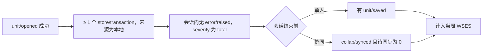
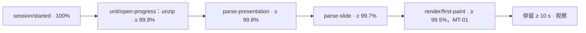
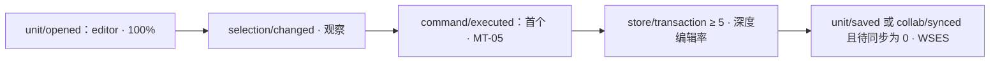
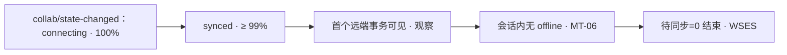
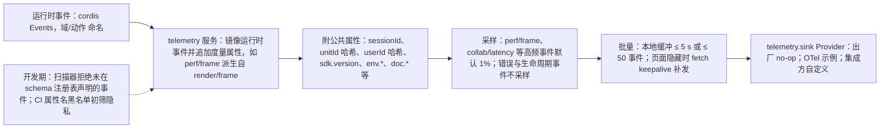

> 状态：草稿 | 负责：产品 | 更新：2026-11-05 | 依赖：charter v0.2；rulings §4.15、§4.16、§4.17（D5）、§4.18、§4.19、§4.23、§4.25（DS-76、DS-90、TB-36、TB-77、TB-118）；设计 01、03-10、03-20、03-21；架构 05、10；前端 50/07、50/15

# 06 指标与埋点

> 指标编号前缀 `MT-`。埋点对应章程 L0 的 `telemetry` 服务（D11）；事件命名遵循 `<域>/<动作>`；遥测事件**镜像**运行时事件（EM-05）并追加度量属性，不另起一套命名（规避 Univer A8 的多套事件机制）。遥测默认 no-op（PD-10），集成方通过 `telemetry.sink` Provider 接入自家管道；本文定义**我们希望集成方能采集到什么**以及**我们自己的参考应用采集什么**。

---

## 0. 原则

1. **不采集内容**：文档文本、图片、评论正文、文件名一律不进遥测；只采集结构性度量（数量、时长、类型、错误码）。用户/文档标识使用不透明 id（OIDC 主体或集成方传入），并在 SDK 内再做一次单向哈希（可关闭）。
2. **事件即契约**：每个遥测事件有 schema（Standard Schema）、版本、隐私分级；schema 变更走 Changesets；未声明的事件被扫描器拒绝。
3. **能被回答的问题才埋**：每个事件至少服务于一个指标（§1/§2）或一个告警（SV-10）。
4. **采样可配**：高频事件（`perf/frame`、`collab/latency`）默认采样 1%；错误与生命周期事件不采样。

---

## 1. 北极星与一级指标

### 1.1 北极星：周成功编辑会话数（WSES，Weekly Successful Editing Sessions）

- 定义：单周内满足以下全部条件的会话数：`unit/opened` 成功 → ≥ 1 个 `store/transaction`（来源 = 本地）→ 会话内无 `error/raised{severity:"fatal"}` → 会话结束前有 `unit/saved` 或（协同）`collab/synced` 且待同步 = 0。
- 为什么：它同时要求「打得开」「能编辑」「不崩」「不丢」，是 SDK 价值链的完整闭环；比 DAU 更能反映产品是否真的被用来干活。
- 里程碑：M2 起事件齐备、可计算（参考应用的单人编辑自 M2 起即经协同网关持久化，按 `collab/synced` 且待同步 = 0 判定，rulings §4.19 D-M2-CONTENT；SDK 嵌入的单人 preset 按 `unit/saved` 判定）；M3 起含多人协同会话。
- 参考应用自己的采集自 M3 起：部署开启遥测出口、用户在偏好设置「隐私与诊断」开启「发送使用统计」后才发送（NF-11、§5）。
- 配套（查看器场景）：周成功查看会话数（WSVS）= `unit/opened` 成功 + 停留 ≥ 10 s + 无 fatal。

**图 1-1 一个会话如何计入 WSES**

怎么读：从左到右四个条件必须全部满足，最后一项按单人或协同二选一；任一环节缺失，该会话不计入。
依据：本节 §1.1。

### 1.2 一级指标（MT-01 … MT-08）

| 编号 | 指标 | 定义 | 目标（初始） | 里程碑 |
|---|---|---|---|---|
| MT-01 | 打开成功率 | `unit/opened` / (`unit/opened` + `unit/open-failed`)，排除 `format.unsupported_binary`、`format.encrypted`、`format.macro_rejected`（单列为「拒绝率」） | ≥ 99.5% | M1 |
| MT-02 | 保真指数 | 每会话降级元素数 / 总元素数 的加权平均（`render/element-degraded` + `render/element-failed` + `render/font-fallback`） | ≤ 2%（T2 语料对照 ≤ 3%） | M1 |
| MT-03 | 首屏时间 TTFS | `open()` → `render/first-paint`，按文稿规模分桶（≤ 20 页 / 21–50 / 51–200） | p75：≤ 1.0 s / ≤ 1.5 s / ≤ 3.0 s | M1 |
| MT-04 | 崩溃自由会话率 | 无 `error/raised{fatal}` 的会话占比 | ≥ 99.5% | M2 |
| MT-05 | 编辑转化率 | 有 ≥ 1 个本地 `store/transaction` 的会话 / 可编辑会话（有 `doc.write`） | 基线观察，M3 设目标 | M2 |
| MT-06 | 同步健康率 | 协同会话中 `collab/synced` 后从未进入 `offline` 且软冲突 ≤ 2 的占比 | ≥ 95% | M3 |
| MT-07 | 导出成功率 | `export/completed` / (`completed` + `failed`) | ≥ 99.5% | M2 |
| MT-08 | 集成与插件采用 | 活跃集成方数（按公共属性 `integratorId`）、活跃第三方插件数（按 `plugin/loaded` 去重的非官方插件 id） | M4 设目标 | M4 |

---

## 2. 健康指标（MT-10 … MT-24）

| 编号 | 指标 | 数据源 | 阈值 / 用途 |
|---|---|---|---|
| MT-10 | 键入延迟 p95 | `perf/input-latency`（采样） | ≤ 50 ms；超出触发性能调查 |
| MT-11 | 交互帧率 | `perf/frame`（采样，拖动/缩放期间） | p95 帧 ≤ 33 ms |
| MT-12 | 命令失败率 | `command/failed` / `command/executed` | ≤ 0.1% |
| MT-13 | 命令拒绝（权限）率 | `command/rejected{reason:"permission"}` | 观察 UI 是否正确禁用（应接近 0） |
| MT-14 | 撤销使用率 | `history/undo` 次数 / `command/executed` 次数（撤销是 Operation `core.undo`，不发 `command/executed`） | 体验信号：> 15% 提示误操作多 |
| MT-15 | 软冲突率 | `collab/soft-conflict` / 协同会话·小时（服务端指标 `cordex_collab_soft_conflicts_total{type}`）；撤销被跳过 `store/undo-skipped` 单独统计、不计入（rulings §4.17 D5） | ≤ 0.5 次/会话·小时 |
| MT-16 | 重连率与离线时长 | `collab/reconnect`、`collab/state-changed` 时长 | 网络质量诊断 |
| MT-17 | 同步延迟 p95 | `collab/latency`（采样） | ≤ 400 ms |
| MT-18 | 评论使用 | `comment/added`、`comment/resolved`、解决时长 | 协作深度 |
| MT-19 | 插件失败率 | `plugin/failed` / `plugin/loaded` | ≤ 0.5%；按插件 id 排名 |
| MT-20 | 插件加载耗时 | `plugin/loaded{durationMs}` | p95 ≤ 200 ms |
| MT-21 | 内存峰值 | `perf/memory`（会话结束采样） | 与 NF-01 对照 |
| MT-22 | 功能使用分布 | `command/executed{id}` 计数 | 优先级校准；识别从未使用的功能 |
| MT-23 | 错误码 Top-N | `error/raised{code}` | 每周复盘 |
| MT-24 | 服务端 SLO | SV-10 指标 | 可用性 99.9%、广播 p95 ≤ 100 ms、导入/导出成功率 ≥ 99.5% |

---

## 3. 埋点事件清单

### 3.1 公共属性（每个事件自动附带）

| 属性 | 说明 | 隐私级 |
|---|---|---|
| `ts` | 事件时间（客户端单调时钟 + 会话起点） | P0 |
| `sessionId` | 会话随机 id（每次宿主创建） | P0 |
| `unitId` | `Unit` 哈希（可关闭） | P1 |
| `deploymentId` / `integratorId` | 部署或集成方传入的不透明 id（单组织，无租户维度，rulings §4.15 T-0） | P1 |
| `userId` | 用户 id（OIDC `(issuer, sub)` 或集成方传入）的哈希（可关闭） | P1 |
| `sdk.version` / `preset` / `pluginsHash` | 版本、preset 名、已加载插件 id 集合哈希 | P0 |
| `env.browser` / `env.os` / `env.viewport` / `env.dpr` / `env.hardwareConcurrency` / `env.deviceMemory` | 环境 | P0 |
| `doc.pages` / `doc.elements` / `doc.sizeBucket` / `doc.producer` | 文稿规模分桶与生产者（`app.xml` Application，不含标题）；`doc.elements` 为文档总元素（含墓碑），分桶边界对齐包络与天花板（6,000 / 15,000 / 20,000，rulings §4.15 Q5） | P0 |
| `mode` | `viewer` / `editor` / `collab` / `headless` | P0 |

隐私级：P0 = 无任何标识；P1 = 伪匿名标识；P2 = 内容，**禁止**采集。

### 3.2 事件表

> 本表为遥测清单权威（决策 INC-33），`50-frontend/15` §8 登记前端发布方与采样。列「类别」：**cordis 事件**＝镜像同名的 cordis 运行时事件（遥测登记表条目带 `mirrorOf`），属性由遥测服务从运行时载荷投影得到，时长类属性由遥测服务按成对事件计时（如 `unit/closed` 的 `durationMs` 自 `unit/opened` 起算），每个属性的来源以 `50-frontend/15` §8 的登记为准；**遥测专用**＝没有对应的运行时事件，由发布方直接 `telemetry.event` 发出，只存在于遥测登记表。列「触发」为触发条件；「属性」为除公共属性外的载荷；「里程碑」为事件首次存在的里程碑；「服务」为对应的指标或告警。运行时事件名与载荷以架构 10 §11.1 为准；该表未列的 `ui/theme-changed` 与插件管理事件以 `50-frontend/15` §2 为准。

| 事件 | 类别 | 触发 | 属性 | 隐私 | 里程碑 | 服务 |
|---|---|---|---|---|---|---|
| `session/started` | 遥测专用 | 宿主创建 | `entry`（集成入口形态 A–F） | P0 | M1 | 会话计数 |
| `session/ended` | 遥测专用 | 宿主销毁 / 页面隐藏 ≥ 30 s | `durationMs`, `transactions`, `fatal` | P0 | M1 | WSES、MT-04 |
| `unit/opened` | cordis 事件 | 打开成功（首批装载后即触发，OF-03） | `durationMs`, `source`（buffer/url/stream/snapshot）, `conformance`, `contentType`, `pagesParsed`, `lazy` | P0 | M1 | MT-01、MT-03 |
| `unit/loaded` | cordis 事件 | 全部页装载到齐（rulings §4.18 CO-12） | `durationMs`（自打开起）, `pages` | P0 | M1 | NF-01「后台全部解析完成」 |
| `unit/open-progress` | cordis 事件 | 阶段变化（仅采样 10%） | `stage`, `percent`, `elapsedMs` | P0 | M1 | 打开漏斗 |
| `unit/open-failed` | cordis 事件 | 打开失败 | `code`, `stage`, `durationMs` | P0 | M1 | MT-01、MT-23 |
| `unit/closed` | cordis 事件 | 关闭 | `durationMs`, `dirtyAtClose` | P0 | M1 | 会话诊断、WSES 辅助 |
| `unit/dirty-changed` | cordis 事件 | dirty 切换 | `dirty` | P0 | M2 | 会话诊断、WSES 辅助 |
| `unit/saved` | cordis 事件 | 保存回调成功 / 快照落盘 | `kind`（pptx/snapshot/collab）, `durationMs`, `bytes` | P0 | M2 | WSES |
| `unit/save-failed` | 遥测专用 | 保存失败 | `code`, `retryable` | P0 | M2 | MT-23 |
| `unit/migrated` | cordis 事件 | 快照迁移 | `fromVersion`, `toVersion`, `durationMs` | P0 | M2 | 迁移健康 |
| `render/first-paint` | cordis 事件 | 首页可见 | `elapsedMs`, `page`, `elements` | P0 | M1 | MT-03 |
| `render/page-rendered` | 遥测专用 | 任一页首次渲染（采样 10%） | `page`, `durationMs`, `elements` | P0 | M1 | 性能 |
| `render/element-degraded` | cordis 事件 | 降级渲染 | `kind`, `reason`（emf-no-preview / 3d-flattened / effect-approx / smartart-no-dsp / math-fallback / unsupported-media …） | P0 | M1 | MT-02 |
| `render/element-failed` | cordis 事件 | 渲染抛错 | `kind`, `code` | P0 | M1 | MT-02、MT-23 |
| `render/font-fallback` | cordis 事件 | 字体回退 | `requestedFont`（字体名不视为内容）, `fallbackFont`, `scope`（latin/ea/cs/sym） | P0 | M1 | MT-02 |
| `perf/frame` | 遥测专用 | 交互期间帧时间（采样 1%；**派生自 cordis 事件 `render/frame`**，帧级数据只走遥测） | `frameMs`, `interaction`（drag/zoom/scroll/type）, `pages`, `elementsUpdated`, `overrun`（与 `render/frame` 的 `stats` 同名，决策 INC-08） | P0 | M2 | MT-11 |
| `perf/input-latency` | 遥测专用 | 键入到绘制（采样 5%） | `latencyMs`, `ime` | P0 | M2 | MT-10 |
| `perf/memory` | 遥测专用 | 会话结束 / 每 5 min（采样） | `heapUsedMB`, `pages`, `elements` | P0 | M1 | MT-21 |
| `perf/long-task` | 遥测专用 | 主线程任务 > 50 ms | `durationMs`, `phase` | P0 | M1 | 性能 |
| `command/executed` | cordis 事件 | 命令成功 | `id`, `durationMs`, `elementsAffected`, `source`（ui/shortcut/api/plugin/palette） | P0 | M2 | MT-12、MT-14、MT-22 |
| `command/rejected` | cordis 事件 | 命令被管线拒绝 | `id`, `reason`（not-found / validation / permission / readonly，以架构 05 §3 为准） | P0 | M2 | MT-13 |
| `command/failed` | cordis 事件 | 命令抛错回滚 | `id`, `code` | P0 | M2 | MT-12、MT-23 |
| `store/transaction` | cordis 事件 | 事务提交（高频合并 ≥ 50 ms） | `origin.kind`（local / remote / system / replay）, `origin.via`（undo / redo）, `origin.reason`（load / import / migration / repair / restore）, `mutations`, `count` | P0 | M2 | WSES、MT-05 |
| `history/undo` / `history/redo` | 遥测专用 | 撤销/重做（遥测专用；运行时事件为 `history/changed`） | `steps`, `skipped`（整步被跳过的步数，停下不连撤）, `keysSkipped`（因他人后写被跳过的键数，rulings §4.15 Q3） | P0 | M2 | MT-14 |
| `selection/changed` | cordis 事件 | 选区变化（采样 10%） | `kinds`（元素类型集合）, `count` | P0 | M2 | 功能使用 |
| `view/page-changed` | cordis 事件 | 翻页 | `from`, `to`, `method`（click / key / thumb / link / follow，另有在网格视图中打开某页、触控轻扫、数字跳页、命令面板「跳转到第 N 页」、评审条或浏览条的上一处 / 下一处评论、查找命中、保真报告「定位」、深链 `?page=`；入口以设计 03-20 §7、03-21 §4、03-10 §4.2 与 01 §4、§5.1 为准；取值名以 `50-frontend/15` §8 为准） | P0 | M1 | 导航行为 |
| `view/zoom-changed` | cordis 事件 | 缩放 | `zoom`, `method`（菜单、快捷键、命令面板、`Mod+滚轮` 或捏合；入口以设计 03-20 §4 为准；取值名以 `50-frontend/15` §8 为准） | P0 | M2 | 功能使用 |
| `view/mode-changed` | cordis 事件 | 编辑 ↔ 放映 ↔ 母版视图 | `mode`, `durationMsInPrev` | P0 | M2 | 放映使用 |
| `export/started` / `export/completed` / `export/failed` | cordis 事件 | 导出 | `format`, `pages`, `durationMs`, `bytes`, `code`, `side`（client/server） | P0 | M2 | MT-07 |
| `search/performed` | 遥测专用 | 查找 | `resultCount`, `durationMs`（不含查询词） | P0 | M2 | 功能使用 |
| `clipboard/pasted` | 遥测专用 | 粘贴 | `mime`（internal/image/html/text）, `elements` | P0 | M2 | 功能使用 |
| `collab/state-changed` | cordis 事件 | 会话状态机迁移 | `from`, `to`, `reason`, `durationMsInPrev` | P0 | M2 | MT-06、MT-16 |
| `collab/synced` | cordis 事件 | 初始/重连同步完成 | `durationMs`, `updatesApplied`, `initial` | P0 | M2 | 初始同步时长 |
| `collab/latency` | 遥测专用 | 往返延迟（采样 1%；不进 `Events` 接口，由 collab-yjs 经 `telemetry.event` 发出，架构 10 §11.1） | `rttMs`, `applyMs` | P0 | M2 | MT-17 |
| `collab/soft-conflict` | cordis 事件 | 软冲突检测 | `type`（text-same-pos/prop-lww/delete-vs-edit/delete-vs-reference/reorder；`delete-vs-reference` 为 ML-03 母版与版式冲突，见 `50-frontend/07` §12）, `resolvedBy`（auto/restore-my-value/restore-element） | P0 | M3 | MT-15 |
| `store/undo-skipped` | cordis 事件 | 协同撤销被跳过（**单独统计，不是 `collab/soft-conflict` 的 type，不计入软冲突率 MT-15**，rulings §4.17 D5） | `skipped`（本次被跳过的键数）, `wholeStep`（整步被跳过、停下不连撤）；遥测只统计跳过次数与整步跳过次数，不含路径内容 | P0 | M3 | MT-14 旁注、撤销体验 |
| `collab/reconnect` | cordis 事件 | 重连尝试 | `attempt`, `backoffMs`, `success`, `queued` | P0 | M2 | MT-16 |
| `collab/auth-failed` | cordis 事件 | 握手失败 | `code` ∈ collab.unauthenticated / forbidden / doc_not_found / doc_purging / schema_too_new / protocol_mismatch / epoch_changed / room_full / rate_limited（以架构 10 §11.2 为准）；`protocol_mismatch` 时附 `client`, `server` 版本 | P0 | M2 | 安全告警、升级健康 |
| `collab/update-rejected` | cordis 事件 | 服务端硬门禁拒绝本地 update（降权/锁定窗口） | `reason`, `rejectedTransactions` | P0 | M2 | 权限即时性、体验信号 |
| `collab/repair` | cordis 事件 | 服务端软门禁修复触及本地 | `rule`, `paths`（路径数） | P0 | M2 | 数据完整性（`cordex_collab_repairs_total{rule}`） |
| `presence/joined` / `presence/left` | cordis 事件 | 协作者进出 | `participants`（当前人数） | P0 | M3 | 协作规模 |
| `presence/follow` | 遥测专用 | 跟随开始/结束 | `durationMs` | P0 | M3 | 功能使用 |
| `comment/added` / `comment/replied` / `comment/resolved` / `comment/reopened` / `comment/deleted` | cordis 事件 | 评论操作 | `anchorKind`（page/element/text）, `threadDepth`, `hasMention`（不含正文） | P0 | M3 | MT-18 |
| `comment/orphaned` | 遥测专用 | 锚点元素被删 | `anchorKind` | P0 | M3 | 体验信号 |
| `history/version-created` / `history/version-restored` / `history/version-previewed` | 遥测专用 | 版本历史 | `kind`（auto/named）, `ageMs` | P0 | M3 | 功能使用 |
| `permission/changed` | cordis 事件 | 能力位变化 | `added`, `removed`, `propagationMs` | P0 | M3 | CO-05 ≤ 2 s |
| `permission/denied` | cordis 事件 | 服务端拒绝 | `capability`, `surface`（rest/ws） | P0 | M3 | 安全告警 |
| `plugin/loaded` | cordis 事件 | 插件 ACTIVE | `pluginId`, `version`, `official`, `durationMs`, `contributions` | P0 | M2 | MT-08、MT-20 |
| `plugin/failed` | cordis 事件 | 插件 FAILED | `pluginId`, `version`, `code`（`kernel.plugin_failed`）, `phase`（activate / contribution，与错误码 `details.phase` 同值，rulings §4.25 TB-77） | P0 | M2 | MT-19 |
| `plugin/incompatible` | cordis 事件 | 版本协商失败 | `pluginId`, `required`, `actual` | P0 | M2 | 升级健康 |
| `plugin/pending` | 遥测专用 | 进入 PENDING 超过 5 s | `pluginId`, `missing`（服务名） | P0 | M2 | 诊断 |
| `plugin/missing-in-document` | cordis 事件 | 缺插件横幅出现（每文档每会话每插件一次） | `pluginId`, `reason`（disabled / absent / outdated / failed；disabled 自 M3 起区分）, `count` | P0 | M2 | PM-12、PM-15 |
| `plugin/user-toggled` | cordis 事件 | 个人启停可选界面级插件成功 | `pluginId`, `enabled` | P0 | M3 | PM-15 |
| `plugin/scope-violation` | cordis 事件 | 界面级插件执行写命令被命令管线拒绝（诊断事件） | `pluginId`, `commandId` | P0 | M3 | PM-13 诊断 |
| `plugin/policy-changed` | 遥测专用 | 管理员保存插件策略成功（编辑器内有 host 时同时作为 cordis 事件发出） | `count`, `pluginIds` | P0 | M3 | PM-15 |
| `ui/panel-toggled` | 遥测专用 | 面板开关 | `panelId`, `open` | P0 | M2 | 功能使用 |
| `ui/shortcut-used` | 遥测专用 | 快捷键触发 | `commandId`, `scope` | P0 | M2 | 功能使用 |
| `ui/theme-changed` | cordis 事件 | 主题切换（浅色 / 深色 / 跟随系统，rulings §4.25 DS-90） | `theme` | P0 | M2 | 功能使用 |
| `i18n/missing-key` | 遥测专用 | 缺 key | `key`, `locale` | P0 | M2 | 质量 |
| `error/raised` | cordis 事件 | 任一类型化错误 | `code`, `severity`, `retryable`, `surface`, `pluginId?` | P0 | M1 | MT-04、MT-23 |
| `a11y/screen-reader-detected` | 遥测专用 | 检测到辅助技术（启发式，可关闭） | `hint` | P0 | M2 | a11y 使用 |
| `quota/exceeded` | 遥测专用 | 配额拒绝（遥测专用；派生自 `error/raised` 的配额三码 `format.quota_exceeded`、`document.quota_exceeded`、`storage.quota_exceeded` 与房间满员码 `collab.room_full`；`dimension` 取值以架构 10 §1.4「配额三码并列与 `dimension` 取值表」为准：`slides` / `elementsPerSlide` / `elementsTotal` / `fileSize`，存储为 `bytes` / `documents`） | `code`, `dimension`, `limit` | P0 | M2 | SV-08 |

底部工具条、菜单与右键触发的命令由 `command/executed{source}` 覆盖。单页 / 网格视图切换与检查器「设计 / 评论」页签切换是 Operation，按架构 05 §3 的执行管线不发 `command/executed`；M2 不为这两类切换另设遥测事件，使用度量只用 `command/executed{source}` 与 `ui/panel-toggled`，需要时再走新增事件的变更（rulings §4.25 TB-36）。

服务端事件（Prometheus/OTel 指标为主，见 SV-10）；审计事件（SV-07）**不是**遥测，不进本表。协同后端自 M2 起交付（rulings §4.19 D-M2-CONTENT），参考应用经协同网关打开文档，因此会话、同步、重连、握手、门禁类 `collab/*` 事件与导入配额的 `quota/exceeded` 自 M2 起存在；在场、评论、软冲突、权限变更等多人事件为 M3。

---

## 4. 漏斗与仪表盘

### 4.1 打开漏斗（M1）

**图 4-1 打开漏斗**

怎么读：箭头为会话依次到达的漏斗阶段，节点「·」后为该阶段的目标到达率（相对 `session/started`）；中间三段是 `unit/open-progress` 的阶段值。

### 4.2 编辑漏斗（M2）

**图 4-2 编辑漏斗**

怎么读：箭头为编辑会话依次到达的阶段，节点「·」后为该阶段对应的指标或口径；最后一步按单人或协同二选一（同图 1-1）。

### 4.3 协同漏斗（M3）

**图 4-3 协同漏斗**

怎么读：箭头为协同会话依次到达的阶段，节点「·」后为目标到达率或对应指标。

### 4.4 仪表盘（参考应用与内部）

参考应用里基于产品遥测的仪表盘自 M3 起有数据：它们要等部署开启遥测出口、用户开启「发送使用统计」后才收到数据（§1.1、§5）；服务端仪表盘取 SV-10 指标，不受用户开关影响。

| 仪表盘 | 受众 | 内容 |
|---|---|---|
| 产品总览 | 产品/管理 | WSES、WSVS、MT-01…08 趋势、功能使用 Top-20 |
| 保真 | 产品/架构 | MT-02 分 `kind`/`reason`、字体回退 Top-20、按生产者分布 |
| 性能 | 架构 | MT-03/10/11/21 分桶与 p50/p75/p95、long-task 分布 |
| 协同 | 架构/运维 | MT-06/15/16/17、房间规模分布、重连原因 |
| 插件 | SDK 团队 | MT-08/19/20、PENDING 缺失服务 Top、incompatible 版本对 |
| 服务端 | 运维 | SV-10 指标与告警 |

---

## 5. 实施要求

| 要求 | 口径 | 里程碑 |
|---|---|---|
| 事件 schema 注册表 | 每个事件在 `telemetry` 的 schema 表中声明（名称、版本、属性 schema、隐私级、采样率）；扫描器拒绝未注册事件 | M1 |
| 隐私审查 | 新事件/属性合入前经隐私检查清单（无内容、无明文标识）；CI 用属性名黑名单（`text`、`title`、`name`、`content`、`url`、`email`）初筛 | M1 |
| 默认 no-op | SDK 出厂不发送任何遥测（PD-10）；参考应用 `apps/web` 的产品遥测只在部署开启遥测出口（RuntimeConfig `telemetry.otlp`，M3）且用户在偏好设置「隐私与诊断」开启「发送使用统计」（缺省关，按账户记，NF-11）时发送；客户端错误上报是另一通道，默认值见 NF-11 | M1 |
| 采样与批量 | 客户端本地缓冲 ≤ 5 s 或 ≤ 50 事件批量发送；页面隐藏时用 `fetch` 的 `keepalive` 补发（不用 `sendBeacon`：它不能带 CSRF 防护要求的 `X-Cordex-Request` 头，SV-12） | M2 |
| 与 telemetry.sink 契约 | 事件对象 + 公共属性 → Provider；提供 OTel 示例（PS-04） | M2 |
| 指标计算文档 | 每个 MT 指标的 SQL/查询定义随参考应用发布 | M3 |
| 事件量预算 | 每会话·小时 ≤ 500 事件（采样后）；超出告警 | M2 |

**图 5-1 遥测事件从产生到出口**

怎么读：实线为一条遥测事件在客户端的处理链，虚线表示在开发期对事件登记与隐私的机械约束；全链不携带文档内容，审计事件不走这条链（SV-07）。
依据：本文 §0、§3.1、§5；EM-13。
