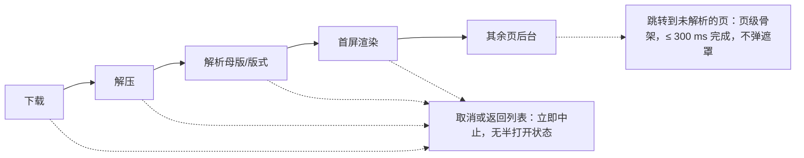
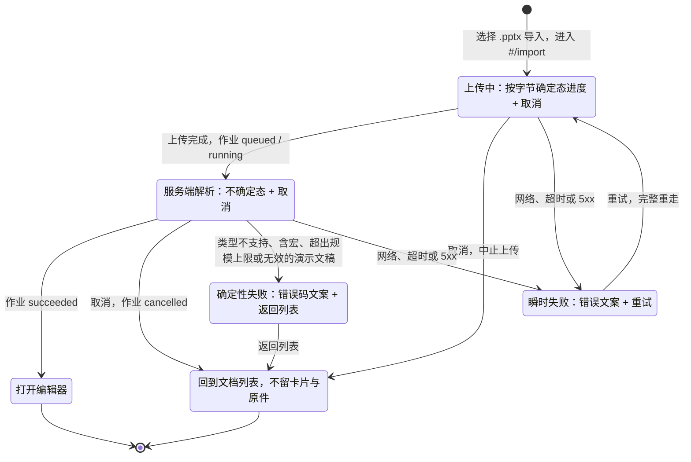
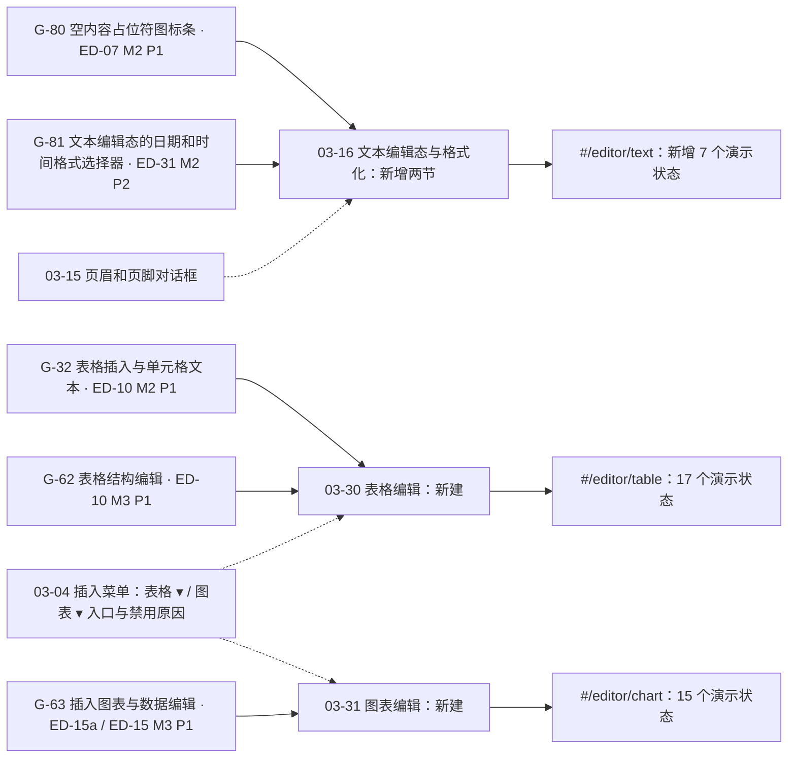
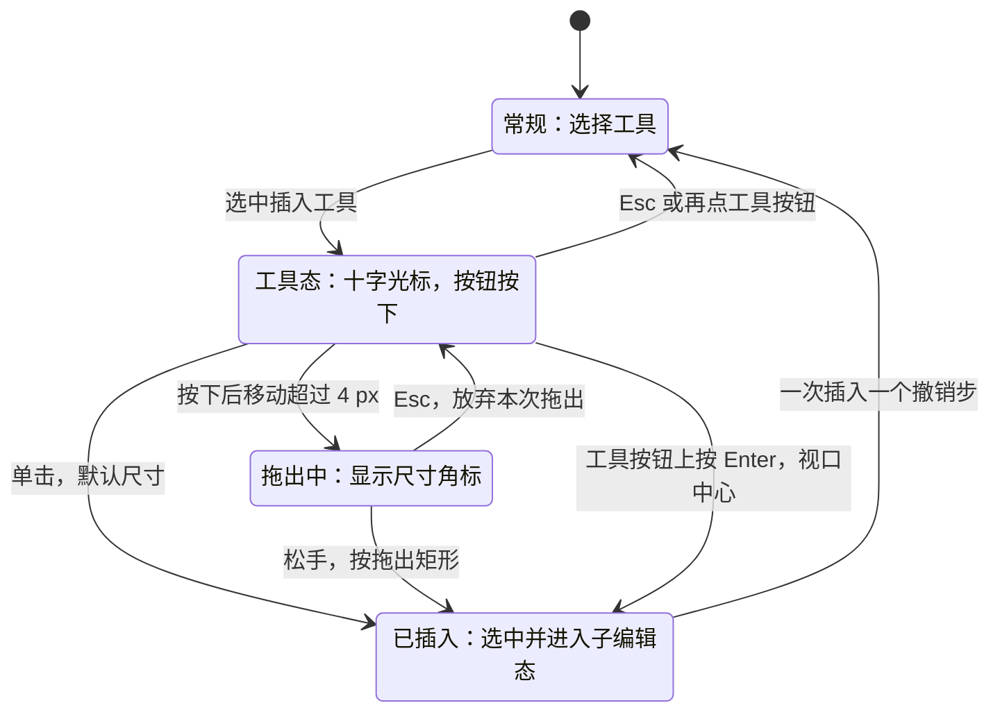
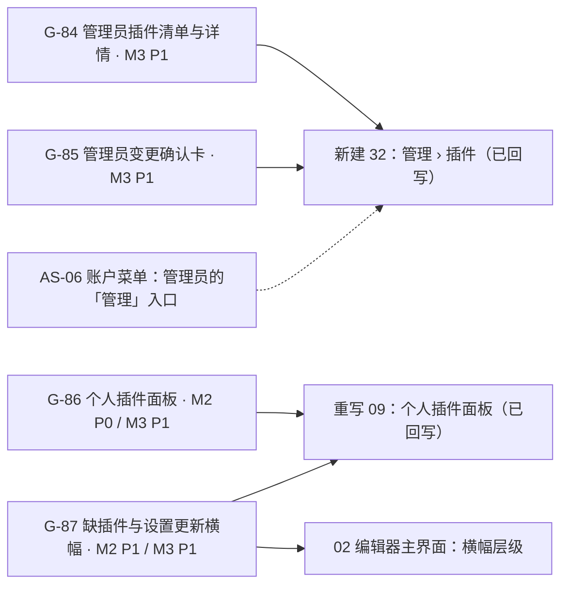

> 状态：草稿 | 负责：产品（2026-09-17 由总编排按设计稿同步；2026-09-18 按用户裁决 Q11–Q20 回写） | 更新：2026-09-18；2026-09-24（rulings §4.15：G-53 撤销语义重写（Q3）、D7 匿名访客废止（S-1/T-0）、D18 结束态按场景、ED-15/G-63 图表五类、G-55 总元素与超包络拒绝导入（Q5）、G-06 外链资源自动加载（Q7）、SV-06/G-61 去「组织外邮箱」、G-66 补注册与 Casdoor 主题（Q6）、SV-04 M2 过渡封面（Q8））；2026-09-24（rulings §4.16 Q15：G-02 新增 `format.macro_rejected` 失败态）；2026-09-24（复核修正，rulings §4.17）；2026-09-25（补图）；2026-09-25（矛盾收口，rulings §4.18）；2026-09-25（§4.19）；2026-09-26（§4.20：D9 删除被引用版式 / 母版改为确认 + 可撤销双层例外、应用主题直接执行 + 可撤销 Toast（FE-05、FE-07）；G-73 删除母版的版式选取结案与冲突信号（FE-23、FE-04、FE-14）；F-P16 分支；D5 唯一 owner 空窗运维命令（BE-05+TX-22）；G-75 应用主题 Toast）；2026-09-26（§4.21：新增 §2.7 插入元素缺口 G-77–G-83（插入工具态、形状库 72 项、操作设置、空内容占位符图标条、页眉页脚对话框、图标面板、符号面板）；G-32 / G-62 按表格 M2 可插入与归一化模型改写；G-63 补 M3 插入图表并删去「M1/M2 可插入静态图表」；G-13 / G-19 / D21 与 §1.2 矩阵同步；设计稿均待 playground 样张确认后回写）；2026-09-26（§4.21 整合：§2.7 G-81 补文本编辑态的日期和时间格式选择器；登记设计 03-04 静态图表条作废、03-15 形状 flyout 72 项待设计确认、G-77 / G-79 行为落点；D27 登记 Mod+E 冲突待裁）；2026-09-30（§4.21 样张确认回写：G-77、G-78、G-79、G-81、G-82、G-83 设计稿已回写到 20-design/03-screens/04、15、18，状态改为已回写；§1 矩阵 ED-05、ED-07、ED-15a、ED-19、ED-31、ED-32、ED-33、ED-35 两列同步；G-80 与表格、图表类 G-32 / G-62 / G-63 仍待样张）；2026-09-30（§4.21 剩余缺口样张回写：G-80 空内容占位符图标条与 G-81 文本编辑态的日期和时间格式选择器回写到 20-design/03-screens/16，G-32 / G-62 落点定为新建的 03-30 表格编辑、G-63 落点定为新建的 03-31 图表编辑，五项状态均改为已回写；§1 矩阵 ED-07、ED-10、ED-15、ED-15a、ED-31 两列同步；§0 界面编号范围改为 01–31、§5 新文件编号改为从 32 起；样张经主会话抽查，最终以用户确认为准）；2026-09-30（§4.21 剩余缺口样张回写 · 整合：G-32「上限 10 × 8」的行列归属与 G-62 他人删行 toast 的按钮文案登记为待决，分别指向设计 30 §13 第 6、4 条；§2.7 第一段回写说明补「同日已补」）；2026-09-30（§4.21 剩余缺口样张回写 · 复核修正，按设计稿同步：ED-12 矩阵行与 G-19 迷你工具条槽位改为 `toolbar.chart`、table-cell 内容按设计 30；G-26 表格单元格变体改为平铺菜单；G-62 边框预设改为 10 个；G-34 落点改为 03-16 已有一节；§2.7 引言改为已回写；G-32 占位符表格图标登记待决）；2026-09-30（§4.22 设计待决收口：G-32 / G-62 / G-63 / G-80 / G-81 的待决项按用户裁决三题与默认答案定稿——插入落点先填空内容占位符、占位符表格图标弹网格弹层、网格悬停 8 行 × 10 列与对话框上限待性能评估、他人删行 toast 按钮「恢复该行」、边框 10 个预设、数据面板为检查器加宽到 440、图标条按屏幕尺寸绘制并可折叠、日期格式默认 datetime1；G-19 补 M2 单元格选区工具条、G-26 补 M2「删除表格」可用；§1 矩阵 ED-07、ED-10、ED-15、ED-15a、ED-31 两列与 §2.7 落点图同步；缩略图保真、样式数据来源、日期格式映射改为推迟）；2026-10-01（§4.23 插件管理：新增 §1.9 PM 覆盖矩阵与 §2.8 缺口 G-84…G-87（管理员插件清单与详情、管理员变更确认卡、个人插件面板、缺插件与插件设置更新横幅），落点均为待样张；§1.4 PS-11 行改指个人插件面板）；2026-10-01（§4.23 插件管理样张回写：用户确认 playground 样张，G-84 / G-85 落点为新建的设计 03-32 管理员插件管理（`#/admin/plugins`，11 态），G-86 / G-87 落点为重写的设计 03-09 个人插件面板（`#/editor/plugins`，14 态）与 03-02「插件横幅」，四项状态改为已回写；§1.9 设计 / 原型覆盖两列、§1.4 PS-11 与 ED-16 行、§1.8 AS-06 行、F-P14 流程、§2.8 落点图同步；§0 界面编号范围改为 01–32、§5 新文件编号改为从 33 起）；2026-10-04（design-language-v3 第 0 批：状态头注明已被取代，正文不改）；2026-10-07（design-language-v3 第 1 批：取代注记补第 1 批——对象迷你工具条、调整手柄、参考线与网格间距、版式画廊与重置、撤销与保存态、缩放与面板尺寸、查找、链接、插入入口与原型路由、母版与主题等缺口条目的改读集中在 README §9 末的改读表（rulings §4.25 DS-13、DS-21…DS-30、TB-1…TB-30），正文仍不改）；2026-10-08（design-language-v3 第 1 批收口：取代注记补 2026-10-08 收口——快速样式、主题与模板清单、色板变体数、幻灯片大小、表格插入文案、备注拖高、替代文本、开发者面板、窄屏形态与母版占位符类型等写法的改读并入 README §9 两表（rulings §4.25 DS-30…DS-33、TB-8、TB-12、TB-24、TB-32、TB-34、TB-40、TB-41、TB-44），正文仍不改）；2026-10-15（design-language-v3 第 2 批：取代注记补第 2 批——评论、版本历史、分享与访问申请（含「待处理申请 N」改读为「访问申请 N」）、降权与隔离、离线与同步状态行、软冲突、保真报告与降级对象、查看器 ⓘ、个人插件面板与插件收纳、插件横幅等条目，以及 §4 D2、D4、D9、D27 的改读集中在 README §9（rulings §4.25 DS-38…DS-63），正文仍不改）；2026-10-15（design-language-v3 第 2 批回写补充：取代注记补 G-24 第二条（离线时的刷新提示）、G-26 评论图钉与降级元素右键、G-30 导入详情自动高亮开关的改读（rulings §4.25 DS-40、DS-59、DS-64、TB-61、TB-67），G-56「通知由集成方发送」保留并由 M3 Webhook 事件 `access_request.created` 支撑（DS-67）、申请被拒不告知（DS-68），并注明 §0「Fn」图例只列到 F9、设计 02 另有 F10、F11；正文仍不改）；2026-10-15（design-language-v3 第 2 批回写再补充：取代注记补 G-40 编辑中新增降级的角标高亮、§1.1 OF-05、OF-13、OF-17 三行缺口列与 OF-13 原型覆盖列的改读指向（README §9 第 2 批改读表 OF-13 一行；报告的常驻入口只有「文件 › 保真报告」、不设角标与「不再提醒」，rulings §4.25 DS-38、DS-51）；正文仍不改）；2026-10-22（design-language-v3 第 3 批：取代注记补第 3 批——§1.8 AS 各行、G-41 新建弹层、G-64 回收站、G-02 打开失败、G-01 协同快照打开、G-54 导入、G-25 导出、G-04 查看器、G-87 查看器一行说明与版本漂移合并、F-P10「已导出本地副本」、G-21 快捷键面板、G-30 设置、G-36 放映、F-P09 跟随、G-66 登录与错误页、G-84 / G-85 管理员插件、G-76 模板库、G-68 窄屏与平板、ED-30 命令面板、EM-01 嵌入，以及 §4 D4、D6、D12、D13、D15、D16、D17、D27 的改读集中在 README §9（rulings §4.25 DS-71…DS-136、TB-101…TB-129）；G-36 的「进入时键盘提示浮层」「显示 / 隐藏光标」与 G-76 的「分类、搜索、最近使用」按裁决不做（DS-107、DS-93）；正文仍不改）；2026-10-22（design-language-v3 第 3 批回写补充：取代注记补 G-25 导出对话框底部的「查看导入详情」、§1.6 SV-02 行的「下载链接（1 h 有效）」与 G-04 查看器工具条里常驻的「搜索」，改读并入 README §9 第 3 批改读表（rulings §4.25 DS-100、DS-137、DS-138、TB-130…TB-151）；正文仍不改；2026-10-22 复核修正：取代注记里 G-30 开关的「去留并入第 3 批复核」补结案指向（DS-114），并注明 TB-152…TB-169 的改读同样并入 README §9 第 3 批改读表（如 G-02 末条「申请访问」M2 不可用，TB-156）；取代注记里并入该表的技术口径范围改到 TB-178，注明 TB-172 并入第 2 批改读表 CO-01、CO-06 一行；正文仍不改）；2026-10-23（design-language-v3 第 3 批评审修改：取代注记补 G-54 与图 G-54 的 `#/import` 过渡页、G-55 里导入失败落在过渡页失败态的写法与 §1.6 SV-01 行的过渡态——导入改为叠在原页上的「导入」对话框（rulings §4.25 DS-140、TB-179…TB-181），G-25 导出格式行另带文件类型图标（DS-143、TB-182），改读并入 README §9 第 3 批改读表 G-54、G-25 两行；正文仍不改）；2026-11-04（design-language-v3 母版视图改版：只改文首，第 2 行取代注记补 G-70、G-71、G-73、G-74 与 F-P16 中的范围条与图例、继承占位符徽标、加载骨架、多选画布的占位提示、窗格的右键与键盘、「插入占位符 ▾」的位置与「转到版式」的出现范围（rulings §4.25 DS-145…DS-154、DS-174），改读并入 README §9 母版视图改版改读表；正文仍不改） | 依赖：charter v0.2；rulings §4.10、§4.15、§4.18、§4.19、§4.20、§4.21、§4.22、§4.23；`09-prd-design-alignment-2026-09-18.md`
> **已被 rulings §4.25 DS-1/DS-2 取代**（2026-10-04，设计语言 v3：编辑器去 ribbon 改 Figma 式结构、取消应用栏与状态栏、视觉改中性平面）：本文以 ribbon 页签 / 分组、应用栏、状态栏与毛玻璃材质描述的入口与界面结构只作历史参考，现行口径见各功能域正文与 README §9 的改读表；2026-10-07 第 1 批（编辑器族 + 窄屏）拍板后（rulings §4.25 DS-13、DS-21…DS-30），本文中迷你工具条、黄色调整手柄、品红参考线、网格间距、缩略图右键「版式 ▸」、内嵌确认卡、App Bar 撤销与保存态、缩放胶囊与面板尺寸、「超链接…」与插入页签入口等写法同样已被取代，改读见 README §9 末的第 1 批改读表；2026-10-08 第 1 批收口（rulings §4.25 DS-31…DS-33、TB-31…TB-52）后，本文中的快速样式入口、主题画廊的内置主题清单与「4 个变体」、幻灯片大小、表格插入的读数与对话框文案、备注拖高范围、替代文本弹层、开发者面板入口、「最小 640 × 400」的窄屏口径与「插入占位符」11 类等写法也已被取代，改读同样见 README §9 的两张表；2026-10-15 第 2 批（协作族）拍板后（rulings §4.25 DS-38…DS-63），本文中评论的发起与撰写（「添加批注」、面板底部撰写框、图钉编号、「导入为可编辑线程」）、版本历史的迷你缩略图条与命名弹层、分享链接区与过期时间、申请访问的 toast 与所有者端「待处理申请 N」（统一为「访问申请 N」）、降权横幅正文、离线与长时间离线提示、查看人数已满的阻断态、同一文本框的「X 也在编辑」、降级占位的一行文案与可关闭的页级提示条、App Bar 保真角标与诊断面板落点、查看器 ⓘ 摘要、个人插件面板与插件横幅，以及 §4 D2、D4、D9、D27 中相应的写法同样已被取代，改读见 README §9 第一张表与第 2 批改读表；同日回写中的补充裁决（rulings §4.25 DS-64…DS-68、TB-59…TB-74）后，G-24 离线时的「刷新将丢失未同步更改」（浏览器原生提示不能定制文案，这类文案只用于应用内确认框）、G-26 评论图钉与降级元素两个右键变体、G-30「通知」组的导入详情自动高亮开关（去留并入第 3 批复核，TB-67；第 3 批已删去，DS-114）也按 README §9 第 2 批改读表改读；G-56 的「通知由集成方发送」保留，M3 由服务端 Webhook 事件 `access_request.created` 支撑（DS-67），申请被拒不告知申请人（DS-68）；G-40 中编辑导致新增降级时的「角标数字更新并短暂高亮」、§1.1 OF-05、OF-13、OF-17 三行缺口列的「入口角标见 G-40」「G-40（措辞）」与 OF-13 原型覆盖列的「部分（报告对话框）」同样按 README §9 第 2 批改读表 OF-13 一行改读：保真报告的常驻入口只有主菜单「文件 › 保真报告」，报告是检查器整栏面板，打开后有差异时出一次轻提示，不设常驻角标与「不再提醒」，编辑中新增的降级由报告条目与缩略图警示角标体现（DS-38、DS-51）；§0「Fn」图例写于设计 02 只有 F1–F9 时，设计 02 现另有 F10 母版视图与版式 / 主题管理、F11 分享与访问申请，本文正文未引用这两条；2026-10-22 第 3 批（应用壳族）拍板后（rulings §4.25 DS-71…DS-136），本文中开始页与文档列表的左栏与新建卡、「新建 ▾」弹层、回收站 Tab、打开失败的合并写法、打开进度的骨架、导入直接进过渡页、导出的入口快捷键 `Mod+E` 与「链接 1 小时内有效」、批量 PNG、查看器的单行工具条与窄屏收敛、快捷键面板与设置的抽屉形态、设置里的「密度」与两个通知开关、放映的键盘提示浮层与「显示 / 隐藏光标」、跟随标签、待新建的「登录与会话」、管理员插件的详情与草稿画法、模板库的分类与搜索等写法同样已被取代，改读见 README §9 第一张表与第 3 批改读表（导入详情自动高亮开关删去，DS-114；登录、会话与错误页的落点为设计 03-33，DS-71）；同日回写中的补充裁决（rulings §4.25 DS-137、DS-138、TB-130…TB-151）之后，G-25 导出对话框底部的「查看导入详情」（改为「查看保真报告」）、§1.6 SV-02 行的「下载链接（1 h 有效）」（下载地址每次现签，界面不写时效，DS-100）与 G-04 查看器工具条里常驻的「搜索」（与缩略图条、备注同为宿主选项）也按 README §9 第 3 批改读表改读；其后的技术口径（rulings §4.25 TB-152…TB-178）涉及的改读同样并入该表（TB-172 并入第 2 批改读表 CO-01、CO-06 一行），如 G-02 末条的「申请访问」在 M2 留在原位、不可用（TB-156）；2026-10-23 第 3 批文档评审修改（rulings §4.25 DS-140…DS-143、TB-179…TB-183）后，G-54 与图 G-54 的 `#/import` 过渡页（选择 .pptx 即进入、取消回到文档列表、失败只给「返回列表」）、G-55 里导入文件过大与超出规模上限落在「过渡页失败态」的写法、§1.6 SV-01 行的过渡态同样已被取代：导入全程在叠在原页上的「导入」对话框里，取消、× 与 Esc 中止并关闭、留在原页，失败后的出口只有「关闭」（DS-140、TB-179…TB-181）；G-25 的导出格式行另带文件类型图标（DS-143、TB-182）；改读见 README §9 第 3 批改读表 G-54、G-25 两行；2026-11-04 母版视图改版（rulings §4.25 DS-144…DS-177、TB-186…TB-210）后，G-70、G-71、G-73、G-74 与 F-P16 中的范围条与图例、继承占位符的虚线徽标、加载骨架、多选画布的占位提示、窗格的右键与键盘、「插入占位符 ▾」的位置与「转到版式」的出现范围同样已被取代：窗格选中即编辑对象，对象名并入母版视图横幅，占位符一律虚线 + 类型名、继承项点线，加载为转圈 + 一句文字，「占位符 ▾」在底部工具条「选择」之后第 2 位，「转到版式」只在选中对象本身是占位符形状时出现（DS-145…DS-154、DS-174），改读见 README §9 母版视图改版改读表；正文保持原样不再修订。

# 07 需求 ↔ 设计 ↔ 原型 覆盖矩阵与缺口清单（供设计条线直接消费）

> 背景：用户反馈「目前功能不全」。本文以产品视角核对 `docs/20-design/`（IA、F1–F9 流程、12 个界面、05 协同 UX、06 扩展 UX、07 可访问性）与 `prototype/index.html` 对 M1–M3 内有界面影响的需求的覆盖情况，产出 (1) 覆盖矩阵、(2) 按里程碑/优先级排序的缺口清单（每个缺口附 Given/When/Then 级期望行为，设计无需回读 PRD 全文）、(3) 原型 v2 必须演示的流程、(4) 影响界面的产品待决事项的默认答案。
> 结论先行：设计文档在**横切主题**（协同/离线/权限降级/插件失败/可访问性）上覆盖完整；在**编辑器基本功**（插入、文本编辑与格式化、页管理与版式、对齐/吸附/网格、剪贴板、撤销重做、查找替换、导出对话框、设置、快捷键面板、只读查看器壳、打开失败态全集）上多为流程级文字、缺线框与状态；原型 v1 只演示了主界面壳、四个面板、两个对话框、命令面板、单一变体右键菜单、放映与横幅，**没有演示任何一条编辑流程**。缺口共 61 个：M1 P0 6、M2 P0 20、M2 P1 15、M3 P0 9、M3 P1 11（含 2026-09-15 总编排裁决新增的母版/版式/主题缺口 G-70–G-75 与 2026-09-18 补编号的应用壳缺口 G-76；其中 G-04 / G-21 / G-30 / G-70 / G-71 / G-72 已按实现回写为「已实现」，编号保留不复用）。

> **2026-09-17 同步说明**：本文「设计覆盖 / 原型覆盖」两列写于 2026-09-15，此后设计线已交付 28 份界面文档与 19 条 playground 路由（`20-design/README.md` §8 v4–v20，artifact 见 `docs/README.md`），大部分「无 / 部分」已过期。本次只回写与母版视图、应用壳、设置入口相关的行与缺口（§1.5、§1.7、§1.8、G-21/30/70/71/72/73、D12/13/23/24/25）；其余行的覆盖状态以 `20-design/playground/src/routes/registry.ts`（全部 ready）为准，落点文件编号以 `20-design/03-screens/` 现行编号为准（G-70/71 → 26、G-21 → 24、G-30 → 23）。

> **2026-09-18 同步说明**：按用户裁决（rulings §4.10 Q11–Q20；逐项处置见 `09-prd-design-alignment-2026-09-18.md`）回写——G-70 / G-71 / G-72 删去「评审模式可进入」与「< 1024 改为侧边抽屉」的旧口径（Q12：仅编辑模式且视口 ≥ 1024 提供入口），补入范围条、加载 / 失败态、应用栏「改动将影响 N 页」徽标、版式多选与占位符上限（Q16）；G-73「删除」分支改为「确认对话框 → 自动改用默认版式」（Q11）；G-04 补查看器可选缩略图条与备注抽屉（Q18）；F-P16 改为分段入口 + 母版缩略图窗格；D9 增「重置为版式默认」双层例外；新增 D26（母版视图可用范围，Q12）、D27（应用栏「⋯」菜单，Q20）；§1.1 OF-14、§1.2 ED-16 / ED-25、§1.7、§1.8 AS-03（G-76 补编号）/ AS-06 按现状更新；§2 各缺口「落点」改为 `03-screens/` 现行编号，尚未出稿者标「待新建（编号待分配，不得占用 23–29）」。

> **2026-09-26 同步说明**（rulings §4.21）：用户指出「编辑器的每个能力前端怎么实现、尤其追加元素的部分没有说清楚」，前端新增元素目录 50/19–50/25 与能力总表 50/18。本次新增 §2.7 共 7 个插入元素缺口 G-77–G-83（M2 P0 2、M2 P1 2、M2 P2 1、M3 P2 2），并改写 G-32、G-62、G-63；上文「缺口共 61 个」的计数不含 §2.7。§2.7 各项的界面当时尚无设计稿，约定待 playground 样张确认后回写本文 §1 矩阵的「设计覆盖 / 原型覆盖」两列。（2026-09-30：样张已确认，G-77–G-79、G-81–G-83 已回写；同日剩余缺口 G-80 与 G-81 的日期和时间格式选择器也已回写，§2.7 七项全部为「已回写」，见 §2.7「状态」列与下一段。）

> **2026-09-30 同步说明**（§4.21 剩余缺口样张回写）：§4.21 之后还没有设计稿的 5 个缺口已按 playground 样张回写——G-80 空内容占位符图标条、G-81 文本编辑态的「日期和时间」格式选择器扩展到 [03-16](../20-design/03-screens/16-text-editing-and-formatting.md)（路由 `#/editor/text`）；G-32 表格插入与单元格文本、G-62 表格结构编辑新建 [03-30](../20-design/03-screens/30-table-editing.md)（路由 `#/editor/table`）；G-63 插入图表与图表数据编辑新建 [03-31](../20-design/03-screens/31-chart-editing.md)（路由 `#/editor/chart`）。§1 矩阵 ED-07、ED-10、ED-15、ED-15a、ED-31 的「设计覆盖 / 原型覆盖」两列已同步。样张由主会话抽查通过，**最终以用户确认为准**；样张作者自报的取舍写在各设计稿的「待决 / 取舍」里，本文不复述（同日已按 rulings §4.22 收口，见下一段）。至此本文登记的界面缺口中，已编号待新建文件的只剩 G-44 / G-67 开发者面板、G-66 登录与会话、G-76 模板库（可扩展 29）。

> **2026-09-30 §4.22 收口说明**（rulings §4.22）：上段回写后留下的待决项已全部收口。用户裁决三题：从插入页签插入表格、图表、图片时，页上有空内容占位符就填入阅读序第一个；空内容占位符的表格图标弹出与插入页签同一网格弹层（含「插入表格…」）；网格悬停范围 8 行 × 10 列，「插入表格…」对话框上限待性能评估、评估定值前暂按 75 × 75 占位。其余待决按默认答案直接落地，样张同步修改；G-19、G-26、G-32、G-62、G-63、G-80、G-81 与 §1 矩阵 ED-07、ED-10、ED-15、ED-15a、ED-31 两列已同步。仍不能定的项改为「推迟」并写明触发条件（表格样式缩略图逐部件保真、74 种样式的数据来源与许可、`datetime1`…`datetime13` 的三语映射、`obj` 占位符放图片是裁剪填满还是等比放入、对话框上限的性能评估），见 rulings §4.22。

---

## 0. 读法与记号

| 记号 | 含义 |
|---|---|
| `IA §n` | `20-design/01-information-architecture.md` 第 n 节 |
| `Fn` | `20-design/02-user-flows.md` 流程 Fn（F1 打开、F2 编辑、F3 加入离开、F4 软冲突、F5 离线、F6 导出、F7 评论、F8 版本、F9 插件） |
| `01`…`32` | `20-design/03-screens/01-document-list.md` … `32-admin-plugin-management.md`（现行 32 份，编号以目录为准；后接 §/状态名；`30-table-editing.md`、`31-chart-editing.md` 于 2026-09-30 按 §4.21 样张新建，`32-admin-plugin-management.md` 于 2026-10-01 按 §4.23 样张新建）。本文 §2 各缺口「落点」已于 2026-09-18 改为现行编号；尚未出稿者标「待新建（编号待分配，不得占用 23–31）」 |
| `05 §n` / `06 §n` / `07 §n` | `05-collaboration-ux.md` / `06-extensibility-ux.md` / `07-accessibility-and-i18n.md` |
| 设计覆盖 | 完整 = 有线框 + 状态 + 交互；部分 = 仅文字/流程提及或仅部分状态；无 |
| 原型覆盖 | 有 = 可看到该表面且关键状态可切换；部分 = 静态或仅单一状态；无 |
| `G-xx` | 本文 §2 的缺口编号 |
| 优先级 | 取自 PRD 各需求；缺口优先级 = 所属需求在该里程碑的优先级 |

---

## 1. 覆盖矩阵（M1–M3 内有界面影响的需求）

### 1.1 OF 打开 / 保真 / 导出

| 需求 | 里程碑 / 优先级 | 所需 UI 表面 | 设计覆盖 | 原型覆盖 | 缺口 |
|---|---|---|---|---|---|
| OF-01 打开 pptx | M1 / P0 | 加载骨架、阶段进度（解压 / 解析 / 首屏）、取消、三种入口（列表 / 拖入 / 链接） | 部分：02 加载中（进度条 + 骨架）；F1 主流程、E6 | 无 | G-01 |
| OF-02 类型识别与错误码 | M1 / P0 | 按错误码区分的阻断错误态（`.ppt` 不支持 / 加密 / 无效的演示文稿 / 超限 / 无访问权 / 无文档类型） | 部分：02 错误（单一通用文案）；F1 E3、E5 | 无 | G-02 |
| OF-03 渐进加载 | M1 / P0 | 首屏先出、其余页与缩略图逐步细化、跳转到未解析页的等待态、后台解析进度 | 部分：02 加载中「渐进式细化」；F1 E6 | 无 | G-01、G-05 |
| OF-05 字体回退 | M1 / P0 | 保真报告「缺失字体替代」条目；诊断面板（M2） | 完整：10 | 有 | 入口角标见 G-40 |
| OF-07 图片与媒体 | M1 / P0 | 视频 / 音频海报帧 + 播放控件（查看 / 放映）、不支持编解码提示、EMF 无预览占位（M2 起栅格化，超限回占位）、外链资源占位（`externalResources` 为 confirm/never 时） | 无 | 无 | G-06 |
| OF-09 图表 | M1 / P0 | 图表渲染块缺席时的占位；M3 前「数据编辑不可用」提示 | 部分：04 交互说明（禁用提示一句） | 无 | G-03 |
| OF-11 备注 / 评论 / 节的读取 | M1 P0 / M2 P1（节） / M3 P1（旧评论） | 备注区只读；旧式评论只读线程 + 「导入为可编辑」；缩略图节分组 | 部分：IA §2.3a 备注区；06 边界（旧评论）；节：无 | 部分（备注区） | G-42、G-50 |
| OF-13 错误隔离与降级渲染 | M1 P0 / M2 P1（诊断面板） | 元素级占位框（可选中 / 移动 / 删除）、页级「部分内容无法显示」提示条、缩略图警示角标、保真诊断面板 | 部分：F1 E2 文字；10（导入时报告） | 部分（报告对话框） | G-03、G-40 |
| OF-14 只读查看器 preset | M1 / P0 | 独立查看器壳：翻页 / 页码 / 缩放 / 适应 / 全屏放映 / ⓘ 保真摘要 / 搜索（M2） / 超链接；加载与错误态；可选缩略图条与备注抽屉（默认关、宿主选项开启） | 完整：03-screens/25；IA §8（可选缩略图条与备注抽屉 2026-09-18 Q18 补入） | 有（playground `#/viewer`） | 已实现（G-04 落点 25） |
| OF-15 缩略图 | M1 / P0 | 虚拟化占位、懒生成、编辑后 ≤ 500 ms 更新、警示角标、当前页标记 | 部分：02 边界（虚拟滚动一句） | 部分（3 张静态） | G-05 |
| OF-16 文本搜索 | M2 / P1 | 查找面板、命中计数、跨页跳转、元素级高亮；查看器壳内的搜索 | 无（IA §8 提及查看器搜索按钮） | 无 | G-31 |
| OF-17 内嵌字体 | M2 / P1 | 报告条目「内嵌字体已加载 / 超限跳过」 | 部分：10 可复用「缺失字体」条目 | 有 | G-40（措辞） |
| OF-18 导出 pptx | M1（零编辑）/ M2 P0 | 导出对话框（格式 / 范围）、确定态进度、完成与下载、失败重试、未同步更改警告、不透明保留说明 | 部分：F6 流程与边界（无线框） | 无（仅 toast） | G-25 |
| OF-19 导出 PNG / SVG / PDF | M2 P1（PNG/SVG）/ M3（PDF 服务端） | 格式与宽度选项、服务端作业进度与下载链接有效期 | 部分：F6 | 无 | G-25 |
| OF-21 文件属性 | M2 / P2 | 属性对话框（只读） | 无 | 无 | P2，见 §2.6 |
| OF-22 新建 / 从模板 | M2 / P1 | 新建入口、模板选择（空白 16:9 / 上传 .potx / 最近模板） | 部分：01 「新建」按钮 | 无 | G-41 |
| OF-24 输入安全限制 | M1 / P0 | 超限错误态（显示被触发的限制与上限值） | 部分：F1 E1（仅上传大小） | 无 | G-02 |

### 1.2 ED 编辑

| 需求 | 里程碑 / 优先级 | 所需 UI 表面 | 设计覆盖 | 原型覆盖 | 缺口 |
|---|---|---|---|---|---|
| ED-01 选择模型与命中 | M2 / P0 | 单选 / Shift 多选 / 框选矩形 / 多选包围盒 / 组合进入与退出 / Tab 循环 / 锁定元素的禁用手柄 / 隐藏元素 | 部分：02 选中态变体表；07 §1.2 键盘 | 部分（单选框 + 手柄静态） | G-10 |
| ED-02 文本内联编辑与 IME | M2 / P0 | 进入 / 退出编辑态、插入符、IME 组合态、空占位符提示文字（「单击此处添加标题」）、自动增长 | 部分：02 「正在编辑文本」一行；07 §4 IME 规则 | 部分（迷你工具条静态） | G-11 |
| ED-03 字符与段落格式 | M2 / P0 | ribbon「开始」完整分组（字体族可搜索、字号阶梯、B/I/U/S/上下标/颜色/高亮/大小写/清除格式；段落对齐 5 种、缩进、行距菜单、段距；文本框锚点 / 内边距 / 换行）、颜色选择器 popover、迷你工具条、属性面板「文本」 | 部分：02 ribbon 线框（简）；03 文本分区（字体/字号/行距/BIU/对齐） | 部分（B/I/U/颜色/两种对齐/行距按钮） | G-12 |
| ED-04 项目符号与编号 | M2 / P0 | 项目符号库 / 编号库 flyout、升降级、起始编号 | 无 | 无 | G-12 |
| ED-05 形状插入与几何变换 | M2 / P0 | 形状库 flyout（首批约 72 项、10 类）、插入工具态（十字光标、单击 vs 拖出、Esc、插入后选中）、线条两端点手柄、动作按钮与操作设置、8 缩放手柄 + 旋转手柄 + 黄色调整手柄、Shift/Alt 修饰反馈、拖动中尺寸/位置角标、文本框工具 | 完整：15（2026-09-30 样张确认回写：形状库 10 类 72 项、插入工具态视觉、操作设置对话框、变换手柄）；04 分组 | 有（playground `#/editor/insert`：形状库 · 72 项、插入工具态 · 拖出、动作按钮 · 操作设置、变换手柄） | G-13、G-77、G-78、G-79（G-77 / G-78 / G-79 已回写） |
| ED-06 填充 / 线条 / 效果 | M2 P0（纯色 / 线条）/ P1（渐变 / 阴影 / 样式库） | 填充类型切换、渐变 stop 编辑器、线宽 / 虚线 / 箭头选择器、阴影预设、形状样式库、多选统一应用 | 部分：03 填充（纯色 / 渐变 / 图片单选框 + 不透明度）、边框与阴影仅分区标题 | 部分（纯色色块） | G-14 |
| ED-07 图片操作 | M2 / P0 | 插入（文件 / 拖入 / 粘贴 / URL）、上传占位与失败态、替换 / 重置、裁剪模式（手柄 + 遮罩）、透明度、替代文本、大图压缩提示、空内容占位符图标条（P1） | 完整：04 图片 ▾ 菜单与加载中 / 错误占位；18 插入路径、裁剪、替代文本、大图压缩、SVG 与图标（2026-09-30 回写）；05 「编辑替代文字…」菜单项；16 空内容占位符图标条（图标条、键盘焦点与禁用原因、图片拖入空占位符，2026-09-30 剩余缺口回写；§4.22 收口：图标条按屏幕尺寸绘制、窄占位符折叠为「插入 ▾」、表格图标弹网格弹层） | 部分（playground `#/editor/insert` 图片 ▾ 菜单与上传中；`#/editor/text` 空内容占位符 · 图标条、图标条 · 键盘焦点与禁用原因、图标条 · 窄占位符折叠、占位符 · 表格网格、图片拖入空占位符） | G-15、G-80（G-80 已回写） |
| ED-08 组合 / 层级 / 对象操作 | M2 / P0 | 组合 / 取消组合、置顶 / 置底 / 上下移一层、复制偏移、删除（可撤销 toast）、重命名（P1） | 部分：05 形状右键；02 ribbon「排列」 | 部分（右键项、两个排列按钮） | G-16 |
| ED-09 对齐 / 分布 / 吸附 / 参考线 | M2 P0（吸附与智能参考线）/ P1（对齐分布）/ P2（标尺） | 智能参考线（边 / 中心 / 等距）、吸附开关与 Alt 临时禁用提示、对齐 / 分布菜单（参照页面 / 所选）、网格显示与吸附设置 | 部分：05 「网格与参考线 ▸」菜单项；03 「对齐与分布」仅分区标题 | 无 | G-17 |
| ED-10 表格编辑 | M2 P1（插入与单元格文本，rulings §4.21 由 M3 提前）/ M3 P1（结构与样式） | 插入网格与「插入表格…」对话框、单元格选中与 Tab 导航、行列插入 / 删除手柄、合并 / 拆分、行高列宽拖动、边框选择器、样式库与标志复选 | 完整：30 表格编辑（2026-09-30 剩余缺口回写：M2 插入网格与默认表格、首格光标、单元格编辑与 Tab 导航、多格选区、结构编辑灰显；M3 悬停「+」插入行列、拖分隔线调列宽、右键菜单行列与合并、合并后效果、边框选择器、样式库与 6 个标志；他人删除正在编辑的行）；04 插入网格选择器（悬停范围 8 行 × 10 列）；§4.22 收口补「插入表格…」对话框与超限报错、占位符表格网格、M2 单元格选区、样式库展开全部 74 种（缩略图逐部件保真推迟，见 G-62） | 有（playground `#/editor/table` 17 个演示状态；`#/editor/insert` 表格 ▾ 网格） | G-32、G-62（均已回写） |
| ED-11 幻灯片管理 | M2 P0（新建 / 复制 / 删除 / 重排 / 隐藏 / 换版式 / 重置）/ P1（节显示） | 「新建 ▾」版式选择器、复制、删除（可撤销）、拖拽重排（占位 + 多选拖动）、隐藏态视觉、更换版式库、重置页、节标题折叠 | 部分：05 缩略图右键（5 项）；02 交互说明（拖拽排序） | 部分（静态 3 张 + 新建按钮） | G-18、G-42 |
| ED-12 属性面板与上下文工具 | M2 / P0 | 按选区类型的分区（形状 / 文本框 / 图片 / 表格 / 组合 / 连接符 / 幻灯片级）、多选混合值、迷你工具条按类型（`ui.toolbar` 槽 text-editing / image-selected / `toolbar.chart`（原写 chart-selected，按前端 50/10 §5 命名））、右键菜单全变体 | 部分：03 按选区类型的分区总表（2026-09-30 补 `table` / `table-cell`、`chart`、`placeholder-empty`，分别链到 30、31、16）与迷你工具条槽位；05 右键变体（2026-09-30 补表格单元格 M2 / M3 两态）；06 §2.6 | 部分（形状属性；形状右键） | G-19、G-26 |
| ED-13 查找与替换 | M2 / P1 | 查找 / 替换面板、选项（区分大小写 / 全字）、命中计数与上下条、全部替换 toast、画布与缩略图高亮 | 无 | 无 | G-31 |
| ED-14 撤销 / 重做 | M2 / P0 | 快捷入口按钮（禁用态、tooltip 显示步骤名）、撤销时跳页并选中受影响元素、协同下「无法撤销」提示 | 部分：F2 通用回路文字；05 §6（协同语义） | 部分（删除的 toast 撤销） | G-20、G-53 |
| ED-15 图表数据编辑 | M3 / P1 | 数据网格面板、图表类型切换（bar / line / pie / area / scatter 五类，U-06）、标题 / 图例 / 数据标签开关 | 完整：31 图表编辑（2026-09-30 剩余缺口回写：检查器数据网格与展开抽屉、更改图表类型、标题 / 图例 / 数据标签、饼图百分比标签、「此类型仅支持查看」）；§4.22 收口：数据面板定为检查器坞由 300 加宽到 440、整栏换成数据面板，迷你工具条「编辑数据」直开展开面板、双击只展开检查器「数据」分区；补类型切换确认、网格行列右键与截断、原工作簿提示 | 有（playground `#/editor/chart`：数据网格 · 展开抽屉、数据网格 · 行列右键菜单、紧凑网格 · 超过 8 × 4、数据面板 · 原工作簿提示、更改图表类型、更改类型 ▾ · 下拉、更改类型 · 会移除导入内容、更改类型 ▾ · 下拉内确认、标题 / 图例 / 数据标签、饼图 · 百分比标签、此类型仅支持查看） | G-63（已回写） |
| ED-15a 插入图表（§4.21 新增） | M3 / P1 | 图表 ▾ flyout（五类及子类型）、示例数据、插入后自动打开数据网格；M2 入口禁用 | 完整：04 图表 ▾（M3 标记、六项菜单与示例数据，2026-09-30 回写；原「M1/M2 可插入静态图表」已按 rulings §4.21 d-74 删去）；31 图表 ▾ 五类与子类型、插入后示例图表并自动打开数据面板、M2 禁用原因（2026-09-30 剩余缺口回写）、占位符图标条的图表项（§4.22 收口） | 有（playground `#/editor/chart`：插入后 · 示例图表与数据面板、图表 ▾ · 五类与子类型、占位符图标条 › 图表（M3）、M2 · 图表 ▾ 禁用 · 选中导入图表；`#/editor/insert` 图表 ▾ 菜单） | G-63（已回写） |
| ED-16 快捷键 | M2 / P0（注册与 tooltip）/ P1（面板） | tooltip 与菜单右侧的快捷键提示、快捷键速查面板、冲突在插件管理器可见 | 完整：03-screens/24（三个入口：Ribbon 页签行右侧「?」、账户菜单「键盘快捷键」、`Mod+/`）；06 §2.4；冲突跳个人插件面板冲突态（03-09 §4.4，2026-10-01） | 有（playground `#/settings` 快捷键面板） | 已实现（G-21 按实现回写） |
| ED-17 剪贴板 | M2 P0（内部 / 文本 / 图片）/ P1（HTML）/ M3 P1（跨文档） | 粘贴变体菜单、「部分格式已被简化」toast、粘贴图片进度、剪贴板权限拒绝回退提示、跨文档版式映射提示 | 部分：05 文本右键两种粘贴；F2 边界一句 | 无 | G-22、G-65 |
| ED-18 演讲者备注编辑 | M3 / P1（2026-09-25 由 M2 调整，M1–M2 备注区只读） | 备注区展开 / 拖高、字数、基本格式 | 完整：IA §2.3a、02 | 有 | G-33（格式与拖高） |
| ED-19 超链接 | M2 / P1 | 超链接对话框（URL / 跳转到页 / 移除）、编辑态 Mod+点击提示、操作设置对话框（动作按钮与形状动作） | 部分：05 「超链接… Ctrl+K」菜单项；04 超链接对话框；15 操作设置对话框（2026-09-30 回写） | 有（playground `#/editor/insert` 超链接对话框与操作设置） | G-34、G-79（G-79 已回写） |
| ED-20 幻灯片背景 | M2 / P1 | 幻灯片级属性「背景」（纯色 / 渐变 / 图片 / 隐藏背景图形）、「应用到全部」提示、重置 | 部分：03 空态一句（幻灯片级属性含背景） | 无 | G-35 |
| ED-21 放映模式 | M2 / P1 | 进入入口（模式下拉 / F5 / Shift+F5）、控制条、跳页输入、黑 / 白屏、结束页、超链接与媒体点击、演讲者视图（范围见 §4） | 完整（基础）：11；缺跳页输入、白屏、结束页、演讲者视图 | 部分（静态控制条 + 跟随标签） | G-36 |
| ED-22 视图 / 缩放 / 导航 | M2 / P0 | 缩放控件与预设下拉、适应窗口 / 宽度、平移模式、面板拖宽与记忆、大缩放下滚动条 | 部分：02 交互说明；IA §2.2 | 部分（静态缩放条） | G-23 |
| ED-23 保存 / 脏状态 / 离开保护 | M2 / P0 | 保存态文案全集（已保存 / 保存中 / 未保存 / 保存失败重试 / 已在本地保存）、自动保存设置、离开提示、Mod+S 反馈 | 部分：02 App Bar「已保存」、离线「已在本地保存」 | 部分（静态「已保存」） | G-24 |
| ED-24 文本自动调整 | M2 / P1 | 属性面板「自动调整」三选一、溢出指示 | 无 | 无 | G-37 |
| ED-25 母版与版式（索引） | M2 P0 / M3 P0 | 见 §1.7 ML 行 | 见 §1.7（03-screens/26 / 27 / 28） | 有（playground `#/editor/masters`、`#/editor/layouts`、`#/editor/design`） | 见 §1.7（G-70–G-72 已实现；G-73–G-75 缩至未出稿项） |
| ED-26 锁定 / 隐藏 / 替代文本 | M2 P1（替代文本）/ P2（锁定、选择窗格） | 替代文本对话框；锁定开关；选择窗格 | 部分：05 菜单项 | 无 | G-38 |
| ED-28 连接符 | M2 P1（E~）/ M3 P1（E） | 连接点悬停高亮、端点吸附、连接符类型选择 | 无 | 无 | G-39 |
| ED-29 无鼠标编辑 | M2 / P0 | F6 区域循环、拖拽的键盘 / 表单等价、焦点环 | 完整：07 §1–§2 | 部分 | 无缺口（原型 v2 需体现） |
| ED-30 命令面板 | M2 / P2 | 模糊搜索、不可用原因、来源标签 | 完整：06 §2.5；IA §4 | 有 | 无缺口 |
| ED-31 页眉和页脚（§4.21 新增） | M2 / P2 | 页眉和页脚对话框（日期时间 / 幻灯片编号 / 页脚 / 标题页不显示；应用 / 全部应用）、文本编辑态直接插字段 | 完整：15 页眉和页脚对话框、04 文本组随文本编辑态切换（2026-09-30 回写）；16 文本编辑态的日期和时间格式选择器与已插入日期字段（2026-09-30 剩余缺口回写；§4.22 收口：默认 `datetime1`，与对话框共用 13 种格式表；中英日格式映射推迟到 M2 P2 开工前按语料核对，见 G-81）；26 母版页脚复选 | 有（playground `#/editor/insert` 页眉和页脚对话框；`#/editor/text` 日期和时间 · 格式选择器、已插入日期字段） | G-81（已回写） |
| ED-32 插入图标（§4.21 新增） | M3 / P2 | 图标面板（搜索、分类、网格、多选、改色） | 完整：15 图标面板（入口在插入 › 形状 › 图标）、18 SVG 与图标改色（2026-09-30 回写） | 有（playground `#/editor/insert` 图标面板） | G-82（已回写） |
| ED-33 插入符号（§4.21 新增） | M3 / P2 | 符号面板（分类、搜索、最近使用；仅文本编辑态可用） | 完整：15 符号面板、04 禁用原因（2026-09-30 回写） | 有（playground `#/editor/insert` 符号面板 · 编辑文本） | G-83（已回写） |
| ED-34 屏幕截图与相册（§4.21 新增） | M4+ / P2 | 截图授权与失败提示、相册「每图一页」选项 | 无 | 无 | P2，见 §2.6 |
| ED-35 插入视频与音频（§4.21 新增） | M2 / P2 | 视频 ▾ / 音频 ▾、格式兼容提示、上传占位、海报帧 | 部分：04 视频 / 音频 P2 禁用而不隐藏并给原因；18 已有媒体的编辑态临时播放（2026-09-30 回写）；插入流程待 P2 | 部分（playground `#/editor/insert` 禁用原因 · 视频 P2） | P2，见 §2.6 |

### 1.3 CO 协同

| 需求 | 里程碑 / 优先级 | 所需 UI 表面 | 设计覆盖 | 原型覆盖 | 缺口 |
|---|---|---|---|---|---|
| CO-01 会话与房间 | M2 / P0（会话、同步与持久化，rulings §4.19）/ M3（名额、容量、在场） | 六态状态指示（状态栏 + 横幅）、初始同步进度、容量已满只读加入 | 完整：05 §7、12 | 有 | 无缺口 |
| CO-03 Presence | M3 / P0 | 头像簇 + 「+N」列表、远端光标 / 选区、空闲灰显、跟随模式提示条、20 人折叠 | 完整：05 §1–§4 | 部分（静态头像 / 光标；跟随仅放映标签） | 无设计缺口；原型 v2 见 §3 F-P09 |
| CO-04 评论 | M3 / P0 | 评论撰写框 + @ 候选、锚点创建（页 / 元素 / 文本范围）、图钉编号与悬停预览、筛选 / 排序、解决 / 重开 / 编辑 / 删除、已脱离锚点、旧评论导入提示、缩略图评论角标、深链接定位 | 部分：06（列表 / 筛选 / 解决 / 脱离锚点完整；撰写框与 @ 候选无线框；重开 / 编辑 / 删除无；缩略图角标无）；F7 | 部分（两条线程、解决） | G-50 |
| CO-05 权限与只读降级 | M3 / P0 | `readonly-degraded` 横幅 + 导出本地副本、提权 toast、被移除访问的阻断态 | 完整：05 §8、12 | 有（横幅） | G-56（申请访问流程、双向反馈） |
| CO-06 离线与重连 | M3 / P0 | 横幅四态、刷新警告、24 h 提示、登录过期（新窗口重新登录、队列保留，rulings §4.18 UX-02）、离线后周期重连 | 完整：F5、12（出边按 rulings §4.18 UX-01/UX-02/UX-03 同步） | 有 | G-66（重登录回调页） |
| CO-07 版本历史 | M3 / P1 | 时间轴、预览与翻页、命名、恢复确认、「恢复自」记录、加载更早 | 完整（主流程）：07、F8 | 部分（列表 + 恢复确认） | G-60 |
| CO-08 软冲突 | M3 / P0 | 11+4 场景的提示形态（内联 / toast / 动效）；prop-lww 提示条按钮为「恢复我的值」；删除 vs 编辑的「恢复元素」沿用原 id（软删除墓碑，rulings §4.15 Q3） | 完整（11 行）：05 §5、F4；新增 4 行（父子环修复、分段 vs 加粗、离线 vs 删除、同位置插页）未映射 | 无 | G-52 |
| CO-09 协同下撤销 | M3 / P0 | 撤销跳过他人后写的键并提示「X 之后修改了此处，已跳过」；整步被跳过时「这一步已无法撤销」并停下（rulings §4.15 Q3） | 部分：05 §6 文字 | 无 | G-53 |
| CO-10 编辑中软提示 | M3 / P2 | 文本框边缘「X 正在编辑」内联提示 | 完整：05 §5 B 行 | 无 | P2 |
| CO-12 门禁与用户可见行为 | M2 / P0（随协同网关提前，rulings §4.19） | 被拒 update 的「导出后重载」（撤销栈清空说明）、软门禁修复 toast、隔离（4409）后的提示 | 部分：05 §8 / 12 覆盖降权分支；修复 toast 与隔离态无 | 部分（降权横幅） | G-51 |
| CO-13 协同诊断 | M3 / P1（开发者） | 诊断面板（连接 / RTT / 待同步 / 事件流） | 无 | 无 | G-67 |
| CO-15 分享与访问入口（参考应用） | M3 / P1 | 分享对话框、链接权限、申请访问、未注册邮箱邀请报错（无待接受邀请，rulings §4.17 D1）、过期 | 完整（主流程）：08 | 部分（静态列表 + 复制） | G-61 |

### 1.4 PS 插件 SDK（用户可见部分）

| 需求 | 里程碑 / 优先级 | 所需 UI 表面 | 设计覆盖 | 原型覆盖 | 缺口 |
|---|---|---|---|---|---|
| PS-02 贡献点槽位 | M2 / P0 | ribbon / panel / contextMenu / toolbar / statusBar / dialog / notification / overlay 槽位与归属标识 | 完整：06 §2、§4 | 有（槽位高亮开关） | 无缺口 |
| PS-09 开发者面板 | M2 / P1（内部） | Fiber 树、贡献列表、effect 树、事件流、热重载反馈 | 部分：06 §6 槽位高亮 | 部分（槽位高亮） | G-44 |
| PS-11 失败隔离可见性（扩展面板） | M2 / P0 | 状态栏插件入口 → 个人插件面板：启动失败 / 等待依赖 / 版本不兼容的行内说明、错误详情与复制诊断、本会话重试、为我关闭（界面级可选） | 完整：09（2026-10-01 按 rulings §4.23 重写为个人插件面板）；06 §3 降级表 | 有（playground `#/editor/plugins`，14 态） | 已回写（G-27 并入 G-86）；依赖冲突卡与首次启用确认移到管理员稿 32 |

### 1.5 EM 嵌入与集成（用户可见部分）

| 需求 | 里程碑 / 优先级 | 所需 UI 表面 | 设计覆盖 | 原型覆盖 | 缺口 |
|---|---|---|---|---|---|
| EM-01 多实例 / 紧凑模式 | M2 / P0 | 1024 / 640 断点、抽屉互斥、最小 640×400 | 完整：IA §6–§7 | 有（抽屉） | 无缺口 |
| EM-06 主题与外观 | M2 / P0（token）/ P1（用户设置） | 主题切换（跟随系统 / 亮 / 暗）、密度两档、高对比、减少透明度退化 | 完整：03-screens/23 设置；09 v3.0 §1/§6（shadcn Rhea + 材质 token）；Ribbon 右侧主题分段 | 有（playground `#/settings`、全局主题 store） | 无缺口（NF-01 §1.5 材质约束已补） |
| EM-08 UI 裁剪 / 只读嵌入 | M2 / P0 | 评审模式（只读 UI 收敛）、按 id 隐藏 ribbon 项后的布局 | 完整：IA §5、02 评审模式 | 有 | 无缺口 |
| EM-11 国际化对接 | M2 / P1 | 语言切换入口、切换后即时刷新 | 完整：03-screens/23 设置「语言」 | 有（playground `#/settings`） | 无缺口 |
| EM-12 错误处理与诊断 | M1 / P0 | 错误码 → 用户文案 + 建议动作；「复制诊断信息」入口 | 部分：07 §7 文案规范；无诊断入口 | 无 | G-02（错误态）、G-30（诊断入口） |
| EM-17 参考应用 | M2 / P0（开始页、文档列表、OIDC 登录，rulings §4.19） | 开始页（AS-01）、文档列表、账户菜单（AS-06）、登录 / 令牌过期、分享入口 | 完整：03-screens/29 开始页、01 文档列表；登录无 | 有（playground `#/home`、`#/documents`） | G-66（登录） |

### 1.6 SV 服务端（用户可见部分）

| 需求 | 里程碑 / 优先级 | 所需 UI 表面 | 设计覆盖 | 原型覆盖 | 缺口 |
|---|---|---|---|---|---|
| SV-01 服务端导入作业 | M2 / P0（由 M3 提前，rulings §4.19） | `#/import` 过渡态（上传中 → 服务端解析 → 打开编辑器；可取消；确定性失败返回列表、瞬时失败重试，rulings §4.18 UX-14）、大小上限提示 | 部分：01 「导入 .pptx」按钮；F1 E1 | 无 | G-54 |
| SV-02 服务端导出作业 | M3 / P0 | 导出对话框的服务端路径：作业进度、下载链接（1 h 有效）、PDF 选项 | 部分：F6 | 无 | G-25 |
| SV-04 缩略图服务 | M2 过渡 / M3 P0 | 文档列表卡片缩略图：M2 包内封面（`source=embedded`，无则占位），M3 服务端生成（生成中占位 / 失败占位） | 部分：01 卡片缩略图（无生成中态） | 无 | 01 卡片封面（G-54 末条） |
| SV-06 鉴权与权限 | M2（OIDC 登录）/ M3 P0（分享与权限细化） | 分享对话框角色变更、链接权限（始终要求登录）、按人分享（无组，U-11 推迟）、未注册邮箱邀请的错误区分（`auth.selfSignup` 开 / 关两态） | 完整：08 | 部分 | G-61 |
| SV-08 配额与限制 | M2（导入天花板与 WS 消息限额随协同后端，rulings §4.19）/ M3 P0（存储配额、名额） | 页数软警告（150）与硬上限阻断（200）、单页元素上限、文档总元素软警告（15,000）与上限（20,000）、超系统天花板导入拒绝（指明超出项）、文件过大、房间已满横幅 | 部分：12 容量已满横幅 | 部分 | G-55 |
| SV-11 数据保留与删除 | M2（回收站移入与恢复，rulings §4.19）/ M3 P1（永久删除、到期清理与擦除） | 回收站视图（30 天可恢复）、永久删除文档确认 | 部分：01 「移动到回收站」菜单项 | 无 | G-64 |

### 1.7 ML 母版 / 版式 / 主题（2026-09-15 裁决新增域，正文见 `03-features/07-masters-layouts-and-themes.md`）

| 需求 | 里程碑 / 优先级 | 所需 UI 表面 | 设计覆盖 | 原型覆盖 | 缺口 |
|---|---|---|---|---|---|
| ML-01 母版视图 | M2 / P0 | Ribbon 视图分段（主入口，仅编辑模式且视口 ≥ 1024）+ 视图页签「母版视图」次入口 + `Mod+Alt+M`、母版页签、母版缩略图窗格、画布版式 / 母版合成与范围条「编辑版式 \| 母版」、继承占位符徽标、应用栏「改动将影响 N 页」徽标、加载骨架 / 失败重试态、关闭组 | 完整（26 v16，2026-09-18 按 Q12 / Q16 重写：入口可用范围、范围条、加载 / 失败态、徽标）；09 v3.0 T-02 | 有（playground `#/editor/masters` 六个演示状态） | 已实现（G-70/71/72 按实现与 2026-09-18 裁决回写） |
| ML-02 版式应用与重置 | M2 / P0 | 版式选择器（按母版分组画廊 + 搜索框）、跨母版选版式说明、占位符重匹配结果 toast [撤销]、重置确认卡 + 可撤销 toast、基于版式新建 | 完整：03-screens/27（按母版分组画廊、搜索框、跨母版提示、不匹配 toast——2026-09-18 Q13 三处统一为 toast + 撤销、重置确认卡） | 有（playground `#/editor/layouts` 六个演示状态） | 无缺口 |
| ML-03 母版与版式编辑 | M3 / P0 | 母版页签五组（编辑母版 / 母版版式 / 主题 / 背景 / 关闭）、插入占位符 ▾（含同类上限提示）、占位符属性（类型 / 位置 / 文本样式逐级 + 覆盖徽标 + 重置为母版值）、版式增删改名与重排、版式多选批量删除、删除被引用版式的确认对话框（Q11；确认后可撤销，rulings §4.20 FE-05）、保留母版开关、协同编辑中提示 | 部分：03-screens/26（页签五组、占位符属性覆盖态、删除确认对话框、多选、占位符上限 toast）；保留开关、11 类占位符、协同提示未出稿 | 部分（playground 占位符属性态） | G-73、G-74（缩至未出稿项） |
| ML-04 主题 | M3 / P1 | 「设计」页签主题分组、主题色 / 字体编辑 popover、变体切换、从模板应用向导；母版视图下同组控件位于母版页签「主题」组 | 完整：03-screens/28；从模板应用向导未出稿 | 有（playground `#/editor/design` 四态） | G-75（缩至向导） |
| ML-05 备注 / 讲义母版 | M4 / P2 | 备注页 / 讲义预览 | 无 | 无 | P2，见 §2.6 |

### 1.8 AS 应用壳（2026-09-17 新增域，正文见 `03-features/08-app-shell.md`；设计先于需求交付，本表按实现回填）

| 需求 | 里程碑 / 优先级 | 所需 UI 表面 | 设计覆盖 | 原型覆盖 | 缺口 |
|---|---|---|---|---|---|
| AS-01 开始页 | M2 / P0 | 左栏导航（首页 / 新建 / 我的文档 / 与我共享 / 最近 / 指南）、新建卡（空白 / 主题模板 / 导入）、最近、指南与帮助、离线态 | 完整：03-screens/29；09 v3.0 T-07 | 有（playground `#/home` 四态） | 无缺口 |
| AS-02 最近与固定 | M2 / P1 | 最近列表（缩略图 / 标题 / 仅查看 / 固定 / 所有者·时间 / 更多）、固定置顶、可撤销移除 | 完整：03-screens/29 | 有 | 无缺口 |
| AS-03 模板库 | M3 / P1 | 主题模板卡、「更多模板」库页 | 部分：29 仅四张主题模板卡；库页无 | 部分 | G-76 |
| AS-04 指南与帮助入口 | M2 / P1 | 五张指南卡（快速入门 / 快捷键 / 母版与版式 / 协同 / 帮助中心）、账户菜单「帮助中心」 | 完整：03-screens/29 | 有 | 内容来源 PD-23 |
| AS-05 首次使用引导 | M3 / P2 | 最近为空时的空态 + 指南承担引导 | 完整：29「首次使用」态 | 有 | 无缺口（交互式引导 P2 不做） |
| AS-06 账户菜单 | M2 / P0 | 侧栏用户行 / 文档列表与编辑器应用栏头像 → 姓名邮箱、设置、快捷键、帮助中心、退出登录 | 完整：09 v3.0 §2 `UserMenu`；29；编辑器族应用栏头像（2026-09-18 Q14，应用栏右侧顺序：在场头像 · 分享 · 模式下拉 · ⋯ · 账户头像） | 有（`#/home`、`#/documents`；编辑器族 2026-09-18 补） | 登录由 G-66 承接；管理员的「管理」项 2026-10-01 已回写（03-32 §1，playground `user-menu.tsx`） |

### 1.9 PM 插件管理（2026-10-01 新增域，正文见 `03-features/09-plugin-manager.md`，rulings §4.23）

| 需求 | 里程碑 / 优先级 | 所需 UI 表面 | 设计覆盖 | 原型覆盖 | 缺口 |
|---|---|---|---|---|---|
| PM-03 / PM-06 管理员三态与插件清单 | M3 / P1 | 「管理 › 插件」：清单、部署级状态分组、三态控件与锁定、详情（依赖、贡献、能力声明、信任来源、变更历史）、客户端失败计数 | 完整：03-32 §1–§5、§8–§11 | 有（playground `#/admin/plugins`） | G-84 已回写 |
| PM-07 / PM-08 依赖、互斥与变更确认 | M3 / P1 | 禁用被依赖者、一并启用、互斥、缺席后果、首次启用第三方、影响与生效时机的确认卡 | 完整：03-32 §5.3、§5.4、§6、§7（草稿 + 保存条 + 变更确认卡；禁用被依赖者与首次启用第三方当下弹卡） | 有 | G-85 已回写 |
| PM-10 / PM-11 个人插件面板 | M2 / P0（只读诊断）；M3 / P1（个人启停） | 三分组（本部署统一启用 / 我的界面插件 / 本文档缺少的插件）、本会话状态与重试、为我关闭、快捷键冲突高亮 | 完整：09（2026-10-01 重写）§1–§5、§7 | 有（playground `#/editor/plugins`） | G-86（含 G-27）已回写 |
| PM-12 / PM-08 横幅 | M2 / P1（缺插件）；M3 / P1（设置更新） | 缺插件一次性横幅（三种原因文案）、占位元素上的插件名、「管理员更新了插件设置」横幅 | 完整：09 §6；02「插件横幅」 | 有 | G-87 已回写 |

---

## 2. 缺口优先级清单

> 每个缺口：所属需求、所需表面、期望行为要点（Given / When / Then，3–5 条），以及对设计交付物的建议落点（新增文件或扩展现有文件）。文案示例仅示意，最终文案按 07 §7 文案规范。

### 2.1 M1 P0（6 个）

#### G-01 打开进度、阶段与取消（OF-01 / OF-03）
- 落点：扩展 `02`「加载中」为完整状态序列；补 `01` 的「打开中」卡片态。
- Given 用户从列表点击文档，When 进入编辑器，Then 显示骨架 + 阶段文案与百分比（阶段顺序：下载 → 解压 → 解析母版/版式 → 首屏渲染 → 其余页后台），每阶段 ≥ 250 ms 或 5% 更新一次。
- Given 首屏已可见但后台仍在解析，Then 骨架消失，状态栏保留「其余页面加载中 x/N」弱提示，缩略图逐项由占位灰块变为真实缩略图，用户可立即翻页。
- Given 用户跳转到尚未解析的页，Then 该页显示页级骨架并在 ≤ 300 ms 内完成；不弹遮罩。
- Given 打开进行中，When 用户点击「取消」或「返回列表」，Then 立即中止并回到列表，无半打开状态；取消按钮在首屏可见前常驻于顶部全局栏。
- Given 文件 > 50 MB 或 > 100 页，Then 进度文案追加「文件较大，首屏渲染完成后其余页面将继续加载」。

**图 G-01 打开进度的阶段与取消**

怎么读：实线为阶段顺序，每阶段 ≥ 250 ms 或 5% 更新一次文案与百分比；虚线为用户可以打断的点——首屏可见前可随时取消，首屏之后后台解析期间可直接跳页。
依据：本条 G-01；OF-01、OF-03。

#### G-02 打开失败态全集（OF-02 / OF-24 / EM-12）
- 落点：`02` 错误态拆为按错误码的变体表（同一阻断式布局，不同图标 / 主文案 / 次文案 / 动作）。
- Given 文件为 `.ppt` 二进制（`format.unsupported_binary`），Then 主文案「不支持的文件格式」，次文案「请在 PowerPoint 中另存为 .pptx 后重试」，动作「返回列表」；不使用「已损坏」措辞。
- Given 加密文件（`format.encrypted`），Then 「此文件已加密，当前版本无法打开」+ 次文案「请先去除密码后再导入」+「返回列表」。
- Given 宏文件（`.pptm`，或含 `vbaProject.bin` 的包；`format.macro_rejected`，rulings §4.16 Q15），Then 主文案「不支持包含宏的演示文稿」，次文案「请另存为 .pptx 后再导入」，动作「返回列表」；不提供重试。
- Given 文件不是有效的演示文稿（`format.pptx.invalid_package`；原称「损坏」，措辞随 rulings §4.18 UX-14 统一），Then 「无法打开：文件不是有效的演示文稿」+ 可展开「技术详情」（首个失败部件路径）+「复制诊断信息」。
- Given 超限（`format.limit_exceeded`），Then 显示被触发的限制名与上限值（如「媒体总量超过 256 MB 上限」），动作「返回列表」；不提供重试。
- Given 无访问权 / 文档已删除，Then 「你没有权限访问此文档」+「申请访问」「返回列表」；Given 集成错误（`format.no_document_type`），Then 面向集成方的文案「未加载可打开此文件的文档类型插件」+「复制诊断信息」。

#### G-03 降级渲染占位（OF-13 / OF-09 / OF-07 EMF）
- 落点：`03-screens/13-import-progress-and-degraded-states.md`（已出稿；元素级 / 页级 / 缩略图三层）。
- Given 某元素无法渲染（渲染抛错、渲染器插件缺席、EMF 无预览且栅格化不可用/超限、SmartArt 无 `dsp`、chartex 图表、未知 `graphicData`），Then 在其原始几何位置显示占位框：虚线边框 + 类型图标 + 一行文案（「无法显示：图表渲染器未加载」），不遮挡相邻元素。
- Given 占位元素被点击，Then 可选中（显示手柄）、可移动 / 缩放 / 删除，不可进入内部编辑；属性面板显示「此元素当前无法渲染」与原因。
- Given 一页内 ≥ 1 个降级元素，Then 该页缩略图右上角显示警示角标（数字 = 降级元素数），画布顶部出现可关闭的页级提示条「本页有 N 处内容无法完整显示 [查看详情]」，「查看详情」打开保真诊断面板并过滤到本页。
- Given 整页解析失败（F1 E2），Then 画布显示页级占位「此页内容无法解析」，其余页正常；导出时该页原样保留并在导出对话框中提示。

#### G-04 只读查看器 preset 界面（OF-14）——已实现，落点 `03-screens/25`
- 落点：`03-screens/25-viewer-preset-shell.md`（已出稿；独立壳，非编辑器模式）；playground `#/viewer`。
- Given 集成方以 `preset-slide-viewer` 嵌入，Then 界面仅含单行工具条（上一页 / 下一页 / 页码 x of N 可点击输入 / 缩放 − 100% + / 适应窗口 / 全屏 / ⓘ 保真摘要 / 搜索（M2））与画布；无 ribbon、无面板；缩略图条与备注抽屉为可选（见下条）。
- Given 宿主以选项开启缩略图导航 / 备注查看（2026-09-18 Q18；默认关），Then 分别显示可折叠的缩略图条与备注抽屉，其代码按需加载、**不计入 350 KB gzip 基线**；未开启时不渲染任何入口。
- Given 容器宽度 < 640 px，Then 工具条只保留翻页 / 缩放 / 更多（44 px 触控目标），画布支持双指缩放与平移。
- Given 加载中 / 失败，Then 复用 G-01 / G-02 的语义但在容器内呈现（不跳转），失败态含「下载原文件」（若集成方提供）。
- Given 点击 ⓘ，Then 弹出保真摘要卡片（降级项计数 + 缺失字体数 +「查看详情」外链由集成方决定），非完整报告。
- Given 键盘用户，Then 方向键 / PageUp-Down 翻页、Mod+滚轮缩放、F 全屏、Esc 退出全屏、Tab 可达全部按钮；超链接可点击（新窗口）。

#### G-05 缩略图侧栏的加载 / 虚拟化 / 警示（OF-15 / OF-03）
- 落点：扩展 `02` 的缩略图侧栏为独立小节（状态：占位 / 生成中 / 就绪 / 警示 / 隐藏页 / 当前页 / 多选）。
- Given 200 页文档，Then 只渲染视口附近 ±10 项真实缩略图，其余为灰块 + 页码，滚动 ≥ 55 fps。
- Given 某页尚未解析，Then 缩略图显示骨架（呼吸动效）而非空白。
- Given 某页含降级元素，Then 角标见 G-03；Given 某页含评论，Then 评论角标（M3，G-50）。
- Given 编辑后，Then ≤ 500 ms 内该页缩略图更新，其它页不重绘。

#### G-06 媒体元素的查看态（OF-07）
- 落点：并入 `03-screens/13`（媒体子节）。
- Given 页面含视频 / 音频，When 编辑模式或评审模式，Then 显示海报帧 + 居中播放图标（不自动播放）；点击播放使用浏览器原生控件，Esc 或点击外部停止。
- Given 浏览器不支持该编解码（wmv/avi）或 DRM，Then 海报帧 + 角标「此格式无法在浏览器中播放」，仍可移动 / 缩放 / 删除（M2）。
- Given 外链媒体 / 外链图片（仅 http(s) 可激活），Then 默认自动加载（`externalResources = auto`，媒体 `preload="none"`，rulings §4.15 Q7）；部署配置为 `confirm` 时显示占位 + 来源域名确认后加载，为 `never` 时一律占位并标注「外部内容已被管理员禁用」；在线视频只显示海报，点击在新标签打开。
- Given 放映模式，Then 点击播放，播放中控制条隐藏；翻页即停止。

### 2.2 M2 P0（20 个）

#### G-10 选择模型（ED-01）
- 落点：扩展 `02` 选中态小节 + 新增「画布交互」小节。
- Given 空白处按下并拖动，Then 显示半透明框选矩形；松手后完全包含的元素被选中（Alt 为相交即选），多选显示统一虚线包围盒 + 8 手柄。
- Given Shift + 点击，Then 加选 / 减选；Given 选中组合后双击子元素，Then 进入组合（组合外围显示浅色边框表示「组合编辑中」，面包屑或 Esc 提示），Esc 逐级退出：文本编辑 → 选中子元素 → 选中整个组合（退出组合编辑态）→ 取消选择 →（仅母版视图中且已无选区）退出母版视图（ED-01，rulings §4.18 UX-06；设计 17 补选择状态图）。
- Given 元素带 `noMove`/`noResize` 锁，Then 选中后对应手柄显示为锁形且拖动无效，tooltip「该形状已锁定移动」。
- Given 元素重叠，Then 点击命中 z 序最高的填充 / 描边 / 文本；`fill="none"` 形状内部点击穿透。
- Given 键盘用户，Then Tab / Shift+Tab 按 z 序循环选中并滚入视口，Mod+A 全选当前页。

#### G-11 文本编辑态与占位符提示（ED-02）
- 落点：扩展 `02`「正在编辑文本」为完整状态；补占位符空态。
- Given 文本占位符为空，Then 显示灰色提示文字（「单击此处添加标题」，取自版式提示或默认），不导出、不计字数；单击即进入编辑并清空提示。
- Given 双击文本，Then 进入编辑态：文本框描边变为编辑色、插入符落在点击处、迷你工具条出现在文本框上方（视口边缘翻转）、属性面板「文本」分区展开。
- Given IME 组合中，Then 候选文字原位显示、候选框与插入符对齐、Esc 先取消组合；组合期间迷你工具条与快捷键不拦截按键。
- Given `spAutoFit` 文本框输入超出，Then 形状实时增高；`normAutofit` 溢出，Then 文本按阶梯缩小并在属性面板显示「已自动缩小至 92%」。
- Given Esc 或点击外部，Then 退出编辑回到选中态；空文本框退出时恢复占位提示。

#### G-12 字符 / 段落格式与项目符号（ED-03 / ED-04）
- 落点：`03-screens/16-text-editing-and-formatting.md`（已出稿）与 `04`「开始」页签完整线框 + 颜色选择器、字体选择器、行距、项目符号 / 编号 flyout。
- Given 「开始」页签，Then 分组：剪贴板（粘贴 ▾ / 剪切 / 复制 / 格式刷 P2）、幻灯片（新建 ▾ / 版式 ▾ / 重置）、字体（字体族可搜索下拉含主题字体 +mj/+mn、字号阶梯下拉与增减、B I U S、上标 / 下标、字体颜色 ▾、高亮 ▾、大小写 ▾、清除格式）、段落（项目符号 ▾ / 编号 ▾ / 减少 / 增加缩进、左 / 中 / 右 / 两端 / 分散、行距 ▾、段前后距 ▾、文本方向 P2、对齐文本（锚点）▾）、绘图（形状 ▾ / 排列 ▾ / 快速样式 ▾ / 填充 / 轮廓 / 效果）、编辑（查找 / 替换 / 选择 ▾）。
- Given 颜色按钮 ▾，Then popover：主题色 10×6、标准色、最近使用、「更多颜色…」（HEX/RGB/HSL 输入）、透明度滑杆（填充场景）、取色器 P2；键盘可导航。
- Given 项目符号 ▾，Then 7 种字符预设 + 「无」+「自定义…」；编号 ▾ ≥ 8 种方案（含中文数字）+ 起始值输入；Tab/Shift+Tab 在段首升降级并即时改变缩进。
- Given 光标在词内无选区，When 应用字符格式，Then 作用于当前词；多选文本框时作用于全部文本并一个事务。
- Given 文本框选中（非编辑态），Then 字体 / 字号等控件显示当前值，混合值显示「多个值」（`MixedValueField` 占位样式，与设计 03 一致，rulings §4.18 UX-10）。

#### G-13 形状插入与几何变换（ED-05）
- 落点：`04` 形状 flyout 扩为完整分类库；新增「画布交互」小节的手柄规范。
- Given 形状 ▾，Then 分类：最近使用 / 线条 / 矩形 / 基本形状 / 箭头 / 公式形状 / 流程图 / 星与旗帜 / 标注 / 动作按钮，≥ 60 项，每项 tooltip 名称；键盘方向键导航，Enter 选择。
- Given 选择形状后，When 在画布单击，Then 以默认尺寸插入并选中；When 拖出，Then 按拖动矩形插入（Shift 锁比例）；插入后自动进入文本编辑（P1）。
- Given 拖动手柄，Then 显示实时尺寸 / 位置角标（单位见 §4 D1），Shift 锁比例、Alt 中心缩放；旋转手柄拖动显示角度角标，Shift 步进 15°。
- Given 形状有 `avLst`，Then 显示黄色调整手柄，拖动实时改几何；Esc 取消当前拖动并恢复。
- Given 文本框工具，Then 单击插入自动增长文本框并进入编辑；拖出插入固定宽度自动换行文本框；一个字没输入就退出时文本框消失，撤销栈里不留这一步（rulings §4.21 d-65）。
- 2026-09-26（§4.21）：插入工具态的通用状态见 G-77，形状库的清单、线条与动作按钮见 G-78，操作设置对话框见 G-79。

#### G-14 填充 / 线条 / 效果（ED-06）
- 落点：扩展 `03` 填充 / 边框 / 阴影分区为完整线框。
- Given 填充分区，Then 类型单选（无 / 纯色 / 渐变 / 图片 P2 / 图案 P2）；纯色 = 色块 + HEX + 透明度；渐变 = 类型（线性 / 径向）、角度、stop 条（2–10 个，可拖动、可增删、每个 stop 有颜色与位置）、预设渐变 8 个。
- Given 线条分区，Then 无 / 纯色、宽度（0.25–100 pt，阶梯下拉 + 输入）、虚线类型 8 种图示、箭头首尾类型与尺寸（线条与连接符可见）、端点 / 连接 P2。
- Given 阴影 / 效果分区，Then 预设 9 种缩略图 + 无；自定义（颜色 / 透明度 / 模糊 / 距离 / 角度）折叠。
- Given 多选，Then 应用任一属性对全部生效并为一个撤销步；混合值显示「多个值」（rulings §4.18 UX-10）。
- Given 快速样式 ▾（ribbon 绘图组，P1），Then 6×7 主题样式缩略图库。

#### G-15 图片操作（ED-07）
- 落点：`03-screens/18-image-editing.md`（已出稿；插入路径、上传占位、裁剪模式、图片属性分区）。
- Given 插入图片，Then 文件选择（多选）/ 拖入画布 / 粘贴 / URL 输入（可由集成方禁用）；单张 > 25 MB 拒绝并提示上限。
- Given 上传中（协同模式），Then 画布原位占位框 + 确定态进度 + 取消；失败态「上传失败 · 原因」+ 重试 / 移除（`04` 已有，沿用）。
- Given 图片选中，Then 属性面板分区：替换 / 重置、裁剪（进入裁剪模式）、透明度滑杆、大小与位置、替代文本（缺失时警示标记）；迷你工具条（`image-selected`）：裁剪 / 替换 / 替代文本。
- Given 裁剪模式，Then 8 个裁剪手柄 + 图片外区域遮罩 50%、可拖动图片调整可见区、Enter 确认 / Esc 取消、属性面板显示上下左右裁剪数值等价输入。
- Given 插入 > 4096 px 图片，Then toast「图片较大，是否压缩到 2048 px？[压缩] [保留原图]」。

#### G-16 组合 / 层级 / 对象操作（ED-08）
- 落点：扩展 `05` 形状右键与 ribbon「排列 ▾」菜单。
- Given ≥ 2 个选中，Then 「组合」可用；组合后为一个对象，双击进入（见 G-10）；「取消组合」拆一层。
- Given 排列 ▾，Then 置顶 / 置底 / 上移一层 / 下移一层 + 对齐 / 分布子菜单（见 G-17）+ 旋转 / 翻转子菜单。
- Given Mod+D，Then 在原位右下偏移 0.2 in 复制并选中副本，连续 Mod+D 保持相同偏移。
- Given 删除，Then 立即执行 + 5 s 可撤销 toast（`05` 已定）。
- Given 占位符参与组合，Then toast「占位符将转换为普通形状」（可撤销）。

#### G-17 对齐 / 分布 / 吸附 / 网格 / 参考线（ED-09）
- 落点：`03-screens/17-selection-alignment-and-snapping.md`（已出稿）。
- Given 拖动 / 缩放元素，Then 出现智能参考线：与页面中心 / 边缘对齐为品红实线，与其它元素边 / 中心对齐为品红虚线，等间距显示间距标注；吸附阈值 4 px；按住 Alt 时参考线消失且不吸附，状态栏短暂显示「吸附已临时关闭」。
- Given 排列 ▾ → 对齐，Then 左 / 水平居中 / 右 / 顶 / 垂直居中 / 底、横向 / 纵向分布、「相对于页面 / 所选对象」切换（单选时自动为页面）。
- Given 视图页签或右键「网格与参考线 ▸」，Then 显示网格（开关）、网格间距（0.1/0.2/0.5 in 或 cm 等价）、吸附到网格（开关）、吸附到对象（开关）、智能参考线（开关）；设置持久到本地偏好。
- Given 标尺 / 自定义参考线（P2），Then 预留菜单项灰显。

#### G-18 幻灯片管理与版式选择（ED-11）
- 落点：`03-screens/14-slide-management-and-layouts.md`（已出稿；新建 ▾ 版式库、缩略图拖拽、隐藏态、更换版式、重置、多选）；版式选择器按母版分组、搜索框、跨母版见 `27`。
- Given 「新建 ▾」，Then 版式库 flyout（当前母版全部版式缩略图 + 名称，默认高亮「与当前页相同」），单击插入到当前页之后并选中；直接点击「新建」= 同版式；Enter 于缩略图栏亦新建。
- Given 拖拽缩略图（含多选），Then 拖动中显示插入位置指示线，其余缩略图让位动画，松手一个事务；键盘 Mod+Shift+↑/↓ 等价。
- Given 隐藏幻灯片，Then 缩略图编号加斜线、缩略图 60% 不透明、tooltip「已隐藏，放映时跳过」；右键可取消隐藏。
- Given 更换版式，Then 版式库 flyout 显示当前版式高亮，选择后占位符按类型 / 索引重匹配，无法匹配的内容保留原位并 toast「N 个元素无法匹配新版式的占位符，已保留为普通形状 [撤销]」；「重置」恢复占位符属性到版式定义（可撤销）；缩略图右键增加「版式 ▸」子菜单（列出当前母版全部版式）。重匹配规则与文案以 ML-02 为准。
- Given 删除页（含多选），Then 立即删除 + 可撤销 toast「已删除 N 页 [撤销]」，选中相邻页。

#### G-19 属性面板全对象类型（ED-12）
- 落点：`03` 从「单个形状」扩为按选区类型的分区总表（形状 / 文本框 / 图片 / 表格 / 组合 / 连接符 / 媒体 / 降级元素 / 幻灯片级 / 多选交集）。
- Given 未选中，Then 「幻灯片属性」：版式（可换）、背景（G-35）、切换效果（只读展示「已保留，暂不可编辑」）、隐藏此页开关、备注字数。
- Given 图片，Then 见 G-15；Given 表格单元格，Then 文本分区 + 单元格填充 / 边框（M3）；Given 组合，Then 位置与大小 + 「取消组合」+ 子元素计数；Given 连接符，Then 线条分区 + 端点连接状态。
- Given 降级元素，Then 只显示位置与大小 + 原因说明 + 「查看保真详情」。2026-09-26（§4.21，前端 50/25）：SmartArt、OLE、公式、3D 模型、墨迹、缩放定位等只读与不透明对象同用此分区，另加对象类型名（如「嵌入的 Excel 工作表」）与替代文本（SmartArt、OLE 可编辑，其余只读并注明需在 PowerPoint 中修改）；双击或 Enter 不进入编辑，只弹一次说明 toast（文案沿用 `13`），toast 带「查看保真详情」。
- Given 多选异类，Then 仅交集分区（位置与大小 / 排列 / 透明度），类型专属分区隐藏。
- Given 迷你工具条，Then 按槽位：text-editing（字体 / 字号 / B / I / 颜色 / 对齐 / 项目符号）、image-selected（裁剪 / 替换 / 替代文本）、`toolbar.chart`（M3：编辑数据 / 更改类型 ▾；原写 chart-selected，按前端 50/10 §5 命名，设计 [31](../20-design/03-screens/31-chart-editing.md)）、table-cell（M3：插入 ▾ / 合并 / 拆分 / 填充 ▾ / 边框 ▾，设计 [30](../20-design/03-screens/30-table-editing.md) §4；M2 的单元格选区出文本条（字体 / 字号 / B / I），条尾是禁用入口「表格结构 M3」并以 tooltip 说明原因，M3 起换成 table-cell 条，rulings §4.22）。

#### G-20 撤销 / 重做 UI（ED-14）
- 落点：`02` App Bar 增加撤销 / 重做按钮小节；toast 规范。
- Given 编辑模式，Then App Bar 文档标题右侧常驻「撤销」「重做」图标按钮，无可撤销 / 重做时禁用，tooltip 显示「撤销：移动形状（Mod+Z）」（步骤名来自命令 `ui.command` 标题）。
- Given 撤销影响的元素不在当前页，Then 自动跳转到该页并选中受影响元素（多元素则多选）。
- Given 连续键入，Then 合并为一步（间隔 < 500 ms、同一文本框，ED-14）；格式 / 拖动 / 粘贴各为一步。
- Given 协同模式下撤销目标已被他人删除，Then toast「无法撤销：此处已被 X 删除」，停下不连带撤销更早一步；不看墓碑 TTL（rulings §4.15 Q3、§4.17 D4，见 G-53）。

#### G-22 剪贴板反馈（ED-17）
- 落点：扩展 `05` 粘贴变体 + 新增 toast 规范条目。
- Given 粘贴外部 HTML / 富文本，Then 转为支持的格式，toast「部分格式已被简化」；纯文本粘贴到画布空白处新建文本框并进入编辑。
- Given 粘贴图片，Then 走 G-15 上传占位；Given 粘贴 > 25 MB，Then 拒绝并提示。
- Given 剪贴板 API 被拒绝，Then toast「浏览器未授权访问剪贴板，已使用编辑器内部剪贴板」，内部复制粘贴仍可用。
- Given 右键「粘贴 ▾」，Then 变体：保留源格式 / 仅文本 / 作为图片（P2）。

#### G-23 视图 / 缩放 / 导航（ED-22）
- 落点：扩展 `02` 缩放条与面板尺寸小节；「视图」页签线框。
- Given 缩放控件，Then 滑杆 + 百分比可点击输入（10–400）+ 预设下拉（适应窗口 / 适应宽度 / 50 / 75 / 100 / 150 / 200）；Mod+滚轮以鼠标位置为锚缩放；捏合手势同。
- Given 缩放 > 适应，Then 画布视口出现原生滚动条，空格 + 拖拽平移，「适应窗口」一键归位。
- Given 拖动侧栏 / 检查器坞 / 备注区分隔条，Then 尺寸在 240–480 px 内可调并按 `Unit` 记忆（本地偏好）。
- Given 「视图」页签，Then 网格 / 参考线 / 标尺开关（G-17）、缩放预设、「母版视图」入口（ML-01，见 G-72；仅编辑模式且视口 ≥ 1024 可用，D26）、备注开关、缩略图侧栏开关。

#### G-24 保存态与离开保护（ED-23）
- 落点：`02` App Bar 保存态变体表。
- Given 单人模式，Then 保存态文案：已保存 ✓ / 保存中… / 未保存（有更改，自动保存倒计时不显示）/ 保存失败 ⚠ [重试]；协同模式替换为同步状态（05 §7）。
- Given dirty 且关闭标签页，Then 浏览器 `beforeunload` 提示（集成方可关闭）；协同模式 offline 时提示「刷新将丢失未同步更改」。
- Given Mod+S，Then 立即触发保存，App Bar 短暂显示「已保存 · 刚刚」；保存中再次编辑不阻塞。
- Given 保存失败，Then 保存态变为警示并可点击重试，toast 一次；本地保留脏状态。

#### G-25 导出对话框（OF-18 / OF-19 / SV-02 / F6）
- 落点：`03-screens/22-export-dialog.md`（已出稿）；入口为应用栏「⋯ → 导出…」（`Mod+E`，D27）。
- Given 「⋯ → 导出」或 Mod+E，Then 对话框：格式（pptx 默认；PNG / SVG M2 P1；PDF M3 服务端；插件贡献格式追加带归属标识）、范围（全部 / 当前页 / 选定页 / 自定义页码）、图片宽度（1280 / 1920 / 3840，仅图片格式）、记忆上次选择。
- Given 点击导出，Then 确定态进度（阶段文案「正在重新打包未修改的部件…」）、可取消；完成后浏览器下载并 toast「已导出 · 文件名」；服务端作业则显示「链接 1 小时内有效」。
- Given 存在未同步更改（协同），Then 按格式区分（rulings §4.18 UX-05）：客户端格式（pptx、客户端导出的 PNG / SVG）导出前内联警告「存在 N 项未同步更改，导出将包含本地最新内容」+ 仍要导出 / 等待同步；**服务端格式须先同步**——PDF 与 M3 起的批量 PNG 取服务端已持久化的内容，不提供「仍要导出」，警告为「需先同步 N 项更改」+ 等待同步。
- Given 点「等待同步」，Then 对话框停在等待态，实时显示「正在同步 N 项…」，归零后自动进入生成中，期间可取消；离线或重连中时「等待同步」禁用并提示「恢复连接后才能同步」。
- Given 文档含不透明保留内容，Then 对话框底部说明「未修改的内容将原样保留」+「查看导入详情」链接。
- Given 失败，Then 内联错误（类型化文案）+ 重试；不影响文档。

#### G-26 上下文菜单全变体（ED-12）
- 落点：扩展 `05`：图片 / 表格单元格 / 组合 / 多选交集 / 评论图钉 / 连接符 / 降级元素 / 媒体 变体。
- Given 图片右键，Then 剪切 / 复制 / 粘贴 / 删除 | 裁剪 / 替换图片 / 重置图片 | 置于顶层 ▸ / 组合 | 编辑替代文字… / 另存为图片 P2 / 添加批注。
- Given 组合右键，Then 取消组合 / 进入组合编辑；Given 多选异类，Then 仅交集命令；Given 评论图钉右键，Then 解决 / 复制链接 / 删除线程（权限内）。
- Given 降级元素右键，Then 复制 / 删除 / 查看保真详情；Given 媒体右键，Then 播放 / 替换海报 / 删除。
- Given 表格单元格右键，Then 剪切 / 复制 / 粘贴 / 删除文本 | 「插入」小标题（带 M3 标记）下平铺在上方 / 下方插入行、在左侧 / 右侧插入列 | 合并单元格 / 拆分单元格… | 删除行 / 删除列 / 删除表格；不用子菜单（原「插入行列 ▸」作废）。M2 时行列、合并与拆分项禁用（`aria-disabled`、键盘可达），「插入」小标题换成菜单内常驻说明行，「删除表格」在 M2 可用；M3 普通单元格的「拆分单元格…」禁用并说明「只有合并过的单元格可以拆分」；无编辑权限时除「复制」外全部禁用并提示「需要编辑权限」（设计 [05](../20-design/03-screens/05-context-menu.md)「表格单元格变体」、[30](../20-design/03-screens/30-table-editing.md) §5.3，2026-09-30；§4.22 收口）。

#### G-27 扩展面板：PENDING 与失败恢复细节（PS-11）
- 2026-10-01（rulings §4.23）：本缺口并入 G-86 个人插件面板（§2.8），以下各条保留为 G-86 的一部分。
- 落点：扩展 `09` 状态：PENDING（等待依赖）分组、详情展开、重试中、版本不兼容文案。
- Given 插件缺少依赖服务，Then 归入「等待依赖」分组（非失败），文案「等待服务 `x` 可用」，无重试按钮，依赖满足后自动变为已启用并 toast。
- Given 插件 `FAILED`，Then 「启动失败」分组：错误码用户文案 + 展开「查看详情」（错误码、插件版本、宿主版本、复制诊断）+ 重试（显示 spinner，失败再回到失败态）/ 禁用。
- Given 版本不兼容（`plugin.incompatible`），Then 文案「需要宿主 x.y–x.z，当前 a.b」+「查看兼容说明」；无重试。
- Given 状态栏插件图标点击，Then 打开管理器并预筛选到失败 / 等待分组。

#### G-70 母版视图：同一编辑器内的母版页签与画布（ML-01）——已实现，落点 `03-screens/26`（2026-09-18 按 Q12 / Q16 修订）
- 落点：`03-screens/26-master-view-and-editing.md`（原拟 27，编号已变；v16）；playground `#/editor/masters`。
- Given 编辑模式（有 `doc.write`）且视口 ≥ 1024，When 通过入口（G-72）进入母版视图，Then 应用栏出现「母版视图」徽标与「改动将影响 N 页」徽标（N = 当前范围对象的引用页数，随选中与范围切换即时更新，与状态栏文案并存且数字一致）；Ribbon 最左新增「母版」页签（强调色）并选中，开始 / 插入 / 切换 / 视图 / 插件页签照常，「设计」页签隐藏；缩略图窗格切换为母版缩略图（G-71）；画布显示所选版式的合成，继承占位符用虚线 + 「母版 · 类型」徽标；状态栏左「编辑版式 · 名称 · 未保存改动 · 影响 N 页」、右同步状态 + 「关于母版继承」；检查器仅「评论」禁用；页级评论图钉与他人页级光标不显示。
- Given 母版视图，Then 画布上方常驻**范围条**：「编辑版式 | 母版」双态单选（`role="radiogroup"`）+ 当前对象名称与继承来源（「名称 · 继承自「母版」」）+ 图例（实线 = 此版式定义 / 虚线 = 继承自母版）；切换范围不改变窗格选中项，画布与检查器随范围切换 ≤ 100 ms。
- Given 母版 / 版式数据尚未就绪，Then 窗格骨架行 + 画布骨架屏，范围条与母版页签控件禁用，就绪后就地替换；Given 加载失败，Then 主体替换为「母版信息加载失败 [重试]」，视图分段保留可切回「普通」。
- Given 画布上的占位符，Then 虚线框 + 左上角类型标签 + 灰色提示文本；M2 可选中查看属性（类型、索引、被引用页数），拖动手柄显示锁形，tooltip「版式编辑将在后续版本提供」（协同后端已提前到 M2，rulings §4.19 D-M2-CONTENT）；M3 可编辑，属性面板含「已在此版式覆盖」徽标与「重置为母版值」。
- Given 点击母版页签最右「关闭」组大按钮、视图分段切回「普通」、Esc（无选区）或再按 `Mod+Alt+M`，Then 回到进入前的页、缩放与滚动位置，选区清空；切换动效 ≤ 180 ms（`prefers-reduced-motion` 直接切换）；不产生历史项。
- Given 评审模式、放映模式、无 `doc.write` 或视口 < 1024（Q12，D26），Then **不提供入口**：视图分段不显示、`Mod+Alt+M` 无效；评审与放映模式没有 Ribbon、「视图」页签不存在（命令面板该项禁用并注明原因）；编辑模式但已降权时「视图」页签「母版视图」按钮禁用、tooltip「需要编辑权限」，窄屏时 tooltip「需要 ≥ 1024 宽度」（rulings §4.18 UX-11）；已在母版视图中时缩窄窗口不强制退出；查看器 preset 无此入口。不存在评审模式下的只读母版视图。
- Given 协同（M3），Then 他人正在编辑同一版式时该版式缩略图与画布显示 presence 标签「X 正在编辑」。

#### G-71 缩略图窗格的母版模式（ML-01）——已实现，落点 `03-screens/26`（2026-09-18 按 Q12 / Q16 修订）
- 落点：同 `03-screens/26`（v16）；`02` 侧栏小节引用之。
- Given 母版视图，Then 左侧仍是缩略图窗格（**不是文字树**）：每个母版一张大缩略图（标签「n · 母版 · 名称」+「N 版式 · M 页」，导入的母版带「导入」徽标）→ 缩进 16 px、左侧连接线的版式小缩略图（名称 + 引用页数，0 为「未使用」灰字）；卡片与选中环同页缩略图；当前页所用版式默认选中并滚入视口；单母版文档仍显示母版缩略图；底部「新建母版」。
- Given 悬停版式缩略图，Then tooltip 列出前 5 个引用页页码 +「…」；右键（M2）：关闭母版视图 / 在普通视图中查看引用页；右键（M3）：重命名 / 复制版式 / 插入版式 / 删除 / 保留母版开关。
- Given 键盘，Then ↑/↓ 列表式遍历母版与版式、Enter 选中、Esc 关闭母版视图、Shift+↑/↓ 扩展多选版式（M3）、Delete（M3）删除并走 G-73 的确认规则。
- Given M3 且 Shift / Mod 点选多个版式缩略图，Then 进入多选态：画布显示「已选中 N 个版式」占位提示，右键「删除 N 个版式」或 Delete 走 G-73 的批量删除规则（一次确认汇总版式数与受影响页数）。
- Given 拖拽（M3），Then 版式在母版内重排、母版之间重排，显示插入指示线；不允许把版式拖到另一母版下（提示）。
- Given 视口 < 1024，Then 不提供母版视图入口（Q12，见 G-70）；已在母版视图中缩窄时不强制退出，窗格沿用普通视图的紧凑规则（640–1024 收为图标条、< 640 抽屉，IA §6）。

#### G-72 视图入口（ML-01 / ED-22）——已实现
- 落点：Ribbon 页签行右侧（`RibbonTrailing`）与「视图」页签；状态栏**不再**放视图切换器（2026-09-16 用户裁决，rulings §4.8 Q8）。
- Given 编辑模式（有 `doc.write`）且视口 ≥ 1024 的任一编辑器路由，Then Ribbon 页签行右侧常驻「普通 | 母版」视图分段（`aria-pressed`，tooltip 含 `Mod+Alt+M`），普通视图与母版视图同位置，母版视图下处于「母版」档；评审 / 放映 / 窄屏下分段不显示（Q12，D26）。
- Given 「视图」页签，Then 分组：显示（网格 / 参考线 / 智能参考线）、缩放（预设与适应）、窗口（缩略图侧栏 / 备注 / 「母版视图」按钮——次入口，不可用时禁用并 tooltip 说明原因）；演示文稿视图组不单列。
- Given 命令面板，Then 「切换到母版视图」「关闭母版视图」可搜索并显示快捷键；评审 / 放映 / 窄屏下显示不可用原因（Q12）。

### 2.3 M2 P1（15 个）

#### G-21 快捷键速查面板（ED-16）——已实现，落点 `03-screens/24`
- 落点：`03-screens/24-keyboard-shortcuts-panel.md`（原拟 20，编号已变）。
- Given 点击 Ribbon 右侧「?」、账户菜单「键盘快捷键」或按 Mod+/，Then 右侧抽屉（不遮画布）按作用域分组（全局 / 画布 / 文本编辑 / 缩略图栏 / 放映）列出全部快捷键，含插件贡献（带归属标识），搜索框过滤。
- Given 快捷键冲突（加载期报告），Then 面板内该项标「冲突」并链接到插件管理器。
- Given macOS，Then 显示 ⌘ 符号；Windows 显示 Ctrl；使用 `KeyboardEvent.code` 不受输入法影响。

#### G-30 设置面板（EM-06 / EM-11 / D1 / D4）——已实现，落点 `03-screens/23`
- 落点：`03-screens/23-settings-panel.md`（原拟 21，编号已变；个人偏好，本地持久，不同步他人）。
- Given 账户菜单「设置」（唯一入口，`Mod+,`），Then 右侧玻璃抽屉，头部「个人偏好，不影响协作者；关闭即保存」，分组：外观（主题：跟随系统 / 亮 / 暗；密度：舒适 / 紧凑）、语言（zh-CN / en-US，切换 ≤ 200 ms 即时刷新）、度量单位（cm / in / pt / px，见 §4 D1）、编辑（自动保存间隔、吸附与参考线默认、粘贴默认变体）、通知（协作者加入 toast 开关、评论 @ 提示开关、导入详情自动高亮开关）、关于（版本、诊断信息复制、已加载插件数 → 插件管理器）。
- Given 集成方通过配置锁定某项（如强制主题），Then 该项显示为只读并注明「由宿主应用设置」。
- Given 关闭抽屉（右上 × / Esc / 点遮罩），Then 即时保存并**返回打开它的页面**（不切换到其它抽屉）。

#### G-31 查找与替换（ED-13 / OF-16）
- 落点：`03-screens/21-find-and-replace.md`（已出稿）。
- Given Mod+F，Then 画布右上角浮动面板：查找输入（实时）、上一条 / 下一条、命中计数「3 / 27」、选项（区分大小写 / 全字匹配）、展开「替换」（替换输入、替换 / 全部替换）；Esc 关闭并保留选区。
- Given 命中，Then 当前命中元素高亮包围盒并跳页；所有命中页在缩略图栏显示小标记。
- Given 全部替换，Then 一个事务，toast「已替换 27 处 [撤销]」；保留 run 格式。
- Given 查看器 preset，Then 同一面板但无替换区。

#### G-32 表格插入与单元格文本编辑（ED-10 M2；2026-09-26 按 rulings §4.21 q-table-depth 补插入）
- 落点：[03-30 表格编辑](../20-design/03-screens/30-table-editing.md)（2026-09-30 新建；M2 部分：插入、单元格选中与文本；M3 部分见 G-62）；playground `#/editor/table`。
- 状态：**已回写**（2026-09-30，§4.21 剩余缺口样张；样张经主会话抽查，最终以用户确认为准；同日按 rulings §4.22 收口插入落点、占位符表格图标与对话框上限三题）。M2 演示状态：插入网格 · 3 × 4、插入后 · 默认表格与首格光标、单元格编辑 · Tab 导航、单元格选区 · 多选、M2 · 结构编辑灰显、M2 · 单元格选区、占位符 · 表格网格、插入表格对话框、插入表格对话框 · 超出上限。
- Given 插入 › 表格 ▾，Then 悬停网格（悬停范围 8 行 × 10 列；悬停格高亮、底部读数「R 行 × C 列 表格」；方向键移动、Home / End 到行首尾、Enter 确认）+「插入表格…」：先关网格、再开对话框（行数、列数并排；提示行「行数、列数各 1–75 · 上限待性能评估（暂按 75 × 75）」，超限或非法时提示行变红、「确定」禁用并以 tooltip 复述原因；取消或 Esc 后焦点回到「表格 ▾」）。对话框上限推迟（触发条件：M2 表格插入开工前完成大表渲染与协同基准，见 rulings §4.22；设计 [30](../20-design/03-screens/30-table-editing.md) §2.1–§2.2）。空内容占位符的表格图标旁弹出与插入页签同一网格弹层（含「插入表格…」，rulings §4.22）。
- Then 插入落点：页上有空内容占位符（`obj` 或 `tbl`）时填入阅读序第一个（已选中的空占位符优先），保留占位符身份，宽取占位符框宽；没有时宽取正文占位符宽、水平居中（rulings §4.22，ED-10）。行高 0.41 in、默认样式「中度样式 2 - 强调 1」并开标题行与镶边行，光标落在第一个单元格，toast「已插入 R 行 × C 列表格」。
- Given 双击单元格，Then 进入文本编辑；Tab / Shift+Tab / 方向键在单元格间移动；单元格选中态为填充高亮 + 表格外框选中。
- Given 表格整体选中，Then 属性面板：位置与大小 + 「表格」分区（M3 项灰显并注明里程碑）+ 替代文本（`selectionKind = table`，rulings §4.21 d-72）。

#### G-33 备注区增强（ED-18）
- 落点：扩展 `02` 备注区小节。
- Given 备注区展开，Then 拖动上边缘调高（80–400 px）并记忆；工具条：B / I / 项目符号；字数统计；Mod+Shift+N 聚焦备注（草案）。

#### G-34 超链接对话框（ED-19）
- 落点：[03-16](../20-design/03-screens/16-text-editing-and-formatting.md)「超链接对话框（G-34）」（已有）；插入页签入口与样张文案另见 [03-04](../20-design/03-screens/04-insert-menu.md)「超链接对话框」。
- Given Mod+K 或右键「超链接…」，Then 弹层：类型切换（网页 URL / 本文稿中的页）、URL 输入（协议白名单校验，内联错误）、页选择（缩略图列表）、显示文本（文本选区时只读）、移除链接；确认后文本变为链接样式。
- Given 编辑态悬停链接，Then 浮出小卡「Mod+点击打开 · 编辑 · 移除」。

#### G-35 幻灯片背景（ED-20）
- 落点：扩展 `03` 幻灯片级属性。
- Given 背景分区，Then 类型（纯色 / 渐变 / 图片：拉伸或平铺 + 透明度）、「隐藏背景图形」开关、「应用到全部」按钮（点击后 toast「已应用到母版，影响使用该母版的 N 页 [撤销]」）、「重置为版式背景」。

#### G-36 放映模式补全（ED-21）
- 落点：扩展 `11`。
- Given 模式下拉 → 放映 或 F5 / Shift+F5，Then 分别从第 1 页 / 当前页开始；进入时短暂显示键盘提示浮层（3 s，可在设置关闭）。
- Given 控制条「⋯」，Then 白屏（W）、跳至页码（输入框 + Enter）、显示 / 隐藏光标、结束放映；黑屏 B。
- Given 黑屏或白屏，When 再按同一键、点击画面或按任一翻页键，Then 先恢复到当前页（不翻页）；Esc 仍直接退出放映；期间控制条照常可浮现（ED-21，rulings §4.18 UX-07；`11` 状态图补黑屏 / 白屏子态）。
- Given 末页再前进，Then 结束页「放映结束，单击退出」（黑底白字），单击 / Esc 退出到进入前模式与页。
- Given 页面含超链接 / 媒体，Then 光标变为手形，点击打开 / 播放；隐藏页跳过。
- Given 演讲者视图，Then 本里程碑不提供入口（§4 D3）。

#### G-37 文本自动调整（ED-24）
- 落点：扩展 `03` 文本分区。
- Given 文本框选中，Then 「自动调整」三选一：不自动调整 / 溢出时缩小文字 / 根据文字调整形状大小；当前缩放比例只读显示「文字已缩小至 85%」；溢出且不调整时文本框右下角显示溢出角标。

#### G-38 替代文本对话框（ED-26）
- 落点：小弹层规范，挂在 `03`/`05`。
- Given 右键「编辑替代文字…」或属性面板「替代文本」，Then 弹层：描述文本（≤ 250 字，计数）、「标记为装饰性」复选（导出为空 alt）、保存；图片无 alt 时属性面板与画布角落显示警示标记（07 §3）。

#### G-39 连接符（ED-28 E~）
- 落点：并入 `03-screens/17` 或形状库文件。
- Given 选择连接符工具悬停形状，Then 显示其连接点（小圆点），端点拖至连接点吸附并高亮；连接后移动形状，直线连接符端点跟随。
- Given 连接符选中，Then 属性面板线条分区 + 端点状态「已连接到：矩形 3」；断开 = 拖离连接点。

#### G-40 保真诊断面板（实时）（OF-13 / OF-05 / OF-17）
- 落点：扩展 `10`：从「导入时对话框」扩为「诊断面板」（检查器坞第五 Tab 或对话框内 Tab）。
- Given 打开后任何时刻，Then App Bar 角标显示当前降级项总数；点击打开面板：分组（无法显示 / 已保留不可编辑 / 字体替代 / 内嵌字体已加载 或 超限跳过 / 已忽略），每条可「定位」，按页过滤。
- Given 编辑导致新增降级（如插入的图表渲染块加载失败），Then 角标数字更新并短暂高亮。
- Given 首次打开且存在「部分解析失败」条目，Then 额外 toast 一次；其余不打断（§4 D4）。

#### G-41 新建文档 / 模板选择（OF-22）
- 落点：扩展 `01`「新建」为弹层。
- Given 点击「新建 ▾」，Then 空白（16:9 默认 / 4:3）、从模板（上传 .potx / 最近使用的模板 / 集成方提供的模板库 P2）；创建后直接进入编辑器，首页为标题版式。

#### G-42 节的显示（ED-11 / OF-11）
- 落点：扩展 `02` 缩略图侧栏。
- Given 文档含节，Then 缩略图栏显示节标题行（名称 + 页数 + 折叠箭头），折叠后隐藏该节缩略图但保留标题；拖拽页跨节时插入指示线显示目标节；节的增删改为 M3。

#### G-44 开发者面板（PS-09，内部）
- 落点：待新建「开发者面板」（编号待分配，不得占用 23–31；仅开发模式或集成方开启，入口为应用栏「⋯ → 开发者」，D27）。
- Given 开发模式，Then 「⋯ → 开发者」抽屉：Fiber 树（状态徽标 PENDING / LOADING / ACTIVE / FAILED、依赖快照）、贡献列表（按贡献点分组）、effect 树、最近错误、事件流（可按域过滤、暂停）、槽位高亮开关（沿用 06 §6）、重载插件按钮。

### 2.4 M3 P0（9 个）

#### G-50 评论完整流程补全（CO-04）
- 落点：扩展 `06`：撰写框与 @ 候选线框、锚点创建三种路径、重开 / 编辑 / 删除、缩略图角标、深链接定位、旧评论导入。
- Given 选中元素 / 文本范围 / 无选中（页级），When 点击「添加批注」，Then 画布出现临时图钉 + 面板底部撰写框聚焦；输入 `@` 弹出候选（头像 + 姓名 + 角色，最近协作优先，键盘上下 / Enter / Esc），无用户目录回调时不显示 @ 建议。
- Given 提交，Then 线程出现在列表顶部、图钉编号刷新、缩略图栏该页显示评论角标（未解决数）。
- Given 线程操作，Then 回复 / 编辑自己的（显示「已编辑」）/ 删除自己的（可撤销 toast；owner 可删任何，见 §4 D2）/ 解决 / 重新打开（已解决线程折叠态展开后可见）。
- Given 通过深链接 `?comment=` 打开，Then 跳页 + 面板定位并高亮该线程 + 图钉脉冲一次。
- Given 导入含旧评论的 pptx，Then 只读线程带「来自原文件」徽标 +「导入为可编辑线程」按钮（P1）。

#### G-51 门禁的用户可见行为（CO-12 / ADR-0034）
- 落点：扩展 `12` 与 `05 §8`：新增「导出后重载」与「自动修正」两种提示。
- Given 本地 update 被服务端拒绝（降权 / 锁定窗口），Then 横幅「你的 N 项更改未被保存（权限已变更）[导出为本地副本]」（已有），并追加说明「文档已重新载入服务端版本，撤销历史已清空」；导出前横幅不可关闭。
- Given 服务端软门禁修复触及本地内容，Then 非阻断 toast「已自动修正 1 处结构问题 [查看]」，「查看」定位到受影响元素；撤销栈不清空。
- Given 同一会话 10 分钟内 ≥ 5 次修复被隔离（4409），Then 阻断式横幅「你的会话已被暂停协同，请刷新页面重新加入；如持续出现请联系管理员」+「刷新」。

#### G-52 软冲突新增场景的提示形态（CO-08）
- 落点：扩展 `05 §5` 表 4 行。
- 父子环修复 → toast「已自动修正 1 处结构问题」（同 G-51）；分段 vs 加粗落空 → 无提示；离线修改 vs 在线删除 → 同 D 行 toast +「未同步更改」可导出；同位置插页 → 无提示，缩略图动效。
- 「彻底删除元素」入口（CO-08，rulings §4.18 CO-07，M3 与墓碑同期）：只对已删除（墓碑态）的元素、只对 owner 显示；落点已定为设计 03-screens/07 版本历史面板的「最近删除」分组（仅所有者可见，编辑者不显示；撤销返回整步跳过；审计 `document.element_purged`）。Given 点击，Then 确认对话框明示「历史版本仍含该内容，要连历史清除请永久删除文档」，确认后立即硬删除并写审计；非 owner 不显示入口。

#### G-53 协同下撤销 / 重做提示（CO-09 / ED-14）
- 落点：toast 规范条目 + `02` 撤销按钮 tooltip。
- 语义基线：rulings §4.15 Q3（撤销永不覆盖他人）、§4.17 D4（被他人删除即跳过，不看 TTL）；原「撤销覆盖他人…无提示（Yjs 既定语义）」一句作废，设计 05 §6 与 02-user-flows 需同步。
- Given 撤销的一步中某属性在我之后已被他人改写，Then 跳过该属性、其余照常撤销，toast「X 之后修改了此处，已跳过」；需要取回我的值时用 CO-08 提示条的「恢复我的值」（新事务，可再撤销）。
- Given 撤销目标已被他人删除（**不看墓碑 TTL**，TTL 内同样处理；rulings §4.17 D4），Then 跳过该目标并 toast「无法撤销：此处已被 X 删除」（文案以设计 05 §6 / 19 为准），撤销永不复活他人删除的元素；恢复由删除方撤销自己的删除，或由我显式点 CO-08 提示条的「恢复元素」完成。
- Given 撤销的一步全部被跳过（全部属性已被他人改写，或目标已被他人删除），Then toast「这一步已无法撤销」，停下，不连带撤销更早一步；再次 Ctrl+Z 才处理更早一步。
- 埋点：跳过单独计入 `store/undo-skipped`，不计入软冲突率（rulings §4.17 D5）。
- Given 撤销我自己的删除，Then 元素以原 id 恢复（清除墓碑），评论锚点等引用不断；若墓碑 TTL 已过或该元素已被 owner「彻底删除元素」（G-52），按「这一步已无法撤销」处理（整步被跳过，rulings §4.18 CO-07）。

#### G-54 服务端导入进度与失败（SV-01 / SV-04）
- 落点：`13` 的 `#/import` 过渡态（交互形态以设计 08「导入→跳 #/import」为准，rulings §4.5；本条只定功能范围，rulings §4.18 UX-14）；`13` 打开进度表补「上传中（按字节确定态）」与「服务端解析（作业 queued / running）」两行，并注明服务端导入复用同一过渡页。
- Given 选择 .pptx 导入，Then 进入 `#/import` 过渡页：上传中（按字节确定态进度 + 取消）→ 服务端解析（不确定态 + 取消）→ 直接打开编辑器；文档列表中不出现中间态卡片。
- Given 取消，Then 中止上传或取消作业（SV-01 `cancelled`），回到文档列表，不留卡片、不留原件与产物。
- Given 失败，Then 按 `13` 的错误码表处理：确定性错误（类型不支持、含宏、超出规模上限、无效的演示文稿 `format.pptx.invalid_package`）只给「返回列表」，不提供重试（同一文件重试结果不变）；瞬时错误（网络 / 超时 / 5xx）给「重试」，重试 = 重新走一遍完整导入。文案不用「已损坏」措辞。
- 缩略图生成失败的占位（默认占位图 + tooltip「预览暂不可用」）归 `01` 卡片封面（SV-04），不属本条。

**图 G-54 导入过渡页的状态**

怎么读：方框为 `#/import` 过渡页的可见状态，箭头上写触发条件；确定性失败不提供重试，超出规模上限时指明超出哪一项与上限值，不提供只读打开（G-55）。
依据：本条 G-54；SV-01、SV-04；设计 13；rulings §4.18 UX-14。

#### G-55 配额超限反馈（SV-08）
- 落点：新增 toast / 对话框规范条目。
- Given 页数达 150（软警告），Then 状态栏弱提示「已接近 200 页上限」；达 200，When 新建页，Then 拒绝 + toast「已达页数上限（200）」。
- Given 单页元素达 1,000，Then 拒绝新增并提示；Given 文档总元素达 15,000（含已删除待清理的墓碑），Then 状态栏弱提示「已接近 20,000 元素上限」；达 20,000 拒绝新增并提示。
- Given 导入文件过大，Then `#/import` 过渡页失败态「文件超过 200 MB 上限」（G-54）；Given 导入文件超出页数 / 单页元素 / 总元素上限（系统天花板），Then 过渡页失败态指明超出哪一项与上限值（`format.quota_exceeded`），不提供只读打开（rulings §4.15 Q5）。上限值取自部署配置，文案读取实际配置值。
- Given 房间编辑者已满，Then `12` 容量横幅（已有）；查看者也满时阻断态「文档当前查看人数已达上限，请稍后再试」。

#### G-56 权限变更的双向即时反馈与申请访问（CO-05 / CO-15）
- 落点：扩展 `08` 与 `12`。
- Given 被提权，Then toast「你现在可以编辑此文档」，ribbon 解锁（05 §8 已有）；Given 被降权，Then 见 G-51。
- Given 横幅「申请访问」，Then 弹层：可选留言（≤ 200 字）+ 发送 → toast「已发送申请，所有者将收到通知」（通知由集成方发送）；重复点击禁用 24 h。
- Given 所有者收到申请（集成方回调进入应用壳通知），Then 分享对话框顶部显示「待处理申请 N」区，逐条批准（选角色）/ 拒绝。

#### G-73 母版与版式编辑（ML-03）——页签与删除确认对话框已出稿，保留母版开关与 11 类占位符未出稿
- 落点：`03-screens/26`（母版页签五组已按 2026-09-17 定稿出稿；删除被引用版式的确认对话框、版式多选与占位符上限 toast 已按 2026-09-18 Q11 / Q16 出稿）；待补：保留母版开关、插入占位符全部 11 类。删除被引用母版的目标版式选取已定稿（rulings §4.20 FE-23：各页改用目标母版中同 `type` 的版式，无同 `type` 落目标母版首个版式；界面不加母版选择器，默认取按 `order` 排序的首个剩余母版），设计 26 的对话框文案随之补上，本项该部分结案。
- Given 「母版」页签，Then 五组（每组左大按钮 + 右两行小控件）：编辑母版（新建母版 / 插入版式；删除版式 / 重命名；保留开关 M3）、母版版式（插入占位符 ▾：内容 / 标题 / 正文 / 图片 / 图表 / 表格 / 媒体 / SmartArt / 日期 / 页脚 / 页码；标题 / 页脚复选）、**主题**（编辑主题… / 颜色 / 字体——用户裁决留在母版页签，因母版视图下隐藏「设计」页签）、背景（背景样式 ▾ / 隐藏背景图形 / 背景格式…）、关闭（关闭母版视图，独立成组靠右）。
- Given 选择占位符类型后，When 在画布拖出或点击，Then 插入带提示文本的占位符；占位符可移动 / 缩放 / 旋转、设填充 / 线条 / 文本样式；属性面板见 G-74。Given 所选类型在当前版式已达上限（标题 / 居中标题、日期、页脚、页码各至多 1 个），Then 菜单项禁用并 tooltip，触发插入时阻止并 toast「该版式已包含〈类型〉占位符」（Q16）。
- Given 删除引用数 > 0 的版式（2026-09-18 Q11，按设计 26；2026-09-26 rulings §4.20 FE-05 修订），Then 确认对话框「该版式仍被 N 个页面使用，删除后这些页面将改用「与当前页相同」的默认版式」[删除] [取消]（D9「确认 + 可撤销」双层例外）；确认后受影响页在同一事务内改用默认版式（`defaultLayoutOf`，架构 04 §12.3 I-ML2），占位符按 ML-02 规则以类型 / 索引重新匹配，入撤销栈并给 5 s Toast「已删除版式，N 页已改用默认版式 [撤销]」，撤销一步恢复各页引用、版式以原 id 复活；引用数 = 0 → 立即删除 + 5 s 可撤销 toast。Given 删除引用数 > 0 的母版，Then 确认对话框「N 个页面将改用剩余母版中对应的版式」[删除] [取消]，确认后同样一个事务、可撤销（FE-23）。Given Shift / Mod 多选多个版式后删除（Q16），Then 一次确认对话框汇总版式数与受影响页数，规则同上；全部未被引用时直接删除 + 一条可撤销 toast。
- Given 选中母版并点选母版文本样式占位符某一级（1–9），Then ribbon 字体 / 段落控件作用于该级，画布实时预览；修改后引用页与缩略图 ≤ 500 ms 更新，状态栏弱提示「已更新 N 页」。
- Given 协同，Then 他人正在编辑同一版式 → 内联「X 正在编辑此版式」；版式被他人删除而本地页正在使用 → toast「版式『X』已被删除，N 页已改用『Y』」（Y 为 `defaultLayoutOf` 给出的默认版式；墓碑期读时容错，信号 `collab/soft-conflict{type:"delete-vs-reference"}`；硬删时由 `collab/repair{rule:"dangling-layout"}` 写修复，规则名以架构 04 §12.3 为准，rulings §4.20 FE-04、FE-14）。

#### G-74 属性面板：母版 / 版式 / 占位符属性（ML-03）
- 落点：扩展 `03` 分区总表新增三种上下文。
- Given 母版视图选中版式且无对象，Then 「版式属性」：名称（可编辑，唯一性内联校验）、所属母版、被引用页（可点击列表，点击在普通视图打开该页）、背景、显示母版形状开关。
- Given 选中占位符，Then 「占位符」分区：类型下拉（同族可改，跨族禁用并提示）、索引（只读）、提示文本、方向（横 / 竖）、尺寸变体；其下为常规分区（位置与大小 / 填充 / 线条 / 文本，文本含各级列表样式）。
- Given 选中母版，Then 「母版属性」：名称、主题（链接到 G-75）、版式数、被引用页数、背景、「保留母版」开关（关闭且引用数 = 0 时显示导出前将移除的说明）。
- Given 普通视图选中占位符形状，Then 面板顶部说明行「继承自版式『X』· [转到版式]」，点击进入母版视图并选中该版式。

### 2.5 M3 P1（11 个）

#### G-60 版本历史补全（CO-07）
- 落点：扩展 `07`。
- 预览态底部迷你缩略图条可翻页；命名版本弹层（名称 ≤ 30 + 说明 ≤ 200）；自动版本显示贡献者头像集合；恢复后新版本命名「恢复自『X』」；「加载更早版本」分页；对比视图（P2）灰显入口。

#### G-61 分享对话框补全（CO-15 / SV-06）
- 落点：扩展 `08`。
- 链接权限增加「过期时间」（7 天 / 30 天 / 永不）；**邀请只对已存在账号生效**（rulings §4.17 D1）：邀请成功即直接授予权限，不存在「待接受邀请」行、撤回邀请或待定邀请；邀请本部署未注册的邮箱时内联报错并按 `auth.selfSignup` 区分文案（关，默认：「系统中没有使用该邮箱的账号。请联系管理员为对方开通账号后再邀请」；开：「……请对方先注册并登录，再邀请；也可以把分享链接发给对方」），文案以设计 08 为准；单组织，无「组织外」概念，无按组分享（U-11 推迟）；「转移所有权」不做（§4 D5）。

#### G-62 表格结构编辑（ED-10 M3）
- 落点：[03-30 表格编辑](../20-design/03-screens/30-table-editing.md)（与 G-32 同一文件，2026-09-30 新建）；playground `#/editor/table`。
- 状态：**已回写**（2026-09-30，§4.21 剩余缺口样张；样张经主会话抽查，最终以用户确认为准）。M3 演示状态：悬停插入手柄、拖分隔线调列宽、右键菜单 · 行列与合并、合并单元格后、边框选择器、表格样式库 · 6 个标志；协同状态：他人删除了正在编辑的行。§4.22 收口：「显示全部 74 种」展开为分组列表（浅色 21 · 中等 28 · 深色 11 · 其它 14，演示状态「样式库 · 全部 74 种（M3）」）。缩略图配色仍为近似：逐部件保真推迟（触发条件：74 种样式数据定稿后、M3 表格样式开工前，见 rulings §4.22）；74 种样式的数据来源与许可推迟（触发条件：M3 表格样式开工前，唯一登记点 50/24 §2.14 第 2 条，见 rulings §4.22）。
- 2026-09-26（§4.21）：M3 前表格模型改为归一化结构（ADR-0018），协同下两人同时插行、插列或合并时表格保持规整；界面上需要的新状态只有一个——他人刚删除了你正在编辑的行 / 列时，退出单元格编辑并 toast「该行已被〈姓名〉删除」，说明「恢复即可找回你在该行的修改」，按钮 [恢复该行]（列为「恢复该列」），恢复后 toast「已恢复该行」（软冲突提示同 G-52 形态；恢复是本端的新事务、已提交的修改不丢，30/06 §8、50/04 §6.3；客户端分流已登记在 50/07 §12；设计 [30](../20-design/03-screens/30-table-editing.md) §7，§4.22 定稿）。
- 行列悬停手柄「+」插入；行列头右键删除；拖动分隔线调宽高；多选单元格 → 合并；拆分只对合并过的单元格（普通单元格的「拆分单元格…」禁用并说明「只有合并过的单元格可以拆分」）；表格分区：样式库（74 内置缩略）+ 标志复选（标题行 / 汇总行 / 镶边行 / 第一列 / 最后一列 / 镶边列）、边框选择器（10 个预设：无、全部、外侧、内部、内部横、内部竖、上、下、左、右，见设计 30 §6.4；原「单条 / 全部 / 内 / 外」作废）、单元格填充、内边距、锚点。

#### G-63 插入图表与图表数据编辑（ED-15a / ED-15）
- 落点：[03-31 图表编辑](../20-design/03-screens/31-chart-editing.md)（2026-09-30 新建）；入口与禁用原因另见 [03-04](../20-design/03-screens/04-insert-menu.md)；playground `#/editor/chart`。
- 状态：**已回写**（2026-09-30，§4.21 剩余缺口样张；样张经主会话抽查，最终以用户确认为准）。演示状态（§4.22 收口后 15 个）：插入后 · 示例图表与数据面板、图表 ▾ · 五类与子类型、占位符图标条 › 图表（M3）、数据网格 · 展开抽屉、数据网格 · 行列右键菜单、紧凑网格 · 超过 8 × 4、数据面板 · 原工作簿提示、更改图表类型、更改类型 ▾ · 下拉、更改类型 · 会移除导入内容、更改类型 ▾ · 下拉内确认、标题 / 图例 / 数据标签、饼图 · 百分比标签、此类型仅支持查看、M2 · 图表 ▾ 禁用 · 选中导入图表。数据面板形态已定（rulings §4.22）：检查器坞由 300 加宽到 440、整栏换成数据面板，不另开一栏；窄屏（640–1024）用底部 Sheet，其样张推迟（触发条件：紧凑断点编辑态统一出样张时，见 rulings §4.22）。
- 2026-09-26（§4.21）：图表插入定为 M3（ED-15a），**删去设计 `04` 中「M1/M2 可插入静态图表」的口径**（与章程 D16 冲突，rulings §4.21 d-74）。Given M3 插入 › 图表 ▾，Then flyout 按五类分组（柱形 / 条形、折线、饼、面积、散点），每类列簇状 / 堆积 / 百分比子类型缩略图；点选后按 ED-15a 落点插入（页上有空内容占位符时填入，否则取正文占位符框，rulings §4.22），示例数据 4 类别 × 3 系列，数据网格自动打开；Given M2 或图表编辑插件未装载，Then 「图表 ▾」禁用并 tooltip 说明原因（D21）。
- 迷你工具条「编辑数据」→ 直接打开展开的数据面板（检查器坞加宽到 440、整栏换成数据面板）；双击图表只展开检查器「数据」分区（紧凑网格，超出 8 × 4 时说明行「共 N 类别 × M 系列 · 此处显示前 8 × 4」）。数据网格（行 = 类别，列 = 系列，可增删；类别名与系列表头右键可删除与移动）、类型切换（柱 / 折线 / 饼 / 面积 / 散点五类，与插入页签同一六项菜单与子类型 flyout；其余类型不列入，ED-15a；切换会移除导入的坐标轴或趋势线时先确认）、标题文本、图例显示 / 位置（含右上）、数据标签开关；变化 ≤ 100 ms 重绘。导入的非五类图表选中时检查器显示「此类型仅支持查看」说明卡，双击时 toast 同一提示（同一对象 10 秒内不重复，带「查看保真详情」）。

#### G-64 文档列表回收站（SV-11 / EM-17）
- 落点：扩展 `01`：回收站筛选 Tab。
- 「回收站」Tab：卡片显示剩余天数、恢复 / 永久删除文档（确认对话框，不可撤销；文档级术语，区别于元素级「彻底删除元素」，rulings §4.18 CO-07）；空态文案。

#### G-65 跨文档粘贴提示（ED-17 M3）
- 落点：toast 条目。
- Given 跨文档粘贴页 / 元素，Then toast「已粘贴 N 页；2 个版式在目标文档中不存在，已映射到『标题和内容』[撤销]」。

#### G-66 登录与鉴权页（EM-17 参考应用）
- 落点：待新建「登录与会话」（编号待分配，不得占用 23–31）。
- OIDC 登录页（品牌区 + 「使用组织账号登录」）、登录中、失败、令牌过期后的重登录（`12` 横幅已有入口）。
- 令牌过期后的重登录在**新窗口**完成（rulings §4.18 UX-02，CO-05）：横幅「重新登录」打开弹窗或新标签走 OIDC（弹窗被拦截时退化为新标签链接），回调页通知原页；原页不跳转、待同步队列保留，拿到新票据后经「重连中 → 同步中 → 已恢复」回到原文档与页；回来的用户与原会话不同则不重放队列、按只读处理并提供导出本地副本；该横幅处理前不可关闭。落点补「弹窗回调页」与 `12` 横幅 `expired` 的出边。
- 注册入口仅在 `auth.selfSignup` 开启时出现（默认关，未开启时显示「请联系管理员开通账号」）；注册页本身由 IdP 提供——内置 Casdoor 时补 Casdoor 登录 / 注册页的主题定制工作项（rulings §4.15 Q6）。服务端不持有密码，参考应用不自绘密码表单。

#### G-67 协同诊断面板（CO-13，开发者）
- 落点：并入待新建的「开发者面板」文件（G-44，编号待分配）协同 Tab：连接状态、RTT、待同步数、最近 100 条同步事件、awareness 快照。

#### G-68 移动端查看 + 评论适配核对（Q20）
- 落点：`IA §6` 已有；补 `06` 与 `11` 在 < 640 px 的评论撰写与放映控制条线框各一张。

#### G-75 主题面板（ML-04）——已出稿，缩至「从模板应用向导」
- 落点：`03-screens/28-design-tab-and-themes.md`（已出稿：「设计」页签线框 + 主题色 / 字体 popover；「设置为默认主题」「另存为新主题」已按 2026-09-18 Q17 删除）；待补：从模板应用向导。
- Given 「设计」页签，Then 分组：主题（当前主题名 + 4 个变体色板缩略 + 「从模板应用主题…」）、主题颜色 ▾（12 色可点编辑 + 「重置为原主题」）、主题字体 ▾（标题 / 正文，分 latin / ea，可搜索字体族）、效果（只读名称）、背景格式（G-35）、幻灯片大小（P2 灰显）。
- Given 点选某主题色，Then 颜色选择器 popover；确认后全文重算并 toast「已更新主题颜色，影响 N 处 [撤销]」；显式 srgb 元素不变。
- Given 点主题卡、变体色块或主题面板「应用」，Then 直接执行（一个事务，不弹确认）并 Toast「已应用主题『X』，影响 N 页 [撤销]」（N 为该母版引用页数）；撤销后主题与 12 个色槽恢复原值（D9，rulings §4.20 FE-07；设计 28 §6 该项已定）。
- Given 「从模板应用主题…」，Then 文件选择 → 预览卡（模板首页缩略 + 主题色条 + 字体对）→ 模式单选（仅应用主题 / 导入母版与版式并应用）→ 应用 → toast 统计（新增母版数、已映射页数、按 ML-02 规则脱离的元素数）。
- Given 协同中他人修改主题，Then 画布重算 + 状态栏弱提示「主题已被 X 更新」。

#### G-76 模板库页（AS-03）
- 落点：扩展 `03-screens/29`（M3 段）或待新建「模板库」（编号待分配，不得占用 23–31）；M2 仅开始页四张内置主题模板卡（29 已出稿）。
- Given 开始页「新建」段点击「更多模板」（M3），Then 进入模板库页：左侧分类（全部 / 内置 / 集成方模板源 / 最近使用）、顶部搜索框（按名称实时过滤）、16:9 卡片网格（缩略 + 名称 + 来源徽标）、悬停「预览」/「使用此模板」。
- Given 点击「预览」，Then 右侧预览抽屉：首页大图、主题色条、标题 / 正文字体、版式数；「使用此模板」以该模板新建文档并进入编辑器（首页为标题版式，D14）。
- Given 集成方未配置模板源，Then 仅显示内置分类；Given 模板源加载失败，Then 内联错误 + 重试，内置模板仍可用；Given 离线，Then 「更多模板」禁用并 tooltip「离线时不可用」（AS-01 离线态）。
- Given 上传 `.potx` / `.pptx` 作为模板（ML-04 模式 B），Then 走 G-75 的「从模板应用主题」预览与模式选择；内容来源与审核见 PD-23。

### 2.6 P2 项（不阻塞，登记备查）
- OF-21 文件属性对话框；ML-05 备注 / 讲义母版预览（M4）；ED-26 锁定与选择窗格；ED-27 触控编辑；CO-10 编辑中强提示；CO-07 版本对比；ED-09 标尺与自定义参考线；EM-01 SSR；快速样式与格式刷。
- 2026-09-26（§4.21）新增登记：ED-35 插入视频与音频（M2 P2：视频 ▾ / 音频 ▾、格式兼容提示、上传占位与海报帧，插入时不写动画时序）；ED-34 屏幕截图与相册（M4+ P2）；ED-05 边界的任意多边形 / 曲线 / 自由曲线绘制（M2 P2）；公式插入入口在 M2–M3 只是灰显按钮（M4+ 立项）。页眉页脚、图标、符号虽为 P2，因需要新对话框与面板，列入 §2.7 以便设计排期。

### 2.7 插入元素缺口（2026-09-26，rulings §4.21；7 个）

> 来源：用户第三问「追加元素至少要说清需要追加什么、有什么作用、每个元素怎么设计」，前端已在 [50/19](../50-frontend/19-insertable-elements-overview.md) 与 50/20–50/25 逐元素写出行为；本节只列**界面上还没有设计稿**的部分。七项的设计稿按「先出样张、确认后再定稿」回写本文 §1 矩阵两列，2026-09-30 已全部回写（见下两段与下表「状态」列）；落点均为扩展现有文件（03-15、03-16），未新建文件（`30`、`31` 号已由表格编辑、图表编辑占用）。
>
> **2026-09-30 回写**：用户已确认 playground `#/editor/insert` 的 §4.21 插入样张，G-77、G-78、G-79、G-81、G-82、G-83 的设计稿已回写（统一扩展到 [03-15](../20-design/03-screens/15-insert-menu-and-shape-library.md)，入口与禁用原因在 [03-04](../20-design/03-screens/04-insert-menu.md)，图标插入后的操作在 [03-18](../20-design/03-screens/18-image-editing.md)；未新建 `30` 号文件），§1 矩阵两列已同步；G-80 空内容占位符图标条样张未出，仍待回写（同日第二批样张已补，见下一段）。下表「状态」列为准。
>
> **2026-09-30 剩余缺口回写**：同日第二批样张（`#/editor/text` 新增 5 个演示状态）把 G-80 空内容占位符图标条与 G-81 文本编辑态的「日期和时间」格式选择器回写到 [03-16](../20-design/03-screens/16-text-editing-and-formatting.md)，§2.7 七项全部为「已回写」；样张经主会话抽查，最终以用户确认为准。

| 缺口 | 需求 | 里程碑 / 优先级 | 落点 | 状态 |
|---|---|---|---|---|
| G-77 插入工具态 | ED-05（全部插入入口共用） | M2 / P0 | `15`「插入工具态」 | 已回写（2026-09-30） |
| G-78 形状库 72 项、线条与动作按钮 | ED-05 | M2 / P0 | `15`「形状库弹出面板」 | 已回写（2026-09-30） |
| G-79 操作设置对话框 | ED-19、ED-05 | M2 / P1 | `15`「动作按钮『操作设置』对话框」（超链接对话框见 `04`） | 已回写（2026-09-30） |
| G-80 空内容占位符图标条 | ED-07（表格、图表、视频随各自需求） | M2 / P1 | `16` 新增「空内容占位符图标条」一节（扩展占位符提示） | 已回写（2026-09-30，剩余缺口样张） |
| G-81 页眉和页脚对话框（含文本编辑态的日期和时间格式选择器） | ED-31 | M2 / P2 | `15`「页眉和页脚对话框」；`04` 文本组分流；`16` 新增「日期和时间格式选择器」一节 | 已回写（2026-09-30；日期和时间格式选择器随剩余缺口样张回写到 `16`） |
| G-82 图标面板 | ED-32 | M3 / P2 | `15`「图标面板」；插入后操作见 `18`「SVG 与图标」 | 已回写（2026-09-30） |
| G-83 符号面板 | ED-33 | M3 / P2 | `15`「符号面板」 | 已回写（2026-09-30） |

与既有设计稿的关系（2026-09-26 整合登记）：设计 03-04「交互说明」里「M1/M2 插入的图表以静态样式呈现」一条已按 R-d-74 作废（图表插入定 M3，ED-15a；[20-design/03-screens/04](../20-design/03-screens/04-insert-menu.md) 已改）；设计 03-15 的形状 flyout 扩为首批 72 项 10 类，草案见 [50/22](../50-frontend/22-elements-shapes-and-lines.md) §2.1，已于 2026-09-30 按样张确认回写（G-78）；G-77 插入工具态与 G-79 操作设置对话框的行为分别以 [50/10](../50-frontend/10-editor-shell-and-interaction.md) §7.4 与 50/22 §6.2 为准；图标面板的缺口即 G-82。

**图 §4.21 剩余缺口的设计落点（2026-09-30）**

怎么读：左列带 G 编号的是 2026-09-30 回写前还没有设计稿的 5 个缺口，实线指向回写后的设计稿，再指向对应的 playground 路由（截图与演示状态以路由为准）；左列另两个是已有设计稿，虚线表示它们与新稿的衔接——表格与图表的插入入口、禁用原因仍在 04，文本编辑态之外的日期和时间走 15 的页眉和页脚对话框。路由上的演示状态数按 §4.22 收口后的清单（文本编辑路由在首批 5 个之外另加「图标条 · 窄占位符折叠」「占位符 · 表格网格」）。样张经主会话抽查，最终以用户确认为准。
依据：本节 G-80、G-81；§2.3 G-32；§2.5 G-62、G-63；rulings §4.21；playground `registry.ts`。

#### G-77 插入工具态（ED-05）
- 状态：**已回写**（2026-09-30，§4.21 样张确认；设计稿见 [03-15](../20-design/03-screens/15-insert-menu-and-shape-library.md)）。
- Given 在插入页签或形状库选中一个工具（文本框、形状、线条、表格网格之外的一切「在画布上放置」的工具），Then 光标变十字，工具按钮保持按下态，状态栏提示「单击插入或拖出大小，Esc 取消」。
- When 单击，Then 以默认尺寸插入（形状 1 in × 1 in，左上角在点击处；线条 1 in 水平线）；When 拖出超过 4 px，Then 按拖出矩形插入，拖动中显示尺寸角标，Shift 锁比例（线条约束 0° / 45° / 90°）、Alt 以中心。
- When Esc 或点击工具按钮本身，Then 退出工具态，不插入、不留撤销步；When 焦点在工具按钮上按 Enter，Then 插到视口中心，连续插入依次错位 0.2 in。
- Then 插入后选中新元素并进入该元素的子编辑态（文本框进入文本编辑、表格进入第一个单元格、动作按钮弹 G-79）；插入被规模上限拒绝时 toast 说明原因，画布不变。
- 协同中：工具态是本机状态，不广播；他人看到的只是插入完成后的新元素。

**图 G-77 插入工具态**

怎么读：从「常规」进入「工具态」后只有三条路离开——单击或 Enter 直接插入、拖出后松手插入、Esc 放弃；每次成功插入都回到常规选择状态，工具不保持（连续插入需再次选择工具，与 PowerPoint 默认一致）。
依据：ED-05 插入工具态条款；rulings §4.21 d-62；前端设计见 [50/19](../50-frontend/19-insertable-elements-overview.md)。

#### G-78 形状库 72 项、线条与动作按钮（ED-05）
- 状态：**已回写**（2026-09-30，§4.21 样张确认；设计稿见 [03-15](../20-design/03-screens/15-insert-menu-and-shape-library.md)）。
- Given 形状 ▾，Then flyout 按 10 类分组，首批约 72 项（「最近使用」最多 10 项、存本机）；每项缩略图由预设几何表在构建期生成，tooltip 为本地化名称；顶部可选搜索框（按名称过滤，设计样张决定是否保留；2026-09-30 样张不保留）。
- Given「线条」类，Then 直线、箭头、双箭头、肘形连接符、曲线连接符在前，任意多边形 / 曲线 / 自由曲线在末（P2 灰显）；线条选中后只显示两个端点手柄，无旋转手柄。
- Given「动作按钮」类 12 项，Then 插入后立即弹 G-79，并预选该按钮的默认动作。
- Given 新插入的形状，Then 颜色取当前主题（换主题后跟随），属性面板的填充 / 边框显示「主题样式」而非具体色值。

#### G-79 操作设置对话框（ED-19、ED-05）
- 状态：**已回写**（2026-09-30，§4.21 样张确认；设计稿见 [03-15](../20-design/03-screens/15-insert-menu-and-shape-library.md)）。
- Given 动作按钮刚插入，或右键形状「操作设置…」，Then 对话框：「单击时」单选——无动作 / 下一页 / 上一页 / 第一页 / 最后一页 / 最近观看 / 结束放映 / 指定幻灯片（缩略图列表选择）/ URL（协议白名单校验同 G-34）；「悬停时」页签灰显（P2）。
- Then 确认后与插入合并为一个撤销步（动作按钮）或独立一步（普通形状）；取消时动作按钮保留且带默认动作。
- Given 导入文件中带不认识的动作，Then 对话框显示「其他动作（保留原设置）」且不可选改，确认不清除它。
- Given 放映中点击带动作的形状，Then 按动作执行（G-36 放映控制条不变）。

#### G-80 空内容占位符图标条（ED-07）
- 状态：**已回写**（2026-09-30，§4.21 剩余缺口样张；设计稿见 [03-16](../20-design/03-screens/16-text-editing-and-formatting.md)「空内容占位符图标条」一节，playground `#/editor/text` 的「空内容占位符 · 图标条」「图标条 · 键盘焦点与禁用原因」「图片拖入空占位符」三个状态；样张经主会话抽查，最终以用户确认为准）。§4.22 收口：图标条改画在屏幕坐标覆盖层、按屏幕尺寸绘制，窄占位符折叠为「插入 ▾」，键盘改为单一停靠点，表格图标弹网格弹层（rulings §4.22）；演示状态另加「图标条 · 窄占位符折叠」「占位符 · 表格网格」。
- Given 页上空的内容或图片占位符（非编辑态），Then 占位符中央显示图标条：表格、图片（M2）、图表（M3 起）、视频（P2 起），未到里程碑的图标留在原位、禁用并挂里程碑标记，不显示 SmartArt 与剪贴画；图标条是覆盖层，按屏幕尺寸绘制、不随画布缩放，不影响缩略图与导出。
- Given 占位符在屏幕上放不下整条图标条（含四周 8 px 留白），Then 折叠为单个「插入 ▾」按钮，菜单里是同一组条目、里程碑标记与禁用原因。
- When 点「图片」，Then 打开文件选择，选定后图片填入占位符位置并保留占位符身份；When 把图片文件拖到空占位符上，Then 同样填入（拖入其它位置则按普通插入；多张图片拖入时指针下的占位符填第一张，其余在放下点普通插入、依次错位 0.2 in）。
- When 点「表格」，Then 图标旁弹出与插入页签同一网格弹层（含「插入表格…」），选定后表格填入占位符（rulings §4.22，同 G-32）。
- Then 填入是一个撤销步；删除填入的内容后占位符恢复为空并重新显示提示文字与图标条。
- 图标条是一个工具条：整条只占一个 Tab 停靠点，←/→ 在图标间移动并循环、Home / End 到首尾、Enter 触发；禁用图标可聚焦并以 tooltip 说明原因；读屏名称「插入图片到占位符」等。
- Given 选中空内容占位符，Then 检查器三组：「占位符」（类型、索引、来自版式）、「位置与大小」（逐字段显示「继承自版式」或「已覆盖 · 重置」）、「插入到占位符」（与图标条同一组动作、同源禁用与原因）；只读与评审模式不显示图标条与「插入到占位符」组。

#### G-81 页眉和页脚对话框（ED-31）
- 状态：**已回写**（2026-09-30，§4.21 样张确认；设计稿见 [03-15](../20-design/03-screens/15-insert-menu-and-shape-library.md)）。文本编辑态的「日期和时间」格式选择器同日随剩余缺口样张回写到 [03-16](../20-design/03-screens/16-text-editing-and-formatting.md)「日期和时间格式选择器」一节（playground `#/editor/text` 的「日期和时间 · 格式选择器」「已插入日期字段」两个状态；样张经主会话抽查，最终以用户确认为准）。§4.22 收口：选择器与对话框共用同一张 13 种格式表，默认选中当前语言的第一种 `datetime1`；「自动更新」说明改为「插入为日期字段：这里显示插入当天的日期，在 PowerPoint 中打开时自动更新」（正文里的日期字段不在 Cordex 内刷新，对话框应用只改写页脚的日期占位符）。`datetime1`…`datetime13` 的中英日格式映射推迟（触发条件：M2 P2 开工 `slide.insertField` / `slide.setHeaderFooter` 前，70 线交付三语 PowerPoint 另存语料，见 rulings §4.22）。
- Given 插入 › 文本 › 页眉和页脚…，Then 对话框：日期和时间（开关；自动更新 + 格式下拉 / 固定文本二选一）、幻灯片编号（开关）、页脚（开关 + 文本框）、「标题幻灯片中不显示」（复选）；右侧小预览标出三处位置。
- Then 「应用」只改当前页、「全部应用」改全部页，各为一个撤销步，toast「已更新 N 页 [撤销]」；页数多时显示确定态进度。
- Given 光标在文本中，When 点「幻灯片编号」，Then 直接在光标处插入字段，不弹对话框；When 点「日期和时间」，Then 弹出小型格式选择器（按当前文字的语言列出可用格式并预览，勾选「自动更新」插入日期字段，不勾选插入普通文本），与 PowerPoint 的「日期和时间」对话框同构（2026-09-26 整合补入，前端行为见 [50/20](../50-frontend/20-elements-text.md) §3）。
- Given 版式里没有对应的页脚占位符，Then 对话框中该项禁用并说明「当前版式没有此占位符」。

#### G-82 图标面板（ED-32）
- 状态：**已回写**（2026-09-30，§4.21 样张确认；设计稿见 [03-15](../20-design/03-screens/15-insert-menu-and-shape-library.md)）。
- Given 插入 › 形状 › 图标…（2026-09-30 样张确认，形态为对话框，设计 03-15），Then 面板（抽屉或大弹层，样张决定）：搜索框、分类列表、图标网格（虚拟滚动）、可多选并显示已选计数、「插入」按钮；图标与界面图标同一风格（lucide-static）。
- Then 插入的图标默认 1 in × 1 in、颜色为主题文字色；选中图标时迷你工具条出现「颜色」，改色即时生效。
- 面板全键盘可达（方向键在网格中移动、空格选中、Enter 插入）；无网络时照常可用（图标随应用打包、按需加载）。

#### G-83 符号面板（ED-33）
- 状态：**已回写**（2026-09-30，§4.21 样张确认；设计稿见 [03-15](../20-design/03-screens/15-insert-menu-and-shape-library.md)）。
- Given 文本编辑态下插入 › 文本 › 符号…，Then 弹层：分类（数学、箭头、货币、希腊字母、带圈数字、CJK 标点等）、搜索、最近使用（本机）、字符网格与放大预览（含 Unicode 名称）。
- When 选中字符，Then 在光标处插入并保持弹层打开以便连续插入；Esc 关闭并回到文本光标。
- Given 不在文本编辑态，Then 按钮禁用并 tooltip「先把光标放进文本」。

### 2.8 插件管理缺口（2026-10-01，rulings §4.23；4 个）

> 来源：用户 2026-10-01 指出「产品设计方案上没有插件管理器的部分」，产品按当日三题裁决新建 [09-plugin-manager](03-features/09-plugin-manager.md)（PM-01…PM-16）。设计 [03-09](../20-design/03-screens/09-plugin-manager.md) 旧稿按「用户本地即时启停、用户确认首次启用第三方」写成，与裁决不符：用户侧重写为个人插件面板（G-86），管理员侧新建界面稿（G-84、G-85，编号从 `32` 起，§5）。四项均按「先出样张、用户确认后再定稿」回写本文 §1.9 两列；原型流程 F-P14 的插件管理器部分随样张改写。**2026-10-01 样张已确认并回写**：G-84 / G-85 落在新建的 [03-32](../20-design/03-screens/32-admin-plugin-management.md)，G-86 / G-87 落在重写的 [03-09](../20-design/03-screens/09-plugin-manager.md) 与 [03-02](../20-design/03-screens/02-editor-main.md)「插件横幅」。

| 缺口 | 需求 | 里程碑 / 优先级 | 落点 | 状态 |
|---|---|---|---|---|
| G-84 管理员插件清单与详情 | PM-03、PM-06 | M3 / P1 | `32` 管理员插件管理 §1–§5、§8–§11（路由 `#/admin/plugins`） | 已回写 |
| G-85 管理员变更确认卡 | PM-07、PM-08 | M3 / P1 | `32` §6、§7 | 已回写 |
| G-86 个人插件面板 | PM-10、PM-11（吸收 G-27） | M2 / P0（只读诊断）；M3 / P1（个人启停） | 重写的 `09` §1–§5、§7 | 已回写 |
| G-87 缺插件与插件设置更新横幅 | PM-12、PM-08 | M2 / P1；M3 / P1 | `09` §6（文案与详情分组）；`02`「插件横幅」（位置与优先级） | 已回写 |

**图 §2.8 插件管理缺口的界面落点**

怎么读：左列四个缺口指向各自的设计落点，管理员侧两项合在新建的 32 号稿，用户侧两项落在重写的 09 号稿与编辑器主界面；虚线表示管理员从账户菜单进入管理页，入口已在 AS-06 与 03-32 §1 定稿（2026-10-01）。
依据：本节 G-84…G-87；PRD 09 §6；rulings §4.23 下游落地清单。

#### G-84 管理员插件清单与详情（PM-03 / PM-06）
- 状态：已回写（2026-10-01，设计 [03-32](../20-design/03-screens/32-admin-plugin-management.md) §1–§5、§8–§11；详情为右侧抽屉而非行内展开，锁定项显示锁定胶囊）。
- Given 管理员打开「管理 › 插件」，Then 每行：图标、名称、`id`、版本、来源、作用域徽标、必需性、三态控件、部署级状态、近 24 h 客户端失败会话数；按状态分组（已启用 / 已停用 / 等待依赖 / 启动失败 / 未通过部署校验），空分组隐藏，可搜索。
- Given 内容级插件，Then 三态控件只有「强制启用 / 禁用」，「允许用户选择」禁用并 tooltip 说明；Given 内核必需或契约必需，Then 锁形图标与「核心组件，更换需修改部署」，无控件；Given `lockPolicy`，Then 只读并注明「由部署配置锁定」。
- Given 展开，Then 宿主兼容范围、依赖与被依赖、贡献计数、能力声明（仅展示）、信任来源、最近 5 次策略变更。
- Given 版本不兼容或未签名被拒，Then 各自文案，无开关、无重试；Given 非生产部署允许未签名，Then 整页警示条。

#### G-85 管理员变更确认卡（PM-07 / PM-08）
- 状态：已回写（2026-10-01，设计 03-32 §5.3、§5.4、§6、§7；改动先进草稿、底部保存条一次保存，禁用被依赖插件与首次启用第三方在点击当下弹确认卡、确认后进草稿；「一并启用」在等待依赖行内）。
- Given 禁用被依赖者，Then 确认卡列出将进入等待依赖的插件；Given 启用缺依赖者，Then「需要先启用『X』」+「一并启用」；Given 互斥，Then 保存禁用并说明冲突对象。
- Given 首次启用第三方插件，Then 确认卡列出将新增的贡献与能力声明，并写「同源可信、无运行时沙箱」。
- Given 保存，Then 合并确认卡按作用域写明影响与生效时机（新会话生效、在线会话会收到重新加载提示、停用后内容保留以占位显示）；保存整体成功或整体失败。

#### G-86 个人插件面板（PM-10 / PM-11，吸收 G-27）
- 状态：已回写（2026-10-01，设计 [03-09](../20-design/03-screens/09-plugin-manager.md) 重写为个人插件面板；G-27 的等待依赖、详情展开、重试中、版本不兼容文案保留，版本不兼容为本会话报告的 `plugin/incompatible`，PS-07）。
- Given 打开，Then 三分组「本部署统一启用」（只读，「由管理员统一」）、「我的界面插件」（开关 + 管理员默认值说明）、「本文档缺少的插件」；没有可选插件时第二组隐藏并显示「可选插件由管理员设置」。
- Given 本会话失败，Then 任何用户可重试；界面级可选插件另有「为我关闭」；内容级或强制启用显示「如持续失败，请联系管理员」，管理员另见「去管理 › 插件」。
- Given 从快捷键面板冲突条目进入，Then 高亮相关插件，可关闭的一方提供「为我关闭」。
- 删去旧稿中面向用户的首次启用确认卡、依赖冲突卡与「启用 / 禁用本地即时生效」（移到 G-84、G-85）。

#### G-87 缺插件与插件设置更新横幅（PM-12 / PM-08）
- 状态：已回写（2026-10-01，设计 [03-09](../20-design/03-screens/09-plugin-manager.md) §6、[03-02](../20-design/03-screens/02-editor-main.md)「插件横幅」；插件横幅进入 03-12 的单条横幅通道，排在连接、权限、保存类之后）。
- Given 文档足迹里的插件已停用、未安装或版本过旧，Then 一次性非阻断横幅，三种原因各一套文案，写明插件名、`id` 与所需版本，[查看详情] 打开 G-86 的「本文档缺少的插件」；占位元素带插件名。
- Given 管理员变更了插件设置，Then 在线会话横幅「管理员更新了插件设置，重新加载后生效」[重新加载]，与版本漂移横幅同层级、不叠加（同时出现时合并为一条）。
- Given 查看器 preset，Then 只显示占位与一行说明，无面板入口。

---

## 3. 原型 v2 必须演示的流程清单（16 条）

> 「可点击」= 原型中必须能按步骤操作并看到状态变化；「静态」= 提供该状态的一帧即可（可用原型控制条切换）。验收：每条流程的「结束态」在原型中可达；涉及的界面文件在 20-design 中存在。

| # | 流程 | 入口 → 步骤 → 结束态 | 涉及界面 | 演示方式 |
|---|---|---|---|---|
| F-P01 | 打开文档（成功 + 失败变体 + 保真报告） | 文档列表点击卡片 → 加载骨架 + 阶段进度（可取消）→ 首屏 → 缩略图逐项就绪 → App Bar 保真角标 → 打开报告 → 「定位」跳页高亮。失败变体：拖入 `.ppt` → 阻断错误态（不支持格式）；超限 → 错误态（显示上限） | 01、02、10、G-01/G-02 | 成功流程可点击；失败变体静态帧 ×3 |
| F-P02 | 幻灯片管理 | 缩略图栏「新建 ▾」→ 版式库 → 插入 → 右键复制 → 拖拽重排（指示线）→ 隐藏（斜线态）→ 删除 → 可撤销 toast → 撤销 | 02、05（缩略图变体）、G-18 | 可点击（拖拽可用上下按钮等价） |
| F-P03 | 插入形状、变换、填充线条、撤销重做 | 插入页签 → 形状库 → 画布拖出 → 手柄缩放（角标）→ 旋转 → 属性面板填充改渐变 → 线条虚线 → App Bar 撤销 ×2 → 重做 | 04、03、02、G-13/G-14/G-20 | 可点击（手柄拖动可用属性面板数值等价） |
| F-P04 | 文本编辑、格式化与查找替换 | 双击占位符（提示文字消失）→ 键入 → 迷你工具条加粗 → ribbon 项目符号 → Tab 升级 → Esc → Mod+F → 命中高亮 → 全部替换 toast | 02、G-11/G-12/G-31 | 可点击 |
| F-P05 | 插入图片与裁剪 | 插入图片 → 上传占位进度 → 完成 / 失败重试（两帧）→ 选中 → 迷你工具条裁剪 → 裁剪模式（遮罩 + 手柄）→ Enter → 替代文本弹层 → 缺失警示消失 | 04、G-15/G-38 | 上传态静态；裁剪与替代文本可点击 |
| F-P06 | 多选、对齐分布、吸附与网格 | 框选 3 个形状 → 多选包围盒 → 排列 ▾ 对齐居中 → 分布 → 拖动时智能参考线 + 间距标注（一帧）→ 视图页签开网格 | 02、G-10/G-17/G-23 | 框选与对齐可点击；参考线静态帧 |
| F-P07 | 导出 | ⋯ → 导出对话框（格式 / 范围 / 宽度）→ 未同步警告（协同态）→ 进度 → 完成 toast / 失败重试 | G-25 | 可点击 |
| F-P08 | 评论闭环 | 选中元素 → 添加批注 → 撰写框 @ 候选 → 提交 → 图钉 + 缩略图角标 → 筛选「@我」→ 回复 → 解决 → 折叠 → 重新打开 → 删除元素 → 线程变「已脱离锚点」→ 筛选「已脱离锚点 (1)」 | 06、G-50 | 可点击 |
| F-P09 | 协同在场与软冲突 | 协作者加入（头像簇 +1，无 toast 默认）→ 远端光标移动 → 点击头像跟随（提示条）→ 手动翻页退出 → 「+N」列表弹层 → 软冲突：形状「跳走」toast +「恢复我的值」；删除 vs 编辑 toast + 恢复元素（原 id）；同文本框「X 也在编辑」内联 | 02、05、G-52 | 加入 / 跟随 / +N 可点击；软冲突用原型控制条触发 |
| F-P10 | 离线、重连、降权与修复 | 控制条切 offline（横幅 + 状态栏红点）→ reconnecting → syncing 进度 → recovered 自动消失 → readonly-degraded → 导出为本地副本 → 「已重新载入、撤销历史已清空」→ 修复 toast「已自动修正 1 处」→ 隔离阻断态 | 12、G-51 | 可点击（控制条） |
| F-P11 | 版本历史 | 历史 Tab → 时间轴（今天 / 昨天分组）→ 选择版本 → 只读大预览 + 迷你翻页条 → 命名当前版本弹层 → 恢复确认卡 → toast → 时间轴出现「恢复自『提案定稿』」 | 07、G-60 | 可点击 |
| F-P12 | 分享与权限即时反馈 | 分享 → 邀请（错误：未注册邮箱）→ 成功行 → 改角色为「可评审」→ 链接权限改为「登录用户凭链接可查看」+ 过期 7 天 → 复制链接；目标端视角：降权横幅（复用 F-P10）与提权 toast | 08、12 | 分享可点击；目标端两帧静态 |
| F-P13 | 放映 | 模式下拉 → 放映（键盘提示浮层 3 s）→ 控制条 → 跳至页码 → 黑屏 / 白屏 → 末页 → 结束页 → Esc 回到原页；协同跟随标签（已有） | 11、G-36 | 可点击 |
| F-P14 | 系统面板：插件管理器 / 设置 / 快捷键 | 状态栏「N 个插件启动失败」→ 个人插件面板（本文档缺少的插件 / 我的界面插件 / 本部署统一启用）→ 展开详情 → 重试（spinner → 恢复运行或仍失败）→ 界面级可选插件「为我关闭」；管理员：账户菜单「管理」→ 管理 › 插件 → 改三态进草稿 → 禁用被依赖者确认卡 / 首次启用第三方确认卡 → 保存条 → 变更确认卡（2026-10-01 按 rulings §4.23 改写，设计 09、32）；账户菜单 → 设置（主题 / 密度 / 语言 / 单位）即时生效，关闭返回；? 或账户菜单 → 快捷键面板搜索 | 09、G-27/G-30/G-21 | 可点击 |
| F-P15 | 只读查看器 preset | 独立页面：单行工具条 → 翻页 / 页码输入 / 缩放 / 全屏 / ⓘ 摘要卡 / 搜索 → 加载态与失败态两帧 → 窄屏（< 640）工具条收敛 | IA §8、G-04 | 翻页 / 缩放 / ⓘ / 搜索可点击；加载 / 失败静态 |
| F-P16 | 母版视图与版式编辑 | Ribbon 视图分段「母版」（或视图页签「母版视图」/ `Mod+Alt+M`；仅编辑模式且视口 ≥ 1024）→ 左侧缩略图窗格切为母版缩略图窗格，当前页版式已选中 → 范围条「编辑版式」→ 选择「标题和内容」版式 → 插入占位符（图片）→ 拖动标题占位符位置（属性面板数值等价）→ 范围条切「母版」，改母版文本样式一级字体 → 应用栏「改动将影响 N 页」→ 关闭母版视图 → 回到原页：标题位置与字体已更新、缩略图更新、toast「已更新 N 页」；分支：删除被引用版式 → 确认对话框 → 自动改用默认版式（可撤销，Toast 带撤销；rulings §4.20 FE-05） | G-70、G-71、G-72、G-73、G-74、26、27 | 可点击（M2 部分为只读浏览；M3 编辑步骤可用属性面板等价） |

原型 v2 的横切要求：保留 v1 的原型控制条（主题 / 连接状态 / 协作者 / 槽位高亮）并新增「视口宽度预设 1280 / 900 / 400」与「角色预设 owner / editor / commenter / viewer」两个开关；全部新增按钮沿用 v1 的 `role`/`aria-*`/焦点管理约定。

---

## 4. 设计会遇到的产品待决问题——产品默认答案（设计可直接采用）

| # | 问题（来源） | 产品默认答案 | 影响界面 |
|---|---|---|---|
| D1 | 度量单位（设计 README D1） | 内部 EMU；显示单位随语言默认：zh-CN → cm，en-US → in；用户可在设置中切换 cm / in / pt / px（个人偏好，本地持久）；字号始终 pt；坐标与尺寸显示 2 位小数，输入允许带单位后缀（如 `2.5cm`）自动换算 | G-13 角标、03 属性面板、G-30 设置 |
| D2 | 评论删除权限矩阵（设计 README D2） | 作者可编辑 / 删除自己的评论与回复；`owner` 可删除任何评论 / 线程；`editor` 可解决任何线程但**不可**删除他人评论；`commenter` 可创建 / 回复、解决自己创建的线程、删除自己的；`viewer` 只读。删除单条回复可撤销（toast 5 s）；删除整个线程（含回复）需确认（不可撤销） | 06、G-50 |
| D3 | 演讲者视图范围（设计 README D3） | **不在 M2–M3 范围**（ED-21 P2，排 M4+）；放映控制条「⋯」中不显示演讲者视图入口（不做灰显占位）；备注在放映中不显示；普通放映须完整可用 | 11、G-36 |
| D4 | 保真报告「不再提醒」范围与首次自动弹出（设计 README D4） | 不自动弹出对话框；首次打开时 App Bar 角标高亮 3 s；「不再提醒」= 对该文档、该用户持久（本地），非会话级；设置中提供「导入后自动高亮导入详情」全局开关（默认开）；仅当存在「部分解析失败」条目时额外 toast 一次 | 10、G-40、G-30 |
| D5 | 转移所有权（设计 README D5） | M3 不做界面（P2）；所有者变更由集成方后台完成，SDK 只消费角色变化并按 05 §8 即时反馈。唯一 owner 被停用或擦除后的空窗，M3 由运维命令 `cordex-ops documents:reassign-owner` 转移（SV-11；M4 管理面板 SV-14 复用同一用例，rulings §4.20 BE-05+TX-22） | 08 |
| D6 | 第三档密度（设计 README D6） | 不做；仅舒适 / 紧凑 | 04 |
| D7 | 匿名访客（设计 README D7） | **已废止**（rulings §4.13 S-1，§4.15 T-0/Q6 重申）：不支持匿名访问。链接权限为「登录用户凭链接」（可查看 / 可评审），即任何已登录本部署的用户凭链接获得链接角色，原「任何拥有链接的人」选项作废；未登录者先走 OIDC 登录（G-66），登录后凭链接获得链接角色并深链到目标页；不存在「访客 N」presence | 02 评审模式、05 §1、08 |
| D8 | 协作者加入 toast（F3 可选） | 默认**不弹** toast，仅头像簇动效 + `aria-live` 播报；设置中可开启 | 05、G-30 |
| D9 | 删除类操作的确认策略 | 采纳设计：可逆操作（删对象 / 页 / 评论回复 / 移除协作者非自己）用可撤销 toast；不可逆（永久删除版本 / 回收站永久删除 / 删除整线程 / 移除自己）用确认对话框。**显式例外**（确认 + 可撤销双层）：(1)「重置为版式默认」——进入重置需主动点击 + 二次确认，结果仍可撤销（2026-09-18 Q16；ML-02、设计 27 §3）；(2) 删除被引用的版式 / 母版——影响批量页面且撤销栈只在会话内有效，所以事前确认，确认后入撤销栈、Toast 带 [撤销]（Q11 经 2026-09-26 rulings §4.20 FE-05 修订，原列于「不可逆」）。应用主题（主题卡、变体色块、主题面板「应用」）直接执行 + 可撤销 Toast「已应用主题『X』，影响 N 页 [撤销]」，不弹确认（ML-04 一个事务可撤销，rulings §4.20 FE-07） | 05、12、G-18、G-73、G-75、26、27、28 |
| D10 | 撤销 / 重做按钮位置 | App Bar 文档标题右侧两个图标按钮（编辑模式常驻；评审 / 放映隐藏）；ribbon 不再重复放置 | 02、G-20 |
| D11 | 查找 / 替换面板位置 | 画布右上角浮动面板（不占检查器坞，不遮 ribbon）；查看器 preset 复用 | G-31 |
| D12 | 快捷键面板入口与快捷键 | Ribbon 右侧「?」按钮 + 账户菜单「键盘快捷键」+ `Mod+/`；抽屉形态（2026-09-17 补账户菜单入口） | G-21 |
| D13 | 设置入口与持久化 | **账户菜单 → 设置**（唯一入口，`Mod+,`；侧栏与顶栏不再单独放设置按钮）抽屉；关闭即保存并返回打开它的页面；全部为个人本地偏好；集成方可锁定并显示「由宿主应用设置」（2026-09-17 按设计稿修订） | G-30 |
| D14 | 新建幻灯片默认版式 | 「新建」= 与当前页相同版式（首页之后默认「标题和内容」）；「新建 ▾」选版式 | G-18 |
| D15 | 隐藏幻灯片视觉 | 编号斜线 + 缩略图 60% 不透明 + tooltip；放映跳过 | G-18 |
| D16 | 放映起始与结束 | F5 从头、Shift+F5 当前页；末页后为结束页「放映结束，单击退出」；退出回到进入前模式与页 | G-36 |
| D17 | 导出默认与记忆 | 默认 pptx + 全部页；记忆上次格式与范围（本地）；文件名 = 文档标题 | G-25 |
| D18 | 放映动画阶段 | 已定（章程 §2.3 v0.2；「结束态」按场景细化，rulings §4.15 Q7）：M1–M3 不播放；编辑态 / 缩略图 / PDF 为静态全部可见，放映为主序列可见性终态（交互触发的进入元素保持隐藏）；报告条目文案「放映时显示结束态，播放为后续版本能力」 | 10、11 |
| D19 | 评论 @ 候选来源 | 集成方用户目录回调；无回调时不显示 @ 建议（输入 `@` 作为普通字符） | G-50 |
| D20 | 页面尺寸修改 | M2 P2；「幻灯片属性」显示尺寸只读 + 「更改尺寸（即将推出）」不显示 | 03 |
| D21 | 图表 M2 行为 | 可选中 / 移动 / 缩放 / 删除；插入页签「图表 ▾」在 M2 禁用并 tooltip「图表插入将在后续版本提供」（插入定为 M3，rulings §4.21 d-74）；迷你工具条「编辑数据」按钮不显示（M3 才出现），属性面板注明「数据编辑将在后续版本提供」（协同后端已提前到 M2，文案不再提「协同版本」，rulings §4.19 D-M2-CONTENT） | 03、04 |
| D23 | 母版视图入口与快捷键 | 主入口 Ribbon 页签行右侧「普通 \| 母版」分段（普通与母版视图同位置）+ 「视图」页签次入口 + `Mod+Alt+M`（2026-09-17 定稿）；**状态栏不放切换器**；关闭：母版页签「关闭」组大按钮 / 分段切回「普通」/ Esc（无选区）/ 再按快捷键；回到进入前的页、缩放与滚动位置 | G-70、G-72 |
| D24 | 母版视图的形态（2026-09-16 用户裁决） | 同一个编辑器：新增「母版」页签、隐藏「设计」页签、其余页签照常；左侧缩略图窗格显示母版 + 缩进版式缩略图（非文字树）；检查器仅禁用评论 | G-70、G-71 |
| D25 | 母版页签「主题」组归属（2026-09-17 用户裁决） | 留在母版页签（编辑主题 / 颜色 / 字体），与「设计」页签 ML-04 同一套控件 | G-73 |
| D26 | 母版视图可用范围（2026-09-18 用户裁决 Q12） | 仅编辑模式（有 `doc.write`）且视口 ≥ 1024 提供入口；评审 / 放映 / 窄屏下视图分段不显示、「视图」页签「母版视图」按钮禁用并 tooltip 说明原因、`Mod+Alt+M` 无效、命令面板显示不可用原因（→ 2026-09-25 rulings §4.18 UX-11：评审与放映没有 Ribbon，「视图」页签不存在；按钮禁用只适用于编辑模式已降权（tooltip「需要编辑权限」）与窄屏（「需要 ≥ 1024 宽度」））；已在母版视图中缩窄窗口不强制退出（窗格沿用普通视图紧凑规则）；查看器 preset 无入口 | G-70、G-71、G-72、26 |
| D27 | 编辑器应用栏「⋯」更多菜单（2026-09-18 用户裁决 Q20 / Q14） | 菜单项固定顺序：导出…（`Mod+E`；与 ED-16 居中对齐的 `Mod+E` 冲突，待用户裁决，推荐导出改为 `Mod+Shift+E`，rulings §4.21 待裁项，2026-09-26 整合登记）/ 保真报告 / 版本历史 / 插件管理器 / 重命名 / 创建副本 /（开发者，仅开发模式）；应用栏右侧顺序：在场头像 · 分享 · 模式下拉 · ⋯ · 账户头像（编辑器族全部路由共用 `UserMenu`）；设置不在此菜单（D13） | 02、G-25、G-40、G-44、F-P07、F-P14 |
| D22 | 应用壳级业务 UI 的归属（设计 README §5-2） | 产品立场：分享对话框、插件管理器、版本历史、设置等属 SDK 交付物（`slide-ui`/`ui-react` 之上的可复用组件），`apps/web` 只组装；已在 README CS-09 采纳范围内，归属由架构-结构定包名 | 08、09 |

---

## 5. 与设计条线的交接约定

| 事项 | 约定 |
|---|---|
| 新增界面文件编号 | 现行 `03-screens/13`–`31` 已由设计线分配（见各缺口「落点」与 `20-design/03-screens/` 目录；`30` 表格编辑、`31` 图表编辑为 2026-09-30 按 §4.21 样张新建）；下一个新文件从 `33` 起编号，不得占用 23–32（2026-10-01：`32` 已由管理员插件管理占用，G-84 / G-85）；沿用现有文件结构（线框 / 状态 / 交互说明 / 边界情况） |
| 缺口关闭标准 | 该缺口的每条 Given/When/Then 在设计文件中有对应线框或状态描述；原型 v2 对应流程可达 |
| 术语 | 只用章程 §4 与两条线 README 术语补充；本文新增术语：无 |
| 回写 | 设计完成后由产品在本文 §1 矩阵更新「设计覆盖 / 原型覆盖」列；缺口编号保持稳定 |
| 不在本文范围 | 视觉终稿、高对比主题数值、M4+ 功能（动画播放、演讲者视图、插件市场） |
