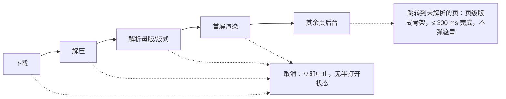
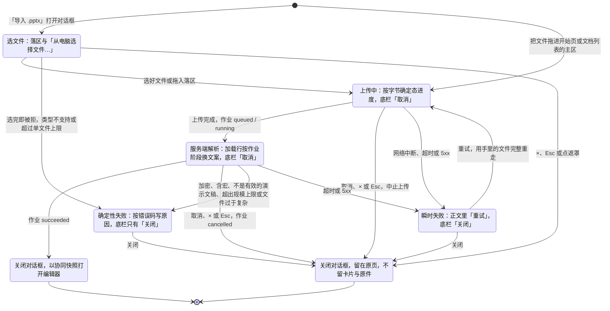
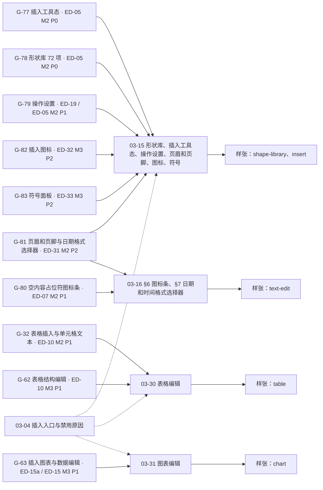
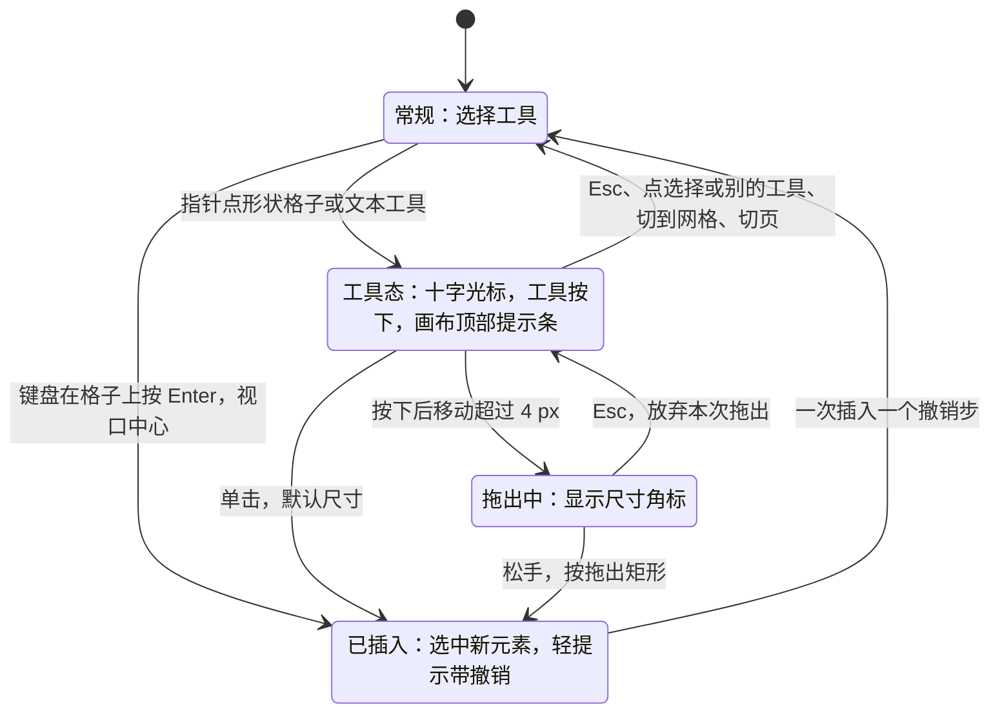
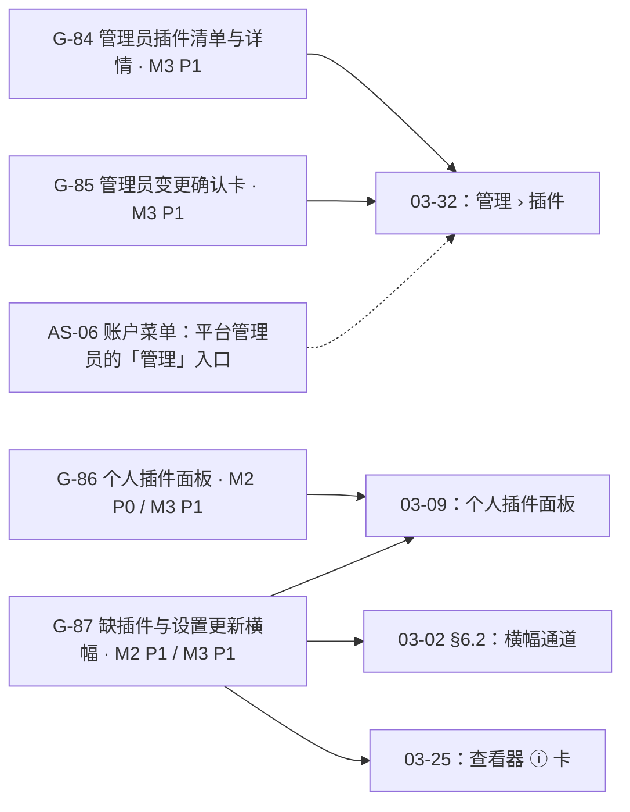

> 状态：草稿 | 负责：产品 | 更新：2026-11-05 | 依赖：charter v0.2；rulings §4.10、§4.13、§4.15–§4.26；设计 20-design 01–07、09 与 03-screens/01–33；v3 样张（playground `src/v3`）；80-process/02

# 07 需求 ↔ 设计 ↔ 样张 覆盖矩阵与缺口清单（供设计条线直接消费）

> 本文以产品视角登记 M1–M3 内有界面影响的需求在现行设计中的覆盖，另登记一项已有设计落点的 M4 缺口（G-94，PM-09）。设计指 `20-design/` 的 01–07、09 与界面文档 `03-screens/01`–`33`，流程为 F1–F11；样张指 playground `src/v3` 的 v3 样张，路由 `#/v3/<宿主>?state=<场景>.<状态>`。本文给出四部分：(1) 覆盖矩阵；(2) 缺口 G-01…G-94 的现状、落点与期望行为；(3) 样张须覆盖的 16 条流程；(4) 影响界面的产品默认答案 D1–D27。界面布局、交互、状态与文案以 `20-design/03-screens` 与样张为准（80-process/02 §2）；本文复述的界面细节与之一致，并注明以哪份设计为准。
> 现状（以 §2 各缺口的「现状」一行为准）：缺口编号共 79 个，其中 §2.1–§2.5 61 个、§2.7 7 个、§2.8 4 个、§2.9 7 个。已落地 47 个；部分落地 21 个（G-03、G-04、G-10、G-12、G-13、G-14、G-15、G-16、G-33、G-35、G-36、G-38、G-40、G-42、G-50、G-52、G-71、G-73、G-75、G-84、G-85）；未落地 10 个（G-44、G-65、G-67、G-88…G-94）；G-27 并入 G-86，编号保留。仍开放的各项与要补的设计见 §2 表 2-1。

---

## 0. 读法与记号

| 记号 | 含义 |
|---|---|
| `IA §n` | `20-design/01-information-architecture.md` 第 n 节 |
| `Fn` | `20-design/02-user-flows.md` 流程 Fn（F1 打开、F2 编辑、F3 加入离开、F4 软冲突、F5 离线、F6 导出、F7 评论、F8 版本、F9 插件、F10 母版视图与版式 / 主题、F11 分享与访问申请） |
| `01`…`33` | `20-design/03-screens/01-document-list.md` … `33-login-session-and-error-pages.md`（现行 33 份，编号以目录为准；后接 § 或状态名）。正文写「设计 03-NN」或「03-NN」。还没有设计稿的写「未出稿」，需要新文件时从 `34` 起编号（§5） |
| `05 §n` / `06 §n` / `07 §n` | `05-collaboration-ux.md` / `06-extensibility-ux.md` / `07-accessibility-and-i18n.md` |
| 设计覆盖 | 完整 = 现行设计文档（`20-design/` 01–07、09 与 03-screens）有线框、状态与交互；部分 = 只有一部分，或与需求有出入、待设计补改；无 = 没有。需求编号的机械覆盖以 G4（80-process/02 §1.3）为准，本列是产品侧摘要 |
| 样张覆盖 | v3 样张的状态，写作 `场景.状态`（同一场景连写时省去场景名，`*` 表示该场景全部状态）；宿主随场景：`home.*` 在 `#/v3/home`，`documents.*` 在 `#/v3/documents`，`templates.*` 在 `#/v3/templates`，`admin-plugins.*` 在 `#/v3/admin/plugins`，`shell-pages.*` 在 `#/v3/page`，`embed.*` 在 `#/v3/embed`，`account-menu.*` 在 `#/v3/home`（其中 `editor`、`embedded-logout` 两态在 `#/v3/editor`），其余在 `#/v3/editor`（个别状态另换宿主，以场景声明为准）；网格视图为 `#/v3/editor?view=grid`。有 = 关键状态都有；部分 = 只有部分状态，缺什么见同一行「设计覆盖」；无 = 没有。设计只差规则或文案、不缺状态时记「有」。标「未采纳 · 」的状态不算覆盖 |
| `G-xx` | 本文 §2 的缺口编号；缺口列写编号与现状（已落地 / 部分落地 / 未落地，定义见 §2 引言） |
| 优先级 | 取自 PRD 各需求块；缺口优先级 = 所属需求在该里程碑的优先级 |

---

## 1. 覆盖矩阵（M1–M3 内有界面影响的需求）

### 1.1 OF 打开 / 保真 / 导出

| 需求 | 里程碑 / 优先级 | 所需 UI 表面 | 设计覆盖 | 样张覆盖 | 缺口 |
|---|---|---|---|---|---|
| OF-01 打开 pptx | M1 / P0 | 打开进度与取消（参考应用以协同快照打开；本地字节与 SDK 为渐进打开：阶段文案、百分比、其余页后台解析）；导入入口（「导入」对话框、拖入） | 完整：03-13「打开进度」「导入对话框」、03-02 §6.2「加载中」 | 有：`main-states.opening`、`opening-rest`，`import.snapshot-opening`、`large-file`、`dialog-uploading`、`dialog-parsing` | G-01（已落地） |
| OF-02 类型识别与错误码 | M1 / P0 | 按错误码区分的失败态（不支持的格式、加密、含宏、不是有效的演示文稿、超出处理上限、无访问权限、找不到该文档、回收站里的文档等），每个错误码有建议动作 | 完整：03-13「打开失败态」、03-02 §6.2、03-33 §7、03-01 §6.1 | 有：`main-states.open-failed`、`open-failed-access`，`import.dialog-failed-*`，`shell-pages.not-found-doc`、`link-expired`，`documents.trash-blocked`，`viewer.failed-code` | G-02（已落地） |
| OF-03 渐进加载 | M1 / P0 | 首屏先出、其余页与缩略图逐步细化、跳到未解析页的等待态、后台解析进度 | 完整：03-13「打开进度」「缩略图侧栏」、03-02 §6.2 | 有：`main-states.opening-rest`，`import.thumbs-virtualized` | G-01、G-05（已落地） |
| OF-05 字体回退 | M1 / P0 | 保真报告「字体」分组；受限字体的编辑提示 | 完整：03-10「字体」分组、03-13、03-16 §3.3 | 有：`fidelity.font-toast`、`font-detail`，`text-edit.restricted-font` | 无 |
| OF-07 图片与媒体 | M1 / P0 | 视频与音频的海报帧与播放（编辑、评审、放映）、放不了的格式提示（编辑器与查看器）、EMF 预览（M2 起栅格化，超限回占位）、外链资源（`externalResources` 为 auto / confirm / never） | 部分：03-13「媒体元素查看态」「只保留对象、外链资源与字体的呈现」、03-18 §9；查看器里放不了的媒体的提示未出稿 | 部分：`import.media-unsupported`、`external-never`、`emf-rasterizing`，`image-editing.video-poster`、`video`，`fidelity.external-confirm` | G-06（已落地）、G-04（部分落地） |
| OF-09 图表 | M1 / P0 | 渲染块缺席时的占位；M2 选中导入图表时只读的「类型」节与「此类型仅支持查看」 | 完整：03-13、03-31「未开放、只读角色与其它模式」、03-03 G-19 | 有：`chart.m2-disabled`、`readonly-type`，`fidelity.degraded-selected` | G-03（部分落地；本行涉及的占位已落地） |
| OF-11 备注 / 评论 / 节的读取 | M1 P0 / M2 P1（节）/ M3 P1（旧评论） | 备注区只读；导入的批注只读并可「导入为可编辑评论」；缩略图按节分组与折叠 | 完整：03-02 §3.3、03-06 §4.6、03-14 §3.4 | 有：`comments.imported`，`slide-management.sections`、`section-menu` | G-42、G-50（部分落地；本行涉及的部分已落地） |
| OF-13 错误隔离与降级渲染 | M1 P0 / M2 P1（保真报告） | 降级占位三层（元素、页、缩略图）；保真报告（主菜单「文件 › 保真报告」打开的检查器整栏面板） | 部分：03-13「降级渲染占位」、03-10、03-03 G-19、03-05 §3；运行时渲染出错的元素占位、公式等只读对象的占位文案与报告的部分条目类别未出稿，运行时合成失败的页是否列进报告未定 | 部分：`fidelity.*` | G-03、G-40（部分落地） |
| OF-14 只读查看器 preset | M1 / P0 | 查看器壳：翻页、页码输入、缩放与适应窗口、全屏、ⓘ 保真摘要、超链接；打开中与打开失败；缩略图条、备注面板与搜索为宿主选项（缺省关）；窄屏向仅查看形态靠齐；隐藏页照常显示、页码旁标「已隐藏」 | 部分：03-25；隐藏页的「已隐藏」标记与放不了的媒体提示未出稿 | 部分：`viewer.*`，嵌入形态 C `embed.viewer-box` | G-04（部分落地） |
| OF-15 缩略图 | M1 / P0 | 视口附近懒生成、未解析页的版式骨架、编辑后 ≤ 500 ms 更新、警示与评论角标、当前页标记 | 完整：03-13「缩略图侧栏」、03-14 | 有：`import.thumbs-virtualized`、`fidelity.generating` | G-05（已落地） |
| OF-16 文本搜索 | M2 / P1 | 查找面板、命中计数、跨页跳转、命中高亮；查看器的搜索（宿主选项） | 完整：03-21、03-25 §4.4 | 有：`find-replace.*`，`viewer.search`、`narrow-search` | G-31（已落地） |
| OF-17 内嵌字体 | M2 / P1 | 保真报告「字体」分组（内嵌字体已加载或超限跳过、仅授权查看的字体） | 完整：03-10、03-13、03-16 §3.3 | 有：`fidelity.font-detail` | 无 |
| OF-18 导出 pptx | M1（零编辑）/ M2 P0 | 导出对话框（pptx 只导整份）、生成中与取消、完成即下载、失败重试、未同步更改的处理、底部说明行 | 完整：03-22、03-12 §7.2 | 有：`export.default`、`unsynced-client`、`waiting-sync`、`generating`、`failed`、`exported-toast`、`degraded-note` | G-25（已落地） |
| OF-19 导出 PNG / SVG / PDF | M2 P1（PNG / SVG）/ M3 P1（服务端 PDF） | 格式、范围与宽度；服务端作业的排队、生成与下载（不写链接时效） | 完整：03-22 | 有：`export.png`、`svg`、`m3-pdf`、`server-generating`、`exported-server` | G-25（已落地） |
| OF-21 文件属性 | M2 / P2 | 文件属性对话框（只读） | 无：入口未出稿 | 无 | P2，见 §2.6 |
| OF-22 新建 / 从模板 | M2 / P1 | 开始页「新建演示文稿」与「从模板开始」（空白 + 5 套内置模板）；M3 模板库；从 .potx 新建是 SDK 能力 | 完整：03-29、03-01；模板库见 03-29 §7 | 有：`home.m2-default`、`creating`、`create-failed`；M3 `templates.*` | G-41、G-76（已落地） |
| OF-24 输入安全限制 | M1 / P0 | 超出处理上限与超出规模上限的失败态（写明哪一项与上限值） | 完整：03-13「打开失败态」「超出规模上限」 | 有：`import.dialog-failed-quota` | G-02（已落地） |

### 1.2 ED 编辑

| 需求 | 里程碑 / 优先级 | 所需 UI 表面 | 设计覆盖 | 样张覆盖 | 缺口 |
|---|---|---|---|---|---|
| ED-01 选择模型与命中 | M2 / P0 | 单选、Shift 加减选、框选（缺省完全包含，Alt 相交即选）、多选包围盒、组合编辑与 Esc 逐级、Tab 循环、锁定对象（P1）、隐藏元素 | 部分：03-17 §3、§6；Tab 循环的次序写作「按 z 序」，待按 ED-01 改为按阅读顺序 | 有：`selection.marquee`、`multi-select`、`group-edit`、`locked` | G-10（部分落地） |
| ED-02 文本内联编辑与 IME | M2 / P0 | 进入与退出编辑态、插入符、IME 组合、空占位符提示文字、自动增长 | 完整：03-16 §3、§6 | 有：`text-edit.editing`、`placeholder`、`autofit` | G-11（已落地） |
| ED-03 字符与段落格式 | M2 / P0 | 检查器「文本」五节（字体、段落、颜色、列表、文本框）、字体与颜色弹层、混合值、格式快捷键 | 部分：03-16 §4、03-02 §4.3；文本框内边距未出稿，大小写菜单的「句首大写」待删 | 部分：`text-edit.editing`、`font`、`color`、`mixed` | G-12（部分落地） |
| ED-04 项目符号与编号 | M2 / P0 | 项目符号库与编号库、起始值、Tab 升降级；项目符号颜色与大小（P1） | 部分：03-16 §4.6；编号预设待按 ED-04 改，项目符号颜色与大小未出稿 | 部分：`text-edit.bullets`、`numbering` | G-12（部分落地） |
| ED-05 形状插入与几何变换 | M2 / P0 | 工具条「形状」与形状库（10 类 72 项）、插入工具态、线条端点、动作按钮的操作设置、缩放 / 旋转 / 调整手柄、修饰键与尺寸角标、文本框工具；调整手柄的数值等价；「插入后自动进入文本编辑」选项（P1，缺省关） | 部分：03-15 §1–§5、03-04；调整手柄的数值等价与「插入后自动进入文本编辑」选项的开关落点（偏好设置 03-23 或 preset 选项）未出稿 | 部分：`shape-library.*`、`insert.more` | G-13（部分落地）；G-77、G-78、G-79（已落地） |
| ED-06 填充 / 线条 / 效果 | M2 / P0（纯色、线条）/ P1（渐变、阴影、快速样式） | 填充类型、渐变编辑、描边宽度 / 虚线 / 箭头、阴影预设与自定义、快速样式、多选统一应用 | 部分：03-02 §4.2、03-03 §G-14；快速样式已画，描边宽度与虚线箭头、渐变编辑、阴影预设与自定义的检查器控件未出稿 | 部分：`main-states.quick-styles`、`quick-styles-gallery` | G-14（部分落地） |
| ED-07 图片操作 | M2 / P0 | 插入（工具条「图片 ▾」：此设备 / 来自 URL；拖入、粘贴；页上有空内容占位符时先填入）、上传占位与失败、替换 / 重置、裁剪模式与「填充 / 适合」（P1）、不透明度、替代文本、大图压缩提示、空内容占位符图标条（P1） | 部分：03-18、03-04 §5、03-16 §6；裁剪的「填充 / 适合」未出稿 | 部分：`image-editing.*`、`insert.image-menu`、`image-url`，`text-edit.placeholder`、`placeholder-focus`、`placeholder-collapsed`、`placeholder-table`、`placeholder-drop` | G-15（部分落地）、G-80（已落地） |
| ED-08 组合 / 层级 / 对象操作 | M2 / P0 | 组合与取消组合、层级四项、原位复制、删除（可撤销）、重命名（P1） | 部分：03-05 §3、03-17 §6、03-02 §2.3「排列」；对象重命名的入口未出稿 | 部分：`context-menu.shape`、`group`、`object-deleted`，`selection.group-edit` | G-16（部分落地） |
| ED-09 对齐 / 分布 / 吸附 / 参考线 | M2 / P0（智能参考线与吸附）/ P1（对齐分布、显示文件里存的参考线）/ P2（标尺；参考线的新增、拖出与写回） | 智能参考线（页面实线、对象虚线、等间距角标）、吸附与 Alt 临时关闭、检查器对齐行与多选右键「对齐与分布 ▸」、网格与参考线开关、网格间距 | 完整：03-17 §2、§4–§7，03-20 §5 | 有：`selection.smart-guides`、`snap-off`、`grid-visible`、`align-menu`，`view-zoom.grid-guides` | G-17（已落地）；标尺等 P2 见 §2.6 |
| ED-10 表格编辑 | M2 P1（插入与单元格文本）/ M3 P1（结构与样式） | 插入网格与「插入表格」对话框、占位符填入、单元格编辑与 Tab 导航、多格选区；M3 悬停插入行列、拖分隔线、右键行列与合并、边框、样式库与标志 | 完整：03-30、03-04、03-16 §6；对话框行列上限推迟（rulings §4.22 DF-10） | 有：`table.*` | G-32、G-62（已落地） |
| ED-11 幻灯片管理 | M2 / P0（新建 / 复制 / 删除 / 重排 / 隐藏 / 换版式 / 重置）/ P1（节的显示）；节的增删改与重排 M3 / P2 | 左栏「+」与「新建幻灯片 ▾」版式画廊、复制、删除（可撤销）、拖动排序（含多选、跨节）、隐藏页、更换版式、重置页、节标题行与折叠；M3 节的增删改 | 部分：03-14、03-27；M3 节的增删改样张未出稿 | 部分：`slide-management.*`、`layout-picker.*`、`context-menu.thumbnail` | G-18（已落地）、G-42（部分落地） |
| ED-12 检查器与右键菜单 | M2 / P0 | 按选中类型的检查器分区（形状 / 文本 / 图片 / 表格 / 组合 / 连接符 / 图表 / 空内容占位符 / 降级对象 / 幻灯片级 / 多选交集）、多选混合值、右键全部变体；对象不设迷你工具条 | 完整：03-02 §3.5、§4，03-03 G-19，03-05 | 有：`main-states.*`、`selection.*`、`context-menu.*`、`fidelity.degraded-*`、`plugins.panel-entry` | G-19、G-26（已落地） |
| ED-13 查找与替换 | M2 / P1 | 主菜单「编辑 › 查找… / 替换…」、画布右上浮动面板、选项（区分大小写 / 全字匹配）、命中计数与上下条、全部替换、画布与缩略图高亮 | 完整：03-21 | 有：`find-replace.*`、`narrow.compact-find` | G-31（已落地） |
| ED-14 撤销 / 重做 | M2 / P0 | 主菜单「编辑 › 撤销 / 重做」（带步骤名、不可用写原因）、撤销时跳页并选中、协同下被跳过的提示 | 完整：03-19 §1–§4、05 §6 | 有：`undo-clipboard.edit-menu`、`undo-partial`、`undo-blocked` | G-20、G-53（已落地） |
| ED-15 图表数据编辑 | M3 / P1 | 检查器「数据」分区的紧凑网格与「展开」后的数据面板、类型字段下拉（五类）、标题 / 图例 / 数据标签、非五类图表只读 | 完整：03-31 | 有：`chart.data-panel`、`grid-menu`、`compact-overflow`、`workbook-notice`、`type-menu`、`type-switch`、`type-confirm`、`options`、`pie`、`readonly-type` | G-63（已落地） |
| ED-15a 插入图表 | M3 / P1 | 工具条「图表」五类与子类型、示例数据、按占位符落点插入后展开检查器「数据」分区；M2 入口留在原位不可用 | 完整：03-31、03-04、03-16 §6 | 有：`chart.inserted`、`menu`、`placeholder-chart`、`m2-disabled` | G-63（已落地） |
| ED-16 快捷键 | M2 / P0 | 工具提示与菜单右侧的键位、键盘快捷键面板（主菜单「帮助 › 键盘快捷键」、账户菜单、`Mod+/`）、冲突可跳到个人插件面板 | 完整：03-24、03-02 §2.3、06 §2.4 | 有：`shortcuts.*` | G-21（已落地） |
| ED-17 剪贴板 | M2 P0（内部 / 纯文本 / 图片）/ P1（HTML）/ P2（PowerPoint 互粘）/ M3 P1（跨文档资源迁移） | 「部分格式已被简化」提示、粘贴图片的上传占位、超过 25 MB 拒绝、剪贴板未授权时回退、「粘贴选项 ▸」（P2）、跨文档粘贴的版式映射提示 | 部分：03-19 §5；跨文档粘贴的提示未出稿 | 部分：`undo-clipboard.paste-html`、`paste-too-large`、`clipboard-denied`、`paste-options` | G-22（已落地）、G-65（未落地） |
| ED-18 演讲者备注编辑 | M3 / P1（M1–M2 备注区只读） | 备注区显示 / 隐藏与拖高、只读文案、M3 基本格式（粗斜体、项目符号） | 部分：03-02 §3.3、03-20；M3 基本格式的入口未出稿 | 部分：`view-zoom.panel-size` | G-33（部分落地） |
| ED-19 超链接 | M2 / P1 | 「插入链接」对话框（网页地址 / 本文稿中的页、移除）、编辑态悬停小卡、目标页已删除；动作按钮与形状的操作设置 | 完整：03-16 §5、03-15 §5、03-04 §2、03-05 | 有：`text-edit.link-dialog`、`link-invalid`、`link-hover`、`link-broken`，`shape-library.action-settings`、`action-slide` | G-34、G-79（已落地） |
| ED-20 幻灯片背景 | M2 / P1 | 无选中检查器「背景」节（纯色 / 渐变 / 图片）、「隐藏背景图形」「重置为版式背景」「应用到全部」 | 部分：03-02 §4.1、03-03 G-19；三项背景动作、图片背景的拉伸 / 平铺与透明度、渐变方向与色标的控件未出稿 | 部分：`main-states.*` 无选中各态 | G-35（部分落地） |
| ED-21 放映模式 | M2 / P1 | 进入（检查器顶行「放映」、F5 / Shift+F5、命令面板）、控制条与「更多」、跳页、黑屏 / 白屏、结束页、超链接与媒体点击、隐藏页；演讲者视图不做（D3） | 部分：03-11；缩放定位在放映中的点击未写 | 有：`present.*` | G-36（部分落地） |
| ED-22 视图 / 缩放 / 导航 | M2 / P0 | 单页与网格视图及切换、缩放读数与菜单（适应窗口 / 适应宽度）、平移、三条分隔条与尺寸记忆、紧凑与仅查看两种窄屏形态 | 完整：03-20、03-02 §2、§5、§5a | 有：`view-zoom.*`、`narrow.*`；网格视图 `#/v3/editor?view=grid` | G-23（已落地） |
| ED-23 保存 / 脏状态 / 离开保护 | M2 / P0 | 文件名下方的状态行（已保存 / 保存中 / 未保存 / 保存失败 / 已在本地保存）、应用内离开与刷新确认、`Mod+S` | 完整：03-19 §6–§7、03-12 §9 | 有：`undo-clipboard.saved`、`saving`、`unsaved`、`save-failed`、`saved-local`，`offline-conflict.leave-confirm` | G-24（已落地） |
| ED-24 文本自动调整 | M2 / P1 | 检查器「文本框」节「自动调整」三项、缩小比例的说明 | 完整：03-16 §3.3、§4.1 | 有：`text-edit.autofit` | G-37（已落地） |
| ED-25 母版与版式（索引） | M2 P0 / M3 P0 | 见 §1.7 ML 各行 | 见 §1.7（03-26、03-27、03-28） | 见 §1.7 | 见 §1.7 |
| ED-26 锁定 / 隐藏 / 替代文本 | M2 / P1（替代文本、锁定对象的呈现）/ P2（锁定属性的查看与切换、选择窗格） | 检查器「替代文本」节（右键「编辑替代文本…」聚焦此节）与缺替代文本的提示；锁定对象的呈现与说明；锁定属性的查看与切换、选择窗格（P2） | 部分：03-18 §5.4、03-02 §4.2、03-30 §6.7、03-31、03-17 §6.2；表格缺替代文本的提示未出稿 | 部分：`image-editing.selected`、`alt-text`、`decorative`，`selection.locked` | G-38（部分落地）；锁定属性与选择窗格 P2 见 §2.6 |
| ED-28 连接符 | M2 P1（E~，检查器可切换直线 / 肘形 / 曲线）/ M3 P1（E，肘形与曲线随端点重算） | 连接点悬停高亮、端点吸附与跟随、检查器「连接」「类型」节、拖动的键盘等价 | 完整：03-17 §8、03-15、03-05 | 有：`selection.connector-snap`、`connector-connected`，`context-menu.connector` | G-39（已落地） |
| ED-29 无鼠标编辑 | M2 / P0 | F6 区域循环、拖拽的键盘或表单等价、焦点环 | 部分：07 §1–§2 与各界面的键盘节；调整手柄的数值等价未出稿 | 部分 | G-13（部分落地） |
| ED-30 命令面板 | M2 / P1 | 模糊搜索、不可用原因、来源标签、常用命令；仅查看形态外接键盘按 `Mod+K` 的行为 | 部分：03-24 §8、06 §2.5；仅查看形态按 `Mod+K` 是否打开未定 | 有：`command-palette.default`、`search`，`master-view.palette` | G-90（未落地） |
| ED-31 页眉和页脚 | M2 / P2 | 「页眉和页脚」对话框（日期和时间 / 幻灯片编号 / 页脚 / 标题幻灯片中不显示；应用 / 全部应用）、文本编辑态直接插字段与日期格式选择器 | 完整：03-15 §6、03-16 §7、03-04；日期格式的三语映射推迟（rulings §4.22 DF-08） | 有：`insert.header-footer`、`header-footer-missing`，`text-edit.datetime`、`datetime-field` | G-81（已落地） |
| ED-32 插入图标 | M3 / P2 | 插入图标对话框（搜索、分类、网格、多选）、改色在检查器「图形填充」节 | 完整：03-15 §7、03-18 §8 | 有：`insert.icons`、`icons-empty`，`image-editing.icon` | G-82（已落地） |
| ED-33 插入符号 | M3 / P2 | 符号面板（分类、搜索、最近使用；仅文本编辑态可用） | 完整：03-15 §8、03-04 §7.3 | 有：`insert.symbols` | G-83（已落地） |
| ED-34 屏幕截图与相册 | M4+ / P2 | 截图授权与失败提示、相册「每图一页」 | 部分：03-04（入口留在原位、不可用并标 M4+） | 部分：`insert.image-menu` | P2，见 §2.6 |
| ED-35 插入视频与音频 | M2 / P2 | 视频 / 音频入口、格式兼容提示、上传占位、海报帧；已有媒体的编辑态临时播放 | 部分：03-04（入口留在原位、不可用并标 P2）、03-18 §9；插入流程随 P2 | 部分：`insert.more`，`image-editing.video-poster`、`video` | P2，见 §2.6 |

### 1.3 CO 协同

| 需求 | 里程碑 / 优先级 | 所需 UI 表面 | 设计覆盖 | 样张覆盖 | 缺口 |
|---|---|---|---|---|---|
| CO-01 会话与房间 | M2 / P0（会话、同步与持久化，rulings §4.19）/ M3（名额、容量、在场） | 文件名下方的同步状态行与横幅、初始同步、编辑者名额已满以只读加入、查看人数已满的阻断页 | 完整：05 §7、03-12、03-02 §3.1 | 有：`main-states.syncing`、`reconnecting`、`offline`，`offline-conflict.*` | 无 |
| CO-03 Presence | M3 / P0 | 头像组与「+N」在线列表、远端光标与选区、跟随、20 人折叠；他人所在页、空闲态 | 部分：05 §1–§4、03-02 §3.5、03-11 §5；协作者不超过 5 人时看不到他人所在页、空闲态的画法未出稿 | 部分：`main-states.presence`、`presence-list`，`presence-scale.*`，`present.editor-following` | G-89（未落地） |
| CO-04 评论 | M3 / P0 | 评论工具与浮动撰写框、@ 候选、锚点（页 / 元素 / 文本范围）、评论钉与悬停预览、筛选、解决 / 重新打开 / 编辑 / 删除、已脱离锚点、导入的批注、缩略图评论角标、深链接定位、重新锚定（P1） | 部分：03-06、F7；重新锚定的交互未出稿 | 部分：`comments.*` | G-50（部分落地） |
| CO-05 权限与只读降级 | M3 / P0 | 降权横幅与导出本地副本、被提权的轻提示、访问被撤销的阻断页、申请访问 | 完整：05 §8、03-12 §7–§8、03-08 §4.5 | 有：`offline-conflict.degraded-export`、`degraded-exported`、`degraded-no-changes`、`promoted`、`access-revoked`、`access-requested`，`share.request-access`、`request-access-sent` | G-56（已落地） |
| CO-06 离线与重连 | M3 / P0 | 横幅与同步状态行、应用内离开与刷新确认、长时间离线提示、登录已过期的新窗口重新登录（rulings §4.18 UX-02）、离线后周期重连 | 完整：F5、03-12、05 §7、03-33 §6 | 有：`offline-conflict.*`，`shell-pages.popup-completing`、`popup-done-tab`、`popup-failed` | G-66（已落地） |
| CO-07 版本历史 | M3 / P1 | 文档菜单「版本历史」打开整栏面板、预览、命名、恢复确认卡与「恢复自『X』」、加载更早版本、最近删除 | 完整：03-07、F8 | 有：`version-history.*` | G-60（已落地） |
| CO-08 软冲突 | M3 / P0 | 冲突场景的提示形态（内联 / 轻提示 / 动效）；提示条按钮「恢复我的值」；删除 vs 编辑的「恢复元素」沿用原 id（软删除墓碑，rulings §4.15 Q3） | 部分：05 §5（A–K）、03-12 §12–§13、03-07 §4.5；PRD CO-08 另列的几行在 05 §5 未逐行映射，离线修改遇墓碑已过期时的提示未出稿 | 部分：`offline-conflict.conflict-*`、`repair-toast`，`version-history.recently-deleted`、`purge-confirm` | G-52（部分落地） |
| CO-09 协同下撤销 | M3 / P0 | 撤销跳过他人后写的键并提示，整步被跳过时停下；提示带「恢复我的值」或「恢复元素」 | 完整：05 §6、03-19 §4.2 | 有：`undo-clipboard.undo-partial`、`undo-blocked`，`main-states.undo-skipped`、`undo-blocked` | G-53（已落地） |
| CO-10 编辑中软提示 | M3 / P2 | 同一文本框的提示签「〈姓名〉也在编辑此文本框」；集成方开启的强提示 | 完整：05 §5 B 行、03-12 §12 | 有：`offline-conflict.conflict-same-text` | P2，见 §2.6 |
| CO-12 门禁与用户可见行为 | M2 / P0（随协同网关，rulings §4.19） | 被拒更改的「导出本地副本」与重新载入说明、软门禁修复的轻提示、隔离（4409）后的暂停与「刷新」 | 完整：03-12 §7–§8、§13 | 有：`offline-conflict.degraded-*`、`quarantine`、`refresh-confirm`、`repair-toast` | G-51（已落地） |
| CO-13 协同诊断 | M3 / P1（开发者） | 诊断面板（连接、RTT、待同步、事件流） | 部分：入口在主菜单「帮助」最后一组与偏好设置「关于」（开发构建），面板未出稿 | 无 | G-67（未落地） |
| CO-15 分享与访问入口（参考应用） | M3 / P1 | 分享对话框（邀请、成员与角色、链接权限与有效期、复制链接）、非所有者的「谁能访问…」、访问申请、未注册邮箱的报错（无待接受邀请，rulings §4.17 D1） | 完整：03-08、05 §12、F11 | 有：`share.*`、`documents.share-from-card` | G-61、G-56（已落地） |

### 1.4 PS 插件 SDK（用户可见部分）

| 需求 | 里程碑 / 优先级 | 所需 UI 表面 | 设计覆盖 | 样张覆盖 | 缺口 |
|---|---|---|---|---|---|
| PS-02 贡献点槽位 | M2 / P0 | 贡献点槽位与归属标识（贡献点清单以 40-modules/16 为准）：工具条「更多」、检查器插件分区与整页面板、右键、命令、通知 | 完整：06 §2、§4，03-09 §10–§11 | 有：`plugins.panel-entry`、`panel`、`more-few`、`more-many`、`sections-few`、`sections-many` | 无 |
| PS-09 开发者面板 | M2 / P1（内部） | Fiber 树、贡献列表、effect 树、事件流、热重载反馈、槽位高亮 | 部分：入口在主菜单「帮助」最后一组与偏好设置「关于」（开发构建或部署打开 `features.developerMenu`），槽位高亮见 06 §6，面板本体未出稿 | 无 | G-44（未落地） |
| PS-11 失败隔离可见性 | M2 / P0 | 主菜单「插件…」与插件横幅「查看详情」打开个人插件面板：启动失败、等待依赖、版本不兼容的行内说明，错误详情与复制诊断，本会话重试，为我关闭（界面级可选插件） | 完整：03-09、06 §3 | 有：`plugins.*` | G-86（已落地；含 G-27） |
| PS-14 服务端 / headless 插件 | M3 / P1 | 插件贡献的导出格式出现在导出对话框格式列表末尾，写明来自哪个插件 | 完整：03-22 §4.1 | 有：`export.plugin-format` | 无 |

### 1.5 EM 嵌入与集成（用户可见部分）

| 需求 | 里程碑 / 优先级 | 所需 UI 表面 | 设计覆盖 | 样张覆盖 | 缺口 |
|---|---|---|---|---|---|
| EM-01 多实例 / 紧凑模式 | M2 / P0 | 三种形态：≥ 1024 完整、640–1024 紧凑（两侧收为胶囊、按需展开为抽屉，同一时刻一个）、< 640 或触控设备仅查看；嵌入形态 E 的出口与登录提示 | 完整：03-02 §5a、IA §6–§7、03-33 §9 | 有：`narrow.*`、`embed.*` | 无 |
| EM-06 主题与外观 | M2 / P0 | 主题（浅色 / 深色 / 跟随系统，账户菜单与偏好设置同一偏好）、高对比（`forced-colors`）；单档尺寸、无半透明材质（NF-01 §1.8 层次与阴影） | 部分：03-23 §4.1、03-29 §2.5、设计 04、09；高对比主题未出稿 | 部分：`settings.default`、`account-menu.member` | G-92（未落地） |
| EM-08 UI 裁剪 / 只读嵌入 | M2 / P0 | 评审与只读收敛；宿主按 id 隐藏或禁用工具、检查器分区、菜单项、面板与快捷键，以及隐藏左栏缩略图列表、检查器页签、底部工具条与备注后的版面 | 部分：只读收敛见设计 01 §5、03-02 §6.2；按 id 隐藏后的版面未出稿 | 部分：`main-states.review`、`viewer`，`embed.view-mode` | G-88（未落地） |
| EM-11 国际化对接 | M2 / P1 | 偏好设置「语言与单位」、切换后即时刷新、语言包加载失败 | 完整：03-23 §4.2 | 有：`settings.language-switching`、`language-failed` | 无 |
| EM-12 错误处理与诊断 | M1 / P0 | 错误码 → 用户文案 + 建议动作；「复制诊断信息」 | 完整：03-13「打开失败态」、03-23 §4.5–§4.6、03-33 §7 | 有：`import.dialog-failed-invalid-package`，`settings.copied`，`shell-pages.app-error` | G-02（已落地） |
| EM-17 参考应用 | M2 / P0（开始页、文档列表、OIDC 登录，rulings §4.19） | 开始页（AS-01）、文档列表、账户菜单（AS-06）、登录与登录失败、令牌过期后的新窗口重新登录、错误页、分享入口 | 完整：03-29、03-01、03-33 | 有：`home.*`、`documents.*`、`shell-pages.*` | G-66（已落地） |

### 1.6 SV 服务端（用户可见部分）

| 需求 | 里程碑 / 优先级 | 所需 UI 表面 | 设计覆盖 | 样张覆盖 | 缺口 |
|---|---|---|---|---|---|
| SV-01 服务端导入作业 | M2 / P0（rulings §4.19） | 叠在原页上的「导入」对话框：选文件、拖入、上传（按字节确定态）、服务端解析、失败；取消即关闭、留在原页；单个文件的大小上限 | 完整：03-13「导入对话框」 | 有：`import.dialog*` | G-54（已落地） |
| SV-02 服务端导出作业 | M3 / P0（PDF 随 OF-19 为 P1） | 导出对话框的服务端路径：须先同步、排队与生成中、完成后带「下载」的轻提示（不写链接时效）、PDF | 完整：03-22 | 有：`export.m3-pdf`、`unsynced-server`、`server-generating`、`exported-server` | G-25（已落地） |
| SV-04 缩略图服务 | M2 P0（包内过渡封面）/ M3 P0（服务端生成） | 文档卡片封面：M2 取包内封面（`source=embedded`，无则占位），M3 服务端生成（生成中与失败的占位） | 完整：03-01 §4.1、03-29 §2.3 | 有：`documents.recent`、`home.m2-default` | 无 |
| SV-06 鉴权与权限 | M2（OIDC 登录）/ M3 P0（按人分享与权限细化；分享链接随 CO-15 为 P1） | 登录页、分享对话框的角色变更、链接权限（始终要求登录）、按人分享（无组，U-11 推迟）、未注册邮箱的报错（`auth.selfSignup` 开 / 关两种文案） | 完整：03-08、03-33 | 有：`share.*`、`shell-pages.login`、`login-signup` | G-61、G-66（已落地） |
| SV-08 配额与限制 | M2（导入天花板与 WS 消息限额随协同后端，rulings §4.19）/ M3 P0（存储配额、名额） | 页数与元素数的软提示和硬上限、导入时超出规模上限（指明超出项）、存储空间不足（M3）、编辑者名额已满、查看人数已满、文档已达元素上限只读打开 | 完整：03-12 §13、§7.5、§8.2、§8.6，03-13 | 有：`offline-conflict.quota-soft`、`quota-hard`、`seats-full`、`viewers-full`，`import.dialog-failed-quota`，`doc-banners.over-ceiling` | G-55（已落地） |
| SV-11 数据保留与删除 | M2（移入回收站与恢复，rulings §4.19）/ M3 P1（永久删除、到期清理与擦除） | 回收站（左侧导航第 5 项）、恢复、永久删除确认（M3）、所有者打开回收站里的文档 | 完整：03-01 §6、03-13 | 有：`documents.trash`、`trash-m2`、`purge-confirm`、`purging`、`trash-blocked`、`trash-empty` | G-64（已落地） |

### 1.7 ML 母版 / 版式 / 主题（正文见 `03-features/07-masters-layouts-and-themes.md`）

| 需求 | 里程碑 / 优先级 | 所需 UI 表面 | 设计覆盖 | 样张覆盖 | 缺口 |
|---|---|---|---|---|---|
| ML-01 母版视图 | M2 / P0 | 入口（主菜单「视图 › 母版视图」、`Mod+Alt+M`、命令面板、检查器「编辑版式」与「转到版式」；只在编辑模式的完整形态可进入）、母版视图横幅与唯一常驻退出「关闭母版视图」、母版窗格、占位符虚线 + 类型名与继承项点线、加载与失败（转圈 + 一句文字）、M2 只能浏览 | 部分：03-26 §1–§4、§6，03-02 §2.4；母版名称为空时的显示名未定 | 有：`master-view.entry`、`default`、`entry-inspector`、`goto-layout`、`from-grid`、`entry-blocked`、`loading`、`load-failed`、`readonly`、`m2-*` | G-70、G-72（已落地）、G-71（部分落地） |
| ML-02 版式应用与重置 | M2 / P0 | 版式画廊（按母版分组、可搜索、跨母版说明）、不匹配时带「撤销」的轻提示、重置页（确认对话框 + 可撤销轻提示）、按版式新建 | 完整：03-27、03-14 §3.6 | 有：`layout-picker.*` | 无 |
| ML-03 母版与版式编辑 | M3 / P0 | 「新建版式 ▾」、工具条「占位符 ▾」（10 类）、检查器版式 / 母版 / 占位符分区、窗格右键与就地改名、多选删除、删除被引用版式 / 母版的确认（确认后可撤销）、保留母版、协同在场 | 部分：03-26 §1.2、§3–§5、§8，03-03；「从模板导入母版…」之后的流程、新母版的内容、选中母版时可插的占位符类型未出稿 | 部分：`master-view.*` | G-73（部分落地）、G-74（已落地） |
| ML-04 主题 | M3 / P1 | 检查器「主题」节的主题卡与主题画廊（5 套 × 3 变体）、「调整主题」的主题颜色与字体、应用主题可撤销；从模板应用主题（模式 A / B）；母版视图下在检查器「主题」节（随母版） | 部分：03-28；从模板应用主题、效果方案名只读、「重置为原主题」、主题字体分 latin / ea、背景填充方案只读未出稿 | 部分：`design-themes.*`、`master-view.theme` | G-75（部分落地） |
| ML-05 备注 / 讲义母版 | M4 / P2 | 备注页 / 讲义预览 | 无 | 无 | P2，见 §2.6 |

### 1.8 AS 应用壳（正文见 `03-features/08-app-shell.md`）

| 需求 | 里程碑 / 优先级 | 所需 UI 表面 | 设计覆盖 | 样张覆盖 | 缺口 |
|---|---|---|---|---|---|
| AS-01 开始页 | M2 / P0 | 左侧导航（首页 / 最近 / 我的文档 / 与我共享 / 回收站，后四项即文档列表的筛选）、搜索框下拉、「新建演示文稿」与「从模板开始」（空白 + 5 套）、「最近」、导入入口（「导入」对话框、拖入）、加载 / 出错 / 离线、窄屏与触控 | 完整：03-29、03-01、03-13 | 有：`home.*`、`documents.*`、`import.dialog` | 无 |
| AS-02 最近与固定 | M2 / P1 | 同一份卡片与「⋯」菜单、第二行「编辑者 · 相对时间」、角色徽标、固定、从最近移除（可撤销）、空态引导句 | 部分：03-29、03-01；手机与平板上的空态引导句未出稿 | 部分：`home.card-menu`、`removed-undo`、`first-run`，`documents.*` | G-91（未落地） |
| AS-03 模板库 | M3 / P1 | M2：「从模板开始」的空白 + 5 套内置模板；M3：模板库页（来源分段与预览） | 完整：03-29 §7 | 有：`templates.*`、`home.m3-more-templates` | G-76（已落地） |
| AS-04 指南与帮助入口 | M2 / P1 | 帮助菜单只列集成方配置了链接的条目，「键盘快捷键」常在；编辑器主菜单「帮助」 | 完整：03-29 §2.4、03-02 §2.3 | 有：`home.help-menu`、`help-menu-unconfigured` | 内容来源 PD-23 |
| AS-05 首次使用引导 | M3 / P2 | 「最近」为空时的空态引导句 + 帮助菜单承担引导，不做交互式分步引导 | 完整：03-29「首次使用」 | 有：`home.first-run` | 无 |
| AS-06 账户菜单 | M2 / P0 | 三处同一份账户菜单（开始页左栏用户行、文档列表、编辑器右上角自己的头像）：姓名与邮箱、「个人资料…」（M3 起）、主题三项、偏好设置…、键盘快捷键、帮助中心（按配置）、退出登录；平台管理员另有「管理」（M3，PM-01） | 完整：03-29 §2.5、03-02 §3.5、03-32 §1 | 有：`account-menu.*`，`main-states.account-menu`、`account-menu-grid` | 无（登录见 G-66） |

### 1.9 PM 插件管理（正文见 `03-features/09-plugin-manager.md`）

各界面的无障碍随所在界面验收（PM-16）；客户端失败计数（PM-15）并入 PM-03 / PM-06 一行。

| 需求 | 里程碑 / 优先级 | 所需 UI 表面 | 设计覆盖 | 样张覆盖 | 缺口 |
|---|---|---|---|---|---|
| PM-03 / PM-06 管理员三态与插件清单 | M3 / P1 | 「管理 › 插件」：清单、部署级状态分组、三态控件与锁定、详情抽屉（依赖与冲突、贡献、能力声明、信任来源、变更历史）、近 24 h 客户端失败会话数 | 部分：03-32 §1–§5、§8–§11；详情「依赖与冲突」里可并存冲突（快捷键、菜单位置）的呈现未出样张 | 部分：`admin-plugins.default`、`detail`、`deep-link`、`rejected`、`status-legend` 等 | G-84（部分落地） |
| PM-07 / PM-08 依赖、互斥与变更确认 | M3 / P1 | 禁用被依赖者、一并启用、互斥、缺席后果、首次启用第三方、影响与生效时机的确认卡 | 部分：03-32 §5.3、§5.4、§6、§7；没有依赖方的可选·降级插件在变更确认卡里的缺席后果未出稿 | 部分：`admin-plugins.dep-conflict`、`first-enable`、`change-confirm`、`change-confirm-disable`、`draft`、`mutex` | G-85（部分落地） |
| PM-10 / PM-11 个人插件面板 | M2 / P0（只读查看与失败诊断）；M3 / P1（个人启停）；PM-11 M2 / P1 | 主菜单「插件…」打开的居中对话框：三分组（本部署统一启用 / 我的界面插件 / 本文档缺少的插件）、本会话状态与重试、为我关闭、快捷键冲突高亮 | 完整：03-09 §1–§5、§7，03-24 §6 | 有：`plugins.*`、`shortcuts.conflict` | G-86（已落地） |
| PM-12 / PM-08 横幅 | M2 / P1（缺插件）；M3 / P1（设置更新） | 缺插件横幅（三种原因文案）、占位元素上的插件名、「插件设置已更新」横幅、与版本漂移合并、查看器 ⓘ 卡里的一行 | 完整：03-09 §6、03-02 §6.2「插件横幅」、03-25 §4.3 | 有：`main-states.plugin-missing`、`plugin-missing-undeclared`、`plugin-missing-version`、`plugin-failed`、`plugin-settings`，`plugins.banner-queue`、`failed-reshow`，`viewer.missing-plugin`，`doc-banners.version-drift` | G-87（已落地） |

---

## 2. 缺口优先级清单

> 每个缺口写所属需求、现状、落点（`20-design/03-screens` 现行编号与章节）与样张状态，其下是期望行为要点（Given / When / Then）。已落地的写现行设计中的行为，复述的界面细节与设计一致，画法与文案以所列设计为准；部分落地与未落地的另写仍缺什么，供设计排期。
> 现状的取值：**已落地** = 设计文档有线框、状态与交互，v3 样张有对应状态；**部分落地** = 已有大部分，仍缺某些状态、控件或画法，或设计与需求有出入、待设计改；**未落地** = 还没有设计稿；**推迟** = 按裁决推迟的单项，触发条件见 rulings §4.22（DF-xx）。
> 分组：§2.1–§2.5 按所属需求块的目标里程碑与优先级（需求跨里程碑时，后一阶段的部分在条内写明）；§2.6 登记 P2；§2.7、§2.8、§2.9 按来源成组。编号不复用：G-27 并入 G-86、编号保留；G-07…G-09、G-28、G-29、G-43、G-45…G-49、G-57…G-59、G-69 从未使用；新缺口从 G-88 起编号。

**表 2-1 仍开放的缺口与待补的设计**

| 缺口 | 需求 | 里程碑 / 优先级 | 现状 | 仍缺什么 | 待补的设计 |
|---|---|---|---|---|---|
| G-03 | OF-13、OF-09、OF-07 | M1 / P0 | 部分落地 | 运行时渲染出错的元素占位；公式、3D 模型、墨迹（含裸 `p:contentPart`）、缩放定位、TIFF 的画布呈现、双击说明与占位文案 | 03-13「降级渲染占位」「只保留对象、外链资源与字体的呈现」 |
| G-04 | OF-14、OF-07 | M1 / P0 | 部分落地 | 隐藏页照常显示时页码旁「已隐藏」标记的画法与读屏文案（rulings §4.26 PV-4）；查看器里放不了的媒体的提示 | 03-25 |
| G-10 | ED-01 | M2 / P0 | 部分落地 | Tab / Shift+Tab 按阅读顺序循环（缺省按叠放次序），设计写的「按 z 序」待改 | 03-17 §3 |
| G-12 | ED-03、ED-04 | M2 / P0（项目符号颜色与大小 P1） | 部分落地 | 文本框内边距字段；项目符号颜色与大小；大小写菜单删去「句首大写」（PV-5）；编号预设补带圈数字 ① ② ③、核对「一、二、三、」、删去导不出去的「(一) (二) (三)」（PV-6） | 03-16 §4.1、§4.6 与样张 |
| G-13 | ED-05、ED-29 | M2 / P1 | 部分落地 | 调整手柄的数值等价：形状检查器「调整值」节，每个调整值一个数值字段；「插入后自动进入文本编辑」选项的开关落点：偏好设置或 preset 选项（rulings §4.26 PV-29） | 03-02 §4.2；03-23（放偏好设置时） |
| G-14 | ED-06 | M2 / P0（描边）/ P1（渐变、阴影） | 部分落地 | 形状检查器「描边」节的颜色、宽度、8 种虚线、箭头首尾类型与尺寸；「填充」节的渐变编辑（色标、角度、预设）；「阴影」节的 9 种预设与自定义参数 | 03-02 §4.2 与样张 |
| G-15 | ED-07 | M2 / P1 | 部分落地 | 裁剪的「填充 / 适合」入口与状态 | 03-18 §6 |
| G-16 | ED-08 | M2 / P1 | 部分落地 | 对象重命名的入口（右键与检查器都没有） | 03-02 §4、03-05 |
| G-33 | ED-18 | M3 / P1 | 部分落地 | 备注的基本格式（粗体、斜体、项目符号）在哪里设、怎么操作 | 03-02 §3.3 |
| G-35 | ED-20 | M2 / P1 | 部分落地 | 「隐藏背景图形」「重置为版式背景」「应用到全部」三项的控件；图片背景的拉伸 / 平铺与透明度；渐变的方向与色标 | 03-02 §4.1 与样张 |
| G-36 | ED-21 | M2 / P1 | 部分落地 | 缩放定位（节缩放）在放映中的点击：按回退图上的页内链接跳到目标页 | 03-11 §4.7 |
| G-38 | ED-26 | M2 / P1 | 部分落地 | 表格缺替代文本时的提示：检查器节末一行与画布角标（rulings §4.26 PV-31） | 03-30 §6.7 |
| G-40 | OF-13 | M2 / P1 | 部分落地 | 报告条目类别补全：以静态图片显示的公式、3D 模型、墨迹、缩放定位，以占位显示的未知对象、TIFF 等；运行时合成失败、显示「此页内容暂时无法显示」的页是否列进报告未定 | 03-10 §4.1、§4.6 |
| G-42 | ED-11 | M3 / P2（节的增删改与重排） | 部分落地 | 节的新增、重命名、重排与删除（入口在节标题右键）的样张 | 03-14 §3.4 |
| G-44 | PS-09 | M2 / P1 | 未落地 | 开发者面板本体（入口已定） | 新文件，从 `34` 起编号 |
| G-50 | CO-04 | M3 / P1（重新锚定） | 部分落地 | 「重新锚定…」的交互（怎样选目标对象、取消与键盘等价）；出样张前入口留在原位、不可用 | 03-06 |
| G-52 | CO-08 | M3 / P0 | 部分落地 | 05 §5 按 PRD CO-08 逐行映射其余几行（父子环修复、分段 vs 加粗、离线修改 vs 在线删除、同位置各插一页）；离线修改遇墓碑已过期时的提示与导出入口 | 05 §5、03-12 §12 |
| G-65 | ED-17 | M3 / P1 | 未落地 | 跨文档粘贴的版式映射提示与撤销 | 03-19 §5 |
| G-67 | CO-13 | M3 / P1 | 未落地 | 协同诊断面板 | 随 G-44 的开发者面板 |
| G-71 | ML-01 | M2 / P0 | 部分落地 | 母版名称为空时的显示名（窗格、母版视图横幅、检查器与读屏同一个） | 03-26 §3 |
| G-73 | ML-03 | M3 / P0 | 部分落地 | 「从模板导入母版…」之后的对话框流程；新建母版的画面与内容（默认主题及其版式）；选中母版时「占位符 ▾」可插哪些类型 | 03-26 §4.3、03-28 §6 |
| G-75 | ML-04 | M3 / P1 | 部分落地 | 从模板应用主题（模式 A、模式 B）的入口、上传与预览；效果方案名只读；「重置为原主题」；主题字体分 latin / ea；背景填充方案只读 | 03-28 §6 |
| G-84 | PM-03、PM-06、PM-11 | M3 / P1 | 部分落地 | 详情抽屉「依赖与冲突」里可并存冲突（快捷键、菜单位置）的呈现 | 03-32 §9 |
| G-85 | PM-07 | M3 / P1 | 部分落地 | 没有依赖方的可选·降级插件在变更确认卡里的缺席后果 | 03-32 §7.1 |
| G-88 | EM-08 | M2 / P0 | 未落地 | 宿主按 id 隐藏工具、检查器分区与菜单项，以及隐藏左栏缩略图列表、检查器页签、底部工具条、备注后的版面规则 | 03-02（引用 EM-08） |
| G-89 | CO-03 | M3 / P0 | 未落地 | 协作者不超过 5 人时他人所在页的呈现；空闲态的画法 | 03-02 §3.5、05 §1a |
| G-90 | ED-30 | M2 / P1 | 未落地 | 编辑器仅查看形态（手机、平板）外接键盘按 `Mod+K` 是否打开命令面板 | 03-24 §10 |
| G-91 | AS-02 | M2 / P1 | 未落地 | 手机与平板上「最近」与文档列表的空态 | 03-29 §3、03-01 §7 |
| G-92 | EM-06、NF-05 | M3（门禁）/ P1 | 未落地 | 高对比主题 | 设计 04 §3 |
| G-93 | NF-05 | M3 / P0 | 未落地 | 参考应用怎样满足「一致帮助」「冗余输入」「可访问认证」三条 | 设计 07 |
| G-94 | PM-09 | M4 / P1 | 未落地 | 管理员插件配置区的可编辑态（逐字段报错、机密项的「使用部署文件中的值」、保存与审计提示） | 03-32 §9 |

另有按裁决推迟的单项，挂在已落地的缺口下：G-32 对话框行列上限（DF-10）、G-62 样式缩略图逐部件保真与 74 种样式的数据来源与许可、列分隔线拖动语义（DF-01、DF-02、DF-03）、G-15 与 G-80 的 `obj` 占位符填入图片是裁剪还是等比（DF-09）、G-81 日期格式的三语映射（DF-08）。

### 2.1 M1 P0（6 个）

#### G-01 打开进度、阶段与取消（OF-01 / OF-03）
- 现状：已落地。落点：03-13「打开进度的呈现」与「打开进度」表、03-02 §6.2「加载中」；样张 `main-states.opening`、`opening-rest`，`import.snapshot-opening`、`large-file`。
- Given 参考应用从开始页或文档列表打开服务端文档（M2 起），Then 以协同快照一次装载：编辑器外壳照常画出、全部不可用，超过 300 ms 才在画布中央出一行「正在打开…」+「取消」，没有百分比、不画版式骨架，快照到达后直接出完整编辑器（rulings §4.25 DS-99）。
- Given 本地字节或 SDK 打开（渐进打开，M1 本地打开同此），Then 画布与缩略图先画每页真实的版式几何，画布幻灯片框下方一行阶段文案 + 确定态进度条 + 百分比 +「取消」，同步状态行「正在打开…」；阶段顺序为下载 → 解压 → 解析母版 / 版式 → 首屏渲染 → 其余页后台，每阶段 ≥ 250 ms 或 5% 更新一次。
- Given 首屏已可见但后台仍在解析，Then 进度与骨架消失、编辑器可交互，同步状态行弱提示「其余页面加载中 x/N」，缩略图逐项由版式骨架变为真实缩略图，可立即翻页。
- Given 跳到尚未解析的页，Then 该页显示页级版式骨架并在 ≤ 300 ms 内完成，不弹遮罩。
- Given 首屏可见前点「取消」，Then 立即中止并释放资源，无半打开状态，参考应用回到文档列表；「取消」的位置固定：渐进打开在画布幻灯片框下方的进度行，协同快照在画布中央那一行。
- Given 文件 > 50 MB 或 > 100 页（只在渐进打开里判定），Then 进度行下方另起一行「文件较大，首屏渲染完成后其余页面将继续加载」。画法与文案以设计 03-13 为准。

**图 G-01 本地字节与 SDK 的渐进打开**

怎么读：实线为渐进打开的阶段顺序，每阶段 ≥ 250 ms 或 5% 更新一次文案与百分比；虚线为用户可以打断的点：首屏可见前可随时取消，首屏之后后台解析期间可直接跳页。参考应用打开服务端文档走协同快照，一次装载，不经这些阶段。
依据：本条 G-01；OF-01、OF-03；设计 03-13。

#### G-02 打开失败态全集（OF-02 / OF-24 / EM-12）
- 现状：已落地。落点：03-13「打开失败态」、03-02 §6.2「错误（打开失败）」、03-33 §7、03-01 §6.1；样张 `main-states.open-failed`、`open-failed-access`，`import.dialog-failed-network`、`dialog-failed-invalid-package`、`dialog-failed-quota`，`shell-pages.not-found-doc`、`link-expired`，`documents.trash-blocked`，`viewer.failed-code`。
- 打开时的失败复用编辑器的阻断页（不画残缺的左栏、检查器与工具条），返回入口只有「返回文档列表」；导入时的失败在「导入」对话框里原位显示，出口只有底栏「关闭」（见 G-54）。按错误码区分，每个错误码有建议动作（EM-12）；任何失败文案都不用「已损坏」。
- Given `.ppt` 二进制（`format.unsupported_binary`），Then「不支持的文件格式」+「请在 PowerPoint 中另存为 .pptx 后重试」。
- Given 加密文件（`format.encrypted`），Then「此文件已加密，当前版本无法打开」+「请先在 PowerPoint 中去除密码后再导入」（查看器里写「…后再打开」）。
- Given 含宏的文件（`.pptm`，或含 `vbaProject.bin` 的包；`format.macro_rejected`，rulings §4.16 Q15），Then「不支持包含宏的演示文稿」+「请另存为 .pptx 后再导入」，不提供重试。
- Given 不是有效的演示文稿（`format.pptx.invalid_package`，rulings §4.18 UX-14），Then「无法打开：文件不是有效的演示文稿」+ 建议句「可以在 PowerPoint 中打开并另存一份 .pptx 后再导入」+ 可展开的「技术详情」（错误码、首个失败部件路径、traceId）+「复制诊断信息」，不提供重试。
- Given 超出处理上限（`format.limit_exceeded`）或超出规模上限（`format.quota_exceeded`），Then 写明被触发的是哪一项与上限值（如「媒体总量 312 MB，超过 256 MB 的上限」），两类文案不混用，不提供重试（规模上限见 G-55）。
- Given 从未获授权的人打开（403），Then「你没有权限访问此文档」+「申请访问」（M2 留在原位、不可用，写「后续版本提供」，M3 起可用，rulings §4.25 TB-156）；Given 文档不存在、永久删除中，或有角色的非所有者打开回收站里的文档，Then「找不到该文档」，只有「返回文档列表」（DS-122）；Given 所有者打开回收站里的文档，Then「此文档在回收站中」+「恢复」（DS-85）；Given 分享链接已撤销或已到期，Then「链接已失效」+「申请访问」（03-33 §7.3）。
- Given 其余未归类的错误，Then 通用兜底「无法打开该文档」+「请稍后重试；如果问题持续，请复制诊断信息并联系管理员」+「重试」「复制诊断信息」。集成场景里未加载文档类型插件时，给集成方看的文案同样登记在 03-13 表里。各错误码的主文案、说明与按钮以设计 03-13「打开失败态」表为准。

#### G-03 降级渲染占位（OF-13 / OF-09 / OF-07 EMF）
- 现状：部分落地。已落地：03-13「降级渲染占位」「只保留对象、外链资源与字体的呈现」、03-03 G-19「无法显示的对象」、03-05 §3、03-10；样张 `fidelity.page-hint`、`degraded-selected`、`degraded-menu`、`degraded-menu-review`、`parse-failed`、`parse-hint`。仍缺：运行时渲染出错的元素在 03-13 元素级的占位（与降级占位同一画法）；公式、3D 模型、墨迹（含裸 `p:contentPart`）、缩放定位、TIFF（M1–M2）在 03-13「只保留对象」表里的画布呈现、双击说明与占位文案（以前端 50/25 已写的文案为底）。
- Given 某元素无法渲染（渲染抛错、渲染器插件缺席、EMF 无预览且栅格化不可用或超限、SmartArt 无 `dsp`、chartex 图表、未知 `graphicData`），Then 在其原始几何位置显示纸面占位：虚线框 + 类型图标 + 一行标题 + 一行原因（「内容已保留」并进原因行，如「瀑布图暂不支持显示」┊「已原样保留，导出后可在 PowerPoint 查看」），不遮挡相邻元素；保真占位与缺插件占位同一画法（rulings §4.25 DS-52）。
- Given 选中占位对象，Then 可选中、移动、删除，保真占位可以缩放、缺插件占位不能改大小，都不能进入内部编辑；双击或 Enter 只弹一次说明轻提示（带「查看保真详情」）；检查器最上是对象说明（中性信息图标、标题、一句原因、「保真详情」），然后是位置与大小（不旋转、不翻转），最后是对象自己的节。SmartArt、OLE、公式、3D 模型、墨迹、缩放定位等只读与不透明对象同用这套分区，另写对象类型名与替代文本（SmartArt、OLE 与未识别的 graphicData 的替代文本可改，其余只读并注明需在 PowerPoint 中修改，前端 50/25）。
- Given 评审、只读浏览或降权，Then 右键照常出「能摆放」口径的菜单，编辑类命令留在原位、不可用，顶部一行写原因（DS-64）。
- Given 一页有以占位显示的内容，Then 画布顶部居中出浮动提示条「本页有 N 处内容无法完整显示 ┊ 查看详情」：本会话每页第一次进入时出现、约 5 秒淡出、不设 ×，报告开着时不出、选中降级对象时让位；缩略图右上角警示角标按这一页最严重一条的级别着色；「查看详情」打开按本页过滤的保真报告（DS-51）。
- Given 整页解析失败（F1 E2），Then 画布显示页级占位「此页内容无法解析」+「原内容已保留，导出时原样写回；其余页面不受影响」，提示条与角标用危险色，其余页正常；导出时该页原样写回，导出对话框底部的说明行写明（设计 03-22 §4.5）。画法与文案以设计 03-13 为准。

#### G-04 只读查看器 preset 界面（OF-14）
- 现状：部分落地。已落地：03-25（独立的查看器壳，不是编辑器的一个模式）；样张 `viewer.*`，嵌入形态 C 见 `embed.viewer-box`。仍缺：隐藏页照常显示时页码旁「已隐藏」标记的画法与读屏文案（rulings §4.26 PV-4，OF-14）；查看器里放不了的媒体的提示（与编辑器 03-13「媒体元素查看态」同一口径）。
- Given 集成方以 `preset-slide-viewer` 嵌入，Then 界面是贴边顶部条（上一页 / 下一页、页码输入、缩放读数菜单（含适应窗口）、全屏、ⓘ 保真摘要）与画布；没有编辑 UI、没有协同；体积 ≤ 350 KB gzip（OF-14）。
- Given 宿主以选项开启缩略图条、备注或文本搜索（缺省关，rulings §4.10 Q18），Then 才渲染对应入口并按需加载，不计入 350 KB 基线；未开启时不渲染入口、不留占位。没有备注的页写「这一页没有演讲者备注」（rulings §4.25 DS-138）。
- Given 点 ⓘ，Then 弹出保真摘要卡：只给影响「看」的计数（暂不支持显示的内容、以静态画面显示的动画与切换、用了替代字体的缺失字体），缺插件的一行排在最前，没有差异时写「未发现影响查看的差异」；「查看详情」只在宿主提供回调时出现，不内嵌完整报告（DS-51、DS-110、TB-114）。
- Given 容器宽度 < 640，Then 向编辑器仅查看形态靠齐：当前页全宽、底部浮动翻页条，「更多」、保真摘要与幻灯片列表为底部面板，备注为当前页下方的只读卡（DS-111）。
- Given 打开中，Then 在容器内显示版式骨架与阶段进度，没有「取消」；Given 打开失败，Then 容器里只剩阻断页，文案按 03-13 错误码表（「后再导入」改写为「后再打开」），只在宿主提供回调时给「下载原文件」，不给「重试」与「复制诊断信息」（TB-114）。
- Given 文档里有隐藏页，Then 查看器顺序翻页照常显示隐藏页，页码旁标「已隐藏」（放映按 ED-21 跳过，查看器不跳过，PV-4）。
- Given 键盘用户，Then ← → / PageUp PageDown 翻页、Home / End 到首尾页、`+` / `−` 缩放、`F` 全屏、Esc 关闭菜单与面板，Tab 可达全部按钮；查看器不占 `Mod+F` 与 `Mod++` / `Mod+−`；超链接 http(s) 在新窗口打开。画法、键位与文案以设计 03-25 为准。

#### G-05 缩略图侧栏的加载 / 虚拟化 / 警示（OF-15 / OF-03）
- 现状：已落地。落点：03-13「缩略图侧栏加载 / 虚拟化 / 警示」、03-14；样张 `import.thumbs-virtualized`、`fidelity.generating`。
- Given 200 页文档，Then 左栏只为视口附近的页生成缩略图（overscan 与同时挂载的上限以前端 50/10 §6 为准，rulings §4.25 TB-135），生成超过 300 ms 才显示同尺寸的中性块（不画转圈与文字，DS-176），页码与读屏名照常，滚动 ≥ 55 fps。
- Given 某页尚未解析，Then 缩略图显示这一页的版式骨架（真实版式几何、占位符虚线框），而不是空白。
- Given 某页含降级元素，Then 警示角标见 G-03；Given 某页含未解决的评论，Then 评论角标（M3，见 G-50），两枚并排、警示在左。
- Given 编辑后，Then ≤ 500 ms 内该页缩略图更新，其它页不重绘。画法以设计 03-13 为准。

#### G-06 媒体元素的查看态（OF-07）
- 现状：已落地。落点：03-13「媒体元素查看态」「只保留对象、外链资源与字体的呈现」、03-18 §9；样张 `import.media-unsupported`、`external-never`、`emf-rasterizing`，`image-editing.video-poster`、`video`，`fidelity.external-confirm`。
- Given 页面含视频或音频，When 编辑模式或评审模式，Then 显示海报帧 + 居中播放按钮，不自动播放；播放用浏览器原生控件，Esc 或点击外部停止；编辑态的临时播放不写入文档、不进撤销栈（03-18 §9）。
- Given 浏览器不支持该编解码（wmv / avi）或 DRM，Then 海报帧照常显示，左上角一枚中性提示签「此格式无法在浏览器中播放」，没有播放按钮；仍可选中、移动、缩放、删除，导出时原样写回（M2）。
- Given 外链媒体或外链图片（只有 http(s) 目标可以加载），Then 默认自动加载（`externalResources = auto`，媒体 `preload="none"`，rulings §4.15 Q7）；部署配置为 `confirm` 时先显示来源域名占位与「加载」，进入这一页时出页级提示条「本页包含来自外部网站的内容 ┊ 全部加载」；为 `never` 时一律占位「外部内容已被管理员禁止加载」，不可播放；在线视频只显示海报与「在新标签页打开」。
- Given EMF / WMF 图片（M2 起按需栅格化），Then 栅格化期间原位是纸面占位「正在生成预览…」，完成后原位换成图片；失败或超出 OF-24 上限时为占位「EMF 图片无法预览」。
- Given 放映模式，Then 点击播放，播放中控制条隐藏，翻页即停止。画法与文案以设计 03-13 为准。

### 2.2 M2 P0（25 个）

#### G-10 选择模型（ED-01）
- 现状：部分落地。已落地：03-17 §3、§6；样张 `selection.marquee`、`multi-select`、`group-edit`、`locked`。待改：03-17 §3 写的「`Tab` / `Shift+Tab` 按 z 序循环选中」按 ED-01 改为按阅读顺序循环（偏好设置「无障碍 › 阅读顺序」，缺省按叠放次序，NF-05）。
- Given 空白处按下并拖动，Then 显示框选矩形，松手后完全包含的对象被选中，按住 Alt 为相交即选（拖动中提示签「按住 Alt 相交即选」）；多选画统一包围盒，不提供整体旋转与调整手柄；检查器标题「N 个对象」，取值不同的字段写「多个值」。
- Given Shift + 单击，Then 加选或减选；Given 选中组合后双击子对象，Then 进入组合编辑：组合外围浅色虚线框 + 提示签「组合编辑中」，检查器顶部一行「按 Esc 返回整个组合」；Esc 逐级退出：文本编辑 → 选中子对象 → 选中整个组合 → 取消选择 →（仅在母版视图中且已无选区时）退出母版视图（rulings §4.18 UX-06）。
- Given 原文件里锁定移动的对象，Then 可以选中，四角手柄换成锁形，拖动与缩放无效并提示「该〈对象〉已锁定移动」，检查器「位置与大小」留在原位、不可用并写原因。锁定对象的这套呈现为 P1，锁定属性的查看与切换为 P2（rulings §4.26 PV-28，ED-26）。
- Given 对象重叠，Then 点击命中 z 序最高、且命中其填充、描边或文本的对象；`fill="none"` 的形状内部点击穿透。
- Given 键盘用户，Then Tab / Shift+Tab 按阅读顺序循环选中并滚入视口，`Mod+A` 全选当前页。画法与文案以设计 03-17 为准。

#### G-11 文本编辑态与占位符提示（ED-02）
- 现状：已落地。落点：03-16 §3、§6；样张 `text-edit.editing`、`placeholder`、`autofit`。
- Given 文本占位符为空，Then 显示灰色提示文字（取自版式提示或默认，如「单击此处添加标题」），不导出、不计字数；标题等文字占位符单击即进入编辑，内容占位符（`obj`）单击左上提示行进入编辑、单击框内其余区域则选中占位符（见 G-80）。
- Given 双击文本，或选中文本框后按 Enter / F2，Then 进入编辑态：文本框画 1px 强调色描边、不画缩放手柄，插入符落在点击处（按键进入时在文本末尾），检查器切到「文本」五个分区；画布上不出浮动的文字格式条（rulings §4.25 DS-13），粗体、斜体等用快捷键。
- Given IME 组合中，Then 候选文字原位显示、候选框与插入符对齐，组合期间全局快捷键不拦截按键，Esc 先取消候选而不是退出编辑。
- Given `spAutoFit` 文本框输入超出，Then 形状实时增高；Given `normAutofit` 溢出，Then 文字按 PowerPoint 阶梯缩小，画布浮签「已缩小至 92%」，检查器「文本框」节写明缩小比例（见 G-37）。
- Given Esc，Then 退出编辑回到选中该文本框；Given 点击画布空白处，Then 退出编辑并取消选择；空文本框退出时恢复占位提示。画法与文案以设计 03-16 为准。

#### G-12 字符 / 段落格式与项目符号（ED-03 / ED-04）
- 现状：部分落地。已落地：03-16 §4、03-02 §4.3；样张 `text-edit.editing`、`font`、`color`、`bullets`、`numbering`、`mixed`。仍缺：文本框内边距（左 / 右 / 上 / 下，ED-03 M2 P0，建议在「文本框」节）；项目符号的颜色与大小（ED-04 P1，建议在「列表」节）。待改：「大小写」下拉删去「句首大写」，只留无 / 全部大写 / 小型大写（rulings §4.26 PV-5）；编号预设补带圈数字 ① ② ③、核对「一、二、三、」对应的编号方案、删去没有对应方案、导不出去的「(一) (二) (三)」（PV-6）。样张同步改。
- Given 文本编辑态或选中文本框，Then 字符与段落格式只在检查器「文本」五节（字体、段落、颜色、列表、文本框，DS-13）：字体节为西文与中文字体分设（主题字体在值后标「标题 / 正文」）、字号框与增大 / 减小、粗体 / 斜体 / 下划线 / 删除线、上标 / 下标与大小写、「清除格式」；段落节为五种对齐、行距下拉、增减缩进、段前段后；颜色节为文字颜色与高亮；文本框节为垂直对齐、自动换行、自动调整与文字方向（P2，留在原位不可用）。剪切、复制、粘贴与查找替换在主菜单「编辑」，新建页与版式在左栏，形状与排列在工具条、右键与主菜单。
- Given 字体字段，Then 弹出可搜索的字体弹层：主题字体、最近使用、全部字体三组，受限内嵌字体带锁形、不可用于新文字。
- Given 颜色字段，Then 弹出颜色弹层：主题颜色 10 × 6、标准色、最近使用、自定义色值（色块 · 十六进制 · 不透明度）；单击即应用、弹层保持打开，键盘可导航。
- Given 项目符号下拉，Then 7 种预设字符 +「无」+「自定义符号…」（P2，留在原位、不可用并写原因，PV-7）；Given 编号下拉，Then ≥ 8 种预设方案（含 arabicPeriod、alphaLcPeriod、romanUcPeriod、带圈数字与中文数字，每种都对应 PowerPoint 能显示的编号方案）+「起始值」；Tab / Shift+Tab 在段首升降级（共 9 级）并即时改变缩进。
- Given 光标在词内且无选区，When 应用字符格式，Then 作用于当前词；Given 同时选中多个文本框，Then 改值作用于全部文本并计一个撤销步，不一致的值显示「多个值」（rulings §4.18 UX-10）。画法与文案以设计 03-16 §4 为准；格式刷为 P2，见 §2.6。

#### G-13 形状插入与几何变换（ED-05）
- 现状：部分落地。已落地：03-15 §1–§4、03-04；样张 `shape-library.*`、`insert.more`。仍缺：调整手柄的数值等价（ED-29），即形状检查器「调整值」节，每个调整值一个数值字段，与调整手柄同批（M2 P1）；「插入后自动进入文本编辑」选项（P1，缺省关，rulings §4.26 PV-29）的开关落点（偏好设置 03-23 或 preset 选项）未出稿。插入工具态见 G-77，形状库见 G-78，操作设置见 G-79。
- Given 底部工具条「形状」，Then 弹出常用 4 × 3 与「全部形状」；形状库按 10 类分组、首批 72 项，每项工具提示为本地化名称（G-78）。
- Given 选中形状工具，When 在画布单击，Then 按 1 in × 1 in 插入并选中，左上角在点击处；When 拖出超过 4 px，Then 按拖出矩形插入，Shift 锁比例、Alt 从中心（G-77）；插入后只选中、不进入文本编辑，「插入后自动进入文本编辑」为 P1 选项、缺省关（rulings §4.26 PV-29）。
- Given 拖动手柄，Then 显示实时尺寸 / 位置角标（单位见 §4 D1），Shift 锁比例、Alt 以中心缩放；旋转手柄拖动显示角度角标，Shift 步进 15°。
- Given 形状有 `avLst`，Then 显示调整手柄（强调色菱形），拖动实时改几何；Esc 取消当前拖动并恢复。
- Given 文本框工具，Then 单击插入自动增长文本框并进入编辑；拖出插入固定宽度、自动换行的文本框；一个字没输就退出时文本框消失，撤销栈里不留这一步（rulings §4.21 d-65）。手柄与角标画法以设计 03-15 §4 为准。

#### G-14 填充 / 线条 / 效果（ED-06）
- 现状：部分落地。已落地：03-02 §4.2 形状检查器的节序与快速样式、03-03 §G-14 的取值范围；样张 `main-states.quick-styles`、`quick-styles-gallery`。仍缺：形状检查器「描边」节的颜色、宽度、8 种虚线、箭头首尾类型与尺寸（M2 P0）；「填充」节的渐变编辑（色标、角度、预设，M2 P1）；「阴影」节的 9 种预设与自定义参数（M2 P1）。现画只有「无 / 实线 / 虚线」与「无 / 外阴影 / 内阴影」两组分段，待设计在 03-02 §4.2 补控件并出样张。图案填充为 P2，见 §2.6。
- Given 形状检查器，Then 节序为对齐行 · 位置与大小 · 快速样式 · 填充 · 描边 · 阴影 · 不透明度 · 操作 · 替代文本。
- Given 填充节，Then 类型分段（无 / 纯色 / 渐变 / 图片 P2）；纯色 = 色块 + 十六进制 + 透明度；渐变 = 类型（线性 / 径向）、角度、2–10 个可拖动增删的色标（各有颜色与位置）、8 个预设渐变。
- Given 描边节，Then 无 / 纯色、宽度（0.25–100 pt，阶梯下拉 + 输入）、8 种虚线图示、箭头首尾类型与尺寸（线条与连接符可见）、端点与连接（P2）。
- Given 阴影节，Then 9 种预设 + 无；自定义（颜色、透明度、模糊、距离、角度）折叠；「内阴影」为 P2，留在原位、不可用。
- Given 多选，Then 应用任一属性对全部所选对象生效、计一个撤销步，混合值显示「多个值」（rulings §4.18 UX-10）。
- Given 快速样式（P1），Then「填充」节上方一行主题样式缩略图，点开后 42 格样式库（7 列主题色 × 6 档强度）在本节里原位展开、不遮挡画布，换主题后跟着变（rulings §4.25 DS-31、DS-34）。取值以设计 03-03 §G-14 为准，节的画法以 03-02 §4.2 为准。

#### G-15 图片操作（ED-07）
- 现状：部分落地。已落地：03-18、03-04 §5；样张 `image-editing.*`、`insert.image-menu`、`image-url`、`text-edit.placeholder-drop`。仍缺：裁剪的「填充 / 适合」（ED-07 P1）的入口与状态（03-18 §6 写「样张未画，落点随实现定」）。推迟：`obj` 占位符里放图片是裁剪填满还是等比放入（rulings §4.22 DF-09）。
- Given 插入图片，Then 入口为底部工具条「图片 ▾」（此设备 / 来自 URL）、主菜单「插入」与命令面板，另有拖入画布与粘贴；页上有空内容占位符时先填入阅读序第一个（已选中的空占位符优先，rulings §4.22）；单张 > 25 MB 拒绝并提示上限；「来自 URL」只接受 https，下载后内嵌、不保留外链。
- Given 上传中，Then 画布原位占位框 + 确定态进度，不另出轻提示；Given 上传失败，Then 占位框原位变为错误态「图片上传失败」+「文件过大或格式不支持（单张上限 25 MB）」+「重试」「移除」。
- Given 图片选中，Then 检查器为「图片」节（预览、替换… / 裁剪 / 重置 / 压缩…）· 不透明度 · 位置与大小（默认锁定比例）· 替代文本；右键有裁剪、替换图片、重置图片；对象不设迷你工具条（rulings §4.25 DS-13、DS-22）。
- Given 裁剪模式，Then 原图外区域盖遮罩、裁剪框带三分线与 8 个裁剪手柄，可在框内拖动图片调整可见区，检查器只留上 / 下 / 左 / 右四个百分比（拖动的键盘等价），框下浮条「取消 Esc ┊ 完成 ↵」是唯一的两个出口，「完成」算一个撤销步。
- Given 插入任一边大于 4096 px 的位图，Then 轻提示「图片较大，是否压缩到 2048 px？」+「压缩」「保留原图」；不阻塞，选「压缩」时一个撤销步。画法与文案以设计 03-18 为准。

#### G-16 组合 / 层级 / 对象操作（ED-08）
- 现状：部分落地。已落地：03-05 §3、03-17 §6、03-02 §2.3「排列」；样张 `context-menu.shape`、`group`、`object-deleted`，`selection.group-edit`、`align-menu`。仍缺：对象重命名（`cNvPr@name`，ED-08 P1）的入口，右键与检查器都没有；建议检查器面板标题可就地改名（双击或 Enter，与母版窗格就地改名同一交互），出样张后回写 03-02 §4。
- Given ≥ 2 个对象选中，Then「组合」可用（右键与主菜单「排列」，`Mod+G`）；组合后为一个对象，双击进入组合编辑（见 G-10）；「取消组合」拆一层。
- Given 右键「排列 ▸」或主菜单「排列」，Then 置于顶层 / 上移一层 / 下移一层 / 置于底层；旋转与翻转在右键「旋转 ▸」；对齐与分布在检查器对齐行与多选右键「对齐与分布 ▸」（见 G-17）。
- Given `Mod+D`，Then 在原位右下偏移 0.2 in 复制并选中副本，连续按保持相同偏移。
- Given 删除，Then 立即执行，轻提示里 5 秒内可撤销。
- Given 占位符参与组合，Then 提示「占位符将转换为普通形状」，可撤销。条目与落位以设计 03-05、03-02 §2.3 为准。

#### G-17 对齐 / 分布 / 吸附 / 网格 / 参考线（ED-09）
- 现状：已落地。落点：03-17 §2、§4–§7，03-20 §5；样张 `selection.smart-guides`、`snap-off`、`grid-visible`、`align-menu`，`view-zoom.grid-guides`。
- Given 拖动或缩放对象，Then 出现智能参考线：与页面中心或边缘对齐画实线，与其他对象的边或中心对齐画虚线，选中框与参考线统一用强调色，以线型与数值角标区分（rulings §4.25 DS-24）；两侧间距相等时写间距角标；吸附阈值 4 px（屏幕空间）。
- Given 按住 Alt，Then 参考线消失、不吸附，被拖对象上方出画布提示签「吸附已临时关闭 · 松开 Alt 恢复」。
- Given 对齐与分布，Then 在检查器顶部的对齐行（六种对齐 + 横向 / 纵向分布）与多选右键「对齐与分布 ▸」，多选时有「对齐参照」（所选对象 / 页面），单选固定以页面为参照、分布不可用（需选中 3 个以上对象）；每次对齐或分布是一个撤销步。
- Given 主菜单「视图 › 网格与参考线 ▸」或画布空白处右键，Then 显示网格、显示参考线（文件里存的参考线，缺省开，ED-09 P1）、吸附到网格、智能参考线四个开关与网格间距 6 / 12 / 18 pt（缺省 12 pt，按设置的单位显示，DS-27）；都是本机偏好，不同步给协作者。
- Given 标尺、参考线的新增、拖出与写回（P2），Then 菜单项留在原位、不可用并标 P2。画法与文案以设计 03-17 为准。

#### G-18 幻灯片管理与版式选择（ED-11）
- 现状：已落地。落点：03-14、03-27；样张 `slide-management.*`、`layout-picker.*`，`context-menu.thumbnail`。
- Given 左栏「+」（`Mod+M`）或焦点在缩略图上按 Enter，Then 按当前页的版式新建并插到当前页之后、选中新页（当前页为标题幻灯片时用「标题和内容」，D14）；「新建幻灯片 ▾」打开版式画廊（按母版分组、可搜索）选版式。
- Given 拖动缩略图（含多选、跨节），Then 显示插入位置指示线，松手一个事务；键盘 `Mod+Shift+↑ / ↓` 与右键「移动 ▸」等价。
- Given 隐藏幻灯片，Then 缩略图变淡并带斜线眼睛图标与工具提示，放映顺序翻页时跳过（D15）；常驻入口为无选中时检查器「放映」节的「放映时跳过此页」，缩略图右键「隐藏幻灯片 / 取消隐藏」是第二入口（rulings §4.25 DS-25）。
- Given 更换版式（缩略图与画布空白处右键「更换版式…」、检查器「版式」字段），Then 打开版式画廊，选择后占位符按类型与索引重匹配，匹配不上的内容原位保留为普通形状并给带「撤销」的轻提示（ML-02）；重置页为确认对话框 + 可撤销轻提示（入口为画廊左下、主菜单「编辑 › 重置页…」与画布空白处右键，D9）。
- Given 删除页（含多选），Then 立即删除 + 可撤销轻提示，选中相邻页；只剩 1 页时删除不可用。画法与文案以设计 03-14、03-27 为准。

#### G-19 检查器全对象类型（ED-12）
- 现状：已落地。落点：03-02 §3.5、§4，03-03 G-19（选中类型与分区的单一来源）；样张 `main-states.*`、`selection.multi-select`、`align-menu`，`table.*`、`chart.*`，`text-edit.placeholder-selected`，`fidelity.degraded-selected`，`plugins.missing-selected`。
- Given 无选中，Then 检查器为幻灯片属性四节：版式（含「编辑版式」，见 G-72）· 主题 · 背景（G-35）· 放映（切换效果只读「已保留，暂不可编辑」、「放映时跳过此页」）。
- Given 图片，Then 见 G-15；Given 表格或单元格，Then 「表格」「单元格」「文本」等分区，M3 项留在原位并注明里程碑（03-30 §6）；Given 组合，Then 位置与大小 +「组合」节（「包含 N 个对象」+「取消组合」）+ 不透明度；Given 连接符，Then「连接」「线条」「类型」与位置与大小（G-39）；Given 图表，Then 类型 · 图表元素 · 数据 · 位置与大小 · 替代文本（G-63）。
- Given 降级对象（无法显示的对象与缺插件元素），Then 见 G-03：对象说明 · 位置与大小（不旋转、不翻转）· 对象自己的节（替代文本或缺少的插件）。
- Given 多选异类，Then 对齐行 + 交集分区（位置与大小、不透明度），类型专属分区隐藏；同类多选显示公共属性，不一致处写「多个值」。
- Given 任一对象，Then 画布不设迷你工具条（rulings §4.25 DS-13、DS-22，`toolbar.<selectionKind>` 槽位删除，TB-29）：格式在检查器，其余命令在右键、主菜单、命令面板与快捷键。分区与字段以设计 03-02 §4、03-03 G-19 为准。

#### G-20 撤销 / 重做 UI（ED-14）
- 现状：已落地。落点：03-19 §1–§4、03-02 §2.3；样张 `undo-clipboard.edit-menu`、`undo-partial`、`undo-blocked`。
- Given 编辑模式，Then 撤销 / 重做是主菜单「编辑」的前两项，带步骤名（如「撤销：移动形状」），没有可撤销 / 重做的步骤时置灰并写原因；另有 `Mod+Z` / `Mod+Shift+Z`、`Mod+Y` 与命令面板（D10）。
- Given 撤销影响的元素不在当前页，Then 自动跳到该页并选中受影响元素（多元素则多选）。
- Given 连续键入，Then 合并为一步（间隔 < 500 ms、同一文本框，ED-14）；格式、拖动、粘贴各为一步。
- Given 协同模式下撤销目标已被他人改写或删除，Then 跳过并提示，规则见 G-53。文案以设计 03-19 §4 为准。

#### G-21 快捷键速查面板（ED-16）
- 现状：已落地。落点：03-24；样张 `shortcuts.*`。
- Given 主菜单「帮助 › 键盘快捷键」、账户菜单「键盘快捷键」或按 `Mod+/`，Then 打开键盘快捷键面板：画布浮动面板（非模态，与查找和替换同位置、同一时刻只开一个，开着时可在画布上试键；开始页上浮在主区右上，rulings §4.25 DS-115）。从开始页或文档列表（左栏帮助菜单或账户菜单）打开时，手机为贴底的底部面板、平板沿用浮动面板（TB-154）；编辑器的仅查看形态（手机、平板）没有主菜单与账户入口，打不开这个面板（03-24 §1.5）。
- Given 面板，Then 按作用域分组（全局 · 工具 · 画布 · 文本编辑 · 左栏缩略图与网格 · 视图 · 放映，另加插件各一组；从开始页打开时最上一组「开始页」），含插件贡献（带归属标识），搜索框过滤（TB-105、TB-116）。
- Given 快捷键冲突（加载期报告），Then 面板内该项标「冲突」，「在插件中查看」打开个人插件面板并高亮相关插件（PM-11）。
- Given macOS，Then 显示 ⌘ 等符号，Windows / Linux 显示 Ctrl；按 `KeyboardEvent.code` 识别，不受输入法影响；触控形态的菜单项不写键位提示，面板里照常列出（TB-164）。画法与分组以设计 03-24 为准。

#### G-22 剪贴板反馈（ED-17）
- 现状：已落地。落点：03-19 §5；样张 `undo-clipboard.paste-html`、`paste-too-large`、`clipboard-denied`、`paste-options`。
- Given 粘贴外部 HTML 或富文本，Then 转为支持的格式并轻提示「部分格式已被简化」；纯文本粘贴到画布空白处新建文本框并进入编辑。
- Given 粘贴图片，Then 走 G-15 的上传占位；Given 粘贴超过 25 MB，Then 拒绝并提示上限。
- Given 浏览器拒绝剪贴板访问，Then 轻提示说明已改用编辑器内部剪贴板，内部复制粘贴照常可用。
- Given 「粘贴选项 ▸」（保留源格式 / 仅文本 / 作为图片，P2），Then 在主菜单「编辑」与画布空白处右键，P2 上线前整项留在原位、不可用。跨文档粘贴见 G-65。文案以设计 03-19 §5 为准。

#### G-23 视图 / 缩放 / 导航（ED-22）
- 现状：已落地。落点：03-20、03-02 §2、§3.5、§5、§5a；样张 `view-zoom.*`、`narrow.*`，网格视图 `#/v3/editor?view=grid`。
- Given 单页与网格两种视图，Then 左栏顶部、网格左上胶囊与主菜单「视图」三处入口读写同一视图状态；网格视图把两侧面板收为左上「文档」、右上「协作与分享」两个浮动胶囊（rulings §4.25 DS-3、DS-4）。
- Given 缩放读数（检查器页签行右端；网格视图与紧凑窗口在右上胶囊），Then 显示实测比例，点开为菜单：比例输入框（10–400）、放大 / 缩小、适应窗口 / 适应宽度、50%–200%；`Mod+滚轮`以指针为锚缩放，捏合手势同。
- Given 放大超过窗口，Then 画布出现原生滚动条，空格 + 拖动平移，「适应窗口」一键归位。
- Given 拖动分隔条，Then 左栏 160–420、检查器 240–480、备注 64–320，可用键盘调整，尺寸按文档记在本机，登出与换人时清除，不设整栏折叠（TB-24、TB-25、TB-41）。
- Given 主菜单「视图」，Then 单页视图 / 网格视图 ┊ 备注 ┊ 网格与参考线 ▸（G-17）· 缩放 ▸ ┊ 母版视图（见 G-72）┊ 模式（编辑 / 评审）；不设缩略图侧栏开关。
- Given 窗口宽度变化，Then 640–1024 为紧凑形态（两侧收为胶囊、按需展开为抽屉，同一时刻一个），< 640 或触控设备为仅查看形态（DS-17）。画法以设计 03-20、03-02 §5a 为准。

#### G-24 保存态与离开保护（ED-23）
- 现状：已落地。落点：03-19 §6–§7、03-12 §9；样张 `undo-clipboard.saved`、`saving`、`unsaved`、`save-failed`、`saved-local`，`offline-conflict.leave-confirm`。
- Given SDK 单人模式（回调式保存），Then 左栏文件名下方的状态行写保存态：已保存 / 保存中… / 未保存 / 保存失败（可重试）/ 已在本地保存；协同模式下同一行是同步状态（05 §7）。
- Given 保存失败，Then 只在状态行提示、可点击重试，不另弹轻提示；本地保留脏状态。
- Given `Mod+S`，Then 立即触发保存，状态行随之更新；保存中再次编辑不阻塞。
- Given 有未保存或未同步的更改时离开或刷新，Then 浏览器刷新与关闭标签页只能用原生的 `beforeunload` 提示、文案不能定制，集成方可关闭这一提示（ED-23）；应用内的离开与刷新先尝试同步，仍有未同步项时弹应用内确认框（初始焦点在安全项），「刷新将丢失 N 项未同步更改」这类文案只用于应用内确认框（rulings §4.25 DS-59）。文案以设计 03-19 §6–§7、03-12 §9 为准。

#### G-25 导出对话框（OF-18 / OF-19 / SV-02 / F6）
- 现状：已落地。落点：03-22、03-12 §7.2；样张 `export.*`。
- Given 主菜单「文件 › 导出…」、`Mod+Shift+E`（`Mod+E` 留给居中对齐）或命令面板（rulings §4.25 DS-78），Then 对话框：格式（PowerPoint（.pptx）缺省；PNG / SVG M2 P1；PDF M3 由服务端生成；插件贡献的格式排在末尾并写「来自「〈插件名〉」」），格式行带文件类型图标（DS-143）；范围、图片宽度（1280 / 1920 / 3840，仅 PNG）；记住上次的格式与范围（D17）。
- Given pptx，Then 只导整份；图片与 PDF 的「全部页」缺省不含隐藏页；对话框不放 JPEG 与质量参数（DS-103）。导出的 pptx 一律写入评论，不写入是 SDK 导出接口的选项，对话框不设这一开关（rulings §4.26 PV-12）。
- Given 点「导出」，Then 确定态进度（如「正在重新打包未修改的部件…」），生成中只有「取消」、不做后台继续（DS-101）；文件就绪即下载并关闭对话框，轻提示「已导出「〈文件名〉」」，服务端格式的轻提示另带「下载」，不写链接时效（下载地址每次现签，DS-100）。
- Given 存在未同步更改，Then 按格式区分（rulings §4.18 UX-05）：浏览器生成的格式（pptx、M2 的 PNG / SVG）说明行「有 N 项更改还没同步」+「仍要导出 / 等待同步」；服务端格式（PDF 与 M3 起 PNG 的「全部页」）须先同步，说明行「需先同步 N 项更改」，不提供「仍要导出」。
- Given 点「等待同步」，Then 对话框停在等待态「正在同步 N 项更改…」，归零后自动进入生成中，期间可取消；离线或重连中时「等待同步」不可用并写原因（如「恢复连接后才能同步」）。
- Given 文档含原样保留或无法显示的内容，Then 底部一行说明（pptx「未修改的内容将原样保留」；有无法显示的内容时按格式写）+「查看保真报告」。
- Given 无编辑权限（查看者、评审者、编辑中被降权），Then「导出…」留在原位、不可用并写原因（DS-105）；Given 失败，Then 整块状态「导出没有完成」+ 按错误码的原因 +「重试」，不影响文档。画法与文案以设计 03-22 为准。

#### G-26 右键菜单全变体（ED-12）
- 现状：已落地。落点：03-05 §3–§4、03-30 §5.3、03-06；样张 `context-menu.*`、`comments.pin-menu`、`fidelity.degraded-menu`、`degraded-menu-review`、`plugins.missing-menu`、`table.m2-menu`、`table.context-menu`。
- Given 任一选中对象右键，Then 出该类型的菜单（形状、文本、画布空白处、缩略图、组合、图片、媒体、连接符、多选、表格单元格、评论钉、降级对象等），条目与分组以设计 03-05 为准；不可用项禁用而不隐藏、写原因（rulings §4.22 D-10）。
- Given 图片右键，Then 剪贴板四项 ┊ 裁剪 · 替换图片… · 重置图片 ┊ 排列 ▸ · 旋转 ▸ · 组合 ┊ 编辑替代文本… · 另存为图片…（P2，留在原位不可用）· 添加评论 ┊ 删除。
- Given 评论钉右键，Then 解决（已解决的为「重新打开」）· 复制链接 ┊ 删除讨论串…；「删除讨论串…」只有文档所有者有，模态确认；查看者没有这份菜单；评论钉菜单不开放插件贡献（rulings §4.25 DS-40、TB-61）。
- Given 降级对象右键，Then 按「能摆放」口径（复制、删除、查看保真详情等），评审、只读浏览与降权下照常出现，编辑类命令留在原位、不可用、顶部一行写原因（DS-52、DS-64）。
- Given 表格单元格右键，Then 剪切 / 复制 / 粘贴 / 删除文本 ┊「插入」小标题下平铺在上方 / 下方插入行、在左侧 / 右侧插入列 ┊ 合并单元格 / 拆分单元格… ┊ 删除行 / 删除列 / 删除表格；M2 时行列、合并与拆分项禁用（`aria-disabled`、键盘可达），「删除表格」可用；普通单元格的「拆分单元格…」禁用并说明「只有合并过的单元格可以拆分」；无编辑权限时除「复制」外全部禁用（设计 03-05 §3.1、03-30 §5.3）。
- Given 评审、只读浏览或降权，Then 菜单照常打开，改文档的命令不可用并写原因。

#### G-27 扩展面板：等待依赖与失败恢复（PS-11）
- 现状：并入 G-86（个人插件面板），编号保留、不复用；等待依赖、本会话重试、版本不兼容的规则写在 G-86。

#### G-30 偏好设置（EM-06 / EM-11 / AS-06 / D1 / D8 / D13）
- 现状：已落地。落点：03-23；样张 `settings.*`。
- Given 账户菜单「偏好设置…」或 `Mod+,`，Then 打开居中模态对话框，改了即生效、没有保存按钮；× / Esc / 点遮罩关闭并回到打开它的页面（rulings §4.25 DS-113、D13）。从开始页或文档列表打开时，手机为贴底的底部面板、平板沿用居中对话框（TB-118）；编辑器的仅查看形态（手机、平板）没有账户入口，打不开偏好设置（03-23 §2）。
- Given 对话框，Then 分组为外观（主题：浅色 / 深色 / 跟随系统，与账户菜单同一偏好）· 语言与单位（zh-CN / en-US，切换即时刷新；度量单位 cm / in / pt / px，见 §4 D1）· 无障碍（阅读顺序，DS-116）· 通知（只有「协作者加入时提示」，缺省关，D8）· 隐私与诊断 · 关于（版本、诊断信息复制、插件、开发构建时的开发者面板）；SDK 单人 preset 另有「编辑」组（自动保存间隔）（TB-118）。不设「密度」（DS-76）。
- Given 偏好的保存位置，Then 偏好按设备记，隐私与诊断两项按账户记、换人时回到部署默认（TB-118）。
- Given 集成方通过配置锁定某项（如强制主题），Then 该项为只读行，写「由宿主应用设置」。画法与分组以设计 03-23 为准。

#### G-51 门禁的用户可见行为（CO-12 / ADR-0034）
- 现状：已落地。落点：03-12 §7–§8、§13；样张 `offline-conflict.degraded-export`、`degraded-exported`、`degraded-no-changes`、`quarantine`、`refresh-confirm`、`repair-toast`。CO-12 随协同网关在 M2（rulings §4.19）。
- Given 本地更改被服务端拒绝（降权、锁定窗口），Then 降权横幅标题写明新角色，正文「N 项更改未被保存；文档已重新载入服务端版本，撤销历史已清空」；横幅处理前不可关闭，「导出为本地副本」打开的对话框列出未保存的更改并可导出为 .pptx 副本或更改摘要 .json，导出后横幅降为可关闭的「已导出本地副本」（rulings §4.25 DS-58）。
- Given 服务端软门禁修复触及本地内容，Then 非阻断轻提示「已自动修正 1 处结构问题」+「查看」，「查看」定位到受影响元素；撤销栈不清空。
- Given 同一会话 10 分钟内 ≥ 5 次修复被隔离（4409），Then 横幅说明协同已暂停，写命令被拒、字段留在原位不可用、检查器顶部一行写原因；「刷新」先尝试同步，仍有未同步项时弹应用内确认框、初始焦点在「取消」（DS-58、DS-59）。文案与画法以设计 03-12 为准。

#### G-54 服务端导入进度与失败（SV-01 / SV-04）
- 现状：已落地。落点：03-13「导入对话框」与「打开进度」表；样张 `import.dialog`、`dialog-documents`、`dialog-dragover`、`dialog-uploading`、`dialog-parsing`、`dialog-failed-network`、`dialog-failed-invalid-package`、`dialog-failed-quota`、`dialog-phone`。SV-01 在 M2（rulings §4.19）。
- Given 开始页或文档列表顶栏「导入 .pptx」，Then 在原页上打开「导入」对话框（地址 `/import` 叠在来路之上，浏览器后退等于关闭）：落区写明拖入 .pptx 与单个文件的大小上限，主按钮「从电脑选择文件…」；把文件拖进开始页或文档列表主区的落区，松开即打开对话框的上传态；一次只收一个文件（rulings §4.25 DS-140、DS-141、TB-179、TB-180）。
- Given 选好文件，Then 对话框里原位切换：上传中（按字节确定态进度 + 底栏「取消」）→ 服务端解析（加载行按作业阶段换文案，不显示百分比）→ 成功后关闭对话框，以协同快照打开编辑器；文档列表中不出现「上传中 / 解析中」的卡片。
- Given 上传或解析中点「取消」、× 或 Esc，Then 中止上传或取消导入作业（SV-01 `cancelled`），关闭对话框、留在原页，不留卡片、不留原件与产物（rulings §4.18 UX-14）；点遮罩不关闭。
- Given 失败，Then 在对话框里原位显示，出口只有底栏「关闭」：确定性错误（类型不支持、加密、含宏、不是有效的演示文稿 `format.pptx.invalid_package`、超出处理上限或规模上限、文件过于复杂、存储空间不足）不提供重试；瞬时错误（网络中断、超时、5xx、上传凭证失效）在正文里给「重试」，重试即用还在手里的文件重新走一遍完整导入。文案不用「已损坏」。
- Given 手机（< 640），Then 是贴底的底部面板，没有落区，按钮写「选择文件…」；平板是对话框（TB-181）。手机与平板的开始页、文档列表不放「导入 .pptx」（DS-87）。
- 卡片封面与缩略图生成失败的占位（默认占位图 + 工具提示）归文档列表卡片（SV-04，03-01 §4.1），不属本条。画法与文案以设计 03-13 为准。

**图 G-54 「导入」对话框的状态**

怎么读：方框为「导入」对话框的可见状态，箭头上写触发条件；对话框叠在原页上，取消与失败后的「关闭」都留在原页。确定性失败不提供重试，超出规模上限时写明超出哪一项与上限值，不提供只读打开（G-55）。
依据：本条 G-54；SV-01、SV-04；设计 03-13；rulings §4.18 UX-14、§4.25 DS-140。

#### G-66 登录与鉴权页（EM-17 参考应用）
- 现状：已落地。落点：03-33（rulings §4.25 DS-71）；样张 `shell-pages.*`、`embed.auth-required`、`auth-popup-open`、`auth-blocked`、`offline-conflict.auth-expired`、`auth-expired-pending`、`auth-expired-popup-blocked`。OIDC 登录随 EM-17 在 M2；令牌过期后的新窗口重新登录随 CO-06 在 M3。
- Given 未登录访问，Then 登录页与阻断页同一画法：品牌标 · 标题「登录 Cordex」· 说明 · 主按钮「使用组织账号登录」，不加卡片（DS-118）；点主按钮才跳 IdP，回调页只剩「正在登录…」。
- Given `auth.selfSignup` 关（缺省），Then 登录页常显「没有账号？请联系管理员开通」；开时换成次按钮「注册」，注册页由 IdP 提供（内置 Casdoor 时补 Casdoor 登录 / 注册页的主题定制，rulings §4.15 Q6）；服务端不持有密码，参考应用不自绘密码表单（DS-119）。
- Given 登录失败（含发起登录时 IdP 不可达），Then 回到登录页、主按钮上方内联报错，不推断「你还没有账号」（DS-119…DS-121）。
- Given 令牌过期（M3），Then 横幅「重新登录」在新窗口完成 OIDC（弹窗被拦截时退为新标签页），回调页通知原页；原页不跳转、待同步队列保留，拿到新票据后经「重连中 → 同步中 → 已恢复」回到原文档与页；回来的账号与原会话不同则不重放队列、按只读处理并提供导出本地副本；该横幅处理前不可关闭（rulings §4.18 UX-02）。
- Given 嵌入（iframe）且没有会话，Then「请在新窗口登录」三态（03-33 §9）。页面文案以设计 03-33 为准。

#### G-70 母版视图：同一编辑器内的母版视图横幅与画布（ML-01）
- 现状：已落地。落点：03-26 §1、§4、§6，03-02 §2.4；样张 `master-view.*`。
- Given 编辑模式、有 `doc.write`、完整形态（视口 ≥ 1024 且不是触控设备），且版本历史面板没开着、文档已经打开，When 经入口（G-72）进入母版视图，Then 同一个编辑器实例：协同连接、撤销历史与单位都不重建，只把正在编辑的对象从页换成母版或版式。左栏换成母版窗格（G-71），「新建幻灯片 ▾ / +」换成「新建版式 ▾ / +」；画布列顶部是母版视图横幅（「母版视图」┊ 正在编辑的对象与继承来源 ┊ 影响页数或当前状态 + 右端「关闭母版视图」）；底部工具条「占位符 ▾」排在「选择」之后（M3），没有「评论」；检查器「评论」页签留在原位、不可用（rulings §4.25 DS-145、DS-151、DS-152）。
- Given 母版窗格，Then 选中谁就编辑谁，不设编辑范围单选；继承项在检查器顶行有「在母版中编辑」（DS-146）。
- Given 画布上的占位符，Then 一律虚线 + 类型名，继承的页脚、日期、页码点线 +「母版 · 类型」（DS-148）；M2 可选中查看属性、不能编辑，原因写在检查器顶行（「版式编辑将在后续版本提供」，DS-156）；M3 可编辑（G-73、G-74）。
- Given 数据尚未就绪，Then 窗格一行加载行、画布中央转圈 + 一句文字（超过 300 ms 才显示）；Given 加载失败，Then 画布中央「母版信息加载失败」+ 次按钮「重试」（DS-154）。
- Given 母版视图里，Then 版本历史、保真报告、插件、重置页与跟随协作者留在原位、不可用，写「母版视图下不可用」；进入时停止跟随（DS-157）。
- Given 母版视图横幅「关闭母版视图」（唯一的常驻退出）、主菜单「视图 › 关闭母版视图」、再按 `Mod+Alt+M`，或画布无选区时按 Esc，Then 回到进入前的页、缩放、滚动与视图，选区清空；进入与退出都不产生历史项。
- Given 已在母版视图中，Then 缩到紧凑形态不退出（窗格与检查器收成抽屉），进入仅查看形态即退出；手动切到评审即退出；会话内被降权原地只读（TB-16）。
- Given 协同（M3），Then 他人正在编辑的版式行显示在场头像。不能进入的情形与原因见 G-72。画法与文案以设计 03-26 为准。

#### G-71 缩略图窗格的母版模式（ML-01）
- 现状：部分落地。已落地：03-26 §3；样张 `master-view.default`、`context-menu`、`master-context-menu`、`multi-select`、`rename-inline`、`reorder`、`reorder-blocked`、`long-names`、`presence`。仍缺：母版名称为空时的显示名（窗格、母版视图横幅、检查器与读屏用同一个，文案由设计补；版式空名的「未命名版式 n」已定，rulings §4.25 DS-160）。
- Given 母版视图，Then 左栏是母版窗格（不是文字树）：每个母版一张整宽大缩略图 +「N 版式 · M 页」，经「从模板导入母版…」加入的母版带「导入」标记（TB-201）；其下缩进、带连接线的版式缩略图，写名称与引用页数（0 为「未使用」），名称换行不截断；单母版文档同样显示母版。当前页所用版式默认选中并滚入视口。
- Given 右键版式或母版（M3），Then 版式菜单为重命名 · 复制版式（`Mod+D`）· 插入版式（`Mod+M`）┊ 在普通视图查看引用页 ┊ 删除版式（Delete）；母版菜单为重命名 · 复制母版 · 插入母版 ┊ 保留母版（勾选）┊ 删除母版；双击名称或右键「重命名」就地改名（DS-150）。M2 的窗格没有右键菜单，不能就地改名、拖拽重排，Delete、`Mod+M`、`Mod+D` 不响应（03-26 §3、§4.4）。
- Given 键盘，Then ↑ / ↓ 遍历母版与版式，Enter 把焦点送到画布，焦点在窗格时第一下 Esc 把焦点交给画布，画布无选区时再按 Esc 才退出（TB-195）；Shift+↑ / ↓ 扩展多选版式（M3）。
- Given M3 多选多个版式，Then 画布按网格排出所选版式的真实渲染，创建工具留在原位、不可用（DS-153）；右键打开版式菜单的多选形态，「删除版式」或 Delete 按集合合并判定，有被引用的版式时弹确认框「删除 N 个版式？」（规则见 G-73，03-26 §3、§8）。
- Given 拖拽（M3），Then 版式只能在所属母版内重排，母版之间可调顺序；拖动时显示插入指示线，拖到别的母版下不画插入线、显示禁止光标，松手回弹（`master-view.reorder-blocked`）；键盘等价为 `Mod+Shift+↑ / ↓`，一次重排是一个可撤销命令（ML-03）。
- Given 已在母版视图中缩到 640–1024，Then 窗格与检查器收成抽屉；缩到 < 640 退出母版视图（TB-16）。画法与键位以设计 03-26 §3 为准。

#### G-72 视图入口（ML-01 / ED-22）
- 现状：已落地。落点：03-02 §2.3–§2.4、03-26 §1.1、03-24；样张 `master-view.entry`、`entry-inspector`、`goto-layout`、`from-grid`、`entry-blocked`、`view-menu`、`palette`。
- Given 普通视图，Then 进入母版视图有五个入口、同一可用性与原因：主菜单「视图 › 母版视图」、`Mod+Alt+M`、命令面板「母版视图」，以及检查器「版式」节标题右侧的「编辑版式」与选中对象本身是占位符形状时检查器顶行的「转到版式」（rulings §4.25 DS-21、DS-147、DS-174）；从「转到版式」进入时同时选中版式上对应的占位符。
- Given 不能进入，Then 五个入口写同一条原因（按先后取第一条）：评审模式下不可用、只有查看权限、需要编辑权限、在更大窗口中编辑（平板写「在电脑上编辑」，嵌入里写「当前区域太窄，暂不可用」）、关闭版本历史后可用、文档打开后可用（TB-44、TB-136、DS-112、DS-162、DS-164）；按 `Mod+Alt+M` 不切换，给一次轻提示「母版视图：〈原因〉」，放映中不响应（DS-163，D26）。
- Given 母版视图里的命令面板，Then 这一条叫「关闭母版视图」，普通视图专属的命令留在原位、不可用并写原因（DS-161、DS-172）。退出见 G-70。原因与先后以设计 03-26 §1.1 为准。

### 2.3 M2 P1（12 个）

#### G-31 查找与替换（ED-13 / OF-16）
- 现状：已落地。落点：03-21、03-25 §4.4；样张 `find-replace.*`、`narrow.compact-find`、`viewer.search`、`narrow-search`。
- Given `Mod+F`、主菜单「编辑 › 查找…」或命令面板，Then 画布右上角浮动面板（不占检查器、非模态）：查找输入（实时）、上一个 / 下一个、命中计数「i / n」、选项（区分大小写 / 全字匹配，正则 P2）；替换键（Windows / Linux `Ctrl+H`、macOS `⇧⌘H`）或「编辑 › 替换…」打开并展开替换行；Esc 关闭并保留选区（D11）。
- Given 命中，Then 当前命中浅强调色底 + 强调色框、本页其余命中只有框，下一处在别页时自动换页；命中所在页的缩略图右下角显示本页命中数。
- Given 全部替换，Then 作用于全文档、一个事务，轻提示「已替换 N 处」+「撤销」；替换保留该处首个 run 的格式；协同下提交前目标文字已被他人改动的位置跳过并写明未替换几处。
- Given 查找范围，Then M2 只查幻灯片内容、不含演讲者备注，面板不设「含备注」（rulings §4.25 TB-27）。
- Given 评审模式、只读浏览或降权，Then 只有查找，面板不显示替换行，替换键只打开查找（TB-28）。
- Given 紧凑形态（640–1024），Then 面板宽 320，选项与「替换…」收进「⋯」；Given 查看器 preset 开了搜索，Then 同一面板、没有替换行，查看器不占 `Mod+F`（03-25 §4.4）。画法与文案以设计 03-21 为准。

#### G-32 表格插入与单元格文本编辑（ED-10 M2）
- 现状：已落地。落点：03-30 §2–§4、§6，03-16 §6、03-04；样张 `table.grid`、`placeholder-grid`、`table-dialog`、`table-dialog-error`、`inserted`、`inserted-free`、`cell-nav`、`m2-range`、`m2-menu`。推迟：「插入表格」对话框的行列上限待性能评估，评估定值前暂按 75 × 75（rulings §4.22 DF-10，触发条件：M2 表格插入开工前）。M3 的结构编辑见 G-62。
- Given 底部工具条「表格」或主菜单「插入 › 表格…」，Then 弹出悬停网格（悬停范围 8 行 × 10 列；标题行读数「R 行 × C 列」；方向键移动、Home / End 到行首尾、Enter 插入，rulings §4.25 TB-8）+「插入表格…」：先关网格，再开「插入表格」对话框（行数、列数并排；说明行常显「行数、列数各 1–75」，超限或非法时说明行就地变为内联错误、主按钮「插入」不可用并以工具提示复述原因；取消或 Esc 后焦点回到「表格」）。
- Given 空内容占位符的表格图标，Then 图标旁弹出同一网格弹层（含「插入表格…」，rulings §4.22）。
- Then 插入落点：页上有空内容占位符（`obj` 或 `tbl`）时填入阅读序第一个（已选中的空占位符优先），保留占位符身份、宽取占位符框宽；没有时宽取正文占位符宽、水平居中（rulings §4.22，ED-10）。行高 0.41 in（370840 EMU）、默认样式「中度样式 2 - 强调 1」并开标题行与镶边行；插入后插入符在首格，轻提示「已插入 R 行 × C 列表格」（填入占位符时为两行文案）；插入是一个撤销步。
- Given 双击单元格或插入后，Then 进入单元格文本编辑；Tab / Shift+Tab / 方向键在单元格间移动；单元格选区为填充高亮 + 表格外框选中；M2 的单元格选区只改文字格式，行列、合并与拆分留在原位、不可用并标 M3。
- Given 表格整体选中，Then 检查器为位置与大小 +「表格」分区（M3 项留在原位并注明里程碑）+ 替代文本（`selectionKind = table`，rulings §4.21 d-72）。画法与文案以设计 03-30 为准。

#### G-34 超链接对话框（ED-19）
- 现状：已落地。落点：03-16 §5（入口见 03-04 §2）；样张 `text-edit.link-dialog`、`link-invalid`、`link-hover`、`link-broken`。
- Given 工具条「更多 › 链接…」、主菜单「插入 › 链接…」、文本与形状右键「链接…」或 `Mod+Shift+K`（`Mod+K` 归命令面板，rulings §4.25 DS-11），Then 打开「插入链接」对话框：「链接到」分段（网页地址 / 本文稿中的页）、地址输入（协议白名单校验，不在白名单时内联报错「只支持 http、https、mailto 和 tel 链接」、「插入」不可用）、页选择（真实缩略图，单选）、显示文字（预填选中的文字）；确认后文字变为链接样式，一个撤销步（TB-6）。
- Given 编辑态悬停已有链接，Then 浮出小卡：目标 +「⌘ 点击前往」┊ 编辑链接 · 移除链接；`Mod+点击`前往；应用内只激活 http(s) 与页内跳转，`mailto:` / `tel:` 随文件保留、应用内不打开。
- Given 链接到的页已被删除，Then 编辑态下链接文字画危险色虚线下划线，小卡写「目标页已被删除，请重新设置」。文案以设计 03-16 §5 为准；动作按钮与形状的操作设置见 G-79。

#### G-35 幻灯片背景（ED-20）
- 现状：部分落地。已落地：入口与行为（03-02 §4.1「背景」节、03-03 G-19；样张为 `main-states.*` 的无选中各态）。仍缺：「隐藏背景图形」「重置为版式背景」「应用到全部」三项的控件形态与次序，图片背景的拉伸 / 平铺与透明度，渐变的方向与色标（03-02 §4.1 写「样张只画了填充方式与颜色，三项的控件形态与次序随实现」），待设计补控件并出样张。
- Given 无选中检查器的「背景」节，Then 先选填充方式（纯色 / 渐变 / 图片）再选颜色，常用主题色有一排快捷色块（rulings §4.25 DS-20）；图片背景可选拉伸或平铺与透明度，渐变可设方向与色标（ED-20）。
- Given「隐藏背景图形」，Then 本页不画母版上的装饰形状；Given「重置为版式背景」，Then 回到版式定义的背景。
- Given「应用到全部」，Then 写入母版级背景、不逐页复制，完成后给可撤销的轻提示，写明影响的页数（rulings §4.25 TB-45）。文案以设计 03-02 §4.1 为准。

#### G-36 放映模式补全（ED-21）
- 现状：部分落地。已落地：03-11；样张 `present.*`。仍缺：缩放定位（节缩放）在放映中的点击，按回退图上的页内链接跳到目标页（与 ED-21「超链接与动作可点击」同一规则；不做缩放过渡，编辑态不可点击；ADR-0008），03-11 §4.7 未写。
- Given 检查器协作行「放映」（从当前页，`Shift+F5`）、F5（从第一页）或命令面板，Then 进入放映并同步请求全屏；浏览器拒绝全屏时舞台铺满窗口，「更多」里另有「全屏」（不允许全屏时不出现，rulings §4.25 TB-134）。不设进入时的键盘提示浮层与「显示 / 隐藏光标」，指针随控制条静止 3 秒隐藏（DS-107）。
- Given 控制条，Then 上一页 · 页码 · 下一页 ┊ 黑屏 · 更多 ┊ 退出放映；「更多」只有「白屏」与「跳至页码…」；B / W 黑屏与白屏；画面上敲数字 + Enter 跳页（提示条「转到第 N 页 · ↵ 跳转」，TB-104）。
- Given 黑屏或白屏，When 再按同一键、单击画面、按任一翻页键或数字 + Enter，Then 先恢复到当前页、不翻页；Esc 仍直接退出放映；期间控制条照常可浮现（rulings §4.18 UX-07）。
- Given 末页再前进，Then 进入黑底结束页「放映结束，单击退出」；单击、再前进或 Esc 退出，回到进入前的模式与视图，停在放映里最后显示的那一页（DS-109，D16）。
- Given 放映中按 F5 / Shift+F5，Then 吞掉，不刷新、不重新进入（DS-108）。
- Given 页面含超链接、动作按钮或媒体，Then 单击它们不算下一页：http(s) 在新窗口打开，动作按 G-79 执行，视频点击播放、翻页即停；隐藏页在顺序翻页时跳过，敲页码仍可跳到并显示（TB-111）。
- Given 演讲者视图，Then 本里程碑不提供入口（§4 D3）。画法与文案以设计 03-11 为准。

#### G-37 文本自动调整（ED-24）
- 现状：已落地。落点：03-16 §3.3、§4.1「文本框」节；样张 `text-edit.autofit`。
- Given 文本框选中或在编辑，Then 检查器「文本框」节的「自动调整」下拉三项：不自动调整 / 溢出时缩小文字 / 根据文字调整形状大小。
- Given 溢出时缩小，Then 按 PowerPoint 阶梯缩小字号（行距同比），文本框右下角外侧出画布浮签「已缩小至 92%」，「自动调整」下方写明「文字已缩小至 92%，行距同比缩小；删减内容后自动恢复」。画法以设计 03-16 为准。

#### G-38 替代文本（ED-26）
- 现状：部分落地。已落地：03-18 §5.4、03-02 §4.2、03-30 §6.7、03-31；样张 `image-editing.selected`、`alt-text`、`decorative`。仍缺：表格缺替代文本时的提示（检查器节末一行与画布角标）未出稿，03-30 §6.7 只有标题与描述两个字段（rulings §4.26 PV-31）。
- Given 图片、媒体、表格、图表、只读对象或形状选中，Then 检查器有「替代文本」节：图片、媒体与形状为同一组件，描述（≤ 250 字，计数）与「标记为装饰性」两者互斥，装饰性导出为空 alt（03-18 §5.4）；表格与图表为标题 + 描述（03-30 §6.7、03-31）；只读对象中 SmartArt、OLE 与未识别的 graphicData 可改，其余只读并写原因（ED-26）。右键「编辑替代文本…」把焦点移到这一节（rulings §4.25 TB-32）。
- Given 对象没有替代文本，Then 节末与画布角标显示缺失警示（07 §3）。范围以 ED-26 为准，只提示替代文本可编辑的对象：图片、媒体、表格、图表、不含文字的预设形状与任意多边形，以及只读对象中的 SmartArt、OLE 与未识别的 graphicData；含文字的形状与文本框（TB-54）、其余只读对象（公式、墨迹、3D 等）不提示（PV-31）。画法以设计 03-18 §5.4 为准，图表的节末一行以 03-31 为准；表格的提示待设计在 03-30 §6.7 补。

#### G-39 连接符（ED-28 E~）
- 现状：已落地。落点：03-17 §8、03-15、03-05；样张 `selection.connector-snap`、`connector-connected`，`context-menu.connector`。
- Given 在工具条「形状」里选直线或箭头线并悬停形状，Then 显示其 4 个连接点；端点靠近连接点时吸附，提示签「连接到「〈形状名〉」」；已连接的端点画成实心。
- Given 连接符选中，Then 检查器「连接」节写明起点 / 终点连到哪个形状的哪个连接点，起点、终点的下拉是拖动连接的键盘等价（rulings §4.25 TB-21）；「线条」节；「类型」节可在直线 / 肘形 / 曲线之间切换，切换后用该类型的缺省路径，一个撤销步（M2，rulings §4.26 PV-9）。
- Given 移动被连接的形状，Then 直线连接符的端点跟随（M2）；肘形与曲线的路径按 PowerPoint 规则重算为 M3（ED-28 E）。
- Given 把端点拖离形状，Then 断开，无需确认。画法以设计 03-17 §8 为准。

#### G-40 保真报告（OF-13 / OF-05 / OF-17）
- 现状：部分落地。已落地：03-10、03-13；样张 `fidelity.*`。仍缺：03-10 §4.1 的条目全集只有 10 类，缺以静态图片显示的公式、3D 模型、墨迹、缩放定位，与以占位显示的未知对象、TIFF 等；按 OF-13，运行期渲染出错的元素同样计入。运行时合成某一页出错、这一页换成页级占位「此页内容暂时无法显示」时，这一页是否列进报告未定，待设计在 03-10 §4.1、§4.6 定。
- Given 主菜单「文件 › 保真报告」（常驻入口只有这一处）或命令面板，Then 检查器整栏换成报告（宽度沿用检查器，缺省 280）：按类型分组、同类合并计数，「无法解析」单独成组排在最前；范围分段「全部 / 本页」；「定位」跳页并短暂高亮、不改选中，多处时逐处查看（rulings §4.25 DS-38、DS-51、TB-60）。
- Given 打开后有差异，Then 出一次轻提示「N 项内容与原文件不同」+「查看」（中性图标；有整页无法解析时为错误语气），不走横幅、不自动弹出对话框、不设常驻角标；看过报告或关掉提示即算已读（同一文档有新差异前不再出，按用户记在本机），不设「不再提醒」（D4）。
- Given 编辑导致新增降级（如插入的图表渲染块加载失败），Then 体现在报告条目与受影响页的缩略图警示角标上，不另设角标高亮。
- Given 首屏可交互后报告还在检查其余页面，Then 先列已发现的差异，末尾写还有哪些页待补全。上下文入口（页级提示条「查看详情」、检查器「保真详情」、右键「查看保真详情」）都打开同一个面板。画法与文案以设计 03-10 为准。

#### G-41 新建文档 / 模板选择（OF-22）
- 现状：已落地。落点：03-29「新建演示文稿」与「从模板开始」（空白 + 5 套内置模板，rulings §4.25 DS-33）；样张 `home.m2-default`、`creating`、`create-failed`。M3 模板库见 G-76。从 .potx 新建是 SDK 能力（OF-22），参考应用不提供入口，不需要界面；参考应用的新建由服务端以内置模板字节导入建档（rulings §4.19 D-M2-CONTENT）。
- Given 开始页「新建演示文稿」或「从模板开始」的一张卡，Then 建档期间那张卡转圈并写「正在创建…」，其余新建入口暂不可用、不生成占位卡片；成功后直接进入编辑器，首页为标题版式（D14）；失败时入口恢复并给「重试」，重试不会建出两份文档（rulings §4.18 UX-14、BE-18）。
- Given 手机或平板，Then 开始页不提供新建与导入，顶部一行提示写「在更大窗口中新建或导入演示文稿」（平板写「在电脑上新建或导入演示文稿」，DS-87、TB-153）。画法以设计 03-29 为准。

#### G-42 节的显示（ED-11 / OF-11）
- 现状：部分落地。已落地：M2 的显示与折叠（03-14 §3.4、§3.2；样张 `slide-management.sections`、`section-menu`、`drag-multi-section`）。仍缺：M3 节的新增、重命名、重排与删除（ED-11「M3 增删改与重排」，P2；入口在节标题右键）的样张，随 M3 出稿后回写 03-14 §3.4。
- Given 文档含节，Then 缩略图栏在对应位置插入节标题行「▾ 节名 N 页」，点整行折叠或展开，折叠后只留标题行；折叠状态是本人在本机的偏好，不同步、不写进文件。
- Given 节标题右键（M2），Then「展开此节」或「折叠此节」┊「全部折叠」·「全部展开」┊ 说明行「节的新增、重命名与排序将在后续版本提供」；这个菜单不开放插件贡献（rulings §4.25 TB-23）。
- Given 拖拽页跨节，Then 插入指示线显示目标节（见 G-18）。
- Given M3（P2），Then 节标题右键提供新增、重命名、重排与删除节。画法以设计 03-14 §3.4 为准。

#### G-44 开发者面板（PS-09，内部）
- 现状：未落地。入口已定：主菜单「帮助」最后一组（分隔线之后）的「开发者面板」与偏好设置「关于 › 开发者面板 · 打开」，只在开发构建或部署打开 `features.developerMenu` 时出现，生产缺省不出现（rulings §4.25 TB-40，03-02 §2.3、03-23 §4.6）；面板本体未出稿，需要新文件时从 `34` 起编号（§5）。
- Given 开发构建打开开发者面板，Then 面板列出：Fiber 树（状态徽标 PENDING / LOADING / ACTIVE / FAILED、依赖快照）、贡献列表（按贡献点分组）、effect 树、最近错误、事件流（可按域过滤、可暂停）、重载插件；另有「切换贡献槽位高亮」，在当前页面标出全部已解析的贡献点槽位与槽位 id（设计 06 §6）；协同诊断见 G-67。

### 2.4 M3 P0（7 个）

#### G-50 评论完整流程补全（CO-04）
- 现状：部分落地。已落地：03-06、F7；样张 `comments.*`。仍缺：「重新锚定…」（CO-04 P1）的交互：怎样选目标对象、取消与键盘等价；出样张前入口按现画法留在原位、不可用并写「后续版本提供」。
- Given 新评论，Then 常驻入口是工具条「评论」（C）：点对象落元素锚点，点空白处或按 ↵ 落页级锚点；右键或 Shift+F10「添加评论」是第二入口；编辑文字时可对选中的文字发起；撰写框浮在落点旁，面板里不常驻撰写框；发表后评论工具保持按下，没有撰写框时 Esc 或 V 回到「选择」（rulings §4.25 DS-44、DS-45）。
- Given 撰写框里输入 `@`，Then 弹出候选：只列人，在场的在前、其余按最近协作，键盘上下 / Enter / Esc；没有用户目录回调时 `@` 是普通字符（D19）。
- Given 写了内容的撰写框遇到换页、进网格视图或切到评审模式，Then 草稿按页留在内存，回到那一页时原样恢复，恢复时不抢焦点；关闭文档即丢弃（DS-65，TB-79、TB-84、TB-87）。
- Given 评论页签，Then 筛选为分段「全部 / 当前页 / 未解决 / @我」、缺省「当前页」，「已脱离锚点 N」作临时筛选；钉与列表都不编号；已解决的收在末尾一行「已解决 N」（DS-43）。
- Given 线程操作，Then 回复、编辑自己的（标「已编辑」）、删除自己的评论或回复（轻提示里 5 秒内可撤销）、解决与重新打开；整条讨论串只有文档所有者能删，删除前模态确认（DS-40，§4 D2）。
- Given 点评论钉或通过深链接打开，Then 跳到那一页，检查器切到「评论」，线程选中并描边一次，评论钉脉冲一次；左栏与网格的缩略图显示本页未解决的评论数。
- Given 导入含旧评论的 pptx，Then 导入的批注用中性头像与中性钉，每条标「来自原文件」并带「导入为可编辑评论」（P1）。
- Given 锚点对象被删除，Then 线程标「原对象已删除」、照常可读、回复与解决；墓碑 TTL 内对象以原 id 恢复时线程自动回到原锚点（rulings §4.15 Q3）。
- Given 手机（< 640），Then 可发表与回复，解决在更大窗口中进行；平板只读评审（DS-46，见 G-68）。画法与文案以设计 03-06 为准。

#### G-52 软冲突补充场景的提示形态（CO-08）
- 现状：部分落地。已落地：05 §5 场景 A–K、03-12 §12–§13、03-07 §4.5「最近删除」；样张 `offline-conflict.conflict-same-text`、`conflict-moved`、`conflict-deleted`、`conflict-page-deleted`、`conflict-layout`、`repair-toast`，`version-history.recently-deleted`、`purge-confirm`。仍缺：05 §5 按 PRD CO-08 逐行映射其余几行（父子环修复、分段 vs 加粗、离线修改 vs 在线删除、同位置各插一页），并在 03-12 §12 补离线修改遇墓碑已过期时的提示与导出入口。
- 父子环修复 → 轻提示「已自动修正 1 处结构问题」+「查看」（同 G-51，03-12 §13）；分段 vs 加粗落空 → 无提示；离线修改 vs 在线删除 → 同「删除 vs 编辑」的轻提示 +「恢复元素」，墓碑已过期时提示更改未能合并并可导出本地副本；同位置各插一页 → 无提示，缩略图动效。提示形态以 PRD CO-08 表为准。
- 同一文本框两人同时编辑：文本框上沿出提示签「〈姓名〉也在编辑此文本框」并画对方插入符，不加锁；同时更换同一页的版式：在检查器「版式」字段处写明并给「恢复我的值」（rulings §4.25 DS-60）。
- 「彻底删除元素」（CO-08，P1，rulings §4.18 CO-07，M3 与墓碑同期）：只对已删除（墓碑态）的元素、只对文档所有者开放，入口是版本历史面板的「最近删除」分组（缺省收起，每行一个中性次按钮「彻底删除」）。Given 点击，Then 模态确认框明示「历史版本仍含该内容，要连历史清除请永久删除文档」，初始焦点在「取消」，确认后立即硬删除并写审计（`document.element_purged`）；之后删除方再撤销这一步按整步被跳过处理（DS-40、DS-57）。文案以设计 05 §5、03-12 §12、03-07 §4.5 为准。

#### G-53 协同下撤销 / 重做提示（CO-09 / ED-14）
- 现状：已落地。落点：05 §6、03-19 §4.2；样张 `undo-clipboard.undo-partial`、`undo-blocked`，`main-states.undo-skipped`、`undo-blocked`。
- 语义：撤销永不覆盖他人（rulings §4.15 Q3）；被他人删除即跳过、不看墓碑 TTL（§4.17 D4）；跳过单独计入 `store/undo-skipped`，不计入软冲突率（§4.17 D5）。
- Given 撤销的一步中某属性在我之后已被他人改写，Then 跳过该属性、其余照常撤销，轻提示「〈X〉之后修改了此处，已跳过」，带「恢复我的值」（新事务，可再撤销）。
- Given 撤销的一步全部被跳过（全部属性已被他人改写，或目标已被他人删除），Then 停下、不连带撤销更早一步，警告色轻提示「无法撤销：此处已被〈X〉修改 / 删除」；修改的一种带「恢复我的值」，删除的一种带「恢复元素」（rulings §4.25 TB-26）；撤销永不复活他人删除的元素，再按一次 `Mod+Z` 才处理更早一步；主菜单「撤销：〈步骤名〉」随即更新为再前一步。
- Given 撤销我自己的删除，Then 元素以原 id 恢复（清除墓碑），评论锚点、连接线与动画引用不断；墓碑已过 TTL 或该元素已被所有者「彻底删除元素」（G-52）时按整步被跳过处理，提示「无法撤销：该内容已被彻底删除」，不带按钮（rulings §4.18 CO-07）。提示文案以设计 05 §6、03-19 §4.2 为准。

#### G-55 配额超限反馈（SV-08）
- 现状：已落地。落点：03-12 §13、§7.5、§8.2、§8.6，03-13「超出规模上限」；样张 `offline-conflict.quota-soft`、`quota-hard`、`seats-full`、`viewers-full`，`import.dialog-failed-quota`，`doc-banners.over-ceiling`。导入天花板与 WS 消息限额随协同后端在 M2，存储配额与名额在 M3（rulings §4.19）。
- Given 页数达 150（软警告），Then 中性轻提示「已接近 200 页上限」，跨越阈值时出现一次；Given 页数达 200 时新建页，Then 拒绝 + 警告色轻提示「已达页数上限（200）」。
- Given 单页元素达 1,000 时新增元素，Then 拒绝并提示、不产生新对象；Given 文档总元素达 15,000（含墓碑 TTL 内的已删除元素），Then 中性轻提示「元素数量已接近上限（15,000 / 20,000）」，第二行说明最近 24 小时内删除的元素仍计入；达 20,000 时拒绝新增、粘贴与插入页并说明原因。
- Given 导入文件超过单文件上限（缺省 200 MB）或超出页数 / 单页元素 / 总元素上限，Then 在「导入」对话框里原位显示失败态「文档超出规模上限，无法导入」，写明超出哪一项与实际值 / 上限值（`format.quota_exceeded`），不提供只读打开、不提供重试（rulings §4.15 Q5，G-54）。
- Given 房间编辑者已满，Then 以只读身份加入，中性底横幅「编辑者名额已满（上限 N 人）」+「重试以编辑身份加入」，不自动提升；Given 查看人数也已满，Then 阻断页「文档当前查看人数已达上限」+「有名额空出时会自动打开，保持此页即可」，后台按退避重试（DS-58、DS-60）。
- Given 部署调低元素天花板后打开超限的文档，Then 只读加入，中性底、可关闭的横幅「文档已达元素上限，只读打开」（DS-128）。所有数字读部署配置，不写死；文案以设计 03-12 §13 为准。

#### G-56 权限变更的双向即时反馈与申请访问（CO-05 / CO-15）
- 现状：已落地。落点：03-08 §1.4、§4.4、§4.5，03-12 §7.4、§8.1；样张 `share.access-requests`、`request-pending`、`request-access`、`request-access-sent`，`offline-conflict.promoted`、`access-revoked`、`access-requested`。
- Given 被提权，Then 成功色轻提示「你现在可以编辑此文档」，工具条、检查器与画布立即解锁；Given 被降权且本端有未同步更改，Then 见 G-51；没有未同步更改时只给中性轻提示「你的权限已变更为「〈新角色〉」」（rulings §4.25 DS-58）。
- Given 打开时没有权限或会话中访问被撤销，Then 阻断页上有「申请访问」（M2 留在原位、不可用并写「后续版本提供」，阻断页的说明句不变；M3 起可用，TB-156）：打开留言弹层，可选留言 ≤ 200 字 +「发送」；发送后「申请访问」留在原位不可用（24 小时内不能重复申请），页上常驻「已发送申请，等待文档所有者批准」，不另出轻提示（DS-48）。
- Given 所有者有待处理的申请，Then 分享对话框顶部一节「访问申请 N」，逐条选角色后「批准 / 拒绝」；「分享」按钮带强调色小圆点（DS-48）。新申请的通知由集成方发送，M3 由 Webhook 事件 `access_request.created` 支撑（DS-67，SV-15）；申请被拒不告知申请人，再打开时阻断页与第一次相同，满 24 小时后可再申请（DS-68）。画法与文案以设计 03-08、03-12 为准。

#### G-73 母版与版式编辑（ML-03）
- 现状：部分落地。已落地：03-26 §1.2、§3–§5、§8（样张 `master-view.insert-placeholder`、`delete-confirm`、`delete-master-confirm`、`multi-delete-confirm`、`delete-reassigned`、`delete-undo`、`limit-toast`、`master-text-level`、`presence`、`remote-deleted`、`export-unused`）。仍缺：「新建版式 ▾ › 从模板导入母版…」之后的对话框流程（M3，随 03-28 §6 出稿）；新建母版的画面与内容（缺省母版：默认主题及其版式，与新建空白文档的默认母版相同）；选中母版时「占位符 ▾」可插哪些类型（03-26 §4.3 不分版式与母版，母版检查器只有五类勾选）。
- Given 母版视图（M3），Then 母版编辑命令落在左栏「新建版式 ▾」（插入版式、复制所选版式、新建母版、从模板导入母版…）、底部工具条「占位符 ▾」（「选择」之后第 2 位，单键 P）、检查器各节与窗格右键（rulings §4.25 DS-152）。
- Given「占位符 ▾」，Then 类型为内容 / 文本 / 图片 / 表格 / 图表 / 媒体（P2）┊ 标题 / 页脚 / 日期 / 页码，不提供 SmartArt 占位符（DS-30）；选择后在画布拖出或点击插入带提示文本的占位符，可移动、缩放、设填充 / 线条 / 文本样式（属性见 G-74）；同类上限为标题、日期、页脚、页码各至多 1 个，已达上限时菜单项禁用并写原因，触发插入时阻止并轻提示（rulings §4.10 Q16）。
- Given 删除引用数 > 0 的版式，Then 确认对话框写明受影响页数，确认后受影响页在同一事务内改用同母版的默认版式（`defaultLayoutOf`，架构 04 §12.3），占位符按 ML-02 规则重匹配，轻提示带「撤销」，撤销一步恢复各页引用、版式以原 id 复活（D9，rulings §4.20 FE-05）；引用数 = 0 时直接删除 + 可撤销轻提示。Given 删除引用数 > 0 的母版，Then 确认后各页改用目标母版（按 `order` 排序的首个剩余母版，界面不加母版选择器）中同 `type` 的版式，没有同 `type` 时用目标母版首个版式，同样一个事务、可撤销（FE-23）。多选多个版式删除时一次确认汇总版式数与受影响页数。
- Given 选中母版并编辑母版文本样式，Then 检查器「级别」下拉选第 1–9 级，画布上插入符所在的级别同步到「级别」；修改后引用页与缩略图 ≤ 500 ms 更新，提交后轻提示「已更新 N 页」；母版文本样式里的「其他」原样保留、不提供编辑（rulings §4.26 PV-18）。
- Given 协同，Then 他人正在编辑的版式行显示在场头像；版式被他人删除而本地页正在使用时轻提示「版式「L」已被 A 删除，第 P 页已改用「〈默认版式名〉」」（墓碑期读时容错，信号 `collab/soft-conflict{type:"delete-vs-reference"}`；硬删时由 `collab/repair{rule:"dangling-layout"}` 写修复，规则名以架构 04 §12.3 为准，rulings §4.20 FE-04、FE-14）。命令落位以设计 03-26 §1.2 为准，对话框文案以 03-26 §8 为准。

#### G-74 检查器：母版 / 版式 / 占位符属性（ML-03）
- 现状：已落地。落点：03-26 §5、03-03「母版视图与继承上下文的三种分区」；样张 `master-view.default`、`edit-master`、`placeholder`、`placeholder-more`、`inherited`、`goto-layout`、`m2-default`、`m2-edit-master`、`m2-inherited`。
- Given 母版视图选中版式且无对象，Then 检查器面板标题只写「版式」，节序为对象（名称：同一母版内唯一、行内校验；使用此版式「N 页」+「在普通视图查看」；所属母版）→ 占位符 → 主题（「随母版」）→ 背景（含「跟随母版」与「隐藏背景图形」）（rulings §4.25 DS-150、DS-151）。
- Given 选中母版，Then 面板标题「母版」，同一节序：对象（名称、版式数、使用此母版的页数、「保留母版」勾选项，没勾且没有页面使用时导出前提示）→ 占位符 → 主题（打开主题画廊与「调整主题」，G-75）→ 背景。
- Given 选中版式或母版上的占位符，Then 面板标题「〈类型〉占位符」，「占位符」节：M3 且不是继承项时「类型」为同族下拉（内容族：内容 / 文本 / 图片 / 表格 / 图表 / 媒体，媒体为 P2、不可用；标题族：标题 / 居中标题；页脚族不可改），「方向」（横排 / 竖排）与「大小」（全尺寸 / 半尺寸 / 四分之一）可改，其下「索引」「来自」只读；M2、会话内降权与继承项只列「类型」「索引」「来自」三行、只读。其下依次为位置与大小、文本样式（内容与文本占位符按大纲级别第 1–9 级，字段随级别切换）、填充与描边（折叠；继承项没有这一节）。版式上的占位符某属性与母版不同时，所在分区节末一行「〈属性〉已在此版式覆盖」+「重置为母版值」，重置是一次可撤销命令；选中母版时没有覆盖（DS-151）。画法以设计 03-26 §5 为准。
- Given 普通视图选中的对象本身是占位符形状（空占位符，或来自版式占位符的标题、文本框），Then 检查器顶行「继承自版式「X」」+「转到版式 ›」，进入母版视图并选中该版式与版式上对应的占位符；填进占位符的表格、图表、图片与媒体不出这一行；只读展示时也留在原位、不可用并写原因（DS-147、DS-174）。
- Given M2 或会话内被降权，Then M2 字段留在原位、不可用并写「版式编辑将在后续版本提供」，降权时只读展示当前值（DS-15、DS-156）。字段与节序以设计 03-26 §5、03-03 为准。

### 2.5 M3 P1（11 个）

#### G-33 备注区增强（ED-18）
- 现状：部分落地。已落地：备注区的显示与隐藏（主菜单「视图 › 备注」）、拖高 64–320（缺省 120，桌面可拖、键盘可调，按文档记在本机）、M1–M2 只读与没有备注时的文案（03-02 §3.3、03-20 §6；样张 `view-zoom.panel-size`）。仍缺：M3 的备注编辑态，即基本格式（粗体、斜体、项目符号）在哪里设（检查器「文本」是否随备注焦点切换，或只用快捷键）与项目符号的操作方式，待设计在 03-02 §3.3 补并出样张。
- Given M1–M2 或评审、只读浏览，Then 备注区只读，显示该页的备注；没有备注时写「这一页没有演讲者备注」（rulings §4.25 DS-138）。
- Given 编辑模式（M3），Then 备注可编辑纯文本与基本格式（粗体、斜体、项目符号，ED-18）。
- Given 拖动备注上方的把手，Then 高度在 64–320 之间调整并按文档记在本机；网格视图与母版视图不显示备注区。画法以设计 03-02 §3.3 为准。

#### G-60 版本历史补全（CO-07）
- 现状：已落地。落点：03-07、F8；样张 `version-history.*`。「撤销此次恢复」随 ADR-0038 定稿后出稿（03-07 §4.4）。
- Given 文档菜单「版本历史」或命令面板，Then 检查器整栏换成版本列表（宽度沿用检查器，缺省 280，rulings §4.25 DS-38、TB-60）；评审者与查看者没有这个入口，编辑中被降权时留在原位、不可用并写「需要编辑权限」（DS-82、TB-138）。
- Given 列表，Then 按天分组；自动版本一行写时刻与贡献者头像、姓名（最多列三人，再多写「等 N 人」）；同一天相邻两条及以上的自动版本收成「N 个自动版本 起–止」，标「恢复前」的单列；30 天以前每天只留「当日最后版本」；命名版本以加粗名称区分；末尾「加载更早版本」按游标翻页；最早一条按建文档的来源写（如「导入自『文件名.pptx』」「新建演示文稿」，DS-57、DS-70）。
- Given 点某一行，Then 预览：画布与左栏换成所选版本的只读内容、工具条收起，预览横幅常驻在上并带唯一的「返回当前版本 / 恢复此版本」；预览只影响自己（DS-39）。
- Given 标题行「命名当前版本」（只有所有者），Then 在面板顶部原位展开：名称 ≤ 30 字、说明可选 ≤ 200 字（TB-64）；达到每份文档 200 个命名版本的上限时表单留着并轻提示。
- Given「恢复此版本」（只有所有者），Then 锚在按钮下的非模态确认卡（有其他协作者在编辑时写明他们的画布会随之更新）；确认后列表最前出现「恢复自『X』」与标「恢复前」的自动版本，其他在线协作者收到轻提示（DS-40）。
- Given 版本对比，Then 是 P2，本版不设入口（03-07）。画法与文案以设计 03-07 为准；「最近删除」与彻底删除元素见 G-52。

#### G-61 分享对话框补全（CO-15 / SV-06）
- 现状：已落地。落点：03-08；样张 `share.*`、`documents.share-from-card`。分享在 M3 开放：M2 的编辑器「分享」与卡片菜单「分享…」留在原位、不可用，写「后续版本提供」（rulings §4.25 DS-137）。
- Given 检查器协作行「分享」或卡片「⋯ › 分享…」，Then 对话框节序为访问申请（有时）· 邀请协作者 · 有权限的用户 · 通过链接分享，没有底栏，唯一的主按钮是「邀请」。
- Given 邀请，Then 只对已存在账号生效（rulings §4.17 D1）：邀请成功即直接授予权限，不存在「待接受邀请」；邀请本部署未注册的邮箱时内联报错并按 `auth.selfSignup` 区分文案（关，缺省：「系统中没有使用该邮箱的账号。请联系管理员为对方开通账号后再邀请」；开：请对方先注册并登录再邀请，也可以把分享链接发给对方）；单组织，没有「组织外」，不按组分享（U-11 推迟）。
- Given 成员行，Then 角色是行内下拉，「移除」在角色下拉末项、行内确认（DS-40）。
- Given 链接区，Then 不显示地址，只有「链接权限下拉 + 复制链接」：仅邀请的用户可访问（缺省）/ 登录用户凭链接可查看 / 登录用户凭链接可评审，编辑权限只能通过邀请授予；有效期（永久 / 7 天 / 30 天）只在链接授予角色时出现；改回「仅邀请」即撤销旧链接（行内确认写明原链接永久失效），到期等同收紧，所有者再打开时说明行补「原链接已于〈日期〉到期」（DS-47、DS-66）。
- Given 非所有者点「分享」，Then 打开只读的「谁能访问…」，不显示邮箱，「复制链接」复制的与所有者相同（DS-48、DS-69）。
- Given 转移所有权，Then 不做（§4 D5）。文案以设计 03-08 为准；访问申请见 G-56。

#### G-62 表格结构编辑（ED-10 M3）
- 现状：已落地。落点：03-30 §5–§7（与 G-32 同一文件）；样张 `table.range`、`context-menu`、`merged`、`borders`、`hover-insert`、`resize`、`styles`、`styles-all`、`remote-delete`。推迟：样式缩略图的逐部件保真（DF-01，触发条件：74 种样式数据定稿后、M3 表格样式开工前）；74 种内置样式的数据来源与许可（DF-02，M3 表格样式开工前，唯一登记点 50/24 §2.14 第 2 条）；表格内部列分隔线的拖动语义（DF-03，M3 表格结构开工前完成 PowerPoint 对照）；均见 rulings §4.22。
- Given M3，Then 悬停行列边缘出「+」插入行或列；行列头右键删除；拖动分隔线调列宽与行高；多选单元格后合并；拆分只对合并过的单元格，普通单元格的「拆分单元格…」禁用并说明「只有合并过的单元格可以拆分」。
- Given 检查器「表格」与「单元格」分区，Then 样式库（展开为「全部 74 种」分组列表：浅色 21 · 中等 28 · 深色 11 · 其它 14）+ 6 个标志（标题行 / 汇总行 / 镶边行 / 第一列 / 最后一列 / 镶边列）；边框选择器 10 个预设（无、全部、外侧、内部、内部横、内部竖、上、下、左、右，设计 03-30 §6.4）；单元格填充、边距与垂直对齐。
- Given 协同下他人删除了你正在编辑的行或列，Then 退出单元格编辑并轻提示「该行已被〈姓名〉删除」，说明「恢复即可找回你在该行的修改」，按钮「恢复该行」（列为「恢复该列」）；恢复是本端的新事务、已提交的修改不丢，恢复后轻提示「已恢复该行」（表格为归一化模型，ADR-0018，两人同时插行、插列或合并时表格保持规整；软冲突提示同 G-52 形态）。画法与文案以设计 03-30 为准。

#### G-63 插入图表与图表数据编辑（ED-15a / ED-15）
- 现状：已落地。落点：03-31（入口与禁用原因另见 03-04）；样张 `chart.*`。
- Given M3 底部工具条「图表」、主菜单「插入」或占位符图标条的图表项，Then 菜单按五类分组（柱形 / 条形、折线、饼、面积、散点），每类列簇状 / 堆积 / 百分比等子类型缩略图；点选后按 ED-15a 落点插入（页上有空内容占位符时填入，否则取正文占位符框，rulings §4.22），示例数据 4 类别 × 3 系列；插入后只展开检查器「数据」分区，轻提示「已展开数据」（rulings §4.25 TB-12）。
- Given M2 或图表编辑插件未装载，Then 「图表」留在原位、不可用，工具提示写原因（D21）；选中导入的五类图表时检查器只有只读的「类型」节（标 M3）、位置与大小与替代文本。
- Given 选中图表，Then 检查器为类型（下拉，五类与子类型）· 图表元素（标题、图例显示与位置、数据标签）· 数据（紧凑网格，只显示前 8 × 4，超出时说明行写「共 N 类别 × M 系列」）+「展开」· 位置与大小 · 替代文本；对象不设迷你工具条（DS-22）。
- Given「展开」，Then 检查器整栏换成完整数据网格，宽 max(400, 检查器当前宽度)（DS-26、TB-60）：行 = 类别、列 = 系列，可增删；类别名与系列表头右键可删除与移动；变化 ≤ 100 ms 重绘；紧凑窗口为画布底部 Sheet。
- Given 切换类型会移除导入的坐标轴或趋势线，Then 在类型下拉底部确认（TB-11）；饼图数据标签为百分比。
- Given 导入的非五类图表，Then 选中时检查器显示「此类型仅支持查看」说明卡，双击时轻提示同一句（同一对象 10 秒内不重复，带「查看保真详情」）。画法与文案以设计 03-31 为准。

#### G-64 文档列表回收站（SV-11 / EM-17）
- 现状：已落地。落点：03-01 §6、§6.1，03-13；样张 `documents.trash`、`trash-m2`、`purge-confirm`、`purging`、`trash-blocked`、`trash-empty`。移入与恢复在 M2，永久删除在 M3（rulings §4.19）。
- Given 左侧导航「回收站」（第 5 项），Then 只列自己拥有的文档、按移入时间倒序，卡片封面变淡、第二行「N 天后永久删除」（天数由服务端按部署配置下发，rulings §4.25 TB-141）、右下常驻「恢复」，卡片不能打开（DS-79、DS-85）。
- Given 回收站卡片「⋯」或右键「永久删除…」（M3），Then 只在回收站发起，模态确认、初始焦点在「取消」、不要求输入文档名，确认后不可撤销；文档级的「永久删除文档」与元素级的「彻底删除元素」（G-52）分开称呼（rulings §4.18 CO-07）；M2 时留在原位、不可用并标 M3。
- Given 所有者从旧链接打开回收站里的文档，Then 阻断页「此文档在回收站中」+「恢复」；「恢复」失败时阻断页在主按钮上方内联报错，回收站卡片上为轻提示 +「重试」（TB-155）。
- Given 回收站为空，Then 空态文案。画法与文案以设计 03-01 §6 为准。

#### G-65 跨文档粘贴提示（ED-17 M3）
- 现状：未落地。设计 03-19 §5 只覆盖 HTML、图片、剪贴板未授权与粘贴选项，跨文档粘贴的提示待设计补。
- Given 跨文档粘贴页或元素，Then 目标文档缺少的版式按名称匹配，匹配不上映射到目标文档的默认版式（ED-17；占位符内容按 ML-02 规则重匹配），给一次带「撤销」的轻提示，说明粘贴了几页、映射了几处（文案由设计定）。

#### G-67 协同诊断面板（CO-13，开发者）
- 现状：未落地。入口已定：随开发者面板（G-44）在主菜单「帮助」最后一组与偏好设置「关于」出现（开发构建或部署打开 `features.developerMenu`，03-23 §4.6、03-24 §10）；面板本身未出稿，内容以前端 50/07 §14 为准，随 G-44 一起出稿。
- Given 开发者面板的协同页，Then 显示连接状态、RTT、待同步数、最近的同步事件与 awareness 快照。

#### G-68 移动端查看与评论适配（章程 §10 Q20）
- 现状：已落地。落点：03-06 §1.4、§9，03-11 §1.5，03-02 §5a.2，设计 01 §6；样张 `comments.phone`、`phone-reply`、`phone-viewer`、`tablet`，`narrow-review.tablet-comments`、`tablet-comments-landscape`，`present.phone`、`phone-landscape`。
- Given 手机（< 640），Then 编辑器为仅查看形态，可发表与回复评论，解决在更大窗口中进行（rulings §4.25 DS-46）；放映控制条为触控尺寸。
- Given 平板（触控、≥ 640），Then 只读评审：评论面板竖屏在当前页下方、横屏为右侧整高侧栏（DS-131）；状态行写「仅查看 · 在电脑上编辑」，不可用入口的原因一律写「在电脑上编辑」（TB-125、TB-136），嵌入里同样以触控为准（TB-159）；「触控设备」只指平板，手机不论是否触控都按窗口窄写（TB-163）。画法以设计 03-06、03-11、03-02 §5a 为准。

#### G-75 主题（ML-04）
- 现状：部分落地。已落地：03-28（检查器「主题」节的主题卡、主题画廊、「调整主题」的主题颜色与字体）；样张 `design-themes.*`、`master-view.theme`。仍缺（M3 P1，03-28 §6）：从模板应用主题（模式 A 仅应用主题、模式 B 导入母版与版式并应用）的入口、上传与预览；效果方案名称只读展示；「重置为原主题」一键回退；主题字体分 latin / ea；背景填充方案只读展示。
- Given 检查器「主题」节（普通视图在无选中时；母版视图在母版检查器里，随母版），Then 一行主题卡（主题色缩略 · 主题名与字体 ·「调整主题」）；点卡片展开主题画廊：内置简约 / 商务 / 暗色 / 学术 / 活力 5 套，每套 3 个色板变体（rulings §4.25 DS-32、DS-33）。
- Given 点主题卡或变体色块，Then 直接应用（一个事务，不弹确认）并轻提示「已应用主题「X」，影响 N 页」+「撤销」，撤销后主题与 12 个色槽恢复原值（D9，rulings §4.20 FE-07）。
- Given「调整主题」，Then 主题颜色（12 色可点编辑）与主题字体（标题 / 正文，可搜索字体族）；改主题色后全文重算，显式 srgb 的元素不变。
- Given「从模板应用主题」（待出稿），Then 文件选择 → 预览（模板首页缩略、主题色条、字体对）→ 模式选择（仅应用主题 / 导入母版与版式并应用）→ 应用 → 轻提示统计（新增母版数、已映射页数、按 ML-02 规则脱离的元素数）。
- Given 协同中他人修改主题，Then 画布重算 + 弱提示通知「主题已被〈姓名〉更新」。画法与文案以设计 03-28 为准。

#### G-76 模板库页（AS-03）
- 现状：已落地。落点：03-29 §7；样张 `templates.*`、`home.m3-more-templates`。
- Given M2，Then 开始页「从模板开始」一行为空白 + 5 套内置模板（rulings §4.25 DS-33）。
- Given M3 开始页「更多模板 →」，Then 进入模板库页：只做来源分段（集成方配置了模板源时出现）与预览，不做分类、搜索与「最近使用」（DS-93）；顶栏不放导入与新建，网格不含「空白」（TB-110）。
- Given 点模板，Then 预览对话框（首页大图、主题色条、字体、版式数）+「使用此模板」，以该模板新建文档并进入编辑器（首页为标题版式，D14）（DS-72）。
- Given 模板源加载失败，Then 只在那一组内联报错 +「重试」，内置模板仍可用；Given 离线，Then 可预览，「使用此模板」不可用。
- Given 集成方模板源，Then PD-23 定之前按部署配置的静态来源列表设计（TB-160），跨源时由部署一并放行进 CSP（TB-168）；上传 `.potx` / `.pptx` 作为模板走 ML-04 模式 B（G-75）。画法以设计 03-29 §7 为准。

### 2.6 P2 项（不阻塞，登记备查）
- OF-21 文件属性对话框（入口未出稿：主菜单「文件」现有导出、保真报告、幻灯片大小，P2 前入口留在原位、不可用）；导出时的签名失效提示（OF §2.1 `_xmlsignatures/` 行，M2 P2；界面未出稿，落点设计 03-22）；ML-05 备注 / 讲义母版预览（M4）；ED-26 锁定属性的查看与切换、选择窗格；ED-27 触控编辑（M4+）；CO-10 编辑中的强提示（集成方开启）；CO-07 版本对比；ED-09 标尺与参考线的新增、拖出与写回；EM-01 SSR。
- 格式刷（ED-03 P2，入口未出稿，rulings §4.26 PV-7）；外部插入的单色 SVG 改色（ED-07 P2，入口未出稿，PV-7；多色 SVG 的「图形填充」不可用并写原因，03-18 §8）；图案填充（ED-06 P2，待设计在形状检查器「填充」分段补一项、P2 前留在原位不可用，或注明 P2 上线时再加入口）。
- 图片右键「另存为图片…」（ED-07）、视频「裁剪」（ED-35）、项目符号「自定义符号…」（ED-04）同为 P2，入口已在原位、不可用并写原因（PV-7）。
- ED-35 插入视频与音频（M2 P2：视频 / 音频入口、格式兼容提示、上传占位与海报帧，插入时不写动画时序）；ED-34 屏幕截图与相册（M4+ P2）；ED-05 边界的曲线、任意多边形与自由曲线绘制（M2 P2）；公式插入入口在 M2–M3 留在原位、不可用（M4+ 立项）。页眉和页脚、图标、符号虽为 P2，因需要新对话框与面板，列入 §2.7 以便设计排期。

### 2.7 插入元素缺口（rulings §4.21；7 个）

> rulings §4.21 的插入元素缺口 7 个，行为以前端 50/19–50/25 为准，界面均已落地：G-77、G-78、G-79、G-82、G-83 在 03-15，G-80 与 G-81 的日期和时间格式选择器在 03-16（G-81 的页眉和页脚对话框在 03-15），入口与禁用原因在 03-04，图标插入后的操作在 03-18。表格与图表的插入与编辑见 G-32、G-62、G-63（03-30、03-31）。

| 缺口 | 需求 | 里程碑 / 优先级 | 落点 | 状态 |
|---|---|---|---|---|
| G-77 插入工具态 | ED-05（全部插入入口共用） | M2 / P0 | `15` §3「插入工具态」 | 已落地 |
| G-78 形状库 72 项、线条与动作按钮 | ED-05 | M2 / P0 | `15` §1–§2「形状弹层」「形状库」 | 已落地 |
| G-79 操作设置对话框 | ED-19、ED-05 | M2 / P1 | `15` §5「操作设置」对话框（链接对话框见 `16` §5.1） | 已落地 |
| G-80 空内容占位符图标条 | ED-07（表格、图表、视频随各自需求） | M2 / P1 | `16` §6「空内容占位符图标条」 | 已落地（`obj` 填入图片的方式推迟，DF-09） |
| G-81 页眉和页脚对话框（含文本编辑态的日期和时间格式选择器） | ED-31 | M2 / P2 | `15` §6「页眉和页脚对话框」；`04` 文本组分流；`16` §7「日期和时间格式选择器」 | 已落地（三语格式映射推迟，DF-08） |
| G-82 插入图标 | ED-32 | M3 / P2 | `15` §7「插入图标对话框」；插入后的操作见 `18` §8「SVG 与图标」 | 已落地 |
| G-83 符号面板 | ED-33 | M3 / P2 | `15` §8「符号面板」 | 已落地 |

与其他文档的关系：图表插入定为 M3（ED-15a，rulings §4.21 d-74），设计 03-04 不提供 M1 / M2 的静态图表插入；形状库首批 72 项 10 类，清单以 [50/22](../50-frontend/22-elements-shapes-and-lines.md) §2.1 与设计 03-15 §2.2 为准；G-77 插入工具态与 G-79 操作设置的行为分别以 [50/10](../50-frontend/10-editor-shell-and-interaction.md) §7.4 与 50/22 §6.2 为准。

**图 2-7 插入元素与表格、图表缺口的设计落点**

怎么读：左列是缺口，实线指向它的设计落点，再指向对应的 v3 样张场景（状态以场景为准）；虚线表示 03-04 的入口与禁用原因衔接到各落点：工具条「更多」、「表格」「图表」与主菜单「插入」都从 03-04 进，具体对话框、面板与编辑态在 03-15、03-16、03-30、03-31。G-81 的对话框在 03-15，文本编辑态里的日期和时间格式选择器在 03-16。
依据：本节 G-77…G-83；§2.3 G-32；§2.5 G-62、G-63；rulings §4.21、§4.22。

#### G-77 插入工具态（ED-05）
- 现状：已落地。落点：03-15 §3；样张 `shape-library.insert-ready`、`insert-drag`、`library-armed`、`inserted`。
- Given 指针在形状弹层或形状库里点一个格子（或选「文本」工具），Then 光标变十字，工具条上的工具保持按下，画布顶部居中出提示条：「插入 · 〈名称〉」、单击插入或拖出大小的说明，竖分隔后是键帽 Shift「锁定比例」、Alt「从中心」、Esc「取消」。
- When 单击，Then 按默认尺寸插入（形状 1 in × 1 in，左上角在点击处；线条为 1 in 水平线）；When 按下后移动超过 4 px，Then 按拖出矩形插入，拖动中显示「W × H」尺寸角标，Shift 锁比例（线条约束 0° / 45° / 90°）、Alt 以按下点为中心。
- When Esc、点「选择」或别的创建工具、切到网格视图、切页，Then 退出工具态，不插入、不留撤销步；再点「形状」是重新打开形状弹层，不退出工具态。
- When 键盘焦点在形状格子上按 Enter（或焦点在工具条「文本」上按 Enter），Then 不经工具态，插到视口中心并选中，连续插入依次错位 0.2 in。
- Then 插入后选中新元素并给轻提示「已插入 · 〈名称〉」+「撤销」；形状只选中、不进入文本编辑（「插入后自动进入文本编辑」为 P1 选项、缺省关，G-13），文本框进入文本编辑，动作按钮弹 G-79；插入被规模上限拒绝时轻提示说明原因，画布不变。
- 协同中：工具态是本机状态，不广播；他人看到的只是插入完成后的新元素。画法与文案以设计 03-15 §3 为准。

**图 G-77 插入工具态**

怎么读：从「常规」进入「工具态」后只有三条路离开：单击直接插入、拖出后松手插入、Esc 等动作放弃；键盘不经工具态，从格子直接插到视口中心。每次成功插入都回到常规选择状态，工具不保持（连续插入需再次选择工具，与 PowerPoint 默认一致）。只有「已插入」写文档，工具态是本机界面状态。
依据：ED-05 插入工具态条款；rulings §4.21 d-62；设计 03-15 §3；前端设计见 [50/19](../50-frontend/19-insertable-elements-overview.md)。

#### G-78 形状库 72 项、线条与动作按钮（ED-05）
- 现状：已落地。落点：03-15 §1–§2、§4；样张 `shape-library.quick`、`library`。
- Given 底部工具条「形状」，Then 弹出常用 4 × 3 与「全部形状 72 ›」；点「全部形状」在同一弹层原位换成形状库：按 10 类分组、首批 72 项，「最近使用」置顶（最多 10 项、存本机、不计入 72 项）；每项缩略图是构建期按预设几何生成的线稿，工具提示为本地化名称；形状库不设搜索框，按名称直达走命令面板。
- Given「线条」类，Then 直线、箭头、双箭头、肘形连接符、曲线连接符在前，曲线、任意多边形、自由曲线在末（P2，留在原位、不可用）；线条选中后只显示两个端点手柄，没有旋转手柄。
- Given「动作按钮」类 12 项，Then 插入后立即弹 G-79，并预选该按钮的默认动作。
- Given 新插入的形状，Then 只写主题样式引用，颜色取当前主题（换主题后跟随），检查器的填充与描边显示「主题样式 · 强调 1」这类主题样式名，而非具体色值。键盘与画法以设计 03-15 §1–§2 为准。

#### G-79 操作设置对话框（ED-19、ED-05）
- 现状：已落地。落点：03-15 §5；样张 `shape-library.action-settings`、`action-slide`。
- Given 动作按钮刚插入、检查器「操作」一行（任何形状都有）或右键形状「操作设置…」，Then 对话框「操作设置」：「单击鼠标」页签下「单击时」单选：无动作 / 下一张 / 上一张 / 第一张 / 最后一张幻灯片 / 最近观看的幻灯片 / 结束放映 / 指定幻灯片…（页选择下拉）/ 网址（URL）…（协议白名单与「插入链接」对话框一致，G-34）；「单击时突出显示」复选；「鼠标悬停」页签留在原位、不可用并标 P2。
- Then「应用」后动作与插入合为一个撤销步（动作按钮）或独立一步（普通形状）；取消时动作按钮保留且带默认动作。
- Given 导入文件中带对话框不认识的动作，Then 显示为「其他动作（保留原设置）」，不可选改，「应用」不清除它。
- Given 放映中点击带动作的形状，Then 按动作执行，单击不算下一页（G-36）。文案以设计 03-15 §5 为准。

#### G-80 空内容占位符图标条（ED-07）
- 现状：已落地。落点：03-16 §6；样张 `text-edit.placeholder`、`placeholder-selected`、`placeholder-focus`、`placeholder-collapsed`、`placeholder-table`、`placeholder-drop`、`placeholder-readonly`。推迟：`obj` 占位符里放图片是裁剪填满还是等比放入（rulings §4.22 DF-09，触发条件：M2 P1 图片填入开工前实测）。
- Given 页上空的内容占位符或图片占位符（非编辑态），Then 占位符中央显示图标条：表格、图片（M2）、图表（M3 起）、视频（P2 起），未到里程碑的图标留在原位、不可用并挂里程碑标记，不显示 SmartArt 与剪贴画；图标条画在屏幕坐标的覆盖层、按屏幕尺寸绘制，不随画布缩放，不进缩略图与导出。
- Given 占位符在屏幕上放不下整条图标条（含四周 8 px 留白），Then 折叠为单个「插入 ▾」按钮，菜单里是同一组条目、里程碑标记与禁用原因。
- When 点「图片」，Then 打开文件选择，选定后图片填入占位符位置并保留占位符身份；When 把图片文件拖到空占位符上，Then 同样填入（拖入其它位置按普通插入；多张图片拖入时指针下的占位符填第一张，其余在放下点普通插入、依次错位 0.2 in）。
- When 点「表格」，Then 图标旁弹出与工具条同一个网格弹层（含「插入表格…」），选定后表格填入占位符（rulings §4.22，同 G-32）。
- Then 填入是一个撤销步；删除填入的内容后占位符恢复为空，重新显示提示文字与图标条。
- 图标条是一个工具条：整条只占一个 Tab 停靠点，← / → 在图标间移动并循环、Home / End 到首尾、Enter 触发；不可用的图标可聚焦并以工具提示说明原因；读屏名如「插入图片到占位符」。
- Given 选中空内容占位符，Then 检查器只放「占位符」（类型、索引、来自版式，只读）与「位置与大小」（逐字段显示「继承自版式」或「已覆盖 · 重置」）两组，不设「插入到占位符」按钮组，往占位符里插入内容走画布图标条与底部工具条（rulings §4.25 DS-14）；评审、只读浏览与降权时不显示图标条，检查器只读展示。画法与文案以设计 03-16 §6 为准。

#### G-81 页眉和页脚对话框（ED-31）
- 现状：已落地。落点：03-15 §6、03-16 §7、03-04；样张 `insert.header-footer`、`header-footer-missing`，`text-edit.datetime`、`datetime-field`。推迟：`datetime1`…`datetime13` 在中英日三种语言下的格式映射（rulings §4.22 DF-08，触发条件：M2 P2 开工 `slide.insertField` / `slide.setHeaderFooter` 前，测试线交付三语 PowerPoint 另存语料）。
- Given 工具条「更多 › 页眉和页脚…」或主菜单「插入 › 页眉和页脚…」（未在编辑文字时「日期和时间…」「幻灯片编号…」也打开它），Then 对话框：日期和时间（复选；「自动更新」+ 格式下拉 + 语言下拉，或「固定」+ 文本）、幻灯片编号（复选）、页脚（复选 + 文本框）、「标题幻灯片中不显示」（复选）；右侧预览当前页的真实缩小渲染并标出三处位置。
- Then「应用」作用于左栏所选的页（rulings §4.25 DS-32），「全部应用」作用于全部页，各为一个撤销步，对话框关闭后轻提示「已把页眉和页脚应用到所选 N 页」或「…全部 M 页」，带「撤销」；页数多时显示确定态进度。
- Given 光标在文本里，When 点「幻灯片编号」，Then 直接在光标处插入页码字段、不弹对话框；When 点「日期和时间…」，Then 弹出格式选择器：与对话框共用 13 种格式，按当前文字的语言列出并预览，默认第一种 `datetime1`；勾选「自动更新」插入日期字段（这里显示插入当天的日期，在 PowerPoint 中打开时自动更新，正文里的日期字段不在 Cordex 内刷新），不勾插入普通文本；行为口径同前端 [50/20](../50-frontend/20-elements-text.md) §3。
- Given 版式里没有对应的页脚族占位符，Then 对话框中该项不可用并写「当前版式没有此占位符」。文案以设计 03-15 §6、03-16 §7 为准。

#### G-82 图标面板（ED-32）
- 现状：已落地。落点：03-15 §7、03-18 §8；样张 `insert.icons`、`icons-empty`，`image-editing.icon`。
- Given 工具条「更多 › 图标…」或主菜单「插入 › 图标…」，Then 模态对话框「插入图标」：搜索框（中文名、补充词与英文 id）、分类栏、图标网格（虚拟滚动）、可多选并显示已选计数、「插入 N 个」；图标与界面图标同一风格（Lucide，ISC）。
- Then 插入的图标默认 1 in × 1 in（72 × 72 pt）、颜色取主题文字色，N 个图标一个事务、按视口中心依次错位插入并全部选中，替代文本预填图标中文名；选中单色图标时检查器最上方多「图形填充」节，改色即时生效、一个撤销步（03-18 §8）。
- 面板全键盘可达（方向键在网格中移动、空格选中、Enter 插入）；图标随应用打包、按分类惰性加载，无网络时照常可用。文案以设计 03-15 §7 为准。

#### G-83 符号面板（ED-33）
- 现状：已落地。落点：03-15 §8、03-04 §7.3；样张 `insert.symbols`。
- Given 文本编辑态下工具条「更多 › 符号…」或主菜单「插入 › 符号…」，Then 非模态弹层：搜索（名称或码位）、按 Unicode 区块分类（拉丁-1 补充、希腊字母、货币符号、箭头、数学运算符、带圈字母数字、CJK 符号和标点等）、最近使用（每人最多 12 个、存本机、不写入文档）、字符网格与放大预览（含中文名、码位与 Unicode 名）。
- When 选中字符并点「插入」、按 Enter 或双击，Then 在插入符处插入并保持弹层打开以便连续插入；Esc 关闭并回到文本插入符。
- Given 不在文本编辑态，Then 「符号…」留在原位、不可用，原因「先在文本框中放置光标」（03-04 §7.3）。文案以设计 03-15 §8 为准。

### 2.8 插件管理缺口（rulings §4.23；4 个）

> §4.23 插件管理的界面缺口 4 个（正文见 [09-plugin-manager](03-features/09-plugin-manager.md)，PM-01…PM-16）：管理员侧 G-84、G-85 在设计 [03-32](../20-design/03-screens/32-admin-plugin-management.md)（`#/v3/admin/plugins`）；用户侧 G-86 在 [03-09](../20-design/03-screens/09-plugin-manager.md)（个人插件面板，主菜单「插件…」打开的居中对话框），G-87 在 03-09 §6 与 [03-02](../20-design/03-screens/02-editor-main.md) §6.2「插件横幅」，查看器里缺插件的说明在 03-25 ⓘ 卡。G-84、G-85 部分落地，各缺一处（见条内）。

| 缺口 | 需求 | 里程碑 / 优先级 | 落点 | 状态 |
|---|---|---|---|---|
| G-84 管理员插件清单与详情 | PM-03、PM-06（含 PM-11 的冲突呈现） | M3 / P1 | `32` 管理员插件管理 §1–§5、§8–§11 | 部分落地 |
| G-85 管理员变更确认卡 | PM-07、PM-08 | M3 / P1 | `32` §5.3、§5.4、§6、§7 | 部分落地 |
| G-86 个人插件面板 | PM-10、PM-11（吸收 G-27） | M2 / P0（只读诊断）；M3 / P1（个人启停） | `09` §1–§5、§7 | 已落地 |
| G-87 缺插件与插件设置更新横幅 | PM-12、PM-08 | M2 / P1；M3 / P1 | `09` §6（文案与详情分组）；`02` §6.2「插件横幅」（位置与优先级） | 已落地 |

**图 2-8 插件管理缺口的界面落点**

怎么读：左列四个缺口指向各自的设计落点，管理员侧两项都在 03-32，用户侧两项在 03-09 与编辑器的横幅通道，查看器里缺插件只写进 ⓘ 卡；虚线表示平台管理员从账户菜单「管理」进入管理页（03-32 §1）。
依据：本节 G-84…G-87；PRD 09；rulings §4.23；rulings §4.25 DS-38、DS-54、DS-94、DS-110。

#### G-84 管理员插件清单与详情（PM-03 / PM-06）
- 现状：部分落地。已落地：03-32 §1–§5、§8–§11；样张 `admin-plugins.default`、`loading`、`error`、`rejected`、`status-legend`、`forced-by-dependency`、`declared`、`user-default-menu`、`detail`、`deep-link`、`deep-link-absent`、`detail-rejected`。仍缺：详情抽屉「依赖与冲突」里可并存冲突（快捷键、菜单位置，PM-11）的呈现样张，待设计在 PM-11 的 M3 部分实现前补到 03-32 §9。
- Given 平台管理员从账户菜单「管理」进入「管理 › 插件」（`/admin/plugins`），Then 每行：图标、名称 · 版本 · 来源、插件 id（cordis 插件 id，rulings §4.25 TB-121）、作用域、必需性、策略控件、部署级状态、近 24 h 客户端失败会话数；按状态分组、空分组隐藏、可搜索；加载为一行加载行（DS-86）。普通成员没有入口，手输地址时回到开始页并轻提示「需要管理员权限」（TB-101）。
- Given 内容级插件，Then 策略三段里「用户选择」留在原位、不可用并写原因，只有「强制启用 / 禁用」；Given 内核必需或契约必需，Then 锁形 +「强制启用 · 核心组件」，没有控件，工具提示「核心组件，更换需修改部署」；Given 声明文件写了 `lockPolicy`，Then 锁形 +「强制启用 · 部署锁定」；Given 被内容级插件必需注入的界面级插件，Then 视同强制启用。
- Given 点行尾「›」或深链 `?plugin=<id>`，Then 打开右侧贴边整高、宽 480 的模态抽屉（只读）：宿主兼容范围、依赖与被依赖、互斥、贡献点摘要、能力声明（仅展示）、信任来源、最近 5 次策略变更；配置区为 M4，M3 只读占位（DS-94；可编辑态见 G-94）。
- Given 版本不兼容或未通过部署校验，Then 各自文案，「无开关 · 需重新部署」，不提供重试；被拒横幅在主区顶栏之下、只陈述事实、不带按钮（DS-96、TB-119）；Given 非生产部署允许未签名（M4），Then 整页警示条。画法与文案以设计 03-32 为准。

#### G-85 管理员变更确认卡（PM-07 / PM-08）
- 现状：部分落地。已落地：03-32 §5.3、§5.4、§6、§7；样张 `admin-plugins.draft`、`deps-enabled`、`mutex`、`dep-conflict`、`first-enable`、`change-confirm`、`change-confirm-disable`、`saved`、`save-failed`、`save-conflict`、`save-item-errors`、`leave-guard`。仍缺：没有依赖方的可选·降级插件（如禁用 `ooxml-pptx`：无法打开或导出 .pptx；禁用 `slide-render`：画布空白）在保存前的变更确认卡里写明缺席后果，现在只有通用说明（缺席后果目前只出现在「禁用被依赖的插件」确认卡与详情抽屉），待设计补到 03-32 §7.1。
- Given 改策略，Then 改动先进草稿：该行名称前 6px 强调色圆点 +「· 未保存」，不铺底、不画竖条（rulings §4.25 DS-95）；有草稿时底部出保存条，「检查并保存…」打开变更确认卡。
- Given 禁用被依赖者，Then 点击当下弹确认卡，列出将进入等待依赖的插件，确认后进草稿；Given 启用缺依赖者，Then 行内「需要先启用『X』」+「一并启用」；Given 互斥，Then 保存条不可用并说明冲突对象。
- Given 首次启用第三方插件（M4），Then 点击当下弹确认卡，列出将新增的贡献与能力声明，并写明「同源可信、无运行时沙箱」。
- Given 保存，Then 变更确认卡按作用域写明影响与生效时机：内容级在新打开的文档会话中生效，已打开的会话会在 60 秒内收到重新加载提示、不会被强制中断，停用后用到它的内容保留、以占位显示；界面级在新会话中生效，改为强制启用或禁用时个人选择暂时失效（保留记录）（TB-120）；保存整体成功或整体失败，失败、冲突与逐项报错写在确认卡底栏、草稿保留。文案以设计 03-32 §7 为准。

#### G-86 个人插件面板（PM-10 / PM-11，吸收 G-27）
- 现状：已落地。落点：03-09 §1–§5、§7，03-24 §6；样张 `plugins.default`、`entry-menu`、`failed`、`failed-admin`、`retrying`、`user-off`、`toggle-failed`、`conflict`、`conflict-locked`、`readonly`、`no-optional`、`m2`、`loading`、`error`，`shortcuts.conflict`。
- Given 主菜单「插件…」、命令面板，或插件横幅、缺插件元素、快捷键冲突条目里的「查看详情 / 在插件中查看」，Then 打开居中对话框（宽 640，各状态同高、列表在框内滚动，rulings §4.25 DS-38）：三分组「本文档缺少的插件」（有时）、「我的界面插件」（管理员至少开放一个可选插件时出现，带 M3 标记）、「本部署统一启用」（锁形「由管理员统一」）；需要处理的行（启动失败 → 版本不兼容 → 等待依赖）排在各组最前（TB-78）。
- Given 本会话启动失败，Then 行内写失败摘要与「重试」（任何用户可用，只在本会话重试、不改部署状态），展开详情有错误码 `kernel.plugin_failed` 与阶段、traceId 与「复制诊断信息」；界面级可选插件另有「为我关闭」；内容级或强制启用插件写「仅在本会话重试；如持续失败，请联系管理员」，平台管理员另有直达管理详情的入口（DS-56）。
- Given 等待依赖，Then 说明依赖恢复后自动启动、无需重试，不着色、不提供重试；Given 本会话报告的版本不兼容（`plugin/incompatible`，PS-07），Then 写「需要宿主 x.y–x.z，当前 a.b；无法重试，如需使用请联系管理员」。
- Given「我的界面插件」的开关（M3），Then 切换即时生效、只影响自己、随账号保存，结果写在对话框底栏并可撤销；保存失败时开关回弹并写原因；M2 构建里开关留在原位、不可用并标 M3。
- Given 从快捷键面板冲突条目进入，Then 说明行吸顶、滚到冲突那一行，可关闭的一方提供「为我关闭」（PM-11）。
- 用户侧没有首次启用确认卡与依赖冲突卡，也不能启停全局插件（即时启停只对「我的界面插件」成立）；这些在管理员侧（G-84、G-85）。画法与文案以设计 03-09 为准。

#### G-87 缺插件与插件设置更新横幅（PM-12 / PM-08）
- 现状：已落地。落点：03-09 §6、03-02 §6.2「插件横幅」、03-12 §2、03-25 §4.3；样张 `main-states.plugin-missing`、`plugin-missing-undeclared`、`plugin-missing-version`、`plugin-failed`、`plugin-settings`，`plugins.banner-queue`、`failed-reshow`、`reload-saving`、`missing-detail`、`missing-selected`、`missing-menu`，`viewer.missing-plugin`，`doc-banners.version-drift`。
- Given 文档足迹里的插件已停用、本部署没有或版本过旧，Then 文档照常打开，相关元素以占位显示、数据原样保留，横幅通道出一次非阻断的缺插件横幅（每个文档每会话一次），三种原因各一套标题，写明插件名、`id` 与所需版本；「查看详情」打开 G-86 并把「本文档缺少的插件」置顶；占位元素带插件名，选中时横幅与检查器各有一个「查看详情」（rulings §4.25 DS-52）。
- Given 插件横幅，Then 中性底加状态色图标（缺少插件警告色拼图，启动失败危险色），同一时刻只放一条，按「缺少插件 > 启动失败 > 设置已更新」取第一条没关过的；启动失败横幅关掉后只在有新插件失败时再出一次；一个插件失败时标题写插件名「插件「X」未能启动」，多个时「N 个插件启动失败」（DS-41、DS-54、DS-55）。
- Given 管理员变更了插件设置（M3），Then 在线会话横幅「管理员更新了插件设置，重新加载后生效」+「重新加载」：先保存未同步的更改，仍有未同步项时弹应用内确认框（DS-59）；「稍后再说」后同一份策略本会话不再提示。与版本漂移的「发现新版本」同时成立时合并为一条「发现新版本，刷新后继续」，以版本漂移的文案与动作为准（TB-66、DS-126）。
- Given 查看器 preset，Then 没有插件面板与插件横幅；缺插件的一行说明放进 ⓘ 保真摘要卡最前一行（警告色拼图），不加横幅、不占画布（DS-110）。文案以设计 03-09 §6 为准。

### 2.9 现行设计待补缺口（rulings §4.26；7 个）

> 定稿设计里还没有画、又不属于已有缺口的部分，从 G-88 起编号（依据 rulings §4.26；G-88 由 PV-14 指定）。与已有缺口同一需求、同一设计落点的待补项并入原缺口（G-03、G-04、G-10、G-12…G-16、G-33、G-35、G-36、G-38、G-40、G-42、G-50、G-52、G-71、G-73、G-75、G-84、G-85，见表 2-1）。

| 缺口 | 需求 | 里程碑 / 优先级 | 落点 | 状态 |
|---|---|---|---|---|
| G-88 宿主按 id 隐藏后的版面 | EM-08 | M2 / P0 | 待设计在 03-02 补（引用 EM-08） | 未落地 |
| G-89 在场信息的所在页与空闲态 | CO-03 | M3 / P0 | 待设计在 03-02 §3.5、05 §1a 补 | 未落地 |
| G-90 仅查看形态的命令面板 | ED-30 | M2 / P1 | 待设计在 03-24 §10 定 | 未落地 |
| G-91 触控形态的空态 | AS-02 | M2 / P1 | 待设计在 03-29 §3、03-01 §7 补 | 未落地 |
| G-92 高对比主题 | EM-06、NF-05 | M3（门禁）/ P1 | 待设计在设计 04 §3 补 | 未落地 |
| G-93 一致帮助、冗余输入与可访问认证 | NF-05 | M3 / P0 | 待设计在设计 07 补一节 | 未落地 |
| G-94 管理员插件配置的可编辑态 | PM-09 | M4 / P1 | 待设计在 03-32 §9 补 | 未落地 |

#### G-88 宿主按 id 隐藏后的版面（EM-08）
- 现状：未落地。已有：评审与只读的收敛（设计 01 §5、03-02 §6.2；样张 `main-states.review`、`viewer`，`embed.view-mode`）。缺：宿主按 id 隐藏或禁用工具、检查器分区、菜单项、面板与快捷键，以及隐藏左栏缩略图列表、检查器页签、底部工具条、备注之后的版面规则；待设计在 03-02 补隐藏后的版面规则并引用 EM-08（rulings §4.26 PV-14）。
- Given 宿主按 id 隐藏或禁用底部工具条工具（含「更多」项）、检查器分区、主菜单 / 文档菜单 / 右键菜单项、面板或快捷键，Then 隐藏的不渲染、不留空位，禁用的留在原位、不可用；剩下的工具条、菜单与分区按设计给的规则重新排布。
- Given 宿主隐藏左栏的缩略图列表，Then 左栏上部（主菜单与「单页 / 网格」、文件名、同步状态）照常保留；Given 宿主隐藏检查器的页签，Then 检查器顶行（头像组与账户菜单、放映、分享）与页签行右端的缩放读数照常保留（EM-08；位置以设计 03-02 §3.1、§3.5 为准）。
- Given 宿主整体隐藏底部工具条或备注，Then 画布区随之调整，版面与焦点顺序由设计定。
- 要完全自绘界面的宿主走 Headless（形态 B / D），不属本缺口。

#### G-89 在场信息的所在页与空闲态（CO-03）
- 现状：未落地。已有：头像组与「+N」在线列表（列表逐行写所在页）、远端光标与选区、跟随、20 人折叠（05 §1–§4、§1a，03-02 §3.5，03-11 §5；样张 `main-states.presence`、`presence-list`，`presence-scale.*`，`present.editor-following`）。缺：协作者不超过 5 人时头像组不出「+N」，界面上看不到他人所在页（左栏缩略图没有在场角标）；空闲态（60 s 无活动）没有画法：设计 02 F3 写头像灰显，但 03-02 §3.5、05 §1a 与样张都没画。
- Given 文档里有协作者在场（不论人数），Then 能看出每位协作者所在的页（呈现由设计定）。
- Given 某位协作者 60 s 没有活动，Then 标为空闲，与离开无关、不触发移除；呈现由设计定（CO-03），设计 02 F3 的「头像灰显」随之统一；变灰的头像容易被读成离线（rulings §4.25 DS-177），设计时留意。

#### G-90 仅查看形态的命令面板（ED-30）
- 现状：未落地。已有：命令面板（03-24 §8；样张 `command-palette.default`、`search`，`master-view.palette`）。缺：编辑器仅查看形态（手机、平板）外接键盘按 `Mod+K` 是否打开命令面板，设计 03-24 §10 写「未定」，待设计定；前端 50/10 §10.4 随之补条件。
- Given 仅查看形态外接键盘按 `Mod+K`，Then 行为由设计定：打开时只列查看类命令，或不响应；两种都须与这一形态「不提供编辑」的口径一致（03-02 §5a.2）。

#### G-91 触控形态的空态（AS-02）
- 现状：未落地。已有：桌面与紧凑窗口的空态引导句（03-29 §3、03-01 §7；样张 `home.first-run`，`documents.empty`、`shared-empty`、`trash-empty`）。缺：手机与平板不提供新建与导入（rulings §4.25 DS-87），但「最近」与文档列表空态的引导句不随形态变，会指向不存在的入口；触控形态的空态待设计补。
- Given 手机或平板上「最近」或文档列表为空，Then 空态不引导用户去用这一形态里没有的新建与导入入口（写法由设计定，可与顶部提示行「在更大窗口中 / 在电脑上新建或导入演示文稿」配合）。

#### G-92 高对比主题（EM-06 / NF-05）
- 现状：未落地。NF-05「高对比模式」：`forced-colors: active` 下可用，axe 通过，按钮、输入框、选中框与焦点环的轮廓可见（P1）；M1–M2 只以系统色兜底、不计入门禁（M2 起报告），M3 起门禁。设计 04 §3 还没有高对比主题，待设计线在 M3 前补齐。
- Given 系统开启强制颜色（`forced-colors: active`），Then 编辑器与参考应用的按钮、输入框、选中框与焦点环轮廓可见，状态不只靠颜色区分；取值与画法由设计 04 定。

#### G-93 一致帮助、冗余输入与可访问认证（NF-05）
- 现状：未落地。NF-05 要求参考应用 `apps/web` 在 M3 满足 WCAG 2.2 的 3.2.6 一致帮助、3.3.7 冗余输入、3.3.8 可访问认证，设计 07 还没有写明怎样满足，待补一节。
- Given 参考应用的各页面，Then 帮助入口位置固定（开始页左栏「帮助」与编辑器主菜单「帮助」，rulings §4.25 DS-89）；登录交给 OIDC 身份提供方，产品页面不设认知测试（03-33）；同一流程里已填的信息不再要求重填（如分享邀请、导入）。

#### G-94 管理员插件配置的可编辑态（PM-09）
- 现状：未落地。已有：03-32 §9 详情抽屉里的配置区（M3 只读占位：字段只读、`aria-disabled`，工具提示「插件配置 · 后续版本提供」；机密字段值显示 `***`）。缺：M4 的可编辑态，即逐字段报错、机密项的「使用部署文件中的值」（显示 `***`，界面不能填写或读出）、保存与审计提示，待设计在 M4 前补样张（03-32 §15）。
- Given M4 管理员在详情抽屉里改插件配置，Then 表单由 Config schema 生成（PM-09、PS-10）；保存时校验，失败逐字段报错、整份不部分生效；机密项显示 `***`，只提供「使用部署文件中的值」；审计只记字段路径、不记值。

---

## 3. 样张须覆盖的流程清单（16 条）

> 「可点击」= v3 样张里能按步骤走通；「静态」= 有对应状态即可（经 `?state=` 打开）。验收：每条流程的结束态在样张中可达，涉及的界面文档在 `20-design/03-screens` 中存在。下表「演示方式」列出各流程的 v3 状态；设计 02「F-P 流程映射」写 F-P 与 F1–F11 的对应，其中的条数与各行状态待设计按本表对齐。

| # | 流程 | 入口 → 步骤 → 结束态 | 涉及界面 | 演示方式 |
|---|---|---|---|---|
| F-P01 | 打开文档（成功 + 失败变体 + 保真报告） | 开始页或文档列表点卡片 → 以协同快照打开（「正在打开…」，可取消）→ 编辑器可交互 → 有差异时出一次轻提示 →「查看」或主菜单「文件 › 保真报告」打开整栏报告 →「定位」跳页并短暂高亮。导入变体：「导入 .pptx」打开「导入」对话框 → 上传 → 服务端解析 → 打开。失败变体：导入 `.ppt` 或不是有效的演示文稿 → 对话框里的失败态；超出规模上限 → 写明超出项与上限值；打开没有权限或已不存在的文档 → 阻断页 | 01、02、10、13、29、33；G-01、G-02、G-40、G-54 | 成功流程可点击；失败变体静态（`documents.recent`、`import.dialog`、`import.dialog-uploading`、`import.snapshot-opening`、`fidelity.default`、`report`、`locate`；`import.dialog-failed-invalid-package`、`dialog-failed-quota`、`dialog-failed-network`，`main-states.open-failed`，`shell-pages.not-found-doc`，`documents.trash-blocked`） |
| F-P02 | 幻灯片管理 | 左栏「新建幻灯片 ▾」→ 版式画廊 → 插到当前页之后 → 缩略图右键「复制幻灯片」→ 拖动排序（插入指示线；键盘 `Mod+Shift+↑ / ↓` 等价）→ 隐藏（缩略图变淡、斜线眼睛）→ 删除 → 可撤销轻提示 → 撤销 | 02、05、14、27；G-18 | 可点击（`slide-management.new-slide-menu`、`new-slide-added`、`drag-reorder`、`hidden`、`deleted`，`context-menu.thumbnail`） |
| F-P03 | 插入形状、变换、填充线条、撤销重做 | 工具条「形状」→ 形状库 → 画布拖出（尺寸角标）→ 手柄缩放 → 旋转 → 检查器「填充」改渐变 →「描边」改虚线 → 主菜单「编辑 › 撤销」或 `Mod+Z` ×2 → 重做 | 02、03、04、15、19；G-13、G-14、G-20 | 可点击（`shape-library.quick`、`library`、`insert-drag`、`inserted`，`main-states.quick-styles`，`undo-clipboard.edit-menu`）；渐变与虚线的检查器控件随 G-14 补样张后接入 |
| F-P04 | 文本编辑、格式化与查找替换 | 单击空占位符（提示文字消失）→ 键入 → `Mod+B` 加粗（或检查器「字体」）→ 检查器「列表」选项目符号 → Tab 降一级 → Esc → `Mod+F` → 命中高亮 → 全部替换 → 轻提示「已替换 N 处」带「撤销」 | 02、16、21；G-11、G-12、G-31 | 可点击（`text-edit.placeholder`、`editing`、`bullets`，`find-replace.default`、`replace`、`replaced`） |
| F-P05 | 插入图片与裁剪 | 工具条「图片 ▾ › 此设备」→ 上传占位与进度 → 完成 / 失败重试（两帧）→ 选中 → 检查器「图片 › 裁剪」→ 裁剪模式（遮罩 + 手柄）→ Enter → 检查器「替代文本」节填写 → 缺失警示消失 | 04、18；G-15、G-38 | 上传态静态；裁剪与替代文本可点击（`insert.image-menu`，`image-editing.uploading`、`upload-failed`、`crop`、`selected`、`alt-text`） |
| F-P06 | 多选、对齐分布、吸附与网格 | 框选 3 个形状 → 多选包围盒 → 检查器对齐行「水平居中」→「横向分布」→ 拖动时智能参考线与间距角标（一帧）→ 主菜单「视图 › 网格与参考线 › 显示网格」 | 02、17、20；G-10、G-17、G-23 | 框选与对齐可点击；参考线静态帧（`selection.marquee`、`multi-select`、`align-menu`、`smart-guides`、`grid-visible`，`view-zoom.grid-guides`） |
| F-P07 | 导出 | 主菜单「文件 › 导出…」（`Mod+Shift+E`）→ 对话框（格式 / 范围 / 宽度）→ 未同步更改的说明行（协同）→ 生成中 → 完成即下载并轻提示 / 失败重试 | 22、12；G-25 | 可点击（`export.default`、`png`、`unsynced-client`、`waiting-sync`、`generating`、`exported-toast`、`failed`） |
| F-P08 | 评论闭环 | 工具条「评论」点选元素 → 浮动撰写框 → @ 候选 → 发表 → 评论钉 + 缩略图角标 → 筛选「@我」→ 回复 → 解决 → 收进「已解决 N」→ 重新打开 → 删除元素 → 线程标「原对象已删除」→ 临时筛选「已脱离锚点 1」；手机发表评论 | 06；G-50 | 可点击（`comments.tool`、`compose`、`mention`、`default`、`mentions`、`resolved`、`detached`，手机 `comments.phone`） |
| F-P09 | 协同在场与软冲突 | 协作者加入（头像组变化，缺省不弹提示，D8）→ 远端光标移动 → 点头像跟随（跟随条）→「停止跟随」→「+N」在线列表 → 软冲突：形状被并发移动的轻提示 +「恢复我的值」；删除 vs 编辑的轻提示 +「恢复元素」（原 id）；同一文本框的提示签「〈姓名〉也在编辑此文本框」 | 02、05、11、12；G-52 | 加入、跟随与「+N」可点击；软冲突各态静态（`main-states.presence`、`presence-list`，`present.editor-following`，`offline-conflict.conflict-same-text`、`conflict-moved`、`conflict-deleted`） |
| F-P10 | 离线、重连、降权与修复 | 断网 → 离线横幅与同步状态行 → 重连中 → 同步中 → 已恢复（3 秒后滑出）→ 降权横幅 →「导出为本地副本」→「已导出本地副本」→ 软门禁修复的轻提示「已自动修正 1 处结构问题」→ 隔离：协同已暂停的横幅与「刷新」 | 12、02；G-51、G-24 | 可点击（`main-states.offline`、`reconnecting`、`syncing`，`offline-conflict.recovered`、`degraded-export`、`degraded-exported`、`repair-toast`、`quarantine`） |
| F-P11 | 版本历史 | 文档菜单「版本历史」→ 整栏面板（按天分组、自动版本收组）→ 选择版本 → 只读预览（画布与左栏换成该版本，预览横幅）→ 命名当前版本（原位展开）→ 恢复确认卡 → 轻提示 → 列表最前出现「恢复自『提案定稿』」与「恢复前」 | 07；G-60 | 可点击（`version-history.entry`、`default`、`preview`、`name-version`、`restore-confirm`、`restored`） |
| F-P12 | 分享与权限即时反馈 | 检查器协作行「分享」→ 邀请（报错：本部署没有使用该邮箱的账号）→ 邀请成功 → 改角色为「可评审」→ 链接权限改为「登录用户凭链接可查看」+ 有效期 7 天 → 复制链接；目标端视角：降权横幅（复用 F-P10）与被提权的轻提示；文档列表卡片「⋯ › 分享…」。分享在 M3 开放，M2 的入口留在原位、不可用 | 08、12、01；G-61、G-56 | 分享可点击；目标端两帧静态（`share.invite-no-account`、`invite-added`、`role-menu`、`link-view`、`link-expiry`、`link-copied`、`access-requests`，`offline-conflict.promoted`、`degraded-export`，`documents.share-from-card`） |
| F-P13 | 放映 | 检查器协作行「放映」（从当前页）或 F5（从第一页）→ 正在进入放映 → 控制条 →「更多 › 跳至页码…」或敲数字跳页 → 黑屏 / 白屏 → 末页 → 结束页「放映结束，单击退出」→ 退出，回到进入前的模式、停在最后显示的页；编辑器里的跟随与放映里的跟随条（M3） | 11；G-36 | 可点击（`present.entering`、`default`、`more-menu`、`page-jump`、`black`、`white`、`end`、`editor-following`、`following`） |
| F-P14 | 系统面板：个人插件面板 / 管理员插件 / 偏好设置 / 快捷键 | 主菜单「插件…」或插件横幅「查看详情」→ 个人插件面板（本文档缺少的插件 / 我的界面插件 / 本部署统一启用）→ 展开失败详情 → 重试（转圈 → 恢复运行或仍失败）→ 界面级可选插件「为我关闭」；平台管理员：账户菜单「管理」→ 管理 › 插件 → 改策略进草稿 → 禁用被依赖者的确认卡 → 保存条 → 变更确认卡；账户菜单「偏好设置…」（主题 / 语言与单位 / 无障碍 / 通知）改了即生效，关闭后回到原页；主菜单「帮助 › 键盘快捷键」或账户菜单 → 快捷键面板 → 搜索 | 09、32、23、24；G-86、G-84、G-85、G-30、G-21 | 可点击（`plugins.entry-menu`、`default`、`failed`、`retrying`、`user-off`；`admin-plugins.default`、`draft`、`dep-conflict`、`change-confirm`；`settings.default`；`shortcuts.entry-main-menu`、`search`） |
| F-P15 | 只读查看器 preset | 独立页面：顶部条 → 翻页 / 页码输入 / 缩放读数菜单 / 全屏 / ⓘ 保真摘要卡 / 搜索（宿主选项）→ 打开中与打开失败两帧 → 窄屏（< 640）的底部浮动翻页条与底部面板 | 25、IA §8；G-04 | 翻页、缩放、ⓘ、搜索可点击；打开中与打开失败静态（`viewer.default`、`summary`、`search`、`loading`、`failed`、`narrow`） |
| F-P16 | 母版视图与版式编辑 | 主菜单「视图 › 母版视图」（或 `Mod+Alt+M`、命令面板、检查器「版式」节的「编辑版式」；只在编辑模式的完整形态可进入）→ 左栏换成母版窗格，本页所用的版式已选中 → 窗格选中「标题和内容」版式 → 工具条「占位符 ▾」插入图片占位符 → 拖动标题占位符（检查器数值等价）→ 窗格选中母版行，选中文本占位符，在检查器「级别」选第 1 级改字体（插入符所在的级别同步）→ 母版视图横幅写明影响页数 → 提交后轻提示「已更新 N 页」→「关闭母版视图」→ 回到原页：标题位置与字体已更新、缩略图更新；分支：删除被引用版式 → 确认对话框 → 改用默认版式（可撤销，rulings §4.20 FE-05）；普通视图选中标题占位符 → 检查器顶行「转到版式」 | 26、27、28；G-70、G-71、G-72、G-73、G-74 | 可点击（M2 部分为只读浏览；M3 编辑步骤可用检查器数值等价）（`master-view.entry`、`entry-inspector`、`goto-layout`、`default`、`insert-placeholder`、`edit-master`、`master-text-level`、`committed`、`delete-confirm`、`delete-reassigned`，`layout-picker.default`，`design-themes.gallery`） |

样张的横切要求：主题经 URL 参数切换（`theme=dark|light`）；窄屏形态与角色用对应状态覆盖（如 `narrow.*`、`main-states.commenter`、`viewer`、`review`），样张页面上不另放切换形态或角色的控制条；新增按钮沿用 v3 kit 的 `role` / `aria-*` 与焦点约定（设计 07）。

---

## 4. 设计会遇到的产品待决问题：产品默认答案（设计可直接采用）

| # | 问题（来源） | 产品默认答案 | 影响界面 |
|---|---|---|---|
| D1 | 度量单位（设计 README D1） | 内部 EMU；显示单位随语言默认（zh-CN → cm，en-US → in），用户可在偏好设置「语言与单位」切换 cm / in / pt / px（个人偏好，按设备记）；坐标与尺寸显示 2 位小数，输入允许带单位后缀（如 `2.5cm`）自动换算；字号与段前、段后、固定行距始终以 pt 显示、不随单位换算（rulings §4.25 TB-33）。设计文档与样张的数值一律按 pt 书写，产品按设置的单位显示（DS-27）；网格间距三档 6 / 12 / 18 pt、缺省 12 pt（ED-09）；PRD 引用的 OOXML / PowerPoint 默认值（如形状 1 in、错位 0.2 in、行高 0.41 in）保留原单位（TB-37） | G-13 尺寸角标、G-17、G-30；03-03、03-23 |
| D2 | 评论删除权限矩阵（设计 README D2） | 作者可编辑、删除自己的评论与回复，删除后轻提示里 5 秒内可撤销；整条讨论串只有文档所有者能删（rulings §4.25 DS-40）：所有者删整条讨论串前弹模态确认框「删除此讨论串？」「将同时删除 N 条回复，删除后无法恢复。」，删他人的回复前弹同一种确认框「删除这条回复？」「这是〈某某〉的回复，删除后无法恢复。」，初始焦点都在「取消」；`editor` 可解决任何线程，不能删除他人的评论；`commenter` 可创建、回复、解决自己发起的线程、删除自己的；`viewer` 只读（文案以设计 03-06 为准） | 06、G-50 |
| D3 | 演讲者视图范围（设计 README D3） | **不在 M2–M3 范围**（ED-21 P2，排 M4+）；放映控制条与「更多」里不显示演讲者视图入口（不做灰显占位）；备注在放映中不显示；普通放映须完整可用 | 11、G-36 |
| D4 | 保真差异的提示与报告入口（设计 README D4） | 打开后有差异时出一次轻提示（中性图标，带「查看」；有整页无法解析时为错误语气），不走横幅、不自动弹出对话框；报告的常驻入口只有主菜单「文件 › 保真报告」，不设常驻角标；看过报告或关掉提示即算已读（同一文档有新差异前不再出，按用户记在本机），不设「不再提醒」；报告打开后检查器整栏换成报告（宽度沿用检查器，缺省 280）（rulings §4.25 DS-38、DS-51、TB-60）；偏好设置里不设与这次提示相关的开关（DS-114）。以设计 03-10、03-13 为准 | 10、13、G-40、G-30 |
| D5 | 转移所有权（设计 README D5） | M3 不做界面（P2）；所有者变更由集成方后台完成，SDK 只消费角色变化并按 05 §8 即时反馈。唯一所有者被停用或擦除后的空窗，M3 由运维命令 `cordex-ops documents:reassign-owner` 转移（SV-11；M4 管理面板 SV-14 复用同一用例，rulings §4.20 BE-05+TX-22） | 08 |
| D6 | 界面密度（设计 README D6） | 只有单档紧凑尺寸，不设密度切换，偏好设置里没有「密度」一行；要更大的界面用浏览器缩放（200% 缩放的验收口径与已知限制见 NF-05，rulings §4.26 PV-24）；第三档同样不做（rulings §4.25 DS-76） | 23、EM-06 |
| D7 | 匿名访客（设计 README D7） | 不支持匿名访问（rulings §4.13 S-1，§4.15 T-0 / Q6 重申）：链接只授予登录用户（「登录用户凭链接可查看 / 可评审」），任何已登录本部署的用户凭链接获得链接角色；未登录者先走 OIDC 登录（G-66），登录后凭链接获得链接角色并深链到目标页；在场信息里没有「访客」 | 08、33、05 §1、F11 |
| D8 | 协作者加入提示（F3 可选） | 缺省不弹轻提示，只有头像组变化与 `aria-live` 播报；偏好设置「通知 › 协作者加入时提示」可开启，缺省关（rulings §4.25 DS-114，设计 03-23） | 05、23、G-30 |
| D9 | 删除类操作的确认策略 | 三档（rulings §4.25 DS-40）：能找回的用锚在按钮下的非模态确认卡（恢复版本，恢复前服务端先存标「恢复前」的自动版本，CO-07）；在对象上就地确认用行内确认（移除成员，入口在角色下拉里；把链接收紧到「仅邀请」，CO-15）；不可逆的销毁用模态确认框、初始焦点在安全项（彻底删除元素 CO-08、删除整条讨论串 CO-04、永久删除文档 SV-11、应用内离开或刷新会丢失未同步更改 CO-06）。可逆的对象、页与评论回复删除用可撤销轻提示。**显式例外**（确认 + 可撤销双层）：(1) 重置页：确认对话框 + 可撤销轻提示（ML-02，设计 27 §3）；(2) 删除被引用的版式或母版：影响批量页面且撤销栈只在会话内有效，所以事前确认，确认后入撤销栈、轻提示带「撤销」（rulings §4.20 FE-05）。应用主题（主题卡、变体色块）直接执行 + 可撤销轻提示「已应用主题「X」，影响 N 页」，不弹确认（ML-04，rulings §4.20 FE-07） | 05、07、08、12、G-18、G-73、G-75、26、27、28 |
| D10 | 撤销 / 重做的入口 | 不设常驻按钮：主菜单「编辑」前两项「撤销 / 重做」带步骤名（如「撤销：移动形状」），没有可撤销 / 重做的步骤时置灰并写原因；另有 `Mod+Z` / `Mod+Shift+Z`、`Mod+Y` 与命令面板；评审 / 只读浏览 / 降权时不可用（以设计 03-19 §4.1、03-02 §2.3 为准） | 02、19、G-20 |
| D11 | 查找 / 替换面板位置与入口 | 画布右上角浮动面板，不占检查器；入口为主菜单「编辑 › 查找… / 替换…」、快捷键与命令面板：查找 `Mod+F`，替换 Windows / Linux `Ctrl+H`、macOS `⇧⌘H`（rulings §4.25 DS-16，ED-16）；紧凑窗口宽 320、替换与选项收进「⋯」；评审、只读浏览与降权时只有查找（TB-28）；M2 只查幻灯片内容、不含演讲者备注（TB-27）；查看器 preset 复用同一面板（以设计 03-21 为准） | 21、G-31 |
| D12 | 快捷键面板的入口与形态 | 编辑器主菜单「帮助 › 键盘快捷键」+ 账户菜单「键盘快捷键」+ `Mod+/`（AS-06）；主菜单「帮助」为命令面板… · 键盘快捷键 ┊ 帮助中心（只在集成方配置了帮助链接时出现、在新标签页打开，rulings §4.25 DS-89、TB-39），母版视图中「帮助」另有「关于母版继承」（同一规则，TB-15、TB-132），开发构建在最后一组另有开发者面板（TB-40，PS-09）；面板是画布浮动面板（非模态，画布列右上、与查找和替换同位置、同一时刻只开一个，开着时画布照常可点、可试键；开始页上浮在主区右上，DS-115）；分组按 TB-105、TB-116；从开始页或文档列表打开时，手机（< 640）为贴底的底部面板、平板沿用浮动面板（TB-154），编辑器的仅查看形态没有主菜单与账户入口、打不开这个面板（03-24 §1.5）；触控形态的菜单项一律不写键位提示，快捷键面板里照常列出（TB-164）。以设计 03-24 为准 | 24、G-21 |
| D13 | 偏好设置的入口与持久化 | 入口为账户菜单「偏好设置…」与 `Mod+,`（AS-06），侧栏与顶栏不单独放设置按钮；形态为居中模态对话框（宽 480，顶部锚定，最高到视口底留 32，超出时正文滚动；改了即生效、没有保存按钮；× / Esc / 点遮罩关闭，rulings §4.25 DS-113）；从开始页或文档列表打开时，手机（< 640）为贴底的底部面板、平板沿用居中对话框，编辑器的仅查看形态没有账户入口（03-23 §2）；分组为外观 · 语言与单位 · 无障碍 · 通知 · 隐私与诊断 · 关于，SDK 单人 preset 为外观 · 语言与单位 · 编辑 · 无障碍 · 关于（TB-118），不设「密度」（DS-76）；偏好按设备记，隐私与诊断两项按账户记、换人时回到部署默认（TB-118，NF-11）；集成方锁定的项为只读行，写「由宿主应用设置」。以设计 03-23 为准 | 23、G-30 |
| D14 | 新建幻灯片默认版式 | 左栏「+」（`Mod+M`）或焦点在缩略图上按 Enter，按当前页版式新建，当前页为标题幻灯片时改用「标题和内容」；「新建幻灯片 ▾」打开版式画廊选版式（以设计 03-14 §3.1、03-27 为准） | 14、27、G-18 |
| D15 | 隐藏幻灯片视觉 | 缩略图编号加斜线、60% 不透明并带斜线眼睛图标与工具提示；入口为无选中时检查器「放映」节的「放映时跳过此页」（常驻）与缩略图右键「隐藏幻灯片 / 取消隐藏」（第二入口，rulings §4.25 DS-25，ED-11）；放映时顺序翻页跳过隐藏页，敲页码仍可跳到并显示（TB-111）；查看器照常显示隐藏页、页码旁标「已隐藏」（rulings §4.26 PV-4，见 G-04） | 14、11、25、G-18 |
| D16 | 放映起始与结束 | F5 从第一页、Shift+F5 从当前页（检查器「放映」按钮的工具提示写「从当前页放映 ⇧F5」，rulings §4.25 TB-103）；末页之后为结束页「放映结束，单击退出」（TB-102）；退出回到进入前的模式与视图，停在放映里最后显示的那一页（DS-109）；放映中按 F5 / Shift+F5 不刷新页面（DS-108）。以设计 03-11 为准 | 11、G-36 |
| D17 | 导出默认与记忆 | 默认 pptx + 全部页；记住上次的格式与范围（本机）；文件名 = 文档标题；pptx 只导整份，「全部页」是它唯一的范围；图片与 PDF 的「全部页」缺省不含隐藏页、不设勾选（rulings §4.25 DS-103，OF-18、OF-19）。以设计 03-22 为准 | 22、G-25 |
| D18 | 放映动画阶段 | 已定（章程 §2.3；「结束态」按场景细化，rulings §4.15 Q7）：M1–M3 不播放；编辑态、缩略图与 PDF 为静态全部可见，放映为主序列可见性终态（交互触发的进入元素保持隐藏）；保真报告「动画效果」条目的文案以设计 03-10 §4.1 为准 | 10、11 |
| D19 | 评论 @ 候选来源 | 集成方用户目录回调；无回调时不显示 @ 建议（`@` 作为普通字符）；候选只列人，在场的在前、其余按最近协作（rulings §4.25 DS-43） | 06、G-50 |
| D20 | 页面尺寸修改 | P2；入口为主菜单「文件 › 幻灯片大小…」，P2 前留在原位、不可用并标 P2（rulings §4.25 DS-31，ED-11）；无选中检查器为版式 / 主题 / 背景 / 放映四节，不显示尺寸（ED-12） | 02、03 |
| D21 | 图表 M2 行为 | 可选中、移动、缩放、删除；底部工具条「图表」在 M2 留在原位、不可用，工具提示写「插入图表在 M3 提供」（插入定为 M3，rulings §4.21 d-74；文案以设计 03-31「禁用原因」为准）；M2 选中导入的五类图表时检查器只有只读的「类型」节（标 M3，注「数据编辑 M3 提供」）、位置与大小与替代文本，非五类图表显示「此类型仅支持查看」说明卡（rulings §4.25 TB-13）；对象一律不设迷你工具条，「编辑数据」在 M3 检查器「数据」分区的「展开」（DS-13、DS-22、DS-26） | 03、04、31 |
| D22 | 应用壳级业务界面的归属（设计 README §5-2） | 分享对话框、个人插件面板、版本历史、保真报告、偏好设置与快捷键面板等编辑器里的业务界面属 SDK 交付物（`slide-ui` / `ui-react` 之上的可复用组件），参考应用 `apps/web` 只组装（README CS-09）；账户菜单 `UserMenu` 与品牌标 `Brand` 由 `@cordexjs/ui-react` 交付，开始页、文档列表与编辑器三处共用；开始页、文档列表、模板库、管理页与「导入」对话框是参考应用 `apps/web` 的页面（章程 §5.2，README PD-24） | 08、09、23、29 |
| D23 | 母版视图的进入与退出 | 进入：主菜单「视图 › 母版视图」、命令面板、`Mod+Alt+M`，以及普通视图检查器「版式」节的「编辑版式」与选中对象本身是占位符形状时检查器顶行的「转到版式」（rulings §4.25 DS-21、DS-147、DS-174）；退出：母版视图横幅「关闭母版视图」是唯一的常驻退出，另有主菜单「视图」、Esc（画布无选区时）与再按快捷键（ML-01、ED-16）；回到进入前的页、缩放、滚动与视图（以设计 03-26 §1.1 为准） | 26、G-70、G-72 |
| D24 | 母版视图的形态 | 同一个编辑器：左栏换成母版窗格（母版 + 缩进的版式缩略图，不是文字树），画布列顶部是母版视图横幅，窗格选中即编辑对象；检查器只禁用「评论」（ML-01，以设计 03-26 §1 为准）；母版编辑命令落在左栏「新建版式 ▾」、工具条「占位符 ▾」、检查器各节与窗格右键（ML-03，03-26 §1.2） | 26、G-70、G-71 |
| D25 | 母版视图里的主题控件 | 在母版视图检查器的「主题」节（版式上写「随母版」），与普通视图检查器「主题」节同一套主题卡、主题画廊与「调整主题」（ML-04，以设计 03-28 为准） | 26、28、G-73、G-75 |
| D26 | 母版视图可用范围（rulings §4.10 Q12） | 只在编辑模式（有 `doc.write`）的完整形态（视口 ≥ 1024 且不是触控设备）、版本历史面板没开着、文档已经打开时可进入（rulings §4.25 TB-44、DS-162、DS-164）；不能进入时主菜单与命令面板的「母版视图」、检查器「编辑版式」「转到版式」留在原位、不可用并写同一条原因（DS-147），按 `Mod+Alt+M` 给一次轻提示「母版视图：〈原因〉」，放映中不响应（DS-163）；原因按先后：评审模式下不可用 · 只有查看权限 · 需要编辑权限 · 在更大窗口中编辑（平板写「在电脑上编辑」，嵌入里写「当前区域太窄，暂不可用」，嵌入里的平板以触控为准，TB-136、DS-112、TB-159）· 关闭版本历史后可用 · 文档打开后可用；「触控设备」只指平板，手机不论是否触控都按窗口窄写（TB-163）；已在母版视图中缩到 640–1024 不退出，缩到 < 640 时退出（TB-16）；查看器 preset 没有入口 | 26、02、G-70、G-71、G-72 |
| D27 | 文件、文档与插件类命令的入口（rulings §4.10 Q20 / Q14） | 导出…与保真报告在主菜单「文件」；「导出…」为 `Mod+Shift+E`（macOS 显示 ⇧⌘E），居中对齐保留 `Mod+E`（rulings §4.25 DS-78，ED-16）；插件为主菜单顶层「插件…」（在「排列 ▸」与「帮助 ▸」之间，DS-18、DS-21）；开发者面板在主菜单「帮助」最后一组，只在开发构建或部署打开开发者菜单开关时出现（TB-40，PS-09）；版本历史、重命名、创建副本在文档菜单，条目随角色（评审者与查看者没有「创建副本」，他们的文件名只显示、不是菜单触发器，DS-82；编辑中被降权时「重命名」「创建副本」「版本历史」留在原位、不可用并写「需要编辑权限」，TB-138、DS-139）；编辑权限降级后与评审者、查看者的「文件 › 导出…」留在原位、不可用（DS-105）；在场头像与「分享」在检查器顶部协作行（网格视图与紧凑窗口在右上胶囊；分享在 M3 开放，M2 的「分享」留在原位、不可用，DS-137），模式切换在主菜单「视图 › 模式」，账户入口为右上角自己的头像（DS-18，AS-06）；保真报告与版本历史打开后为检查器整栏面板（宽度沿用检查器），个人插件面板为居中对话框（宽 640），插件整页面板为整栏、宽 max(400, 检查器当前宽度)（DS-38、TB-60）；偏好设置不在这些菜单里（D13） | 02、07、09、10、22、G-25、G-40、G-44、F-P07、F-P14 |

---

## 5. 与设计条线的交接约定

| 事项 | 约定 |
|---|---|
| 新增界面文件编号 | 现行 `03-screens/01`–`33` 已由设计线分配（见各缺口「落点」与 `20-design/03-screens/` 目录）；下一个新文件从 `34` 起编号；沿用现有文件结构（线框 / 状态 / 交互说明 / 边界情况） |
| 缺口关闭标准 | 缺口所述的产品期望在落点设计文档中有线框或状态描述，且 v3 样张有对应状态（标「未采纳 · 」的不算）；关闭后该缺口写「已落地」与落点，编号保留、不复用 |
| 术语 | 只用章程 §4 与两条线 README 的术语补充；本文新增术语：无 |
| 回写 | 设计交付后，经 OpenSpec 变更的文档影响矩阵回写本文 §1 矩阵的「设计覆盖 / 样张覆盖」两列与 §2 各缺口的「现状」（80-process/01、02）；缺口编号保持稳定 |
| 不在本文范围 | 视觉终稿与 token 取值（高对比主题的取值归设计 04，G-92 只登记主题待设计）、M4+ 功能（动画播放、演讲者视图、插件市场；已有设计落点的 G-94 除外） |
