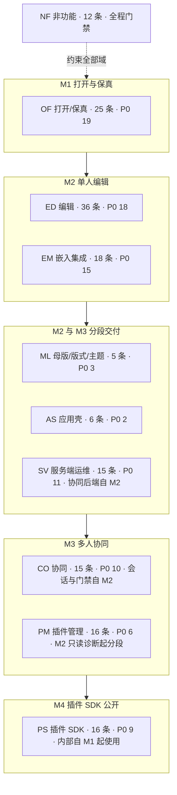
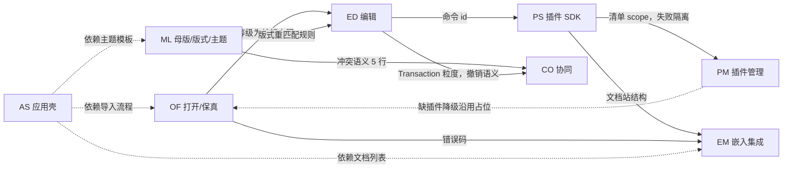
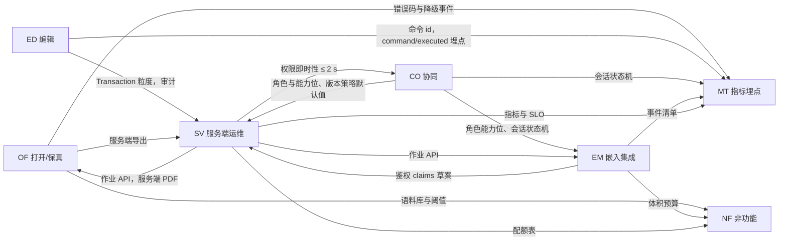

> 状态：草稿 | 负责：产品 | 更新：2026-11-05 | 依赖：charter v0.2；rulings §3、§4.1、§4.3、§4.9、§4.10、§4.12、§4.15、§4.16、§4.18、§4.19、§4.21、§4.23、§4.25、§4.26、§5；80-process/02；设计 README、03-02

# PRD 总览 —— 基于 cordis 的可插拔办公文档 SDK 与在线协同编辑器（首个文档类型：.pptx）

> 读者：总编排、设计线、架构线（结构、运行时、类型治理）、模块线、前端 / 后端 / 测试设计线、评审者，以及据此拆任务的工程师。
> 本目录是产品需求基线：需求、验收标准、优先级与里程碑（03-features、04、05）以及产品指标（06）以本目录为准。本目录复述的界面、接口与数据等事实（含界面文案、尺寸与位置）须与 80-process/02 §2 所列的归属文档一致，冲突时以归属文档为准。与章程（`../00-charter/charter.md`，v0.2）冲突之处不擅改，登记在 §6；需要决策的问题登记在 §5，按默认值推进。

---

## 1. 范围声明

### 1.1 本 PRD 覆盖

- 产品定义、目标与非目标；角色与场景；九个功能域（打开/保真、编辑、协同、插件 SDK、嵌入与集成、服务端与运维、母版/版式/主题、应用壳、插件管理）的可验收需求；非功能需求（NF-01…NF-12：性能、保真、可用性与数据安全、安全、可访问性、国际化、浏览器与运行时矩阵、互操作、可维护性与质量门禁、容量、隐私与合规、文档与支持）；M0–M5 里程碑范围与验收；北极星与埋点。
- 首个文档类型 PowerPoint `.pptx`（含 `.ppsx`/`.potx` 同结构变体；`.pptm` 宏文件直接拒绝导入，`format.macro_rejected`，rulings §4.16 Q15）；`.docx`/`.xlsx` 仅在 M5 以「骨架验证文档类型盲」的深度出现。

### 1.2 本 PRD 不覆盖

- 界面布局、交互、状态与文案（`../20-design/03-screens/` 与 playground `src/v3/`）；架构与实现（`../30-architecture/`，含类型治理 `09-type-discipline/` 与 ADR）；模块、插件与文件结构（`../40-modules/`）；浏览器侧行为、路由与事件（`../50-frontend/`）；REST 路由、表与迁移、配置键（`../60-backend/`，路由见 60/15，配置键见 60/17）；测试用例、CI 步骤与 PRD 检查名（`../70-testing/`，检查名见 70/13）；研发流程（`../80-process/`）。各类事实的唯一归属以 80-process/02 §2 为准。本 PRD 引用它们时写编号、键或链接（如「设计 03-02」「架构 04」「ADR-0020」「60/15」）；复述的界面细节须与设计一致，冲突时以设计为准。
- 商业模式、定价（许可证已裁决 Apache-2.0，见 PD-21）。
- doc/sheet 的产品需求（M5 之后另立 PRD）。

### 1.3 需求编号与优先级约定

| 约定 | 说明 |
|---|---|
| 需求编号 | `<域>-<两位序号>`，必要时带一个小写字母后缀（如 ED-15a）；只追加不复用，删除的需求在标题末尾标「（已删除）」并保留编号（80-process/02 §1.1）。功能域：`OF` 打开/保真、`ED` 编辑、`CO` 协同、`PS` 插件 SDK、`EM` 嵌入集成、`SV` 服务端运维、`ML` 母版/版式/主题、`AS` 应用壳（开始页 / 最近 / 模板 / 指南 / 账户）、`PM` 插件管理（面向部署管理员与用户，rulings §4.23）；`NF` 非功能（PRD 04） |
| 指标 id | `MT-xx`（PRD 06），不是需求编号 |
| 用户故事 | `US-<角色码>-<序号>`：E 编辑者、R 评审者、P 插件开发者、I 集成方、O 运维 |
| 待决事项 / 章程建议 | `PD-xx` / `CS-xx`（本文件 §5、§6） |
| 设计覆盖 | 缺口 `G-xx`、影响界面的产品默认答案 `D1`…`D27`、验收流程 `F-P01`…`F-P16`（PRD 07） |
| 每条需求必含 | 验收标准（Given/When/Then 或可度量指标）、`优先级：` 与 `目标里程碑：` 两个字段（写法见 80-process/02 §1.1）、依赖能力（章程 §4 术语）；用户故事集中写在 02 与 PS、EM、SV 三个功能域的「用户故事汇总」节，条目内可选；某条线确实不涉及时在条目内写 `- 落点豁免：<线>——<理由>` |
| P0 | 里程碑出口条件，缺一不可 |
| P1 | 里程碑目标，可在里程碑内延后，不可跨里程碑（跨则登记 PD） |
| P2 | 机会项，可自由滑动 |
| 数字 | 全部为**初始预算**，在对应里程碑中期实测校准一次，只能收紧 |

---

## 2. 文档索引与阅读指引

```
docs/10-prd/
├── README.md                          本文：总览、范围、需求统计、待决事项、章程建议、术语补充、跨条线承接现状、设计语言 v3 下的界面口径
├── 01-background-and-goals.md         背景、为什么不用 Univer/PPTist/pptx-viewer 直接做、目标/非目标、成功指标、关键假设
├── 02-personas-and-scenarios.md       五个角色的画像、核心场景、用户故事（US-*）与故事地图
├── 03-features/
│   ├── 01-open-and-fidelity.md        OF-01…25；★ pptx 特性支持矩阵（查看/编辑/保留 × 里程碑）；保真度量口径
│   ├── 02-editing.md                  ED-01…35（含 ED-15a，共 36 条）；§1a 可插入元素一览（即章程 §4.4 的可追加元素）；快捷键表（ED-16）；编辑与保真的交叉约束；§5 编辑与插入的非目标
│   ├── 03-collaboration.md            CO-01…15；角色与能力位；★ 软冲突语义表（CO-08）；状态与提示一览（会话状态机与同步状态行，§3）
│   ├── 04-plugin-sdk.md               PS-01…16；★ 公开贡献点目录与稳定级；CTK 9 项检查；示例插件清单
│   ├── 05-embedding-and-integration.md EM-01…18；嵌入形态 A–F；★ 事件清单；体积预算；CSP
│   ├── 06-server-and-ops.md           SV-01…15；作业 API；配额表；SLO；部署与运维；Webhook 事件出口（SV-15，M3 含访问申请事件）
│   ├── 07-masters-layouts-and-themes.md ML-01…05：母版视图（M2 P0）、版式应用与重置（M2 P0）、母版与版式编辑（M3 P0）、主题（M3 P1）、备注/讲义母版（M4 P2）；缩略图窗格的母版模式（§3）
│   ├── 08-app-shell.md                AS-01…06：开始页（M2 P0）、最近与固定、模板库、指南与帮助入口、首次使用引导、账户菜单（M2 P0）
│   └── 09-plugin-manager.md           PM-01…16：两级管理（管理员三态 / 用户个人启停）、只认部署预置、作用域（内容级按部署统一 / 界面级个人）、个人插件面板、缺插件降级提示、协同一致性、审计；M2 只读诊断 → M3 管理员管控 → M4 第三方预置
├── 04-non-functional-requirements.md  NF-01…12；★ 参考机/参考文稿；性能预算全表；WCAG 2.2 AA 口径；浏览器矩阵
├── 05-milestones-and-scope.md         M0–M5：范围（按需求编号）、机械可验证验收、可插拔证据、依赖、风险
├── 06-metrics-and-analytics.md        北极星 WSES；MT-01…08、MT-10…24；★ 埋点事件清单（<域>/<动作>）；漏斗与仪表盘
├── 07-design-coverage-and-gaps.md     ★ 需求 ↔ 设计 ↔ v3 样张覆盖矩阵；缺口 G-01…G-94 的现状与落点；验收流程 F-P01…F-P16；影响界面的产品默认答案 D1–D27
├── 08-prd-design-alignment-2026-09-17.md PRD ↔ 设计稿一致性：母版视图、应用壳等 14 项的现行结论与归属文档
└── 09-prd-design-alignment-2026-09-18.md PRD ↔ 设计稿一致性：rulings §4.10 Q11–Q21 各题的现行结论与归属文档
```

| 读者 | 建议顺序 |
|---|---|
| 总编排 / 评审 | README → 01 → 05 → 各功能域 §0「产品立场」→ 04 → 07（设计覆盖与缺口） |
| 设计 | **07（覆盖矩阵与缺口，先读）** → 02 → 03/02 → 03/03（§3 状态表、CO-08）→ 03/04（PS-02 槽位）→ 03/07（母版/版式/主题，G-70–G-75）→ 03/08（开始页、账户菜单）→ 03/09（PM-10…PM-12）→ 04（NF-05） |
| 架构-结构 | 03/01（OF-18、矩阵）→ 03/04（PS-01/02/07）→ 03/05（EM-01/05/07）→ 05（可插拔证据） |
| 架构-运行时 | 03/03 → 03/06 → 04（NF-01）→ 03/01（OF-03/05/09、§4） |
| 类型治理 | 03/04（PS-06/07/15）→ 04（NF-09）→ 06（§5 事件注册表） |
| 前端设计 | 05 §0.3（M2 / M3 边界）→ 各功能域需求 → 04（NF-01 预算、NF-05、NF-07）→ 06 §3（埋点事件） |
| 后端设计 | 03/06 → 03/03 §1（角色与能力位）→ 05 §0.3 → 04（NF-01 §1.7、NF-03、NF-10、NF-11） |
| 测试设计 | 05（各里程碑验收与检查名）→ 各功能域验收标准 → 04 |
| 拆任务的工程师（含模块线） | 05（当前里程碑范围）→ 对应功能域需求条目 → 04 门禁数字 |

---

## 3. 产品定位（一页纸）

| 维度 | 立场 |
|---|---|
| 是什么 | 可嵌入、可自托管、每一级可替换的办公文档 SDK；`apps/web` 只是组装样例 |
| 首个能力 | pptx 直接打开 → 高保真渲染 → 单人编辑 → 多人协同 → 导出且未修改零丢失 |
| 差异化 | ① 保真可机械验收（部件级 diff + oracle SSIM）；② 每一级可插拔且有 CI 证据；③ 插件开发者是第一等用户（Manifest/CTK/文档站）；④ 浏览器与 Node 跑同一份模型代码 |
| 不是什么 | 不是 PowerPoint 替代品、不是套件、不是插件市场、不是多租户 SaaS（一次部署 = 一个组织，M1–M5 只做自托管，rulings §4.15 T-0/Q10）、不做沙箱、不做 .ppt、M1–M3 不编辑动画 |
| 北极星 | 周成功编辑会话数 WSES（打开成功 + ≥1 事务 + 无致命错误 + 保存/同步成功） |

---

## 4. 需求统计（草稿基线）

| 域 | 条目数 | P0 / P1 / P2 | 主要里程碑 |
|---|---|---|---|
| OF 打开/保真 | 25 | 19 / 4 / 2 | M1 |
| ED 编辑 | 36（含 ED-15a） | 18 / 12 / 6 | M2 |
| CO 协同 | 15 | 10 / 3 / 2 | M3（会话建立、同步路径与门禁自 M2 随协同后端交付，rulings §4.19 D-M2-CONTENT） |
| PS 插件 SDK | 16 | 9 / 6 / 1 | M4（内部自 M1） |
| EM 嵌入集成 | 18 | 15 / 3 / 0 | M2 |
| SV 服务端运维 | 15 | 11 / 3 / 1 | M2 / M3（导入、网关、update 持久化与快照、OIDC 自 M2，rulings §4.19 D-M2-CONTENT） |
| ML 母版/版式/主题 | 5 | 3 / 1 / 1 | M2 / M3 |
| AS 应用壳 | 6 | 2 / 3 / 1 | M2 / M3 |
| PM 插件管理 | 16 | 6 / 10 / 0 | M2 只读诊断 / M3 管理员管控与协同一致性 / M4 第三方预置 |
| NF 非功能 | 12 | 不分级 | 全程 |
| 合计 | 164 | 93 / 45 / 14 | — |

口径：每条需求按条目内首个「优先级」取值计（80-process/02 §1.1 第 6 条），与 `check-req-coverage.py`（G4）的汇总一致；OF-11、ED-06、ED-09、ED-17、ED-26、SV-02、SV-03、SV-06、SV-07、PM-01、PM-04、PM-05、PM-10 写有分段优先级，同样按首个取值计。NF 不写优先级，合计里的 12 条不分级。

**图 4-1 PRD 功能域地图：按主要里程碑分组**



怎么读：每个子图是一个里程碑，域放在其主要里程碑下，节点里的数字取自上表；实线为里程碑先后，虚线表示 NF 以门禁形式贯穿所有里程碑。协同后端自 M2 交付，M2 / M3 的边界见 `05-milestones-and-scope.md` §0.3；各域在其它里程碑的条目见同文件 §0.2 总表。

依据：本节上表；05 §0.2、§0.3；rulings §4.19 D-M2-CONTENT。

**图 4-2 功能域之间的产出与消费：编辑器侧**



怎么读：实线从「产出方」指向「消费方」，边上写产出物；虚线是依赖：应用壳依赖导入流程、主题模板与文档列表，插件管理的缺插件提示沿用打开域的降级占位。设计与架构方向的消费方未画入。

依据：各功能文件末节「与其它域的接口」（01 §5、02 §4、03 §4、04 §4、05 §4、06 §4、07 §4、08 §2、09 §6）。

**图 4-3 功能域之间的产出与消费：协同、服务端与横切域**



怎么读：读法同图 4-2；NF 与 MT 两个横切域在本图中只作为消费方出现，其余域产出的阈值、事件、指标与配额汇入这两处。

依据：同图 4-2。

---

## 5. 待决事项（按默认值推进；决策人可随时否决）

> 「章程」列为章程 §10 的 Q 号时，该项在章程层裁决，以章程与 rulings 为准。决策人写「已裁决」的行只记现行结论与依据；其余按「当前默认」推进，决策人可随时否决。范围变更的流程见 05 §6。

| 编号 | 问题 | 当前默认 | 影响 | 决策人 | 章程 |
|---|---|---|---|---|---|
| PD-01 | 加密（AES）pptx 的支持时点 | **已裁决**（章程 Q15，rulings §4.16）：M1–M4 拒绝并返回 `format.encrypted`，提示先去除密码 | OF-02、矩阵 §2.1 | 已裁决 | Q15 |
| PD-02 | `.pptm` 宏文件策略 | **已裁决**（章程 Q15，rulings §4.16）：`.pptm` 直接拒绝导入，错误码 `format.macro_rejected`，提示「请另存为 .pptx 后再导入」；`.ppsx` / `.potx` 不受影响 | OF-02、矩阵 §2.1、安全立场 | 已裁决 | Q15 |
| PD-03 | Strict 命名空间输入且有编辑时的导出一致性类 | **已裁决 C**（rulings §4.12 U-02）：导出保持输入的一致性类（Strict 输入经反向映射写回 Strict），M1 即完整实现；方案 B「整包转 Transitional」只作反向映射失败时的异常兜底。硬要求：零编辑时字节相同，PowerPoint 365 打开无修复 | OF-18、矩阵 §2.1、ADR-0008 | 已裁决 | **Q14** |
| PD-04 | 评论的持久化与 pptx 导出 | **已裁决**。存储：评论以快照内 `ResourceHook` 的 `comments.threads` 为事实源，服务端数据库为镜像读模型，作者级规则由服务端软门禁执行（rulings §4.19 D-COMMENTS-PKG，ADR-0031）。导出：缺省把评论线程写入现代评论部件；不写入是 SDK 导出接口的选项（EM-02），参考应用的导出对话框不提供开关、一律写入（rulings §4.26 PV-12；对话框以设计 03-22 为准） | CO-04、OF-11、EM-02 | 已裁决 | — |
| PD-05 | 离线编辑范围 | M2：基础重连（指数退避自动重连，先鉴权再同步，补发未获确认的更改，有未确认更改时离开保护，05 §0.3）。M3：会话内断线队列（内存，刷新即丢）；离线横幅文案「更改已保存在本地，将在重新连接后同步」；应用内的离开与刷新先尝试同步，仍有未同步项时弹应用内确认框（初始焦点在安全项），浏览器刷新与关闭标签页只能用浏览器原生提示（CO-06，rulings §4.25 DS-59）；写明「关闭或刷新会丢失」的文案在 M4 启用跨刷新持久化前再定。M4 P2：`collab-offline-idb`（`OfflineStore` Provider）跨刷新持久化（ADR-0033）。界面与文案以设计 03-12 为准 | CO-06 | 用户 | — |
| PD-06 | 图表数据编辑后内嵌工作簿的处理 | **已裁决**（rulings §4.21 q-chart-route 与默认值 R-d-35，ADR-0036）：数据被编辑过的图表在导出时用自研最小写出器重生成内嵌工作簿，导入时自带工作簿里数据区之外的内容（其它工作表、公式）随之不保留；导入的带工作簿图表第一次编辑数据时提示一次（设计 03-31「原工作簿提示」）；工作簿生成失败时的降级由架构-运行时定，以架构 04 与前端 50/18 CHT-05 为准 | ED-15、ED-15a、ADR-0036 | 已裁决 | — |
| PD-07 | 放映模式与动画/切换播放 | **已定**（章程 §2.3、§7）：M1–M3 渲染结束态不播放；播放 M4 P2；编辑非目标 | ED-21、矩阵 §2.3 | 已裁决 | §2.3 |
| PD-08 | 版本与数据保留策略 | **已裁决**（章程 Q17，rulings §4.16）：自动快照每 10 min 或 500 updates；30 天内全量，此后每天保留最后一个，保留天数缺省 365、设为 0 即永久（rulings §4.19 C-06）；命名快照永久（每文档上限 200）；update 追加表 7 天；导入原件 30 天；回收站 30 天（SV-11）；墓碑 TTL 24 h；**全部可由部署配置调整**，键名与取值范围以 60-backend/17 §5.11 为准。不透明保留所需的部件 Blob 随文档生命周期保留，不受此限 | CO-07、SV-03、SV-08、SV-11 | 已裁决 | Q17 |
| PD-09 | 浏览器矩阵底线 | Chrome / Edge 最近 2 个稳定版；Firefox 最近 2 个稳定版 + 当前 ESR；Safari 17+；移动端见 PD-15 | NF-07 | 用户（客户画像） | — |
| PD-10 | 遥测默认开关 | SDK 出厂 no-op；集成方显式接入 `telemetry.sink` | EM-13、06 指标 | 用户（法务/隐私） | — |
| PD-11 | 首批语言 | zh-CN（源）+ en-US（M2） | NF-06、PS-05 双语文档 | 用户 | — |
| PD-12 | 是否随包分发 CJK 回退字体 | 客户端：不内置（体积与许可），集成方经 OF-25 供给。服务端字体包**已裁决**（章程 Q19，rulings §4.16）：内置 Noto（含 CJK）+ Liberation + Carlito/Caladea，均开源；**部署方可挂载自有授权字体目录**；不内置商业字体 | OF-05、OF-25、SV-02 | 已裁决（服务端）/ 用户（客户端） | Q19 |
| PD-13 | 里程碑周期 | **已裁决**（章程 Q13，rulings §4.16）：不定周期，按范围与验收推进，每个里程碑开工前再估 | 05 里程碑 | 已裁决 | Q13 |
| PD-14 | 第三方插件「已验证目录」 | M4 P2，仅文档站目录（CTK 报告 + 许可 + 源码链接），不做运行时市场 | PS-08 | 用户 | — |
| PD-15 | 移动端浏览器范围 | **已裁决**（章程 Q20，rulings §4.16）：桌面优先；平板只读评审；手机查看 + 评论 M3 P1；编辑 M4+ P2；M2 必达键盘可达 + 基本朗读，WCAG 2.2 AA 分阶段。手机（< 640）的评论包含发表与回复，解决在更大窗口中进行（rulings §4.25 DS-28、DS-46）；平板（触控、≥ 640）的评论只读（TB-49），评论面板按方向落位：竖屏在当前页与备注卡下方、横屏为右侧整高侧栏（DS-131）；平板的仅查看状态行写「仅查看 · 在电脑上编辑」（TB-125），不可用入口的原因同写「在电脑上编辑」（TB-136），嵌入里同样以触控为准（TB-159）；平板上开始页与文档列表顶部的提示写「在电脑上新建或导入演示文稿」（TB-153），左侧导航与卡片列数按窗口宽度（TB-165）；「触控设备」只指平板，手机不论是否触控都按窗口窄写（TB-163）。界面以设计 03-02 §5a、03-06、03-29、03-01 为准 | NF-07、ED-22、ED-27、CO-04、AS-01 | 已裁决 | Q20 |
| PD-16 | 服务端 PDF/缩略图引擎 | **已裁决**（章程 Q8，rulings §4.15）：headless Chromium（ADR-0026），运行于独立零出站 renderer sidecar；缩略图 M3 前半段、PDF M3 后半段；M2 以包内 `thumbnail.jpeg` 作过渡封面；不用 sharp；自研矢量 PDF 为后续 | SV-02、SV-04、SV-09 | 已裁决 | Q8 |
| PD-17 | 配额默认值 | 规模数字**已裁决**（章程 Q5，rulings §4.15）：五个数字为性能保证包络；系统天花板 200 页 / 单页 1,000 / 文档总元素 20,000（软警告 15,000，墓碑计入）；超出系统天花板（或文件超过 200 MB）的导入直接拒绝（rulings §4.18 UX-13）；名额按用户计；全部由部署配置完全可调。其余行（评论线程、命名版本数、速率等）为产品默认值，见 SV-08 表 | SV-08 | 已裁决（规模）/ 用户（其余） | Q5 |
| PD-18 | 不可内部编辑元素（SmartArt/OLE/3D/动画对象）的交互 | **已结案**（章程 Q7，rulings §4.15）：建模变换。删除 M1 P0、整体移动/缩放 M2 P1（`mc:AlternateContent` 各分支 `xfrm` 同步回写，ADR-0008 决策 9 白名单），内部不可编辑并提示 | ED §1、矩阵 §2.1 备注 A、§2.6 | 已裁决 | Q7 |
| PD-19 | 协同排他锁 | **已裁决**（章程 Q16，rulings §4.16）：不做排他锁。只有 awareness 软提示（选中框 + 名字），没有形状级或页级的锁；冲突按 CO-08 软冲突规则 | CO-10、CO-05 | 已裁决 | Q16 |
| PD-20 | 含数字签名文件的处理 | **已裁决**（章程 Q15，rulings §4.16）：签名文件可打开；保留 `_xmlsignatures/`；编辑后提示「签名将失效」（U-05 诊断码）；不移除 | 矩阵 §2.1 | 已裁决 | Q15 |
| PD-21 | SDK 许可证与商业模式 | 许可证**已裁决**（章程 Q12，rulings §4.16）：**Apache-2.0**（含 NOTICE；可发布包 `license: Apache-2.0`）；商业模式不在本 PRD 范围 | EM-16、PS-08 | 已裁决 | Q12 |
| PD-22 | M4 试点团队来源 | **已裁决**（章程 Q11，rulings §4.16）：内部非核心成员（未参与内核开发的同事或全新 AI agent 会话）仅凭公开文档完成一个插件（≤ 2 人日） | 05 M4 验收 5 | 已裁决 | Q11 |
| PD-23 | 模板库与帮助内容的来源与审核（AS-03 / AS-04） | 已定：M2 内置 5 套主题模板，简约 / 商务 / 暗色 / 学术 / 活力，与编辑器主题画廊同一套（rulings §4.25 DS-12、DS-33，ML-04）；帮助与指南的内容由集成方以链接提供、在新标签页打开，未配置时帮助菜单只剩「键盘快捷键」，不做站内指南页（DS-89）；M3 模板库只做来源分段与预览，未配置模板源时只有内置模板（DS-93）。仍待定：内置模板由谁制作与维护，集成方模板源怎样下发、是否需要审核；在本项定之前，集成方模板源按部署配置的静态来源列表设计，某一来源取不到只影响它那一组（TB-160） | 08 AS-03 / AS-04 | 用户 / 集成方 | — |
| PD-24 | 开始页与账户菜单是否作为 SDK 交付物（D22 延伸） | **已结案**（章程 §5.2；40-modules/10、40-modules/11）：开始页是参考应用 `apps/web` 的页面；账户菜单 `UserMenu` 与品牌标 `Brand` 由 `@cordexjs/ui-react` 交付，开始页、文档列表与编辑器三处共用同一个 `UserMenu`；品牌名称、标记与主色可由集成方替换（`BrandConfig`） | 08 §0、AS-01、AS-06、EM-17 | 已裁决 | — |
| PD-25 | M2 应用壳新建 / 打开的文档内容存在哪里（范围变更登记） | **已裁决**（rulings §4.19 D-M2-CONTENT）：协同网关、Room、update 持久化与快照、服务端导入在 M2 交付；参考应用的文档内容自 M2 起只以协同快照为事实源，不设过渡的 pptx 内容版本端点；M3 是多人协同体验层 | 05 §0.3、M2 / M3；CO-01/02/12；SV-01/03/05/06/07/12；AS-01；EM-03/04 | 已裁决 | §7 |
| PD-26 | 性能 runner 与 PowerPoint 基线机器 | **已裁决**（rulings §4.19 D-TEST-INFRA）：性能 M1 用 GitHub larger runner（4 核），协同与服务端压测所需的自托管专用 runner 在 M2 前落地，低配机型用 CDP CPU 4× 节流近似；视觉基线用一台 Windows + PowerPoint 365 维护机（不进 CI），macOS 基线 M2 加入 | 05 M1 依赖与验收 3、M2 依赖；NF-01、NF-02 | 已裁决 | — |
| PD-27 | 网格视图的需求归属与里程碑（rulings §4.25 DS-3、DS-4） | 归入 ED-22「视图、缩放与导航」（M2 P0）：单页 / 网格两种视图，左栏顶部、网格左上胶囊与主菜单「视图」三处入口读写同一视图状态，网格把两侧面板收为左上「文档」、右上「协作与分享」两个浮动胶囊；键盘 e2e 随 05 M2 验收 6 覆盖；界面以设计 03-02 §2、§5 为准 | 02 ED-22、ED-29；05 M2 验收 6；NF-05 | 用户 | — |
| PD-28 | v3 首页样张与 AS-01…AS-06 的差异（设计 03-29 §6） | **已裁决**（rulings §4.25 DS-9…DS-12、DS-18、DS-79…DS-93）：AS-01…AS-06 以 v3 首页与应用壳样张为准。① 最近最多 8 条（网格四列两行、可切列表）；② 卡片第二行「编辑者 · 相对时间」，我拥有的共享文档右下叠 2 位协作者、别人共享给我的是一枚所有者头像，标题后带固定图钉与角色徽标，开始页、文档列表与回收站同一份「⋯」菜单（DS-81、DS-83）；③ 左侧导航宽 220、不设「设置」项，设置只在账户菜单「偏好设置…」（DS-10）；④ 内置模板见 PD-23；⑤ 开始页搜索框的 ⌘K 是开始页作用域的聚焦搜索，编辑器内 `Mod+K` 为命令面板（ED-30，DS-11）；⑥ 不显示问候语，指南与帮助条目在左侧导航「帮助」菜单（AS-04）；⑦ 编辑器的账户入口是右上角自己的头像，三处同一份账户菜单：头部头像、姓名与邮箱 ┊「个人资料…」（M3 起，DS-91）┊ 主题浅色 / 深色 / 跟随系统（DS-90）┊ 偏好设置… · 键盘快捷键 ·（仅平台管理员，M3 起）管理 · 帮助中心（配置了链接时）┊ 退出登录；头像为身份色底 + 白色首字（DS-9、TB-123）；⑧「更多模板 →」随 M3 模板库页提供（AS-03）。条目与画法以 08 AS-01…AS-06 与设计 03-29、03-01 为准 | 08 AS-01…AS-06；05 M2 验收 11、12 | 已裁决 | — |
| PD-29 | 文档菜单「移动到…」是否纳入（设计 03-02 §10） | **已裁决**（rulings §4.25 DS-19）：不纳入。PRD 没有文件夹或位置概念，文档菜单不设「移动到…」；工具条「更多」里同样不设对应能力的「组件」（02 §1a）；以后需要时走新增需求的变更 | 编辑器文档菜单；EM-17 文档列表 | 已裁决 | — |
| PD-30 | 大纲视图是否提供（rulings §4.21 VIEW-04） | 不在 M2–M3，建议 M4+，PRD 02 补条目之前不排期；幻灯片浏览由网格视图承担（PD-27），阅读视图不另做（只读查看器 OF-14 已覆盖） | ED-22 | 用户 | — |

---

## 6. 对章程的异议 / 建议（处置结果见 rulings §3、§4.1、§4.3、§4.16）

| 编号 | 章程位置 | 建议 | 处置 | 落点 |
|---|---|---|---|---|
| CS-01 | §7 M1「部件级 diff 零差异」 | 采纳 `03-features/01-open-and-fidelity.md` §4.1 的等价口径 | **采纳** | D7（与架构 A-12 合并） |
| CS-02 | §7 M2 验收清单 | 补「表格单元格文本编辑（P1）」「基础放映（P1，无动画）」；表格结构编辑归 M3 | **采纳** | §7 M2 / M3 |
| CS-03 | §2.3 非目标（动画/切换） | 明确「播放」策略：M1–M3 渲染结束态不播放，M4 P2 播放 | **采纳** | §2.3、§7 M4 |
| CS-04 | §10 Q5 规模目标 | 增加「只读查看者 ≤ 50/文档」「单页元素 ≤ 1,000」 | **采纳** | Q5 |
| CS-05 | §5.4「打开空壳」 | 采用可验证口径：无 `DocumentType` 时打开文件以错误码失败，宿主仍运行 | **采纳** | §5.4（错误码格式见 CS-13） |
| CS-06 | §6.1 D7 保真策略 | 补「元素级（节点级）不透明保留」 | **采纳** | §4、R6、D7 |
| CS-07 | §5.5 命名 | 为第三方插件预留事件域 / 贡献点 id 前缀规则 | **采纳-改写**（rulings §4.1「第三方前缀」） | 形式为 `<vendor>:<域>/<动作>` 与 `<vendor>:<域>.<名>`（章程 D15、§5.5）；PS-02 按此写 |
| CS-08 | §4 术语表 | 新增 Room/Version/角色名/Soft Conflict/Support Level/Oracle/Corpus/Integrator | **采纳（精简）** | §4.2 / §4.3；本文件 §7「章程」列标注已入章程的术语 |
| CS-09 | §5.2 `apps/web` 职责 | 明确含文档列表 + 分享/权限入口 + 版本入口的最小演示范围 | **采纳** | §5.2 apps/web（另含 `/render` headless 渲染页） |
| CS-10 | §7 M4 可插拔证据「外部团队」 | 增加待决项「试点团队来源」 | **已裁决**（rulings §4.16 Q11）：内部非核心成员（未参与内核开发的同事或全新 AI agent 会话）仅凭公开文档完成一个插件 | Q11、§7 M4 |
| CS-11 | §5.2 包清单 | 增加 `preset-slide-viewer` | **采纳** | §5.1 / §5.2、§7 M1 验收；OF-14 依赖已满足 |
| CS-12 | §5.2 / Q8 | 服务端缩略图排 M3 前半段 | **采纳** | Q8、§7 M3 |
| CS-13 | §5.4 | 错误码统一点式 `format.no_document_type`，事件名保持 `域/动作` | **采纳**（rulings §4.3） | §5.4；架构 10 |

---

## 7. 术语补充（章程 §4 之外、本 PRD 使用的术语；「章程」列非空者以章程定义为准）

编辑器界面术语（底部创建工具条、检查器、主菜单 / 文档菜单、单页 / 网格视图、浮动胶囊、评审条 / 浏览条、紧凑形态 / 仅查看形态、同步状态行）以章程 §4.6 为准，界面细节以设计 README §6 为准。下表收了其中检查器、底部创建工具条、单页 / 网格视图与主菜单 / 文档菜单四条，补本 PRD 用到的规则与界面细节，冲突时以章程与设计为准。

| 术语 | 英文 | 定义 | 章程 |
|---|---|---|---|
| 支持等级（章程称「支持级」） | Support Level | 对一种 pptx 特性的承诺：`P` 仅保留 / `V~` 近似查看 / `V` 查看 / `E~` 部分编辑（章程称「有限编辑」）/ `E` 编辑 / `✗` 拒绝（章程称「不支持」，PRD 只用于文件级）；累积关系 E ⊃ V ⊃ P。定义见 `03-features/01-open-and-fidelity.md` §1 | §4.3 |
| 语义等价 / 部件级 diff | Part-level diff | 导出包与源包的结构保真判定口径，见 OF §4.1 | D7 |
| 参照物 | Oracle | PowerPoint 365 真机导出的 PNG/PDF/属性表，作为保真比对基准 | §4.3 |
| 语料库 | Corpus | 保真与性能测试用的 pptx 集合：T1 规范语料、T2 真实语料（脱敏）、T3 压力语料（含参考文稿） | §4.3 |
| 参考机 | Reference Machine | 性能预算的度量环境（RM-A 基线 / RM-B 低端 / RM-S 服务端），见 NF §0 | — |
| 参考文稿 | Reference Deck | D50、D200、DX-1000、DX-DEEP、DX-MEDIA 与 DX-20K（系统天花板验证），见 NF §0.2 | — |
| gate / target | Gate / Target | gate = PRD 门禁值（CI 超出即失败）；target = 架构内部目标值（观测不门禁），见 NF-01 §1.2 | — |
| 降级渲染 | Degraded Rendering | 元素无法高保真渲染时的占位或近似显示，必伴随 `render/element-degraded` 事件 | — |
| 保真报告（保真诊断面板） | Fidelity Report | 列出当前文档全部降级项、缺失字体与限制命中的报告（OF-13，M2 P1）：主菜单「文件 › 保真报告」打开的检查器整栏面板，宽度沿用检查器当前宽度（缺省 280）；页级「查看详情」打开同一面板并按本页过滤，不另做诊断视图（rulings §4.25 DS-38、DS-51、TB-60）；界面以设计 03-10 为准 | — |
| 个人插件面板（扩展面板） | Extensions Panel | 主菜单「插件…」打开的居中对话框，宽 640（rulings §4.25 DS-38）：分「本文档缺少的插件」「我的界面插件」「本部署统一启用」三组，列出每个插件本会话的状态（运行中、等待依赖、未加载、已关闭、启动失败、版本不兼容），启动失败的插件写错误码与阶段，可在本会话重试；M3 起可开关「我的界面插件」（PM-10）。它是 PS-11 的失败可见面，PRD 中的「扩展面板」即此面板；界面以设计 03-09 为准 | — |
| 检查器 | Inspector | 编辑器右侧贴边面板，缺省宽 280，桌面形态可拖宽 240–480（rulings §4.25 TB-25）：顶部协作行（头像组、放映、分享）；「设计」页签只放当前选中对象的属性、随选中切换分区（`ui.inspectorSection`），「评论」页签放评论面板（筛选缺省「当前页」，DS-43）；需要整栏空间时换成整栏面板（见本表「整栏面板」）；检查器页签只由内置包贡献（TB-59）；网格视图里收为右上「协作与分享」胶囊，紧凑形态里是右侧抽屉（DS-4、DS-130）。其它文档里的「属性面板」即检查器。界面以设计 03-02 §3.5 与设计 README §6 为准 | §4.6 |
| 底部创建工具条 | Creation Toolbar | 画布底部居中的浮动工具条，只管创建：选择、文本、形状、图片、表格、图表、评论、更多；插件的创建类按钮只进「更多」（`ui.toolbar`，rulings §4.25 DS-1、DS-5） | §4.6 |
| 单页 / 网格视图 | Single / Grid View | 编辑器的两种视图：单页为左栏 + 画布 + 检查器；网格把左栏与检查器收起为左上「文档」、右上「协作与分享」两个浮动胶囊，画布排开全部幻灯片；视图状态只有一份（ED-22，rulings §4.25 DS-3、DS-4） | §4.6 |
| 主菜单 / 文档菜单 | Main Menu / Document Menu | 左栏左上 logo ▾ 的主菜单（返回首页 ┊ 文件 / 编辑 / 视图 / 插入 / 排列 ┊ 插件… ┊ 帮助，rulings §4.25 DS-18、DS-21）与文件名 ▾ 的文档菜单（重命名 / 创建副本 / 版本历史，条目随角色；评审者与查看者没有任何条目，他们的文件名只显示、不是菜单触发器，DS-82；编辑中被降权时三项留在原位、不可用并写「需要编辑权限」，TB-138、DS-139）；承接创建与格式之外的其余命令，与右键、命令面板（`Mod+K`，ED-30）和快捷键并列（DS-1）；界面以设计 03-02 §2.3 为准 | §4.6 |
| 母版视图 / 母版视图横幅 | Slide Master View / Master View Banner | 编辑母版与版式的视图，是同一编辑器的一种视图状态：左栏换成母版缩略图窗格，窗格选中母版即编辑母版、选中版式即编辑版式；画布顶部的母版视图横幅写明正在编辑的对象与继承来源，带「关闭母版视图」，这是唯一的常驻退出（ML-01，rulings §4.25 DS-21、DS-145、DS-146）。设计称这条横幅为「上下文条」（TB-208）；界面以设计 03-26 为准 | — |
| 整栏面板 | Inspector Takeover | 检查器整栏换成的面板：协作行不动，页签行换成面板标题行。版本历史与保真报告沿用检查器当前宽度（缺省 280），开着时分隔条照常可拖；图表数据面板与插件整页面板宽 max(400, 检查器当前宽度)，开着时分隔条不可拖，关闭后回到打开前的宽度（rulings §4.25 DS-26、DS-38、TB-60）；插件整页面板由该插件检查器分区右下的「展开」或命令打开，跟着触发它的选中对象（TB-59）；紧凑形态里版本历史与保真报告进右侧检查器抽屉，插件整页面板改画布底部 Sheet（DS-130）；界面以设计 README §6 为准 | — |
| 降级对象 | Degraded Object | 画布上暂时无法显示的对象（保真占位）与缺少插件的元素共用的选中类型：画成虚线框 + 图标 + 一行标题 + 一行原因；检查器最上是对象说明，然后是位置与大小，最后是对象自己的节；右键按「能摆放」口径，评审、只读浏览与降权下照常出现，编辑类命令留在原位、不可用（OF-13、PM-12，rulings §4.25 DS-52、DS-64）；占位画法以设计 03-13 为准，检查器与右键以 03-03 G-19、03-05 §3 为准 | — |
| 阻断页 | Blocking Page | 整个区域不能用时画的页：画布底色上居中一列，图标、标题、说明与按钮，不加卡片；用于没有访问权限（含会话中访问被撤销）、找不到该文档、「此文档在回收站中」、查看人数已满、打开失败、链接已失效、登录页与错误页，以及嵌入里的登录提示与打开失败（CO-05、CO-15、SV-11、AS-06，rulings §4.25 DS-50、DS-71、DS-85、DS-118）；界面以设计 03-33、03-13 为准 | — |
| 访问申请 | Access Request | 没有权限的用户在「你没有权限访问此文档」阻断页上点「申请访问」，可留言（≤ 200 字）；所有者在分享对话框顶部「访问申请 N」一节逐条选角色后批准或拒绝，有待处理申请时「分享」按钮带强调色小圆点；及时通知靠集成方，M3 另推 Webhook 事件 `access_request.created`；申请被拒不告知申请人（CO-05、CO-15、SV-15，rulings §4.25 DS-48、DS-67、DS-68）。随分享在 M3 开放，M2 阻断页上的「申请访问」留在原位、不可用并写「后续版本提供」（TB-156）；界面以设计 03-08 为准 | — |
| 回收站 | Trash | 左侧导航第 5 项，也是文档列表的一个视图：只列自己拥有、已移到回收站的文档，按移入时间倒序；卡片封面变淡、常驻「恢复」，不能打开；卡片第二行 M3 起为「N 天后永久删除」（天数读部署配置，缺省 30），M2 为「N 天前移到回收站」；「永久删除…」只在这里发起（M3）；所有者从旧链接打开时为「此文档在回收站中」阻断页、可就地恢复（SV-11、AS-01，rulings §4.25 DS-79、DS-85、TB-141）；界面以设计 03-01 为准 | — |
| 偏好设置 | Preferences | 账户菜单「偏好设置…」或 `Mod+,` 打开的居中模态对话框（宽 480），改了即生效、没有保存按钮；编辑器的仅查看形态（< 640 或触控）没有账户入口，手机与平板上只能从开始页或文档列表打开：手机（< 640）为贴底的底部面板，平板沿用居中对话框；分组为外观 · 语言与单位 · 无障碍 · 通知 · 隐私与诊断 · 关于，不设「密度」；集成方锁定的项为只读行，写「由宿主应用设置」（AS-06、EM-06、NF-11，rulings §4.25 DS-113、TB-118）。PRD 中的「设置」即偏好设置；界面以设计 03-23 为准 | — |
| 快捷键面板 | Shortcuts Panel | 编辑器主菜单「帮助 › 键盘快捷键」、开始页与文档列表的帮助菜单、账户菜单与命令面板里的「键盘快捷键」以及 `Mod+/` 打开的画布浮动面板（非模态，宽 360，与查找和替换同一位置、同一时刻只开一个，开着时可在画布上试键；开始页与文档列表上浮在主区右上）：搜索框加按作用域分组的快捷键，插件各一组；编辑器的仅查看形态（< 640 或触控）没有主菜单与账户入口，打不开这个面板；从开始页或文档列表打开时，手机（< 640）为贴底的底部面板，平板沿用浮动面板（ED-16、AS-04、AS-06，rulings §4.25 DS-89、DS-115、TB-154）；入口与界面以设计 03-24 为准 | — |
| 软冲突 | Soft Conflict | CRDT 合并成功但结果可能不符合任一用户意图的并发情形；需提示、可恢复（撤销不覆盖他人，取回自己的值用「恢复我的值」）；场景表见 CO-08 | §4.2 |
| 软删除墓碑 | Tombstone | 删除在 Store 层落为删除标记，id 稳定；读路径/渲染/导出过滤；TTL（默认 24 h）到期由服务端硬删除；计入文档总元素上限（CO-08、SV-03，rulings §4.15 Q3） | — |
| 性能保证包络 / 系统天花板 | Envelope / Ceiling | Q5 两层口径：包络内性能门禁成立；天花板之外拒绝导入（NF §0.2、SV-08） | — |
| 房间 / 会话 / 凭据 | Room / Session / Ticket | 服务端为一份文档维护的协同会话集合与 Y.Doc 副本 / 一个客户端与 Room 的连接生命周期 / WS 握手用短时签名凭据 | §4.2 |
| Update / StateVector / Compaction | — | Yjs 二进制增量 / 已知时钟向量 / 用快照替换其前的 update 序列 | §4.2 |
| 修复 | Repair | 服务端软门禁发出的补偿事务（origin=`repair`），只修不变量，不改用户内容语义（CO-12、ADR-0034） | §4.2 |
| 导出后重载 | Export-then-Reload | 被拒 update 的本地回滚策略：未同步更改存入本地「未同步更改」区（可导出），本地 CRDT 副本从服务端快照重新引导（CO-12、架构 06 §18.4） | — |
| 会话状态 | Collab Session State | `connecting / syncing / synced / reconnecting / offline / readonly-degraded`（UI 名称；对外事件载荷为 M-05 `SyncState` 六态，映射见 CO-01 与架构 06 §18.3，rulings §4.18 UX-01） | — |
| 版本 | Version | 用户可见的历史点：自动版本（按策略的 `Snapshot`）与命名版本（用户创建）；恢复为新事务 | §4.2 |
| 角色 | Role | `viewer` / `commenter` / `editor` / `owner`；是能力位（`doc.read/comment/write/export/manage/history.*`）的预设组合 | §4.3 |
| 能力位 | Capability | 权限的最小单元；命令声明所需能力位；未声明即拒绝 | — |
| 集成方 / 宿主应用 | Integrator / Host App | 把 SDK 嵌入自家产品的工程团队及其产品 | §4.3 |
| 嵌入形态 | Embedding Mode | A React 组件 / B 框架无关挂载 / C 只读查看器（`preset-slide-viewer`）/ D Headless / E iframe / F Web Component，见 EM §1 | — |
| Provider 座 | Provider Slot | 可替换服务实现的落位（`store`/`collabTransport`/`OfflineStore`/`blobStore` 等），不是贡献点；替换须通过 `run<Definition>Conformance` | §5.5 |
| 兼容性测试套件 | CTK, Compatibility Test Kit | 插件在宿主版本矩阵上的 9 项自动检查（含作用域检查，PM-02），见 PS-06 | — |
| 稳定级 | Stability Tier | 贡献点/API 的承诺等级：Stable / Beta / Experimental，见 PS-02；包级字段 `cordex.stability` | §5.2 |
| 资源上传通道 | Asset Upload Channel | 大二进制（图片/媒体）不经 CRDT、经预签名直传到 `blobStore` 的路径，CRDT 内只存 `BlobRef` | （`BlobRef` §4.1） |
| 基线包 | Baseline Package | 导入时以 `BlobRef` 内容寻址保存的原始部件字节（属 `SnapshotBundle`），导出时与快照合成以实现不透明保留；随文档生命周期保留。与「导入原件」（原始上传文件，Q17 保留 30 天）不同 | （`SnapshotBundle` §4.1） |
| 作业 | Job | 服务端异步任务（导入/导出/缩略图/模板填充/迁移），有 `jobId` 与状态机 | — |
| 需求 ↔ 测试矩阵 | Requirement–Test Matrix | 需求编号与测试的映射：测试以 `@req PRD:<编号>` 标注，扫描器 `scan-requirement-tags` 生成 `requirement-test-matrix.json`，判定规则（如 P0 需求在所属里程碑进入出口评审时须有测试，M2 进入出口评审起 P0 / P1 的 ED 需求须有 e2e）见 70-testing/13 §1.3 | — |
| 北极星 WSES | Weekly Successful Editing Sessions | 周成功编辑会话数，定义见 06 §1.1 | — |
| 初始预算 | Initial Budget | 未经实测校准的数字；校准只能收紧 | — |

---

## 8. 跨条线协调请求（供总编排分派）

下表是本 PRD 向其它条线提出的承接项与现在的落点。「已承接」只写落点，设计上仍待补的状态与画法登记在 07 §2 表 2-1，括注其缺口号；「仍开放」写明由哪条线承接。

| 承接内容 | 落点 | 状态 |
|---|---|---|
| 设计：协同界面，含软冲突提示形态（CO-08）、20 人在场与头像折叠、会话状态与同步状态行（CO §3）、评论锚点与筛选、版本历史、分享与访问申请 | 设计 05；设计 03-02 §3.1、03-06、03-07、03-08、03-12 | 已承接（余项见 07 G-50、G-52、G-89） |
| 设计：保真报告、个人插件面板（失败、重试与等待依赖）、插件 UI 槽位（以 PS-02 目录为输入） | 设计 03-10、03-09；设计 06 | 已承接（余项见 07 G-40） |
| 设计：拖拽的键盘与表单等价（ED-29）、画布内容可访问树（NF-05） | 设计 07 §1.2a、§3 | 已承接（余项见 07 G-13） |
| 设计：窄屏的紧凑与仅查看形态（NF-07） | 设计 03-02 §5a | 已承接（余项见 07 G-90） |
| 设计：亮暗主题 token | 设计 04 §2、§3 | 已承接 |
| 设计：高对比主题（`forced-colors`）的具体 token 数值（07 G-92） | 设计 04 §3；设计 README §4 D11 | 仍开放（设计，P1） |
| 架构-结构：开始页路由与壳组件归属（AS、PD-24） | 章程 §5.2；40-modules/10、40-modules/11；50/02 §2 | 已承接 |
| 架构-结构：元素级 `extensions` 槽与 schema 顺序（CS-06）、`preset-slide-viewer`（CS-11）、贡献点目录与稳定级字段、Manifest 字段（PS-01、PS-02）、事件域前缀（CS-07） | ADR-0008；章程 §5.2、§5.5；30/03 §3.6；40-modules/16 | 已承接 |
| 架构-结构：命令声明能力位与扫描器（CO-05）、错误码登记与文档同步（EM-12） | 架构 05；30/10 §1.1a；类型治理 06 §11 | 已承接 |
| 架构-结构：图表 M1 查看路径（OF-09）、Strict 导出（PD-03） | 章程 D16、ADR-0036；ADR-0008、rulings §4.12 U-02 | 已承接 |
| 架构-结构：`Selection` / `Unit` 抽象用 doc / sheet 反例评审（R-M5-1） | ADR-0016；架构 12 §2 | 已承接（M1 起评审） |
| 架构-运行时：页序与形状序的并发移动、富文本映射（CO-08） | ADR-0020、ADR-0032 | 已承接 |
| 架构-运行时：权限变更 ≤ 2 s 推送与容量策略（CO-05、SV-05） | ADR-0012、ADR-0023、ADR-0035 | 已承接 |
| 架构-运行时：服务端软门禁（CO-12）、被拒 update 的本地回滚（CO-12）、离线持久化（CO-06）、房间容量与准入（CO-01、SV-05） | ADR-0034；架构 06 §18.4；ADR-0033；60-backend/05 §4 | 已承接 |
| 架构-运行时：资源上传通道（CO-12）、评论 `ResourceHook` 与现代评论部件编解码（CO-04）、图表内嵌工作簿（PD-06） | 60-backend/04；ADR-0031；ADR-0036 | 已承接 |
| 架构-运行时：headless Chromium 与服务端 PDF（PD-16）、Node 端文本度量 | ADR-0026、ADR-0027 | 已承接 |
| 架构-运行时：IME 宿主 spike（R-M2-1） | ADR-0028「补充（v0.2）」 | 已承接，M2 前执行 |
| 架构-运行时：解析在 Worker、虚拟化与脏区消费（NF-01）、ZIP / XML 限制（OF-24）、连接符路径重算（ED-28）、服务端与客户端导出字节一致（SV-02） | 架构 07；ADR-0019；40-modules/06；30/01 §4.4 | 已承接 |
| 架构-运行时：事件名合并（EM-05 与架构草稿的分歧） | 事件名为 `render/element-failed`、`permission/changed`、`perf/frame`（rulings §5、架构 10 §11）；旧名登记在 `docs/_tools/terms.json`，由 `check-terms.py` 检查残留 | 已承接 |
| 类型治理：遥测事件注册表扫描（06 §5）、命令能力位声明扫描、配置字段读取点扫描（配额与限制）、阈值棘轮的 `cordex-allow` 例外 | 类型治理 06 §7、§10、§11；ADR-0040 | 已承接 |
| 类型治理 / 测试：测试元数据里的需求编号与校验（需求 ↔ 测试矩阵，NF-09） | 70-testing/13 §1.3 | 已承接 |
| 总编排：CS-01…CS-13 与章程级待决项的裁决；PowerPoint oracle 维护机（PD-26） | rulings §3、§4.1、§4.3、§4.16；rulings §4.19 D-TEST-INFRA | 已承接 |
| 总编排 / 测试：T2 真实语料（脱敏、获授权）的来源与授权 | 70-testing/03 | 仍开放（总编排） |
| 架构-运行时：在 30/10 §1.1a 登记 CS-13 采纳的点式错误码（章程 §5.4） | 30/10 §1.1a | 仍开放（架构-运行时；登记后同一提交收紧 G5 基线） |
| 总编排：章程 §4.6「浮动胶囊」「紧凑形态 / 仅查看形态」两行按 rulings §4.25 DS-130（抽屉从横幅下沿开始）、TB-163（「触控设备」只指平板）核对 | 章程 §4.6 | 仍开放（总编排） |
| 总编排：章程 §8 文档树中 PRD 07、08、09 三行的说明按 rulings §4.26 PV-2 改为现行描述（07 为需求 ↔ 设计 ↔ v3 样张覆盖矩阵与缺口清单，08、09 为各项的现行结论与归属文档，不再标「历史记录」），并补 `03-features/09-plugin-manager.md` 一行 | 章程 §8 | 已承接 |

---

## 9. 设计语言 v3 下的界面口径

PRD 各功能域按设计语言 v3 描述界面（rulings §4.25）。本节说明 v3 的界面结构、设计放在哪里、各设计区域对应哪些需求；界面细节写在各需求与设计文档里，本节不重复。

**界面结构**

- 编辑器由左栏、画布、底部创建工具条与右侧检查器组成。左栏（缺省宽 240）自上而下是主菜单（logo ▾）与单页 / 网格切换、文档菜单（文件名 ▾）、文件名下方的同步状态行、「新建幻灯片」与缩略图列表；画布下方是备注区；底部创建工具条只管创建（选择、文本、形状、图片、表格、图表、评论、更多）；检查器（缺省宽 280）顶部是协作行（头像组、放映、分享），「设计」页签只放当前选中对象的属性、随选中切换分区，「评论」页签放评论，版本历史、保真报告、图表数据与插件整页面板打开时整栏换成对应面板（ED-12、ED-22）。
- 创建与格式之外的命令在主菜单、文档菜单、右键、命令面板（`Mod+K`，ED-30）与快捷键（ED-16）。在线人数在头像组里，插件异常、离线与权限变化走按需横幅。
- 视图有单页与网格两种，网格把两侧面板收为左上「文档」、右上「协作与分享」两个浮动胶囊（ED-22）。模式有编辑与评审，评审模式与只读浏览时底部是评审条 / 浏览条；放映是全屏只读呈现（ED-21）。
- 窄屏有两种形态：紧凑（640–1024，两侧面板收为浮动胶囊、按需展开为抽屉）与仅查看（< 640 或平板，只看当前页、底部翻页）（ED-22、NF-07）。嵌入按容器宽度取同样的形态（EM-01）。
- 母版视图是同一编辑器的一种视图：左栏换成母版缩略图窗格，窗格选中即编辑对象，画布顶部的母版视图横幅写明正在编辑的对象，「关闭母版视图」是唯一的常驻退出（ML-01）。
- 应用壳页面（开始页、文档列表与回收站、模板库、管理 › 插件）共用左侧导航与主区顶栏；开始页是左侧导航 +「从模板开始」一行 +「最近」（AS-01）。整个区域不能用时（没有权限、找不到文档、登录与错误页）画阻断页（见 §7）。
- 视觉为中性平面，只有单档紧凑尺寸（EM-06）。

**口径与读法**

- 需求、验收标准、优先级与里程碑以各功能域为准；界面布局、交互、状态与文案以 `20-design/03-screens/` 与 playground `src/v3/` 的 v3 样张为准（80-process/02 §2）。PRD 复述的界面细节与设计一致，冲突时以设计为准。
- 样张里标题以「未采纳 · 」开头的状态是供对照的备选，不是设计，实现以不带这一前缀的状态为准（rulings §4.25 DS-63、DS-173）。
- 编辑器的区域与尺寸以设计 03-02 为准；命令在主菜单、文档菜单、右键、命令面板与快捷键之间的分布以设计 09 §3.1 为准；界面术语以章程 §4.6 与设计 README §6 为准。
- 需求与设计的覆盖矩阵在 07 §1，缺口 G-xx 的现状与落点在 07 §2，影响界面的产品默认答案 D1–D27 在 07 §4。
- 界面口径的裁决出处为 rulings §4.25（DS-1…DS-177、TB-1…TB-210）。

**设计区域与需求**

下表按设计区域给出概览，逐条需求的设计落点以 07 §1 为准。设计文档都在 `20-design/`：03-NN 是界面文档；表中用到的设计总则为 01 信息架构、04 设计系统、05 协同体验、06 扩展体验、07 无障碍与本地化、09 设计规范。

| 设计区域 | 设计文档 | 对应需求 |
|---|---|---|
| 编辑器结构、视图与缩放 | 03-02、03-20；01、09 | ED-12、ED-18、ED-22、EM-08 |
| 窄屏形态与嵌入 | 03-02 §5a | NF-07、ED-27、EM-01 |
| 检查器与右键菜单 | 03-03、03-05 | ED-06、ED-08、ED-12、ED-19、ED-20 |
| 插入与形状 | 03-04、03-15 | ED-05、ED-31…ED-35 |
| 文本与格式 | 03-16 | ED-02…ED-04、ED-24 |
| 选择、对齐与吸附 | 03-17 | ED-01、ED-08、ED-09、ED-26、ED-28 |
| 图片 | 03-18 | ED-07、ED-26 |
| 表格与图表 | 03-30、03-31 | ED-10、ED-15、ED-15a、OF-09 |
| 幻灯片管理与版式画廊 | 03-14、03-27 | ED-11、ML-02 |
| 撤销、剪贴板与保存态 | 03-19；05 §6 | ED-14、ED-17、ED-23、CO-09 |
| 查找与替换 | 03-21 | ED-13、OF-16 |
| 母版视图与主题 | 03-26、03-28 | ML-01、ML-03、ML-04 |
| 在场与跟随 | 05 §1–§4 | CO-03 |
| 评论 | 03-06；05 §10 | CO-04、OF-11 |
| 版本历史 | 03-07；05 §11 | CO-07 |
| 分享与访问申请 | 03-08；05 §12 | CO-05、CO-15、SV-15 |
| 离线、冲突与文档横幅 | 03-12；05 §5、§7、§8 | CO-01、CO-05、CO-06、CO-08、CO-10、CO-12、SV-08 |
| 打开、导入与降级占位 | 03-13 | OF-01…OF-03、OF-07、OF-13、OF-15、OF-24、EM-12、SV-01 |
| 保真报告 | 03-10 | OF-05、OF-13、OF-17 |
| 导出 | 03-22 | OF-18、OF-19、PS-14、SV-02 |
| 放映 | 03-11 | ED-21 |
| 只读查看器 | 03-25 | OF-14 |
| 个人插件面板与插件横幅 | 03-09；06 | PS-02、PS-11、PM-08、PM-10…PM-12 |
| 管理员插件管理 | 03-32 | PM-01、PM-03、PM-05…PM-07、PM-16 |
| 开始页、文档列表、回收站与模板库 | 03-29、03-01 | AS-01…AS-03、AS-05、OF-22、EM-17、SV-04、SV-11 |
| 帮助菜单与账户菜单 | 03-29 §2.4、§2.5；03-02 §2.3 | AS-04、AS-06 |
| 偏好设置 | 03-23 | AS-06、EM-06、EM-11、NF-11 |
| 快捷键面板与命令面板 | 03-24 | ED-16、ED-30、PM-11 |
| 登录、会话与错误页 | 03-33 | EM-03、EM-17、SV-06、AS-06 |
| 设计系统、无障碍与本地化 | 04、07 | ED-29、EM-06、NF-05、NF-06 |
