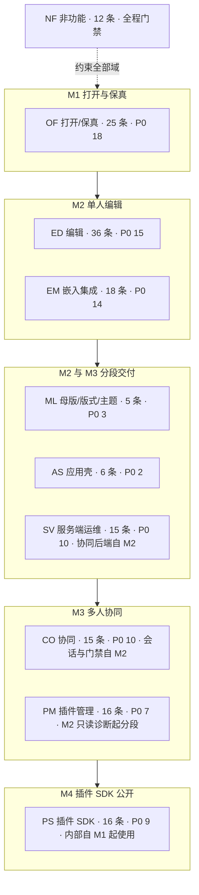
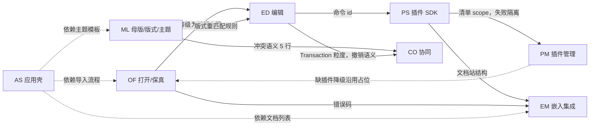
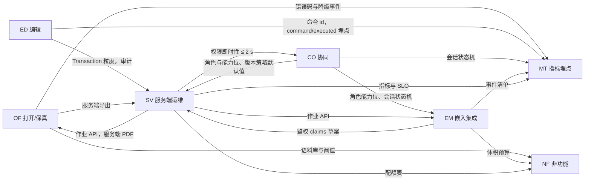

> 状态：草稿 | 负责：产品 | 更新：2026-09-18（按 2026-09-18 裁决 Q11–Q20 回写：ML-01/02/03、G-70/71/72/73、G-76 补编号、D9 例外、新增 D26/D27、AS-06 措辞、OF-14 可选能力口径、05 里程碑 AS 行与 `shell:*` 验收；2026-09-17：按设计稿同步 ML-01/03、新增 AS 域、D12/13/23–25、ED-16 定稿）；2026-09-24（按章程 §10 Q1–Q10 用户裁决 rulings §4.15 回写全部 PRD：单组织去租户、OIDC/Casdoor、撤销语义与软删除墓碑、S-3a、Q5 两层口径、Q7 保真落点、Q8 封面与 PDF、Q9 Node 26、Q10 洁净栈；本文 §3 定位、§5 PD-03/05/16/17/18 结案或更新）；2026-09-24（rulings §4.16：章程 Q11–Q20 裁决回写——§1.1 `.pptm` 拒绝、§1.2 许可证、§5 PD-01/02/08/12/13/15/19/20/21/22 与 §6 CS-10 结案）；2026-09-25（补图）；2026-09-25（矛盾收口，rulings §4.18）；2026-09-25（§4.19）；2026-09-26（§4.20：§8 事件名合并行改写为定稿名（TX-02 术语残留清零）；文件表 07 行注明 FE-05 修订）；2026-09-26（§4.21 整合：§2 索引与 §4 统计登记 ED-15a、ED-31–ED-35（ED 共 36 条），图 4-1 同步）；2026-10-01（§4.23 插件管理：新增功能域 PM（`03-features/09-plugin-manager.md`，PM-01…PM-16），§1.1 改为九个功能域，§2 索引、编号前缀、§4 统计与图 4-1、图 4-2、§7 术语「扩展面板」同步）；2026-10-04（design-language-v3 第 0 批：编辑器去 ribbon / 状态栏 / 应用栏、视觉改中性平面后（rulings §4.25 DS-1…DS-8），各功能域与 02、04、05、06 的入口与界面结构已按 v3 改写；本文 §2 索引中 07 / 08 两个功能域文件与 07–09 三份历史文档的说明注明 v3 改读；§5 新增 PD-27 网格视图归属、PD-28 v3 首页样张差异、PD-29 文档菜单「移动到…」，PD-23 补样张模板清单；§7 术语补检查器、底部创建工具条、单页 / 网格视图、主菜单 / 文档菜单；新增 §9 设计语言 v3 对既有界面口径的改读）；2026-10-04（design-language-v3 第 0 批：术语残留清理：ribbon / 状态栏 / `ui.ribbon` 的历史陈述改用 check-terms 认可的标记措辞（废弃、取代、原名））；2026-10-04（design-language-v3 第 0 批：复验修正——术语表的底部创建工具条（英文名统一为 Creation Toolbar）、单页 / 网格视图、主菜单 / 文档菜单改为引用章程 §4.6）；2026-10-04（design-language-v3 第 0 批：复验第 2 轮修正——D4、D12、D27 三行的主菜单去向按样张注明已起草的落位（保真报告与导出归「文件」、快捷键面板在「帮助 › 键盘快捷键」、模式在「视图 › 模式」，均待第 1 批拍板），删去「子菜单随第 1 批定稿」）；2026-10-05（design-language-v3 第 0 批修正：按 rulings §4.25 DS-10、DS-11、DS-12、DS-16、DS-18 回写——§2 索引 08 行注明 AS 已按已拍板的 v3 首页改写；§5 PD-28 结案（最近 8 条、编辑者 · 相对时间、无「设置」项、模板按样张、⌘K 为开始页聚焦搜索），PD-23 内置模板改为简约 / 商务 / 暗色 / 学术 / 活力 5 套；§9 引言补 2026-10-05 回写范围，D11 替换键改为 Ctrl+H / ⇧⌘H，D27 插件管理器为主菜单「插件…」、账户入口为右上角自己的头像，表后补 07 正文快捷键的改读）；2026-10-05（design-language-v3 第 0 批修正：§5 PD-28 结案说明补 AS-06 账户菜单按样张的条目（个人资料…、亮暗主题、「偏好设置…」）、账户头像身份色（DS-9）与「更多模板 →」随 M3）；2026-10-05（design-language-v3 第 0 批修正：§5 PD-29 按 rulings §4.25 DS-19 结案（「移动到…」与「组件」从样张删除、不实现），§9 D27 同步）；2026-10-05（design-language-v3 第 0 批修正：§9 D21 的「迷你工具条的口径随第 1 批」按 rulings §4.25 DS-13 改为文字迷你工具条已取消、对象快速操作条去留随第 1 批）；2026-10-07（design-language-v3 第 1 批：按已拍板样张与 rulings §4.25 DS-21…DS-30、TB-1…TB-30 回写——§2 索引 07 功能域一行补第 1 批定稿；§9 标题与引言补第 1 批的回写范围，D4、D10、D11、D12、D14、D21、D23、D24/D25、D26、D27 把「第 1 批起草 / 随第 1 批定稿」改为定稿（文件菜单的导出与保真报告、编辑菜单的撤销步骤名、查找面板、帮助菜单、母版视图横幅与唯一常驻退出、TB-16、主菜单「插件…」位置、开发者项不进主菜单、DS-23 模式切换），新增 D1（DS-27 单位口径）与 D15（DS-25 隐藏页入口）两行；§9 末新增第 1 批对 07 正文缺口条目的改读表（迷你工具条、调整手柄、参考线与网格、版式画廊与重置、撤销、缩放与面板尺寸、保存态、查找、链接、插入入口与原型路由、母版与主题），代替逐条改 07 正文；§7 术语「主菜单 / 文档菜单」按定稿的顶层顺序改写；需求编号、优先级、里程碑不变）；2026-10-08（design-language-v3 第 1 批收口：按 rulings §4.25 DS-31…DS-33 与 TB-8、TB-12、TB-15、TB-16、TB-24、TB-25、TB-27、TB-28、TB-32…TB-34、TB-36、TB-37、TB-39…TB-41、TB-44、TB-47、TB-49 回写——§2 索引 07 功能域一行补收口（DS-32、DS-33、TB-34、TB-44）；§5 PD-15 补手机评论可发表、平板仍只读评审（DS-28、TB-49），PD-23 补编辑器主题画廊与模板同一套 5 个主题（DS-33）；§7 术语「检查器」补缺省宽与拖宽范围（TB-25）；§9 标题与引言补收口范围（含 TB-36、TB-47 的摘要），D1（TB-33、TB-37）、D11（TB-27）、D12（TB-15、TB-39、TB-40）、D26（TB-44）、D27（开发者面板改为主菜单「帮助」最后一组，TB-40，原「开发者项不进主菜单」作废）各行改写，新增 D20（DS-31 幻灯片大小）一行；第 1 批改读表补 G-63 与插入图表后只展开「数据」分区（TB-12）、G-23 登出清除（TB-41）、G-31 不查备注（TB-27），母版与主题一行补范围条、窄屏、占位符类型与「文本」（TB-16、TB-44、DS-30、TB-34），新增 G-14 快速样式、G-32 表格插入文案、G-33 备注拖高、G-38 替代文本节、G-44 开发者面板、G-75 / G-76 主题与模板、§1 EM-01 窄屏形态七行；需求编号、优先级、里程碑不变）；2026-10-08（design-language-v3 第 1 批评审修改：按 rulings §4.25 DS-34…DS-37、TB-55…TB-58——§9 引言补评审修改的范围（快速样式库改为检查器内原位展开 DS-34，02 ED-06；检查器控件安静样式与控件边界口径 DS-35，04 NF-05「对比度」行；DS-36、DS-37 与 TB-55…TB-58 只涉及外观与本次范围、不涉及需求），第 1 批改读表「§1 ED-06 行，G-14 末条」一行的「样式库弹层」改为原位展开；需求编号、优先级、里程碑不变）；2026-10-15（design-language-v3 第 2 批：按已拍板的协作族样张与 rulings §4.25 DS-38…DS-63 回写——§2 索引 03、07、09 三行注明第 2 批定稿；§5 PD-05 补离线横幅文案与应用内离开、刷新拦截（DS-59），PD-15 补第 2 批拍板（DS-46）；§7 术语「保真诊断面板」「扩展面板」「检查器」按整栏面板与对话框的定稿改写（DS-38、DS-51）；§9 标题与引言补第 2 批的回写范围，07 §4 改读表新增 D2（整条讨论串只有所有者能删，DS-40）、D9（三档确认，DS-40）两行、D4（打开后一次轻提示、不设常驻角标，DS-51）与 D27（各面板打开后的形态，DS-38）两行改写，§9 末新增第 2 批对 07 正文缺口条目的改读表（评论、版本历史、分享、访问申请、降权与隔离、离线与状态行、软冲突、保真报告与降级对象、查看器 ⓘ、个人插件面板与插件收纳、插件横幅），PRD 07 G-56 的「待处理申请 N」改读为「访问申请 N」（DS-48）；需求编号、优先级、里程碑不变）；2026-10-15（design-language-v3 第 2 批回写补充：按 rulings §4.25 DS-64…DS-68 与 TB-59…TB-62、TB-64…TB-69、TB-74 补改——§7 术语「保真诊断面板」「检查器」的整栏面板宽度改为沿用检查器当前宽度（缺省 280），编辑与整页类宽 max(400, 检查器当前宽度)（TB-60），检查器页签只由内置包贡献（TB-59）；§9 引言补本次补充裁决的范围；第一张表 D4（宽度，设置开关去留随第 3 批复核，TB-67）、D27（宽度）两行与第 1 批改读表数据面板一行（TB-60）；第 2 批改读表 CO-04（草稿按页保留 DS-65、↵ 落钉的前提 TB-62）、CO-07（宽度、说明 ≤ 200 字、API 建的空文档，TB-60、TB-64、TB-74）、CO-15（链接到期等同收紧 DS-66、非所有者复制文档地址 TB-65）、CO-05 / G-56（M3 Webhook 事件 `access_request.created` DS-67、被拒不告知 DS-68、圆点不做实时推送 TB-68）、CO-01 / CO-06（补 G-24 第二条，G-55 阻断页标题，DS-59、DS-60）、OF-13（宽度，评审与只读下照常出右键 DS-64）、PS-02（宽度、「展开」由分区声明且跟着选中对象 TB-59、TB-60，插件计数改为「插件不超过 3 个」的写法，check-plugin-counts 不再失配）各行补写，新增 G-26（评论钉与降级元素右键，DS-40、DS-64、TB-61）、G-30（导入详情自动高亮开关并入第 3 批复核，TB-67）两行；需求编号、优先级、里程碑不变）；2026-10-15（design-language-v3 第 2 批回写再补充：按 rulings §4.25 DS-69、DS-70 与 TB-76…TB-95 补改——§9 引言补两段，写明 DS-69、DS-70、TB-76…TB-86 与 TB-87…TB-95 中写进各功能域的产品表述与不改产品表述的条目，上段 TB-65「非所有者复制文档地址」一句注明随后由 DS-69 修订；第 2 批改读表 CO-04（进入网格视图、切到评审模式与换页同样处理，恢复的撰写框不抢焦点、评论工具不变，切到评审后仍停在同一页时当场恢复，TB-79、TB-84、TB-87）、CO-07（最早那一条按建文档的来源写，源文档未命名的副本写「创建自『未命名演示文稿』的副本」，DS-70、TB-90）、CO-15（链接授予角色时非所有者的「复制链接」复制分享链接、说明行与所有者相同，DS-69、TB-86 修订 TB-65）、OF-13（07 G-40 编辑中新增降级的角标高亮与 §1.1 OF-05、OF-13、OF-17 三行缺口列、OF-13 原型覆盖列的改读，报告的常驻入口只有「文件 › 保真报告」，DS-38、DS-51）各行补写；需求编号、优先级、里程碑不变）；2026-10-22（design-language-v3 第 3 批：按已拍板的应用壳族样张与 rulings §4.25 DS-71…DS-136、TB-101…TB-129 回写——§2 索引 07、08、09 三行注明第 3 批定稿；§5 PD-15 补平板评论面板按方向落位（DS-131、TB-125），PD-23 改为帮助只用集成方配置的链接、不做站内指南页，M3 模板库只做来源分段与预览（DS-89、DS-93），PD-28 注明「随第 3 批补齐」各项已补齐（DS-81、DS-83、DS-89…DS-91）；§7 术语「主菜单 / 文档菜单」补评审者与查看者的文件名不是菜单触发器（DS-82）；§9 标题与引言补第 3 批的回写范围，第一张表改写 D4（导入详情自动高亮开关删去，DS-114）、D6（只留单档，DS-76）、D12（快捷键面板为画布浮动面板，DS-115）、D27（导出 `Mod+Shift+E`、创建副本随角色、降权后导出不可用，DS-78、DS-82、DS-105）四行，D15 补放映时敲页码可跳到隐藏页（TB-111），新增 D13（偏好设置为居中对话框，DS-113、TB-118）、D16（退出放映停在最后显示的页，DS-109）、D17（pptx 只导整份，DS-103）三行；第 2 批改读表 G-04、G-30 两行改指第 3 批；§9 末新增第 3 批对 07 正文缺口条目的改读表（开始页与文档列表、回收站、打开失败、协同快照打开、导入、导出、查看器、缺插件一行说明、快捷键面板、设置、放映、跟随与在场、登录与错误页、管理员插件、模板库、窄屏与平板、命令面板、嵌入）；需求编号、优先级、里程碑不变）；2026-10-22（design-language-v3 第 3 批回写补充：按 rulings §4.25 DS-137、DS-138 与 TB-130…TB-151 补改——§5 PD-15 补平板上不可用原因「在电脑上编辑」（TB-136）；§7 术语「主菜单 / 文档菜单」补降权时三项不可用（TB-138）；§9 引言补一段，写明 DS-137、DS-138、TB-130…TB-151 中写进各功能域的产品表述与不改产品表述的条目，另记 SV-02 下载地址、查看器搜索为宿主选项、PM-11 冲突按钮三处随第 3 批补齐的表述；第一张表 D12（「关于母版继承」按配置出现，TB-132）、D26（不可用原因按窄窗口、触控、嵌入分写，TB-136、DS-112）、D27（降权时文档菜单三项不可用、M2 的「分享」不可用，TB-138、DS-137）三行；第 3 批改读表的开始页与文档列表、回收站、导入、导出、查看器、放映、「已导出本地副本」、登录与错误页、命令面板、嵌入、窄屏与平板各行补写；需求编号、优先级、里程碑不变）；2026-10-22（design-language-v3 第 3 批回写收口：按 rulings §4.25 TB-152…TB-162 补改——§5 PD-15（TB-153、TB-159）、PD-23（TB-160）；§9 引言新增一段，写明 TB-152…TB-162 写进各功能域的产品表述，第 1 批一段与第 2 批两段里推迟到后续批次的几处补上结案指向（DS-75、DS-86、DS-100…DS-104、DS-114、DS-116、DS-126…DS-128）；第一张表 D12（TB-154）、D26（TB-159）两行；第 1 批改读表母版视图一行补指向 D26；第 2 批改读表访问申请一行（TB-156）；第 3 批改读表开始页与文档列表、回收站、打开失败、导出、快捷键面板、模板库、窄屏与平板、命令面板、嵌入各行补写（TB-152…TB-156、TB-159、TB-160、TB-162）；需求编号、优先级、里程碑不变；2026-10-22 复核修正：按 rulings §4.25 DS-139 与 TB-163…TB-169 补改——§7 术语、§9 第一张表 D27 与第 3 批补充一段补引 DS-139（降权时「创建副本」不可用），§9 第 3 批首段「不改产品表述」的清单删去已写进 03 CO-05 的 DS-105；§9 引言补 TB-163…TB-169 一句，第一张表 D12（TB-164）、D26（TB-163），第 2、3 批改读表访问申请与 G-02 两行（TB-156 补句），第 3 批改读表开始页与文档列表（TB-165、TB-167）、导出（TB-166）、快捷键面板（TB-164）、模板库（TB-168）、窄屏与平板（TB-163）各行；§5 PD-15、PD-28 去掉已结案的「随第 3 批窄屏复核」「呈现随第 3 批补齐」，§9 第 1 批一段 TB-58 的「留待后续批次复核」补结案指向（DS-74、DS-133…DS-136）；§9 引言原「第 3 批回写收口时」改为不带轮次的写法；§2 索引 07 一行的缺口编号范围由 G-01…G-76 改为 G-01…G-87，与 07 现有条目一致；按 TB-170…TB-174 补改——§9 引言补一句，第 2 批改读表 CO-01、CO-06 一行补横幅在最顶上推及平板（TB-172），第 3 批改读表引言的编号范围改到 TB-174，开始页与文档列表（TB-170、TB-171）、导出（TB-173）两行补写，查看器一行补 07「备注抽屉」读作备注面板（DS-111）；按 TB-171 的列表形态、搜索与排序，TB-172 的触控按钮高度与 TB-175…TB-178 补改——§9 引言与第 3 批改读表引言的编号范围改到 TB-178，引言补列表形态的两列、搜索下拉与结果页每一行同卡片第二行、开始页「最近编辑」排序与第二行取同一时间（TB-171），触控形态的按钮照常 44 高、横幅随之撑高（TB-172），服务端导出作业单页超时的原因句（TB-175）与其余失败显示通用文案（TB-176），并写明 TB-177（诊断包归 SDK，与 05 EM-12 一致）、TB-178 不改产品表述；第 2 批改读表 CO-01、CO-06 一行补触控形态横幅撑高（TB-172），第 3 批改读表开始页与文档列表（TB-171）、导出（TB-175、TB-176）两行补写）；2026-10-23（design-language-v3 第 3 批评审修改：按 rulings §4.25 DS-140…DS-143 与 TB-179…TB-183 回写——§2 索引 07、08 两行注明评审修改；§9 标题补评审修改，引言新增一段，写明导入改为叠在原页上的「导入」对话框（DS-140、TB-179…TB-181，取代 DS-97、DS-98，修订 TB-129、TB-133、TB-167）与导入落区的虚线不要求 ≥ 3:1（DS-141）写进的功能域，DS-142、DS-143、TB-182、TB-183 不改产品表述；第 3 批首段与两段补充里导入页、过渡页与直接打开 `/import` 的写法补去向指引；第 3 批改读表引言，开始页与文档列表、G-54（补 G-55 的导入失败）、G-25（文件类型图标）三行改写；需求编号、优先级、里程碑不变）；2026-11-04（design-language-v3 母版视图改版：按 rulings §4.25 DS-144…DS-177 与 TB-186…TB-210 回写——§2 索引 07 一行；§9 标题；§9 新增母版视图改版一段，写明写进各功能域的产品表述（07 §0、§1、ML-01、ML-03、§3、§4，02 ED-12、ED-16、ED-25，03 CO-03，09 PM-10，05 M2 验收 9）与不改产品表述的条目；第一张表 D23、D26 两行补两个上下文入口、不能进入时的轻提示与两种新的不能进入；第 1 批改读表 ML-01…ML-04 一行的范围条标作废并指向新表；文末新增母版视图改版改读表（G-70、G-71、G-73、G-74、F-P16 五行）；需求编号、优先级、里程碑不变） | 依赖：charter v0.2；rulings §4.10、§4.15、§4.16、§4.18、§4.19、§4.20、§4.23、§4.25

# PRD 总览 —— 基于 cordis 的可插拔办公文档 SDK 与在线协同编辑器（首个文档类型：.pptx）

> 读者：总编排、设计条线、架构三条子线、类型治理、评审者，以及将据此拆任务的工程师。
> 本目录是产品需求基线。与章程（`../00-charter/charter.md`，当前 v0.2）冲突之处不擅改，全部登记在 §6；需要用户决策的问题登记在 §5 并按默认值推进。2026-09-15 已按总编排裁决（`../00-charter/rulings-2026-09-14.md`）完成定向对齐。

---

## 1. 范围声明

### 1.1 本 PRD 覆盖

- 产品定义、目标与非目标；角色与场景；九个功能域（打开/保真、编辑、协同、插件 SDK、嵌入与集成、服务端与运维、母版/版式/主题、应用壳、插件管理）的可验收需求；非功能预算（性能、保真、可用性、安全、可访问性、i18n、浏览器矩阵）；M0–M5 里程碑范围与验收；北极星与埋点。
- 首个文档类型 PowerPoint `.pptx`（含 `.ppsx`/`.potx` 同结构变体；`.pptm` 宏文件直接拒绝导入，`format.macro_rejected`，rulings §4.16 Q15）；`.docx`/`.xlsx` 仅在 M5 以「骨架验证文档类型盲」的深度出现。

### 1.2 本 PRD 不覆盖

- 架构与实现（见 `../30-architecture/`）；界面布局与视觉（见 `../20-design/`）；类型治理机制（见 `../30-architecture/09-type-discipline/`）。本 PRD 引用它们时用文档编号（如「架构 04」「设计 05」「ADR-0020」）。
- 商业模式、定价（许可证已裁决 Apache-2.0，见 PD-21）。
- doc/sheet 的产品需求（M5 之后另立 PRD）。

### 1.3 需求编号与优先级约定

| 约定 | 说明 |
|---|---|
| 需求编号 | `<域>-<两位序号>`：`OF` 打开/保真、`ED` 编辑、`CO` 协同、`PS` 插件 SDK、`EM` 嵌入集成、`SV` 服务端运维、`ML` 母版/版式/主题、`AS` 应用壳（开始页 / 最近 / 模板 / 指南 / 账户，2026-09-17 新增）、`PM` 插件管理（面向部署管理员与用户，2026-10-01 新增，rulings §4.23）、`NF` 非功能、`MT` 指标 |
| 用户故事 | `US-<角色码>-<序号>`：E 编辑者、R 评审者、P 插件开发者、I 集成方、O 运维 |
| 待决事项 / 章程建议 | `PD-xx` / `CS-xx`（本文件 §5、§6） |
| 每条需求必含 | 用户故事、验收标准（Given/When/Then 或可度量指标）、优先级、目标里程碑、依赖的架构能力（章程 §4 术语） |
| P0 | 里程碑出口条件，缺一不可 |
| P1 | 里程碑目标，可在里程碑内延后，不可跨里程碑（跨则登记 PD） |
| P2 | 机会项，可自由滑动 |
| 数字 | 全部为**初始预算**，在对应里程碑中期实测校准一次，只能收紧 |

---

## 2. 文档索引与阅读指引

```
docs/10-prd/
├── README.md                          本文：总览、范围、待决事项、章程建议、术语补充、跨条线请求
├── 01-background-and-goals.md         背景、为什么不用 Univer/PPTist/pptx-viewer 直接做、目标/非目标、成功指标、关键假设
├── 02-personas-and-scenarios.md       五个角色的画像、核心场景、用户故事（US-*）与故事地图
├── 03-features/
│   ├── 01-open-and-fidelity.md        OF-01…25；★ pptx 特性支持矩阵（查看/编辑/保留 × 里程碑）；保真度量口径
│   ├── 02-editing.md                  ED-01…35（含 ED-15a；ED-15a、ED-31–ED-35 为 2026-09-26 新增）；快捷键表；编辑与保真交叉约束；§5 编辑与插入的非目标
│   ├── 03-collaboration.md            CO-01…15；角色/能力位；★ 软冲突语义表；会话状态机（2026-10-15 评论、版本历史、分享与访问申请、离线与冲突、同步状态行各态的界面口径按 design-language-v3 第 2 批样张定稿，rulings §4.25 DS-38…DS-68）
│   ├── 04-plugin-sdk.md               PS-01…16；★ 公开贡献点目录与稳定级；CTK 8 项检查；示例插件清单
│   ├── 05-embedding-and-integration.md EM-01…18；嵌入形态 A–F；★ 事件清单；体积预算；CSP
│   ├── 06-server-and-ops.md           SV-01…15；作业 API；配额表；SLO；部署与运维（2026-10-15 SV-15 的 M3 Webhook 另推访问申请事件，rulings §4.25 DS-67）
│   ├── 07-masters-layouts-and-themes.md ML-01…05（2026-09-15 裁决新增域；2026-09-17 按设计稿修订：同一编辑器 + 母版页签、缩略图窗格、视图分段入口、`Mod+Alt+M`；2026-09-18 按裁决 Q11–Q16 回写：删除被引用版式改确认后自动改用默认版式（2026-09-26 rulings §4.20 FE-05 改为确认后可撤销）、母版视图仅编辑模式且 ≥ 1024、补范围条 / 搜索 / 跨母版 / 加载态 / 多选删除 / 占位符上限 / 应用栏徽标 / 重置双层确认；2026-10-04 design-language-v3 第 0 批：母版页签与视图分段随 ribbon 废弃，入口改为主菜单「视图」/ 命令面板 / `Mod+Alt+M`，五组命令拆到工具条、检查器分区与菜单；2026-10-07 第 1 批定稿：不设常驻进入按钮，徽标与状态栏文案并入母版视图横幅，横幅「关闭母版视图」为唯一常驻退出，占位符类型按 rulings §4.25 DS-30，重置页改为确认对话框，缩到 < 640 时退出母版视图；2026-10-08 收口：内置主题与开始页模板统一为 5 套、色板变体为 3 个，`body` 统称「文本」，不是完整形态（含触控设备）不提供母版视图入口，DS-32、DS-33、TB-34、TB-44；2026-11-04 母版视图改版：窗格选中即编辑对象（取代范围条）、横幅写明正在编辑的对象、检查器「编辑版式」与「转到版式」、占位符一律虚线 + 类型名、加载改为转圈、「占位符 ▾」在第 2 位与单键 P、就地改名与 `Mod+M` / `Mod+D`、母版视图里普通视图的入口不可用，DS-144…DS-157、DS-162…DS-167、DS-174）：母版视图（M2 P0）、版式应用与重置（M2 P0）、母版与版式编辑（M3 P0）、主题（M3 P1）、备注/讲义母版（M4 P2）
│   ├── 08-app-shell.md                AS-01…06（2026-09-17 按设计稿新增；2026-10-04 按 v3 首页样张改写开始页结构与指南入口；2026-10-05 按 rulings §4.25 DS-10、DS-12、DS-18 以已拍板的 v3 首页改写全部 AS，PD-28 结案；2026-10-22 按已拍板的第 3 批应用壳族样张定稿左侧导航五项即筛选、搜索下拉、同一份卡片菜单、加载行与空态、窄屏与手机、模板库只做来源分段与预览、帮助菜单按配置、账户菜单三处同一份条目与「个人资料…」M3 起出现，rulings §4.25 DS-79…DS-93；2026-10-23 第 3 批评审修改：「导入 .pptx」改为在原页上打开「导入」对话框，DS-140）：开始页（M2 P0）、最近与固定、模板库、指南与帮助入口、首次使用引导、账户菜单（M2 P0）
│   └── 09-plugin-manager.md           PM-01…16（2026-10-01 按用户裁决 rulings §4.23 新增）：两级管理（管理员三态 / 用户个人启停）、只认部署预置（声明文件、签名或审核）、作用域（内容级按部署统一 / 界面级个人）、个人插件面板、打开文档缺插件的降级提示、协同一致性、审计；M2 只读诊断 → M3 管理员管控 → M4 第三方预置（2026-10-15 个人插件面板为居中对话框 640、插件横幅的画法与先后、单个失败写名字按 design-language-v3 第 2 批样张定稿，rulings §4.25 DS-38、DS-41、DS-54…DS-56；2026-10-22 管理页的横幅位置、详情模态抽屉、加载行、确认卡与插件 id 按第 3 批样张定稿，DS-86、DS-92、DS-94、DS-96、DS-110、TB-119…TB-121）
├── 04-non-functional-requirements.md  NF-01…12；★ 参考机/参考文稿；性能预算全表；WCAG 2.2 AA 口径；浏览器矩阵
├── 05-milestones-and-scope.md         M0–M5：范围（按需求编号）、机械可验证验收、可插拔证据、依赖、风险
├── 06-metrics-and-analytics.md        北极星 WSES；MT-01…24；★ 埋点事件清单（<域>/<动作>）；漏斗
├── 07-design-coverage-and-gaps.md     ★ 需求 ↔ 设计 ↔ 原型覆盖矩阵；缺口（含 Given/When/Then，G-01…G-87）；原型 v2 的 16 条验收流程；影响界面的产品默认答案 D1–D27（2026-09-17 部分行按 playground 回写；2026-09-18 按 Q11–Q20 修订 G-70/71/72/73、D9 例外、新增 D26/D27，见文首同步说明；2026-10-04 起其中以 ribbon / 应用栏 / 状态栏 / 毛玻璃描述的入口与界面结构已被 rulings §4.25 DS-1/DS-2 取代，改读见 §9；第 1、2、3 批（2026-10-07、10-15、10-22）拍板后与 2026-10-23 第 3 批评审修改的改读同见 §9）
├── 08-prd-design-alignment-2026-09-17.md  PRD ↔ 设计稿一致性核对与处置结果（2026-09-17；历史记录，ribbon 相关处置已被 rulings §4.25 DS-1/DS-2 取代）
└── 09-prd-design-alignment-2026-09-18.md  PRD ↔ 设计稿四路复核（正向 / 反向 / 设计文档↔playground / 裁决落地矩阵）与 Q11–Q20 逐项处置记录（总编排撰写；历史记录，ribbon 相关处置已被 rulings §4.25 DS-1/DS-2 取代）
```

| 读者 | 建议顺序 |
|---|---|
| 总编排 / 评审 | README → 01 → 05 → 各功能域 §0「产品立场」→ 04 → 07（设计覆盖与缺口） |
| 设计 | **07（覆盖矩阵与缺口，先读）** → 02 → 03/02 → 03/03（§3 状态表、CO-08）→ 03/04（PS-02 槽位）→ 03/07（母版/版式/主题，G-70–G-75）→ 04（NF-05） |
| 架构-结构 | 03/01（OF-18、矩阵）→ 03/04（PS-01/02/07）→ 03/05（EM-01/05/07）→ 05（可插拔证据） |
| 架构-运行时 | 03/03 → 03/06 → 04（NF-01）→ 03/01（OF-03/05/09、§4） |
| 类型治理 | 03/04（PS-06/07/15）→ 04（NF-09）→ 06（§5 事件注册表） |
| 拆任务的工程师 | 05（当前里程碑范围）→ 对应功能域需求条目 → 04 门禁数字 |

---

## 3. 产品定位（一页纸）

| 维度 | 立场 |
|---|---|
| 是什么 | 可嵌入、可自托管、每一级可替换的办公文档 SDK；`apps/web` 只是组装样例 |
| 首个能力 | pptx 直接打开 → 高保真渲染 → 单人编辑 → 多人协同 → 导出且未修改零丢失 |
| 差异化 | ① 保真可机械验收（部件级 diff + oracle SSIM）；② 每一级可插拔且有 CI 证据；③ 插件开发者是第一等用户（Manifest/CTK/文档站）；④ 浏览器与 Node 跑同一份模型代码 |
| 不是什么 | 不是 PowerPoint 替代品、不是套件、不是插件市场、不是多租户 SaaS（一次部署 = 一个组织，M1–M5 只做自托管，rulings §4.15 T-0/Q10）、不做沙箱、不做 .ppt、M1–M3 不编辑动画 |
| 北极星 | 周成功编辑会话数 WSES（打开成功 + ≥1 事务 + 无致命错误 + 保存/同步成功） |

---

## 4. 需求统计（草稿基线）

| 域 | 条目数 | P0 | 主要里程碑 |
|---|---|---|---|
| OF 打开/保真 | 25 | 18 | M1 |
| ED 编辑 | 36（2026-09-26 新增 ED-15a、ED-31–ED-35，均非 P0） | 15 | M2 |
| CO 协同 | 15 | 10 | M3（会话建立、同步路径与门禁自 M2 随协同后端交付，rulings §4.19 D-M2-CONTENT） |
| PS 插件 SDK | 16 | 9 | M4（内部自 M1） |
| EM 嵌入集成 | 18 | 14 | M2 |
| SV 服务端运维 | 15 | 10 | M2 / M3（导入、网关、update 持久化与快照、OIDC 自 M2，rulings §4.19 D-M2-CONTENT） |
| ML 母版/版式/主题 | 5 | 3 | M2 / M3（2026-09-15 总编排裁决：用户指出编辑器与左侧栏未考虑母版，自 ED-25 提级为正式需求域；2026-09-17 按设计稿修订形态） |
| AS 应用壳 | 6 | 2 | M2 / M3（2026-09-17 用户指出缺少官方首页与指南入口，设计先行交付后回填） |
| PM 插件管理 | 16 | 7（含分段 P0：PM-04、PM-10） | M2 只读诊断 / M3 管理员管控与协同一致性 / M4 第三方预置（2026-10-01 用户指出缺少插件管理器，rulings §4.23） |
| NF 非功能 | 12 | — | 全程 |

**图 4-1 PRD 功能域地图：按主要里程碑分组**



怎么读：每个子图是一个里程碑，域放在其主要里程碑下（数字取自上表；协同后端自 M2 交付，M2 / M3 边界见 `05-milestones-and-scope.md` §0.3，rulings §4.19 D-M2-CONTENT）；实线为里程碑先后，虚线表示 NF 以门禁形式贯穿所有里程碑。各域在其它里程碑的条目见 `05-milestones-and-scope.md` §0.2 总表。

**图 4-2 功能域之间的产出与消费：编辑器侧**



怎么读：实线从「产出方」指向「消费方」，边上写产出物；虚线为应用壳对其它域的依赖。每条边都取自对应功能文件末节「与其它域的接口」，设计与架构方向的消费方未画入。

**图 4-3 功能域之间的产出与消费：协同、服务端与横切域**



怎么读：读法同图 4-2；NF 与 MT 两个横切域在本图中只作为消费方出现，其余域产出的阈值、事件、指标与配额汇入这两处。

---

## 5. 待决事项（按默认值推进；决策人可随时否决）

> 2026-09-15：总编排裁决（`../00-charter/rulings-2026-09-14.md` §3）后，部分事项已进入章程 §10（右列 Q 号，默认值以章程为准）；其余保留在本表，由产品负责人批量决策。

| 编号 | 问题 | 当前默认 | 影响 | 决策人 | 章程 |
|---|---|---|---|---|---|
| PD-01 | 加密（AES）pptx 的支持时点 | **已裁决**（章程 Q15，rulings §4.16）：M1–M4 拒绝并返回 `format.encrypted`，提示先去除密码 | OF-02、矩阵 §2.1 | 已裁决 | Q15 |
| PD-02 | `.pptm` 宏文件策略 | **已裁决**（章程 Q15，rulings §4.16，偏离原默认「打开 + `vbaProject.bin` 不透明保留 + 导出保持 `.pptm`」，更保守）：**`.pptm` 直接拒绝导入**，错误码 `format.macro_rejected`，提示「请另存为 .pptx 后再导入」；`.ppsx`/`.potx` 不受影响 | OF-02、矩阵 §2.1、安全立场 | 已裁决 | Q15 |
| PD-03 | Strict 命名空间输入且有编辑时的导出一致性类 | **已裁决 C**（rulings §4.12 U-02）：保持原一致性类（反向映射写回 Strict），M1 即完整实现；方案 B「整包转 Transitional」仅作反向映射失败时的异常兜底。硬要求不变：零编辑字节相同 + PowerPoint 365 打开无修复 | OF-18、矩阵 §2.1、ADR-0008 | 已裁决 | **Q14** |
| PD-04 | 评论的持久化与 pptx 导出 | 评论以 `Snapshot` 内 `ResourceHook`（命名空间 `comments.*`）为事实源（ADR-0031 v0.2，服务端数据库为镜像读模型）；导出默认写入现代评论部件（可关） | CO-04、OF-11 | 用户 | — |
| PD-05 | 离线编辑范围 | M3：会话内断线队列（内存，刷新即丢，明确提示）；M4 P2：`collab-offline-idb`（`OfflineStore` Provider，ADR-0033）跨刷新持久化；ADR-0033 需与此口径对齐。「明确提示」2026-10-15 按 rulings §4.25 DS-59 定稿：应用内的离开与刷新先尝试同步，仍有未同步项时弹应用内确认框（初始焦点在安全项），浏览器刷新与关闭标签页只能用浏览器原生提示；离线横幅文案维持「更改已保存在本地，将在重新连接后同步」，写明「关闭或刷新会丢失」的文案在 M4 启用跨刷新持久化前再定 | CO-06 | 用户 | — |
| PD-06 | 图表数据编辑后内嵌工作簿的处理 | 重生成最小 `.xlsx`（P1）；不可行则移除并警告「PowerPoint 中编辑数据不可用」 | ED-15、架构 04 | 用户 + 架构-运行时 | — |
| PD-07 | 放映模式与动画/切换播放 | **已定**（章程 §2.3 / §7 v0.2）：M1–M3 渲染结束态不播放；播放 M4 P2；编辑非目标 | ED-21、矩阵 §2.3 | 已裁决 | §2.3 |
| PD-08 | 版本与数据保留策略 | **已裁决**（章程 Q17，rulings §4.16）：默认值不变——自动快照每 10 min 或 500 updates、保留 30 天（2026-09-25 由 rulings §4.19 C-06 细化：30 天内全量，此后每天保留最后一个至 `retention.autoSnapshotDailyDays`，默认 365、0 = 永久）；命名快照永久（每文档上限 200）；update 追加表 7 天；导入原件 30 天；墓碑 TTL 24 h；**全部进入部署配置可调**。不透明保留所需的部件 Blob 随文档生命周期保留，不受此限 | CO-07、SV-03、SV-08、SV-11 | 已裁决 | Q17 |
| PD-09 | 浏览器矩阵底线 | Chrome/Edge/Firefox 最近 2 版 + Firefox ESR；Safari 17+；移动端见 Q20 | NF-07 | 用户（客户画像） | — |
| PD-10 | 遥测默认开关 | SDK 出厂 no-op；集成方显式接入 `telemetry.sink` | EM-13、06 指标 | 用户（法务/隐私） | — |
| PD-11 | 首批语言 | zh-CN（源）+ en-US（M2） | NF-06、PS-05 双语文档 | 用户 | — |
| PD-12 | 是否随包分发 CJK 回退字体 | 不内置（体积与许可）；集成方经 OF-25 供给；服务端字体包**已裁决**（章程 Q19，rulings §4.16）：内置 Noto（含 CJK）+ Liberation + Carlito/Caladea，均开源；**部署方可挂载自有授权字体目录**；不内置商业字体 | OF-05、OF-25、SV-02 | 已裁决（服务端）/ 用户（客户端） | Q19 |
| PD-13 | 里程碑周期 | **已裁决**（章程 Q13，rulings §4.16）：不定周期——按范围与验收推进，每个里程碑开工前再估 | 05 里程碑 | 已裁决 | Q13 |
| PD-14 | 第三方插件「已验证目录」 | M4 P2，仅文档站目录（CTK 报告 + 许可 + 源码链接），不做运行时市场 | PS-08 | 用户 | — |
| PD-15 | 移动端浏览器范围 | **已裁决**（章程 Q20，rulings §4.16，确认默认）：桌面优先；平板只读评审；手机查看 + 评论 M3 P1；编辑 M4+ P2；M2 必达键盘可达 + 基本朗读，WCAG 2.2 AA 分阶段。2026-10-07 起手机（< 640）的评论包含发表与回复、解决在更大窗口中进行（rulings §4.25 DS-28）；平板仍只读评审（2026-10-08，TB-49）；2026-10-15 第 2 批手机评论样张拍板，上述两条一并确认（DS-46）；2026-10-22 第 3 批定下平板评论面板的落位：按方向落位——竖屏在当前页与备注卡下方、横屏为右侧整高侧栏（DS-131），平板的仅查看状态行写「仅查看 · 在电脑上编辑」（TB-125），平板上不可用入口的原因同写「在电脑上编辑」（TB-136），嵌入里同样以触控为准（TB-159），平板上开始页与文档列表顶部的提示写「在电脑上新建或导入演示文稿」（TB-153），左侧导航与卡片列数按窗口宽度（TB-165）；「触控设备」只指平板（触控、≥ 640），手机不论是否触控都按窗口窄写（TB-163）；见 NF-07 | NF-07、ED-27、CO-04 | 已裁决 | Q20 |
| PD-16 | 服务端 PDF/缩略图引擎 | **已裁决**（章程 Q8，rulings §4.15）：headless Chromium（ADR-0026 已接受），运行于独立零出站 renderer sidecar；缩略图 M3 前半段、PDF M3 后半段；M2 以包内 `thumbnail.jpeg` 作过渡封面；不用 sharp；自研矢量 PDF 为后续 | SV-02、SV-04、SV-09 | 已裁决 | Q8 |
| PD-17 | 配额默认值 | 规模数字**已裁决**（章程 Q5，rulings §4.15）：五个数字为性能保证包络；系统天花板 200 页 / 单页 1,000 / 文档总元素 20,000（软警告 15,000，墓碑计入）；超出系统天花板（或文件超过 200 MB）的导入直接拒绝（Q5 原文「超包络」即超系统天花板，见 ADR-0035 复核修正，rulings §4.18 UX-13）；名额按用户计；全部由部署配置完全可调。其余行（评论线程、命名版本数、速率等）仍为产品默认值，见 SV-08 表 | SV-08 | 已裁决（规模）/ 用户（其余） | Q5 |
| PD-18 | 不可内部编辑元素（SmartArt/OLE/3D/动画对象）的交互 | **已结案**（章程 Q7，rulings §4.15）：建模变换——删除 M1 P0、整体移动/缩放 M2 P1（`mc:AlternateContent` 各分支 `xfrm` 同步回写，ADR-0008 决策 9 白名单），内部不可编辑并提示 | ED §1、矩阵 §2.1 备注 A、§2.6 | 已裁决 | Q7 |
| PD-19 | 协同排他锁 | **已裁决**（章程 Q16，rulings §4.16，确认默认）：不做——只有 awareness 软提示（选中框 + 名字），无形状级/页级排他锁；冲突按 CO-08 软冲突规则 | CO-10、CO-05 | 已裁决 | Q16 |
| PD-20 | 含数字签名文件的处理 | **已裁决**（章程 Q15，rulings §4.16）：签名文件可打开；保留 `_xmlsignatures/`；编辑后提示「签名将失效」（U-05 诊断码）；不移除 | 矩阵 §2.1 | 已裁决 | Q15 |
| PD-21 | SDK 许可证与商业模式 | 许可证**已裁决**（章程 Q12，rulings §4.16）：**Apache-2.0**（含 NOTICE；可发布包 `license: Apache-2.0`）；商业模式不在本 PRD 范围 | EM-16、PS-08 | 已裁决 | Q12 |
| PD-22 | M4 试点团队来源 | **已裁决**（章程 Q11，rulings §4.16）：内部非核心成员（未参与内核开发的同事或全新 AI agent 会话）仅凭公开文档完成一个插件（≤ 2 人日） | 05 M4 验收 5 | 已裁决 | Q11 |
| PD-23 | 模板库与帮助中心的内容来源（AS-03 / AS-04） | M2 内置 5 套主题模板（简约 / 商务 / 暗色 / 学术 / 活力）；帮助与指南只用集成方配置的链接（在新标签页打开），未配置时帮助菜单只剩「键盘快捷键」，不做站内指南页（2026-10-22，rulings §4.25 DS-89；原「站内占位指南」与指南部分的「未配置时用内置」作废）；M3 由集成方通过配置提供模板源，模板库只做来源分段与预览（DS-93），未配置时只有内置模板；在本项定之前，模板源按部署配置的静态来源列表设计，某一来源取不到只影响它那一组（TB-160，08 AS-03）。内置清单 2026-10-05 按 v3 首页样张定为上述 5 套（rulings §4.25 DS-12「模板清单按样张」），取代原 Office / 极简灰 / 暖色商务 / 深色科技 4 套；编辑器主题画廊的内置主题与这 5 套是同一套（2026-10-08，rulings §4.25 DS-33，ML-04）；内容来源与审核仍按本行默认推进 | 08 AS-03 / AS-04 | 用户 / 集成方 | — |
| PD-24 | 开始页是否作为 SDK 交付物（D22 延伸） | 是：`slide-ui` 交付 `StartPage` / `UserMenu` / `Brand` 可复用组件，`apps/web` 组装；品牌标与名称可由集成方替换 | 08 §0、charter §5.2 | 架构-结构 | — |
| PD-25 | M2 应用壳新建 / 打开的文档内容存在哪里（范围变更登记） | **已裁决**（rulings §4.19 D-M2-CONTENT，2026-09-25）：协同网关、Room、update 持久化与快照、服务端导入从 M3 提前到 M2，参考应用的文档内容自 M2 起只以协同快照为事实源，不设过渡的 pptx 内容版本端点；M3 保留多人协同体验层 | 05 §0.3、M2 / M3；CO-01/02/12；SV-01/03/05/06/07/12；AS-01；EM-03/04 | 已裁决 | §7 |
| PD-26 | 性能 runner 与 PowerPoint 基线机器 | **已裁决**（rulings §4.19 D-TEST-INFRA）：性能 M1 用 GitHub larger runner（4 核），协同与服务端压测所需的自托管专用 runner 在 M2 前落地，低配机型用 CDP CPU 4× 节流近似；视觉基线用一台 Windows + PowerPoint 365 维护机（不进 CI），macOS 基线 M2 加入 | 05 M1 依赖与验收 3、M2 依赖；NF-01、NF-02 | 已裁决 | — |
| PD-27 | 网格视图（rulings §4.25 DS-3、DS-4，2026-10-04 样张拍板）的需求归属与里程碑 | 归入 ED-22「视图、缩放与导航」（M2 P0）：单页 / 网格两种视图、左栏顶部 / 网格左上胶囊 / 主菜单「视图」三处入口读写同一视图状态、网格收起两侧面板为两个浮动胶囊；键盘 e2e 随 M2 验收 6 覆盖 | 02 ED-22、ED-29；05 M2 验收 6；NF-05 | 用户 | — |
| PD-28 | v3 首页样张与 AS-01…AS-06 的差异（设计 03-29 §6） | **已裁决**（rulings §4.25 DS-10、DS-11、DS-12，2026-10-05）：以已拍板的 v3 首页改写 AS-01…AS-06——① 最近最多 8 条（网格四列两行、可切列表）；② 最近卡元信息改为「编辑者 · 相对时间」并叠放共享者头像，「仅查看」徽标、固定图标与「更多」菜单仍是 AS-02 的要求，呈现 2026-10-22 按第 3 批样张定稿（见本行末）；③ 左侧导航不设「设置」项，设置只在账户菜单（DS-10）；④ 内置模板按样张（PD-23）；⑤ 搜索框的 ⌘K 是开始页作用域的聚焦搜索（AS-01），编辑器内 `Mod+K` 为命令面板（ED-30，DS-11）。同批定下的还有：原「指南与帮助」条目收进左侧导航「帮助」菜单（AS-04）、不显示问候语、左侧导航宽 220；编辑器账户入口为右上角自己的头像，账户菜单按样张为头部头像、姓名与邮箱，加「个人资料…」与亮暗主题（浅色 / 深色），设置的菜单文案为「偏好设置…」，键盘快捷键、管理、帮助中心照旧保留（AS-06，DS-18）；账户头像改为身份色底 + 白色首字（DS-9）；「更多模板 →」随 M3 模板库页提供（AS-03）。2026-10-22 第 3 批补齐的各项：卡片的角色徽标、固定图钉与同一份「⋯」菜单（DS-81、DS-83），账户菜单的键盘快捷键、管理与按配置出现的帮助中心，主题改为三项，「个人资料…」M2 不显示、M3 起出现（DS-89…DS-91，见 08 AS-02、AS-06） | 08 AS-01…AS-06；05 M2 验收 11、12 | 已裁决 | — |
| PD-29 | 文档菜单「移动到…」（v3 样张，设计 03-02 §10 第 4 条）是否纳入 | **已裁决**（rulings §4.25 DS-19，2026-10-05）：不纳入——PRD 没有文件夹或位置概念，该项从样张删除、不实现；工具条「更多」里同样没有对应能力的「组件」一并删除（02 §1a）；以后需要再走新增需求的变更 | 编辑器文档菜单；EM-17 文档列表 | 已裁决 | — |

---

## 6. 对章程的异议 / 建议（处置结果见 `../00-charter/rulings-2026-09-14.md` §3；章程已升至 v0.2）

| 编号 | 章程位置 | 建议 | 处置 | 落点 |
|---|---|---|---|---|
| CS-01 | §7 M1「部件级 diff 零差异」 | 采纳 `03-features/01-open-and-fidelity.md` §4.1 的等价口径 | **采纳** | D7（与架构 A-12 合并） |
| CS-02 | §7 M2 验收清单 | 补「表格单元格文本编辑（P1）」「基础放映（P1，无动画）」；表格结构编辑归 M3 | **采纳** | §7 M2 / M3 |
| CS-03 | §2.3 非目标（动画/切换） | 明确「播放」策略：M1–M3 渲染结束态不播放，M4 P2 播放 | **采纳** | §2.3、§7 M4 |
| CS-04 | §10 Q5 规模目标 | 增加「只读查看者 ≤ 50/文档」「单页元素 ≤ 1,000」 | **采纳** | Q5 |
| CS-05 | §5.4「打开空壳」 | 改为可验证口径：无 `DocumentType` 时打开文件以错误码失败，宿主仍运行 | **采纳** | §5.4（错误码格式见 CS-13） |
| CS-06 | §6.1 D7 保真策略 | 补「元素级（节点级）不透明保留」 | **采纳** | §4、R6、D7 |
| CS-07 | §5.5 命名 | 为第三方插件预留事件域/贡献点 id 前缀规则 | **采纳-改写** | 形式为 `<vendor>:<域>/<动作>` 与 `<vendor>:<域>.<名>`（D15），非 PRD 原提的 `x-<pluginId>`；PS-02 已按此更新 |
| CS-08 | §4 术语表 | 新增 Room/Version/角色名/Soft Conflict/Support Level/Oracle/Corpus/Integrator | **采纳（精简）** | §4.2 / §4.3；本文件 §7 标注已入章程项 |
| CS-09 | §5.2 `apps/web` 职责 | 明确含文档列表 + 分享/权限入口 + 版本入口的最小演示范围 | **采纳** | §5.2 apps/web（另含 `/render` headless 渲染页） |
| CS-10 | §7 M4 可插拔证据「外部团队」 | 增加待决项「试点团队来源」 | **已裁决**（rulings §4.16 Q11）：改为内部非核心成员（未参与内核开发的同事或全新 AI agent 会话）仅凭公开文档 | Q11、§7 M4 |
| CS-11 | §5.2 包清单 | 增加 `preset-slide-viewer` | **采纳** | §5.1 / §5.2、§7 M1 验收；OF-14 依赖已满足 |
| CS-12 | §5.2 / Q8 | 服务端缩略图排 M3 前半段 | **采纳** | Q8、§7 M3 |
| CS-13（新，2026-09-15） | §5.4 | 错误码写作 `format/no-document-type`（斜杠），与 D11 / 架构 10 §1.1 的点式格式 `<domain>.<snake_case_name>` 不一致；建议改为 `format.no_document_type`（PRD 已按点式使用） | 待裁决 | §5.4、架构 10 |

---

## 7. 术语补充（章程 §4 之外，本 PRD 使用；「章程」列非空者已被 v0.2 吸收，以章程定义为准）

| 术语 | 英文 | 定义 | 章程 |
|---|---|---|---|
| 支持等级 | Support Level | 对一种 pptx 特性的承诺：`P` 仅保留 / `V~` 近似查看 / `V` 查看 / `E~` 部分编辑（章程称「有限编辑」）/ `E` 编辑 / `✗` 拒绝；累积关系 E ⊃ V ⊃ P。定义见 `03-features/01-open-and-fidelity.md` §1 | §4.3 |
| 语义等价 / 部件级 diff | Part-level diff | 导出包与源包的结构保真判定口径，见 OF §4.1 | D7 |
| 参照物 | Oracle | PowerPoint 365 真机导出的 PNG/PDF/属性表，作为保真比对基准 | §4.3 |
| 语料库 | Corpus | 保真与性能测试用的 pptx 集合：T1 规范语料、T2 真实语料（脱敏）、T3 压力语料（含参考文稿） | §4.3 |
| 参考机 | Reference Machine | 性能预算的度量环境（RM-A 基线 / RM-B 低端 / RM-S 服务端），见 NF §0 | — |
| 参考文稿 | Reference Deck | D50、D200、DX-1000、DX-DEEP、DX-MEDIA，见 NF §0.2 | — |
| gate / target | Gate / Target | gate = PRD 门禁值（CI 超出即失败）；target = 架构内部目标值（观测不门禁），见 NF-01 §1.2 | — |
| 降级渲染 | Degraded Rendering | 元素无法高保真渲染时的占位或近似显示，必伴随 `render/element-degraded` 事件 | — |
| 保真诊断面板 | Fidelity Diagnostics Panel | 列出当前文档全部降级项、缺失字体、限制命中的 UI（M2 P1）；对应设计 03-screens/10-fidelity-report；v3 界面上称「保真报告」，是主菜单「文件 › 保真报告」打开的检查器整栏面板（宽度沿用检查器，缺省 280，TB-60），页级「查看详情」打开同一面板并按本页过滤，不另做诊断视图（2026-10-15，rulings §4.25 DS-38、DS-51，OF-13） | — |
| 扩展面板 | Extensions Panel | 列出已加载插件、失败插件（错误码、重试）与 PENDING 缺失服务的 UI（PS-11）；2026-10-01 起即 PM-10「个人插件面板」，对应设计 03-screens/09-plugin-manager（已按 rulings §4.23 重写）；v3 为主菜单「插件…」打开的居中对话框，宽 640（2026-10-15，rulings §4.25 DS-38） | — |
| 检查器 | Inspector | 编辑器右侧面板（v3 缺省宽 280，桌面形态可拖宽 240–480，rulings §4.25 TB-25）：顶部协作行（头像组、放映、分享），「设计」页签只放当前选中对象的属性、随选中切换分区（`ui.inspectorSection`），「评论」页签放评论（筛选缺省「当前页」，DS-43）；版本历史与保真报告打开时整栏换成对应面板、宽度沿用检查器当前宽度（缺省 280），开着时分隔条照常可拖；图表数据面板与插件整页面板打开时整栏宽 max(400, 检查器当前宽度)，开着时分隔条不可拖，关闭后回到原宽（DS-26、DS-38、TB-60）；检查器页签只由内置包贡献，插件的整页面板只作整栏面板（TB-59）；原称「属性面板」（ED-12；定义见设计 README §6，rulings §4.25 DS-1） | — |
| 底部创建工具条 | Creation Toolbar | 画布底部居中的浮动工具条，只管创建：选择、文本、形状、图片、表格、图表、评论、更多；插件的创建类按钮只进「更多」（`ui.toolbar`，rulings §4.25 DS-1、DS-5） | §4.6 |
| 单页 / 网格视图 | Single / Grid View | 编辑器的两种视图：单页为左栏 + 画布 + 检查器；网格把左栏与检查器收起为左上「文档」、右上「协作与分享」两个浮动胶囊，画布排开全部幻灯片；视图状态只有一份（ED-22，rulings §4.25 DS-3、DS-4） | §4.6 |
| 主菜单 / 文档菜单 | Main Menu / Document Menu | 左栏左上 logo ▾（返回首页 ┊ 文件 / 编辑 / 视图 / 插入 / 排列 ┊ 插件… ┊ 帮助，2026-10-07 第 1 批定稿，rulings §4.25 DS-18、DS-21）与文件名 ▾（重命名 / 创建副本 / 版本历史，条目随角色；评审者与查看者没有任何条目，他们的文件名只显示、不是菜单触发器，2026-10-22，rulings §4.25 DS-82；编辑中被降权时三项留在原位、不可用并写「需要编辑权限」，TB-138、DS-139），承接已废弃的 ribbon 与应用栏中的「其余命令」（rulings §4.25 DS-1；设计 03-02 §2.3） | §4.6 |
| 软冲突 | Soft Conflict | CRDT 合并成功但结果可能不符合任一用户意图的并发情形；需提示、可恢复（撤销不覆盖他人，取回自己的值用「恢复我的值」）；场景表见 CO-08 | §4.2 |
| 软删除墓碑 | Tombstone | 删除在 Store 层落为删除标记，id 稳定；读路径/渲染/导出过滤；TTL（默认 24 h）到期由服务端硬删除；计入文档总元素上限（CO-08、SV-03，rulings §4.15 Q3） | — |
| 性能保证包络 / 系统天花板 | Envelope / Ceiling | Q5 两层口径：包络内性能门禁成立；天花板之外拒绝导入（NF §0.2、SV-08） | — |
| 房间 / 会话 / 凭据 | Room / Session / Ticket | 服务端为一份文档维护的协同会话集合与 Y.Doc 副本 / 一个客户端与 Room 的连接生命周期 / WS 握手用短时签名凭据 | §4.2 |
| Update / StateVector / Compaction | — | Yjs 二进制增量 / 已知时钟向量 / 用快照替换其前的 update 序列 | §4.2 |
| 修复 | Repair | 服务端软门禁发出的补偿事务（origin=`repair`），只修不变量，不改用户内容语义（CO-12、ADR-0034） | §4.2 |
| 导出后重载 | Export-then-Reload | 被拒 update 的本地回滚策略：未同步更改存入本地「未同步更改」区（可导出），本地 CRDT 副本从服务端快照重新引导（CO-12、架构 06 §18.4） | — |
| 会话状态 | Collab Session State | `connecting / syncing / synced / reconnecting / offline / readonly-degraded`（UI 名称；对外事件载荷为 M-05 `SyncState` 六态，映射见 CO-01 与架构 06 §18.3，rulings §4.18 UX-01） | — |
| 版本 | Version | 用户可见的历史点：自动版本（按策略的 `Snapshot`）与命名版本（用户创建）；恢复为新事务 | §4.2 |
| 角色 | Role | `viewer` / `commenter` / `editor` / `owner`；是能力位（`doc.read/comment/write/export/manage/history.*`）的预设组合 | §4.3 |
| 能力位 | Capability | 权限的最小单元；命令声明所需能力位；未声明即拒绝 | — |
| 集成方 / 宿主应用 | Integrator / Host App | 把 SDK 嵌入自家产品的工程团队及其产品 | §4.3 |
| 嵌入形态 | Embedding Mode | A React 组件 / B 框架无关挂载 / C 只读查看器（`preset-slide-viewer`）/ D Headless / E iframe / F Web Component，见 EM §1 | — |
| Provider 座 | Provider Slot | 可替换服务实现的落位（`store`/`collabTransport`/`OfflineStore`/`blobStore` 等），不是贡献点；替换须通过 `run<Definition>Conformance` | §5.5 |
| 兼容性测试套件 | CTK, Compatibility Test Kit | 插件在宿主版本矩阵上的 8 项自动检查，见 PS-06 | — |
| 稳定级 | Stability Tier | 贡献点/API 的承诺等级：Stable / Beta / Experimental，见 PS-02；包级字段 `cordex.stability` | §5.2 |
| 资源上传通道 | Asset Upload Channel | 大二进制（图片/媒体）不经 CRDT、经预签名直传到 `blobStore` 的路径，CRDT 内只存 `BlobRef` | （`BlobRef` §4.1） |
| 基线包 | Baseline Package | 导入时以 `BlobRef` 内容寻址保存的原始部件字节（属 `SnapshotBundle`），导出时与快照合成以实现不透明保留；随文档生命周期保留。与「导入原件」（原始上传文件，Q17 保留 30 天）不同 | （`SnapshotBundle` §4.1） |
| 作业 | Job | 服务端异步任务（导入/导出/缩略图/模板填充/迁移），有 `jobId` 与状态机 | — |
| 需求 ↔ 测试矩阵 | Requirement–Test Matrix | 每条 P0 需求 id 与测试元数据的映射，由 CI 校验缺失（与章程「规范 ↔ 执行矩阵」同机制） | — |
| 北极星 WSES | Weekly Successful Editing Sessions | 周成功编辑会话数，定义见 06 §1.1 | — |
| 初始预算 | Initial Budget | 未经实测校准的数字；校准只能收紧 | — |

---

## 8. 跨条线协调请求（供总编排分派）

> 2026-09-15 处置状态：以下请求中已由章程 v0.2 / 裁决 / ADR 承接——元素级不透明保留（D7）、`preset-slide-viewer`（§5.2）、贡献点目录与命名（§5.5、D15）、事件名定稿（裁决 §5、架构 10 §11）、图表 M1 路径（D16）、Strict 导出（Q14）、软门禁（ADR-0034 → CO-12 已改写）、页序并发语义（ADR-0020/0032）、评论存储（ADR-0031）、离线持久化（ADR-0033 / `collab-offline-idb`）、被拒 update 回滚（架构 06 §18.4）、房间容量前提（架构 08）。下表保留原始请求供追溯；未列入上述者仍待对应条线承接（主要为设计条线的 UX 承接项与类型治理的扫描器项）。

| 请求对象 | 需要承接的内容 | 来源 |
|---|---|---|
| 设计（2026-09-17 已承接并反向输入 PRD：母版视图形态、缩略图窗格、视图分段入口、开始页、账户菜单——见 `08-prd-design-alignment-2026-09-17.md`） | 软冲突可视化（CO-08 表每行的提示形态）；20 人 presence 的覆盖层与头像折叠；会话状态指示（CO §3）；评论锚点（含脱离锚点态）与面板过滤；版本历史列表/预览/对比；保真诊断面板；「扩展」面板（插件失败/重试/PENDING 缺失服务）；每个拖拽的键盘/表单等价（ED-29）；紧凑模式与抽屉化（< 1024 px）；画布内容可访问树（NF-05）；插件 UI 槽位规范以 PS-02 目录为输入；两档密度、暗色、高对比 token 校验 | ED、CO、PS、NF-05 |
| 架构-结构 | `apps/web` 增加 `/home` 开始页路由与 `StartPage` / `UserMenu` / `Brand` 组件归属（AS、PD-24，charter §5.2 已补）；元素级 `extensions` 槽与 schema 顺序保证（CS-06）；`preset-slide-viewer`（CS-11）；命令声明能力位 + 扫描器（CO-05）；贡献点目录、稳定级字段、Manifest 字段（`hostApi`/`permissions`/`documentTypes`/`i18n`/`stability`）（PS-01/02）；错误码表生成与文档同步（EM-12）；需求 ↔ 测试矩阵机制（NF-09）；`Selection`/`Unit` 抽象用 doc/sheet 反例评审（M5 风险 R-M5-1）；事件域前缀规则（CS-07）；图表 M1 查看路径 = 渲染器只读解析不透明保留的图表部件，不要求 M1 建立图表编辑模型（架构待决 A-11 需据此调整措辞，见 OF-09）；Strict 导出默认与 PD-03 合并（架构待决 A-3） | OF、PS、EM、05 |
| 架构-运行时 | ADR-0020 回答页序/形状序并发移动与富文本映射（CO-08）；ADR-0023 权限变更 ≤ 2 s 推送与容量策略（CO-05、SV-05）；资源上传通道（CO-12）；服务端与客户端导出字节级一致（SV-02）；headless Chromium 池与 PDF（PD-16）；评论 `ResourceHook` + 现代评论部件编解码（CO-04）；图表内嵌工作簿策略（PD-06）；Node 端文本度量（服务端 PDF/缩略图）；连接符路径重算（ED-28）；IME 宿主 spike（R-M2-1）；解析在 Worker、虚拟化与脏区消费（NF-01）；ZIP/XML 限制（OF-24）；事件名合并：PRD EM-05 事件清单与架构 03/10 草稿的分歧定稿为一套（已定稿：`render/element-failed`、`permission/changed`、`perf/frame` 取代草稿名，rulings §5；旧名登记在 `docs/_tools/terms.json`，由 `check-terms.py` 检查残留） | CO、SV、ED、NF-01、EM-05 |
| 类型治理 | 遥测事件注册表扫描（未注册事件拒绝，06 §5）；命令能力位声明扫描；配置字段读取点扫描（配额/限制，Univer A26）；阈值 ratchet 的 `cordex-allow` 例外流程复用于保真/性能门禁；测试元数据中需求 id 的约定与校验 | 06、CO-05、SV-08、NF-09 |
| 总编排 | 裁决 CS-01…CS-12；PD-13（周期）、PD-21（许可）、PD-22（试点团队）已于 rulings §4.16 裁决；协调 PowerPoint oracle 机器（M1 一台 Windows + PowerPoint 365 维护机，macOS 基线 M2 加入，rulings §4.19 D-TEST-INFRA）与真实语料授权 | §5、§6 |

---

## 9. 设计语言 v3 对既有界面口径的改读（2026-10-04 第 0 批起，2026-10-07 补第 1 批，2026-10-08 第 1 批收口，2026-10-15 补第 2 批，2026-10-22 补第 3 批，2026-10-23 第 3 批评审修改，2026-11-04 母版视图改版）

rulings §4.25 DS-1…DS-8 把编辑器改为 Figma 式结构：底部创建工具条只管创建，右侧检查器只管当前选中对象的属性（随选中切换分区），其余命令进主菜单、文档菜单、右键、命令面板与快捷键；ribbon、应用栏与状态栏废弃，同步状态在文件名旁、在线人数并入头像组、插件异常走按需横幅；视觉改为中性平面（去掉毛玻璃）；首页改为左侧导航 + 模板行 + 最近文档。各功能域与 02、04、05、06 的入口与界面结构已按此改写，需求本身、编号、优先级与里程碑不变；推不出的入口一律写「随 design-language-v3 第 N 批定稿」（第 1 批编辑器族、第 2 批协作族、第 3 批应用壳族，DS-8）。设计侧的入口去向总表见设计 09 §3.1 与 03-02 §7.1。2026-10-05 的细化裁决（DS-9…DS-20）中，首页与账户菜单（DS-10、DS-12、DS-18）已回写 08 AS-01…AS-06（PD-28 结案），快捷键（DS-11、DS-16）已回写 02 ED-16、ED-19、ED-30。2026-10-07 第 1 批（编辑器族 + 窄屏）样张拍板后（rulings §4.25 DS-21…DS-30，技术口径 TB-1…TB-30），02、03、04、05、06、07、08、09 与 01 矩阵中原先留给第 1 批定稿或标为第 1 批草稿的写法已按拍板结果改为定稿表述：对象一律不设迷你工具条（DS-13、DS-22）、母版视图横幅与唯一常驻退出（DS-21）、版式画廊与重置确认对话框、网格间距 6 / 12 / 18 pt（DS-27）、ED-16 补登文本格式快捷键（DS-29）、占位符类型（DS-30）、检查器拖宽 240–480 与面板尺寸按文档记在本机（TB-24、TB-25）、手机评论含发表（DS-28）等；涉及第 2、3 批的仍写「随第 2 批 / 第 3 批」（第 2、3 批拍板后已分别改为定稿表述，见下文这两批的各段）。2026-10-08 第 1 批收口（rulings §4.25 DS-31…DS-33，技术口径 TB-31…TB-52）又补齐：形状快速样式与幻灯片大小的入口（DS-31）、主题画廊内置 5 套主题与每个主题 3 个色板变体（DS-32、DS-33）、形状的替代文本节与不透明度（TB-32、TB-47）、母版视图按是否完整形态判定入口（TB-44）、帮助中心与开发者面板的入口（TB-39、TB-40）、面板尺寸登出清除（TB-41）、平板仍只读评审（TB-49）、视图与检查器页签切换不另设遥测事件（TB-36）等；07 正文仍不改，相关改读并入下面两表。同日第 1 批评审修改（rulings §4.25 DS-34…DS-37，技术口径 TB-55…TB-58）：形状快速样式的 42 格样式库改为在检查器「快速样式」节里原位展开、不遮挡画布（DS-34 修订 DS-31，原「样式库弹层」作废，02 ED-06）；检查器控件改为安静样式，数字与文本输入、下拉、分段与按下态靠底色、标签与当前值识别，控件边界不再要求 ≥ 3:1，复选框、单选圈、插入表格网格与焦点环仍 ≥ 3:1（DS-35 修订 DS-9，04 NF-05「对比度」行）；开关按下用强调色淡底、次按钮改为透明底加细边（DS-36、DS-37），以及 TB-55…TB-58（分段选中块贴边、快速样式缩略图去衬底、可为空的字段本次不加框内标识、右侧面板之外的界面留待后续批次复核——第 3 批已定，DS-74、DS-133…DS-136）只涉及外观与本次范围，不涉及需求。

2026-10-15 第 2 批（协作族：评论、版本历史、分享、插件、保真报告、离线与冲突）样张拍板后（rulings §4.25 DS-38…DS-62，用户逐题裁决、均按推荐；DS-63 定样张里保留的备选状态标「未采纳 ·」、只作对照，实现以推荐为准），各功能域中原先留给第 2 批定稿或按旧稿写的界面口径已按拍板结果改写，需求编号、优先级与里程碑不变：03 协同的 CO-01（编辑者名额已满、查看人数已满，DS-58、DS-60）、CO-03（身份色 12 色，DS-42）、CO-04（筛选分段与缺省「当前页」、钉不编号、发表后评论工具保持按下、页级评论只用评论工具、手机可发表而平板只读、导入批注、整条讨论串只有所有者能删，DS-40、DS-43…DS-46、DS-53）、CO-05（降权横幅正文与导出对话框、访问被撤销改为阻断页、登录已过期期间的字段，DS-50、DS-58）、CO-06（离线文案不改、应用内离开与刷新拦截、长时间离线写在「已恢复」上，DS-59）、CO-07（沿用检查器宽度的整栏面板、预览换掉画布与左栏、命名原位展开、自动版本收组与「恢复前」、非模态恢复确认、不做副本，DS-38、DS-39、DS-57）、CO-08（同一文本框的提示签、同时更换版式写在字段处，DS-60）、CO-12（降权与隔离）、CO-15（链接区、有效期、撤销、非所有者只读视图、访问申请，DS-47、DS-48），同步状态行各态的文案与着色写在 03 图 3-1（DS-61）；09 插件管理的 PM-08、PM-10…PM-12、PM-16（640 对话框与底栏反馈、插件横幅中性底与先后、单个失败写名字、缺插件元素不能改大小，DS-38、DS-41、DS-52、DS-54…DS-56）；04 PS-02、PS-11（插件整页面板的整栏落位、只读就地展示、插件条目收纳，DS-38、DS-49、DS-56）；01 OF-13、OF-14（保真报告的入口与提示、降级对象、查看器 ⓘ，DS-51、DS-52）；02 §1a、ED-12、ED-22、ED-27（插件收纳、整栏面板两档、降级对象、仅查看形态的顶部条与横幅，DS-38、DS-49、DS-52、DS-60）；04 NF-05「状态消息」与 NF-07（DS-46、DS-56）；05 M3 验收 20 的重新加载横幅先后（DS-54）；07-masters ML-01（原「历史」「插件」页签的去向）；本文 §5 PD-05、PD-15 与 §7 术语。PRD 07 G-56 写的「待处理申请 N」统一读作「访问申请 N」（DS-48）。横幅高度的统一推迟到第 3 批（DS-62；第 3 批定为统一 40，DS-75）；跨样张转场、通用导出对话框（样张已随第 3 批补齐，DS-100…DS-104）与样张里不计时的「已恢复」只是样张的演示范围，不是产品行为。07 正文仍不改，第 2 批的改读并入下面第一张表（新增 D2、D9 两行，改写 D4、D27 两行）与 §9 末的第 2 批改读表。

同日回写中，用户又裁决 DS-64…DS-68（均按推荐），总编排裁定技术口径 TB-59…TB-75，涉及产品表述的已一并写入：降级对象在评审、只读浏览与降权下照常出「能摆放」右键菜单，编辑类命令留在原位、不可用，顶部一行写原因（DS-64，01 OF-13）；写了内容的评论撰写框遇到换页时，草稿按页留在内存、回到那一页原样恢复（DS-65，03 CO-04）；分享链接到期等同收紧，所有者再打开对话框时链接权限回到「仅邀请的用户可访问」，说明行写明原链接的到期日（DS-66，CO-15）；访问申请在 M3 另推 Webhook 事件 `access_request.created`，由集成方通知所有者（DS-67，CO-15、06 SV-15）；申请被拒不告知申请人（DS-68，CO-05、CO-15）；整栏面板的宽度沿用检查器当前宽度（缺省 280），编辑与整页类宽 max(400, 检查器当前宽度)（TB-60）；插件整页面板由检查器分区上的「展开」打开、跟着触发它的选中对象，检查器页签只由内置包贡献（TB-59，04 PS-02）；评论钉的右键菜单不开放插件贡献（TB-61，见下表 G-26 行）；评论的 ↵ 只在评论工具开着、或焦点在工具条「评论」上时落钉（TB-62，CO-04）；命名版本的说明不超过 200 字（TB-64，CO-07）；非所有者的「复制链接」复制文档地址（TB-65，CO-15；链接授予角色时的这一句随后由 DS-69 修订，见下段）；「分享」按钮的圆点在打开编辑器与打开分享对话框时取数，不做实时推送（TB-68，CO-15）；经 API 直接建的空文档在首次压缩前，版本列表只有「当前版本」一行（TB-74，CO-07）。管理员插件清单与开始页的加载骨架、阅读顺序的检查器入口、设置里「导入后自动高亮导入详情」开关的去留并入第 3 批复核（TB-67：09 PM-06、08 AS-01、05 M2 验收 11、04 NF-05，07 D4 与 G-30）；第 3 批已定——加载统一为一行加载行（DS-86），阅读顺序的常驻入口在偏好设置「无障碍」组（DS-116），这个开关删去（DS-114），见下面第 3 批一段。其余 TB 条目不改产品表述（TB-66 定界面状态的里程碑以 PRD 为准，「文档已被删除」「有更改过大无法同步」两条横幅随 CO-06 在 M3；TB-69 的换账号横幅只留「导出为本地副本」、与降权同一条，已在 CO-05 补明）。

随后用户又裁决 DS-69、DS-70（均按推荐），总编排裁定技术口径 TB-76…TB-86，涉及产品表述的已一并写入：链接授予角色时，非所有者在只读的「谁能访问…」里点「复制链接」，复制的就是分享链接（同 Figma），说明行与所有者相同；链接为「仅邀请」时复制文档地址；能读文档的成员随成员列表拿到当前有效链接的令牌，所有者改回「仅邀请」时这条链接照样作废（DS-69、TB-86，修订上段 TB-65 的「非所有者复制文档地址」，03 CO-15）；版本历史最早那一条按建文档的来源写——「导入自『文件名.pptx』」「新建演示文稿」「从模板『〈模板名〉』新建」「创建自『〈原文档名〉』的副本」，来源与显示名由服务端记在导入快照的元数据里（DS-70，CO-07）；写了内容的评论撰写框在进入网格视图、切到评审模式时与换页同样处理，回到单页的那一页时恢复，恢复时不抢焦点、评论工具是否按下也不因恢复而改变（TB-79、TB-84，CO-04）；个人插件面板「本部署统一启用」与「我的界面插件」两组都把启动失败 → 版本不兼容 → 等待依赖的行排在组内最前（TB-78，09 PM-10），管理员直达管理页插件详情的地址形式登记在前端 50/02 §2（TB-76，PM-10）。其余 TB 条目不改产品表述：TB-77 插件启动与贡献失败的错误码由架构 30/10 登记，PRD 只写「错误码」；TB-80 三条文档状态横幅（发现新版本、换纪元、元素上限只读打开）的底色、图标与能否关闭并入第 3 批横幅样张（第 3 批已定，DS-126…DS-128）；TB-81…TB-83 只涉及样张的示例数据与底座；TB-85 把「导出本地副本」对话框放进 SDK，嵌入形态同样有 CO-05 的导出兜底，CO-05 的表述不变。另按 DS-38、DS-51 补齐 07 G-40 与 §1.1 OF-05、OF-13、OF-17 三行的改读（保真报告入口不设角标、报告是检查器整栏面板、编辑中新增的降级由报告条目与缩略图角标体现），见 §9 末第 2 批改读表 OF-13 一行。

此后总编排又裁定技术口径 TB-87…TB-95，涉及产品表述的已一并写入：草稿按页存、不按模式存，切到评审模式（或从评审回到编辑）后仍停在同一页的单页画布时，写了内容的撰写框当场原样恢复（TB-87，补上段 TB-84，CO-04）；源文档未命名时，副本在版本历史里最早那一条写「创建自『未命名演示文稿』的副本」（TB-90，CO-07）。其余 TB 条目不改产品表述：TB-88（有恢复的撰写框时又发起新评论，不另开撰写框，焦点进恢复的那一个）与 TB-92（草稿保留期间锚点对象被删、文本范围解析不到或整页被删）是撰写框的交互细节，以设计 03-06 为准；TB-89 定仅查看形态底部翻页条「评论」的计数取本页未解决的条数，与 CO-04 缩略图角标同一口径，PRD 不另写这个计数；TB-90 的月份行摘要与读屏名里的类别名（导入的为「导入版本」，新建空白、从模板新建、创建副本为「初始版本」）以设计 03-07 为准；TB-91 定分享令牌暂时取不到时「复制链接」留在原位、不可用，不退而复制文档地址（设计 03-08）；TB-93…TB-95 是服务端的模块归属、读者投影所取的列与上传文件名的长度上限，属后端实现。

2026-10-22 第 3 批（应用壳族：文档列表、开始页、账户菜单、模板库、管理员插件、导入导出、放映、查看器、嵌入、设置、快捷键、命令面板、登录与错误页及推迟项）样张拍板后（rulings §4.25 DS-79…DS-136，用户逐题裁决，DS-80、DS-91、DS-96、DS-98、DS-123 未采用推荐；开工前的范围裁决 DS-71…DS-78，技术口径 TB-101…TB-129），各功能域中原先留给第 3 批定稿或按旧稿写的界面口径已按拍板结果改写，需求编号、优先级与里程碑不变：08 应用壳的 AS-01（左侧导航五项即文档列表的筛选、搜索框下拉与「查看全部结果」、「导入 .pptx」先进导入页与拖入导入、导入过渡页全屏且「取消」回到来处（这两项 2026-10-23 起改为叠在原页上的「导入」对话框，DS-140、TB-179，见下文评审修改一段）、离线横幅在顶栏之下、加载行、紧凑抽屉与手机 / 触控不提供新建与导入，DS-79、DS-80、DS-86、DS-87、DS-92、DS-97、DS-98、TB-129）、AS-02（同一份卡片菜单、评审者与查看者没有「创建副本」、第二行「编辑者 · 相对时间」与头像、角色徽标、开始页排序只是本机视图偏好、空态只留引导句，DS-81…DS-84、DS-88、TB-107…TB-109、TB-127）、AS-03（M3 只做来源分段与预览，删去「分类、搜索」，DS-72、DS-93、TB-110）、AS-04（只列配置了链接的帮助条目，删去「内置指南」，DS-89）、AS-05、AS-06（三处同一份条目、主题三项、「个人资料…」M2 不显示、帮助中心按配置出现、主题锁定与嵌入未配置登出回调时条目不可用、退出前先同步、头像只用身份色首字，DS-89…DS-91、TB-122、TB-123）；05 里程碑 §0.3 导出一行、M2 验收 11、12 与 M3 验收 6（DS-86、DS-89…DS-91、DS-101…DS-103、DS-113）；01 OF-14 查看器壳定稿与 OF-18、OF-19 导出范围（DS-102、DS-103、DS-110、DS-111、TB-114）；02 ED-12、ED-22 紧凑抽屉从横幅下沿开始（DS-130）、ED-16 导出改为 `Mod+Shift+E`（DS-78）、ED-21 放映（DS-106…DS-109、TB-102、TB-104、TB-111…TB-113）、ED-22 仅查看状态行（TB-125、DS-112）、ED-27 平板评论面板（DS-131）、ED-30 命令面板（DS-116、DS-117、TB-117）；03 CO-03 头像、序号角标、「窗口」与跟随（DS-106、DS-132、TB-113、TB-123、TB-124）、CO-04 平板评论面板与嵌入里「解决」的原因（DS-112、DS-131）、CO-06「已导出本地副本」的第二句（DS-129）与 §3 同步状态行（DS-126、DS-128、TB-125）；04 PS-02 紧凑窗口的插件整页面板（DS-130）；05 EM-01 嵌入形态的出口与登录提示（DS-73、DS-112、TB-115）、EM-06 主题三项与只留单档密度（DS-76、DS-90）；06 SV-02 导出取消与 PNG / JPEG 口径、SV-11 回收站的界面口径（DS-85、DS-100…DS-103、DS-122、TB-73）；07-masters ML-01（DS-112、DS-130）；09 PM-05…PM-07、PM-12、PM-15、PM-16（DS-86、DS-92、DS-94、DS-96、DS-110、TB-119…TB-121）；04 NF-05、NF-07、NF-11（DS-76、DS-116、DS-131、TB-118、TB-125）；06 指标 `ui/theme-changed`（DS-76）；本文 §5 PD-15、PD-23、PD-28 与 §7 术语。登录、会话与错误页的落点是新建的设计 03-33（DS-71），PRD 07 G-66 的界面口径按下面第 3 批改读表 G-66 一行读。其余条目不改产品表述：DS-74、DS-133…DS-136（TB-58 留下的外观项）、DS-75（横幅统一高 40）、DS-77（标杆对照做法）、DS-95（管理页草稿行画法）、DS-99（协同快照打开期间的画面，见第 3 批改读表 G-01 行）、DS-104（不加打印入口）、DS-118…DS-125（登录页版式与各失败态，以设计 03-33 为准）、DS-123（画布底上的主按钮不可用与进行中保持 kit 主按钮不可用态）、DS-126…DS-128（三条文档状态横幅的底色与能否关闭，以设计 03-12 为准）以及 TB-101、TB-103、TB-105、TB-106、TB-116、TB-126、TB-128，只涉及外观、样张或设计细节。07 正文仍不改，第 3 批的改读并入下面第一张表（改写 D4、D6、D12、D27 四行，D15 补一句，新增 D13、D16、D17 三行）、§9 末的第 2 批改读表（G-04、G-30 两行改指第 3 批）与新增的第 3 批改读表。

同日回写中，用户又裁决 DS-137…DS-139（均按推荐），总编排裁定技术口径 TB-130…TB-151，涉及产品表述的已一并写入：分享在 M3 开放，M2 的编辑器「分享」按钮与卡片菜单「分享…」留在原位、不可用，写「后续版本提供」（DS-137，08 AS-02、03 CO-15、05 §0.3）；只读的备注区、查看器与仅查看形态的备注卡遇到没有备注的页，一律写「这一页没有演讲者备注」（DS-138，02 ED-18、01 OF-14）；搜索框下拉按组合框操作，手机与触控同用下拉（TB-130，08 AS-01）；网格 / 列表是开始页「最近」与文档列表共用的本机视图偏好（TB-131），「我的文档」「与我共享」按内容更新时间倒序（TB-144）（08 AS-02）；命令面板的「帮助中心」与母版视图的「关于母版继承」只在配置了对应链接时出现（TB-132，08 AS-04、02 ED-30、07-masters ML-01）；导入页与过渡页同一路由，从导入页进入后的「取消」回到打开导入页之前的那一页（TB-133，08 AS-01；2026-10-23 起按 TB-179 改为对话框叠在来路之上、取消即关闭，见下文评审修改一段）；浏览器或容器不允许全屏时，放映「更多」里没有「全屏」，查看器也不渲染全屏按钮（TB-134，02 ED-21、01 OF-14）；左栏缩略图的挂载数以前端 50/10 §6 为准（TB-135，01 OF-15）；平板（触控、≥ 640）上的不可用原因一律写「在电脑上编辑」（TB-136，07-masters ML-01、04 NF-07，本文 D26 与 PD-15）；「个人资料…」M3 起打开个人资料对话框，只改显示名、不接收头像（TB-137、TB-142，08 AS-06）；编辑中被降权时文档菜单的「重命名」「创建副本」「版本历史」留在原位、不可用并写「需要编辑权限」，与「文件 › 导出…」同一规则（TB-138、DS-139、DS-105，03 CO-05，本文 D27 与 §7；「创建副本」一项由 DS-139 定为不可用，推翻第 1 批拍板时「降权时创建副本照常」的样张修正）；「已导出本地副本」第二句里没有点名的原因用中性句（TB-139，03 CO-06）；内置 Casdoor 不支持 `prompt=login` 时错误行补一句（TB-140），自助注册开着却没配注册地址时服务拒绝启动（TB-143，06 SV-06），两条见第 3 批改读表 G-66 一行；回收站的天数由服务端下发（TB-141，06 SV-11）；iframe 嵌入里「返回首页」与「退出登录」按宿主在 `cordex:init` 里声明的壳意图出现或可用（TB-145，05 EM-01、08 AS-06）；浏览器一次导出 PNG 的页数上限按图片宽度分档、先按初值登记（TB-148，01 OF-19；只对 PNG，见下段 TB-152）。其余条目不改产品表述：TB-146（元素上限横幅里的两个数随协议下发）、TB-147（导入文件大小上限的下发方式）、TB-149（命令面板「适应窗口」「100%」两条命令的注册）、TB-150（嵌入标记传进 ui-core 的方式）、TB-151（页级占位由渲染层画）属架构与前后端实现。另按第 3 批拍板补齐三处表述：06 SV-02 写清下载地址每次现签、产物保留 24 小时、界面不提示链接时效，05 M3 验收 6 同改（DS-100）；查看器的文本搜索与缩略图条、备注同为宿主选项、缺省关（01 OF-14，与前端 50/12 §4 一致）；09 PM-11 快捷键冲突条目的按钮改为「在插件中查看」（设计 03-24）。07 正文仍不改，这些补充并入下面第一张表（D12、D26、D27 三行）与第 3 批改读表各行。

此后总编排又裁定技术口径 TB-152…TB-169，涉及产品表述的已一并写入：浏览器一次导出的页数分档上限只对 PNG，SVG 只受每份文档的页数天花板（TB-152，01 OF-19）；平板上开始页与文档列表顶部那一行提示写「在电脑上新建或导入演示文稿」，< 640 仍是「在更大窗口中新建或导入演示文稿」（TB-153，08 AS-01）；键盘快捷键面板在手机为贴底的底部面板、平板沿用桌面的浮动面板，触控形态的菜单不写 ⌘/ 键位（TB-154，08 §0、AS-06）；「此文档在回收站中」阻断页与回收站卡片上「恢复」失败的画法（TB-155，06 SV-11）；M2 阻断页上的「申请访问」留在原位、不可用并写「后续版本提供」（TB-156，03 CO-15、05 §0.3）；运行时单页渲染出错与超时同算失败——缩略图用占位、服务端导出作业失败，整页无法解析的保真占位照常生成（TB-157，06 SV-02、SV-04）；嵌入（iframe）里又是平板时以触控为准，状态行与形态类不可用原因仍写「在电脑上编辑」，嵌入只改写「在更大窗口中编辑」这一类说法（TB-159，02 ED-22、03 §3、05 EM-01、07-masters ML-01、04 NF-07，本文 PD-15、D26），02 ED-22 与 03 §3 同时写明状态行按宽度 < 640 与平板分写（TB-125）；PD-23 定之前，M3 模板库的集成方模板源按部署配置的静态来源列表设计（TB-160，08 AS-03，本文 PD-23）；SDK 里「分享」按钮由宿主声明「后续版本提供」或接上分享回调，两样都不给时不渲染（TB-161，03 CO-15）；导出…、版本历史、保真报告、插件…与配置了链接时的帮助中心在命令面板里各有一条（TB-162，02 ED-30、09 PM-10）；「触控设备」只指平板（触控、≥ 640），宽度 < 640 的手机不论是否触控都按窗口窄写（TB-163，02 ED-22、05 EM-01、07-masters ML-01、04 NF-07、08 AS-01，本文 PD-15、D26）；触控形态（手机与平板）的菜单项一律不写键位提示，「键盘快捷键」的 ⌘/ 与「偏好设置…」的 ⌘, 都不写，快捷键面板里照常列出（TB-164，08 §0、AS-06，02 ED-16，本文 D12）；平板上开始页、文档列表的左侧导航与卡片列数按窗口宽度——≥ 1024 左侧导航常驻、四列，640–1024 收成抽屉、三列（TB-165，08 AS-01）；浏览器生成的图片导出遇到运行时单页渲染出错即这次导出失败，不把一时的出错写进文件，整页无法解析的保真占位照常导出（TB-166，01 OF-19）；手机与平板上直接打开 `/import` 照常显示导入页、不另拦（TB-167，08 AS-01；2026-10-23 起按 TB-181 为手机的底部面板、平板的对话框，见下文评审修改一段）；M3 集成方模板源跨源时由部署把各来源一并放行进 CSP 的 `connect-src`（TB-168，08 AS-03）；M2 阻断页上的「申请访问」不可用时，阻断页的说明句不变、三个里程碑同一版式与文案（TB-156 的补句，03 CO-15）。TB-158（web 容器怎样读到导入大小上限）只涉及部署实现，TB-169（e2e 与服务端集成测试制造运行时渲染出错的故障注入点，只在测试部署提供）只涉及测试，都不改产品表述。其后总编排又裁定 TB-170…TB-178，涉及产品表述的同样已写入：平板上开始页「最近」的网格 / 列表切换与排序、文档列表的网格 / 列表切换照常保留，只有手机（< 640）不放，平板的搜索框随左侧导航（TB-170，08 AS-01）；卡片第二行缺最近编辑者时只写相对时间，最近编辑者与内容更新时间都缺时按创建时间写相对时间、不写编辑者，不拿所有者顶替，列表形态的编辑者与时间两列、搜索下拉与搜索结果页每一行同此，开始页「最近编辑」排序与第二行取同一时间——内容更新时间，还没有快照时取创建时间（TB-171，08 AS-01、AS-02）；仅查看形态里横幅在最顶上对手机与平板都成立，按钮只在一行放不下时才换到文案下方，触控形态的按钮照常 44 高、横幅随之撑高，横幅统一的高 40 指非触控形态（TB-172，02 ED-22、08 AS-01）；导出因页面渲染出错失败时，浏览器与服务端生成写同一句原因「有一页暂时无法生成，请重试；文档本身不受影响」（TB-173，01 OF-19、06 SV-02）；服务端导出作业因单页超时失败时，原因写「生成文件时超时，请重试；文档本身不受影响」（TB-175，06 SV-02）；因其余原因（renderer 忙、注入超时、浏览器崩溃、网络与存储）失败时显示通用文案（TB-176，06 SV-02）。TB-174（服务端渲染页 `/render` 不设故障注入点，页级失败由 renderer 测试桩与组件级用例制造）只涉及测试；TB-177（诊断包 `diagnostics.dump()` 归 SDK、经宿主对外提供，内容按 05 EM-12）与 EM-12 现有表述一致，前端的里程碑随 EM-12 为 M1；TB-178（自动化作业 `convert`、`fill-template` 的页级失败同 render-export，重试 1 次仍失败则作业失败、不写产物）属后端与模块的落点，作业细节按 06 SV-13 以后端 60/06 为准；这三条都不改产品表述。07 正文仍不改，这些补充并入下面第一张表（D12、D26 两行）、第 2 批改读表的访问申请一行与 CO-01、CO-06 一行（TB-172）和第 3 批改读表各行。

2026-10-23 第 3 批文档评审中，用户提出两处修改（导入改为 Figma 式对话框、导出格式加文件类型图标）并拍板 DS-140…DS-143（DS-142 未采用推荐），总编排裁定技术口径 TB-179…TB-183，涉及产品表述的已一并写入：导入改为叠在原页上的「导入」对话框（同 Figma 文件浏览器的 Import 对话框），开始页与文档列表顶栏的「导入 .pptx」打开它，选文件、拖入、上传、服务端解析与失败都在框里原位切换，成功后关闭并进编辑器，取代 2026-10-22 的整屏导入过渡页（DS-97）与整屏导入页（DS-98）；开始页与文档列表主区的拖入落区照常保留，拖入悬停为强调色虚线加淡底，松开即打开对话框的上传态，只有选文件阶段接收拖入、一次只收一个文件（DS-140、DS-141、TB-180，08 AS-01、05 §0.3 与 M2 验收 11、06 SV-01）；`/import` 叠在来路之上，浏览器后退等于关闭，上传与解析中的「取消」、× 与 Esc 中止导入并关闭、留在原页，这时点遮罩不关，成功后以替换方式换成编辑器地址，直接打开 `/import` 时背后是文档列表「最近」，失败后的出口只有底栏「关闭」、可重试的失败在正文里给「重试」（TB-179 修订 TB-129、TB-133，08 AS-01、06 SV-01）；手机为贴底的底部面板、平板为对话框，触控下按钮写「选择文件…」，手机与平板直接打开 `/import` 照常显示（TB-181 修订 TB-167，08 AS-01）；导入对话框的虚线落区靠正中的文字与按钮识别，静止时的虚线与分隔线同档、不要求 ≥ 3:1（DS-141，04 NF-05「对比度」行）。其余条目不改产品表述：DS-142（全站对话框按 Figma 统一为标题栏 40、圆角 12、关闭 × 用正文色，第 1–3 批已拍板的对话框随之改，按钮尺寸与主操作色不变）只涉及外观；DS-143 与 TB-182（导出对话框格式行的 20px 文件类型图标取 Tabler Icons 原件，插件提供的格式没有专属图标时用通用文件字形，同一套图标还用于导入对话框上传行与「导出本地副本」对话框，来源与许可证登记在前端 50/17、不新增运行时依赖）是界面细节，以设计 03-22、03-12 与 04 为准，07 G-25 的改读见第 3 批改读表 G-25 一行；TB-183（评审时画过的、授权不明的彩色文件图标不保留）只涉及样张。07 正文仍不改，这些改读并入下面第 3 批改读表的开始页与文档列表、G-54、G-25 三行。

2026-11-04 母版视图改版：2026-10-23 用户反馈母版视图「切换是切换不过去的」，选择按标杆重新设计（rulings §4.25 DS-144，未采用推荐），2026-11-02 至 11-03 逐题裁决 42 题、均按推荐（DS-145…DS-172），回写中又逐题裁决 DS-173…DS-177（2026-11-04，均按推荐），总编排裁定技术口径 TB-186…TB-210，涉及产品表述的已一并写入：母版视图横幅写明正在编辑的母版或版式与继承来源（DS-145，07 §1 与 ML-01）；不设「版式 | 母版」编辑范围单选，窗格选中即编辑对象，继承项走检查器顶行的「在母版中编辑」，2026-09-18 Q16 补进的范围条作废（DS-146、TB-205，07 §1 与 ML-01，05 M2 验收 9）；普通视图检查器「版式」节的「编辑版式」与选中对象本身是占位符形状时检查器顶行的「转到版式」是两个上下文入口，与主菜单「母版视图」同一可用性，只读展示时也留在原位、不可用（DS-147、DS-174，修订 DS-21 的「不设常驻进入按钮」，是 DS-15 的例外；07 ML-01，02 ED-12、ED-25）；占位符一律虚线 + 类型名、继承项点线，去掉图例（DS-148，07 ML-01）；窗格里就地改名、`Mod+M` 插入版式与 `Mod+D` 复制所选版式、「在普通视图查看」与级别跟随（DS-150、TB-196，07 ML-03 与 §3，02 ED-16）；「占位符 ▾」在「选择」之后第 2 位、单键 P，多选版式时创建工具不可用、画布排出所选版式的真实渲染（DS-152、DS-153、TB-196、TB-200，07 §0 与 ML-03，02 ED-16）；加载与失败改为转圈 + 一句文字与次按钮「重试」（DS-154，07 ML-01 与 §3，05 M2 验收 9）；M2 的原因写在检查器顶行，锁形标签放不下不画（DS-156、TB-190，07 ML-01）；母版视图里版本历史、保真报告、插件、跟随与重置页留在原位、不可用，进入时停止跟随，不可用的头像外观不变（DS-157、DS-167、DS-177、TB-203，07 ML-01，03 CO-03，09 PM-10）；版本历史开着与文档打开中不能进入，不能进入时按 `Mod+Alt+M` 给一次轻提示（放映中不响应），进入时收起的整栏面板退出后恢复到进入前的样子（DS-162…DS-164、TB-209，07 ML-01，02 ED-16，05 M2 验收 9）。其余条目不改产品表述：缩略图画法与窗格里版式名的行数（DS-149、DS-175）、检查器标题与节序（DS-151）、「主题颜色与字体」弹层盖检查器栏（DS-155）、普通视图带进来的浮动层（DS-158）、画布外框焦点环（DS-159）、「未命名版式 n」的编号（DS-160，维持现规则）、命令面板原地打开（DS-161），以及浮层开着时的快捷键、进入后与退出时的焦点、往返后不还原的界面状态等交互细节（DS-165、DS-166、DS-168…DS-172），以设计 03-26、03-02、03-24、03-27、03-28 与前端 50/10、50/11、50/16 为准；对比场景照 DS-63 保留并标「未采纳」（DS-173）只涉及样张，03-13 虚拟化缩略图的逐项占位画法不变（DS-176）只涉及设计 03-13；TB 各条是界面与实现口径。07 正文仍不改，改读见文末的母版视图改版改读表与第一张表 D23、D26 两行。

历史文档 07、08、09 只加注记、正文不改。07 §4 中下列默认答案按右列改读：

| 07 §4 | 原默认答案（摘要） | v3 改读 |
|---|---|---|
| D1 | 度量单位：内部 EMU，显示单位随语言默认（zh-CN cm、en-US in），设置中可切换 | 不变，2026-10-07 由 rulings §4.25 DS-27 确认：产品按设置的度量单位显示；设计文档与样张的数值一律按 pt 书写（§4.22 SR-4 结案）；网格间距三档 6 / 12 / 18 pt、缺省 12 pt（02 ED-09）；字号与段前、段后、固定行距始终按 pt 显示、不随单位换算（2026-10-08，TB-33，02 ED-03）；DS-27 只管界面显示值，PRD 引用的 OOXML / PowerPoint 默认值（如形状 1 in、错位 0.2 in、行高 0.41 in）保留原单位（TB-37，02 ED-05） |
| D2 | 评论删除权限矩阵：作者可删自己的评论与回复，`owner` 可删任何评论 / 线程；删除整个线程需确认 | 2026-10-15（rulings §4.25 DS-40）：整条讨论串只有文档所有者能删，发起人只能删自己的评论与回复；所有者删整条讨论串（或他人的回复）前弹模态确认框「删除此讨论串？将同时删除 N 条回复，删除后无法恢复。」，初始焦点在「取消」；删除自己的评论或回复仍是轻提示里 5 秒内可撤销；其余各行不变（03 CO-04，设计 03-06） |
| D4 | 保真报告首次打开时 App Bar 角标高亮 3 s | 应用栏取消；保真报告入口在主菜单「文件 › 保真报告」（2026-10-07 第 1 批定稿，DS-21，设计 03-02 §2.3）；2026-10-15 第 2 批定稿首次提示（rulings §4.25 DS-51）：打开后有差异时出一次轻提示（中性图标，带「查看」；有整页无法解析时为错误语气），不走横幅、不自动弹出对话框，报告入口不设常驻角标；看过报告或关掉提示即算已读（同一文档有新差异前不再出，按用户记在本地），原「不再提醒」与「仅部分解析失败时额外 toast 一次」并入这一条、不另设；打开后检查器整栏换成报告（宽度沿用检查器，缺省 280，DS-38、TB-60）；设置里「导入后自动高亮导入详情」开关（07 G-30「通知」组）2026-10-22 删去——DS-51 之后不再有角标高亮，开关失去对象，保真差异的那一次轻提示自己管已读（rulings §4.25 DS-114；原「去留随第 3 批复核」结案，TB-67，设计 README D15；01 OF-13，设计 03-10、03-13、03-23） |
| D6 | 仅舒适 / 紧凑两档密度 | 2026-10-16 定为只留单档紧凑尺寸（rulings §4.25 DS-76）：原「两档」作废，设置里没有「密度」一行，要更大的界面用浏览器缩放（NF-05 要求 200% 缩放不丢功能）；第三档同样不做（05 EM-06、06 `ui/theme-changed`，设计 README D6 结案） |
| D9 | 删除类操作的确认策略：可逆操作用可撤销 toast（含移除协作者），不可逆操作用确认对话框，另有「确认 + 可撤销」双层例外 | 2026-10-15 按三档细化（rulings §4.25 DS-40）：能找回的用锚在按钮下的非模态确认卡——恢复版本（恢复前服务端先存标「恢复前」的自动版本，找回走版本历史，CO-07）；在对象上就地确认用行内确认——移除成员（入口在角色下拉里）与把链接收紧到「仅邀请」（CO-15），原「移除协作者用可撤销 toast」不再适用；不可逆的销毁用模态确认框、初始焦点在安全项——彻底删除元素（CO-08）、删除整条讨论串（CO-04）、应用内离开或刷新会丢失未同步更改（CO-06）；「确认 + 可撤销」双层例外（重置页、删除被引用的版式或母版）不变 |
| D10 | 撤销 / 重做按钮在 App Bar 文档标题右侧 | 应用栏取消，不再有常驻按钮：主菜单「编辑」前两项「撤销 / 重做」带步骤名（如「撤销：移动形状」），没有可撤销 / 重做的步骤时置灰并写原因；另有 `Mod+Z` / `Mod+Shift+Z`、`Mod+Y` 与命令面板（2026-10-07 第 1 批定稿，设计 03-19 §1.2、03-02 §2.3、§7.1） |
| D11 | 查找 / 替换为画布右上角浮动面板（不遮 ribbon） | 入口为主菜单「编辑 › 查找… / 替换…」、快捷键与命令面板：查找 `Mod+F`，替换 Windows / Linux `Ctrl+H`、macOS `⇧⌘H`（2026-10-05，rulings §4.25 DS-16，ED-16）；面板仍是画布右上角的浮动面板、不占检查器，紧凑窗口宽 320、替换与选项收进「⋯」，评审、只读浏览与降权时只有查找（2026-10-07 第 1 批定稿，TB-28，设计 03-21）；M2 只查幻灯片内容、不含演讲者备注（2026-10-08，TB-27，02 ED-13）；原「不遮 ribbon」随 ribbon 作废 |
| D12 | 快捷键面板入口：Ribbon 右侧「?」+ 账户菜单 + `Mod+/` | 编辑器主菜单「帮助 › 键盘快捷键」（取代 Ribbon「?」；「帮助」为命令面板… ⌘K · 键盘快捷键 ⌘/ ┊ 帮助中心，2026-10-07 第 1 批定稿，设计 03-02 §2.3）+ 账户菜单「键盘快捷键」+ `Mod+/`（AS-06）；「帮助中心」与账户菜单同项走同一壳意图（2026-10-08，TB-39，08 AS-04），母版视图中「帮助」另有「关于母版继承」（TB-15，ML-01；与「帮助中心」同一规则，只在集成方配置了对应链接时出现，2026-10-22，TB-132），开发构建在最后一组另有开发者面板（TB-40，04 PS-09）；「帮助 › 帮助中心」2026-10-22 起只在集成方配置了帮助链接时出现、在新标签页打开（rulings §4.25 DS-89，08 AS-04）；面板形态定为画布浮动面板（非模态，画布列右上、与查找和替换同位置、同一时刻只开一个，开着时画布照常可点、可试键；开始页上浮在主区右上），原「抽屉形态」作废（DS-115，设计 03-24）；分组按 TB-105、TB-116（从开始页打开时最上一组「开始页」）；手机（< 640）为贴底的底部面板、平板沿用这块浮动面板（TB-154）；触控形态（手机与平板）的菜单项一律不写键位提示，「键盘快捷键」的 ⌘/ 与「偏好设置…」的 ⌘, 都不写，快捷键面板里照常列出（TB-154、TB-164） |
| D13 | 设置入口与持久化：账户菜单 → 设置（唯一入口，`Mod+,`）抽屉；关闭即保存并返回打开它的页面；全部为个人本地偏好；集成方可锁定并显示「由宿主应用设置」 | 入口不变（账户菜单「偏好设置…」与 `Mod+,`，08 AS-06）；形态 2026-10-22 定为居中模态对话框（宽 480，顶部锚定、最高到视口底留 32，超出时正文滚动；改了即生效、没有保存按钮；× / Esc / 点遮罩关闭），原「抽屉」与「关闭即保存」作废（rulings §4.25 DS-113，设计 03-23）；手机（< 640）为贴底的底部面板；分组为外观 · 语言与单位 · 无障碍 · 通知 · 隐私与诊断 · 关于，SDK 单人 preset 为外观 · 语言与单位 · 编辑 · 无障碍 · 关于（TB-118），不设「密度」（DS-76）；偏好按设备记，隐私与诊断两项按账户记、换人时回到部署默认（TB-118，04 NF-11）；集成方锁定的项为只读行，写「由宿主应用设置」（TB-118） |
| D14 | 「新建」= 当前页版式，「新建 ▾」选版式 | 左栏「+」（`Mod+M`）按当前页版式新建，当前页为标题幻灯片时改用「标题和内容」；「新建幻灯片 ▾」打开版式画廊选版式（规则不变，2026-10-07 定稿，设计 03-14 §3.1、03-27） |
| D15 | 隐藏幻灯片：编号斜线 + 缩略图 60% 不透明 + tooltip；放映跳过 | 视觉不变并加斜线眼睛图标；入口为无选中时检查器「放映」节的「放映时跳过此页」（常驻）与缩略图右键「隐藏幻灯片 / 取消隐藏」（第二入口）（2026-10-07，DS-25，02 ED-11）；放映时顺序翻页跳过隐藏页，敲页码仍可跳到隐藏页并显示（2026-10-21，rulings §4.25 TB-111） |
| D16 | 放映起始与结束：F5 从头、Shift+F5 当前页；末页后为结束页「放映结束，单击退出」；退出回到进入前模式与页 | 起始与结束页不变（TB-102；「放映」按钮的工具提示写「从当前页放映 ⇧F5」，TB-103）；退出回到进入前的模式，停在放映里最后显示的那一页（2026-10-22，rulings §4.25 DS-109，原「与页」按此改读）；放映中按 F5 / Shift+F5 不刷新页面（DS-108）（02 ED-21，设计 03-11） |
| D17 | 导出默认与记忆：默认 pptx + 全部页；记忆上次格式与范围（本地）；文件名 = 文档标题 | 不变；pptx 只导整份，「全部页」是它唯一的范围；图片与 PDF 的「全部页」缺省不含隐藏页、不设勾选（2026-10-22，rulings §4.25 DS-103，01 OF-18、OF-19，设计 03-22） |
| D20 | 页面尺寸修改 M2 P2；「幻灯片属性」显示尺寸只读，「更改尺寸（即将推出）」不显示 | 仍为 P2；入口为主菜单「文件 › 幻灯片大小…」，P2 前留在原位、不可用并标 P2（2026-10-08，rulings §4.25 DS-31，02 ED-11）；原「『幻灯片属性』显示尺寸只读、『更改尺寸』不显示」作废（无选中检查器为版式 / 主题 / 背景 / 放映四节，02 ED-12） |
| D21 | 插入页签「图表 ▾」在 M2 禁用；属性面板注明「数据编辑将在后续版本提供」 | 底部工具条「图表」在 M2 留在原位不可用，工具提示写「插入图表在 M3 提供」（文案以设计 03-31「禁用原因」为准）；M2 选中导入的五类图表时检查器只有只读的「类型」节（标 M3，注「数据编辑 M3 提供」）、位置与大小与替代文本，非五类图表显示「此类型仅支持查看」说明卡（2026-10-07，rulings §4.25 TB-13）；对象一律不设迷你工具条——文字 DS-13，表格与图表 DS-22，「编辑数据」并入检查器「数据」分区的「展开」（DS-26，02 ED-12、ED-15）；原「迷你工具条『编辑数据』M3 才出现」作废 |
| D23 | 母版视图主入口为 Ribbon「普通 \| 母版」分段，「视图」页签为次入口 | 主菜单「视图 › 母版视图」+ 命令面板 + `Mod+Alt+M`（取代分段与页签），不设常驻进入按钮（2026-10-07，DS-21；2026-11-04 起普通视图检查器「版式」节另有常驻的「编辑版式」，选中对象本身是占位符形状时检查器顶行有「转到版式」，DS-147、DS-174）；退出以画布顶部母版视图横幅的「关闭母版视图」为唯一常驻入口，另有主菜单「视图」、Esc（无选区时）与再按快捷键（ML-01、ED-16） |
| D24、D25 | 母版视图新增「母版」页签、隐藏「设计」页签；主题组留在母版页签 | 母版编辑命令落在左栏「新建版式 ▾」、工具条「占位符」、检查器各节与母版窗格右键（ML-03「母版编辑命令的去处」，2026-10-07 定稿，设计 03-26 §1.2）；「隐藏设计页签」「主题组归属」失去对象（原页签已作废） |
| D26 | 不可用时视图分段不显示、「视图」页签按钮禁用并 tooltip | 主菜单「视图」与命令面板的「母版视图」项禁用并注明原因（ML-01）；检查器「编辑版式」「转到版式」与之同一可用性与原因，只读展示时也留在原位、不可用（2026-11-04，DS-147）；不能进入时按 `Mod+Alt+M` 给一次轻提示「母版视图：〈原因〉」，放映中不响应（DS-163）；版本历史开着与文档打开中也不能进入（DS-162、DS-164）；分档不变，能否进入按是否完整形态判定——视口 < 1024 或触控设备（仅查看形态）都不提供入口，原因文案与仅查看形态的说明同一口径：窄窗口「在更大窗口中编辑」（2026-10-08，rulings §4.25 TB-44；原窄屏文案「需要 ≥ 1024 宽度」作废），平板（触控、≥ 640）「在电脑上编辑」（2026-10-22，TB-136，含外接键盘按快捷键时的提示），嵌入（iframe）里「当前区域太窄，暂不可用」（DS-112），嵌入里的平板以触控为准、仍为「在电脑上编辑」（TB-159）；「触控设备」只指平板，宽度 < 640 的手机不论是否触控都按窗口窄写（TB-163）；已在母版视图中缩到 640–1024 不退出，缩到 < 640 时退出（2026-10-07，TB-16） |
| D27 | 编辑器应用栏「⋯」更多菜单与应用栏右侧顺序 | 应用栏取消：导出…与保真报告在主菜单「文件」，插件管理器为主菜单顶层「插件…」（在「排列 ▸」与「帮助 ▸」之间，DS-18；位置 2026-10-07 定稿，DS-21），开发者面板在主菜单「帮助」最后一组（分隔线之后），只在开发构建或部署打开开发者菜单开关时出现，生产缺省不出现（2026-10-08，rulings §4.25 TB-40，04 PS-09；原「开发者项不进主菜单」作废，设置「关于」组的同一入口见前端 50/10 §10.3）；版本历史 / 重命名 / 创建副本进文档菜单，条目随角色（样张原有的「移动到…」按 DS-19 删除，见 PD-29；评审者与查看者没有「创建副本」，他们的文件名只显示、不是菜单触发器，2026-10-22，DS-82；编辑中被降权时「重命名」「创建副本」「版本历史」留在原位、不可用并写「需要编辑权限」，TB-138、DS-139）；在场头像与分享在检查器顶部协作行（网格视图与紧凑窗口在右上胶囊；分享在 M3 开放，M2 的「分享」按钮留在原位、不可用，工具提示「分享 · 后续版本提供」，DS-137）；模式切换在主菜单「视图 › 模式」，评审时评审条替换底部工具条（DS-23），账户入口为右上角自己的头像（DS-18，AS-06）；「导出…」的快捷键 2026-10-16 定为 `Mod+Shift+E`（macOS 显示 ⇧⌘E），居中对齐保留 `Mod+E`，原 `Mod+E` 冲突结案（DS-78，02 ED-16）；编辑权限降级后与评审者、查看者的「文件 › 导出…」留在原位、不可用并写「需要编辑权限」（DS-105）；2026-10-15 第 2 批定下各项打开后的形态：保真报告与版本历史为检查器整栏面板（宽度沿用检查器、缺省 280，不加宽，原「版本历史打开时检查器加宽到 560」不再适用），插件管理器（个人插件面板）为居中对话框（宽 640），插件整页面板为整栏、宽 max(400, 检查器当前宽度)（rulings §4.25 DS-38、TB-60）；保真报告的常驻入口只有「文件 › 保真报告」（DS-51） |

07 §1–§3 的覆盖矩阵与缺口条目（G 编号）中凡以 ribbon 页签 / 分组、应用栏、状态栏、毛玻璃材质描述的入口与界面结构已被 v3 取代，同样以各功能域现行正文与本表为准。07 正文里的快捷键另按 2026-10-05 的 rulings §4.25 DS-11、DS-16 改读：§1 ED-19 行的「超链接… Ctrl+K」与 G-34 的「Mod+K 或右键」改为 `Mod+Shift+K`（Windows / Linux 即 `Ctrl+Shift+K`），命令面板为 `Mod+K`（ED-30），替换为 Windows / Linux `Ctrl+H`、macOS `⇧⌘H`（ED-16）。

2026-10-07 第 1 批另按下表改读 07 正文里的缺口条目（07 正文仍不改；现行口径以各功能域正文为准，界面细节以所列设计文档为准；2026-10-08 收口补入 G-14、G-32、G-33、G-38、G-44、G-75 / G-76 与 §1 EM-01 各行，并补改首行与 G-23、G-31、G-70…G-75 三行）：

| 07 条目 | 原写法（摘要） | 第 1 批改读 |
|---|---|---|
| §1 ED-03、ED-12、ED-15、ED-15a 行，G-11 前两条，G-15、G-19 末条，G-63，F-P04、F-P05 | 迷你工具条按槽位出现（文字、图片、图表、表格单元格）；「编辑数据」直接打开由 300 加宽到 440 的数据面板；插入图表后数据网格自动打开 | 已作废：对象一律不设迷你工具条（DS-13、DS-22；对象上下文槽位删除，TB-29）——文字格式在检查器「文本」，图片在检查器「图片」与右键，表格结构走右键与命令面板，图表「编辑数据」在检查器「数据」分区的「展开」，数据面板为检查器栏由 280 加宽到 400（DS-26；检查器已拖宽到 400 以上时保持当前宽度，即 max(400, 检查器当前宽度)，TB-60），紧凑窗口为画布底部 Sheet；插入图表后只展开检查器「数据」分区（紧凑网格），轻提示「已展开数据」，不打开数据面板（TB-12）；见 02 ED-12、ED-15、ED-15a |
| §1 ED-05 行，G-13 | 黄色调整手柄 | 已作废：强调色菱形调整手柄（02 ED-05，设计 03-15 §4） |
| §1 ED-06 行，G-14 末条 | ribbon「绘图」组「快速样式 ▾」：6 × 7 主题样式缩略图库（P1） | 已作废：形状检查器「填充」节上方一行主题样式缩略图，点开后 42 格样式库在「快速样式」节里原位展开（2026-10-08，DS-31；同日 DS-34 修订：原「样式库弹层」作废；02 ED-06、ED-12，设计 04 §4.1a） |
| G-17 | 品红参考线；按住 Alt 时状态栏短暂提示；网格间距 0.1 / 0.2 / 0.5 in | 已作废：选中框与参考线统一用强调色，以线型与数值角标区分（DS-24）；按住 Alt 的提示为画布提示签；网格间距 6 / 12 / 18 pt、缺省 12 pt，入口为主菜单「视图 › 网格与参考线 ▸」与画布空白处右键（DS-27，02 ED-09） |
| G-18 | 缩略图右键「版式 ▸」子菜单；「重置」 | 已作废：缩略图与画布空白处右键「更换版式…」打开版式画廊；重置页为确认对话框 + 可撤销轻提示，入口为画廊左下、主菜单「编辑 › 重置页…」与画布空白处右键（ML-02，设计 03-27） |
| G-20 | App Bar 文档标题右侧常驻撤销 / 重做按钮 | 已作废：见上表 D10 |
| G-23 | 滑杆 + 百分比输入 + 预设下拉；侧栏 / 检查器坞 / 备注 240–480 px 按 `Unit` 记忆；「视图」页签与缩略图侧栏开关 | 已作废：检查器页签行（网格视图与紧凑窗口在右上胶囊）的实测比例读数与菜单（10–400 输入框、放大 / 缩小、适应窗口 / 适应宽度、50%–200%）；三条分隔条为左栏 160–420、检查器 240–480（TB-25）、备注 64–320，按文档记在本机（TB-24），登出与换人时清除（2026-10-08，TB-41）；主菜单「视图」，不设缩略图侧栏开关（02 ED-22，设计 03-20） |
| G-24 | App Bar 保存态变体表；保存失败另弹 toast 一次 | 已作废：保存态在左栏文件名下方的状态行，保存失败只在这一行提示、可重试，不另弹轻提示（02 ED-23，设计 03-19 §6） |
| G-31 | 未写入口 | 主菜单「编辑 › 查找… / 替换…」、快捷键与命令面板（见上表 D11）；M2 只查幻灯片内容、不含演讲者备注（2026-10-08，TB-27），评审、只读浏览与降权时不显示替换行（TB-28）（02 ED-13） |
| G-32 | 「插入 › 表格 ▾」悬停网格读数「R 行 × C 列 表格」；「插入表格…」对话框提示「行数、列数各 1–75 · 上限待性能评估（暂按 75 × 75）」，主按钮「确定」 | 已作废：入口为底部工具条「表格」与主菜单「插入 › 表格…」；读数「R 行 × C 列」，对话框只写「行数、列数各 1–75」（「上限待性能评估」是工程备注、不写进界面），主按钮「插入」（TB-8，02 ED-10，设计 03-30 §2） |
| §1 ED-18 行，G-33 | 备注区拖动上边缘调高 80–400 px 并记忆 | 已作废：备注高 64–320（缺省 120），桌面形态可拖、可用键盘调整，按文档记在本机、登出与换人时清除（TB-24、TB-41，02 ED-18、ED-22，设计 03-02 §3.3） |
| G-34 | 右键「超链接…」 | 已作废：命令名统一为「链接…」，对话框标题「插入链接」，形状右键同组（TB-6、TB-18，02 ED-19） |
| §1 ED-26 行，G-38 | 右键「编辑替代文字…」或属性面板「替代文本」打开替代文本弹层 | 已作废：替代文本是检查器「替代文本」节——图片、媒体、表格、图表、只读对象与形状同一组件（形状 2026-10-08 补，TB-32），右键「编辑替代文本…」把焦点移到这一节（02 ED-26，设计 03-18 §5.4） |
| §1 PS-09 行，G-44 | 开发者面板入口为应用栏「⋯ → 开发者」 | 已作废：主菜单「帮助」最后一组（分隔线之后），只在开发构建或部署打开开发者菜单开关时出现（2026-10-08，TB-40，04 PS-09；见上表 D27） |
| §1 ED-05、ED-19、ED-31、ED-32、ED-33 行的原型列，G-77…G-83 | 原型路由 `#/editor/insert`；插入页签与状态栏提示；「形状 ▾」flyout；「指定幻灯片」用缩略图列表选择；入口「插入 › 文本 / 形状 / 图像 › …」；选中图标时迷你工具条出现「颜色」；检查器的「插入到占位符」组；符号按钮提示「先把光标放进文本」 | 已作废：原型改为 v3 样张（`#/v3/editor?state=shape-library.*`、`insert.*`、`text-edit.*`）；入口按 02 §1a 与 ED-31…ED-35（「更多」文本组 / 插图组、「图片 ▾」、主菜单「插入」）；工具条「形状」弹层与原位展开的形状库（设计 03-15 §1–§2）；「指定幻灯片」为页选择下拉、确认键「应用」（设计 03-15 §5）；页眉和页脚「应用」作用于所选页；图标改色在检查器「图形填充」分区；检查器不设「插入到占位符」组（DS-14）；符号不可用时写「先在文本框中放置光标」（设计 03-04 §7.3） |
| §1 ML-01…ML-04 行，G-70…G-75（母版、版式、主题） | 应用栏徽标、母版页签、「新建母版」虚线按钮、内嵌确认卡、「设计」页签；范围条「编辑版式 \| 母版」、状态栏右侧「关于母版继承」、母版标签带编号；已在母版视图中缩窄时窗格「640–1024 收为图标条、< 640 抽屉」；「插入占位符 ▾」11 类（含「正文」「SmartArt」）与删除对话框旧文案 | 已作废：母版视图横幅、「新建版式 ▾」、工具条「占位符」、版式画廊与确认对话框、主题卡 + 主题画廊 +「调整主题」（ML-01…ML-04，设计 03-26…03-28）；范围条为「版式 \| 母版」（2026-11-04 起范围条作废、窗格选中即编辑对象，见文末的母版视图改版改读表），母版标签前的编号去掉，「关于母版继承」在母版视图的主菜单「帮助」（TB-15）；缩到 640–1024 窗格与检查器收成抽屉、缩到 < 640 退出母版视图，不是完整形态（视口 < 1024 或触控设备）时不提供入口，原因「在更大窗口中编辑」（TB-16、TB-44；原「需要 ≥ 1024 宽度」作废；2026-10-22 起平板与嵌入分写，见上面第一张表 D26 行）；占位符类型为内容 / 文本 / 图片 / 表格 / 图表 / 媒体（P2）┊ 标题 / 页脚 / 日期 / 页码，「文本」取代「正文」且插入菜单与母版检查器勾选项同名，不提供 SmartArt 占位符（DS-30、TB-34）；删除版式 / 母版的对话框文案按样张（DS-32，ML-03） |
| §1 ML-04、AS-03 行，G-75、G-76 | 「设计」页签主题分组：当前主题名 + 4 个变体色板缩略、幻灯片大小（P2 灰显）；他人修改主题时状态栏弱提示；M2 只有开始页四张内置主题模板卡 | 已作废：主题画廊的内置主题与开始页模板统一为简约 / 商务 / 暗色 / 学术 / 活力 5 套（2026-10-08，DS-33；原 Office / 极简灰 / 暖色商务 / 深色科技 4 套作废，08 AS-03），每个主题 3 个色板变体（DS-32，ML-04，设计 03-28）；幻灯片大小在主菜单「文件 › 幻灯片大小…」，P2 前留在原位不可用并标 P2（DS-31，02 ED-11）；他人修改主题时为弱提示通知（`ui.notification`，状态栏随 DS-6 废弃，ML-04） |
| §1 EM-01 行 | 1024 / 640 断点、抽屉互斥、最小 640 × 400 | 已作废：≥ 1024 完整、640–1024 紧凑（两侧收为胶囊、按需展开为整高抽屉，同一时刻一个）、< 640 或触控设备仅查看（DS-17、DS-21，05 EM-01、02 ED-22，设计 03-02 §5a） |

2026-10-15 第 2 批另按下表改读 07 正文里的缺口条目（07 正文仍不改；现行口径以各功能域正文为准，界面细节以所列设计文档为准；第 2 批对 07 §4 默认答案的改读见上面第一张表的 D2、D4、D9、D27 行）：

| 07 条目 | 原写法（摘要） | 第 2 批改读 |
|---|---|---|
| §1.3 CO-04 行，G-50，F-P08，G-68 | 选中元素或页后「添加批注」，画布出临时图钉、面板底部撰写框聚焦；@ 候选列头像、姓名与角色；提交后图钉编号刷新；删除自己的（owner 可删任何）；旧评论只读线程带「导入为可编辑线程」；补 < 640 的评论撰写线框 | 新评论的常驻入口只有工具条「评论」（C）：点对象落元素锚点、点空白处（或 ↵）落页级锚点，右键 / ⇧F10「添加评论 C」是不常驻的第二入口；撰写框浮在落点旁、不切检查器页签，面板里不常驻撰写框；发表后评论工具保持按下，没有撰写框时 Esc 或 V 回到「选择」（DS-44、DS-45）；写了内容的撰写框遇到换页时随旧页收起，草稿按页留在内存，回到那一页时临时钉与撰写框原样恢复，关闭文档即丢弃（DS-65）；进入网格视图、切到评审模式与换页同样处理，回到单页的那一页时恢复；草稿按页存、不按模式存，切到评审模式（或从评审回到编辑）后仍停在同一页时当场恢复；恢复的撰写框不抢焦点、评论工具是否按下也不因恢复而改变（TB-79、TB-84、TB-87）；↵ 只在评论工具开着、或焦点在工具条「评论」上时落钉，没开评论工具时选中对象按 C，↵ 仍是进入文字编辑（TB-62）；@ 候选只列人（在场的在前，其余按最近协作）；筛选为分段「全部 / 当前页 / 未解决 / @我」、缺省「当前页」，「已脱离锚点」作临时筛选，钉与列表都不编号（DS-43）；整条讨论串只有文档所有者能删（DS-40）；导入的批注用中性头像与中性钉，每条标「来自原文件」并各带「导入为可编辑评论」（P1，DS-43）；手机评论撰写已出样张并拍板（可发表与回复，平板只读评审，DS-46），放映控制条的窄屏线框不在本批（03 CO-04，设计 03-06） |
| §1.3 CO-07 行，G-60，F-P11 | 历史 Tab 的时间轴；预览态底部迷你缩略图条可翻页；命名版本弹层（名称 ≤ 30 + 说明 ≤ 200）；自动版本显示贡献者；恢复确认卡与「恢复自『X』」；「加载更早版本」分页 | 文档菜单「版本历史」打开检查器整栏面板，宽度沿用检查器（缺省 280）、不加宽，开着时分隔条照常可拖（DS-38、TB-60）；预览时画布与左栏换成所选版本的只读内容、工具条收起，预览横幅常驻在上并带唯一的「恢复此版本 / 返回当前版本」，离线等横幅在它下方另占一条（DS-39，迷你缩略图条不再采用）；命名在面板顶部原位展开（名称 ≤ 30 字；说明可选、≤ 200 字，到上限后不再接收输入、接近上限才显示计数，服务端建快照时校验，TB-64），达上限时表单留着、错误走轻提示；同一天相邻两条及以上的自动版本收成「N 个自动版本」，标「恢复前」的单列，30 天以前每天只留「当日最后版本」，命名版本用加粗名称；恢复用锚在按钮下的非模态确认卡，恢复后列表最前出现「恢复自『X』」与「恢复前」版本；不做「以此版本创建副本」（DS-40、DS-57）；列表加载为「转圈 + 一句文字」，整块出错为居中的整块状态，空态显示导入快照加一句说明（DS-53；经 API 直接建的空文档在首次压缩前只有「当前版本」一行与同一说明，TB-74）；最早那一条（导入快照）按建文档的来源写：「导入自『文件名.pptx』」「新建演示文稿」「从模板『〈模板名〉』新建」「创建自『〈原文档名〉』的副本」（源文档未命名时为「创建自『未命名演示文稿』的副本」，TB-90），来源与显示名由服务端记在这条快照的元数据里（DS-70）（03 CO-07，设计 03-07） |
| §1.3 CO-15 行，G-61，F-P12 | 链接权限增加「过期时间」（7 天 / 30 天 / 永不）；邀请只对已存在账号生效（其余不变） | 链接区不显示地址，只留「链接权限下拉 + 复制链接」一行；有效期（永久 / 7 天 / 30 天）只在链接授予角色时出现；改回「仅邀请」即撤销——换新令牌、旧链接永久失效，再放宽时生成新链接，收紧前行内确认写明（DS-47）；链接到期等同收紧：所有者再打开对话框时链接权限下拉回到「仅邀请的用户可访问」，说明行补「原链接已于〈日期〉到期」，再放宽时生成新链接（DS-66）；移除成员的入口在角色下拉里、行内确认（DS-40）；非所有者点「分享」打开只读的「谁能访问…」，不显示邮箱（DS-48），链接一行显示当前有效链接授予的角色、不显示有效期（TB-65）；说明行与所有者相同，「复制链接」复制的也与所有者相同：链接授予角色时是分享链接，「仅邀请」时是文档地址，能读文档的成员随成员列表拿到当前有效链接的令牌，所有者改回「仅邀请」时照样作废（DS-69、TB-86，修订 TB-65 的「非所有者复制文档地址」）；加载为「转圈 + 一句文字」，加载失败为内联错误行「成员与链接设置加载失败，请稍后重试」，邀请一节仍可用、链接一节写「暂时无法设置」；文档已被删除时「分享」不可用（DS-53、DS-62）（03 CO-15，设计 03-08） |
| §1.3 CO-05 行，G-02 末条，G-56 | 无访问权时「你没有权限访问此文档」+「申请访问」「返回列表」；弹层发送后 toast「已发送申请，所有者将收到通知」（通知由集成方发送），重复点击禁用 24 h；所有者经集成方回调收到申请，在分享对话框顶部的「待处理申请 N」区逐条批准 / 拒绝 | 「申请访问」在阻断页上（M2 留在原位、不可用并写「后续版本提供」，阻断页的说明句不变，M3 起可用，2026-10-22，TB-156）：打开时就没有权限，以及会话中访问被撤销（DS-50 由阻断横幅改为同一布局的阻断页，内存里的文档与待同步更改一并清空、不提供导出）；留言弹层可选留言 ≤ 200 字，发送后「申请访问」留在原位不可用（24 小时内不能重复），页上常驻「已发送申请，等待文档所有者批准」，不另出轻提示；所有者一侧的节名统一为「访问申请 N」，逐条选角色后「批准 / 拒绝」；有待处理申请时「分享」按钮带强调色小圆点，读屏名「分享（N 个待处理的访问申请）」（DS-48）；圆点在所有者打开编辑器时随文档详情取一次、打开分享对话框时以申请列表为准，本端批准或拒绝后减一，不做实时推送（TB-68）；新申请的及时通知靠集成方：M3 新增 Webhook 事件 `access_request.created`，与评论事件同一套签名、重试与死信，载荷不含留言正文，集成方据此通知所有者，G-56 的「通知由集成方发送」保留（DS-67，06 SV-15）；申请被拒不告知申请人，再打开时阻断页与第一次相同，满 24 小时后可以再申请，不提供申请人查询申请状态的接口（DS-68）；被提权给轻提示，降权但本端没有未同步更改时只给轻提示（DS-58）（03 CO-05、CO-15，06 SV-15，设计 03-08、03-12） |
| §1.3 CO-12 行，G-51，F-P10 | 降权横幅「你的 N 项更改未被保存（权限已变更）[导出为本地副本]」并追加「文档已重新载入服务端版本，撤销历史已清空」，导出前不可关闭；修复 toast「已自动修正 1 处结构问题 [查看]」；隔离（4409）阻断式横幅 +「刷新」；F-P10 的「已恢复」自动消失 | 降权横幅标题写明新角色（如「你的权限已变更为「可评审」」），正文「N 项更改未被保存；文档已重新载入服务端版本，撤销历史已清空」，「导出后可另行申请编辑权限再重新应用」的意思移到导出对话框与「已导出本地副本」提示；导出对话框列出未保存的更改（命令 + 所在页），格式为演示文稿副本 .pptx 或更改摘要 .json，导出后横幅降级为可关闭的「已导出本地副本」；处理前不可关闭的横幅由四类加到六类（另加「文档已被删除」「有更改过大无法同步」，访问权限已变更改为阻断页）（DS-58）；隔离态写命令被拒时字段留在原位不可用、检查器顶部一行写原因，「刷新」先尝试同步、仍有未同步项时弹应用内确认框、初始焦点在「取消」（DS-58、DS-59）；「已恢复」为中性底加成功色图标、3 秒后滑出（DS-41）（03 CO-05、CO-06、CO-12，设计 03-12） |
| §1.3 CO-01、CO-06 行，G-24 第二条，G-55 末条，G-66 第二条 | 六态状态指示与横幅；横幅四态、刷新警告（G-24：离线时提示「刷新将丢失未同步更改」）、24 h 提示、登录过期；编辑者已满用容量横幅，查看者也满时阻断态「文档当前查看人数已达上限，请稍后再试」 | 同步状态行补齐各态：带待同步计数的（离线、登录已过期、协同已暂停、发起方的「未保存到服务器 N 项」）用警告色图标，转为只读的「只读 · 权限已变更 / 名额已满 / 登录账号已变更」、「文档已被删除」与其余协作者的「服务器保存延迟」用中性图标（DS-61）；登录已过期期间写命令被拒，字段留在原位不可用、检查器顶部一行写原因（DS-58）；离线横幅文案不改，写明「关闭或刷新会丢失」的文案在 M4 启用本地持久化前再定；应用内的离开与刷新先尝试同步，仍有未同步项时弹应用内确认框、初始焦点在安全项（离开为「留下」、刷新为「取消」），浏览器刷新与关闭标签页只能用原生提示、文案不能定制，「刷新将丢失 N 项未同步更改」这类文案只用在应用内确认框；离线超过 24 小时重连后在「已恢复」上追加「较长时间离线（超过 24 小时），合并后请检查」与可点的页码（超过 3 页只列前 3 页，其余写「等 N 页」），不自动滑出、图标为中性信息图标（P1）（DS-59）；编辑者名额已满为中性底横幅 +「重试以编辑身份加入」、不自动提升（DS-58）；查看人数已满时为阻断页「文档当前查看人数已达上限」，说明改为「有名额空出时会自动打开，保持此页即可」（原「请稍后再试」不再用），后台按退避继续重试；宽度 < 640 时横幅在最顶上、按钮换到文案下方独占一行、触控高 44，仅查看形态顶部条在离线等同步异常时换成同步状态（DS-60）；2026-10-22 起横幅在最顶上对仅查看形态的手机与平板都成立，按钮只在一行放不下时才换到文案下方，触控形态的按钮照常 44 高、横幅随之撑高（TB-172，02 ED-22）（03 CO-01、CO-05、CO-06 与图 3-1，设计 03-12、03-02 §3.1） |
| §1.3 CO-08 行，G-52，F-P09 | 11 + 4 个场景的提示形态（内联 / toast / 动效）；同文本框「X 也在编辑」内联；「彻底删除元素」确认对话框 | 同一文本框：文本框上沿出提示签「● 〈姓名〉也在编辑此文本框」并画对方插入符，不加锁；同时更换同一页的版式：在检查器「版式」字段处写明并给「恢复我的值」，不弹轻提示（DS-60）；「最近删除」只给所有者、缺省收起，「彻底删除」是中性次按钮，确认为模态确认框、初始焦点在安全项（DS-40、DS-57）（03 CO-08，设计 03-07、03-12） |
| §1.1 OF-05、OF-13、OF-17 行，G-03，G-05，G-40，F-P01 | 占位框一行文案（「无法显示：图表渲染器未加载」）；占位元素可选中（显示手柄）、可移动 / 缩放 / 删除，属性面板写「此元素当前无法渲染」与原因；缩略图角标数字 = 降级元素数；可关闭的页级提示条；诊断面板为检查器坞第五 Tab 或对话框内 Tab，App Bar 角标显示降级项总数并在新增时高亮（G-40：编辑导致新增降级时角标数字更新并短暂高亮）；「部分解析失败」时额外 toast 一次；§1.1 三行的缺口列「入口角标见 G-40」「G-40（措辞）」与 OF-13 原型覆盖列「部分（报告对话框）」 | 画布占位为虚线框 + 图标 + 一行标题 + 一行原因（「内容已保留」并进原因行），与缺插件占位同一画法；无法显示的对象与缺插件元素共用「降级对象」选中类型：检查器最上是对象说明（中性信息图标、标题、一句原因、「保真详情 / 查看详情」），然后是位置与大小（不旋转、不翻转），最后是对象自己的节；右键按「能摆放」口径，改不了的「编辑替代文本」留在原位不可用并写原因；保真占位可以缩放，缺插件占位不能改大小（DS-52）；评审、只读浏览与降权下照常出这份右键菜单，编辑类命令留在原位、不可用，顶部一行写原因，「复制」、有评论权限时的「添加评论」与「查看保真详情 / 查看详情」照常可用（DS-64）；保真报告是主菜单「文件 › 保真报告」打开的检查器整栏面板（宽度沿用检查器，缺省 280，TB-60），页级「查看详情」打开同一面板并按本页过滤，不另做诊断视图（DS-38）；报告的常驻入口只有「文件 › 保真报告」，不设常驻角标，打开后有差异时出一次轻提示（中性图标；有整页无法解析时为错误语气）；页级提示条是画布顶部居中的浮动胶囊、中性图标（整页无法解析时危险色），本会话每页第一次进入时出现、约 5 秒后淡出，悬停或聚焦时停住，不设 ×，报告开着时不出，选中降级对象时让位；缩略图警示角标按这一页最严重一条的级别着色，整页无法解析时用危险色、读屏写「无法解析」；报告按类型分组、同类合并计数，受限字体并入「字体」分组，「定位」跳页并短暂加 2px 外框、不改选中（DS-51）；编辑中新增的降级（如插入的图表渲染块加载失败）由报告条目（报告列出当前文档的全部降级项，OF-13）与受影响页的缩略图警示角标体现，不另设角标高亮，看过报告或关掉提示即算已读、去掉「不再提醒」（DS-51，见上面第一张表 D4 行）；§1.1 三行缺口列里的「入口角标」随之没有对象，OF-13 原型覆盖列的「报告对话框」指 v1 原型，现行画面以 v3 样张 `fidelity.*` 的检查器整栏面板为准（DS-38）（01 OF-13，设计 03-10、03-13） |
| G-04，F-P15 | 查看器 ⓘ 弹出保真摘要卡片：降级项计数 + 缺失字体数 +「查看详情」外链 | ⓘ 只给影响「看」的计数（暂不支持显示的对象、以静态画面显示的动画与切换、替代字体）与集成方配置的「查看详情」外链，不内嵌完整报告；查看器壳的 v3 画法 2026-10-22 定稿，见下面第 3 批改读表 G-04 一行（DS-51，01 OF-14，设计 03-25） |
| §1.4 PS-02、PS-11 行，§1.9 PM-10 / PM-11 行，G-27，G-86，F-P14 | 槽位含检查器页签级面板；从插件入口打开个人插件面板，依赖满足后 toast；三分组，从快捷键冲突进入时高亮相关插件；管理员另见「去管理 › 插件」 | 个人插件面板是主菜单「插件…」打开的居中对话框（宽 640，各状态同高、列表在框内滚动，DS-38）；对话框形态的反馈（开关结果与「撤销」、重试成功、保存失败）写在底栏，不用画布轻提示，开关用安静样式；管理员在计数行右端有一个「去管理 › 插件」，「本文档缺少的插件」行尾另给直达管理详情的入口；快捷键冲突的说明行吸顶，打开时自动滚到冲突那一行（DS-56）；列表加载为「转圈 + 一句文字」，加载失败为框内居中的整块状态（DS-53）；插件整页面板（`ui.panel`）为检查器整栏面板，宽 max(400, 检查器当前宽度)，开着时分隔条不可拖、关闭后回到原宽（DS-38、TB-60）；不做检查器页签，检查器页签只由内置包贡献（当前只有「评论」）；设置型插件缺省留在检查器插件分区，分区声明了对应的整页面板时由宿主在分区右下画「展开」，点了才进整栏，面板跟着触发它的选中对象、选中别的对象即收起（TB-59）；评审与只读下只读就地展示、不加禁用蒙版（DS-38、DS-56）；「更多」与主菜单「插入」在插件不超过 3 个、且每个不超过 3 条时平铺，否则分组进子菜单，检查器插件分区超过 2 个时默认折叠（DS-49）（09 PM-10、PM-11，04 PS-02，02 ED-12，设计 03-09） |
| §1.9 PM-12 行，G-87 | 缺插件一次性非阻断横幅（三种原因文案）；「管理员更新了插件设置」横幅与版本漂移横幅同层级、不叠加 | 缺少插件、插件启动失败这类不阻断的插件横幅为中性底加状态色图标（缺少插件用警告色拼图，启动失败用危险色，DS-41）；多类插件横幅同时成立时同一时刻只放一条，按「缺少插件 > 启动失败 > 设置已更新」取第一条没关过的，本会话关过的不再出现，启动失败横幅关掉后只在有新插件进入失败时再出一次、只写新失败的（DS-54）；一个插件失败时标题「插件「X」未能启动」、说明行「暂时不可用，其余功能照常」，多个时「N 个插件启动失败」、说明行列出插件名（DS-55）；「插件设置已更新」的「重新加载」先同步、仍有未同步项时弹应用内确认框（DS-59）；选中缺插件元素时横幅与检查器各有一个「查看详情」，两处都留（DS-52）（09 PM-08、PM-12，设计 03-02、03-09） |
| G-26 评论图钉、降级元素两个变体 | 评论图钉右键：解决 / 复制链接 / 删除线程（权限内）；降级元素右键：复制 / 删除 / 查看保真详情 | 评论钉右键：解决（已解决的为「重新打开」）· 复制链接 ┊ 删除讨论串…；「删除讨论串…」只有文档所有者有，模态确认（DS-40）；评审者对他人发起的线程与导入的批注，「解决」留在原位不可用并写原因；查看者没有这份菜单，在钉上右键不拦截浏览器菜单；这份菜单由评论钉自己画，不开放插件贡献（TB-61）。降级元素（无法显示的对象与缺插件元素）的右键按「能摆放」口径（DS-52，见上面 OF-13 一行），评审、只读浏览与降权下照常出现，编辑类命令留在原位、不可用，顶部一行写原因（DS-64）（03 CO-04，01 OF-13，09 PM-12，设计 03-05、03-06） |
| G-30「通知」组的导入详情自动高亮开关 | 设置「通知」组有「导入详情自动高亮」开关（§4 D4：「导入后自动高亮导入详情」全局开关，缺省开） | DS-51 之后不再有角标高亮，只剩打开后有差异时的一次轻提示；这个开关 2026-10-22 删去（rulings §4.25 DS-114；原「去留并入第 3 批复核」结案，TB-67，设计 README D15，见上面第一张表 D4 行）；设置面板其余条目见下面第 3 批改读表 G-30 一行 |

2026-10-22 第 3 批另按下表改读 07 正文里的缺口条目（07 正文仍不改；现行口径以各功能域正文为准，界面细节以所列设计文档为准；第 3 批对 07 §4 默认答案的改读见上面第一张表的 D4、D6、D12、D13、D15、D16、D17、D26、D27 行；同日回写中的补充裁决 DS-137…DS-139 与 TB-130…TB-178 已并入下表各行，其中 TB-172 并入上面第 2 批改读表 CO-01、CO-06 一行；2026-10-23 评审修改的 DS-140、DS-141、DS-143 与 TB-179…TB-182 并入开始页与文档列表、G-54、G-25 三行）：

| 07 条目 | 原写法（摘要） | 第 3 批改读 |
|---|---|---|
| §1.8 AS-01…AS-06 行，§1.5 EM-17 行，G-41 | 左栏导航「首页 / 新建 / 我的文档 / 与我共享 / 最近 / 指南」、新建卡（空白 / 主题模板 / 导入）、指南与帮助五张卡、最近卡片「所有者 · 时间」与「更多」、侧栏用户行与应用栏头像；G-41「新建 ▾」弹层（空白 16:9 / 4:3、上传 .potx、最近使用的模板） | 已作废（第 0 批起按已拍板的 v3 首页，DS-12），第 3 批定稿：左侧导航「首页 / 最近 / 我的文档 / 与我共享 / 回收站」，后四项就是文档列表的筛选，列表页不设页内筛选条（DS-79）；搜索框下方弹出前 5 条即时结果与「查看全部结果」，不写数量（DS-80），按组合框操作、手机与触控同用下拉（TB-130）；开始页、文档列表与回收站同一个卡片、同一份「⋯」菜单，评审者与查看者没有「创建副本」（DS-81、DS-82），M2 的「分享…」留在原位、不可用、写「后续版本提供」（DS-137），第二行「编辑者 · 相对时间」（DS-83），缺最近编辑者时只写相对时间、最近编辑者与内容更新时间都缺时按创建时间写，不拿所有者顶替，列表形态的两列、搜索下拉与结果页每一行同此，开始页「最近编辑」排序与第二行取同一时间（TB-171）；文档列表复用网格 / 列表切换、不排序（DS-84、TB-127），网格 / 列表是两处共用的本机视图偏好（TB-131），「我的文档」「与我共享」按内容更新时间倒序（TB-144）；加载为一行加载行（DS-86）；紧凑窗口左侧导航为抽屉，手机 / 触控不提供新建与导入（DS-87），顶部提示 < 640 写「在更大窗口中新建或导入演示文稿」、平板写「在电脑上新建或导入演示文稿」（TB-153），平板上左侧导航与卡片列数按窗口宽度（TB-165），网格 / 列表切换与开始页「最近」的排序照常保留、只有手机不放，搜索框随左侧导航（TB-170），手机与平板直接打开 `/import` 照常显示「导入」对话框，手机为贴底的底部面板、平板为对话框（2026-10-23，TB-181 修订 TB-167）；空态只留引导句（DS-88）；帮助菜单只列配置了链接的条目（DS-89）；账户菜单三处同一份条目（DS-90、DS-91）；不设「新建 ▾」弹层，空白与 5 套内置模板在「从模板开始」一行，M3 模板库见下面 G-76 一行，上传 .potx 见 ML-04 模式 B（08 AS-01…AS-06，设计 03-29、03-01） |
| G-64，§1.6 SV-11 行 | 文档列表「回收站」筛选 Tab；卡片显示剩余天数、恢复 / 永久删除文档（确认对话框，不可撤销）；空态文案 | 回收站是左侧导航第 5 项（DS-79）；只列自己拥有的文档、按移入时间倒序，卡片封面变淡、第二行「N 天后永久删除」（天数读部署配置，由服务端下发，TB-141）、右下常驻「恢复」，卡片不是链接、不能打开；「⋯」为「恢复 ┊ 永久删除…」，永久删除只在这里发起，模态确认、初始焦点在「取消」、不要求输入文档名；M2 只有移入与恢复，「永久删除…」留在原位不可用并标 M3；所有者从旧链接打开为「此文档在回收站中」阻断页、可就地恢复（DS-85）；「恢复」失败时阻断页在主按钮上方内联报错、按钮恢复可用，回收站卡片上为轻提示「无法恢复「〈名〉」」+「重试」（TB-155）（06 SV-11，设计 03-01） |
| G-02 末条 | 无访问权 / 文档已删除合为「你没有权限访问此文档」+「申请访问」「返回列表」 | 拆成两页（DS-122）：文档不存在、永久删除中或有角色的非所有者打开回收站里的文档，为「找不到该文档」阻断页，只有「返回文档列表」；从未获授权的人为「你没有权限访问此文档」+「申请访问」（TB-73；M2 里「申请访问」留在原位、不可用并写「后续版本提供」，阻断页的说明句不变，M3 起可用，TB-156）；所有者打开回收站里的文档为「此文档在回收站中」+「恢复」（DS-85）（06 SV-11，设计 03-13、03-33、03-01） |
| G-01，§1.1 OF-01 行，F-P01 第一步 | 从列表点击文档：加载骨架 + 阶段文案与百分比，首屏前常驻「取消」 | 参考应用自 M2 起以协同快照打开：编辑器外壳照常、全部不可用，画布中央转圈 +「正在打开…」+「取消」，不画版式骨架、没有百分比，超过 300 ms 才出现，快照到达后直接出完整编辑器（DS-99，设计 03-13）；版式骨架 + 阶段进度只留给本地字节（SDK 嵌入）的渐进打开 |
| G-54 与图 G-54，G-55「导入文件过大」一条，§1.6 SV-01 行 | 选择 .pptx 导入即进 `#/import` 过渡页（上传中 → 服务端解析 → 打开）；取消回到文档列表；确定性失败只给「返回列表」；导入文件过大与超出规模上限为过渡页的失败态 | 2026-10-23 起导入全程在叠在原页上的「导入」对话框里（DS-140，取代 2026-10-22 的 DS-98 整屏导入页与 DS-97 整屏过渡页）：开始页与文档列表顶栏的「导入 .pptx」打开它，落区写明拖入 .pptx 与单个文件的大小上限，主按钮「从电脑选择文件…」；选文件、拖入、上传、服务端解析与失败都在框里原位切换，成功后关闭对话框、进编辑器；主区的拖入落区（「松开以导入」）照常保留，拖入悬停为强调色虚线加淡底，松开即打开对话框的上传态，只有选文件阶段接收拖入、一次拖多个文件不接收（DS-141、TB-180）；`/import` 叠在来路之上，选文件到失败不新增浏览历史，浏览器后退等于关闭；上传与解析中「取消」、× 与 Esc 都是中止导入并关闭、留在原页，不留卡片与原件（rulings §4.18 UX-14），点遮罩不关；成功后以替换方式换成编辑器地址；直接打开 `/import` 时背后是文档列表「最近」（TB-179，修订 TB-129、TB-133）；失败（含文件过大与超出规模上限）在框里原位显示，出口只有底栏「关闭」，可重试的失败在正文里给「重试」，确定性失败不给重试，失败表仍含「文件过于复杂」与 M3 的「存储空间不足」（TB-179、DS-53）；手机为贴底的底部面板、平板为对话框，触控下按钮写「选择文件…」，手机与平板直接打开 `/import` 照常显示（TB-181，修订 TB-167）（08 AS-01，05 §0.3 与 M2 验收 11，06 SV-01，设计 03-13） |
| G-25，F-P07，§1.1 OF-19 行，§1.6 SV-02 行 | 入口「⋯ → 导出…」（`Mod+E`）；格式 pptx / PNG / SVG / PDF、范围四项、图片宽度三档；完成后 toast，服务端作业显示「链接 1 小时内有效」；M3 起批量 PNG 走服务端 | 入口为主菜单「文件 › 导出…」`Mod+Shift+E`（DS-78）；pptx 只导整份，图片与 PDF 的「全部页」缺省不含隐藏页，对话框不放 JPEG 与质量（DS-103）；M2 PNG / SVG 四种范围在浏览器生成、多页打 .zip，M3 起只有 PNG「全部页」走服务端、只含已同步的内容（DS-102），浏览器一次导出 PNG 的页数上限按图片宽度分档（TB-148），SVG 只受每份文档的页数天花板（TB-152），浏览器生成时遇到运行时单页渲染出错即这次导出失败、保真占位照常导出（TB-166），因页面渲染出错失败时浏览器与服务端写同一句原因「有一页暂时无法生成，请重试；文档本身不受影响」（TB-173），服务端作业因单页超时失败时写「生成文件时超时，请重试；文档本身不受影响」（TB-175），其余失败（renderer 忙、注入超时、浏览器崩溃、网络与存储）显示通用文案（TB-176）；文件就绪即下载并关闭对话框，轻提示「已导出「文件名」」，服务端格式另带「下载」，不写链接时效——下载地址每次现签，产物保留 24 小时（DS-100，06 SV-02）；生成中只有「取消」，不做后台继续（DS-101）；不加打印入口，需要打印时导出 PDF（DS-104）；编辑权限降级后与评审者、查看者的「导出…」不可用并写「需要编辑权限」（DS-105）；文档有无法显示的内容时，对话框底部的说明行按格式写并带「查看保真报告」，取代原「查看导入详情」；格式行在单选圈与名称之间放 20px 文件类型图标（2026-10-23，DS-143：Tabler Icons 的 PPT、PNG、SVG、PDF 原件，中性色，选中由单选圈表达、图标不变色，不可用的行随文字降色，只作装饰；图上字样是「PPT」，名称照旧写「PowerPoint（.pptx）」），插件提供的格式没有专属图标时用通用文件字形，同一套图标还用于导入对话框上传行与「导出本地副本」对话框（TB-182）（01 OF-18、OF-19，06 SV-02，设计 03-22、03-12） |
| G-04，F-P15，§1.1 OF-14 行 | 单行工具条（翻页 / 页码 / 缩放 / 适应 / 全屏 / ⓘ / 搜索）；< 640 时工具条收敛，缩略图条与备注抽屉可选；失败态含「下载原文件」 | 桌面为贴边顶部条，缩放读数菜单含适应窗口，备注为右侧备注面板（07 写的「备注抽屉」读作备注面板，设计 03-25 §4.6）；< 640 向编辑器仅查看形态靠齐——当前页全宽、底部浮动翻页条，「更多」、保真摘要与缩略图为底部面板，备注为当前页下方只读卡、原 40vh 底部抽屉作废（DS-111）；ⓘ 卡没有影响查看的差异时写「未发现影响查看的差异」，缺插件的那一行排在最前（TB-114、DS-110）；打开失败只在宿主提供回调时给「下载原文件」，不给「重试」「复制诊断信息」（TB-114）；搜索与缩略图条、备注同为宿主选项（缺省关），「全屏」只是全屏、查看器没有放映，不允许全屏时不渲染（TB-134）；没有备注的页写「这一页没有演讲者备注」（DS-138）（01 OF-14，设计 03-25） |
| G-87 末条，§1.9 PM-12 行 | 查看器 preset 只显示占位与一行说明，无面板入口 | 「一行说明」放进 ⓘ 保真摘要卡最前一行（警告色拼图图标），不加横幅、不占画布（DS-110）（09 PM-12，设计 03-25） |
| G-87 第二条，§1.9 PM-08 行 | 「管理员更新了插件设置」横幅与版本漂移横幅同层级、不叠加 | 两者同时成立时合并为「发现新版本，刷新后继续」一条（TB-66）：警告浅底 + 刷新图标、不可关闭、唯一按钮「刷新」，会话已关闭时转为写入不可用、同步状态行「需要刷新 · N 项未同步」（DS-126）（09 PM-08，03 §3，设计 03-12） |
| F-P10，§1.3 CO-05、CO-06 行的「已导出本地副本」 | 导出本地副本后的提示只有降权一种写法 | 「已导出本地副本」与导出对话框说明的第二句按原因写：降权与换账号「获得编辑权限后…」，换纪元与更改过大「可以对照重做」，文档已删除「可以另存为新文档」，离线与退出登录「恢复连接后可以对照重做」（DS-129），没有点名的原因用中性句「导出的副本不会自动合并回文档，可以对照重做。」（TB-139）；换纪元横幅不自动消失，正文「文档已重新载入，撤销历史已清空」（DS-127）；元素数超过部署天花板而只读加入时，为中性底、可关闭的「文档已达元素上限，只读打开」（DS-128）（03 CO-05、CO-06，设计 03-12） |
| G-21，§1.2 ED-16 行，F-P14 快捷键段 | 快捷键面板为右侧抽屉（不遮画布），按作用域分组（全局 / 画布 / 文本编辑 / 缩略图栏 / 放映） | 画布浮动面板（非模态，宽约 360，与查找和替换同位置、同一时刻只开一个，开着时可在画布上试键；开始页上浮在主区右上）（DS-115），手机为贴底的底部面板、平板沿用浮动面板（TB-154），触控形态的菜单项一律不写键位提示（TB-164）；分组为全局 · 工具 · 画布 · 文本编辑 · 左栏缩略图与网格 · 视图 · 放映，另加插件各一组，从开始页打开时最上一组「开始页」（TB-105、TB-116）；导出写 `Mod+Shift+E`、居中对齐 `Mod+E`（DS-78）（02 ED-16，设计 03-24） |
| G-30，F-P14 设置段，§1.5 EM-06、EM-11 行 | 右侧玻璃抽屉，关闭即保存；外观（主题、密度两档）、语言、度量单位、编辑、通知三个开关、关于 | 居中模态对话框（宽 480、顶部锚定，改了即生效、没有保存按钮，DS-113）；分组外观（主题浅色 / 深色 / 跟随系统，与账户菜单同一偏好，DS-90）· 语言与单位 · 无障碍（阅读顺序，DS-116）· 通知（只留「协作者加入时提示」、缺省关，DS-114）· 隐私与诊断 · 关于；不设「密度」（DS-76）；手机为底部面板，隐私与诊断两项按账户记，集成方锁定的项为只读行（TB-118）（08 AS-06，05 EM-06，04 NF-05、NF-11，设计 03-23；见上面第一张表 D13 行） |
| G-36，F-P13，§1.2 ED-21 行 | 模式下拉 → 放映；进入时键盘提示浮层（3 s，设置可关）；「⋯」含显示 / 隐藏光标；结束页后回到原页；协同跟随标签 | 不设键盘提示浮层与「显示 / 隐藏光标」，指针随控制条静止 3 秒隐藏（DS-107）；「更多」只有「白屏」「跳至页码…」，窗口内舞台另有「全屏」（浏览器或容器不允许全屏时不出现，TB-134），放映中吞 F5 / Shift+F5（DS-108）；退出回到进入前的模式、停在最后显示的页（DS-109）；跳页提示条（TB-104）；鼠标单击下一页、触控单击显隐控制条，敲页码可跳到隐藏页（TB-111）；放映中访问被撤销即退出、换成阻断页，版本预览期间「放映」不可用（TB-112）；观众先在编辑器里跟随主讲人再进放映，跟随条随控制条显隐、按钮写「停止跟随」（DS-106、TB-113）（02 ED-21，设计 03-11） |
| F-P09 跟随段，§1.3 CO-03 行 | 点击头像跟随（提示条）；头像簇与「+N」列表 | 他人的头像就是「跟随〈姓名〉」按钮，跟随中外圈换成对方身份色，画布顶部跟随条「正在跟随〈姓名〉┊ 停止跟随」（DS-106、TB-113）；同色第 13 位起写同色序号角标，同一账号多个窗口在在线列表写「N 个窗口」、会话数不上头像（DS-132、TB-124）；头像一律身份色首字（TB-123）（03 CO-03，设计 05） |
| G-66，§1.5 EM-17 行的「登录无」 | 待新建「登录与会话」：OIDC 登录页（品牌区 +「使用组织账号登录」）、登录中、失败、新窗口重新登录与弹窗回调页；selfSignup 关时显示「请联系管理员开通账号」 | 落点为新建的设计 03-33「登录、会话与错误页」（DS-71）：登录页与阻断页同一画法——品牌标 · 标题「登录 Cordex」· 说明 · 主按钮「使用组织账号登录」，不加卡片（DS-118）；selfSignup 关时常显「没有账号？请联系管理员开通」，开时换成次按钮「注册」（开着却没配注册地址时服务拒绝启动，TB-143），登录失败不推断「你还没有账号」（DS-119）；登录失败回到登录页、主按钮上方内联错误，回调页只剩「正在登录…」（DS-120）；发起登录时 IdP 不可达同样回前端、显示同一句内联错误（DS-121）；账号停用后重新登录带 `prompt=login`、界面不变（DS-124），内置 Casdoor 不支持时错误行补一句「如需改用其他账号，请先在登录服务中退出」（TB-140）；新窗口重新登录失败页按错误码写原因，停用那句补「原来页面里未同步的更改，可在离开时导出为本地副本」（DS-125）；文档不存在单独为「找不到该文档」（DS-122）；画布底上的主按钮不可用与进行中保持 kit 主按钮不可用态（DS-123）；退出登录确认先同步、重试保住 next、回调页网络失败原地重试（TB-122）；嵌入的「请在新窗口登录」三态与打开失败写在 03-33「嵌入」一节（DS-73、TB-115）（08 AS-06，05 EM-01） |
| G-84、G-85，§1.9 PM-03 / PM-06、PM-07 / PM-08 行，F-P14 管理员段 | 详情为右侧抽屉（03-32 旧稿为浮起 Sheet）；草稿行强调色淡底 + 竖条；被拒横幅带「只看被拒插件」；加载骨架行；非生产整页警示条 | 详情为右侧贴边整高、宽 480 的模态抽屉，只读（DS-94）；草稿行为名称前 6px 强调色圆点 +「· 未保存」，不铺底、不画竖条（DS-95）；横幅在主区顶栏之下，被拒横幅只陈述事实、不带按钮，与非生产警示同时成立时两条叠放（DS-92、DS-96、TB-119）；加载为一行加载行（DS-86）；两张当下确认卡模态 480、初始焦点「取消」、主按钮强调色，变更确认卡补界面级插件改为禁用的一句（TB-120）；界面与深链显示 cordis 插件 id（TB-121）；补失败阶段，「已声明」行只读，只按桌面设计，不设「恢复部署默认」（TB-119）（09 PM-05…PM-07、PM-15、PM-16，设计 03-32） |
| G-76，§1.8 AS-03 行 | 左侧分类（全部 / 内置 / 集成方模板源 / 最近使用）+ 顶部搜索 + 卡片网格；右侧预览抽屉；离线时「更多模板」禁用 | M3 只做来源分段（集成方配置了模板源时出现）与预览，不做分类、搜索与「最近使用」（DS-93）；预览为对话框（DS-72）；顶栏不放导入与新建，网格不含「空白」（TB-110）；模板源加载失败只在那一组内联报错，离线时可预览、「使用此模板」不可用；集成方模板源在 PD-23 定之前按部署配置的静态来源列表设计（TB-160），跨源时由部署一并放行进 CSP（TB-168）（08 AS-03，设计 03-29） |
| G-68，§1.3 CO-04 行（平板），§1.2 ED-27 行 | 补 06 与 11 在 < 640 的评论撰写与放映控制条线框 | 手机放映控制条为触控尺寸（第 3 批放映样张）；平板评论面板按方向落位——竖屏在当前页下方、横屏右侧整高侧栏（DS-131），平板状态行「仅查看 · 在电脑上编辑」（TB-125），平板上不可用入口的原因同写「在电脑上编辑」（TB-136），嵌入里同样以触控为准（TB-159），「触控设备」只指平板、手机不论是否触控都按窗口窄写（TB-163）；紧凑窗口里版本历史与保真报告进检查器抽屉，插件整页面板改画布底部 Sheet，编辑器的非模态抽屉从横幅下沿开始（DS-130）（02 ED-12、ED-22、ED-27，03 CO-04，04 NF-07） |
| §1.2 ED-30 行 | 模糊搜索、不可用原因、来源标签 | 外观按菜单规则、不加遮罩，宽 480、顶部锚定，层级盖过对话框（DS-117）；「常用」为产品固定清单，不记录个人使用（TB-117）；「阅读顺序…」打开偏好设置并聚焦这一控件（DS-116）；结果行为图标 · 标题 · 分类 · 快捷键，第三方另起一行「来自〈插件〉」，不可用的置灰并写原因（TB-106）；「帮助中心」只在集成方配置了帮助链接时列出（TB-132）；导出…、版本历史、保真报告、插件…与帮助中心在命令面板里各有一条（TB-162）（02 ED-30，设计 03-24） |
| §1.5 EM-01 行（嵌入形态 E） | iframe 嵌入 `apps/web`，界面同参考应用 | 按容器宽度复用三种形态，只是出口不同：不渲染「返回首页」（宿主在 `cordex:init` 声明 `navigate-back` 时才出现），「退出登录」在宿主声明 `sign-out` 时才可用（TB-145），仅查看状态行只写「仅查看」，母版视图等的不可用原因写「当前区域太窄，暂不可用」（嵌入里的平板以触控为准，两处仍写「在电脑上编辑」，TB-159），手机形态评论面板写「当前区域太窄，暂不能解决评论」；没有会话时「请在新窗口登录」三态；打开失败只给「重试」「复制诊断信息」，离开交宿主（DS-73、DS-112、TB-115）（05 EM-01，设计 03-02 §5a、03-33） |

2026-11-04 母版视图改版另按下表改读 07 正文里的缺口条目（07 正文仍不改；现行口径以 07 ML-01、ML-03 与 §3 为准，界面细节以设计 03-26 为准；对 07 §4 默认答案的改读见上面第一张表的 D23、D26 两行）：

| 07 条目 | 原写法（摘要） | 母版视图改版改读 |
|---|---|---|
| G-70 | 范围条「编辑版式 \| 母版」双态单选 + 图例（实线 = 此版式定义 / 虚线 = 继承自母版），画布与检查器随范围切换；继承占位符虚线 +「母版 · 类型」徽标；窗格骨架行 + 画布骨架屏；M2 拖动手柄显示锁形 | 已作废：不设范围单选与图例，窗格选中即编辑对象，对象名与继承来源写在母版视图横幅的对象段（DS-145、DS-146）；占位符一律虚线 + 类型名，继承的页脚、日期、页码点线 +「母版 · 类型」，画布太小放不下的类型名不写（DS-148）；从版式改母版上的项走继承项检查器顶行的「在母版中编辑」（DS-146）；加载为转圈 + 一句文字、不画骨架，失败为次按钮「重试」（DS-154）；M2 选中框无手柄，锁形标签按设计 03-26 §4.2 落位、放不下不画，原因写在检查器顶行（DS-156、TB-190）；母版视图里版本历史、保真报告、插件、跟随与重置页留在原位、不可用（DS-157）（07 ML-01，设计 03-26） |
| G-71 | 键盘 Enter 选中、Esc 关闭母版视图；多选态画布「已选中 N 个版式」占位提示；右键（M3）重命名 / 复制版式 / 插入版式 / 删除 | Enter 把焦点送到画布，焦点在窗格时第一下 Esc 回到画布，画布无选区时再按才退出（07 §3，TB-195）；多选时画布按网格视图排出所选版式的真实渲染，创建工具不可用，原「占位提示」作废（DS-153）；右键各项写快捷键（复制版式 ⌘D、插入版式 ⌘M、删除版式 ⌫），双击名称或右键「重命名」就地改名（DS-150）；缩略图是同一份渲染 + 一种细线框，放不下的提示字整行省去（DS-149）（07 ML-01、ML-03 与 §3，设计 03-26 §3） |
| G-73 | 母版页签「母版版式」组的「插入占位符 ▾」（含同类上限提示） | 「占位符 ▾」在底部工具条「选择」之后第 2 位、后接竖分隔，单键 P，菜单项图标是虚线框变体；同类上限照旧；多选版式时连同其余创建工具留在原位、不可用（DS-152、DS-153，07 ML-03，设计 03-26 §4.3） |
| G-74 | 「版式属性」「母版属性」面板；普通视图选中占位符形状时「继承自版式『X』· [转到版式]」，点击进入并选中该版式 | 面板标题只写类型，版式与母版的节序为「对象 → 占位符 → 主题 → 背景」，「使用此版式」下方有「在普通视图查看」（DS-150、DS-151）；「转到版式」只在选中对象本身是占位符形状时出现（空占位符，或来自版式占位符的标题、文本框；填进占位符的表格、图表、图片与媒体不出），进入时同时选中版式上对应的占位符；普通视图检查器「版式」节另有「编辑版式」，只读展示时两者都留在原位、不可用（DS-147、DS-174）（07 ML-01，02 ED-12，设计 03-26 §5、03-03） |
| F-P16 | 范围条「编辑版式」→ 选择版式 → 插入占位符 → 拖动标题占位符 → 范围条切「母版」，改母版文本样式一级字体 → 应用栏「改动将影响 N 页」 | 已取代：版式与母版都由窗格选中进入编辑；改母版文本样式时在窗格选中母版行（或从继承项的「在母版中编辑」过去），画布上插入符所在的级别同步到检查器「级别」；影响页数写在母版视图横幅的说明里（DS-146、DS-150，07 ML-01、ML-03） |
