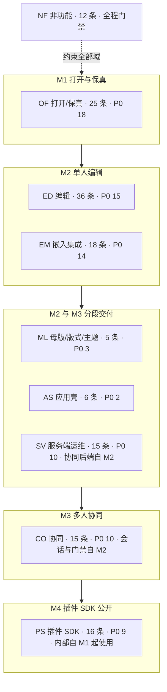
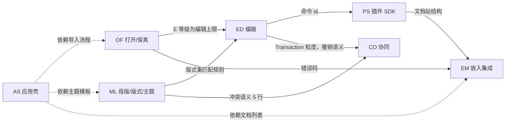
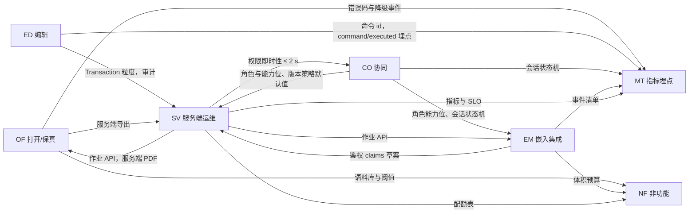

> 状态：草稿 | 负责：产品 | 更新：2026-09-18（按 2026-09-18 裁决 Q11–Q20 回写：ML-01/02/03、G-70/71/72/73、G-76 补编号、D9 例外、新增 D26/D27、AS-06 措辞、OF-14 可选能力口径、05 里程碑 AS 行与 `shell:*` 验收；2026-09-17：按设计稿同步 ML-01/03、新增 AS 域、D12/13/23–25、ED-16 定稿）；2026-09-24（按章程 §10 Q1–Q10 用户裁决 rulings §4.15 回写全部 PRD：单组织去租户、OIDC/Casdoor、撤销语义与软删除墓碑、S-3a、Q5 两层口径、Q7 保真落点、Q8 封面与 PDF、Q9 Node 26、Q10 洁净栈；本文 §3 定位、§5 PD-03/05/16/17/18 结案或更新）；2026-09-24（rulings §4.16：章程 Q11–Q20 裁决回写——§1.1 `.pptm` 拒绝、§1.2 许可证、§5 PD-01/02/08/12/13/15/19/20/21/22 与 §6 CS-10 结案）；2026-09-25（补图）；2026-09-25（矛盾收口，rulings §4.18）；2026-09-25（§4.19）；2026-09-26（§4.20：§8 事件名合并行改写为定稿名（TX-02 术语残留清零）；文件表 07 行注明 FE-05 修订）；2026-09-26（§4.21 整合：§2 索引与 §4 统计登记 ED-15a、ED-31–ED-35（ED 共 36 条），图 4-1 同步） | 依赖：charter v0.2；rulings §4.10、§4.15、§4.16、§4.18、§4.19、§4.20

# PRD 总览 —— 基于 cordis 的可插拔办公文档 SDK 与在线协同编辑器（首个文档类型：.pptx）

> 读者：总编排、设计条线、架构三条子线、类型治理、评审者，以及将据此拆任务的工程师。
> 本目录是产品需求基线。与章程（`../00-charter/charter.md`，当前 v0.2）冲突之处不擅改，全部登记在 §6；需要用户决策的问题登记在 §5 并按默认值推进。2026-09-15 已按总编排裁决（`../00-charter/rulings-2026-09-14.md`）完成定向对齐。

---

## 1. 范围声明

### 1.1 本 PRD 覆盖

- 产品定义、目标与非目标；角色与场景；八个功能域（打开/保真、编辑、协同、插件 SDK、嵌入与集成、服务端与运维、母版/版式/主题、应用壳）的可验收需求；非功能预算（性能、保真、可用性、安全、可访问性、i18n、浏览器矩阵）；M0–M5 里程碑范围与验收；北极星与埋点。
- 首个文档类型 PowerPoint `.pptx`（含 `.ppsx`/`.potx` 同结构变体；`.pptm` 宏文件直接拒绝导入，`format.macro_rejected`，rulings §4.16 Q15）；`.docx`/`.xlsx` 仅在 M5 以「骨架验证文档类型盲」的深度出现。

### 1.2 本 PRD 不覆盖

- 架构与实现（见 `../30-architecture/`）；界面布局与视觉（见 `../20-design/`）；类型治理机制（见 `../30-architecture/09-type-discipline/`）。本 PRD 引用它们时用文档编号（如「架构 04」「设计 05」「ADR-0020」）。
- 商业模式、定价（许可证已裁决 Apache-2.0，见 PD-21）。
- doc/sheet 的产品需求（M5 之后另立 PRD）。

### 1.3 需求编号与优先级约定

| 约定 | 说明 |
|---|---|
| 需求编号 | `<域>-<两位序号>`：`OF` 打开/保真、`ED` 编辑、`CO` 协同、`PS` 插件 SDK、`EM` 嵌入集成、`SV` 服务端运维、`ML` 母版/版式/主题、`AS` 应用壳（开始页 / 最近 / 模板 / 指南 / 账户，2026-09-17 新增）、`NF` 非功能、`MT` 指标 |
| 用户故事 | `US-<角色码>-<序号>`：E 编辑者、R 评审者、P 插件开发者、I 集成方、O 运维 |
| 待决事项 / 章程建议 | `PD-xx` / `CS-xx`（本文件 §5、§6） |
| 每条需求必含 | 用户故事、验收标准（Given/When/Then 或可度量指标）、优先级、目标里程碑、依赖的架构能力（章程 §4 术语） |
| P0 | 里程碑出口条件，缺一不可 |
| P1 | 里程碑目标，可在里程碑内延后，不可跨里程碑（跨则登记 PD） |
| P2 | 机会项，可自由滑动 |
| 数字 | 全部为**初始预算**，在对应里程碑中期实测校准一次，只能收紧 |

---

## 2. 文档索引与阅读指引

```
docs/10-prd/
├── README.md                          本文：总览、范围、待决事项、章程建议、术语补充、跨条线请求
├── 01-background-and-goals.md         背景、为什么不用 Univer/PPTist/pptx-viewer 直接做、目标/非目标、成功指标、关键假设
├── 02-personas-and-scenarios.md       五个角色的画像、核心场景、用户故事（US-*）与故事地图
├── 03-features/
│   ├── 01-open-and-fidelity.md        OF-01…25；★ pptx 特性支持矩阵（查看/编辑/保留 × 里程碑）；保真度量口径
│   ├── 02-editing.md                  ED-01…35（含 ED-15a；ED-15a、ED-31–ED-35 为 2026-09-26 新增）；快捷键表；编辑与保真交叉约束；§5 编辑与插入的非目标
│   ├── 03-collaboration.md            CO-01…15；角色/能力位；★ 软冲突语义表；会话状态机
│   ├── 04-plugin-sdk.md               PS-01…16；★ 公开贡献点目录与稳定级；CTK 8 项检查；示例插件清单
│   ├── 05-embedding-and-integration.md EM-01…18；嵌入形态 A–F；★ 事件清单；体积预算；CSP
│   ├── 06-server-and-ops.md           SV-01…15；作业 API；配额表；SLO；部署与运维
│   ├── 07-masters-layouts-and-themes.md ML-01…05（2026-09-15 裁决新增域；2026-09-17 按设计稿修订：同一编辑器 + 母版页签、缩略图窗格、视图分段入口、`Mod+Alt+M`；2026-09-18 按裁决 Q11–Q16 回写：删除被引用版式改确认后自动改用默认版式（2026-09-26 rulings §4.20 FE-05 改为确认后可撤销）、母版视图仅编辑模式且 ≥ 1024、补范围条 / 搜索 / 跨母版 / 加载态 / 多选删除 / 占位符上限 / 应用栏徽标 / 重置双层确认）：母版视图（M2 P0）、版式应用与重置（M2 P0）、母版与版式编辑（M3 P0，页签五组）、主题（M3 P1）、备注/讲义母版（M4 P2）
│   └── 08-app-shell.md                AS-01…06（2026-09-17 按设计稿新增）：开始页（M2 P0）、最近与固定、模板库、指南与帮助入口、首次使用引导、账户菜单（M2 P0）
├── 04-non-functional-requirements.md  NF-01…12；★ 参考机/参考文稿；性能预算全表；WCAG 2.2 AA 口径；浏览器矩阵
├── 05-milestones-and-scope.md         M0–M5：范围（按需求编号）、机械可验证验收、可插拔证据、依赖、风险
├── 06-metrics-and-analytics.md        北极星 WSES；MT-01…24；★ 埋点事件清单（<域>/<动作>）；漏斗
├── 07-design-coverage-and-gaps.md     ★ 需求 ↔ 设计 ↔ 原型覆盖矩阵；缺口（含 Given/When/Then，G-01…G-76）；原型 v2 的 16 条验收流程；影响界面的产品默认答案 D1–D27（2026-09-17 部分行按 playground 回写；2026-09-18 按 Q11–Q20 修订 G-70/71/72/73、D9 例外、新增 D26/D27，见文首同步说明）
├── 08-prd-design-alignment-2026-09-17.md  PRD ↔ 设计稿一致性核对与处置结果（2026-09-17）
└── 09-prd-design-alignment-2026-09-18.md  PRD ↔ 设计稿四路复核（正向 / 反向 / 设计文档↔playground / 裁决落地矩阵）与 Q11–Q20 逐项处置记录（总编排撰写）
```

| 读者 | 建议顺序 |
|---|---|
| 总编排 / 评审 | README → 01 → 05 → 各功能域 §0「产品立场」→ 04 → 07（设计覆盖与缺口） |
| 设计 | **07（覆盖矩阵与缺口，先读）** → 02 → 03/02 → 03/03（§3 状态表、CO-08）→ 03/04（PS-02 槽位）→ 03/07（母版/版式/主题，G-70–G-75）→ 04（NF-05） |
| 架构-结构 | 03/01（OF-18、矩阵）→ 03/04（PS-01/02/07）→ 03/05（EM-01/05/07）→ 05（可插拔证据） |
| 架构-运行时 | 03/03 → 03/06 → 04（NF-01）→ 03/01（OF-03/05/09、§4） |
| 类型治理 | 03/04（PS-06/07/15）→ 04（NF-09）→ 06（§5 事件注册表） |
| 拆任务的工程师 | 05（当前里程碑范围）→ 对应功能域需求条目 → 04 门禁数字 |

---

## 3. 产品定位（一页纸）

| 维度 | 立场 |
|---|---|
| 是什么 | 可嵌入、可自托管、每一级可替换的办公文档 SDK；`apps/web` 只是组装样例 |
| 首个能力 | pptx 直接打开 → 高保真渲染 → 单人编辑 → 多人协同 → 导出且未修改零丢失 |
| 差异化 | ① 保真可机械验收（部件级 diff + oracle SSIM）；② 每一级可插拔且有 CI 证据；③ 插件开发者是第一等用户（Manifest/CTK/文档站）；④ 浏览器与 Node 跑同一份模型代码 |
| 不是什么 | 不是 PowerPoint 替代品、不是套件、不是插件市场、不是多租户 SaaS（一次部署 = 一个组织，M1–M5 只做自托管，rulings §4.15 T-0/Q10）、不做沙箱、不做 .ppt、M1–M3 不编辑动画 |
| 北极星 | 周成功编辑会话数 WSES（打开成功 + ≥1 事务 + 无致命错误 + 保存/同步成功） |

---

## 4. 需求统计（草稿基线）

| 域 | 条目数 | P0 | 主要里程碑 |
|---|---|---|---|
| OF 打开/保真 | 25 | 18 | M1 |
| ED 编辑 | 36（2026-09-26 新增 ED-15a、ED-31–ED-35，均非 P0） | 15 | M2 |
| CO 协同 | 15 | 10 | M3（会话建立、同步路径与门禁自 M2 随协同后端交付，rulings §4.19 D-M2-CONTENT） |
| PS 插件 SDK | 16 | 9 | M4（内部自 M1） |
| EM 嵌入集成 | 18 | 14 | M2 |
| SV 服务端运维 | 15 | 10 | M2 / M3（导入、网关、update 持久化与快照、OIDC 自 M2，rulings §4.19 D-M2-CONTENT） |
| ML 母版/版式/主题 | 5 | 3 | M2 / M3（2026-09-15 总编排裁决：用户指出编辑器与左侧栏未考虑母版，自 ED-25 提级为正式需求域；2026-09-17 按设计稿修订形态） |
| AS 应用壳 | 6 | 2 | M2 / M3（2026-09-17 用户指出缺少官方首页与指南入口，设计先行交付后回填） |
| NF 非功能 | 12 | — | 全程 |

**图 4-1 PRD 功能域地图：按主要里程碑分组**



怎么读：每个子图是一个里程碑，域放在其主要里程碑下（数字取自上表；协同后端自 M2 交付，M2 / M3 边界见 `05-milestones-and-scope.md` §0.3，rulings §4.19 D-M2-CONTENT）；实线为里程碑先后，虚线表示 NF 以门禁形式贯穿所有里程碑。各域在其它里程碑的条目见 `05-milestones-and-scope.md` §0.2 总表。

**图 4-2 功能域之间的产出与消费：编辑器侧**



怎么读：实线从「产出方」指向「消费方」，边上写产出物；虚线为应用壳对其它域的依赖。每条边都取自对应功能文件末节「与其它域的接口」，设计与架构方向的消费方未画入。

**图 4-3 功能域之间的产出与消费：协同、服务端与横切域**



怎么读：读法同图 4-2；NF 与 MT 两个横切域在本图中只作为消费方出现，其余域产出的阈值、事件、指标与配额汇入这两处。

---

## 5. 待决事项（按默认值推进；决策人可随时否决）

> 2026-09-15：总编排裁决（`../00-charter/rulings-2026-09-14.md` §3）后，部分事项已进入章程 §10（右列 Q 号，默认值以章程为准）；其余保留在本表，由产品负责人批量决策。

| 编号 | 问题 | 当前默认 | 影响 | 决策人 | 章程 |
|---|---|---|---|---|---|
| PD-01 | 加密（AES）pptx 的支持时点 | **已裁决**（章程 Q15，rulings §4.16）：M1–M4 拒绝并返回 `format.encrypted`，提示先去除密码 | OF-02、矩阵 §2.1 | 已裁决 | Q15 |
| PD-02 | `.pptm` 宏文件策略 | **已裁决**（章程 Q15，rulings §4.16，偏离原默认「打开 + `vbaProject.bin` 不透明保留 + 导出保持 `.pptm`」，更保守）：**`.pptm` 直接拒绝导入**，错误码 `format.macro_rejected`，提示「请另存为 .pptx 后再导入」；`.ppsx`/`.potx` 不受影响 | OF-02、矩阵 §2.1、安全立场 | 已裁决 | Q15 |
| PD-03 | Strict 命名空间输入且有编辑时的导出一致性类 | **已裁决 C**（rulings §4.12 U-02）：保持原一致性类（反向映射写回 Strict），M1 即完整实现；方案 B「整包转 Transitional」仅作反向映射失败时的异常兜底。硬要求不变：零编辑字节相同 + PowerPoint 365 打开无修复 | OF-18、矩阵 §2.1、ADR-0008 | 已裁决 | **Q14** |
| PD-04 | 评论的持久化与 pptx 导出 | 评论以 `Snapshot` 内 `ResourceHook`（命名空间 `comments.*`）为事实源（ADR-0031 v0.2，服务端数据库为镜像读模型）；导出默认写入现代评论部件（可关） | CO-04、OF-11 | 用户 | — |
| PD-05 | 离线编辑范围 | M3：会话内断线队列（内存，刷新即丢，明确提示）；M4 P2：`collab-offline-idb`（`OfflineStore` Provider，ADR-0033）跨刷新持久化；ADR-0033 需与此口径对齐 | CO-06 | 用户 | — |
| PD-06 | 图表数据编辑后内嵌工作簿的处理 | 重生成最小 `.xlsx`（P1）；不可行则移除并警告「PowerPoint 中编辑数据不可用」 | ED-15、架构 04 | 用户 + 架构-运行时 | — |
| PD-07 | 放映模式与动画/切换播放 | **已定**（章程 §2.3 / §7 v0.2）：M1–M3 渲染结束态不播放；播放 M4 P2；编辑非目标 | ED-21、矩阵 §2.3 | 已裁决 | §2.3 |
| PD-08 | 版本与数据保留策略 | **已裁决**（章程 Q17，rulings §4.16）：默认值不变——自动快照每 10 min 或 500 updates、保留 30 天（2026-09-25 由 rulings §4.19 C-06 细化：30 天内全量，此后每天保留最后一个至 `retention.autoSnapshotDailyDays`，默认 365、0 = 永久）；命名快照永久（每文档上限 200）；update 追加表 7 天；导入原件 30 天；墓碑 TTL 24 h；**全部进入部署配置可调**。不透明保留所需的部件 Blob 随文档生命周期保留，不受此限 | CO-07、SV-03、SV-08、SV-11 | 已裁决 | Q17 |
| PD-09 | 浏览器矩阵底线 | Chrome/Edge/Firefox 最近 2 版 + Firefox ESR；Safari 17+；移动端见 Q20 | NF-07 | 用户（客户画像） | — |
| PD-10 | 遥测默认开关 | SDK 出厂 no-op；集成方显式接入 `telemetry.sink` | EM-13、06 指标 | 用户（法务/隐私） | — |
| PD-11 | 首批语言 | zh-CN（源）+ en-US（M2） | NF-06、PS-05 双语文档 | 用户 | — |
| PD-12 | 是否随包分发 CJK 回退字体 | 不内置（体积与许可）；集成方经 OF-25 供给；服务端字体包**已裁决**（章程 Q19，rulings §4.16）：内置 Noto（含 CJK）+ Liberation + Carlito/Caladea，均开源；**部署方可挂载自有授权字体目录**；不内置商业字体 | OF-05、OF-25、SV-02 | 已裁决（服务端）/ 用户（客户端） | Q19 |
| PD-13 | 里程碑周期 | **已裁决**（章程 Q13，rulings §4.16）：不定周期——按范围与验收推进，每个里程碑开工前再估 | 05 里程碑 | 已裁决 | Q13 |
| PD-14 | 第三方插件「已验证目录」 | M4 P2，仅文档站目录（CTK 报告 + 许可 + 源码链接），不做运行时市场 | PS-08 | 用户 | — |
| PD-15 | 移动端浏览器范围 | **已裁决**（章程 Q20，rulings §4.16，确认默认）：桌面优先；平板只读评审；手机查看 + 评论 M3 P1；编辑 M4+ P2；M2 必达键盘可达 + 基本朗读，WCAG 2.2 AA 分阶段 | NF-07、ED-27 | 已裁决 | Q20 |
| PD-16 | 服务端 PDF/缩略图引擎 | **已裁决**（章程 Q8，rulings §4.15）：headless Chromium（ADR-0026 已接受），运行于独立零出站 renderer sidecar；缩略图 M3 前半段、PDF M3 后半段；M2 以包内 `thumbnail.jpeg` 作过渡封面；不用 sharp；自研矢量 PDF 为后续 | SV-02、SV-04、SV-09 | 已裁决 | Q8 |
| PD-17 | 配额默认值 | 规模数字**已裁决**（章程 Q5，rulings §4.15）：五个数字为性能保证包络；系统天花板 200 页 / 单页 1,000 / 文档总元素 20,000（软警告 15,000，墓碑计入）；超出系统天花板（或文件超过 200 MB）的导入直接拒绝（Q5 原文「超包络」即超系统天花板，见 ADR-0035 复核修正，rulings §4.18 UX-13）；名额按用户计；全部由部署配置完全可调。其余行（评论线程、命名版本数、速率等）仍为产品默认值，见 SV-08 表 | SV-08 | 已裁决（规模）/ 用户（其余） | Q5 |
| PD-18 | 不可内部编辑元素（SmartArt/OLE/3D/动画对象）的交互 | **已结案**（章程 Q7，rulings §4.15）：建模变换——删除 M1 P0、整体移动/缩放 M2 P1（`mc:AlternateContent` 各分支 `xfrm` 同步回写，ADR-0008 决策 9 白名单），内部不可编辑并提示 | ED §1、矩阵 §2.1 备注 A、§2.6 | 已裁决 | Q7 |
| PD-19 | 协同排他锁 | **已裁决**（章程 Q16，rulings §4.16，确认默认）：不做——只有 awareness 软提示（选中框 + 名字），无形状级/页级排他锁；冲突按 CO-08 软冲突规则 | CO-10、CO-05 | 已裁决 | Q16 |
| PD-20 | 含数字签名文件的处理 | **已裁决**（章程 Q15，rulings §4.16）：签名文件可打开；保留 `_xmlsignatures/`；编辑后提示「签名将失效」（U-05 诊断码）；不移除 | 矩阵 §2.1 | 已裁决 | Q15 |
| PD-21 | SDK 许可证与商业模式 | 许可证**已裁决**（章程 Q12，rulings §4.16）：**Apache-2.0**（含 NOTICE；可发布包 `license: Apache-2.0`）；商业模式不在本 PRD 范围 | EM-16、PS-08 | 已裁决 | Q12 |
| PD-22 | M4 试点团队来源 | **已裁决**（章程 Q11，rulings §4.16）：内部非核心成员（未参与内核开发的同事或全新 AI agent 会话）仅凭公开文档完成一个插件（≤ 2 人日） | 05 M4 验收 5 | 已裁决 | Q11 |
| PD-23 | 模板库与帮助中心的内容来源（AS-03 / AS-04） | M2 内置 4 套主题模板 + 站内占位指南；M3 由集成方通过配置提供模板源与帮助链接，未配置时用内置 | 08 AS-03 / AS-04 | 用户 / 集成方 | — |
| PD-24 | 开始页是否作为 SDK 交付物（D22 延伸） | 是：`slide-ui` 交付 `StartPage` / `UserMenu` / `Brand` 可复用组件，`apps/web` 组装；品牌标与名称可由集成方替换 | 08 §0、charter §5.2 | 架构-结构 | — |
| PD-25 | M2 应用壳新建 / 打开的文档内容存在哪里（范围变更登记） | **已裁决**（rulings §4.19 D-M2-CONTENT，2026-09-25）：协同网关、Room、update 持久化与快照、服务端导入从 M3 提前到 M2，参考应用的文档内容自 M2 起只以协同快照为事实源，不设过渡的 pptx 内容版本端点；M3 保留多人协同体验层 | 05 §0.3、M2 / M3；CO-01/02/12；SV-01/03/05/06/07/12；AS-01；EM-03/04 | 已裁决 | §7 |
| PD-26 | 性能 runner 与 PowerPoint 基线机器 | **已裁决**（rulings §4.19 D-TEST-INFRA）：性能 M1 用 GitHub larger runner（4 核），协同与服务端压测所需的自托管专用 runner 在 M2 前落地，低配机型用 CDP CPU 4× 节流近似；视觉基线用一台 Windows + PowerPoint 365 维护机（不进 CI），macOS 基线 M2 加入 | 05 M1 依赖与验收 3、M2 依赖；NF-01、NF-02 | 已裁决 | — |

---

## 6. 对章程的异议 / 建议（处置结果见 `../00-charter/rulings-2026-09-14.md` §3；章程已升至 v0.2）

| 编号 | 章程位置 | 建议 | 处置 | 落点 |
|---|---|---|---|---|
| CS-01 | §7 M1「部件级 diff 零差异」 | 采纳 `03-features/01-open-and-fidelity.md` §4.1 的等价口径 | **采纳** | D7（与架构 A-12 合并） |
| CS-02 | §7 M2 验收清单 | 补「表格单元格文本编辑（P1）」「基础放映（P1，无动画）」；表格结构编辑归 M3 | **采纳** | §7 M2 / M3 |
| CS-03 | §2.3 非目标（动画/切换） | 明确「播放」策略：M1–M3 渲染结束态不播放，M4 P2 播放 | **采纳** | §2.3、§7 M4 |
| CS-04 | §10 Q5 规模目标 | 增加「只读查看者 ≤ 50/文档」「单页元素 ≤ 1,000」 | **采纳** | Q5 |
| CS-05 | §5.4「打开空壳」 | 改为可验证口径：无 `DocumentType` 时打开文件以错误码失败，宿主仍运行 | **采纳** | §5.4（错误码格式见 CS-13） |
| CS-06 | §6.1 D7 保真策略 | 补「元素级（节点级）不透明保留」 | **采纳** | §4、R6、D7 |
| CS-07 | §5.5 命名 | 为第三方插件预留事件域/贡献点 id 前缀规则 | **采纳-改写** | 形式为 `<vendor>:<域>/<动作>` 与 `<vendor>:<域>.<名>`（D15），非 PRD 原提的 `x-<pluginId>`；PS-02 已按此更新 |
| CS-08 | §4 术语表 | 新增 Room/Version/角色名/Soft Conflict/Support Level/Oracle/Corpus/Integrator | **采纳（精简）** | §4.2 / §4.3；本文件 §7 标注已入章程项 |
| CS-09 | §5.2 `apps/web` 职责 | 明确含文档列表 + 分享/权限入口 + 版本入口的最小演示范围 | **采纳** | §5.2 apps/web（另含 `/render` headless 渲染页） |
| CS-10 | §7 M4 可插拔证据「外部团队」 | 增加待决项「试点团队来源」 | **已裁决**（rulings §4.16 Q11）：改为内部非核心成员（未参与内核开发的同事或全新 AI agent 会话）仅凭公开文档 | Q11、§7 M4 |
| CS-11 | §5.2 包清单 | 增加 `preset-slide-viewer` | **采纳** | §5.1 / §5.2、§7 M1 验收；OF-14 依赖已满足 |
| CS-12 | §5.2 / Q8 | 服务端缩略图排 M3 前半段 | **采纳** | Q8、§7 M3 |
| CS-13（新，2026-09-15） | §5.4 | 错误码写作 `format/no-document-type`（斜杠），与 D11 / 架构 10 §1.1 的点式格式 `<domain>.<snake_case_name>` 不一致；建议改为 `format.no_document_type`（PRD 已按点式使用） | 待裁决 | §5.4、架构 10 |

---

## 7. 术语补充（章程 §4 之外，本 PRD 使用；「章程」列非空者已被 v0.2 吸收，以章程定义为准）

| 术语 | 英文 | 定义 | 章程 |
|---|---|---|---|
| 支持等级 | Support Level | 对一种 pptx 特性的承诺：`P` 仅保留 / `V~` 近似查看 / `V` 查看 / `E~` 部分编辑（章程称「有限编辑」）/ `E` 编辑 / `✗` 拒绝；累积关系 E ⊃ V ⊃ P。定义见 `03-features/01-open-and-fidelity.md` §1 | §4.3 |
| 语义等价 / 部件级 diff | Part-level diff | 导出包与源包的结构保真判定口径，见 OF §4.1 | D7 |
| 参照物 | Oracle | PowerPoint 365 真机导出的 PNG/PDF/属性表，作为保真比对基准 | §4.3 |
| 语料库 | Corpus | 保真与性能测试用的 pptx 集合：T1 规范语料、T2 真实语料（脱敏）、T3 压力语料（含参考文稿） | §4.3 |
| 参考机 | Reference Machine | 性能预算的度量环境（RM-A 基线 / RM-B 低端 / RM-S 服务端），见 NF §0 | — |
| 参考文稿 | Reference Deck | D50、D200、DX-1000、DX-DEEP、DX-MEDIA，见 NF §0.2 | — |
| gate / target | Gate / Target | gate = PRD 门禁值（CI 超出即失败）；target = 架构内部目标值（观测不门禁），见 NF-01 §1.2 | — |
| 降级渲染 | Degraded Rendering | 元素无法高保真渲染时的占位或近似显示，必伴随 `render/element-degraded` 事件 | — |
| 保真诊断面板 | Fidelity Diagnostics Panel | 列出当前文档全部降级项、缺失字体、限制命中的 UI（M2 P1）；对应设计 03-screens/10-fidelity-report | — |
| 扩展面板 | Extensions Panel | 列出已加载插件、失败插件（错误码、重试）与 PENDING 缺失服务的 UI（PS-11）；对应设计 03-screens/09-plugin-manager | — |
| 软冲突 | Soft Conflict | CRDT 合并成功但结果可能不符合任一用户意图的并发情形；需提示、可恢复（撤销不覆盖他人，取回自己的值用「恢复我的值」）；场景表见 CO-08 | §4.2 |
| 软删除墓碑 | Tombstone | 删除在 Store 层落为删除标记，id 稳定；读路径/渲染/导出过滤；TTL（默认 24 h）到期由服务端硬删除；计入文档总元素上限（CO-08、SV-03，rulings §4.15 Q3） | — |
| 性能保证包络 / 系统天花板 | Envelope / Ceiling | Q5 两层口径：包络内性能门禁成立；天花板之外拒绝导入（NF §0.2、SV-08） | — |
| 房间 / 会话 / 凭据 | Room / Session / Ticket | 服务端为一份文档维护的协同会话集合与 Y.Doc 副本 / 一个客户端与 Room 的连接生命周期 / WS 握手用短时签名凭据 | §4.2 |
| Update / StateVector / Compaction | — | Yjs 二进制增量 / 已知时钟向量 / 用快照替换其前的 update 序列 | §4.2 |
| 修复 | Repair | 服务端软门禁发出的补偿事务（origin=`repair`），只修不变量，不改用户内容语义（CO-12、ADR-0034） | §4.2 |
| 导出后重载 | Export-then-Reload | 被拒 update 的本地回滚策略：未同步更改存入本地「未同步更改」区（可导出），本地 CRDT 副本从服务端快照重新引导（CO-12、架构 06 §18.4） | — |
| 会话状态 | Collab Session State | `connecting / syncing / synced / reconnecting / offline / readonly-degraded`（UI 名称；对外事件载荷为 M-05 `SyncState` 六态，映射见 CO-01 与架构 06 §18.3，rulings §4.18 UX-01） | — |
| 版本 | Version | 用户可见的历史点：自动版本（按策略的 `Snapshot`）与命名版本（用户创建）；恢复为新事务 | §4.2 |
| 角色 | Role | `viewer` / `commenter` / `editor` / `owner`；是能力位（`doc.read/comment/write/export/manage/history.*`）的预设组合 | §4.3 |
| 能力位 | Capability | 权限的最小单元；命令声明所需能力位；未声明即拒绝 | — |
| 集成方 / 宿主应用 | Integrator / Host App | 把 SDK 嵌入自家产品的工程团队及其产品 | §4.3 |
| 嵌入形态 | Embedding Mode | A React 组件 / B 框架无关挂载 / C 只读查看器（`preset-slide-viewer`）/ D Headless / E iframe / F Web Component，见 EM §1 | — |
| Provider 座 | Provider Slot | 可替换服务实现的落位（`store`/`collabTransport`/`OfflineStore`/`blobStore` 等），不是贡献点；替换须通过 `run<Definition>Conformance` | §5.5 |
| 兼容性测试套件 | CTK, Compatibility Test Kit | 插件在宿主版本矩阵上的 8 项自动检查，见 PS-06 | — |
| 稳定级 | Stability Tier | 贡献点/API 的承诺等级：Stable / Beta / Experimental，见 PS-02；包级字段 `cordex.stability` | §5.2 |
| 资源上传通道 | Asset Upload Channel | 大二进制（图片/媒体）不经 CRDT、经预签名直传到 `blobStore` 的路径，CRDT 内只存 `BlobRef` | （`BlobRef` §4.1） |
| 基线包 | Baseline Package | 导入时以 `BlobRef` 内容寻址保存的原始部件字节（属 `SnapshotBundle`），导出时与快照合成以实现不透明保留；随文档生命周期保留。与「导入原件」（原始上传文件，Q17 保留 30 天）不同 | （`SnapshotBundle` §4.1） |
| 作业 | Job | 服务端异步任务（导入/导出/缩略图/模板填充/迁移），有 `jobId` 与状态机 | — |
| 需求 ↔ 测试矩阵 | Requirement–Test Matrix | 每条 P0 需求 id 与测试元数据的映射，由 CI 校验缺失（与章程「规范 ↔ 执行矩阵」同机制） | — |
| 北极星 WSES | Weekly Successful Editing Sessions | 周成功编辑会话数，定义见 06 §1.1 | — |
| 初始预算 | Initial Budget | 未经实测校准的数字；校准只能收紧 | — |

---

## 8. 跨条线协调请求（供总编排分派）

> 2026-09-15 处置状态：以下请求中已由章程 v0.2 / 裁决 / ADR 承接——元素级不透明保留（D7）、`preset-slide-viewer`（§5.2）、贡献点目录与命名（§5.5、D15）、事件名定稿（裁决 §5、架构 10 §11）、图表 M1 路径（D16）、Strict 导出（Q14）、软门禁（ADR-0034 → CO-12 已改写）、页序并发语义（ADR-0020/0032）、评论存储（ADR-0031）、离线持久化（ADR-0033 / `collab-offline-idb`）、被拒 update 回滚（架构 06 §18.4）、房间容量前提（架构 08）。下表保留原始请求供追溯；未列入上述者仍待对应条线承接（主要为设计条线的 UX 承接项与类型治理的扫描器项）。

| 请求对象 | 需要承接的内容 | 来源 |
|---|---|---|
| 设计（2026-09-17 已承接并反向输入 PRD：母版视图形态、缩略图窗格、视图分段入口、开始页、账户菜单——见 `08-prd-design-alignment-2026-09-17.md`） | 软冲突可视化（CO-08 表每行的提示形态）；20 人 presence 的覆盖层与头像折叠；会话状态指示（CO §3）；评论锚点（含脱离锚点态）与面板过滤；版本历史列表/预览/对比；保真诊断面板；「扩展」面板（插件失败/重试/PENDING 缺失服务）；每个拖拽的键盘/表单等价（ED-29）；紧凑模式与抽屉化（< 1024 px）；画布内容可访问树（NF-05）；插件 UI 槽位规范以 PS-02 目录为输入；两档密度、暗色、高对比 token 校验 | ED、CO、PS、NF-05 |
| 架构-结构 | `apps/web` 增加 `/home` 开始页路由与 `StartPage` / `UserMenu` / `Brand` 组件归属（AS、PD-24，charter §5.2 已补）；元素级 `extensions` 槽与 schema 顺序保证（CS-06）；`preset-slide-viewer`（CS-11）；命令声明能力位 + 扫描器（CO-05）；贡献点目录、稳定级字段、Manifest 字段（`hostApi`/`permissions`/`documentTypes`/`i18n`/`stability`）（PS-01/02）；错误码表生成与文档同步（EM-12）；需求 ↔ 测试矩阵机制（NF-09）；`Selection`/`Unit` 抽象用 doc/sheet 反例评审（M5 风险 R-M5-1）；事件域前缀规则（CS-07）；图表 M1 查看路径 = 渲染器只读解析不透明保留的图表部件，不要求 M1 建立图表编辑模型（架构待决 A-11 需据此调整措辞，见 OF-09）；Strict 导出默认与 PD-03 合并（架构待决 A-3） | OF、PS、EM、05 |
| 架构-运行时 | ADR-0020 回答页序/形状序并发移动与富文本映射（CO-08）；ADR-0023 权限变更 ≤ 2 s 推送与容量策略（CO-05、SV-05）；资源上传通道（CO-12）；服务端与客户端导出字节级一致（SV-02）；headless Chromium 池与 PDF（PD-16）；评论 `ResourceHook` + 现代评论部件编解码（CO-04）；图表内嵌工作簿策略（PD-06）；Node 端文本度量（服务端 PDF/缩略图）；连接符路径重算（ED-28）；IME 宿主 spike（R-M2-1）；解析在 Worker、虚拟化与脏区消费（NF-01）；ZIP/XML 限制（OF-24）；事件名合并：PRD EM-05 事件清单与架构 03/10 草稿的分歧定稿为一套（已定稿：`render/element-failed`、`permission/changed`、`perf/frame` 取代草稿名，rulings §5；旧名登记在 `docs/_tools/terms.json`，由 `check-terms.py` 检查残留） | CO、SV、ED、NF-01、EM-05 |
| 类型治理 | 遥测事件注册表扫描（未注册事件拒绝，06 §5）；命令能力位声明扫描；配置字段读取点扫描（配额/限制，Univer A26）；阈值 ratchet 的 `cordex-allow` 例外流程复用于保真/性能门禁；测试元数据中需求 id 的约定与校验 | 06、CO-05、SV-08、NF-09 |
| 总编排 | 裁决 CS-01…CS-12；PD-13（周期）、PD-21（许可）、PD-22（试点团队）已于 rulings §4.16 裁决；协调 PowerPoint oracle 机器（M1 一台 Windows + PowerPoint 365 维护机，macOS 基线 M2 加入，rulings §4.19 D-TEST-INFRA）与真实语料授权 | §5、§6 |
