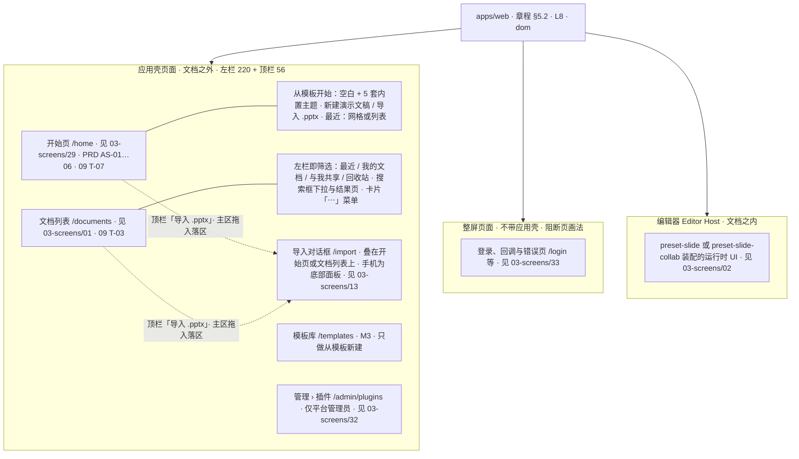
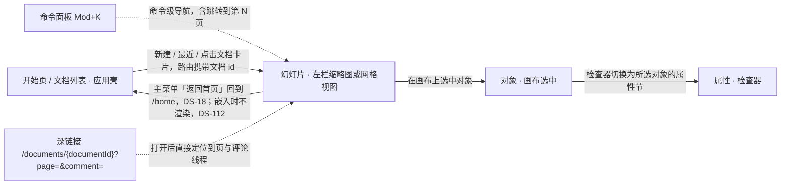
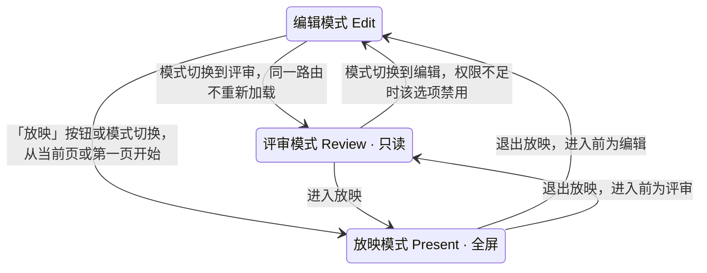
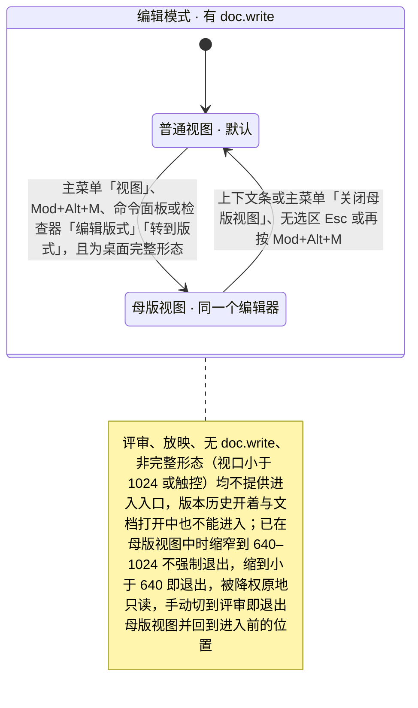
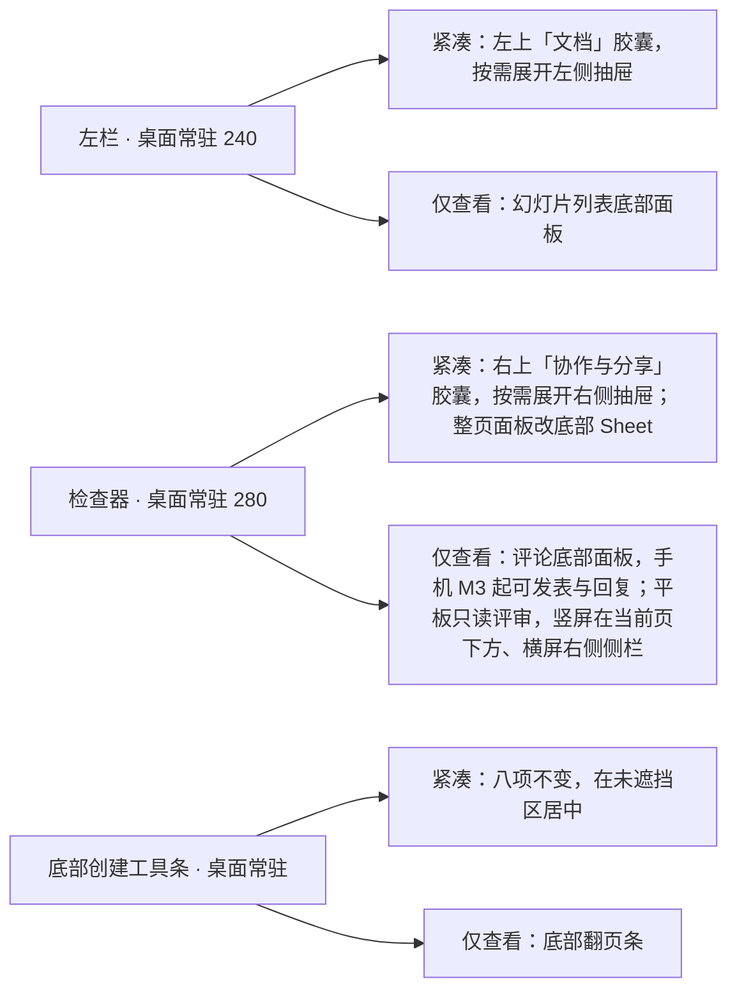
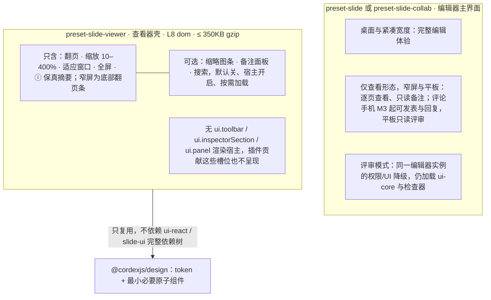
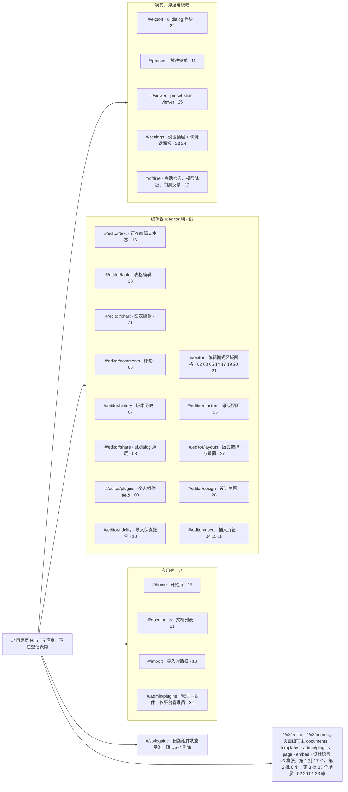

> 状态：草稿 | 负责：设计 | 更新：2026-09-18；2026-09-25（补图）；2026-09-25（矛盾收口，rulings §4.18）；2026-09-25（§4.19）；2026-09-26（§4.20 FE-08）；2026-09-30（§4.21 剩余缺口样张回写：§9 路由表与路由树补 `#/editor/table`（03-screens/30 表格编辑）、`#/editor/chart`（03-screens/31 图表编辑），并补登此前漏列的 `#/editor/fidelity`（03-screens/10），与 `registry.ts` 22 条对齐；`#/editor/text` 行补空内容占位符图标条与日期和时间格式选择器）；2026-10-01（§4.23 插件管理样张回写：§1 账户菜单补仅平台管理员可见的「管理」（进 `/admin/plugins`，03-screens/32）；§2.1 顶部全局栏的账户头像菜单同步；§9 路由表与路由树补 `#/admin/plugins`（03-screens/32 管理员插件管理），`#/editor/plugins` 行改为「个人插件面板（对话框）」，与 `registry.ts` 23 条对齐）；2026-10-04（design-language-v3 第 0 批：§2 编辑器区域划分改为 v3 结构——左栏 / 画布与备注 / 底部工具条 / 检查器 / 网格视图两胶囊 / 主菜单，删除顶部全局栏、Ribbon 区与状态栏区域（rulings §4.25 DS-1…DS-6）；§1 开始页与账户菜单、§2.3 检查器页签、§2.3a 备注、§2.4 / §5a 母版视图入口、§3 层级、§4 导航、§5 模式表、§6 断点、§7、§8 同步改写，推不出的入口写「随 design-language-v3 第 N 批定稿」；§9 补登 `#/v3/editor`、`#/v3/home` 两条样张路由，与 `registry.ts` 25 条对齐）；2026-10-04（design-language-v3 第 0 批：术语残留清理：ribbon / 状态栏 / `ui.ribbon` / `ui.statusBar` 的历史陈述改用 check-terms 认可的标记措辞（废弃、取代、作废）；§2.3a 键盘焦点改为引用已回写的 ED-29 与 07 §1.1；§9 旧稿路由描述去掉 Ribbon 字样）；2026-10-04（design-language-v3 第 0 批：复验修正——§9 路由表 `/styleguide` 改为旧版组件状态基准（随 DS-7 删除、接替路由随第 1 批），`#/v3/editor` 补场景状态参数；§2.2 横幅通道注明样张暂定位置，网格视图是否显示待决）；2026-10-04（design-language-v3 第 0 批：复验第 2 轮修正——§2.2 主菜单行按样张写全顶层项（返回首页 ┊ 文件 / 编辑 / 视图 / 插入 / 排列 ┊ 帮助）并注明第 0 批拍板与第 1 批起草的分界；横幅通道注明网格视图里同样占文档流（待拍板）；§1、§4、§2.2 去向段、§5.2 与图注的「返回首页」与模式切换注明样张已起草的落位（主菜单首项、「视图 › 模式」、评审工具条「返回编辑」）；§2.4 与 §5a 母版视图入口删去「样张未画」）；2026-10-04（design-language-v3 第 0 批：复验第 2 轮补充——§5.1 查看者变体的「只读浏览中」标识注明样张起草为底部浏览条上的标识（待拍板，03-screens/02 §6.2））；2026-10-05（design-language-v3 第 0 批修正：按 rulings §4.25 写入外壳类裁决——§1、§2.2、§4 与导航图中「返回首页」改为主菜单入口、主菜单另有「插件…」，账户菜单在编辑器里由右上角自己的头像打开、列个人资料 / 亮暗主题 / 偏好设置 / 退出，「◐主题」去向改为账户菜单（DS-18）；§1 开始页左栏「设置」冲突改为已按 DS-10 删除；§2.2 文档菜单去掉「移动到…」（DS-19），检查器行注明文字格式只在检查器（DS-13）与只读展示（DS-15）；§5.1、§5a 评审与降权下检查器只读展示当前值（DS-15）；§2.2、§6 紧凑与仅查看形态随第 1 批出样张（DS-17））；2026-10-05（design-language-v3 第 0 批修正：快捷键值按 rulings §4.25 DS-11 同步——§2.1 浮层、§4 导航表与导航图的命令面板由 `Mod+Shift+P` 改为 `Mod+K`（「⌘K」即命令面板），超链接改为 `Mod+Shift+K`）；2026-10-05（design-language-v3 第 0 批修正：§7「插件贡献很多」的工具条主行由「固定八项」改为只收内置项（编辑模式八项、未装评论包时七项），插件不进主行，与 03-02 §3.4、50/10 §4 一致）；2026-10-05（design-language-v3 第 0 批修正：§1 账户菜单改为开始页、编辑器、文档列表三处同一个菜单、同一份条目，条目以 PRD AS-06 为准（含 DS-18 补入的个人资料与亮暗主题），删去「其余条目是否同列随第 1 批」）；2026-10-07（design-language-v3 第 1 批：按已拍板样张（rulings §4.25 DS-21）定稿——§1 主菜单「帮助」条目写全；§2.1、§2.2 区域职责表按第 1 批改写：左栏 / 检查器 / 备注可拖尺寸、评审条与浏览条替换底部工具条（DS-23）、母版视图里「评论」换成「占位符」、主菜单「插件…」位置与「帮助」定稿、横幅通道与轻提示的位置定稿、紧凑与仅查看形态的区域去向（DS-17）；§2.3a 备注把手可拖高度、只读时的文案；§2.4 母版视图入口与退出按 DS-21 定稿（不设常驻按钮，画布顶部横幅「关闭母版视图」是唯一常驻退出入口）并重画区域示意；§3 层级补紧凑抽屉与仅查看底部面板；§4 导航补网格方向键与仅查看翻页；§5.1、§5.2 评审与只读浏览按 DS-23 定稿（评审条、浏览条、查看者没有模式组、文档菜单随角色）；§5a 入口与退出定稿，图与怎么读同步；§6 窄屏重写为桌面 / 紧凑 / 仅查看三形态的区域表与规则（DS-17，细节见 03-screens/02 §5a）；§7 窄屏抽屉与面板互斥、「更多」收纳；§8 查看器关系图与 §8.3 改为仅查看形态（评论只读，与 NF-07 的出入待产品线确认）；§9 `#/v3/editor` 行与路由树按第 1 批 17 个场景、各旧稿路由的 v3 场景改写）；2026-10-07（design-language-v3 第 1 批：第二步按 rulings §4.25 DS-28 与 TB 技术口径定稿，与 03-screens/02 同步——§2.1 检查器拖宽 240–480（TB-25）、面板尺寸按文档记在本机（TB-24）、视图状态同步到地址栏参数 `view`（TB-30）；§2.2 底部工具条行写明评审条的外壳内置项（TB-1），浮层与横幅行写母版视图中母版横幅常驻在上、其余横幅在它下方另占一条（TB-14）；§2.4 与 §5a 缩窄到 < 640 退出母版视图（TB-16）、母版横幅与其余横幅（TB-14）、主菜单「帮助 › 关于母版继承」（TB-15），§5a 状态图注释同步；§3 层级表按 TB-2 改为 `--layer-panel` 与轻提示在外壳之下；§4 键盘跳页改为 PageUp / PageDown、Home / End 与数字 + Enter（03-screens/20 §7，原 Ctrl+G 与 ED-16 的 Mod+G 冲突），深链接行补 `view` 参数（TB-30）；§6 仅查看形态的评论 M3 起可发表与回复（DS-28），图 6-1 与母版视图一条同步；§7「插件贡献很多」改指 06 的暂行规则；§8 关系图与 §8.3 按 DS-28 改写；§9 `/styleguide` 行按 TB-3 结案，路由树「设计主题」）；2026-10-08（design-language-v3 第 1 批收口：与 03-screens/02 同步，按 rulings §4.25 DS-31、TB-31、TB-39…TB-41、TB-44、TB-49、TB-50——§2.1 面板尺寸写全三条范围并补本机存储键与登出清除（TB-41）；§2.2 主菜单「文件」加「幻灯片大小…」（P2，DS-31）、「帮助」写明帮助中心走壳意图（TB-39）与开发构建的「开发者面板」（TB-40），菜单条目的贡献点按 06 §2.3 写为 `ui.contextMenu` 的 `mainMenu` / `mainMenu.<顶层项>` / `docMenu`，检查器行补形状的快速样式与替代文本（DS-31、TB-32）；§2.4、§5a 表与状态图：母版视图非完整形态不可进入、原因写「在更大窗口中编辑」（TB-44）；§4 深链接行与命令面板行的链接命令改称「链接…」（TB-6）；§6 表、图 6-1、§8 图与 §8.3：手机 M3 起可发表与回复、平板仍为只读评审（TB-49）；§7「插件贡献很多」改为随第 2 批出样张（TB-31）；§9 `/styleguide` 只在测试环境挂出（TB-50））；2026-10-15（design-language-v3 第 2 批：按已拍板的第 2 批样张与 rulings §4.25 DS-38…DS-63 回写——§2.1 补检查器整栏面板（版本历史、保真报告沿用 280，插件整页面板 400，个人插件面板为 640 对话框，DS-38）；§2.2 区域职责表：左栏与底部工具条在版本预览时的变化（DS-39）、评论工具发表后保持按下（DS-44）、检查器整栏面板与「分享」的待处理圆点（DS-38、DS-48）、主菜单「插件…」与「文件 › 保真报告」的落位（DS-38、DS-51）、横幅叠放扩到版本预览与仅查看形态的横幅（DS-39、DS-60）；§2.3 版本历史、保真报告与插件整页面板的落位定稿（不另设检查器页签），评论入口与「点评论钉是唯一的自动切换」（DS-44、DS-45）；§3 层级补整栏面板与非模态弹层；§5.1 非所有者的「分享」为只读视图（DS-48）、评审与只读浏览的评论页签换成第 2 批评论面板（DS-62）；§6 仅查看形态的评论（DS-46）、顶部条与横幅（DS-60）、紧凑形态里整栏面板的落位随第 3 批（DS-38）；§7 插件条目很多时的收纳定稿（DS-49），补版本预览与会话中访问被撤销（DS-39、DS-50）；§8.1 查看器 ⓘ 只给影响「看」的计数（DS-51）；§8.3 手机评论样张已出；§9 路由表与路由树补第 2 批 6 个场景；同日再补，按 rulings §4.25 TB-59…TB-61——§2.1 整栏面板的宽度改为列表与报告类沿用检查器当前宽度（缺省 280）、开着时分隔条照常可拖，编辑与整页类宽 max(400, 检查器当前宽度)、开着时分隔条不可拖、关闭后回到原宽（TB-60），插件整页面板由检查器分区的「展开」或命令打开（TB-59）；§2.2 检查器行与主菜单行的「整栏 280」改为沿用检查器宽度，贡献点列写明检查器页签只由内置包贡献、第三方 `ui.panel{slot:'inspector'}` 只作整栏面板（TB-59）；§2.3 补分区条目字段 `expandPanel` 与命令打开；§5.1 查看者在评论钉上没有右键菜单、不拦截浏览器菜单（TB-61）；同日再补：§2.3「点击评论图钉」改为「点击评论钉」，用 DS-43 的统一名称）；2026-10-22（design-language-v3 第 3 批：按已拍板的第 3 批样张与 rulings §4.25 DS-71…DS-136、TB-101…TB-129 回写——§1 站点地图改为应用壳页面、整屏页面与编辑器三类，账户菜单条目按 DS-89…DS-91 定稿（头像一律身份色首字，TB-123），新增「应用壳页面」一段：左栏即筛选（DS-79）、搜索框下拉（DS-80）、横幅在顶栏之下（DS-92）、模板库只做从模板新建（DS-72、DS-93、TB-110）、导入页与全屏的导入过渡页（DS-97、DS-98、TB-129）、登录与错误页（DS-71，03-33）、叠在当前页面上的设置、快捷键面板与分享（DS-113、DS-115、TB-109）、窄屏抽屉与手机不新建（DS-87）；§2.1 紧凑形态里整栏面板的落位（DS-130），浮层补快捷键面板与命令面板不加遮罩（DS-115、DS-117）；§2.2 左栏的视图切换改分段（DS-133）、评审者与查看者没有文档菜单（DS-82）、降权时文档菜单三项都不可用（DS-105、U-09），检查器协作行他人的头像是「跟随」按钮（DS-106），主菜单「文件 › 导出…」⇧⌘E 并按权限置灰（DS-78、DS-105）、不设打印（DS-104）、「帮助 › 帮助中心」按配置出现（DS-89）、嵌入时不渲染「返回首页」（DS-112），横幅统一高 40、紧凑抽屉从横幅下沿开始（DS-75、DS-130）；§2.4 母版视图的紧凑抽屉不盖母版横幅（DS-130）；§3 层级表补模态抽屉、偏好设置、快捷键面板、命令面板不加遮罩与应用壳横幅（DS-92、DS-94、DS-113、DS-115、DS-117）；§4 导航补文档卡片是链接与卡片网格的键盘（TB-107、TB-108）、壳页面上的对话框路由（TB-109）、命令面板的阅读顺序（DS-116）与嵌入时的「返回首页」（DS-112），导航图同步；§5.1、§5.2 评审者与查看者的文件名不再是菜单触发器（DS-82）、「导出…」的不可用原因（DS-105）、放映的跟随条（DS-106），退出放映停在最后显示的页、放映中吞 F5（DS-108、DS-109、TB-103）；§6 紧凑形态的非模态抽屉从横幅下沿开始、整栏面板进抽屉或底部 Sheet（DS-130），平板评论面板按方向落位、触控的状态行「仅查看 · 在电脑上编辑」（DS-131、TB-125），新增嵌入、应用壳页面与查看器的窄屏三条（DS-87、DS-111、DS-112、TB-115），图 6-1 同步；§7 补放映中访问被撤销（TB-112）与同一账号的多个窗口（DS-132、TB-124）；§8.1 查看器桌面壳（只有「全屏」、没有放映）、ⓘ 卡的缺插件一行与没有差异时的写法、打开失败的按钮（DS-110、TB-114）与窄屏形态（DS-111），§8.2 图同步；§9 路由表与路由树补第 3 批的页面级宿主与 18 个场景）；2026-10-22（同日再补，按回写中的裁决 rulings §4.25 DS-137、DS-138 与技术口径 TB-130…TB-151——§1 账户菜单的「个人资料…」M3 起打开个人资料对话框（TB-137），嵌入里「退出登录」按 `cordex:init` 是否声明 `sign-out` 决定可用（TB-145）；应用壳页面补搜索框下拉的键盘与手机形态（TB-130）、卡片与显示方式一条（网格 / 列表共用一份本机偏好、列表次序、M2 的「分享…」不可用，TB-131、TB-144、DS-137），导入过渡页「取消」回到打开导入页之前的那一页（TB-133）；§2.2 左栏文档菜单降权三项补 TB-138，检查器「分享」M2 不可用（DS-137），主菜单「返回首页」按 `navigate-back`（TB-145）、「关于母版继承」与帮助中心同一规则（TB-132）；§2.4 与 §5a 母版视图的不可用原因按形态分：窄窗口「在更大窗口中编辑」、触控设备「在电脑上编辑」、嵌入「当前区域太窄，暂不可用」（TB-136）；§4 壳页面的「分享…」M3 起（DS-137）；§6 仅查看形态与嵌入补备注为空的一句（DS-138）与壳意图（TB-145）；§8.1 查看器备注面板为空时的一句（DS-138））；2026-10-22（同日再补，按回写中的技术口径 rulings §4.25 TB-153、TB-154、TB-156、TB-159…TB-162——§1 账户菜单与帮助菜单在触控形态不写键位提示（「⌘/」按 TB-154，「⌘,」同理，同 03-29 §2.5），模板库的集成方模板源随 PRD PD-23 定、之前按静态来源列表设计（TB-160），偏好设置与快捷键面板的手机形态为贴底的底部面板、平板照常是浮动面板（TB-118、TB-154），窄屏一条与 §6「应用壳页面」一条的顶部提示按宽度与触控分两句（TB-153）；§3 层级表的模态一档补手机上偏好设置与快捷键面板的模态底部面板（TB-118、TB-154）；§2.2 检查器「分享」M2 的工具提示「分享 · 后续版本提供」、宿主既没给分享回调也没标「后续版本提供」时不渲染（TB-161）；§2.4、§5a 与 §6 嵌入一条：嵌入只改写「在更大窗口中编辑」一类的说法，嵌入又是触控设备时以「在电脑上编辑」为准（TB-159）；§4 命令面板一行补壳意图进命令面板（TB-162）；§7 会话中访问被撤销时 M2 的「申请访问」不可用（TB-156）；2026-10-22 复核修正：§1、§4 与导航图里「返回首页」的落点由 playground 旧路由 `#/home` 改为产品路由 `/home`，§8.1 可选项的参照由 `#/viewer` 改为样张 `viewer`；§1 账户菜单的键位提示按 TB-164 写（触控形态一律不写键位，含 ⌘,）；§1 窄屏一条与 §6 应用壳页面补平板的左栏与卡片列数按窗口宽度（TB-165）、手机与平板直接打开 `/import` 照常显示（TB-167）；§2.4、§5a、§6 写明「触控设备」只指平板、手机按窗口窄写（TB-163）；§2.2 文档菜单降权一句补「创建副本」的用户裁决 DS-139；§7 补阻断页说明句不变（TB-156）；§9 按 `registry.ts` 现状改为 30 条、五个页面级宿主已登记；§1 卡片一条补第二行缺最近编辑者或还没有快照时的写法（TB-171）；§1 窄屏一条、§6 应用壳页面与 §1 账户菜单补平板保留列表头的切换与开始页「最近」的排序、搜索框随左栏不写 ⌘K（TB-170）；§2.2 横幅通道与 §6 仅查看一行补横幅在最顶上对手机与平板都成立、按钮只在一行放不下时才换行（TB-172）；§1 卡片一条补列表形态的编辑者与时间两列、搜索下拉与搜索结果页的每一行同第二行写法，开始页「最近编辑」排序与第二行取同一时间（TB-171）；§1 横幅一条、§2.2 横幅通道与 §6 仅查看一行补统一高 40 指非触控形态、触控形态的按钮与 × 照常 44 而横幅随之撑高（TB-172）；§1 横幅一条、§2.2 横幅通道与 §6 仅查看一行补一行放得下时上下内边距仍是 5、共高 55，§1、§2.2 写明应用壳页面的横幅在触控形态与编辑器相同（TB-172））；2026-10-23（design-language-v3 第 3 批评审修改：按 rulings §4.25 DS-140、TB-179…TB-181 回写——§1 站点地图把导入从整屏页面移到应用壳页面上叠开的「导入」对话框（虚线），「不带外壳的整屏页面」一条去掉导入页与过渡页（DS-140 取代 DS-97、DS-98），「叠在当前页面上的」补导入对话框（`/import` 叠在来路之上、后退即关闭、取消即关闭、拖入落区打开上传态，TB-179、TB-180），窄屏一条的直接打开 `/import` 按 TB-181 改写（修订 TB-167）；§4「壳页面上的对话框路由」补导入对话框的地址与历史（TB-179）；§9 路由表 `#/import`、`#/v3/home`、`#/v3/documents`、`#/v3/editor` 与路由树同步）；2026-11-04（design-language-v3 母版视图改版：§2.2 工具条与横幅两行改为「占位符 ▾」第 2 位与上下文条；§2.4 线框与图例按新画法重画（上下文条、占位符虚线 + 类型名与继承点线、检查器标题与节序、工具条新次序），差异 1–6 改写（窗格名称换行与键位指向 03-26 §3、§9，画布去掉编辑范围与图例，上下文条，工具条，检查器），入口与退出补检查器「编辑版式」「转到版式」、Esc 逐级指向 03-26 §1.1，可用性改为不切换并给轻提示、点名版本历史开着与文档打开中两种不能进入并指向 03-26 §1.1；§3 层级表吸顶元素一行改称上下文条；§5a 表三行与表后的段落同改，状态图的进入、退出与注记补检查器两个入口、上下文条与两种新的不能进入，怎么读与依据同步；§6「母版视图」一条的横幅改称上下文条；「显示 ⌘⌥M」两处改为 ⌥⌘M；rulings §4.25 DS-144…DS-177、TB-195、TB-208、TB-209；需求编号、优先级与里程碑不变） | 依赖：charter v0.1（已核对 v0.2）；PRD `08-app-shell.md`（AS-01…06）、`04-non-functional-requirements.md`（NF-07）、`07-masters-layouts-and-themes.md`（ML-01）、`01-open-and-fidelity.md`（OF-14）；rulings §4.8 Q8 / §4.9 Q9–Q10 / §4.10 Q12、Q14、Q18–Q20 / §4.25 DS-1…DS-8、DS-10、DS-11、DS-13、DS-15、DS-17…DS-19、DS-21…DS-26、DS-28、DS-31、DS-38…DS-63、TB-6、TB-31、TB-32、TB-39…TB-41、TB-44、TB-49、TB-50、TB-59…TB-61、DS-71…DS-140、TB-101…TB-165、TB-167、TB-170…TB-172、TB-179…TB-181、DS-144…DS-177、TB-195、TB-208、TB-209；09 v3.0 T-01 / T-02 / T-07；playground `src/routes/registry.ts`、`src/v3/`（场景 `main-states`、`narrow`、`master-view`，第 2 批 `comments`、`version-history`、`share`、`plugins`、`fidelity`、`offline-conflict` 等，第 3 批 `documents`、`home`、`account-menu`、`templates`、`admin-plugins`、`import`、`export`、`present`、`viewer`、`embed`、`settings`、`shortcuts`、`command-palette`、`shell-pages`、`doc-banners`、`narrow-review`、`presence-scale`、`quiet-leftovers`）
> **2026-09-18 修订说明**：按 rulings §4.10 与 playground 回写——§1 应用壳补开始页 `#/home`（PRD AS-01…06）；§2.1 / §2.2 / §4 应用栏「返回首页」、「⋯」更多菜单与账户头像（Q14 / Q20）；§2.4 / §5a 母版视图改为"同一个编辑器"（母版页签置首、五组、其余页签照常、母版缩略图窗格、Ribbon 分段主入口（已被 rulings §4.25 DS-1 取代）、`Mod+Alt+M`、检查器仅禁评论、评审 / 窄屏不提供入口，Q12）；§8.1 查看器补可选缩略图条与备注抽屉（Q18）；§9 路由表与 `registry.ts` 19 条对齐（删除已退役原型的 `text-editing` / `pages`）。

# 01 信息架构（Information Architecture）

本文档定义编辑器（含应用壳）的区域划分、层级、导航模型、三种模式（编辑/评审模式/放映模式）与桌面优先之上的平板/窄屏变化点。术语沿用章程 §4；新增术语（评审模式、放映模式等）见 README「术语补充」。

---

## 1. 应用壳与编辑器的关系

**应用壳与编辑器两层 IA（站点地图）**



怎么读：箭头表示 apps/web 由三类页面组成——共用左栏与顶栏的应用壳页面、不带应用壳的整屏页面（登录与错误页，与阻断页同一画法）、编辑器；分组框内是该类包含的页面，细线把页面连到它承载的内容，虚线是叠在页面上打开的导入对话框（2026-10-23，rulings §4.25 DS-140：导入不再是整屏页面）。路由以前端 50/02 §2 为准，页面之间怎么跳转见 §4「导航层级与快捷通道」图。

应用壳与编辑器是两个独立的 IA 层：应用壳是"文档之外"的空间（开始页、文档列表、模板库、管理页、分享入口、账户），编辑器是"文档之内"的空间（一个 Unit 打开后的完整工作区）。打开应用先到**开始页**（不是文档列表或空白编辑器，PRD AS-01）；编辑器的「返回首页」落回开始页 `/home`（03-screens/29；入口为主菜单「返回首页」，rulings §4.25 DS-18，原在应用栏最左；嵌入时不渲染，DS-112，§6）。2026-10-04 起（rulings §4.25 DS-1、DS-2）两层不再共享顶部全局栏：开始页是左侧 220 导航 + 56 高顶栏（03-screens/29），编辑器是左栏 + 画布 + 检查器（§2.1）。账户菜单（`UserMenu`：开始页、文档列表、模板库与管理页在左栏底部用户行；编辑器中为右上角自己的头像——检查器顶行头像组，网格视图与紧凑形态在右上胶囊，DS-18，原为应用栏头像）三处打开的是同一个菜单、同一份条目（2026-10-07 用户确认，DS-18 补注），条目与次序以 PRD AS-06 为准，2026-10-22 随第 3 批定稿（rulings §4.25 DS-89…DS-91，样张 `account-menu`）：头部（头像、姓名与邮箱，只作标识、不可聚焦；头像一律身份色首字，TB-123）┊ 个人资料…（M3 起出现，打开个人资料对话框：显示名可改（1–128 字）、邮箱只读、头像身份色首字只读，rulings §4.25 TB-137，03-screens/29 §2.5；M2 连同它下面的分隔线都不显示，DS-91）┊ 主题「浅色 / 深色 / 跟随系统」三项单选（与偏好设置「外观 › 主题」同一偏好、同一组取值与顺序，选了不关菜单、立即换肤，DS-90；集成方锁定主题时三项留在原位不可用）┊ 偏好设置… ⌘, · 键盘快捷键 ⌘/ · 管理 · 帮助中心 ┊ 退出登录。「管理」2026-10-01 按 rulings §4.23 新增，只对平台管理员显示，M3 直接进 `/admin/plugins`「管理 › 插件」，03-screens/32；普通成员不显示、不占位。「帮助中心」只在集成方配置了链接时出现，新标签页打开、右侧带外链图标（DS-89）。触控形态（手机与平板）的菜单项一律不写键位提示：「键盘快捷键」照常保留、不写「⌘/」，开始页帮助菜单里的同一项同此，「偏好设置…」也不写「⌘,」；快捷键面板里的键位照常列出（与手机、平板的搜索框都不写 ⌘K 一致，rulings §4.25 TB-154、TB-164、TB-170，03-screens/29 §2.5）。嵌入（iframe）里「退出登录」只在宿主经 `cordex:init` 的 `intents` 声明了 `sign-out` 时可用（点了交给宿主处理登出）；没声明时留在原位不可用、右侧写「由宿主应用管理登录」（rulings §4.25 TB-145、§4.20 FE-06，前端 50/12 §9）。其中**设置只有这一个入口**（侧栏与顶栏不再单独放设置按钮，PRD AS-06；v3 开始页左栏原画的「设置」项已按 DS-10 删除，03-screens/29 §2.1）；快捷键面板另有主菜单「帮助」（DS-1 起取代原 Ribbon 页签行右侧「?」；2026-10-07 第 1 批定稿为「命令面板… ⌘K · 键盘快捷键 ⌘/ ┊ 帮助中心」，DS-21，03-screens/02 §2.3；其中「帮助中心」同样按配置出现、带外链图标，DS-89）与 `Mod+/` 两个等价入口（rulings §4.10），开始页左栏的「帮助」菜单里同样有「键盘快捷键 ⌘/」。

**应用壳页面**（2026-10-22 按第 3 批已拍板样张定稿，rulings §4.25 DS-72、DS-79…DS-98，样张 `home`、`documents`、`templates`、`admin-plugins`、`import`、`shell-pages`；导入 2026-10-23 按第 3 批评审修改改为叠在原页上的对话框，DS-140…DS-142、TB-179…TB-181；页面的路由以前端 50/02 §2 为准）：

- **同一个外壳**：开始页、文档列表、模板库与管理页共用左侧 220 导航 + 56 高顶栏 + 主区。左栏主导航为「首页 / 最近 / 我的文档 / 与我共享 / 回收站」——后四项就是文档列表的筛选，列表页不设页内筛选条，`/documents` 不带 filter 时落「最近」，「全部」只用于搜索结果（DS-79）；左栏底部「帮助」打开帮助菜单：只列集成方配置了链接的条目（新标签页打开、带外链图标），「键盘快捷键 ⌘/」始终在，什么都没配置时只剩它（DS-89）。管理页的左栏换成「← 返回首页 · 管理」一组导航、不放「帮助」（03-screens/32）。
- **搜索**：左栏搜索框（开始页作用域 `Mod+K` 聚焦）输入后，下方弹出前 5 条即时结果与「查看全部结果」，后者进搜索结果页；列表头、下拉与结果页都不写数量（DS-80）。下拉按组合框操作——焦点留在搜索框，↓ / ↑ 移动当前项、↵ 打开（还没移动时等于「查看全部结果」）、Esc 先收起再清空、点外面收起；在结果页里改搜索词时下拉照常弹出，↵ 或「查看全部结果」按新词刷新结果页；手机与触控形态同用下拉，行高 44（rulings §4.25 TB-130，07 §1.2，03-screens/01 §5）。
- **卡片与显示方式**：开始页「最近」与文档列表是同一张卡片、同一份「⋯」菜单（DS-81）；卡片第二行「编辑者 · 相对时间」（DS-83）缺最近编辑者（系统作业建的文档）时只写相对时间，最近编辑者与内容更新时间都缺（还没有快照）时按创建时间写、不写编辑者，不拿所有者顶替；列表形态的编辑者与时间两列（缺最近编辑者时编辑者一列空着）、搜索下拉与搜索结果页的每一行同此（rulings §4.25 TB-171）；网格 / 列表是本机的视图偏好，两处共用一份（TB-131）；文档列表各视图的次序固定、不设排序（DS-84）——「最近」固定的在前、其后按我打开的时间，「我的文档」「与我共享」按内容更新时间倒序，与卡片第二行的时间同源，改名、移入与恢复回收站不改变次序（TB-144），开始页「最近」的排序菜单只管开始页那一段（TB-127），其中「最近编辑」与卡片第二行取同一时间——内容更新时间，还没有快照时取创建时间，与「我的文档」的次序同口径（TB-171、TB-144）。分享在 M3 开放：M2 卡片菜单里的「分享…」留在原位、不可用，右侧写「后续版本提供」（rulings §4.25 DS-137，FE-06）。
- **横幅**：在主区顶栏之下、只横跨主区，导航不动、标题不跳，最多两条叠放；与编辑器同一个件，高 40；触控形态（手机与平板）与编辑器相同：按钮与 × 照常 44、横幅随之撑高，一行放得下时上下内边距仍是 5、共高 55（44 + 10 + 1px 底边；DS-92、DS-75、TB-172）。
- **模板库**（M3）是开始页的下一层，入口只有开始页「从模板开始」一行右端的「更多模板 →」；只做从模板新建：顶栏不放「导入 .pptx」「新建演示文稿」，网格不含「空白」；来源分段只在集成方配置了模板源时出现，点模板打开预览对话框（DS-72、DS-93、TB-110）；集成方模板源怎样下发随 PRD PD-23 定，在那之前按部署配置里的静态来源列表设计，某一来源取不到只影响它那一组，内置模板照常（rulings §4.25 TB-160，03-screens/29 §7）。
- **不带外壳的整屏页面**：登录页、OIDC 回调、新窗口重新登录回调、路由兜底与错误页都与阻断页同一画法，登录页是第 3 批唯一的新版式（DS-71、DS-118…DS-122，03-33）。整屏的导入页与导入过渡页（DS-97、DS-98）2026-10-23 起由 DS-140 取代，导入改为下一条的对话框。
- **叠在当前页面上的**：偏好设置（`/settings` 叠在来路之上，居中对话框，DS-113；手机（< 640）为贴底的底部面板，TB-118）、快捷键面板（开始页上浮在主区右上，DS-115；手机（< 640）同样改为贴底的底部面板，平板（触控、≥ 640）照常是这块浮动面板，rulings §4.25 TB-154）、卡片「⋯」菜单里的「分享…」（M3 起；对话框叠在当前壳页面路由上，关闭后回到原列表与滚动位置，TB-109）与「导入」对话框。「导入」对话框（2026-10-23，rulings §4.25 DS-140；同 Figma 文件浏览器的 Import 对话框）——开始页与文档列表顶栏的「导入 .pptx」在原页上打开它，选文件、拖入、上传、服务端解析与失败都在框里原位切换，成功后关闭、进编辑器；主区的拖入落区照常保留，松开即打开它的上传态（TB-180）；`/import` 叠在来路之上（同 `/settings`），浏览器后退等于关闭，上传与解析中的「取消」、× 与 Esc 都是中止并关闭、留在原页，失败后只有「关闭」（TB-179，修订 TB-129、TB-133）；直接打开 `/import` 时背后是文档列表「最近」；手机（< 640）为贴底的底部面板、平板为对话框（TB-181）；画面与状态见 03-screens/13。
- **窄屏**：判据与编辑器相同（§6）——640–1024 时左栏收成左侧抽屉（顶栏左端「显示导航」，抽屉就是左栏本身、不加遮罩）；< 640 或触控时不渲染「从模板开始」与「新建 / 导入」，顶部一行提示：< 640 写「在更大窗口中新建或导入演示文稿」（DS-87），平板（触控、≥ 640）因为是触控才不能新建，写「在电脑上新建或导入演示文稿」（rulings §4.25 TB-153，与 TB-125、TB-136 同一理由）；平板的左栏与卡片列数仍按窗口宽度取，列表头的网格 / 列表切换与开始页「最近」的排序菜单也照桌面与紧凑保留、只有手机（< 640）不放（TB-165、TB-170，§6）。手机与平板直接打开 `/import` 时照常显示、不另拦——背后是文档列表的触控形态，手机上是底部面板、平板上是导入对话框，导入完成后按设备进编辑器的仅查看形态（rulings §4.25 TB-181，修订 TB-167，03-screens/13）。

---

## 2. 编辑模式：区域划分

### 2.1 区域网格（桌面，≥1024px，断点口径见 §6；2026-10-04 按 rulings §4.25 DS-1…DS-6 改为 v3 结构）

v3 废弃 ribbon、应用栏与状态栏（DS-1、DS-6）：**底部浮动工具条只管创建，右侧检查器只管当前选中对象的属性，其余命令进主菜单、右键、命令面板与快捷键**。单页视图（默认）的区域如下，尺寸与元素以 [03-screens/02](03-screens/02-editor-main.md) 与 playground `#/v3/editor` 为准：

```
┌────────────────────┬────────────────────────────────────────────────────┬────────────────────────┐
│ 左栏 Left Rail 240 │ 画布 Canvas（flex）                                │ 检查器 Inspector 280   │
│                    │                                                    ├────────────────────────┤
│ 主菜单 · 单页/网格 │     ┌────────────────────────────────────────┐     │ 协作者 · 放映 · 分享   │
│ 文档菜单（文件名▾）│     │                                        │     ├────────────────────────┤
│ 同步状态           │     │    当前幻灯片渲染区                    │     │ [设计] 评论      缩放▾ │
│ 新建幻灯片 ▾  [+]  │     │    render-dom 输出 + 覆盖层            │     ├────────────────────────┤
│                    │     │    （远端光标 · 选区 · 评论锚点）      │     │ 随选中对象切换的属性节 │
│ 缩略图列表         │     │                                        │     │ · 无选中：幻灯片       │
│ [1]                │     └────────────────────────────────────────┘     │ · 选中形状：矩形 …     │
│ [2▪当前]           │     备注（主菜单「视图 › 备注」开关）              │ · 编辑文字：文本       │
│ [3]                │                                                    │                        │
│ …                  │              ╭ 底部工具条：只管创建 ╮              │ （命令不在这里）       │
│                    │                                                    │                        │
└────────────────────┴────────────────────────────────────────────────────┴────────────────────────┘
```

网格视图（DS-4）：左栏与检查器都不渲染，收起为画布左上「文档」（主菜单 · 文件名 · 新建幻灯片 · 单页 / 网格）与右上「协作与分享」（协作者 · 缩放 · 放映 · 分享）两个浮动胶囊，画布排开全部幻灯片，底部工具条常驻（03-screens/02 §5）。单页 / 网格的视图状态只有一份（参考应用同步到地址栏查询参数 `view`，缺省的单页不写、切换不新增浏览历史，rulings §4.25 TB-30），入口为左栏顶部（单页时）、左上胶囊（网格时）与主菜单「视图」（DS-3、DS-4）。左栏、检查器与备注在桌面形态可拖尺寸（左栏右缘、检查器左缘的分隔条与备注上方的把手；左栏 160–420、检查器 240–480、备注 64–320，TB-25；尺寸按文档记在本机，TB-24，存储键 `cordex.layout.{rememberKey}`、登出与换人时清除，TB-41；03-screens/20 §6）；窗口窄于 1024 时的紧凑与仅查看形态见 §6（DS-17）。

**检查器整栏面板**（2026-10-15，rulings §4.25 DS-38）：需要比一个属性节更多空间的内容不另开区域，而是让检查器整栏换成一个面板——协作行不动，「设计 / 评论」页签行换成面板标题行（标题、面板自己的按钮、可选的「收起到检查器」与「关闭」Esc）。列表与报告类就是检查器当前的宽度（缺省 280）、不加宽，画布不跳动，开着时检查器左缘的分隔条照常可拖、拖的就是检查器宽度：版本历史（文档菜单「版本历史」）、保真报告（主菜单「文件 › 保真报告」）；编辑与整页类宽 max(400, 检查器当前宽度)，开着时分隔条不可拖，关闭后回到检查器原宽（rulings §4.25 TB-60）：图表「编辑数据」（DS-26）、插件整页面板（设置型插件缺省留在检查器的插件分区，点分区右下的「展开」后才进整栏；「展开」由宿主按分区条目的 `expandPanel` 字段画出，命令或快捷键打开走 Operation `ui.openPanel{id}`，面板跟着触发它的选中对象，选中别的对象即收起，TB-59，字段定义以前端 50/09 §6.1 为准）。个人插件面板不在这里：它是设置类、低频、与当前选中无关的列表，用居中对话框 640（主菜单「插件…」）。原「版本历史打开时检查器临时加宽到 560」作废；紧凑形态（640–1024）里列表与报告类（版本历史、保真报告）进右侧检查器抽屉、宽度不变（280），插件整页面板改为画布底部 Sheet（同图表数据面板，2026-10-22，rulings §4.25 DS-130，§6）。

浮层（不占布局流）：底部工具条与形状弹层、网格视图与紧凑形态的胶囊、紧凑形态的抽屉、仅查看形态的底部面板、主菜单 / 文档菜单 / 右键菜单、画布浮动面板（查找和替换、快捷键面板，同一位置、同一时刻只开一个，rulings §4.25 DS-115）、命令面板（`Mod+K`，不加遮罩，DS-117）、对话框、Toast、画布覆盖层（远端光标 · 选区 · 评论锚点）。只有浮层带阴影，面板贴边、1px 分隔（DS-2）。横幅不是浮层：它在画布列顶部占文档流（§2.2「浮层与横幅」）。

### 2.2 区域职责表

| 区域 | 职责 | 常驻/可隐藏 | 对应贡献点 |
|---|---|---|---|
| 左栏 | 主菜单与单页 / 网格切换（2026-10-22 起为分段画法，同检查器的分段控件，rulings §4.25 DS-133）、文档菜单（文件名 ▾，条目随角色：有编辑权限时为重命名 / 创建副本 ┊ 版本历史，编辑中被降权时重命名、创建副本与版本历史都留在原位不可用并写「需要编辑权限」（与「文件 › 导出…」同一规则，rulings §4.12 U-09、§4.25 DS-105、TB-138；「创建副本」一项按 DS-139，第 1 批「降权时创建副本照常」作废，03-screens/02 §2.3）；评审者与查看者没有文档菜单，文件名只显示、不是菜单触发器，rulings §4.25 DS-82，原「评审者与查看者只有创建副本」作废；样张原有的「移动到…」按 DS-19 删除）、同步状态行（DS-6：在文件名旁，取代原状态栏同步指示）、新建幻灯片（评审与只读浏览不渲染）、缩略图列表（顺序导航、增删排序）；母版视图下同一栏显示母版缩略图窗格，「新建幻灯片」换成「新建版式」、没有单页 / 网格（§2.4）；版本预览时同一栏换成所选版本的缩略图、不提供新建（rulings §4.25 DS-39，原「缩略图迷你条」作废） | 单页视图常驻（宽 240，右缘可拖宽）；网格视图收为左上「文档」胶囊；紧凑形态收为左上胶囊、按需展开为左侧整高抽屉；仅查看形态不渲染（§6） | 缩略图窗格 `ui.panel`（slot: 'rail'）；主菜单命令 `ui.command` |
| 画布 | 渲染当前幻灯片、承载选中 / 编辑交互；网格视图下排开全部幻灯片；仅查看形态为当前页全宽（§6） | 常驻（三种模式都有，放映模式全屏） | `render.target`/`render.element`/`render.overlay` |
| 备注 | 演讲者备注文本（§2.3a） | 主菜单「视图 › 备注」开关；网格视图与母版视图不显示；仅查看形态为当前页下方的只读卡片；放映模式隐藏 | `ui.panel`（slot: 'notes'） |
| 底部工具条 | **只管创建**：选择、文本、形状、图片、表格、图表、评论、更多；插件的创建类入口一律进「更多」（DS-5；条目很多时按 DS-49 收进「插件 · N」子菜单，§7）；母版视图里「占位符 ▾」排在「选择」之后第 2 位、没有「评论」（rulings §4.25 DS-152）；「评论」是新评论唯一的常驻入口（点对象落元素锚点、点空白处落页级锚点），发表后保持按下、可接着落下一条（rulings §4.25 DS-44、DS-45） | 编辑模式两种视图常驻（距画布底 16、居中浮动）；版本预览时收起（DS-39）；评审模式换成评审条、只读浏览换成浏览条（DS-23，§5.1）；紧凑形态条目不变、仅查看形态换成底部翻页条（§6）；放映模式无 | `ui.toolbar`（创建类，见设计 06 §2.6；评审条目 `slot: 'reviewBar'`，只承载评论、高亮与上一处 / 下一处，「浏览」、模式标识与「返回编辑」由外壳内置，rulings §4.25 TB-1） |
| 检查器 | 顶行协作者头像组（DS-6：在线人数并入，超过 5 人折叠为「+N」、点开在线列表；组里自己的头像打开账户菜单，DS-18；他人的头像是「跟随 〈姓名〉」按钮，跟随中外圈换成对方身份色，rulings §4.25 DS-106；第 13 位起同色的头像挂序号角标，DS-132，05 §2）· 放映（工具提示「从当前页放映 ⇧F5」，TB-103）· 分享；「设计 / 评论」页签与缩放；**随选中对象切换的属性节**（无选中 = 幻灯片属性；各选中态的分区见 03-screens/02 §4，如选中形状另有「填充」节上方的快速样式与末尾的替代文本节，DS-31、TB-32；文字格式只在这里，对象一律不设迷你工具条，DS-13、DS-22；评审模式、只读角色与降权下只读展示当前值、顶部一行说明权限，DS-15） | 单页视图常驻（宽 280，左缘可拖宽 240–480；整栏面板：版本历史、保真报告沿用检查器宽度，图表数据面板与插件整页面板宽 max(400, 检查器当前宽度)，DS-26、DS-38、TB-60，§2.1）；顶行「分享」有待处理的访问申请时带强调色圆点（只有所有者看到，DS-48）；分享在 M3 开放，M2 的「分享」按钮留在原位、不可用，工具提示写「分享 · 后续版本提供」（rulings §4.25 DS-137、TB-161，FE-06）；宿主既没给分享回调、也没标「后续版本提供」时不渲染「分享」（如不带分享的 SDK 集成，TB-161）；网格视图收为右上「协作与分享」胶囊；紧凑形态收为右上胶囊、按需展开为右侧整高抽屉；仅查看形态不渲染，评论改为底部面板（§6） | 属性节 `ui.inspectorSection`（按选中对象类型挂分区，DS-5，设计 06 §2.12）；`ui.panel`（slot: 'inspector'）：检查器页签只由内置包贡献（当前只有「评论」），第三方插件的条目只作整栏面板、不以 `order` 区分（rulings §4.25 TB-59，设计 06 §2.2） |
| 主菜单与文档菜单 | 主菜单：返回首页（嵌入时不渲染、连同其后的分隔线，宿主在 `cordex:init` 的 `intents` 里声明了 `navigate-back` 时才出现，rulings §4.25 DS-112、TB-145）┊ 文件（导出… ⇧⌘E · 保真报告 · 幻灯片大小… P2，DS-31；导出按 DS-78 用 ⇧⌘E，⌘E 留给居中对齐；没有编辑权限时「导出…」留在原位不可用——查看者写「只有查看权限」，评审者与编辑中被降权的写「需要编辑权限」，DS-105；不设「打印…」，要打印先导出 PDF，DS-104）/ 编辑 / 视图（单页 · 网格 · 备注 · 网格与参考线 · 缩放 · 母版视图 · 模式）/ 插入 / 排列 ┊ 插件… ┊ 帮助（命令面板… · 键盘快捷键 ┊ 帮助中心；帮助中心只在集成方配置了链接时出现、新标签页打开、带外链图标，DS-89；母版视图的「关于母版继承」与命令面板的「帮助中心」同一规则，TB-132；帮助中心与「关于母版继承」走壳意图 `help-center`，TB-39；开发构建或 `features.developerMenu` 打开时最后一组多「开发者面板」，TB-40）；「返回首页」与「插件…」由 DS-18 定在主菜单，全部条目 2026-10-07 第 1 批定稿（DS-21，03-screens/02 §2.3），承接已废弃的 Ribbon 与应用栏「⋯」中非创建、非格式的命令；评审、只读浏览与降权下改文档的命令留在原位、不可用并写原因；账户类条目不在主菜单，在账户菜单（§1）；第 2 批定稿（2026-10-15）：「插件…」打开个人插件面板（居中对话框 640，DS-38），「文件 › 保真报告」是保真报告唯一的常驻入口（检查器整栏面板，沿用检查器宽度，DS-51、TB-60）；文档菜单：文件级操作，条目随角色，其中「版本历史」打开检查器整栏面板（沿用检查器宽度，DS-38、TB-60） | 按需展开（菜单） | 菜单条目为 `ui.contextMenu`（主菜单顶层单项 `mainMenu`、子菜单 `mainMenu.<顶层项>`、文档菜单 `docMenu`，右键同一贡献点，设计 06 §2.3）；标题与图标取 `ui.command` 的呈现元数据 |
| 浮层与横幅 | 菜单、对话框、通知、命令面板、画布覆盖层；横幅通道同一时刻最多一条（离线、同步、权限降级、文档状态、插件异常，03-screens/12）；例外是模式横幅：母版视图的上下文条（母版视图的模式横幅，rulings §4.25 TB-14、DS-145）与版本预览的预览横幅（DS-39）常驻在上，其余横幅按 03-12 的优先级在它下方另占一条，最多两条 | 按需出现。横幅通道（2026-10-07 第 1 批定稿，DS-21）：画布列顶部、左右栏之间，占文档流——单页视图里画布下移，网格视图里两个胶囊与网格整体下移，紧凑形态里两个胶囊排在横幅下面、抽屉从横幅下沿开始（rulings §4.25 DS-130），仅查看形态（手机与平板）里横幅在最顶上、顶部条排在它下面（DS-60、TB-172）；横幅统一高 40（含 1px 底边，DS-75），指桌面与紧凑这两种非触控形态，仅查看形态的按钮与 × 照常 44、横幅随之撑高，一行放得下时上下内边距仍是 5、共高 55（44 + 10 + 1px 底边，TB-172）；应用壳页面的横幅在主区顶栏之下（DS-92，§1），触控形态同此（TB-172）；轻提示在画布列底部居中、底部工具条上方（03-screens/02 §6.2） | `ui.contextMenu` / `ui.dialog` / `ui.notification` / `render.overlay` |

**原区域的去向**（DS-1、DS-6；逐项见 [03-screens/02](03-screens/02-editor-main.md) §7.1）：顶部全局栏——文件名与重命名进左栏文档菜单，保存 / 同步态进文件名旁，在场头像与分享进检查器顶行，「⋯」中的版本历史 / 重命名 / 创建副本进文档菜单、导出 / 保真报告进主菜单「文件」、插件进主菜单「插件…」（DS-18）；「返回首页」进主菜单（DS-18），模式下拉改为主菜单「视图 › 模式」、评审时评审条替换底部工具条并带「返回编辑」（DS-23），账户头像改为右上角头像组里自己的头像、点开账户菜单（DS-18）。Ribbon 区——插入类进底部工具条，格式类进检查器分区，其余进主菜单、右键、命令面板与快捷键；页签行右侧「普通｜母版」见 §2.4，「?」进主菜单「帮助」，主题切换进账户菜单「亮暗主题」（DS-18）。状态栏——页码在左栏缩略图与网格，「已选中 N 个对象」由检查器面板标题体现，缩放在检查器页签行（网格在右上胶囊），同步状态在文件名旁，在线人数并入头像组，插件健康度改为按需横幅，`ui.statusBar` 贡献点删除，由 `ui.notification` 与横幅取代（DS-6）。

### 2.3a 备注区（Speaker Notes，补充；2026-10-04 按 v3 改写；2026-10-07 第 1 批定稿）

编辑器需要一个**备注区**承载演讲者备注文本。v3 的备注区在画布下方、底部工具条之上：上方居中一条拖拽把手，下面是缺省高 120 的文本区（占位「添加演讲者备注…」）；开关在主菜单「视图 › 备注」（样张默认显示），网格视图与母版视图不显示（菜单项置灰并注「网格视图下不显示」/「母版视图下不显示」，回单页恢复原开关值）。把手是备注高度的分隔条：桌面形态可上下拖或用 ↑ / ↓ 调整，范围与记忆见 03-screens/20「面板尺寸与记忆」（样张 64–320）。编辑模式与评审模式均可见（评审模式与只读浏览下只读：显示该页备注，没有备注时写「这一页没有演讲者备注」，不出现邀请输入的占位；编辑备注为 M3，PRD ED-18），仅查看形态在当前页下方以只读卡片显示（§6），放映模式不显示（演讲者视图用途见 03-screens/11 待确认范围）。键盘焦点：F6 区域循环按 v3 样张的 DOM 顺序——左栏 → 画布 → 备注 → 底部工具条 → 检查器（网格视图的顺序与备用键见 07-accessibility-and-i18n.md §1.1）；PRD `03-features/02-editing.md` ED-29 已同步改写，原「ribbon → 缩略图栏 → 画布 → 属性面板 → 备注 → 状态栏」顺序作废。

### 2.3 检查器的页签与互斥规则

v3 检查器只有「设计」（即原「属性」）与「评论」两个页签，同一时刻只显示一个；「设计」页签的内容随选中对象切换（无选中显示幻灯片属性，选中形状显示对象属性，编辑文字显示文本属性，03-screens/02 §4）。原检查器坞的「历史」「插件」页签不再设（2026-10-15 第 2 批定稿，rulings §4.25 DS-38）：版本历史（文档菜单「版本历史」）、保真报告（主菜单「文件 › 保真报告」）与插件整页面板（`ui.panel`，slot: 'inspector'；从插件在检查器里的分区点「展开」）都以检查器整栏面板出现（§2.1）——整栏面板开着时检查器没有页签，点画布上的评论钉先收起面板、再切到「评论」并定位；插件整页面板跟着触发它的元素走，选中别的对象即收起；它不作检查器第三个页签（该备选未采纳）。检查器页签只由内置包贡献（当前只有「评论」）；第三方插件的 `ui.panel`（slot: 'inspector'）条目一律只作整栏面板，由同一插件的检查器分区条目用 `expandPanel` 字段指向它、宿主在分区右下画「展开」，命令或快捷键打开走 Operation `ui.openPanel{id}`（rulings §4.25 TB-59，字段定义以前端 50/09 §6.1 为准，设计 06 §2.2、§2.12）。默认态与自动切换规则不变：有选中对象时显示「设计」；点击评论钉（或深链 `?comment=`）自动切到「评论」并定位对应线程，这是**唯一**允许 UI 自动切换页签的场景（其余情况下尊重用户当前选择的页签，不因选中变化而打断用户正在查看的评论）。评论工具按下时也不切页签：撰写框浮在画布落点旁（DS-44）；新评论的常驻入口只有工具条「评论」，「评论」页签里不常驻撰写框（DS-45，03-screens/06）。次级浮动面板（插件贡献，`slot: 'floating'`）不受此互斥规则约束，独立浮层显示，详见设计 06 §2.2。

### 2.4 母版视图（视图模式：普通 / 母版；2026-09-18 按 rulings §4.8 Q8 / §4.9 / §4.10 Q12 改写；2026-10-04 按 §4.25 DS-1 改写入口；2026-10-07 按 DS-21 定稿）

用户反馈"左侧栏与编辑器都没有考虑幻灯片母版"后新增编辑模式下的第二种**视图模式**：普通视图（§2.1 已定义的默认区域）与母版视图。两者是编辑模式内的一个正交切面，不是章程/§5 定义的"编辑/评审/放映"三种模式的第四种——母版视图**只在编辑模式（有 `doc.write`）且视口 ≥ 1024 下可进入**（rulings Q12），退出后回到的仍是编辑模式。母版视图是**同一个编辑器**（对齐 PowerPoint 幻灯片母版视图，rulings §4.8 / PRD ML-01 §0-6 / 09 T-02）：不替换区域，不是专用模式；同一个编辑器实例（`UnitScope`、协同连接、撤销历史不重建），只改变"正在编辑的对象"（母版 / 版式而非页）。它与单页 / 网格（§2.1）是两个不同的维度，母版视图不提供网格。完整交互规格见 `03-screens/26-master-view-and-editing.md`，v3 外壳中的呈现见 [03-screens/02](03-screens/02-editor-main.md) §2.4（2026-10-07 第 1 批拍板，DS-21，样张场景 `master-view`；2026-11-03 母版视图改版按标杆重做，rulings §4.25 DS-144…DS-177）；本节只定义 IA 层面的区域变化与导航模型：

```
┌────────────────────┬──────────────────────────────────────────────────────┬────────────────────────┐
│ [Logo▾]            │ ▤ 母版视图 ┊ 版式「标题和内容」· 继承自母版「Office」│ (周)(王)(李)  ▶ [分享] │
│ 2026 年 Q2 业绩汇报│   ┊ 改动将影响 1 页（第 2 页）       [关闭母版视图]  ├────────────────────────┤
│ ✓ 已同步           │──────────────────────────────────────────────────────│ [设计]  评论（不可用） │
│ [新建版式    ▾] [+]│  ┌────────────────────────────────────────────────┐  ├────────────────────────┤
│                    │  │ 标题                                           │  │ 版式                   │
│ 母版 Office  7 版式│  │ ╎单击此处编辑母版标题样式                  ╎   │  ├────────────────────────┤
│ [母版大缩略图    ] │  │ 文本                                           │  │ 名称 · 使用此版式      │
│  ├ [标题幻灯片]    │  │ ╎• 单击此处编辑母版文本样式                ╎   │  │ 所属母版               │
│  ├ [标题和内容]▪   │  │ ╎  • 二级                                  ╎   │  │ 占位符                 │
│  ├ [两栏内容]未使用│  │                                                │  │ 主题（随母版）         │
│  └ …               │  │ 母版 · 页脚     母版 · 日期     母版 · 页码    │  │ 背景（含跟随母版）     │
│ 母版 简约 [导入]   │  │ ┈┈┈┈┈┈┈┈┈┈┈┈   ┈┈┈┈┈┈┈┈┈┈┈┈   ┈┈┈┈┈┈┈┈┈┈       │  │                        │
│ [母版大缩略图    ] │  └────────────────────────────────────────────────┘  │                        │
│  └ …               │  ╭─────────────────────────────────────────────────╮ │                        │
│                    │  │[选择][占位符▾]┊[文本][形状][图片][表格][图表][+]│ │                        │
│                    │  ╰─────────────────────────────────────────────────╯ │                        │
└────────────────────┴──────────────────────────────────────────────────────┴────────────────────────┘
```

图例：画布列顶部是母版视图的上下文条（模式横幅，占横幅通道）：「母版视图」┊ 对象段（选中的版式或母版与继承来源）┊ 说明段，右端「关闭母版视图」，宽度够时排在一行（图中折成两行），画法以 03-screens/26 §6.3 为准（rulings §4.25 DS-145）；画布上只放幻灯片——`╎…╎` 是本版式的占位符（1px 虚线，类型名「标题」「文本」写在框外），`┈┈` 是继承自母版的页脚、日期、页码（点线 +「母版 · 类型」，DS-148）；原「`[版式│母版]` 编辑范围双态单选」与图例作废（DS-146）；检查器面板标题只写类型，节序「对象 → 占位符 → 主题 → 背景」（DS-151）；工具条「占位符 ▾」在「选择」之后、后接竖分隔（DS-152）；`▪` 为当前选中的版式。截图：`openspec/changes/design-language-v3/screens/batch1/master-view-default-*.jpg`（改版后的画面）。

**与普通视图的差异**（其余区域、组件、尺寸不变）：

1. **左栏**：主菜单、文件名与同步状态行不变；没有「单页 / 网格」；「新建幻灯片 ▾ / +」换成「新建版式 ▾」（插入版式 · 复制所选版式 ┊ 新建母版 · 从模板导入母版…）与「+」（插入版式）；缩略图列表换成**母版缩略图窗格**（每个母版一张整宽大缩略图，标题行「母版 名称 · N 版式 · M 页」，导入的母版带「导入」标记；其版式作为缩进、带左侧连接线的小缩略图挂在下方，同款卡片与选中环，无折叠；引用数 0 的版式灰字「未使用」；版式名换行、不截断，缩略图里的占位符只画一种细线框（rulings §4.25 DS-149、DS-175）；键盘为列表式 `↑/↓`，Enter 与 Esc 把焦点交给画布，`role="listbox"/"option"`（键位与读屏名以 03-screens/26 §3、§9 为准）；宽度同普通视图 240）。**不是文字树**（03-screens/26 §3）。
2. **画布**：渲染目标切换为窗格里选中的母版或版式——窗格选中即编辑对象，画布上只放幻灯片：占位符一律 1px 虚线 + 类型名，继承自母版的页脚、日期、页码画点线并写「母版 · 类型」；对象名与继承来源写在上下文条，没有编辑范围单选与图例（rulings §4.25 DS-146、DS-148，修订 §4.10 Q16；原「版式 | 母版」双态单选与图例作废）；不显示备注。
3. **上下文条**（母版视图的模式横幅，rulings §4.25 DS-145、TB-208）：画布列顶部常驻一条——「母版视图」┊ 对象（版式或母版名与继承来源）┊ 影响页数或当前状态（改动将影响 N 页 / 未保存改动 · 影响 N 页 / 只能查看母版与版式等）+ 右端「关闭母版视图」，取代原「母版视图」「改动将影响 N 页」徽标与状态栏文案（均已废弃，DS-6）；画法以 03-screens/26 §6.3 为准。它常驻在上，离线、降权、插件等其余横幅按 03-screens/12 的优先级在它下方另占一条，母版视图中最多两条（rulings §4.25 TB-14）。
4. **底部工具条**：「占位符 ▾」排在「选择」之后第 2 位、后接竖分隔，没有「评论」，其余创建工具同普通视图（插入占位符是母版视图专属的创建工具，rulings §4.25 DS-152）。
5. **检查器**：互斥规则（§2.3）仍成立；仅「评论」页签禁用（母版 / 版式不是可评论的"页面"，禁用不隐藏、tooltip「母版与版式不支持评论」）；「设计」页签为版式、母版或占位符属性：面板标题只写类型，版式与母版同一节序「对象 → 占位符 → 主题 → 背景」，与普通视图同序，「背景」多首项「跟随母版」（rulings §4.25 DS-151，03-screens/26 §5）。
6. **母版命令**：原母版页签五组（编辑母版 / 母版版式 / 主题 / 背景 / 关闭）随 DS-1 拆分并于 DS-21 定稿——插入类走底部工具条（「占位符 ▾」），格式类（主题、背景、占位符属性）走检查器分区，新建母版、插入版式在左栏「新建版式 ▾」，重命名、复制、删除版式与母版在窗格右键（03-screens/26 §3），关闭母版视图在上下文条、主菜单、`Mod+Alt+M` 与 Esc；原「隐藏『设计』页签」一条随 ribbon 废弃。

**入口与退出**（2026-10-07 定稿，DS-21）：原主入口是 Ribbon 页签行右侧常驻的「普通｜母版」分段（`ViewModeSwitch`，rulings Q8），随 DS-1 去掉 ribbon 而取消；v3 入口为主菜单「视图 › 母版视图 ⌥⌘M」、快捷键 `Mod+Alt+M`（显示 ⌥⌘M，rulings Q9；原 `Mod+Shift+M` 作废，登记于 03-screens/24）与命令面板「母版视图」；另有普通视图检查器上的两个上下文入口——无选中时「版式」节标题右侧的「编辑版式」（普通视图里唯一的常驻进入入口）与选中占位符形状时顶行的「转到版式」（同时选中版式上对应的占位符），rulings §4.25 DS-147、DS-174，修订 DS-21「不设常驻按钮」半句。退出四种方式等价：上下文条的「关闭母版视图」（**唯一的常驻退出入口**）/ 主菜单「视图」同一位置的「关闭母版视图」/ 无选区时 `Esc`（每按一次只退一级，逐级以 03-screens/26 §1.1 为准，TB-195）/ 再按 `Mod+Alt+M`；回到进入前的页、缩放与滚动位置，检查器页签沿用进入前的选择（客户端会话记忆，不写入文档），焦点交给画布。母版视图中主菜单「帮助」多一项「关于母版继承」（PRD ML-01，rulings §4.25 TB-15，03-screens/02 §2.3）：只在集成方配置了对应链接时出现，新标签页打开、带外链图标，与「帮助中心」同一规则（TB-132）。

**可用性（rulings Q12；§4.18 UX-11 / UX-20；§4.25 TB-44）**：评审模式、放映模式、无 `doc.write`、不是桌面完整形态（视口 < 1024 或触控设备，即 `breakpoint != 'desktop'` 或 `platform == 'mobile'`）时不提供入口——按 `Mod+Alt+M` 不切换，给一次轻提示「母版视图：〈原因〉」（放映没有编辑器外壳，不响应；rulings §4.25 DS-163），主菜单与命令面板的「母版视图」项与检查器的两个上下文入口禁用并注明原因（「评审模式下不可用」/「在更大窗口中编辑」——与仅查看形态的说明同一口径，原「需要 ≥ 1024 宽度」作废，TB-44；触控设备（平板）上写「在电脑上编辑」，含外接键盘按 `Mod+Alt+M` 时的提示，与它的状态行同一口径，rulings §4.25 TB-136、TB-125；「触控设备」只指平板（触控、≥ 640），手机不论是否触控都按窗口窄写，TB-163；嵌入里写「当前区域太窄，暂不可用」，DS-112——嵌入只改写「在更大窗口中编辑」这一句，嵌入又是触控设备时以「在电脑上编辑」为准，TB-159；查看者「只有查看权限」）；编辑模式但已被降权（`readonly-degraded`）时禁用、tooltip「需要编辑权限」；另有版本历史开着（「关闭版本历史后可用」）与文档打开中（「文档打开后可用」）两种不能进入（DS-162、DS-164），完整的原因与次序以 03-screens/26 §1.1 为准（TB-209）；查看器 preset 无此概念。已在母版视图中时：缩窄到紧凑形态（640–1024）不强制退出（窗格与检查器收成抽屉，抽屉从上下文条下沿开始、不盖住它，rulings §4.25 DS-130；上下文条与「关闭母版视图」照常，§6）；**缩窄到 < 640（进入仅查看形态）即退出母版视图**，与切到评审同理（rulings §4.25 TB-16）；**手动切到评审即退出母版视图**，回到进入前的页、缩放与滚动位置；**被降权原地只读**（只读表现见 03-screens/26 §6）。

---

## 3. 层级（z-index 与视觉层）

区域到层级变量（定义见 04-design-system.md §2.11）的映射（2026-10-04 按 v3 区域改名，rulings §4.25 DS-1；2026-10-07 按 rulings §4.25 TB-2 补 `--layer-panel`、轻提示移到常驻外壳之下，表按层级从低到高排列）。层级变量由 `@cordexjs/design` 以 Cordex 扩展裸名 `--layer-*` 发布（原记号 `--cordex-z-*` 已作废，rulings C-22；旧名→现名对照见 04 §9；playground `index.css` 尚未落地，标「待实现」）：

| 区域/元素 | 变量 |
|---|---|
| 画布内容 | `--layer-canvas` |
| 远端光标/选区/评论锚点/选中手柄 | `--layer-canvas-overlay` |
| 通知 Toast（v3 轻提示在画布列底部、底部工具条上方 12，03-screens/02 §6.2；在常驻外壳之下，工具条弹出的弹层可以盖住它，样张 `z-15`，rulings §4.25 TB-2） | `--layer-toast` |
| 左栏 / 检查器（含整栏面板：版本历史、保真报告、插件整页面板与图表数据面板，DS-38）/ 底部工具条 / 网格视图与紧凑形态的胶囊 / 仅查看形态的顶部条与底部翻页条 | `--layer-chrome` |
| 紧凑形态的左栏 / 检查器抽屉（从横幅下沿开始，rulings §4.25 DS-130）、仅查看形态的底部面板、画布浮动面板（查找替换、快捷键面板，DS-115）、图表数据 Sheet 与紧凑形态的插件整页面板 Sheet（DS-130）、开始页与文档列表紧凑形态的导航抽屉（DS-87）（盖住工具条与胶囊、低于菜单与弹层，样张 `z-30`） | `--layer-panel`（rulings §4.25 TB-2） |
| 下拉菜单（主菜单、文档菜单、「更多」、缩放）、形状弹层 | `--layer-dropdown` |
| 颜色选择器、@提及建议；第 2 批的非模态弹层：评论的浮动撰写框、恢复版本的确认卡、申请访问的留言弹层 | `--layer-popover` |
| 吸顶元素（v3 的离线 / 冲突 / 插件横幅与母版视图的上下文条在画布列顶部占文档流、不占层级，不用这一档，04 §2.11；应用壳页面的横幅在主区顶栏之下，同样占文档流，rulings §4.25 DS-92） | `--layer-sticky` |
| 对话框与模态抽屉的遮罩 / 本体（偏好设置对话框，DS-113；管理员插件详情的模态抽屉，DS-94；手机（< 640）上偏好设置与快捷键面板的模态底部面板，rulings §4.25 TB-118、TB-154） | `--layer-modal-backdrop` / `--layer-modal` |
| 命令面板（不加遮罩，层级盖过对话框，rulings §4.25 DS-117） | `--layer-command-palette` |
| 工具提示 | `--layer-tooltip` |

---

## 4. 导航模型

| 导航方式 | 作用范围 | 说明 |
|---|---|---|
| 应用壳 → 编辑器 | 跨文档 | 开始页「新建演示文稿」、「从模板开始」的模板卡（含空白）、「最近」或文档列表点击文档卡片进入，路由携带文档 id；编辑器的「返回首页」回到开始页 `/home`（03-screens/29；入口为主菜单「返回首页」，DS-18；嵌入时不渲染，DS-112）。第 3 批（2026-10-22）：文档卡片是链接（`<a href="/documents/:id">`），⌘ / Ctrl 点按或中键在新标签页打开，右键是浏览器原生的链接菜单，「⋯」是与链接并列的按钮（rulings §4.25 TB-108）；卡片网格整组一个 Tab 停靠点，方向键在卡片间移动、Enter 打开、⇧F10 / 菜单键开「⋯」菜单（TB-107，07 §1.2b）；回收站里的文档不能打开（DS-85）；模板库的「使用此模板」与搜索下拉、搜索结果页里的文档同样进入编辑器（DS-80、DS-93） |
| 壳页面上的对话框路由 | 应用壳 | 卡片「⋯ › 分享…」（M3 起；M2 这一项留在原位不可用、写「后续版本提供」，rulings §4.25 DS-137）的对话框叠在当前壳页面路由上（`/home?share=<id>`、`/documents?share=<id>`），关闭后回到原列表与滚动位置、焦点回到这张卡片，浏览器后退等于关闭（rulings §4.25 TB-109）；偏好设置 `/settings` 叠在来路之上，关闭即回到打开它的页面（DS-113）；导入对话框 `/import` 同样叠在来路（开始页或文档列表）之上，关闭（×、`Esc`、上传与解析中的「取消」、失败后的「关闭」；选文件与失败阶段也可点遮罩，上传与解析中点遮罩不关）即回到来路、焦点回到顶栏「导入 .pptx」，浏览器后退等于关闭；直接打开时背后是文档列表「最近」、先补一条历史；导入成功后用替换方式换成编辑器地址，在编辑器里后退回到来路、不会回到一个空的导入对话框（2026-10-23，rulings §4.25 DS-140、TB-179）；路由以前端 50/02 §2 为准 |
| 左栏缩略图点击/拖拽排序；网格视图单击选中、双击或回车打开、方向键在页间移动焦点；仅查看形态的底部翻页条、页码打开的幻灯片列表与左右轻扫 | 文档内跨页 | 主要的页面级导航；拖拽排序即命令（产生 Mutation）；网格视图的单页 / 网格切换见 §2.1；仅查看形态见 §6 |
| 键盘 PageUp / PageDown、Home / End；画布聚焦时敲数字 + Enter 跳页 | 文档内跨页 | 键盘用户/放映场景的等效路径，见 03-screens/20 §7 与 07-accessibility-and-i18n.md；原写的 Ctrl+G 跳转与 PRD ED-16 的组合键 `Mod+G` 冲突，作废 |
| 深链接（页面锚点） | 文档内定位 | URL 格式 `/documents/{documentId}?page={slideId}&comment={threadId}`（放映深链参数同名 `page`；原 `/d/` 形式废止，路由表以 `50-frontend/02` 为唯一源，设计线遗留口径 INC-35）；打开后直接定位到页与评论线程（用于评论通知、分享指定页）；切页/切模式时同步更新 URL（可复制分享），浏览器返回时恢复上一页、滚动位置与筛选状态（评审规则 deep-linking / state-preservation）；单页 / 网格视图同步到查询参数 `view`（网格写 `view=grid`，缺省的单页不写，切换用 replace、不新增浏览历史，刷新后保持；嵌入场景由宿主决定是否同步，rulings §4.25 TB-30，03-screens/02 §2.1） |
| 命令面板（`Mod+K`，PRD ED-30；2026-10-05 由 `Mod+Shift+P` 改，rulings §4.25 DS-11） | 全局 | 命令级导航：模糊搜索所有满足条件的 `ui.command` 呈现元数据（对应 `core.command` 注册的命令本体），含"跳转到第 N 页"这类内置命令；执行当前不可用的命令需提示原因（权限/选区类型），见设计 06 §2.5。rulings §4.25 DS-1 / DS-5 写的「⌘K」即这一入口；链接命令随之改为 `Mod+Shift+K`（ED-19；命令名统一为「链接…」，对话框标题「插入链接」，TB-6）。2026-10-22 随第 3 批定稿（DS-117、TB-106、TB-117，样张 `command-palette`）：不加遮罩、层级盖过对话框；还没输入时列产品固定的「常用」命令；「阅读顺序…」打开偏好设置并把焦点放在「无障碍 › 阅读顺序」上（DS-116）。打开外壳界面的意图——导出…、版本历史、保真报告、插件…与帮助中心——同样能在面板里搜到、执行：外壳为每个意图注册一个无参命令并配一条 `ui.command`，帮助中心只在集成方配置了链接时注册（rulings §4.25 TB-162、TB-132；「适应窗口」「100%」两条也是各一个无参命令，由 slide-ui 注册，TB-149） |
| 检查器页签（设计 / 评论） | 面板级 | 见 §2.3 |
| 主菜单、文档菜单、右键菜单 | 上下文相关 | 就地操作，不改变导航位置 |

导航层级遵循"开始页 / 文档列表（应用壳）→ 幻灯片（左栏缩略图或网格视图）→ 对象（选中）→ 属性（检查器）"的递进关系；命令面板与深链接是跳过中间层级的"快捷通道"，不替代递进导航。

**导航层级与快捷通道**



怎么读：实线是递进导航与「返回首页」；虚线是跳过中间层级的两条快捷通道。切页 / 切模式时 URL 同步更新，浏览器返回时恢复上一页、滚动位置与筛选状态。

---

## 5. 三种模式

### 5.1 模式对照表

2026-10-04 起按 v3 区域重排（rulings §4.25 DS-1、DS-6）：原「顶部全局栏」「Ribbon」「状态栏」三行作废，内容分别并入下表各行；评审模式与只读浏览的 v3 形态于 2026-10-07 随 design-language-v3 第 1 批定稿（DS-21、DS-23，样张场景 `main-states`，界面细节见 03-screens/02 §6.2）。

| 区域 | 编辑模式 Edit | 评审模式 Review（只读） | 放映模式 Present |
|---|---|---|---|
| 左栏（含主菜单、文档菜单、同步状态） | 完整，支持新建、增删排序；同步状态常驻文件名旁 | 仅浏览：不渲染「新建幻灯片」，禁用拖拽排序与删除；主菜单里改文档的命令置灰并写「评审模式下不可用」，插入、排列整组与母版视图置灰；文档菜单随角色（有编辑权限的人切到评审时照常；评审者没有文档菜单，文件名只显示、不是菜单触发器，「文件 › 导出…」置灰写「需要编辑权限」，rulings §4.25 DS-82、DS-105）；同步状态同编辑模式 | 无（放映控制条含页码跳转） |
| 画布 | 可编辑：选中框、拖拽手柄、文本插入符 | 只读：不出现选中手柄/文本插入符，仅评论锚点可点击 | 只读、全屏；M1–M3 渲染每页结束态（放映为主序列可见性终态，M2 P1），不播放动画与切换，播放为 M4+ P2（章程 §2.3、rulings §4.3 设计-1；原"按原有切换/动画效果播放"作废） |
| 底部工具条 | 完整：选择、文本、形状、图片、表格、图表、评论、更多 | 换成评审条（DS-23）：浏览 · 评论 · 高亮 ┊ 上一处 / 下一处评论 ┊「评审模式」标识，有编辑权限时另有「返回编辑」；评论、高亮与跳转条目为 `ui.toolbar`（slot: 'reviewBar'），「浏览」、模式标识与「返回编辑」由外壳内置（rulings §4.25 TB-1）；没有条目时（未装评论包）整条换成只读提示「评审模式 · 只读」 | 无 |
| 检查器（含协作者头像组、放映、分享） | 完整，「设计」页签随选中对象切换 | 默认显示「评论」页签（未装评论包时没有这一页签；页签内容是第 2 批评论面板：分段筛选、未解决在前、已解决收起、可展开回复，rulings §4.25 DS-62）；「设计」页签只读展示当前值：不显示禁用控件，只列属性与当前值，顶部一行「只读 · 评审模式下不可编辑」（DS-15）；头像组、放映、分享照常——不是所有者时「分享」打开只读的「谁能访问…」（DS-48） | 无 |
| 备注区 | 主菜单开关、可编辑（编辑备注为 M3，PRD ED-18） | 主菜单开关、只读（没有备注时写「这一页没有演讲者备注」） | 隐藏 |
| 画布覆盖层 | 远端光标/选区/评论锚点/选中手柄 | 远端光标/选区/评论锚点 | 不显示协作者光标 / 选区与评论钉，保持演示画面干净；观众跟随主讲人时舞台顶部是跟随条，随控制条显隐（rulings §4.25 DS-106，03-screens/11、05 §4；原「跟随状态图标」作废） |

**查看者变体（`mode='view'`，rulings §4.18 UX-19）**：只有查看权限（`viewer`，仅 `doc.read`）的用户打开 `/documents/:id` 时，进入的是**同一个协同编辑器**，呈现为评审模式列的只读变体，而不是 §8 的查看器壳：

- 没有「评论」「高亮」等创建类命令，底部是浏览条（DS-23，2026-10-07 定稿）：上一处 / 下一处评论 ┊「只读浏览中」标识（外壳内置，TB-1），没有评论时只剩标识；检查器同评审模式列，但两个页签顶部都写「只读 · 你只有查看权限」，「评论」页签只读（筛选照常、线程可展开阅读，无回复、无标记已解决、无输入框）；评论钉没有右键菜单，在钉上右键不拦截浏览器原生菜单（rulings §4.25 TB-61，03-screens/05 §2.5）；「分享」打开只读的「谁能访问…」（不显示邮箱，rulings §4.25 DS-48）；没有文档菜单：文件名只显示（13px 600，没有 ▾、不响应悬停与点按、不进 Tab 顺序，读屏照常读到），因为查看者没有 `doc.export`、不能「创建副本」，改名要编辑权限，也没有 `history.read`（rulings §4.25 DS-82、§4.12 U-09；原「文档菜单只有『创建副本』」作废）；主菜单里改文档的命令置灰并写「只有查看权限」，「文件 › 导出…」同样置灰、写「只有查看权限」（DS-105）。
- 查看者只有只读浏览一种模式：主菜单没有「视图 › 模式」这一组，放映经检查器顶行 / 网格胶囊的「放映」按钮与 F5；「只读浏览中」标识原在应用栏徽标与状态栏（均已废弃），由浏览条上的标识取代（03-screens/02 §6.2）。
- 进入协同房间：实时看到他人的修改与在场，别人也能看到他在场；计入 50 个查看者名额（rulings §4.15 Q5「查看者在房间内只上报视图」）。
- `/documents/:id/view`（`preset-slide-viewer`）只留给 M1 查看器与嵌入场景，不作为查看者角色的入口。
- 与评审模式（`commenter`，或编辑者主动切换）的区别只在创建类命令与历史入口；文档列表卡片徽标分别标「仅查看」与「可评论」（03-screens/01），两者的卡片「⋯」菜单同样没有「创建副本」（rulings §4.25 DS-82）。

### 5.2 模式切换

- 入口（2026-10-07 定稿，DS-23）：编辑 ⇄ 评审在主菜单「视图 › 模式」（编辑 / 评审单选，原顶部全局栏"模式"下拉作废），权限不足时"编辑"选项禁用并写「需要编辑权限」；评审条在有编辑权限时另有「返回编辑」，是切回编辑的常驻入口；进入评审没有常驻按钮（用户未采用「保留创建工具条 + 右上角模式开关」）。查看者没有模式组（§5.1 查看者变体）。放映经检查器顶行与网格视图、紧凑形态右上胶囊的「放映」按钮与 F5 / Shift+F5（03-screens/02 §6.2）。
- 编辑 ⇄ 评审：同一路由内切换，不重新加载文档；评审模式不是独立权限角色的强制视图——拥有编辑权限的用户也可以主动切到评审模式做只读检视。
- 放映：新的全屏呈现态，可从当前页（⇧F5；三处「放映」按钮的工具提示写「从当前页放映 ⇧F5」，rulings §4.25 TB-103）或第一页（F5）开始（快捷键提示见 07）；放映中再按 F5 / ⇧F5 被吞掉、不刷新（DS-108）；退出放映回到进入前的模式，停在放映里最后显示的那一页（DS-109；末页之后是结束页「放映结束，单击退出」，TB-102）。观众要随主讲人翻页时，先在编辑器里点主讲人的头像进入跟随，再进放映即从对方当前页开始并保持跟随，主讲人一侧不变（DS-106，05 §4、03-screens/11）。
- 三态之间没有"未保存更改丢失"的顾虑：模式切换不影响文档状态，所有变更仍经由命令/Mutation 落盘，符合单一事实源原则（章程 D5）。

**三种模式切换**



怎么读：编辑与评审之间的箭头由模式切换触发（主菜单「视图 › 模式」与评审条「返回编辑」，DS-23），进入放映另可用检查器顶行或网格右上胶囊的「放映」按钮；放映模式隐藏全部编辑器界面，两条退出箭头都回到进入前的模式、停在放映里最后显示的那一页（DS-109）。模式切换不改文档状态，所以任何一条箭头都不会丢失未保存更改。
依据：本文 §5.1、§5.2；rulings §4.25 DS-23、DS-106、DS-108、DS-109

---

## 5a. 视图模式：普通 / 母版（2026-09-15 新增，ML-01/ML-03；2026-09-18 按 rulings §4.8–§4.10 改写；2026-10-04 按 §4.25 DS-1 改写入口；2026-10-07 按 DS-21 定稿入口与退出）

与 §5 的三种**模式**（编辑/评审/放映）正交的另一个轴是**视图模式**：普通视图（默认，即 §2 描述的区域网格）与**母版视图**（编辑母版与版式，详见 03-screens/26-master-view-and-editing.md）。"正交"意味着视图模式不是模式表的第四列，而是叠加在编辑模式之上的独立开关；按 rulings Q12，母版视图**只在编辑模式下提供入口**：

| 模式 × 视图模式 | 普通视图 | 母版视图 |
|---|---|---|
| 编辑模式（有 `doc.write`，桌面完整形态：视口 ≥ 1024、不是触控设备） | 默认态（§2 区域网格） | 可进入，可编辑母版 / 版式 / 占位符（M2 内占位符可选中不可编辑，M3 起可编辑，03-screens/26 §4） |
| 评审模式 | 默认态（§5.1 只读列） | **不提供入口**：按快捷键不切换、给一次轻提示「母版视图：评审模式下不可用」（rulings §4.25 DS-163），主菜单「视图」与命令面板的「母版视图」项禁用并注明"评审模式下不可用"；已在母版视图中**手动切到评审即退出母版视图**，回到进入前的页、缩放与滚动位置（rulings §4.18 UX-20） |
| 编辑模式但无 `doc.write`（已降权，`readonly-degraded`） | 默认态（工具条仍在、创建工具禁用；检查器只读展示当前值，DS-15） | **不提供入口**：主菜单与命令面板的「母版视图」项禁用 + tooltip「需要编辑权限」，按快捷键不切换、给一次同一原因的轻提示（DS-163）；已在母版视图中被降权时**原地只读**，编辑类命令禁用、检查器只读展示（DS-15），四种退出方式照常（03-screens/26 §6） |
| 非完整形态（窄屏 < 1024 或触控） | §6 紧凑 / 仅查看形态 | **不提供入口**（「母版视图」项置灰「在更大窗口中编辑」，rulings §4.25 TB-44；触控设备（平板）上的提示写「在电脑上编辑」，TB-136、TB-163；嵌入里写「当前区域太窄，暂不可用」，DS-112，嵌入又是触控设备时以「在电脑上编辑」为准，TB-159）；已在母版视图中缩窄到紧凑形态（640–1024）不强制退出：母版窗格与检查器收成抽屉，上下文条与「关闭母版视图」照常（§6）；缩窄到 < 640（仅查看形态）即退出母版视图，回到进入前的页、缩放与滚动位置（rulings §4.25 TB-16） |
| 放映模式 | 唯一形态 | 不适用——放映模式没有"母版视图"概念，母版内容只通过页面渲染间接体现 |

**母版视图是同一个编辑器**（09 T-02，PRD ML-01 §0-6）：切换视图模式只改变"正在编辑的对象"（母版 / 版式而非页），差异限于——左栏同一位置显示母版大缩略图 + 缩进的版式小缩略图（**母版缩略图窗格**，不是文字树），「新建版式」取代「新建幻灯片」；画布切换渲染目标（窗格选中即编辑对象，原「版式 | 母版」编辑范围单选作废，rulings §4.25 DS-146）；画布列顶部常驻上下文条（带「关闭母版视图」，DS-145）；工具条「占位符 ▾」排在「选择」之后、没有「评论」（DS-152）；检查器仅「评论」页签禁用；原 Ribbon「母版」页签（已废弃）的五组命令按 DS-1 拆到工具条（插入类）、检查器分区（主题、背景、占位符属性）、左栏「新建版式 ▾」、窗格右键与主菜单 / 快捷键，2026-10-07 定稿（DS-21，§2.4）。

- **入口**：原主入口「普通｜母版」分段（`ViewModeSwitch`，rulings §4.8 Q8）与「视图」页签「窗口」组按钮（03-screens/20）随 DS-1 去掉 ribbon 而取消；v3 入口为主菜单「视图 › 母版视图 ⌥⌘M」、快捷键 `Mod+Alt+M`（显示 ⌥⌘M，rulings §4.9 Q9；原 `Mod+Shift+M` 作废，登记于 03-screens/24）与命令面板「母版视图」，另有检查器「编辑版式」（常驻）与「转到版式」两个上下文入口（2026-11-02，rulings §4.25 DS-147，修订 DS-21「不设常驻入口」）。
- **退出**：上下文条的「关闭母版视图」（**唯一的常驻退出入口**，DS-21、DS-145）/ 主菜单「视图」同一位置的「关闭母版视图」/ 无选区时 `Esc` / 再按 `Mod+Alt+M`，四者等价；返回进入前的页、缩放与滚动位置，检查器页签沿用进入前的选择（客户端会话记忆，不写入文档）。

**视图模式：普通 / 母版（叠加在编辑模式之上）**



怎么读：外框是编辑模式，视图模式只在框内切换，协同连接、撤销历史与 UnitScope 都不重建；进入有主菜单、快捷键与命令面板三个不常驻的入口，另有检查器的「编辑版式」（常驻）与「转到版式」（选中占位符形状时）两个上下文入口，退出有四种等价方式（其中上下文条的「关闭母版视图」是唯一常驻的一个），另有两种自动退出（手动切到评审、窗口缩到小于 640），退出后回到进入前的页、缩放与滚动位置。
依据：rulings §4.10 Q12、§4.18 UX-20、§4.25 DS-21、DS-147、DS-162、DS-164、TB-16、TB-44、TB-209；03-screens/26 §1.1。

母版视图不改变 01 §1 描述的"应用壳/编辑器"两层 IA 结构，也不是 §8 描述的 `preset-slide-viewer` 那种更小的组装——它始终是编辑器实例内的一个视图切换，协同连接、撤销历史、`UnitScope` 均不重建。完整规格见 03-screens/26。

---

## 6. 桌面优先 + 平板/窄屏的变化点

依据 lessons A7："移动端是变化点插件，不是整包复刻"。断点口径对齐 PRD `04-non-functional-requirements.md` NF-07 屏幕矩阵（此前版本使用的 1280/768px 断点已按产品线口径更正为 1024/640px，并补充 <640px 的范围界定）：

2026-10-04 起按 v3 区域改列（rulings §4.25 DS-1）；2026-10-07 随 design-language-v3 第 1 批定稿（DS-17、DS-21：紧凑与仅查看两档出样张，未放到第 3 批；样张场景 `narrow` 13 个状态）。本节写 IA 层面的区域去向与规则，尺寸、交互与状态见 [03-screens/02](03-screens/02-editor-main.md) §5a。

| 形态 | 判定 | UI 完整度（NF-07） | 左栏 | 检查器 | 底部工具条 | 画布与备注 |
|---|---|---|---|---|---|---|
| 桌面 | ≥ 1024px | 完整 UI | 单页视图左侧常驻 240（可拖宽）；网格视图收为左上胶囊 | 单页视图右侧常驻 280（可拖宽）；网格视图收为右上胶囊 | 底部居中常驻（两种视图） | 居中，左右 ≥ 48、上 40 留白；备注在画布下方 |
| 紧凑 | 640–1024px（不含 1024） | 紧凑 UI：编辑能力不减，两侧按需展开 | 收为左上「文档」胶囊（显示幻灯片列表 · 主菜单 · 文件名 · 单页 / 网格）；点窗口左上角开关展开为左侧抽屉——就是桌面左栏本身（宽 240），从横幅下沿开始（没有横幅时整高，rulings §4.25 DS-130），盖在画布上 | 收为右上「协作与分享」胶囊（协作者 · 缩放 · 放映 · 分享 · 显示检查器）；点窗口右上角开关展开为右侧抽屉（桌面检查器本身，宽 280，同样从横幅下沿开始，DS-130）；检查器整栏面板（2026-10-22，DS-130）：版本历史、保真报告进这个抽屉的整栏、宽 280 不变，图表数据面板与插件整页面板改为画布底部 Sheet（高 46vh、整宽、上沿圆角 12、顶部把手、不加遮罩，rulings §4.22 D-17；插件的 Sheet 取代抽屉里的插件分区，抽屉随之收起，03-screens/09 §10.2） | 八项不变，在未被抽屉遮挡的区域居中 | 尽可能占满宽度：左右留白 24、上方给胶囊让出 72；幻灯片与备注在未遮挡区域适应窗口 |
| 仅查看 | < 640px 或 `pointer: coarse`（平板、手机） | 产品范围内仅承诺查看 / 评论体验（NF-07），不承诺完整编辑 UI | 不渲染；幻灯片列表改为底部面板（点底部页码打开，两列真实缩略图） | 不渲染；评论改为底部面板：手机（< 640）M3 起可发表与回复，解决仍在更大窗口中进行（rulings §4.25 DS-28，NF-07 不变；有评论权限的角色才能发表）——第 2 批样张已拍板：面板底部常驻撰写区，上方一行「解决评论请在更大窗口中进行」（DS-46，03-screens/06）；平板（触控、≥ 640）维持只读评审（NF-07，TB-49、DS-46），评论面板按方向落位：竖屏与当前页上下排开、贴底补满（有空间时保留备注卡），横屏是右侧整高侧栏宽 360（2026-10-22，rulings §4.25 DS-131） | 不渲染创建工具，换成底部翻页条：上一页 · 页码 · 下一页 ┊ 评论；按钮 44 × 44、间距 ≥ 8；**减少控件而非缩小控件** | 顶部条（返回首页 · 文档标题与状态行「仅查看 · 在更大窗口中编辑」——平板（触控、≥ 640）写「仅查看 · 在电脑上编辑」，rulings §4.25 TB-125；手机（< 640）不论是否触控都按窗口窄写，TB-163 · 更多；离线等同步异常时这一行换成同步状态，如「离线 · 3 项待同步」，rulings §4.25 DS-60）+ 当前页全宽 + 只读备注卡（没有备注时写「这一页没有演讲者备注」，与桌面只读态、查看器同一句，rulings §4.25 DS-138）；横幅在顶部条之上（手机与平板都是），按钮只在一行放不下时才换到文案下方独占一行，按钮与 × 照常 44、横幅随之撑高，一行放得下时共高 55（DS-60，rulings §4.25 TB-172）；左右轻扫或 ← → 翻页，浏览器原生双指缩放 / 平移；「更多」里只有放映、适应窗口与显示演讲者备注 |

**图 6-1 各区域在三种形态下的去向**



怎么读：左列是桌面形态的三个区域，每个区域有两条去向——上一条是紧凑形态（同一组控件，只是收成胶囊、需要时展开成抽屉；编辑与整页类的整栏面板改成底部 Sheet），下一条是仅查看形态（编辑类入口收起，剩下的查看与评论入口改成底部面板与翻页条）。画布在三种形态里都在，只是留白与尺寸不同。
依据：rulings §4.25 DS-17、DS-21、DS-28、DS-46、DS-130、DS-131、TB-49；PRD NF-07；03-screens/02 §5a。

- **同一个编辑器**：三种形态的权限、模式（编辑 / 评审 / 只读浏览）、单页 / 网格视图与撤销栈都不变（母版视图例外，见下文「母版视图」一条），外接键盘的快捷键照常；跨断点切换时打开中的抽屉与底部面板关闭，焦点若在被收起的区域内移到画布（前端 50/10 §2.2）。
- **同一时刻只开一个**：紧凑形态的两个抽屉互斥（两个都开时 640 宽只剩 120 给画布）；仅查看形态的三个底部面板（评论、幻灯片列表、更多）互斥。抽屉与底部面板不加遮罩，层级为 `--layer-panel`（§3，rulings §4.25 TB-2）；Esc 逐层收起（先关其他浮层）。
- **入口不重复**：抽屉展开时同侧胶囊让位（抽屉里就是同一组控件），开与关在窗口同一个角。
- **母版视图**：视口 < 1024 不提供入口（§5a）；已在其中缩窄到紧凑形态时不强制退出，母版窗格与检查器同样收成抽屉，上下文条与「关闭母版视图」照常（03-screens/26 §6）；缩窄到 < 640 进入仅查看形态即退出母版视图（rulings §4.25 TB-16，03-screens/02 §5a.2）。
- **网格视图**：紧凑形态与桌面相同（两胶囊 + 1–3 列网格）；仅查看形态下单页与网格呈现相同（都是逐页查看）。
- **嵌入**（`/embed/:id`，M3 P2；2026-10-22，rulings §4.25 DS-112、TB-115）：按容器宽度取同一套三种形态（容器尺寸由宿主定，前端 50/12 §9），没有专为嵌入另画的界面；只有交给宿主的出口不同——不渲染「返回首页」（宿主在 `cordex:init` 的 `intents` 里声明 `navigate-back` 时才出现；声明 `sign-out` 时账户菜单的「退出登录」才可用，rulings §4.25 TB-145），仅查看形态的状态行只写「仅查看」，母版视图这类不可用的原因写「当前区域太窄，暂不可用」，手机评论面板上方那句写「当前区域太窄，暂不能解决评论」；改写的只是「在更大窗口中编辑」一类的说法，嵌入又是触控设备（平板）时以「在电脑上编辑」为准——状态行仍是「仅查看 · 在电脑上编辑」，不可用原因仍写「在电脑上编辑」；嵌入里的手机照窗口窄改写（rulings §4.25 TB-159、TB-163）；apps/web 自身不变。嵌入里的登录提示与打开失败见 03-33 §9。
- **应用壳页面**（开始页、文档列表、模板库、管理页）用同一判据：640–1024 左栏收成左侧抽屉（就是左栏本身、不加遮罩）；< 640 或触控不渲染「从模板开始」与「新建 / 导入」，顶部一行提示——< 640 写「在更大窗口中新建或导入演示文稿」（rulings §4.25 DS-87），平板（触控、≥ 640）写「在电脑上新建或导入演示文稿」（TB-153）——导航项、帮助与用户行 44 高、间距 8（DS-87，§1）。平板的左栏与卡片列数按窗口宽度取，同桌面与紧凑：≥ 1024 左栏常驻、四列，640–1024 左栏收成抽屉、三列；其余照触控形态——不提供新建与导入、命中区 44、卡片「⋯」常显（rulings §4.25 TB-165）。列表头的网格 / 列表切换（开始页在「最近」标题行）与开始页「最近」的排序菜单在平板上同样照桌面与紧凑保留，只有手机（< 640）不放；平板的搜索框随左栏（常驻或在抽屉里），命中区 44、不写 ⌘K，手机的搜索框在主区提示行之下（TB-170，03-screens/29 §2.6、03-01 §9）。
- **查看器**（`preset-slide-viewer`）只按容器宽度分两种形态：< 640 是窄屏，与仅查看形态同一画法；其余同桌面，没有紧凑形态（rulings §4.25 DS-111，§8.1）。

变化点的机制：同一套 `ui.toolbar` / `ui.inspectorSection` / `ui.panel` 贡献在不同断点下有"完整/收纳/收起"呈现，通过 `ContextKeys` 服务的 `platform` 键与贡献项的 `when` 字段声明式判断实现（架构 03 §3.2/§3.6 已确认此机制，`conflict:'replace'` 允许用更具体的 `when` 覆盖同一 `id` 的默认呈现），而非要求插件开发者分别贡献桌面版与移动版控件；断点判断与呈现切换是宿主壳（`ui-react`/`apps/web`）的职责。机制细节见设计 06 §2.10、§5。

---

## 7. 边界情况（IA 层面）

- **窗口很窄**：不再保证三栏可用（§6）——紧凑形态的两个抽屉互斥、仅查看形态的三个底部面板互斥（同一时刻只开一个，避免遮住整个画布）；文件名在胶囊与顶部条里截断；横屏或矮窗口时仅查看形态的整页按可用高度收窄（03-screens/02 §5a）。
- **检查器没有对象可显示**：未选中任何对象时「设计」页签显示幻灯片属性（幻灯片本身就是默认上下文），「评论」页签为空时显示「第 N 页还没有评论」（03-screens/02 §4.4）；检查器不折叠隐藏（避免布局抖动）。
- **插件贡献很多**：底部工具条主行只收内置项（编辑模式八项；M2 未装评论包时没有「评论」，为七项，03-screens/02 §3.4），插件不进主行、宽度不随插件变化，插件的创建类入口只进「更多」菜单（DS-5）；检查器分区按选中对象类型挂载，插件分区排在内置分区之后（设计 06 §2.12）；插件条目很多时的收纳 2026-10-15 按第 2 批样张定稿（rulings §4.25 DS-49，取代 TB-31 的暂行规则）：「更多」与主菜单「插入」在插件不超过 3 个、且每个不超过 3 条时每个插件一组平铺，否则改成「插件 · N」小标题、每个插件一行、条目进子菜单；同一选中对象的插件分区超过 2 个时全部默认折叠为一行，展开状态按分区记在本机（设计 06 §2.6、§2.12）。内置条目与内置分区的位置和长短不随插件数量变化，插件分区也不会被误当成内置属性。
- **版本预览期间**（rulings §4.25 DS-39）：点版本历史里的某个版本，左栏与画布换成这个版本的只读内容（左栏不提供新建），底部工具条收起；画布列顶部的预览横幅常驻在上，带唯一的「恢复此版本 / 返回当前版本」；离线等横幅在它下方另占一条，最多两条（与母版视图同一例外）；预览只影响自己的视图、不广播，Esc 先回到当前版本、再按才关闭版本历史（03-screens/07）。
- **会话中访问被撤销**（rulings §4.25 DS-50）：降为没有任何角色时，整个工作区换成阻断页（与「打开失败 · 没有访问权限」同一布局：「申请访问」为主操作、「返回文档列表」；访问申请随分享在 M3 开放，M2 的「申请访问」留在原位、不可用，写「后续版本提供」，阻断页的说明句不变，rulings §4.25 TB-156），不在编辑器上留横幅——内存里的文档与待同步更改一并清空，画布不能再显示文档内容，也不提供导出（03-screens/12，前端 50/07 §8.1）。放映中访问被撤销时同样立即退出放映、换成这一阻断页；文档被删除、降权时照常放映，退出后按常规出横幅与提示（rulings §4.25 TB-112）。
- **同一文档在多个窗口打开**：每个窗口（标签页或另一台设备）是独立的编辑器实例（各自的 UnitScope 客户端态），IA 结构不变；协同上自己的另一个窗口是一种特殊的远端协作者——画布上是独立的远端光标，名签写「〈姓名〉（你 · 窗口 2）」，头像与名额仍按用户合并，在线列表里我那一行写「2 个窗口」（rulings §4.25 DS-132、TB-124：同一账号的多个会话统一称「窗口」，05 §9）。

---

## 8. `preset-slide-viewer` 极简查看器壳（补充，章程 v0.2 新增）

章程 v0.2 §5.2 新增了 `@cordexjs/preset-slide-viewer`（L8，dom）："只读查看器：无编辑 UI、无 collab"，用于集成方"只想嵌入一个 pptx 查看器，不想引入任何编辑代码"的场景（PRD OF-14）。这不是编辑器主界面（§2）的一个模式，而是**另一个更小的组装形态**，与 preset-slide(-collab) 平级，因此单列一节而不是塞进 §5 的三种模式表。

### 8.1 最小 IA

```
┌──────────────────────────────────────────────────────────┐
│ [◂] [▸] [3] / 6  ┊   [−]  118% ▾  [+]   ┊  [全屏] [搜索] [ⓘ] │
├──────────────────────────────────────────────────────────┤
│                                                          │
│                                                          │
│                 当前幻灯片渲染区（只读）                  │
│                                                          │
│                                                          │
└──────────────────────────────────────────────────────────┘
```

- **只含**（2026-10-22 按第 3 批样张定稿，rulings §4.25 DS-110、DS-111、TB-114，样张 `viewer`，原玻璃工具条作废）：贴边顶部条（高 48、panel 底、1px 下边线）——翻页（上一页 / 下一页 + 页码输入与总页数）┊ 缩放（缩小 · 读数 ▾ · 放大；读数菜单含比例输入、适应窗口与适应宽度，10–400%，PRD OF-14）┊ 全屏 · 搜索（宿主开启时）· 保真提示入口 `ⓘ`。「全屏」只是整个查看器容器进入浏览器全屏，查看器没有放映舞台（原「全屏/放映」入口作废；宿主没授权全屏时不渲染这颗按钮）。`ⓘ` 对应 03-screens/10 保真报告的极简形态：仅摘要 + "查看详情"外链，不内嵌完整报告面板；摘要只给影响「看」的计数——如暂不支持显示的内容、以静态画面显示的动画与切换、替代字体（DS-51）；文档里有缺插件的元素时卡片最前多一行「N 处内容需要插件「X」，以占位显示」（警告色拼图图标；不加横幅、不占画布、没有插件面板入口，PRD PM-12，DS-110）；没有影响查看的差异时 `ⓘ` 留在原位、卡片写「未发现影响查看的差异」（TB-114）；「查看详情」外链由集成方配置、未配置时不显示。打开失败时容器里只剩阻断页，按钮只有宿主提供下载回调时的「下载原文件」（不给「重试」与「复制诊断信息」，诊断走事件，TB-114）。
- **可选（rulings §4.10 Q18，PRD OF-14）**：**缩略图条**（画布下方贴边一条，可点击跳页）、**备注面板**（右侧贴边、非模态、宽 320，只读查看演讲者备注，没有备注时写「这一页没有演讲者备注」，rulings §4.25 DS-138；原「备注抽屉」的玻璃画法作废）与搜索——默认关闭，由宿主选项开启，按需加载、不计入 350 KB 基线；开启后仍无编辑 UI、无 collab（03-screens/25、样张 `viewer`）。
- **窄屏**（容器 < 640，rulings §4.25 DS-111）：向编辑器的仅查看形态靠齐——不画顶部条，当前页全宽，底部浮动翻页条「上一页 · 页码 · 下一页 ┊ 更多」（44、间距 8），左右轻扫翻页；「更多」与幻灯片列表（宿主开了缩略图条时页码是按钮）是底部面板，备注是当前页下方的只读卡，保真摘要与搜索各有窄屏画法（03-screens/25）；其余宽度同桌面，查看器没有紧凑形态。
- **不含**：底部工具条、检查器、编辑器的左栏（查看器只有上述可选缩略图条与页码跳转）、评论、版本历史、插件管理器、协同——这些都是编辑器主界面（preset-slide 装配）才有的区域，查看器壳没有对应的贡献点宿主（无 `ui.toolbar` / `ui.inspectorSection` / `ui.panel` 的渲染宿主，插件即使贡献了这些槽位在查看器壳里也不会呈现任何内容；2026-10-04 起 `ui.ribbon` 已删除，由 `ui.toolbar` / `ui.inspectorSection` 取代，rulings §4.25 DS-5）。
- 支持文本搜索（M2，P1，PRD OF-14；宿主开启时顶部条右侧有「搜索」，打开与编辑器同一个查找面板、没有替换）与超链接点击（http(s) 在新窗口打开），都不占用主区域空间。
- 体积预算 ≤ 350KB（gzip，初始加载，PRD `04-non-functional-requirements.md` NF-01"查看器 preset"行），这是查看器壳"框架无关、极简"定位的可验证约束；设计侧据此要求查看器壳的样式与交互不得依赖 `ui-react`/`slide-ui` 的完整依赖树，只复用 `@cordexjs/design` 的 token 与最小必要的原子组件（Button、ProgressBar/Spinner）。

### 8.2 与三种模式（§5）的关系

查看者角色（`viewer`）打开协同文档走编辑器的查看者变体（§5.1），**不走**本查看器壳；`/documents/:id/view` 只留给 M1 查看器与嵌入场景（rulings §4.18 UX-19）。查看器壳大致对应编辑器的"评审模式"在视觉呈现上的一个更极简子集，但两者不是同一回事：评审模式是**同一个编辑器实例**在权限/UI 层面的降级呈现（仍加载了完整的 ui-core/检查器等基础设施，只是隐藏/禁用了编辑相关部分，评论/版本历史等仍可用）；查看器壳是**另一个更小的 preset 组装**，从根本上不加载这些基础设施。两者的边界情况处理（如导入失败、部分解析失败）复用 03-screens/02 与 03-screens/10 已定义的状态语义，不重复设计一套新的错误态。

**编辑器组装与查看器组装（平级的两种 preset）**



怎么读：两个分组框是平级的两种组装，不是同一编辑器的两个模式；编辑器框内前两行是 §8.3 三层结构的前两层，第三行是 §8.2 的评审模式，三者都是同一编辑器实例；查看器框是集成方主动选择的只读嵌入形态（§8.3 第三层）。
依据：章程 v0.2 §5.2；rulings §4.10 Q18、§4.18 UX-19、§4.25 DS-17、DS-110、DS-111、TB-49、TB-114；PRD OF-14、NF-07。

### 8.3 与 Q20（移动端范围与 a11y 目标）的关系

章程 v0.2 新增 Q20"移动端范围与 a11y 目标"，默认倾向"桌面优先；平板只读评审；M2 a11y 必达『键盘可达 + 基本朗读』，WCAG 2.2 AA 分阶段"。这与本文件 §6 的断点口径（<640px 仅承诺查看/评论体验）及本节的查看器壳定位是一致的三层结构：桌面/紧凑宽度下的编辑器主界面承担完整编辑体验；窄屏/平板下编辑器主界面降级为仅查看形态（逐页查看、只读备注，2026-10-07 第 1 批样张，03-screens/02 §5a；手机上的评论 M3 起可发表与回复、解决在更大窗口中进行，rulings §4.25 DS-28，NF-07「手机查看 + 评论」不变，手机评论样张 2026-10-15 随第 2 批拍板（DS-46）；平板仍按 Q20 与 NF-07 只读评审，TB-49、DS-46，评论面板按方向落位，DS-131）；`preset-slide-viewer` 则是集成方主动选择的、更彻底的"只读嵌入"形态（窄屏与编辑器仅查看形态同一画法，DS-111），三者互不冲突，分别服务不同的集成场景。Q20 的 a11y 分阶段目标（M2 先达到"键盘可达+基本朗读"）与 07-accessibility-and-i18n.md 定义的完整 WCAG 2.2 AA 规则集是同一套规则的不同达标时间点，不是两套规则。

---

## 9. playground 路由表（2026-09-18 与 `playground/src/routes/registry.ts` 对齐，登记 19 条；2026-09-30 补表格、图表两条并补登此前漏列的 `#/editor/fidelity`，共 22 条；2026-10-01 补 `#/admin/plugins`，共 23 条；2026-10-04 补 `#/v3/editor`、`#/v3/home` 两条设计语言 v3 样张，共 25 条；2026-10-07 第 1 批拍板，`#/v3/editor` 承载编辑器族 17 个场景，条数不变；2026-10-15 第 2 批拍板，再承载协作族 6 个场景，条数不变；2026-10-22 第 3 批拍板，`registry.ts` 补登 5 个页面级宿主路由（`#/v3/documents`、`#/v3/templates`、`#/v3/admin/plugins`、`#/v3/page`、`#/v3/embed`），共 30 条）

`playground/`（Vite + React + shadcn Rhea）是唯一设计基准（09 §5），hash 路由用于逐界面审阅本文件定义的区域/模式在不同界面下的具体状态；路由本身**不是**产品真实信息架构的一部分（产品中的评论、历史、插件面板仍在同一编辑器实例内，见 §2.3），只是为便于逐状态审阅而做的拆分。此前 `prototype/index.html` v2 的路由表（含 `#/editor/text-editing`、`#/editor/pages`）已随原型退役作废。**2026-10-04 起**（rulings §4.25 DS-1、DS-7、DS-8）：`#/v3/editor`、`#/v3/home` 是设计语言 v3 样张，本文 §1、§2 以它们为准；其余路由是 ribbon 版旧稿，按编辑器族 → 协作族 → 应用壳族三批迁到 v3，全量迁移完成后删除旧版，下表「对应 IA 区域」列里的 Ribbon 页签、检查器坞 Tab 均指旧稿结构。2026-10-07 起编辑器族（第 1 批）已在 `#/v3/editor` 的场景状态里拍板（17 个场景、220 个状态，DS-21），下表各旧稿行的「v3」括注写明对应场景；2026-10-15 起协作族（第 2 批）同样在 `#/v3/editor` 拍板（6 个场景、188 个状态，rulings §4.25 DS-38…DS-63）；2026-10-22 起应用壳族（第 3 批）拍板（18 个场景，另有嵌入 iframe 里的隐藏场景 `embed-frame`，rulings §4.25 DS-79…DS-136），场景按宿主分在 `#/v3/editor`、`#/v3/home` 与新增的页面级宿主 `#/v3/documents`、`#/v3/templates`、`#/v3/admin/plugins`、`#/v3/page`、`#/v3/embed`（宿主与路由见 `playground/src/v3/scenarios/README.md` §3e）。三批都已拍板，旧版路由按 DS-7 随全量迁移删除。路由与本文件区域、`03-screens/*` 界面文件的对应关系：

| 路由 | 对应 IA 区域/模式 | 对应界面文件 |
|---|---|---|
| `#/`（目录页 Hub，元信息，不在登记表内） | — | — |
| `#/styleguide` | 组件状态基准（旧版，含已作废的材质演示；随 rulings §4.25 DS-7 在 v3 全量迁移后删除）。a11y 与 csp-strict 门禁的对象仍是产品的 `/styleguide`（组件全状态页），内容按 v3 kit，参考应用只在测试环境（`CORDEX_WEB_ENV=test`）挂出、路由登记在前端 50/02 §2（rulings §4.25 TB-50）；playground 里不在目录页展示的 `_kit` 场景（`#/v3/editor?state=_kit.<状态>`，共享底座组件的用法示例）是它的样张（rulings §4.25 TB-3） | 09 §2 |
| `#/home` | §1 应用壳 · 开始页（v3：`#/v3/home`，场景 `home`、`account-menu`，第 0、3 批已拍板） | 29 |
| `#/documents` | §1 应用壳 · 文档列表（v3：`#/v3/documents`，场景 `documents`，第 3 批已拍板） | 01 |
| `#/import` | §1 应用壳 · 导入对话框（v3：场景 `import`，叠在开始页与文档列表上的「导入」对话框，手机为底部面板，第 3 批已拍板，2026-10-23 评审修改转正，rulings §4.25 DS-140；整屏的导入页与过渡页由它取代） | 13 |
| `#/editor` | §2 编辑模式区域网格（含选中态变体、缩放/网格/参考线、撤销重做、右键菜单、查找；v3：场景 `main-states`、`narrow`、`context-menu`、`slide-management`、`selection`、`undo-clipboard`、`view-zoom`、`find-replace`，第 1 批已拍板） | 02、03、05、14、17、19、20、21 |
| `#/editor/masters` | §2.4 / §5a 视图模式 · 母版视图（v3：场景 `master-view`，第 1 批已拍板） | 26 |
| `#/editor/layouts` | 版式选择与重置（浮层：按母版分组的版式画廊；v3：场景 `layout-picker`，第 1 批已拍板） | 27 |
| `#/editor/design` | 旧稿「设计」页签与主题（v3：检查器无选中态「主题」节，场景 `design-themes`，第 1 批已拍板） | 28 |
| `#/editor/insert` | 旧稿「插入」页签（v3：底部工具条与「更多」，场景 `insert`、`shape-library`、`image-editing`，第 1 批已拍板） | 04、15、18 |
| `#/editor/text` | §2.2 画布视口"正在编辑文本"态（含空内容占位符图标条、日期和时间格式选择器；v3：场景 `text-edit`，第 1 批已拍板） | 16 |
| `#/editor/table` | §2.2 画布视口 · 表格选中与单元格编辑（检查器表格分区、右键菜单表格变体；v3：场景 `table`，第 1 批已拍板） | 30 |
| `#/editor/chart` | §2.2 画布视口 · 图表选中与数据编辑（检查器图表分区与数据网格；v3：场景 `chart`，第 1 批已拍板） | 31 |
| `#/editor/comments` | §2.3 检查器「评论」页签（旧稿为检查器坞 Tab；v3：场景 `comments`，第 2 批已拍板） | 06 |
| `#/editor/history` | 版本历史（旧稿为检查器坞「历史」Tab；v3 由文档菜单打开的检查器整栏面板，场景 `version-history`，第 2 批已拍板） | 07 |
| `#/editor/share` | 浮层：`ui.dialog`（v3：场景 `share`，第 2 批已拍板） | 08 |
| `#/editor/plugins` | 浮层：`ui.dialog`（个人插件面板，含缺插件横幅与「插件设置已更新」横幅；v3：场景 `plugins`，第 2 批已拍板，插件整页面板为检查器整栏） | 09 |
| `#/editor/fidelity` | 导入保真报告（旧稿为浮层 `ui.dialog`；v3 为检查器整栏面板，场景 `fidelity`，第 2 批已拍板） | 10、13 |
| `#/export` | 浮层：`ui.dialog`（v3：场景 `export`，第 3 批已拍板） | 22 |
| `#/present` | §5 放映模式（v3：场景 `present`，第 3 批已拍板） | 11 |
| `#/viewer` | §8 `preset-slide-viewer`（v3：场景 `viewer`，嵌入的形态 C 见 `embed.viewer-box`，第 3 批已拍板） | 25 |
| `#/settings` | 浮层：偏好设置 + 快捷键面板（旧稿为设置抽屉；v3：场景 `settings`、`shortcuts`、`command-palette`，第 3 批已拍板，偏好设置为居中对话框） | 23、24 |
| `#/offline` | 横幅：会话六态、权限降级、门禁反馈（v3：场景 `offline-conflict`，第 2 批已拍板；第 3 批的文档状态横幅见场景 `doc-banners`） | 12 |
| `#/admin/plugins` | §1 应用壳 · 管理面板「管理 › 插件」（仅平台管理员，入口为账户菜单「管理」；v3：`#/v3/admin/plugins`，场景 `admin-plugins`，第 3 批已拍板） | 32 |
| `#/v3/editor` | §2 编辑模式 v3 区域（单页 / 网格视图；`state=empty\|shape\|text\|shapes-menu`、`view=single\|grid`、`theme`、`accent` 参数）；场景状态 `state=<场景 id>.<状态 id>`：第 1 批编辑器族 17 个场景、220 个状态（2026-10-07 拍板，DS-21；含窄屏形态场景 `narrow`，§6）；第 2 批协作族 6 个场景、188 个状态（`comments`、`version-history`、`share`、`plugins`、`fidelity`、`offline-conflict`，2026-10-15 拍板，DS-38…DS-62；拍板时的备选状态保留并标「未采纳」，DS-63）；第 3 批应用壳族里编辑器宿主的 11 个场景（`import`、`export`、`present`、`viewer`、`settings`、`shortcuts`、`command-palette`、`doc-banners`、`narrow-review`、`presence-scale`、`quiet-leftovers`，2026-10-22 拍板，DS-79…DS-136；2026-10-23 评审修改 DS-140…DS-143 后 `import` 的导入对话框各态开在开始页与文档列表宿主上，其余各态仍在编辑器宿主）；见 `playground/src/v3/scenarios/README.md` | 02、04、05、06–10、11、12–28、30、31 |
| `#/v3/home` | §1 应用壳 · 开始页 v3（第 3 批场景 `home`、`account-menu`，2026-10-22 拍板，左栏多「回收站」一项，DS-79；2026-10-23 起场景 `import` 的导入对话框各态叠在这里，DS-140） | 29、13 |
| `#/v3/documents`、`#/v3/templates`、`#/v3/admin/plugins` | §1 应用壳页面 · 文档列表、模板库、管理 › 插件（第 3 批场景 `documents`、`templates`、`admin-plugins`，2026-10-22 拍板；页面级宿主，同日登记进 `registry.ts`；导入对话框 `import.dialog-documents` 叠在文档列表上，2026-10-23） | 01、29、32、13 |
| `#/v3/page` | §1 整屏页面 · 登录、回调与错误页（第 3 批场景 `shell-pages`，2026-10-22 拍板） | 33 |
| `#/v3/embed`（另有 `frame=宽x高`） | §6 嵌入 · 中性的宿主外框 + iframe 容器（第 3 批场景 `embed`，iframe 里的页面是隐藏场景 `embed-frame`，2026-10-22 拍板；外框只是演示容器，不进规格） | 02、25、33 |

**playground 路由树（registry.ts 30 条 + 目录页）**



怎么读：目录页只是演示用的元信息入口；顶部与样式指南并列的是 v3 样张路由（编辑器样张承载第 1 批编辑器族、第 2 批协作族与第 3 批编辑器宿主的场景状态，首页与五个页面级宿主承载第 3 批应用壳页面的场景，DS-21、DS-38…DS-63、DS-79…DS-136），三个分组是 v3 之前的旧稿、按本文区域 / 模式归类（全量迁移后删除，DS-7），节点末尾的数字是对应的 03-screens 界面文件编号。这些路由只为逐状态审阅而拆分，不是产品真实信息架构。
依据：rulings §4.25 DS-7、DS-8、DS-21、DS-79…DS-136；`playground/src/routes/registry.ts`；`playground/src/v3/scenarios/`。

深链接格式（§4 已定的 `/documents/{documentId}?page=&comment=`）是产品运行时的真实路由约定，与本节的 playground 演示路由是两套独立机制：前者面向集成方与最终用户，后者仅面向本设计稿的评审者，两者不应混淆或互相替代。
