> 状态：草稿 | 负责：设计 | 更新：2026-09-18；2026-09-24（rulings §4.15）；2026-09-24（rulings §4.16 Q17：自动版本策略标已裁决）；2026-09-24（复核修正，rulings §4.17）；2026-09-25（补图）；2026-09-25（矛盾收口，rulings §4.18）；2026-09-25（§4.19） | 依赖：charter v0.1（已核对 v0.2）；PRD `08-app-shell.md`（AS-01）、`07-masters-layouts-and-themes.md`（ML-01–ML-03）、`03-collaboration.md`（CO-07）；rulings §4.8 Q8 / §4.9 Q9 / §4.10 Q11–Q13、Q16；03-screens/26、29
> **2026-09-24 修订说明（rulings §4.15）**：角色术语去掉"访客 / 匿名"（分享链接始终要求登录，S-1 / Q6）；F1 边界补"超出规模上限直接拒绝导入"（Q5）与外链资源 / 受限字体口径（Q7）；F2、F4 撤销语义按 Q3 改写（跳过他人后写并提示、整步被跳过即停、「恢复我的值」、软删除墓碑以原 id 恢复，原"不强行复用原 id"作废）；F3 名额按用户计、所有者保席（Q5）。
> **2026-09-18 修订说明**：F1 触发补开始页入口（新建 / 最近 / 模板 → 编辑器）；F10 触发 / 前置 / 主流程 / 边界按"同一个编辑器 + 母版缩略图窗格 + Ribbon 分段主入口 + `Mod+Alt+M`"与 rulings Q11–Q13、Q16 回写，F-P16 同步；F8 自动版本策略改为 PRD CO-07 口径。

# 02 关键用户流程（User Flows）

流程编号 F1–F10（F10 母版视图与版式编辑于 2026-09-15 增补）。每个流程给出触发/前置条件、主流程、分支与边界情况、相关界面。命令/服务命名不在本流程文档中定稿（属于架构 05/06 职责），涉及处用自然语言描述用户意图，必要时给出示意性 id 并标注"示意，非最终命名"。

角色术语沿用章程与本文件 README「术语补充」：编辑者（可编辑权限）、评审者（只读+评论权限）、查看者（只读）。**没有访客/匿名身份**：包括通过分享链接进入在内，所有访问都要求先登录（rulings §4.13 S-1、§4.15 Q6；README 待决 D7 已结案）；一次部署即一个组织，流程中不区分组织内外（§4.15 T-0）。

---

## F1 打开 pptx（含导入进度与保真报告）

**触发**：开始页 `#/home`（PRD AS-01，03-screens/29）——「新建 · 空白 / 主题模板」直接创建并进入编辑器、「最近」点击最近文档、「导入 .pptx」卡进入本流程；应用壳文档列表点击文档卡片 / 拖拽上传新文件；通过分享链接直接进入。

**前置条件**：用户对目标文档至少有查看权限；若为新上传文件，浏览器完成文件选择。

**主流程**：

**F1 打开 pptx 主流程**

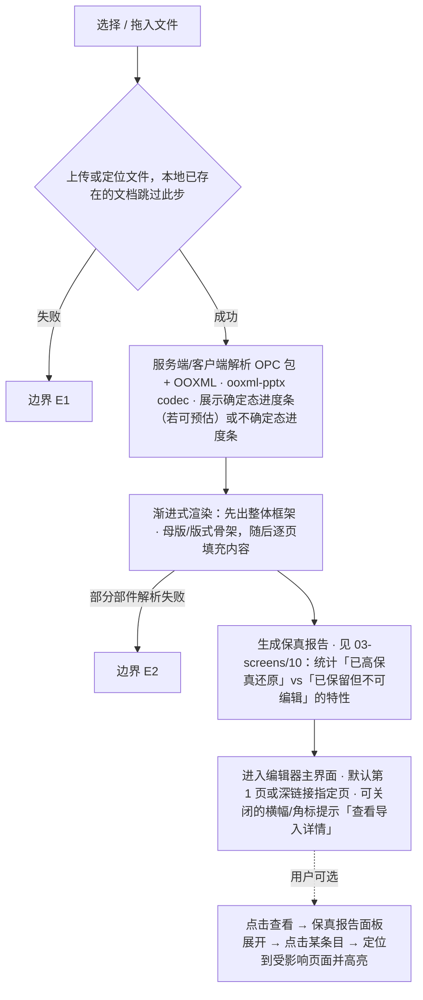

怎么读：实线是主干顺序，带标签的旁支指向下表的边界编号；虚线是用户可选的后续动作。

**边界情况**：

| 编号 | 情况 | 处理 |
|---|---|---|
| E1 | 上传失败（网络/超出大小上限，Q5 默认 200MB） | 内联错误 + "重试"；超出大小上限时明确提示上限值，不重试 |
| E1a | 文档规模超出上限（单文件 > 200 MB、页数 > 200、任一页元素 > 1,000 或文档总元素 > 20,000，部署可调） | 服务端**直接拒绝导入**（`format.quota_exceeded{dimension, limit, actual}`，rulings §4.15 Q5），阻断式错误态说明超出的是哪一项、实际值与上限值（03-screens/13）；不提供"以只读打开"或自动拆分，不重试 |
| E2 | 部分部件解析失败但整体可打开 | 保真报告标红对应条目，受影响页面在缩略图上加警示角标，画布内该页显示"部分内容无法显示"提示条，其余页正常 |
| E2a | 含外链资源 / 受限内嵌字体 / EMF、SmartArt、OLE、chartex 等只保留对象 | 按 03-screens/13"降级占位"与 03-screens/10 保真报告处理：外链图片与音视频默认自动加载（部署 `externalResources` 可收紧为确认 / 禁止）；受限字体只用于只读渲染，编辑态回退字体并提示；EMF M2 栅格化，chartex 占位 + 诊断（rulings §4.15 Q7） |
| E3 | 文件不是合法 pptx / 是不支持的 `.ppt` 二进制格式（章程 §2.3 非目标） | 阻断式错误态（不进入编辑器），明确说明"不支持的文件格式"，不误导为"损坏文件" |
| E4 | 用户仅有评审权限 | 直接以评审模式打开，不经过编辑模式 |
| E4a | 用户仅有查看权限（`viewer`） | 以**只读浏览**打开同一个协同编辑器（查看者变体，`mode='view'`，01-information-architecture §5.1）：进入协同房间、实时看到修改与在场，计入查看者名额；评审工具条去掉「评论 / 高亮」等创建类按钮，只保留跳转与阅读评论，模式下拉只列「只读浏览」与「放映」。不走 `/documents/:id/view` 查看器壳（该路由只留给 M1 查看器与嵌入，rulings §4.18 UX-19） |
| E5 | 文档已被移动到回收站/权限被收回（分享链接失效） | 阻断式错误态，引导返回文档列表或申请访问 |
| E6 | 极大文件（页数多/媒体多，接近 Q5 上限） | 渐进渲染优先当前可见页，缩略图侧栏懒生成，进度提示中说明"首屏渲染完成，其余页面加载中" |

**相关界面**：03-screens/01（文档列表-加载/错误态）、03-screens/02（编辑器-加载态）、03-screens/10（保真报告）。

---

## F2 编辑（文本/形状/图片/表格/页管理/属性/撤销重做）

**触发**：用户在画布或检查器坞对选中对象/页面做出修改。

**主流程（通用命令回路）**：

**F2 通用命令回路**

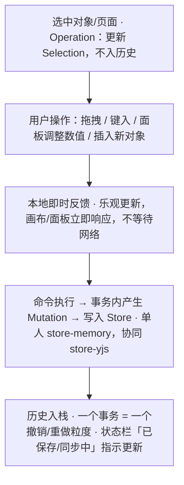

怎么读：自上而下是一次编辑的固定顺序；本地反馈先于命令落盘，所以网络延迟不影响画布响应。协同下撤销的跳过规则见 05-collaboration-ux §6 的撤销决策图。

**分支/边界情况**：

| 情况 | 处理 |
|---|---|
| 评审模式/只读权限下尝试编辑 | 画布不进入编辑态（无选中手柄/插入符），若用户点击文本试图输入，检查器坞自动切到"评论"面板并提示"当前为只读，去评论？" |
| 多选混合属性 | 检查器坞对应字段显示"多个值"占位，用户输入新值即统一应用于全部选中对象 |
| 撤销跨越他人操作（协同场景） | 本地撤销只回退"自己"的操作（按 origin 区分），不影响他人产生的 Mutation；我改过、之后被他人改写的同一属性**跳过**并 Toast"<X> 之后修改了此处，已跳过"；整步都被跳过时本次撤销**停下**、不连带撤销更早一步（rulings §4.15 Q3）；详见 05-collaboration-ux §6 |
| 粘贴外部内容（来自其他 Office 软件/浏览器） | 尽力转换为受支持的形状/文本；无法转换的部分降级为图片或纯文本，操作后以 Toast 说明"部分格式已被简化" |
| 大量对象性能提示 | 单页对象数逼近性能预算（见架构 07/PRD 04）时，状态栏出现弱提示，不阻断操作 |
| 撤销/重做涉及"对象已被他人删除" | 删除是软删除（墓碑，id 稳定）：我对该对象的撤销一律跳过（**不看 TTL**，墓碑 TTL 内也不复活他人删除的对象，rulings §4.17 D4），整步被跳过时提示"无法撤销：此处已被 <X> 删除"，不连带撤销更早一步；要找回对象走 F4 场景 D 的"恢复元素"（清除墓碑、**以原 id 恢复**）。墓碑超过 TTL（默认 24 h）被服务端硬删除后不可恢复。原"视为新建、不复用原 id"写法作废（rulings §4.15 Q3） |

**相关界面**：03-screens/02、03、04、05。

---

## F3 协同加入/离开

**触发**：另一用户打开同一 Unit（加入）；用户关闭标签页/断网/切换文档（离开）。

**主流程**：

**F3 加入**

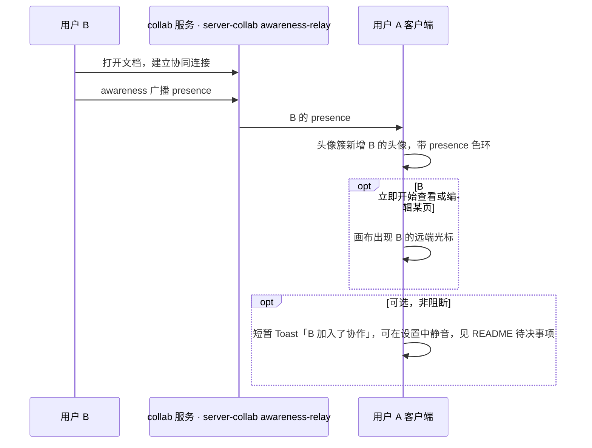

怎么读：纵向是时间顺序，箭头是消息方向；opt 框是按条件出现的步骤，Toast 不阻断任何操作。
依据：本文 F3；presence 经服务端转发见架构 06 §7。

**F3 离开**

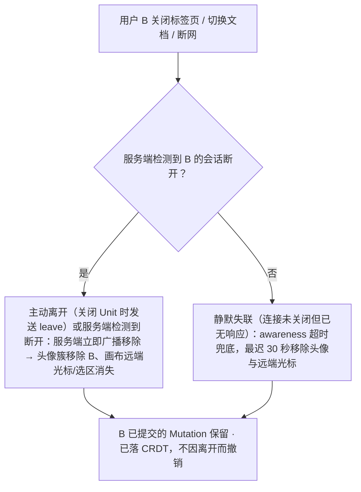

怎么读：自上而下是 A 端看到的离开过程；能检测到断开时立即移除，30 秒只是静默失联时的兜底，两支都不影响 B 已落盘的内容。空闲灰显与离开无关：B 仍在线但 60 秒无活动时头像灰显为「空闲」，有活动即恢复（PRD CO-03）。
依据：架构 06 §7（会话断开即主动广播移除，awareness 超时 30 秒兜底）；PRD CO-03；rulings §4.18 UX-18

**分支/边界情况**：

| 情况 | 处理 |
|---|---|
| 协作者人数超过头像簇可视宽度（超过 5 个，PRD CO-03） | 折叠为 "+N" 头像，点击展开完整列表（含 presence 色、角色） |
| 房间已达编辑者容量上限（≤ 20 编辑者，PRD CO-01） | 新加入者自动以查看者身份加入（`auth.ok{role:'viewer', reason:'capacity'}`，架构 06 §14）并收到提示"编辑者名额已满，你已以只读身份加入"（画布写入与评论创建都收回，原「仍可评论」作废；与查看者角色的「仅查看」仍分开称呼，rulings §4.18 UX-19），对应 05-collaboration-ux.md §7 的 `readonly-degraded`（容量已满分支）。名额按用户计：同一账号的其他标签页/设备不再占名额；评审者计入查看者名额；文档所有者不占编辑者名额、始终可以编辑身份进入（rulings §4.15 Q5） |
| 评审者加入 | 头像环样式与编辑者一致，但 hover 提示角色为"评审者"；不产生画布远端选区（评审者无法选中编辑，仅评论锚点可能出现） |
| 自己的另一个标签页/设备 | 画布上作为独立的远端光标/选区显示（presence 来源于会话），避免"看不到自己另一个窗口在哪"的困惑；头像簇与房间名额按用户合并，同一账号只占 1 个名额（rulings §4.15 Q5，05 §9） |
| 加入时文档正在被大量并发编辑 | 新加入者的首屏渲染以当前 CRDT 状态为准，不需要"追赶"历史事件 |

**相关界面**：03-screens/02（顶部全局栏协作者头像簇、画布远端光标）。

---

## F4 软冲突提示

**背景**：CRDT 保证不存在需要人工合并的"硬冲突"（章程 §4：collab-core 以 CRDT 为单一事实源），但用户体感上仍会遇到"我正在操作的东西被别人动了"的困惑场景，需要明确的软冲突可视化。PRD `03-features/03-collaboration.md` CO-08 用一张表定义了全部收敛结果与提示要求（P0，M3，验收标准要求"以上每一行都有确定性协同模拟用例；提示出现率 100%；提示可关闭且不打断输入"）；下表逐行对应，是本流程的权威口径（取代早期版本的 4 场景简化表）：

| 场景 | 触发 | 收敛结果与表现 | 埋点 |
|---|---|---|---|
| A 同一文本框不同位置并发编辑 | 两人同时在同一文本框的不同位置插入/删除文字 | 两处修改都保留（字符级合并），**无提示** | – |
| B 同一文本框同一位置并发编辑 | 两人光标/插入点位置重合 | 两段插入相邻并存，顺序确定；**编辑中即时提示**（预防性、非事后）："X 也在编辑此文本框"，显示于文本框边缘 | `collab/soft-conflict{type:"text-same-pos"}` |
| C 同一形状被并发移动/变换 | 并发拖拽/缩放/旋转同一对象 | 属性级后写者胜（LWW）；失败方看到对象"跳走" + Toast"X 移动了该形状" + **「恢复我的值」按钮**（新事务，把位置/变换写回我的值、覆盖对方后写，可再撤销；原"撤销"按钮作废，rulings §4.15 Q3） | `collab/soft-conflict{type:"prop-lww"}` |
| D 对象被删除同时其文本被编辑 | A 删除元素，B 同时编辑该元素文本 | 删除胜：元素转为软删除墓碑（id 稳定，不再显示），B 的编辑落在墓碑上、随之隐藏；B 收到 Toast"你编辑的元素已被 X 删除"，提供"恢复元素（含我的编辑）"入口（P1）——新事务，清除墓碑、**以原 id 恢复**，B 的编辑与评论锚点等引用一并复原，不产生重复元素；墓碑超过 TTL（默认 24 h）被硬删除后入口失效（rulings §4.15 Q3） | `collab/soft-conflict{type:"delete-vs-edit"}` |
| E 页被删除同时该页被新增元素 | A 删除页，B 在该页新增元素 | 删除胜（页转为墓碑）；同 D 的提示与"恢复页"入口（原 id、原位置恢复，B 新增的元素随页复原） | `collab/soft-conflict{type:"delete-vs-edit"}` |
| F 并发重排页顺序 | 两人同时拖拽缩略图调整幻灯片顺序 | 有序序列 CRDT（ADR-0020）保证不重复不丢页，顺序确定；**无文字提示**，仅缩略图侧栏用位置变化动效提示 | `collab/soft-conflict{type:"reorder"}` |
| G 组合元素时子元素被并发编辑 | A 组合若干形状，B 同时编辑其中一个子元素 | 组合成功，B 的编辑作用于组合内的子元素，**无提示** | – |
| H 取消组合时并发移动整组 | A 取消组合，B 同时移动这个组合 | 取消组合胜，B 的移动作用于原组合坐标下的子元素（保持视觉位置），**无提示** | – |
| I 并发更换同一页版式 | 两人同时为同一页选择不同版式 | 后写者胜（LWW）；有提示 | `collab/soft-conflict{type:"prop-lww"}` |
| J 解决评论线程同时有新回复 | A 标记线程已解决，B 同时提交回复 | 回复保留，线程状态仍为已解决；评论面板内联提示"已解决线程有新回复"（见 03-screens/06） | – |
| K 并发插入图片产生同名部件 | 两人几乎同时插入图片 | 部件名由客户端 id + 序号生成，不会同名，**无提示** | – |

**通用规则**：软冲突提示优先用画布内联提示、字段级提示或检查器坞局部提示；仅在会导致用户当前操作对象整体消失（场景 D/E）或对象被移动（场景 C）时使用 Toast 作补充，且 Toast 必须可关闭、不打断正在进行的输入；不使用阻断式对话框（软冲突不应打断心流）。上表以外，检查器坞字段级"远端覆盖正在输入的值"场景（用户在属性面板打字时远端提交了新值）由 03-screens/03 单独规定，不属于 CO-08 枚举范围但遵循同样的"内联优先、不阻断"原则：该字段边框短暂高亮闪烁 + 字段旁出现"已更新"小标记；若本地有未提交输入，字段下方给出"应用远端值 / 保留我的输入"的内联选择（不使用浏览器 `confirm()`）。

**F4 软冲突提示通道**

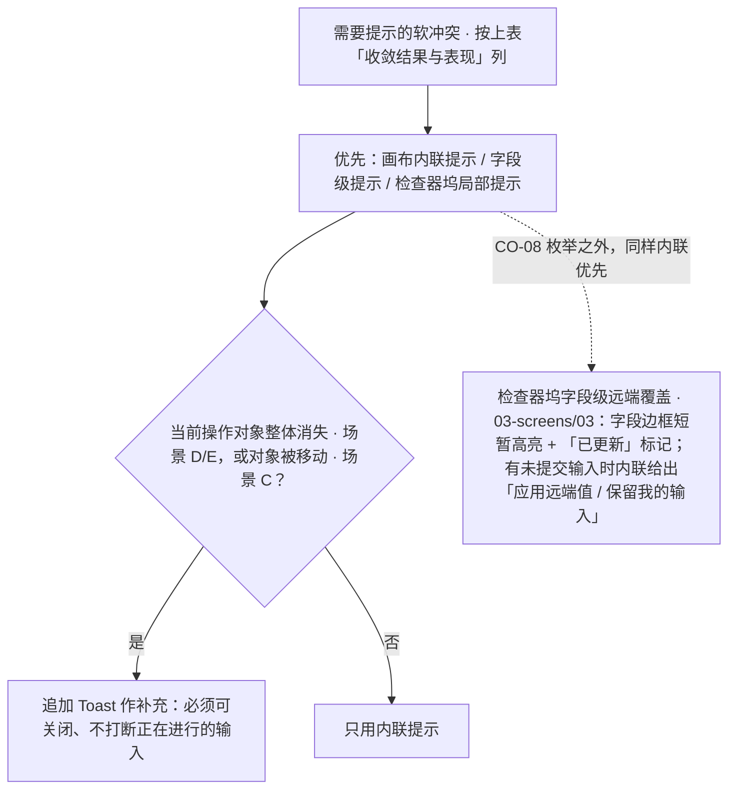

怎么读：先走内联，再按对象是否消失或被移动决定是否追加 Toast；虚线是表外的字段级场景。任何分支都不使用阻断式对话框或浏览器 `confirm()`。

**相关界面**：03-screens/02、03-screens/03；05-collaboration-ux.md §5。

---

## F5 离线与重连

**触发**：浏览器 `offline` 事件 / WebSocket 心跳超时。

**主流程**（状态名与时限口径统一自 PRD CO-01/CO-06 与 05-collaboration-ux.md §7 的六态会话状态机）：

**F5 离线与重连状态流**

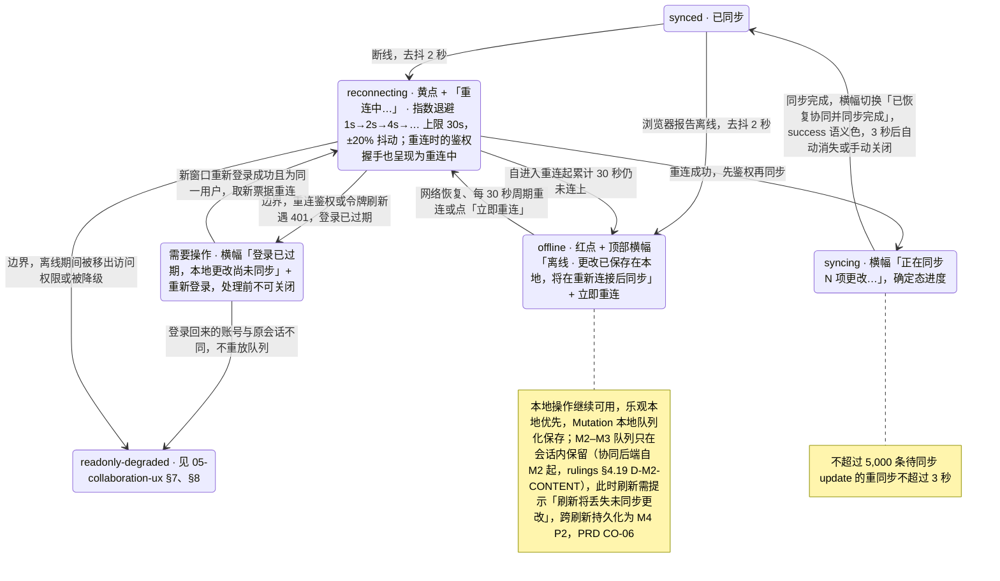

怎么读：主干是 synced → reconnecting →（30 秒未连上）offline →（网络恢复或周期重连）reconnecting → syncing → synced 的一圈；每次重连都先鉴权再同步，所以不会从「重连中」直接回到「已同步」。从 reconnecting 引出的两条是下表的鉴权过期与权限变更边界，都发生在重连鉴权时；登录过期经新窗口重新登录回到重连。状态名与时限口径统一自 PRD CO-01 / CO-06、05-collaboration-ux §7 与架构 06 §5.1（rulings §4.18 UX-01 / UX-02 / UX-03 / CO-03）。

**边界情况**：

| 情况 | 处理 |
|---|---|
| 离线时间过长导致鉴权 token 过期 | 重连鉴权或令牌刷新遇 401（不是网络错误）→ 直接进入需要操作的状态："登录已过期，本地更改尚未同步" +「重新登录」（只有网络错误才走「重连中」）。**重新登录在新窗口完成**（rulings §4.18 UX-02）：弹窗或新标签里走 OIDC，服务端照常设置 httpOnly cookie，回调页经 BroadcastChannel 通知原页（原页重新获得焦点时也探测 `/auth/me`）；原页不跳转、队列保留，拿到新票据后 重连中 → 同步中 → 已恢复；弹窗被拦截时退化为新标签链接。登录回来的账号与原会话不同时不重放队列，按只读处理并提供导出本地副本，防止以他人身份提交更改。本地未同步更改在重新登录前不丢失，该横幅处理前不可关闭 |
| 离线期间被移出文档访问权限 / 权限被降级 | 重连后进入 `readonly-degraded`（见 05-collaboration-ux.md §7/§8）：未同步的本地更改被回滚并明确提示"你的 N 项更改未被保存（权限已变更）"，提供导出本地副本的入口；文档被彻底删除/失去访问则走 03-screens/12 的"访问权限已变更"阻断式提示，提供"了解详情/返回文档列表" |
| 离线操作量很大 | 重同步预算为 ≤5,000 条 update 在 ≤3 秒完成（PRD CO-06）；超出此规模仍继续同步但横幅进度文案如实反映剩余量，不阻止用户继续编辑 |
| 离线超过 24 小时后重连 | 追加提示"较长时间离线，合并后请检查"并列出受影响页（P1，PRD CO-06） |
| 多标签页同时离线又重连 | 各自独立处理，互不阻塞；重连顺序不影响最终一致性（CRDT 保证） |
| 短暂网络抖动（<2 秒） | 去抖：不满 2 秒不展示 `reconnecting`/`offline` 状态变化，避免闪烁疲劳 |
| 单人模式（无协同 Provider） | 不存在离线概念，保存走集成方回调（PRD CO-06），本流程不适用 |

**相关界面**：03-screens/12（离线/冲突横幅）；05-collaboration-ux.md §7。

---

## F6 导出

**触发**：顶部"⋯"菜单 / 命令面板搜索"导出"。

**主流程**：

**F6 导出主流程**

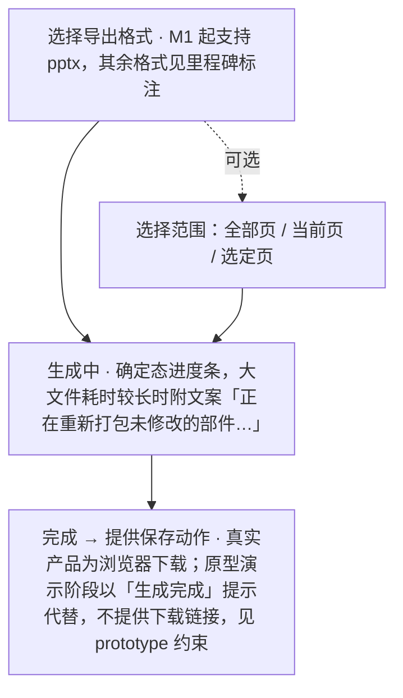

怎么读：虚线进入的「选择范围」是可选步骤，跳过时由选择格式直接进入生成中；其余实线是必经顺序；未同步更改提示、失败重试等分支见下表与 03-screens/22 的状态图。

**边界情况**：

| 情况 | 处理 |
|---|---|
| 存在尚未同步的离线本地更改 | **客户端格式**（pptx / PNG / SVG）：导出前提示"存在 N 项未同步的更改，导出将包含本地最新内容，但可能与其他协作者看到的版本存在差异"，可「仍要导出」或「等待同步」。**服务端格式须先同步**（PDF、M3 起的批量 PNG 取服务端已持久化的版本）：提示"需先同步 N 项更改"，不提供「仍要导出」。点「等待同步」后对话框停在等待态，实时显示"正在同步 N 项…"，归零自动进入生成中，期间可取消；离线或重连中时「等待同步」禁用并提示"恢复连接后才能同步"（03-screens/22，rulings §4.18 UX-05） |
| 导出失败（服务端错误/超时） | 内联错误 + 重试；不影响文档本身 |
| 含不透明保留部件 | 导出说明"未修改部分将原样保留"，与保真报告呼应，避免用户误以为导出会"修复"未建模内容 |

**相关界面**：03-screens/02（导出入口）；对话框沿用 `ui.dialog` 槽位规范（设计 06 §2.8）。

---

## F7 评论

**触发**：选中对象/文本区域后点击"添加评论"；或在评论面板发起页面级评论。

**主流程**：

**F7 评论主流程**

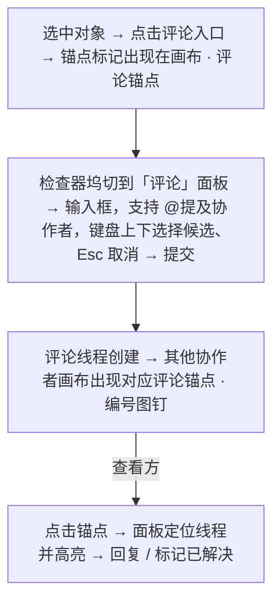

怎么读：前三步在发起方完成，最后一步由查看方触发；锚点对象被删除、离线发表等分支见下表。

**边界情况**：

| 情况 | 处理 |
|---|---|
| 锚点对象被删除 | 线程转为"**已脱离锚点**"（PRD CO-04 术语，取代早期版本使用的"孤立评论"）：不再有画布锚点，面板中该线程标注"原对象已删除"，仍可读/回复/标记已解决；重新锚定到其他对象是 P1 范围。删除为软删除（rulings §4.15 Q3）：墓碑 TTL 内对象被恢复（撤销删除或"恢复元素"，原 id）时，线程自动回到原锚点、标注消失 |
| 评审者/评论者发起评论 | 允许，`commenter` 及以上角色即可创建/回复评论（PRD CO-04）|
| **标记已解决的权限**（此前版本的待决事项，现已由 PRD §1 角色表确认） | `commenter`（评论者）只能解决**自己创建**的线程；`editor`（编辑者）及以上可以解决**任何**线程；`viewer`（查看者）只读，不可评论 |
| 离线时发表评论 | 与其他编辑操作一致：本地乐观创建，离线横幅统一提示将在重新连接后同步（见 F5） |
| 评论过多 | 面板列表虚拟滚动；顶部提供"全部 / 当前页 / 未解决 / @我"筛选（PRD CO-04，取代早期版本的"全部/待处理/已解决"）与排序 |
| 长评论 | 默认折叠 3 行 + "展开"；单条评论 ≤ 5,000 字符（PRD CO-04） |
| 通知 | SDK 本身不发送邮件/推送通知；评论事件（新增/@提及/已解决）通过事件回调交给集成方处理（PRD CO-04 EM-05），编辑器内的画布锚点/角标/Toast 提示不受此影响 |
| 导入含旧版评论的 pptx | 以只读方式显示导入的评论（作者名取自 `commentAuthors`），可选择"导入为可编辑线程"（P1） |

**相关界面**：03-screens/06（评论面板）。

---

## F8 版本历史

**触发**：顶部"⋯"菜单 / 命令面板搜索"版本历史"。

**主流程**：

**F8 版本历史主流程**

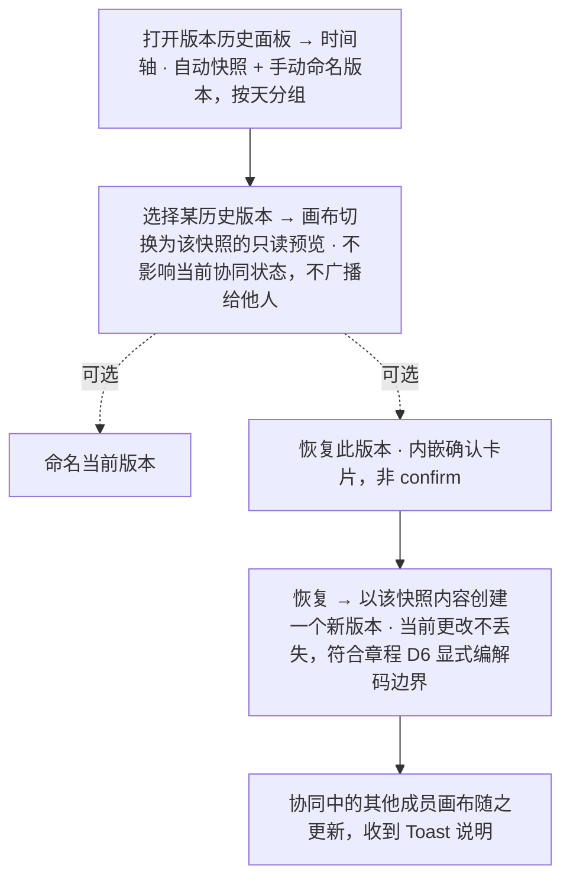

怎么读：浏览与预览只影响本地视图；虚线是两个可选动作，只有「恢复」会产生新版本并影响协作者。权限位（`history.read` / `history.restore`）的分流见 03-screens/07 的权限图。

**边界情况**：

| 情况 | 处理 |
|---|---|
| 权限口径 | 查看历史需要 `history.read`，恢复需要 `history.restore`（PRD CO-07，两个独立能力位）；无 `history.read` 时面板入口本身不出现，而不是出现后再报错 |
| 编辑者查看（有 `history.read`，无 `history.restore` / `doc.manage`） | 可浏览与预览；「恢复此版本」「命名当前版本」禁用并 tooltip「需要所有者权限」（恢复需 `history.restore`、命名需 `doc.manage`，两者只属于所有者） |
| 评审者 / 查看者 | 没有 `history.read`，历史入口不出现（rulings U-09：`history.read` 只下放到编辑者；rulings §4.18 UX-17） |
| 离线 | 版本历史依赖服务端快照，离线时面板整体置灰 + 提示"离线时无法加载版本历史" |
| 大文档快照加载慢 | 预览区骨架屏，时间轴列表可先行可用 |
| 快照数量很多 | 按月折叠、分页加载；自动版本按策略生成（PRD CO-07：每 10 分钟且有变更，或每 500 个 update；保留 30 天——章程 Q17 已裁决，rulings §4.16，默认值且部署配置可调），命名版本用户手动创建、永久保留（受配额） |
| 恢复时他人正在编辑 | 恢复前提示"其他协作者正在编辑，恢复后他们的画布将自动更新为新内容"，不阻止操作（符合软冲突而非硬阻断的整体哲学） |
| 旧 `schemaVersion` 的历史版本 | 预览前经 `migrations` 透明迁移，用户无感知（章程 D6，PRD CO-07） |

**相关界面**：03-screens/07（版本历史）。

---

## F9 插件启用/禁用/失败

**触发**：顶部"⋯"菜单/命令面板打开插件管理器；或系统检测到某插件 Fiber 进入 `FAILED`。

**主流程**：

**F9 插件启用 / 禁用 / 失败**

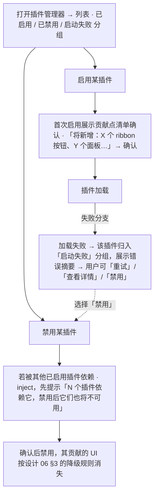

怎么读：从管理器列表出发有启用与禁用两条路径；启用路径的失败分支落到「启动失败」分组，其中的「禁用」操作接入禁用路径。插件状态的完整迁移见 03-screens/09 的生命周期状态图。

**边界情况**：

| 情况 | 处理 |
|---|---|
| 内置插件（如幻灯片核心插件束） | 不可禁用，或需要更强的二次确认与说明（会导致文档无法编辑），默认设计为不可在插件管理器中禁用 |
| 第三方插件 | 首次启用强制展示能力范围说明，呼应章程"同源可信、非沙箱"模型 |
| 插件失败但不影响核心编辑 | 不打断用户当前操作，仅状态栏插件图标变为警示态，用户可自行选择何时处理 |
| 一个插件同时贡献多种槽位且部分成功部分失败 | 极端情况，按当前实现口径视为整体 Fiber 状态（`FAILED` 即全部贡献撤销），不做部分成功的中间态，避免状态解释复杂化（如未来需要更细粒度，需架构评估） |

**相关界面**：03-screens/09（插件管理器）。

---

## F10 母版视图与版式/主题管理（本轮新增）

**背景**：用户反馈"左侧栏与编辑器都没有考虑幻灯片母版"，本轮补齐。母版视图是编辑模式内的第二种视图模式（与评审/放映模式并列的"三种模式"是另一维度，二者正交，见 01-information-architecture.md §2.4 / §5a），且是**同一个编辑器**（Ribbon 最左插入「母版」页签、隐藏「设计」，其余页签照常；左侧栏为母版缩略图窗格；检查器仅禁用评论；09 T-02），因此单列 F10 而不并入 F2——F2 描述的是"编辑一页内容"的通用命令回路，F10 描述的是"编辑影响一批页面的母版/版式定义"这一有质变差异的流程（一次操作的影响范围从"一页"变为"N 页"）。

**触发**：Ribbon 页签行右侧常驻的「普通｜母版」视图模式分段切到「母版」（主入口，rulings Q8）；或 Ribbon「视图」页签「母版视图」按钮（03-screens/20）；或快捷键 `Mod+Alt+M`（rulings Q9；原 `Mod+Shift+M` 作废）；或命令面板搜索"母版视图"。

**前置条件**：处于编辑模式（有 `doc.write`）且视口 ≥ 1024（rulings Q12：评审 / 放映 / 窄屏不提供入口，见下）；文档已完成首屏渲染（母版/版式数据随 F1 主流程"解析母版/版式/主题"阶段先于首屏可用，见 F1 主流程与 03-screens/26"状态·加载中 / 加载失败"）。

**主流程（编辑一个占位符文本样式为例）**：

**F10 母版视图主流程：编辑一个占位符文本样式**

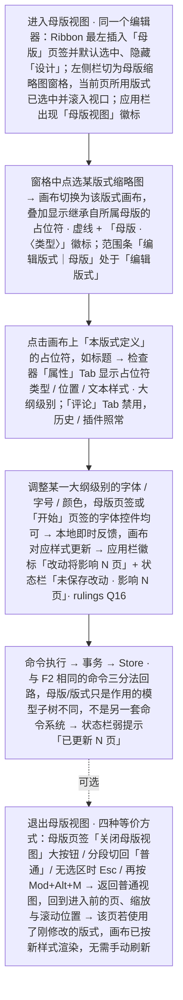

怎么读：自上而下是一次母版编辑的完整路径，与 F2 共用同一条命令回路；虚线表示退出是可选步骤，退出不丢弃已落盘的改动。

**分支/边界情况**：

| 情况 | 处理 |
|---|---|
| 评审模式 / 无编辑权限（`viewer`/`commenter`）/ 视口 < 1024 | **不提供入口**（rulings Q12）：评审模式下 Ribbon 由评审工具条取代，「视图」页签**不存在**，视图分段不显示，`Mod+Alt+M` 无效，命令面板「母版视图」禁用并注明"评审模式下不可用"；编辑模式但已被降权（`readonly-degraded`，Ribbon 仍在）时「视图」页签「母版视图」按钮禁用、tooltip「需要编辑权限」；窄屏时按钮禁用、tooltip「需要 ≥ 1024 宽度」。已在母版视图中：**手动切到评审即退出母版视图**，回到进入前的页、缩放与滚动位置；**被降权时原地只读**——窗格与画布可浏览、可切换范围、占位符属性只读展示，Ribbon「母版」页签编辑类分组整体禁用（tooltip「需要编辑权限」），不产生「改动将影响 N 页」提示，四种退出方式照常；缩窄窗口不强制退出（03-screens/26 §6，rulings §4.18 UX-11 / UX-20） |
| 编辑权限但里程碑未达 `ML-03`（M3 前） | 浏览（`ML-01`）与版式应用/重置（`ML-02`，属于 F2 的一部分，非本流程）可用；M2 内占位符可选中（属性面板显示类型、索引、继承说明）但不可编辑，拖动手柄显示锁形并 tooltip「版式编辑将在后续版本提供」（PRD ML-01）；母版页签的占位符 / 主题编辑控件禁用，tooltip 区分"需要编辑权限" vs "当前版本暂未开放" |
| 切换编辑范围（版式 ⇄ 母版） | 不重新加载文档，画布与检查器坞随之切换渲染目标；未保存的当前范围改动不丢失（各范围的改动相互独立，互不覆盖） |
| 删除版式 / 母版 | **引用数 ≥ 1**（rulings Q11）：`AlertDialog`「该版式仍被 N 个页面使用，删除后这些页面将改用「与当前页相同」的默认版式，操作不可撤销」[删除][取消]；确认后受影响页改用同一母版的默认版式，占位符按类型/索引重新匹配（与更换版式同一规则，03-screens/27），无法匹配的元素保留为普通形状并按 rulings Q13 统一文案 toast「N 个元素无法匹配新版式的占位符，已保留为普通形状」（本场景不可撤销，故不带 [撤销]；ML-02 普通换版式时带 [撤销]）；整体不可撤销——这是本流程中唯一使用确认对话框而非可撤销 toast 的操作，因为影响范围是"批量页面"而非单一对象。**引用数 = 0**：直接删除 + 可撤销 toast。版式多选批量删除按集合合并判定（03-screens/26 §8）；删除仅剩的母版禁用 |
| 并发编辑同一母版/版式（协同场景） | 属性级后写者胜，沿用 05-collaboration-ux.md §5 场景 C 的既有规则；"多页同时受影响"的软冲突提示是否需要区别于单页编辑的呈现，标记为需协同/产品条线下一轮确认的待办（见 03-screens/26 边界情况），不阻塞本轮 |
| 关闭母版视图时存在未保存改动 | 不阻断关闭（改动已按本地乐观优先落盘为事务，退出视图不等于丢弃更改，与 F2 通用回路一致，不特殊化出"离开确认"） |
| 主题编辑（`ML-04`，M3 P1） | 通过 Ribbon"母版"页签"编辑主题…"或普通视图 Ribbon"设计"页签进入，完整规格见 03-screens/28，是本流程在"批量影响范围"这一维度上的延伸（主题的影响范围是"整份文档"，比单个母版的"N 页"更大一层），流程结构相同（选择 → 调整 → 批量生效提示），不重复画一遍时序图 |

**相关界面**：03-screens/26（母版视图与母版/版式编辑）、03-screens/27（版式选择器分组与重置）、03-screens/28（设计页签与主题）、03-screens/03 补充 G-19（占位符属性分区）、03-screens/20（视图页签入口）、03-screens/24（快捷键 `Mod+Alt+M`）。

---

## 流程总览图（状态机简化视角）

**流程总览（状态机简化视角）**

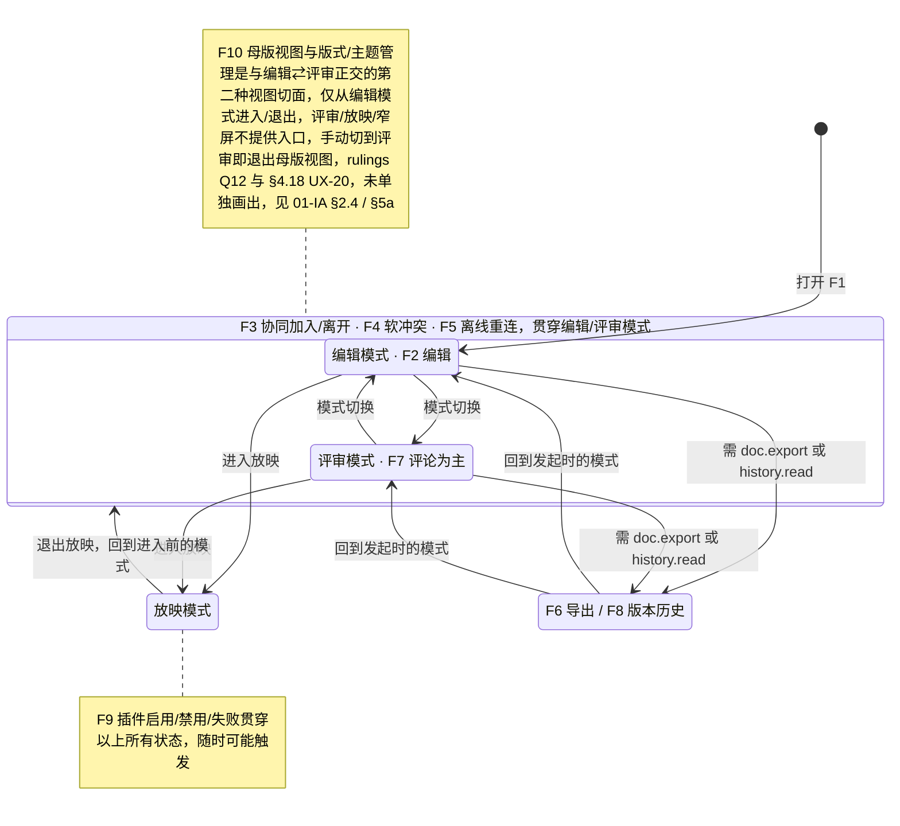

怎么读：外框内是 F3/F4/F5 贯穿的编辑与评审两种模式；进入放映可从任一模式出发，退出回到进入前的模式（01-IA §5.2）；F6/F8 可从编辑或评审模式发起（按能力位：导出需 `doc.export`，版本历史需 `history.read`，评审模式应用栏同样有「⋯」、检查器有「历史」Tab，见 03-screens/02），完成后回到发起时的模式；两条注释说明 F9 与 F10 不在主状态流上。（rulings §4.18 UX-09）

---

## F-P 原型 v2 流程映射（2026-09-15，来源 `10-prd/07-design-coverage-and-gaps.md` §3）

产品条线在覆盖矩阵中定义了原型 v2 必须演示的 15 条流程（`F-P01`–`F-P15`），与本文件的 F1–F10 不是一一对应关系——F-P 是"原型要演示到什么程度"的验收清单，F1–F10 是"设计上定义了哪些完整流程"，两者从不同维度切分同一批用户行为。下表给出映射，供实施原型 v2 时确认覆盖范围与演示方式（"可点击"须走通，"静态"仅需一帧可切换查看，见 07 §3 原表）。

| F-P | 对应本文件流程 | 涉及界面（03-screens） | 演示方式 |
|---|---|---|---|
| F-P01 打开文档（成功+失败变体+保真报告） | F1 | 01、02、10、13 | 成功流程可点击；失败变体静态帧 ×3 |
| F-P02 幻灯片管理 | F2（页管理子集） | 02、05、14 | 可点击 |
| F-P03 插入形状、变换、填充线条、撤销重做 | F2 | 02、03、04、15 | 可点击 |
| F-P04 文本编辑、格式化与查找替换 | F2 | 02、16、21 | 可点击 |
| F-P05 插入图片与裁剪 | F2 | 04、18 | 上传态静态；裁剪与替代文本可点击 |
| F-P06 多选、对齐分布、吸附与网格 | F2 | 02、17、20 | 框选与对齐可点击；参考线静态帧 |
| F-P07 导出 | F6 | 22 | 可点击 |
| F-P08 评论闭环 | F7 | 06 | 可点击 |
| F-P09 协同在场与软冲突 | F3、F4 | 02、05-collaboration-ux.md | 加入/跟随/"+N"可点击；软冲突（P0 高频 3–4 种，见 05-collaboration-ux.md §5）用原型控制条触发，其余按静态帧处理 |
| F-P10 离线、重连、降权与修复 | F5 | 12 | 可点击（控制条） |
| F-P11 版本历史 | F8 | 07 | 可点击 |
| F-P12 分享与权限即时反馈 | F3、05-collaboration-ux.md §8 | 08、12 | 分享可点击；目标端两帧静态 |
| F-P13 放映 | 03-screens/11 | 11 | 可点击 |
| F-P14 系统面板：插件管理器/设置/快捷键 | F9 | 09、23、24 | 可点击 |
| F-P15 只读查看器 preset | 01-information-architecture.md §8 | 25 | 翻页/缩放/ⓘ/搜索可点击；加载/失败静态 |
| F-P16 母版视图与版式/主题管理（`ML-01`–`04`；2026-09-18 措辞同步） | F10 | 26、27、28 | 进入母版视图（Ribbon 页签行分段 / 视图页签「母版视图」/ `Mod+Alt+M`）→ 母版缩略图窗格选择母版与版式 → 画布继承叠加 → 占位符选中 → 检查器属性 → 母版页签「关闭母版视图」（或分段 / Esc / 快捷键）退出，为可点击闭环（playground 路由 `#/editor/masters`）；分支：删除被引用版式 → 确认对话框 → 自动改用默认版式（rulings Q11）。版式画廊与重置（27，`#/editor/layouts`）、设计页签与主题（28，`#/editor/design`）已在 playground 可点击 |

F-P09 的软冲突范围按总编排裁决执行（本轮 08 §6 Q1 的裁决结果）：v2 只把 P0 高频的 3–4 种（建议：场景 B 同位置编辑内联提示、场景 C 形状并发移动 Toast+「恢复我的值」（2026-09-24 按 rulings §4.15 Q3 由"撤销"改名）、场景 D 删除 vs 编辑 Toast+恢复）做成可点击，其余场景（含 CO-08 新增 4 行，见 `05-collaboration-ux.md` §5 补充）按静态帧处理，不在原型中逐一可点击验证。
