> 状态：草稿 | 负责：设计 | 更新：2026-09-18；2026-09-24（rulings §4.15）；2026-09-24（rulings §4.16 Q17：自动版本策略标已裁决）；2026-09-24（复核修正，rulings §4.17）；2026-09-25（补图）；2026-09-25（矛盾收口，rulings §4.18）；2026-09-25（§4.19）；2026-09-26（§4.20：FE-05、FE-23 删除被引用版式 / 母版改为确认后可撤销并补删母版文案）；2026-09-26（§4.21 整合：F3 加入图的服务端参与者改为 Hocuspocus 原生中继加 beforeHandleAwareness（ADR-0024 修订））；2026-09-30（§4.21 剩余缺口样张回写：F2「相关界面」补 03-screens/30 表格编辑、31 图表编辑与 16 的占位符图标条、日期字段）；2026-10-04（design-language-v3 第 0 批：经由 Ribbon、应用栏与状态栏的流程改写为 v3 入口（rulings §4.25 DS-1…DS-6）——F2 触发与「同步状态」改到底部工具条 / 检查器 / 文件名旁，F6 导出、F9 插件改从主菜单，F8 版本历史改从文档菜单，F7 评论增加工具条「评论」工具，F9 插件失败改为按需横幅，F10 母版视图入口改为主菜单「视图」、`Mod+Alt+M` 与命令面板，推不出的写「随 design-language-v3 第 N 批定稿」；「检查器坞」统一改称「检查器」；F-P 表注明演示路径为 ribbon 版旧稿）；2026-10-04（design-language-v3 第 0 批：术语残留清理：ribbon / 状态栏 / `ui.ribbon` / `ui.statusBar` 的历史陈述改用 check-terms 认可的标记措辞（废弃、取代、作废））；2026-10-04（design-language-v3 第 0 批：复验修正——F2 边界「评审 / 只读下尝试编辑」不再自动切到「评论」页签，改为就地提示，与 01 §2.3「唯一自动切换是点评论钉」一致）；2026-10-04（design-language-v3 第 0 批：复验第 2 轮修正——F8 母版视图的触发入口删去「样张未画」，改为主菜单「视图」中已起草的「母版视图 ⌥⌘M」项（待第 1 批拍板））；2026-10-05（design-language-v3 第 0 批修正：按 rulings §4.25 写入外壳类裁决——F2 触发注明文字格式只在检查器、不设画布文字迷你工具条（DS-13）；F2「评审模式/只读权限下尝试编辑」与 F10 降权原地只读改为检查器只读展示当前值、不显示禁用控件（DS-15）；F9 触发改为主菜单「插件…」（DS-18））；2026-10-07（design-language-v3 第 1 批：按已拍板样张与 rulings §4.25 DS-21…DS-30、TB 技术口径把「随第 1 批补齐 / 定稿」「第 1 批起草、待拍板」改为定稿——F1 E4a 查看者的浏览条与主菜单（DS-23、TB-1）；F2 性能弱提示的位置（03-screens/02 §6.2）、撤销被跳过的恢复按钮（TB-26）；F5 状态图的重连与离线指示按同步状态行（03-screens/02 §3.1）；F6 导出入口主菜单「文件 › 导出…」；F7 补手机上发表与回复评论（DS-28）；F9「插件…」的位置；F10 背景、触发、主流程四个节点与边界：不设常驻入口、画布顶部横幅（含「关闭母版视图」）、范围条「版式｜母版」、检查器分区、缩到 < 640 退出（DS-21、TB-14、TB-16）；流程总览注释同步；F-P 表注明第 1 批 v3 演示入口，F-P16 改为 v3 场景路由，「设计页签与主题」改称「设计主题」）；2026-10-08（design-language-v3 第 1 批收口：按 rulings §4.25 DS-32、DS-33、TB-44、TB-49——F7 手机评论补平板仍为只读评审（TB-49）；F10 前置条件与边界改为非完整形态不可进入、原因写「在更大窗口中编辑」（TB-44），主题编辑一行补内置 5 套主题与每套 3 个变体（DS-33、DS-32））；2026-10-15（design-language-v3 第 2 批：按已拍板的第 2 批样张与 rulings §4.25 DS-38…DS-63 改写——F1 打开后的保真提示改为一次中性轻提示与页级提示条、缩略图角标按最严重的级别着色、报告为检查器整栏面板，主流程图同步（DS-38、DS-51），E5 的「申请访问」接留言弹层（DS-48）；F3 编辑者名额已满的横幅与按钮、查看人数已满的阻断页（DS-58、DS-60）；F4 场景 B、C、I、J 的呈现按样张（DS-60）；F5 状态图与边界：「已恢复」的画法与长时间离线、处理前不可关闭的横幅、登录已过期与协同已暂停时写命令被拒、访问被撤销改为阻断页、文档已被删除、更改过大、服务器保存延迟、应用内离开与刷新拦截（DS-41、DS-50、DS-58、DS-59、DS-61）；F6 从横幅导出本地副本（DS-58）；F7 整篇改写：评论工具与浮动撰写框、页级评论、键盘、筛选与列表、删除权限、手机与平板、加载（DS-40、DS-43…DS-46、DS-53）；F8 整篇改写：整栏面板、预览换左栏与画布、恢复确认卡、收组与命名、最近删除、离线与加载（DS-38、DS-39、DS-40、DS-53、DS-57）；F9 按个人插件面板与插件横幅规则改写，个人启停与管理员启用分开（rulings §4.23；DS-38、DS-41、DS-49、DS-52、DS-54…DS-56）；新增 F11 分享与访问申请（DS-40、DS-47、DS-48、DS-50）；流程总览图与 F-P 表补第 2 批；同日再补，按回写中的裁决 rulings §4.25 DS-65…DS-68 与技术口径 TB-60、TB-62…TB-65、TB-68、TB-71、TB-73、TB-74——F5 状态图离线注释改为应用内离开与刷新先尝试同步、仍有未同步项时弹应用内确认框，浏览器刷新与关闭标签页只能用原生提示（DS-59，原「刷新需提示」写法作废）；F7 触发的键盘等价按 TB-62（↵ 只在评论工具开着或焦点在工具条「评论」上时落钉），边界表新增「撰写中换页」（草稿按页留在内存，DS-65），手机与平板一行改指 03-06 §9.5、§9.6；F8 打开节点改为沿用检查器宽度（TB-60），权限口径补面板开着时被降权（TB-63），命名说明不超过 200 字（TB-64），空态按 TB-74 区分用户可见的建文档路径与 API 直接建的空文档；F11 主流程图补访问申请的 Webhook 通知，边界表补链接到期（DS-66）、申请被拒不告知申请人（DS-68）、非所有者看到的链接与复制（TB-65）、复制链接的令牌（TB-71）、所有者端圆点的数据来源（TB-68）、回收站里的文档照常收申请（TB-73），申请人一行的通知改为 M3 Webhook 事件（DS-67）；同日再补，按回写中的裁决 rulings §4.25 DS-69、DS-70 与技术口径 TB-79、TB-84、TB-86——F7 边界表「撰写中换页」一行扩为换页、进网格视图或切到评审模式（TB-84），补恢复的撰写框不抢焦点、评论工具按不按下不因恢复而改变、收起时焦点先交给画布（TB-79）；F8 空态一行补最早那一条按文档来源写（DS-70）；F11 背景补 DS-69，边界表「非所有者点『分享』」改为复制到的与所有者相同（链接授予角色时是分享链接、仅邀请时是文档地址），令牌随成员列表给出、不含有效期与链接 id，分享链接接口仍只给所有者（DS-69、TB-86），原「非所有者复制的是文档地址」作废，「复制链接」一行同步；同日再补，按回写中的技术口径 rulings §4.25 TB-87、TB-88、TB-90、TB-92——F7 边界表「撰写中换页、进网格视图或切到评审模式」一行补草稿按页存、不按模式存，切到评审模式或从评审返回编辑后仍停在同一页的单页画布时撰写框当场原样恢复（TB-87）；新增「有恢复的撰写框时又发起新评论」一行：工具条「评论」上按 ↵、有选中对象时按 C、右键「添加评论」、开着评论工具点画布别处都不另开撰写框，焦点直接进恢复的那个、光标在末尾，临时钉脉冲一次（TB-88）；新增「草稿留着期间锚点不在了」一行：对象已删恢复为同一页的页级锚点（框顶「评论 · 整页」）、文本范围解析不到退为元素锚点、整页已删草稿随页丢弃且不提示（TB-92）；F8 空态一行补源文档未命名的副本写「创建自『未命名演示文稿』的副本」（TB-90）；同日再补：F11 边界表「复制链接」一行补令牌取不到时「复制链接」留在原位不可用、提示「暂时无法取得分享链接，请稍后重试」，所有者与非所有者同一处理、不复制文档地址（rulings §4.25 TB-91））；2026-10-22（design-language-v3 第 3 批：按已拍板的第 3 批样张与 rulings §4.25 DS-71…DS-136、TB-101…TB-129 回写——F1 触发改为开始页、模板库、文档列表与搜索的入口，「导入 .pptx」先进导入页、拖入落区照常（DS-80、DS-87、DS-93、DS-98、TB-108），主流程图按导入过渡页（DS-97）与协同快照打开（DS-99）改写，边界新增 E0 未登录（DS-118…DS-120、TB-122）与 E1b 取消（TB-129），E1 / E1a / E3 改为过渡页原位的失败页（DS-97），E5 按三类人拆成没有权限、回收站里的文档、找不到该文档与链接已失效四行（DS-71、DS-85、DS-122、TB-73）；F3 协作者加入的提示按设置开关（DS-114）、同一账号的多个窗口（TB-124、DS-132）、第 13 位起的序号角标（DS-132），新增跟随一行（DS-106、TB-113）；F5 新增发现新版本、换纪元、元素上限与退出登录确认四行（DS-126…DS-128、TB-122）；F6 触发补 ⇧⌘E 与没有编辑权限时不可用（DS-78、DS-105），主流程图按只有「取消」一个出口与关闭加轻提示改写（DS-100、DS-101），边界补取消、PNG 范围、pptx 整份、隐藏页、JPEG 与打印（DS-101…DS-104），「已导出本地副本」的第二句按原因换（DS-129）；F7 平板评论面板按方向落位与嵌入里的一句（DS-131、DS-112、TB-125）；F8 评审者与查看者没有文档菜单（DS-82）；F10 紧凑抽屉从母版横幅下沿开始（DS-130）；F11 触发补开始页与文档列表卡片的「分享…」（TB-109），边界补凭链接打开时尚未登录与链接已失效（DS-119、DS-71）；流程总览补退出放映停在最后显示的页（DS-109）；F-P 表补第 3 批的 v3 演示入口）；2026-10-22（同日再补，按回写中的裁决 rulings §4.25 DS-137 与技术口径 TB-133、TB-136、TB-138、TB-139、TB-141、TB-146…TB-148、TB-151——F1 主流程注释与 E1b：导入页与过渡页同在 `/import`，「取消」回到打开导入页之前的那一页（TB-133）；E0 补登录失败不说「你还没有账号」（DS-119）；E1 上限值读运行时配置（TB-147）；E2 页级占位在渲染层画（TB-151）；E5a 保留天数读部署配置（TB-141）；F5 元素上限横幅的两个数随协同握手给出（TB-146）；F6 PNG 的页数上限按图片宽度分档（TB-148），「导出本地副本」的说明第二句与「已导出本地副本」的正文按 03-12 §7.2 的表、没点名的原因用中性句（TB-139）；F8 降权时文档菜单「版本历史」不可用（TB-138）；F10 触控设备上的原因写「在电脑上编辑」（TB-136）；F11 分享在 M3 开放，M2 的「分享」与卡片「分享…」留在原位不可用（DS-137））；2026-10-22（同日再补，按回写中的技术口径 rulings §4.25 TB-152、TB-153、TB-155…TB-157、TB-159、TB-161——F1 触发的窄屏一句按宽度与触控分两句提示（TB-153）；E2 页级占位照常进服务端缩略图与导出（TB-157）；E5 与 F5「离线期间被移出」一行：M2 的「申请访问」留在原位不可用（TB-156）；E5a「恢复」失败在阻断页上是内联错误、在回收站卡片上是轻提示 +「重试」（TB-155）；F6 PNG 一行补 SVG 只受页数天花板（TB-152），「导出失败」一行补运行时单页渲染出错时导出作业失败（TB-157）；F7 手机 / 平板一行与 F10 边界：嵌入又是触控设备时以「在电脑上编辑」为准（TB-159）；F11 前置条件补「分享」按钮 M2 的工具提示与不渲染的条件（TB-161）、阻断页「申请访问」M3 起（TB-156）；2026-10-22 复核修正：F1 触发里开始页的路由由 playground 旧路由 `#/home` 改为产品路由 `/home`，并补手机与平板直接打开 `/import` 照常显示（TB-167）；E5 与 F11 前置条件补阻断页说明句不变（TB-156）；F10 边界写明「触控设备」只指平板（TB-163）；F6「导出失败」一行补浏览器生成的图片导出遇运行时渲染出错同样失败（TB-166）；F8 权限口径补「创建副本」的用户裁决 DS-139；F6「导出失败」一行补页面渲染出错时服务端与浏览器同一句原因（TB-173）；F6「导出失败」一行补服务端作业因单页超时失败时的原因句（TB-175），并写明 `render.page_failed` 按 50/15 §4.2 面向用户、带语言包键（TB-173）；F6「导出失败」一行把「其余原因按错误码」改为其余失败显示通用文案 `errors.generic`、不另写「服务暂时不可用」一类的原因句（TB-176））；2026-10-23（design-language-v3 第 3 批评审修改：按 rulings §4.25 DS-140、TB-179…TB-181 回写——F1 触发改为「导入 .pptx」在原页上打开「导入」对话框、主区拖入落区松开打开它的上传态（DS-140 取代 DS-97、DS-98，TB-180），手机与平板直接打开 `/import` 按 TB-181 改写（修订 TB-167）；主流程图的选文件、上传、失败与解析四个节点与注释改为对话框原位切换、取消即关闭、`/import` 叠在来路之上（TB-179，修订 TB-129、TB-133）；E1、E1a、E1b、E3 改为对话框里的失败态与关闭，失败后底栏只有「关闭」、「重试」在正文里；「相关界面」与 F-P01 的 v3 状态按新的状态 id 改写）；2026-11-04（design-language-v3 母版视图改版：F10 触发补检查器「编辑版式」「转到版式」两个上下文入口（DS-174 的裁决日写 2026-11-04），F-P16 的演示路径同步；主流程图的进入、点选版式、编辑与退出四个节点改为上下文条、占位符虚线 + 类型名与继承点线、「占位符 ▾」第 2 位与级别同步；分支表：不可进入一行改为不切换并给轻提示、补版本历史开着与文档打开中，降权与紧凑抽屉去掉「可切换范围」、母版横幅改为上下文条，M2 一行改锁签落位并补 M2 一组画面，「切换编辑范围」一行换成「从版式改它的母版」，新增「查看用这个版式的页」，删除一行的对话框文案与按钮次序改指 03-26 §8，并发一行改为不另设母版专属的冲突提示；相关界面补 03-24 的母版视图三键与 03-27 §4.3；rulings §4.25 DS-32、DS-145…DS-148、DS-150、DS-152、DS-156、DS-162…DS-164、DS-174、TB-190、TB-205；需求编号、优先级与里程碑不变） | 依赖：charter v0.1（已核对 v0.2）；PRD `08-app-shell.md`（AS-01）、`07-masters-layouts-and-themes.md`（ML-01–ML-03）、`03-collaboration.md`（CO-07）；rulings §4.8 Q8 / §4.9 Q9 / §4.10 Q11–Q13、Q16 / §4.20 FE-05、FE-23 / §4.23 / §4.25 DS-1…DS-6、DS-13、DS-15、DS-18、DS-21…DS-33、DS-38…DS-70、TB-1、TB-14、TB-16、TB-26、TB-44、TB-49、TB-60、TB-62…TB-65、TB-68、TB-71、TB-73、TB-74、TB-79、TB-84、TB-86…TB-88、TB-90…TB-92、DS-71…DS-137、DS-139、DS-140、TB-101…TB-163、TB-166、TB-167、TB-173、TB-175、TB-176、TB-179…TB-181、DS-145…DS-148、DS-150、DS-152、DS-156、DS-162…DS-164、DS-174、TB-190、TB-205；03-screens/01、02、06–13、22、26、29、33
> **2026-09-24 修订说明（rulings §4.15）**：角色术语去掉"访客 / 匿名"（分享链接始终要求登录，S-1 / Q6）；F1 边界补"超出规模上限直接拒绝导入"（Q5）与外链资源 / 受限字体口径（Q7）；F2、F4 撤销语义按 Q3 改写（跳过他人后写并提示、整步被跳过即停、「恢复我的值」、软删除墓碑以原 id 恢复，原"不强行复用原 id"作废）；F3 名额按用户计、所有者保席（Q5）。
> **2026-09-18 修订说明**：F1 触发补开始页入口（新建 / 最近 / 模板 → 编辑器）；F10 触发 / 前置 / 主流程 / 边界按"同一个编辑器 + 母版缩略图窗格 + Ribbon 分段主入口 + `Mod+Alt+M`"与 rulings Q11–Q13、Q16 回写，F-P16 同步；F8 自动版本策略改为 PRD CO-07 口径。其中「Ribbon 分段主入口」已被 2026-10-04 的 v3 结构取代（rulings §4.25 DS-1）。

# 02 关键用户流程（User Flows）

流程编号 F1–F11（F10 母版视图与版式编辑于 2026-09-15 增补，F11 分享与访问申请于 2026-10-15 随 design-language-v3 第 2 批增补）。每个流程给出触发/前置条件、主流程、分支与边界情况、相关界面。命令/服务命名不在本流程文档中定稿（属于架构 05/06 职责），涉及处用自然语言描述用户意图，必要时给出示意性 id 并标注"示意，非最终命名"。

角色术语沿用章程与本文件 README「术语补充」：编辑者（可编辑权限）、评审者（只读+评论权限）、查看者（只读）。**没有访客/匿名身份**：包括通过分享链接进入在内，所有访问都要求先登录（rulings §4.13 S-1、§4.15 Q6；README 待决 D7 已结案）；一次部署即一个组织，流程中不区分组织内外（§4.15 T-0）。

---

## F1 打开 pptx（含导入进度与保真报告）

**触发**：开始页 `/home`（PRD AS-01，03-screens/29）——「从模板开始」的模板卡（含空白）与顶栏「新建演示文稿」直接创建并进入编辑器、「最近」点击最近文档；模板库（M3）里点模板打开预览、「使用此模板」以这套模板新建（rulings §4.25 DS-72、DS-93）；文档列表（03-screens/01）点击文档卡片（卡片是链接，⌘ / Ctrl 点按或中键在新标签页打开，TB-108），或从左栏搜索框的下拉结果、「查看全部结果」的结果页点开（DS-80）；开始页与文档列表顶栏的「导入 .pptx」在原页上打开「导入」对话框（2026-10-23，rulings §4.25 DS-140；整屏的导入页与过渡页由它取代），把 .pptx 拖进开始页或文档列表主区的落区照常保留、松开即打开对话框的上传态（TB-180）；通过分享链接直接进入。< 640 或触控时开始页与文档列表不渲染「从模板开始」与「新建 / 导入」，顶部一行提示：< 640 写「在更大窗口中新建或导入演示文稿」（DS-87），平板（触控、≥ 640）写「在电脑上新建或导入演示文稿」（rulings §4.25 TB-153）；手机与平板直接打开 `/import` 时照常显示、不另拦：手机上是底部面板、平板上是导入对话框，背后是文档列表的触控形态，导入完成后按设备进编辑器的仅查看形态（TB-181，修订 TB-167，03-screens/13）。

**前置条件**：用户对目标文档至少有查看权限（尚未登录时见 E0）；若为新上传文件，浏览器完成文件选择。

**主流程**：

**F1 打开 pptx 主流程**

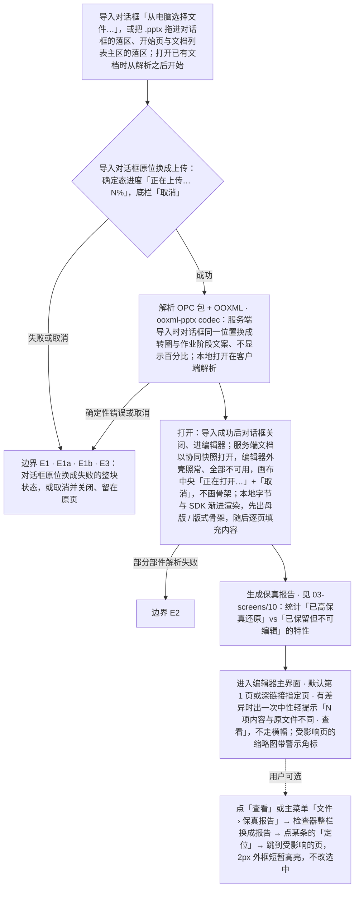

怎么读：实线是主干顺序，带标签的旁支指向下表的边界编号；虚线是用户可选的后续动作。导入全程在叠在原页上的「导入」对话框里（2026-10-23，rulings §4.25 DS-140）：选文件、拖入、上传、解析与失败在框里原位切换，框体不跳；上传与解析中「取消」、× 与 Esc 都是中止并关闭、留在原页，`/import` 叠在来路之上、浏览器后退等于关闭，成功后用替换方式换成编辑器地址（TB-179，修订 TB-129、TB-133）；服务端文档打开期间画布中央一行转圈，超过 300 ms 才出现，快照到了直接出完整编辑器（DS-99）。保真报告的常驻入口只有主菜单「文件 › 保真报告」，打开后的轻提示一次性出现，看过报告或关掉提示即算已读，同一文档有新差异前不再出（每用户本地，rulings §4.25 DS-51）；没有差异时不出提示、缩略图没有角标。

**边界情况**：

| 编号 | 情况 | 处理 |
|---|---|---|
| E0 | 尚未登录（含凭分享链接打开） | 守卫送去登录页 `/login?next=`（2026-10-22，rulings §4.25 DS-118）：与阻断页同一画法——品牌标 ·「登录 Cordex」· 说明 · 主按钮「使用组织账号登录」，必须点一下才跳 IdP；selfSignup 关时页上常显「没有账号？请联系管理员开通」，分享链接落地不另加提示，登录失败也不说「你还没有账号」（DS-119）；登录失败回到登录页、主按钮上方一行内联错误，主按钮就是重试，重试保住 next（DS-120、TB-122）；页面与文案见 03-33 §4 |
| E1 | 上传或解析失败（网络中断、服务器超时、超出大小上限，Q5 默认 200MB） | 导入对话框原位换成失败的整块状态（2026-10-23，rulings §4.25 DS-140、TB-179）：网络中断、超时与服务端的瞬时错误写「导入没有完成」+ 按原因的一句，正文里有次按钮「重试」（用还在手里的文件重走一遍完整导入、原位回到上传中，DS-53），底栏只有「关闭」；超出大小上限在申请上传时就被拒、选完文件直接到失败态、明确提示上限值，不重试（对话框里的「单个文件最大 N MB」与这里的上限值都读部署配置，前端经运行时配置拿到，rulings §4.25 TB-147）；文件过于复杂（解析超时或内存超限）与存储空间不足（M3）同一画法、只换文案，同样只有「关闭」（03-screens/13） |
| E1a | 文档规模超出上限（单文件 > 200 MB、页数 > 200、任一页元素 > 1,000 或文档总元素 > 20,000，部署可调） | 服务端**直接拒绝导入**（`format.quota_exceeded{dimension, limit, actual}`，rulings §4.15 Q5），导入对话框原位的失败态「文档超出规模上限，无法导入」说明超出的是哪一项、实际值与上限值，底栏只有「关闭」（03-screens/13，DS-140）；不提供"以只读打开"或自动拆分，不重试 |
| E1b | 上传或解析中点「取消」（或 ×、Esc、浏览器后退） | 中止直传或调导入取消、服务端清理原件与产物，不留卡片；对话框关闭、留在原页（开始页或文档列表），焦点回到顶栏「导入 .pptx」；直接打开 `/import` 的，背后是文档列表「最近」，关闭后留在列表（2026-10-23，rulings §4.25 TB-179，修订 TB-129、TB-133）；上传与解析中点遮罩不关，免得误点丢掉这次导入（TB-180）；协同快照打开期间的「取消」回到文档列表（DS-99，03-screens/13） |
| E2 | 部分部件解析失败但整体可打开 | 整页解析失败的那一页显示页级占位「此页内容无法解析」（母版页脚照常），其余页正常——页级占位在渲染层的纸面内画，与元素级占位、服务端缩略图一致，也与放映里单页渲染失败的「此页内容暂时无法显示」同一画法（rulings §4.25 TB-151）；这个占位是确定的内容，服务端缩略图与导出照常带着它，运行时渲染出错的页则不同、处理见 F6「导出失败」一行（TB-157）；报告里「无法解析」单独成组、排在最前，用危险色图标；左栏那一页的警示角标按最严重的级别用危险色（读屏「N 处内容无法解析」）；打开时的轻提示改为错误语气「第 N 页内容无法解析」。只是部分元素以占位显示的页：元素在纸面上显示为虚线框 + 图标 + 一行标题 + 一行原因（rulings §4.25 DS-52），缩略图角标为警告色；本会话里每页第一次进入时画布顶部出页级提示条「本页有 N 处内容无法完整显示 ┊ 查看详情」，约 5 秒后淡出，选中降级对象时让位（DS-51，03-screens/10、13） |
| E2a | 含外链资源 / 受限内嵌字体 / EMF、SmartArt、OLE、chartex 等只保留对象 | 按 03-screens/13"降级占位"与 03-screens/10 保真报告处理：外链图片与音视频默认自动加载（部署 `externalResources` 可收紧为确认 / 禁止）；受限字体只用于只读渲染，编辑态回退字体并提示；EMF M2 栅格化，chartex 占位 + 诊断（rulings §4.15 Q7） |
| E3 | 文件不是合法 pptx / 是不支持的 `.ppt` 二进制格式（章程 §2.3 非目标） | 不进入编辑器：导入对话框原位换成失败的整块状态，`.ppt` 写「不支持的文件格式」（按扩展名在申请上传时就被拒，不经上传），包结构坏了写「无法打开：文件不是有效的演示文稿」，都附一句建议、不误导为"损坏文件"；底栏只有「关闭」（不是有效的演示文稿另有「复制诊断信息」），不重试（2026-10-23，rulings §4.25 DS-140、TB-179，03-screens/13） |
| E4 | 用户仅有评审权限 | 直接以评审模式打开，不经过编辑模式 |
| E4a | 用户仅有查看权限（`viewer`） | 以**只读浏览**打开同一个协同编辑器（查看者变体，`mode='view'`，01-information-architecture §5.1）：进入协同房间、实时看到修改与在场，计入查看者名额；没有「评论 / 高亮」等创建类命令，只保留跳转与阅读评论：底部是浏览条（上一处 / 下一处评论 ┊「只读浏览中」，没有评论时只剩标识；rulings §4.25 DS-23、TB-1），主菜单没有「视图 › 模式」这一组（只读浏览是唯一模式），放映经「放映」按钮与 F5（2026-10-07 第 1 批定稿，03-screens/02 §6.2「查看者变体」）。不走 `/documents/:id/view` 查看器壳（该路由只留给 M1 查看器与嵌入，rulings §4.18 UX-19） |
| E5 | 没有访问权限（从未获授权，或权限已被收回） | 阻断页（不渲染残缺的编辑器）：「你没有权限访问此文档」+「申请访问」（主操作）打开留言弹层——可选留言 ≤ 200 字 +「发送」，发送后页上写「已发送申请，等待文档所有者批准」，「申请访问」24 小时内不可用；另有「返回文档列表」（rulings §4.25 DS-48，见 F11）；访问申请随分享在 M3 开放，M2 的「申请访问」留在原位、不可用，写「后续版本提供」（同 DS-137 的画法，FE-06），「返回文档列表」照常，阻断页的说明句不变、三个里程碑同一版式与文案（rulings §4.25 TB-156）；文档在回收站里时从未获授权的人同样看到这一页，申请照常记下、不透露在回收站（TB-73） |
| E5a | 文档在回收站中 | 按三类人分（2026-10-22，rulings §4.25 DS-85、DS-122；守卫顺序见前端 50/02 §6）：**所有者**看到「此文档在回收站中」阻断页——文档名 · 说明「恢复后即可打开和编辑；N 天后将永久删除」（N 读部署配置的回收站保留天数、缺省 30，前端不另配，rulings §4.25 TB-141，接口见后端 60/15；M2 没有到期清理，只写前半句）· 主按钮「恢复」（恢复后照常打开）·「返回文档列表」；「恢复」失败时沿用登录失败的内联错误画法（DS-120）：主按钮上方一行危险色图标 +「无法恢复「〈名〉」，请稍后重试」（`role="alert"`），按钮恢复可用、再点即重试；回收站卡片上的「恢复」失败用轻提示「无法恢复「〈名〉」」+「重试」，同永久删除失败（rulings §4.25 TB-155，03-screens/01 §6.1）；**有角色的非所有者**（编辑者、评审者、查看者，或持有效链接的人）看到 E5b「找不到该文档」；**从未获授权的人**看到 E5 的「你没有权限访问此文档」。回收站里的文档不提供只读预览（DS-85） |
| E5b | 文档不存在、正在永久删除 | 单独的「找不到该文档」阻断页：「文档可能已被删除，或链接有误」，只有「返回文档列表」——对不存在的文档申请访问必然失败，所以不给「申请访问」；拿不到元数据，不写文档名（rulings §4.25 DS-122，03-33 §7.2） |
| E5c | 分享链接已撤销或已到期，又没有直接授权 | 「链接已失效」阻断页（「没有访问权限」的变体，只换图标、标题与第一句说明）：「这个分享链接已被撤销或已过期」「可以向文档所有者申请访问，获得批准后即可打开」+「申请访问」+「返回文档列表」（rulings §4.25 DS-71，03-33 §7.3；收紧与到期见 F11） |
| E6 | 极大文件（页数多/媒体多，接近 Q5 上限） | 渐进渲染优先当前可见页，缩略图侧栏懒生成，进度提示中说明"首屏渲染完成，其余页面加载中"；首屏可交互后保真报告就能打开，面板写「正在检查其余页面… x / N」+ 确定态进度条、先列出已发现的差异（rulings §4.25 DS-53） |

**相关界面**：03-screens/01（文档列表-加载/错误态、回收站）、03-screens/02（编辑器-加载态、打开失败页）、03-screens/10（保真报告）、03-screens/13（导入对话框与其失败态、协同快照打开、降级占位与页级提示条）、03-screens/29（开始页的入口）、03-screens/33（登录页与错误页）。

---

## F2 编辑（文本/形状/图片/表格/页管理/属性/撤销重做）

**触发**：用户在画布、底部工具条（创建：文本、形状、图片、表格、图表等）或检查器（当前选中对象的属性）对对象/页面做出修改（v3 结构，rulings §4.25 DS-1）；文字格式只在检查器改（另有粗体、斜体等快捷键），不设画布文字迷你工具条（DS-13）。

**主流程（通用命令回路）**：

**F2 通用命令回路**

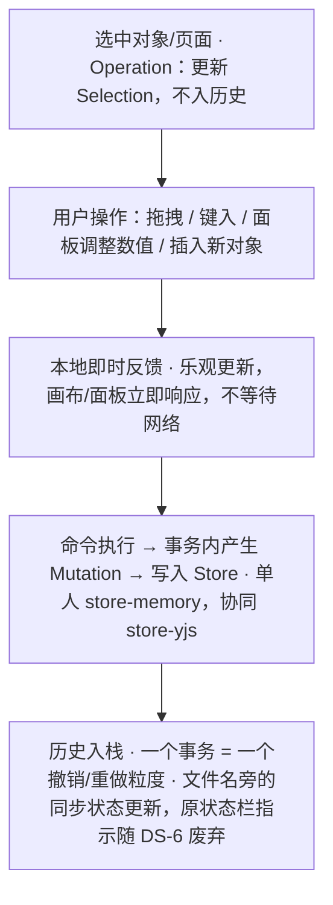

怎么读：自上而下是一次编辑的固定顺序；本地反馈先于命令落盘，所以网络延迟不影响画布响应。协同下撤销的跳过规则见 05-collaboration-ux §6 的撤销决策图。

**分支/边界情况**：

| 情况 | 处理 |
|---|---|
| 评审模式/只读权限下尝试编辑 | 画布不进入编辑态（无选中手柄/插入符），若用户点击文本试图输入，就地提示"当前为只读，去评论？"（有评论能力时提示里带「评论」入口）；检查器**不**自动切页签——唯一的自动切换是点评论钉与深链（01 §2.3，前端 50/10 §5）；「设计」页签只读展示当前值、不显示禁用控件，顶部一行说明权限（rulings §4.25 DS-15） |
| 多选混合属性 | 检查器对应字段显示"多个值"占位，用户输入新值即统一应用于全部选中对象 |
| 撤销跨越他人操作（协同场景） | 本地撤销只回退"自己"的操作（按 origin 区分），不影响他人产生的 Mutation；我改过、之后被他人改写的同一属性**跳过**并 Toast"<X> 之后修改了此处，已跳过"（带「恢复我的值」，M3，rulings §4.25 TB-26）；整步都被跳过时本次撤销**停下**、不连带撤销更早一步（rulings §4.15 Q3）；详见 05-collaboration-ux §6 |
| 粘贴外部内容（来自其他 Office 软件/浏览器） | 尽力转换为受支持的形状/文本；无法转换的部分降级为图片或纯文本，操作后以 Toast 说明"部分格式已被简化" |
| 大量对象性能提示 | 单页对象数逼近性能预算（见架构 07/PRD 04）时出现弱提示（DS-6 起走 `ui.notification`）：轻提示「本页对象较多（N 个），编辑可能变慢」，在画布列底部居中、底部工具条上方，可关闭、不阻断操作（2026-10-07 第 1 批定稿，03-screens/02 §6.2，样张 `main-states.perf-hint`） |
| 撤销/重做涉及"对象已被他人删除" | 删除是软删除（墓碑，id 稳定）：我对该对象的撤销一律跳过（**不看 TTL**，墓碑 TTL 内也不复活他人删除的对象，rulings §4.17 D4），整步被跳过时提示"无法撤销：此处已被 <X> 删除"（带「恢复元素」，M3，TB-26），不连带撤销更早一步；要找回对象用这个按钮或 F4 场景 D 的"恢复元素"（清除墓碑、**以原 id 恢复**）。墓碑超过 TTL（默认 24 h）被服务端硬删除后不可恢复。原"视为新建、不复用原 id"写法作废（rulings §4.15 Q3） |

**相关界面**：03-screens/02、03、04、05；表格的插入、单元格编辑与结构编辑见 [03-screens/30](03-screens/30-table-editing.md)，图表的插入与数据编辑见 [03-screens/31](03-screens/31-chart-editing.md)，空内容占位符图标条与文本编辑态插入日期字段见 [03-screens/16](03-screens/16-text-editing-and-formatting.md)（2026-09-30 补）。

---

## F3 协同加入/离开

**触发**：另一用户打开同一 Unit（加入）；用户关闭标签页/断网/切换文档（离开）。

**主流程**：

**F3 加入**

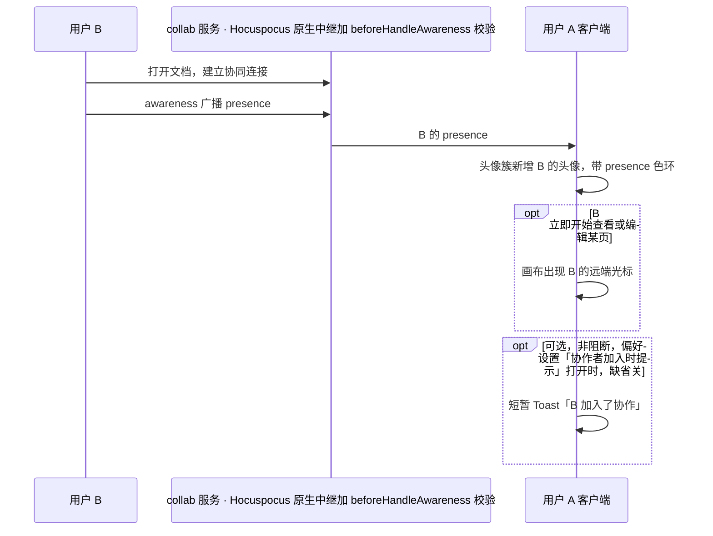

怎么读：纵向是时间顺序，箭头是消息方向；opt 框是按条件出现的步骤，Toast 不阻断任何操作。协作者加入的提示缺省关，开关是偏好设置「通知」组里唯一的一项（PRD 07 D8；rulings §4.25 DS-114，03-screens/23）。
依据：本文 F3；presence 经服务端转发见架构 06 §7（2026-09-26 起由 Hocuspocus 原生中继、服务端扩展 `beforeHandleAwareness` 校验与盖章，ADR-0024 修订）。

**F3 离开**

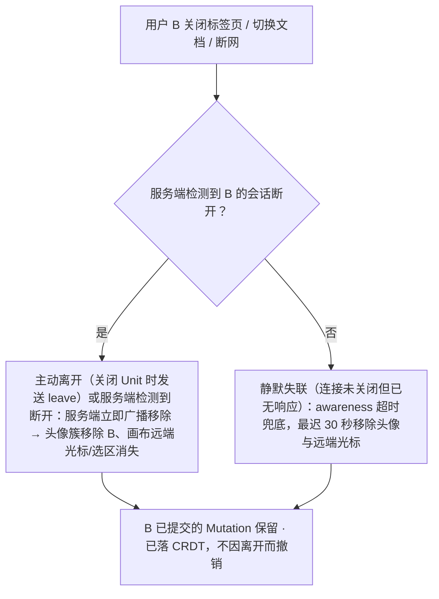

怎么读：自上而下是 A 端看到的离开过程；能检测到断开时立即移除，30 秒只是静默失联时的兜底，两支都不影响 B 已落盘的内容。空闲灰显与离开无关：B 仍在线但 60 秒无活动时头像灰显为「空闲」，有活动即恢复（PRD CO-03）。
依据：架构 06 §7（会话断开即主动广播移除，awareness 超时 30 秒兜底）；PRD CO-03；rulings §4.18 UX-18

**分支/边界情况**：

| 情况 | 处理 |
|---|---|
| 协作者人数超过头像簇可视宽度（超过 5 个，PRD CO-03） | 折叠为 "+N" 头像，点击展开在线列表（含 presence 色、角色与所在页；最窄 256、按内容加宽，rulings §4.25 DS-132）；他人的头像与列表行都可以点了进入跟随（见本表「跟随某位协作者」） |
| 房间已达编辑者容量上限（≤ 20 编辑者，PRD CO-01） | 新加入者自动以查看者身份加入（`auth.ok{role:'viewer', reason:'capacity'}`，架构 06 §14），画布写入与评论创建都收回（原「仍可评论」作废）；横幅用中性底（不是错误，没有丢失任何东西）：「编辑者名额已满（上限 20 人）」+「重试以编辑身份加入」（重新判定名额，不自动提升），可关闭，关闭后同步状态行仍写「只读 · 名额已满」（与查看者角色的「仅查看」分开称呼，rulings §4.18 UX-19；§4.25 DS-58、DS-61），对应 05-collaboration-ux.md §7 的 `readonly-degraded`（容量已满分支）。名额按用户计：同一账号的其他标签页/设备不再占名额；评审者计入查看者名额；文档所有者不占编辑者名额、始终可以编辑身份进入（rulings §4.15 Q5） |
| 房间的查看者名额也已满 | 打开时握手被拒：阻断页「文档当前查看人数已达上限」，只有「返回文档列表」，并写明「有名额空出时会自动打开，保持此页即可」；后台按退避继续重试，有名额空出时自动打开（rulings §4.25 DS-60，前端 50/07 §9）；评审者计入查看者名额 |
| 评审者加入 | 头像环样式与编辑者一致，但 hover 提示角色为"评审者"；不产生画布远端选区（评审者无法选中编辑，仅评论锚点可能出现） |
| 自己的另一个窗口 / 设备 | 画布上作为独立的远端光标/选区显示（presence 来源于会话），名签写「〈姓名〉（你 · 窗口 2）」，避免"看不到自己另一个窗口在哪"的困惑；头像簇与房间名额按用户合并，同一账号只占 1 个头像、1 个名额；窗口数不上头像，写在在线列表我那一行「2 个窗口」（同一账号的多个会话统一称「窗口」，rulings §4.15 Q5、§4.25 DS-132、TB-124，05 §9） |
| 协作者的颜色 | 按用户 id 稳定哈希取 12 色之一，同一场里撞色时顺延到下一个未占用的颜色；同一账号的多个会话同色；第 13 位起复用颜色并在头像上挂序号角标——头像组里挂在头像下沿中线、在线列表里在右下（24px 头像配 14、20px 配 12），同色第一位不画；画布上的名签不加序号、靠名字区分（rulings §4.25 DS-42、DS-132，05 §2） |
| 跟随某位协作者（M3） | 点检查器协作行（网格视图与紧凑形态在右上胶囊）里对方的头像——它是「跟随 〈姓名〉」按钮——进入跟随：头像外圈换成对方身份色、画布列四周 2px 同色外框、画布顶部跟随条「正在跟随 〈姓名〉 ┊ 停止跟随」；只同步看什么（当前页、视口），不同步选中与编辑；自己翻页、滚动、缩放或点「停止跟随」即退出，对方离开协同时退出并轻提示；跟随中进入放映即从对方当前页开始并保持跟随（rulings §4.25 DS-106、TB-113，05 §4、03-screens/11） |
| 加入时文档正在被大量并发编辑 | 新加入者的首屏渲染以当前 CRDT 状态为准，不需要"追赶"历史事件 |

**相关界面**：03-screens/02（检查器顶行 / 网格视图右上胶囊的协作者头像组、画布远端光标）。

---

## F4 软冲突提示

**背景**：CRDT 保证不存在需要人工合并的"硬冲突"（章程 §4：collab-core 以 CRDT 为单一事实源），但用户体感上仍会遇到"我正在操作的东西被别人动了"的困惑场景，需要明确的软冲突可视化。PRD `03-features/03-collaboration.md` CO-08 用一张表定义了全部收敛结果与提示要求（P0，M3，验收标准要求"以上每一行都有确定性协同模拟用例；提示出现率 100%；提示可关闭且不打断输入"）；下表逐行对应，是本流程的权威口径（取代早期版本的 4 场景简化表）：

| 场景 | 触发 | 收敛结果与表现 | 埋点 |
|---|---|---|---|
| A 同一文本框不同位置并发编辑 | 两人同时在同一文本框的不同位置插入/删除文字 | 两处修改都保留（字符级合并），**无提示** | – |
| B 同一文本框同一位置并发编辑 | 两人光标/插入点位置重合 | 两段插入相邻并存，顺序确定；**编辑中即时提示**（预防性、非事后）：文本框上沿外侧出现中性提示签「● X 也在编辑此文本框」（色点是对方的身份色），并画出对方的插入符；不加锁、不阻止输入，断线即消失（rulings §4.25 DS-60） | `collab/soft-conflict{type:"text-same-pos"}` |
| C 同一形状被并发移动/变换 | 并发拖拽/缩放/旋转同一对象 | 属性级后写者胜（LWW）；失败方看到对象"跳走" + Toast"X 移动了该形状"（左侧是对方头像，可关闭）+ **「恢复我的值」按钮**（新事务，把位置/变换写回我的值、覆盖对方后写，可再撤销；原"撤销"按钮作废，rulings §4.15 Q3） | `collab/soft-conflict{type:"prop-lww"}` |
| D 对象被删除同时其文本被编辑 | A 删除元素，B 同时编辑该元素文本 | 删除胜：元素转为软删除墓碑（id 稳定，不再显示），B 的编辑落在墓碑上、随之隐藏；B 收到 Toast"你编辑的元素已被 X 删除"，提供"恢复元素（含我的编辑）"入口（P1）——新事务，清除墓碑、**以原 id 恢复**，B 的编辑与评论锚点等引用一并复原，不产生重复元素；墓碑超过 TTL（默认 24 h）被硬删除后入口失效（rulings §4.15 Q3） | `collab/soft-conflict{type:"delete-vs-edit"}` |
| E 页被删除同时该页被新增元素 | A 删除页，B 在该页新增元素 | 删除胜（页转为墓碑）；同 D 的提示与"恢复页"入口（原 id、原位置恢复，B 新增的元素随页复原） | `collab/soft-conflict{type:"delete-vs-edit"}` |
| F 并发重排页顺序 | 两人同时拖拽缩略图调整幻灯片顺序 | 有序序列 CRDT（ADR-0020）保证不重复不丢页，顺序确定；**无文字提示**，仅缩略图侧栏用位置变化动效提示 | `collab/soft-conflict{type:"reorder"}` |
| G 组合元素时子元素被并发编辑 | A 组合若干形状，B 同时编辑其中一个子元素 | 组合成功，B 的编辑作用于组合内的子元素，**无提示** | – |
| H 取消组合时并发移动整组 | A 取消组合，B 同时移动这个组合 | 取消组合胜，B 的移动作用于原组合坐标下的子元素（保持视觉位置），**无提示** | – |
| I 并发更换同一页版式 | 两人同时为同一页选择不同版式 | 后写者胜（LWW）；不弹轻提示，提示写在受影响的检查器「版式」字段处：字段外圈换成对方的身份色，节末写「X 同时把这一页改成了「〈版式〉」，你选的「〈版式〉」没有生效」+「恢复我的值」（新事务），与第 1 批「远端覆盖正在输入的字段」同一画法（rulings §4.25 DS-60） | `collab/soft-conflict{type:"prop-lww"}` |
| J 解决评论线程同时有新回复 | A 标记线程已解决，B 同时提交回复 | 回复保留，线程状态仍为已解决；只在评论面板这条线程处内联写明「解决之后又有新回复」，收起时摘要行右侧写「有新回复」，不出全局轻提示与横幅（见 03-screens/06） | – |
| K 并发插入图片产生同名部件 | 两人几乎同时插入图片 | 部件名由客户端 id + 序号生成，不会同名，**无提示** | – |

**通用规则**：软冲突提示优先用画布内联提示、字段级提示或检查器局部提示；仅在会导致用户当前操作对象整体消失（场景 D/E）或对象被移动（场景 C）时使用 Toast 作补充，且 Toast 必须可关闭、不打断正在进行的输入；不使用阻断式对话框（软冲突不应打断心流）。上表以外，检查器字段级"远端覆盖正在输入的值"场景（用户在属性面板打字时远端提交了新值）由 03-screens/03 单独规定，不属于 CO-08 枚举范围但遵循同样的"内联优先、不阻断"原则：该字段边框短暂高亮闪烁 + 字段旁出现"已更新"小标记；若本地有未提交输入，字段下方给出"应用远端值 / 保留我的输入"的内联选择（不使用浏览器 `confirm()`）。

**F4 软冲突提示通道**

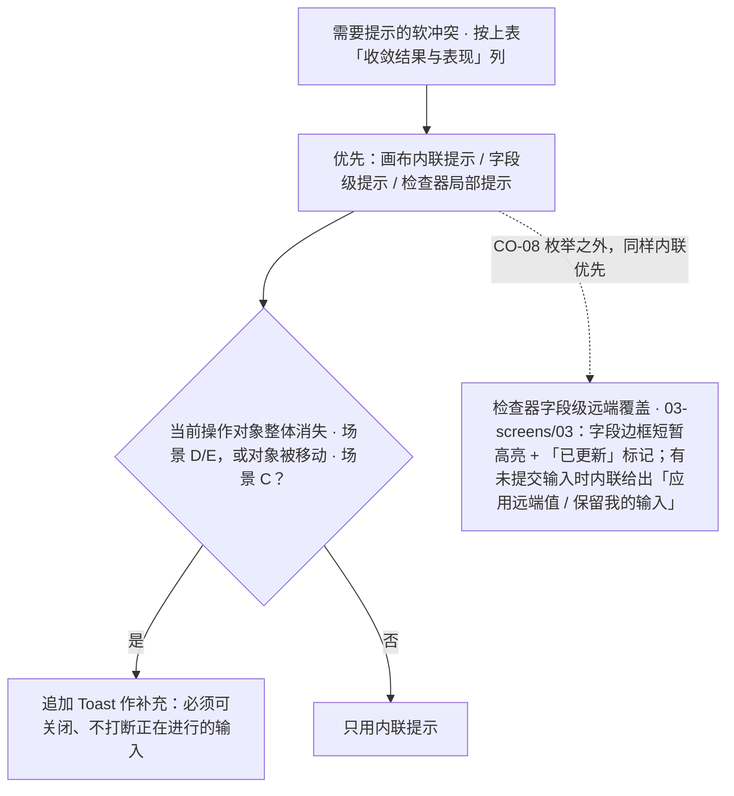

怎么读：先走内联，再按对象是否消失或被移动决定是否追加 Toast；虚线是表外的字段级场景。任何分支都不使用阻断式对话框或浏览器 `confirm()`。

**相关界面**：03-screens/02、03-screens/03；05-collaboration-ux.md §5。

---

## F5 离线与重连

**触发**：浏览器 `offline` 事件 / WebSocket 心跳超时。

**主流程**（状态名与时限口径统一自 PRD CO-01/CO-06 与 05-collaboration-ux.md §7 的六态会话状态机）：

**F5 离线与重连状态流**

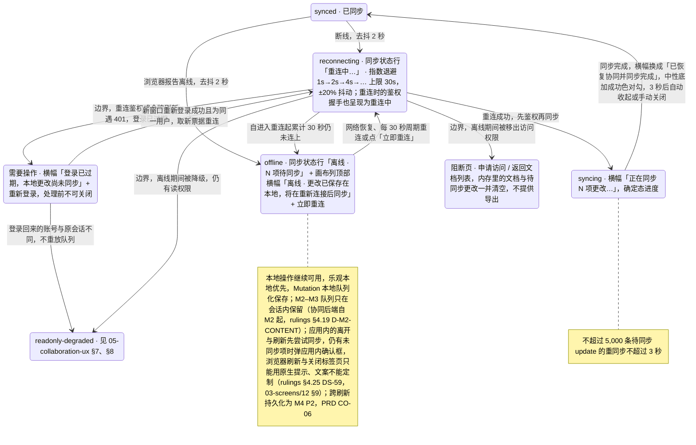

怎么读：主干是 synced → reconnecting →（30 秒未连上）offline →（网络恢复或周期重连）reconnecting → syncing → synced 的一圈；每次重连都先鉴权再同步，所以不会从「重连中」直接回到「已同步」。从 reconnecting 引出的三条是下表的鉴权过期、降级与失去访问三种边界，都发生在重连鉴权时；登录过期经新窗口重新登录回到重连；失去访问不再是横幅，而是整个工作区换成阻断页（rulings §4.25 DS-50）。离线超过 24 小时后重连时，「已恢复」这一条另有画法，见下表。状态名与时限口径统一自 PRD CO-01 / CO-06、05-collaboration-ux §7 与架构 06 §5.1（rulings §4.18 UX-01 / UX-02 / UX-03 / CO-03）。

**边界情况**：

| 情况 | 处理 |
|---|---|
| 离线时间过长导致鉴权 token 过期 | 重连鉴权或令牌刷新遇 401（不是网络错误）→ 直接进入需要操作的状态："登录已过期，本地更改尚未同步" +「重新登录」（只有网络错误才走「重连中」）。**重新登录在新窗口完成**（rulings §4.18 UX-02）：弹窗或新标签里走 OIDC，服务端照常设置 httpOnly cookie，回调页经 BroadcastChannel 通知原页（原页重新获得焦点时也探测 `/auth/me`）；原页不跳转、队列保留，拿到新票据后 重连中 → 同步中 → 已恢复；弹窗被拦截时退化为新标签链接。登录回来的账号与原会话不同时不重放队列，按只读处理并提供导出本地副本，防止以他人身份提交更改。本地未同步更改在重新登录前不丢失，该横幅处理前不可关闭。登录过期期间写命令被拒：创建工具、新建与检查器字段留在原位不可用，检查器标题上方一行「暂不可编辑 · 重新登录后恢复」，同步状态行「登录已过期 · N 项待同步」（警告色图标）；登录窗口打开期间「重新登录」转圈、不可用，弹窗被拦截时退化为「在新标签页中登录」（rulings §4.25 DS-58、DS-61，03-screens/12） |
| 离线期间权限被降级（仍有读权限） | 重连后进入 `readonly-degraded`（见 05-collaboration-ux.md §7/§8）：未同步的本地更改被回滚，危险色横幅「你的权限已变更为「可评审」」+「N 项更改未被保存；文档已重新载入服务端版本，撤销历史已清空」+「导出为本地副本」，导出前不可关闭，导出后降级为可关闭的「已导出本地副本」；本端没有未同步更改时不出横幅，只给轻提示写明新角色（rulings §4.25 DS-58） |
| 离线期间被移出文档访问权限 | 整个工作区换成阻断页（与「打开失败 · 没有访问权限」同一布局）：「申请访问」（主操作，留言弹层；M2 同 F1 E5 留在原位不可用，rulings §4.25 TB-156）·「返回文档列表」；内存里的文档与待同步更改一并清空，不提供导出（rulings §4.25 DS-50，见 F11） |
| 文档已被删除 | 会话结束、停止重连，未同步的更改移入「未同步更改」区，编辑器只读展示；危险色横幅「文档已被删除」+「导出为本地副本」「返回文档列表」，导出前不可关闭；同步状态行「文档已被删除」（中性图标，DS-58、DS-61） |
| 离线累计的更改过大，重连时无法同步 | 不自动重试，按「导出后重载」处理（与降权同一导出路径）：危险色横幅「有更改过大无法同步」+「导出为本地副本」，导出前不可关闭；文档已重新载入服务端版本，可以继续编辑（DS-58） |
| 协同已暂停（隔离态，触发条件见 03-screens/12） | 阻断式横幅、始终不可关闭，只能刷新退出；写命令被拒，工具与字段留在原位不可用，检查器标题上方一行「暂不可编辑 · 协同已暂停，刷新后恢复」；同步状态行「协同已暂停 · N 项未同步」（警告色图标）；待同步更改留在内存里供导出，所以「刷新」先走下面的离开与刷新确认（DS-58、DS-61） |
| 服务器保存延迟 | 发起方出警告横幅「未保存到服务器 N 项」（可关闭，关闭后同步状态行保留警告色的同一句）；其余协作者不出横幅，同步状态行写「服务器保存延迟」（中性图标，悬停看说明）；协作照常（DS-61，05 §7） |
| 有未同步更改时在应用内离开或刷新 | 主菜单「返回首页」、隔离态「刷新」、插件设置「重新加载」、发现新版本「刷新」先尝试同步，仍有未同步项时弹应用内确认框：「离开将丢失 N 项未同步更改」/「刷新将丢失 N 项未同步更改」，左下「导出为本地副本」，初始焦点在安全项（离开为「留下」，刷新为「取消」），主按钮「仍要离开 / 仍要刷新」为危险色；浏览器刷新、关闭标签页只能触发浏览器原生提示，文案不能定制（rulings §4.25 DS-59）。离线横幅文案维持「更改已保存在本地，将在重新连接后同步」，写明「关闭或刷新会丢失」的文案在 M4 启用本地持久化前再定 |
| 发现新版本（协同以 4426 / 4427 关闭，或惰性代码块重试仍失败） | 警告浅底横幅「发现新版本，刷新后继续」+ 刷新图标、不可关闭，唯一按钮「刷新」；会话已关闭时编辑器转为暂时不能编辑——工具与字段留在原位不可用，检查器顶部「暂不可编辑 · 发现新版本，刷新后恢复」，同步状态行「需要刷新 · N 项未同步」（没有未同步项时只写「需要刷新」）；点「刷新」时有未同步更改，先弹上一行的刷新确认；代码块漂移时会话还在，只有惰性元素保持占位，点「刷新」先同步（2026-10-22，rulings §4.25 DS-126，03-screens/12） |
| 换纪元（4428：覆盖导入提交，或运维重建） | 编辑器丢弃本地状态并重新载入，撤销历史清空；没有未提交更改时是中性底 + 信息图标的横幅，标题「文档已替换为导入的文件」（本会话收到过导入锁定）或「文档已由管理员重建」，正文「文档已重新载入，撤销历史已清空」，可关闭、不自动消失；有未提交更改时与「有更改过大无法同步」同一画法——危险浅底，正文追加「；N 项更改未提交」+「导出为本地副本」，导出前不可关闭（rulings §4.25 DS-127） |
| 文档已达元素上限，以只读打开（部署调低了元素天花板） | 以只读加入（与编辑者名额已满分开）：中性底 + 锁形横幅「文档已达元素上限，只读打开」，正文写数字与出路「元素数量超过本部署的上限（N / M）；如需编辑，请联系管理员」——N、M 是文档的元素数与本部署的上限，随协同握手一起给出、与服务端准入判定同口径（rulings §4.25 TB-146）；可关闭、没有按钮；关掉后同步状态行「只读 · 文档已达元素上限」继续说明（rulings §4.25 DS-128） |
| 退出登录时有未同步更改 | 账户菜单「退出登录」与应用内离开同一走向：先尝试同步，仍有未同步项才弹确认「退出登录将丢失 N 项未同步更改」，左下「导出为本地副本」，初始焦点「取消」，危险色「仍要退出」；导出后回到编辑器、不自动退出（rulings §4.25 TB-122，03-33 §8） |
| 离线操作量很大 | 重同步预算为 ≤5,000 条 update 在 ≤3 秒完成（PRD CO-06）；超出此规模仍继续同步但横幅进度文案如实反映剩余量，不阻止用户继续编辑 |
| 离线超过 24 小时后重连 | 在「已恢复」这一条横幅上追加「较长时间离线（超过 24 小时），合并后请检查」与可点的页码（点了切到该页；受影响页超过 3 页时只列前 3 页，其余写「等 N 页」，N 是受影响页总数）；这一条不自动收起，图标换成中性信息图标——要用户回头检查，不用成功色对勾（P1，PRD CO-06，rulings §4.25 DS-59） |
| 多标签页同时离线又重连 | 各自独立处理，互不阻塞；重连顺序不影响最终一致性（CRDT 保证） |
| 短暂网络抖动（<2 秒） | 去抖：不满 2 秒不展示 `reconnecting`/`offline` 状态变化，避免闪烁疲劳 |
| 单人模式（无协同 Provider） | 不存在离线概念，保存走集成方回调（PRD CO-06），本流程不适用 |

**相关界面**：03-screens/12（离线/冲突横幅与文档状态横幅）；03-screens/33（退出登录确认）；05-collaboration-ux.md §7。

---

## F6 导出

**触发**：主菜单「文件 › 导出…」⇧⌘E（Windows / Linux Ctrl+Shift+E；⌘E 是居中对齐，rulings §4.25 DS-78；取代原应用栏「⋯」菜单；2026-10-07 第 1 批定稿，03-screens/02 §2.3）/ 命令面板搜索"导出"。没有 `doc.export` 时「导出…」留在原位不可用、⇧⌘E 无效：查看者写「只有查看权限」，评审者与编辑中被降权的写「需要编辑权限」（DS-105）；被降权时未保存的更改仍走横幅的「导出为本地副本」（CO-05，见本节末行）。

**主流程**：

**F6 导出主流程**

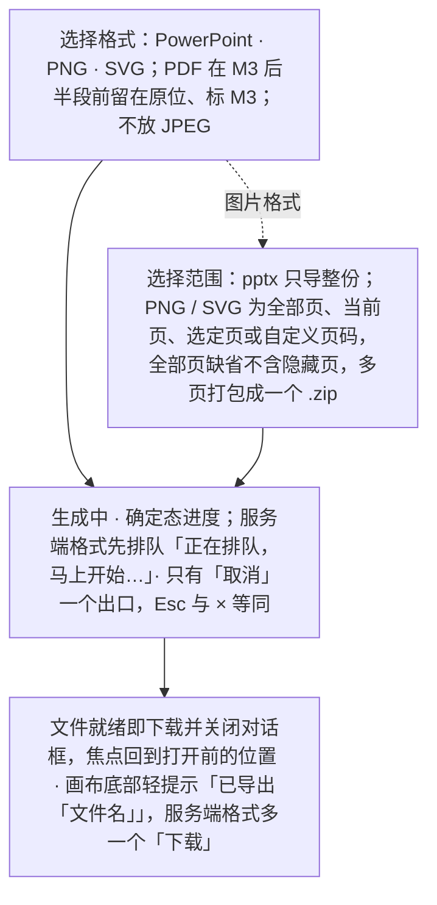

怎么读：虚线进入的「选择范围」只对图片格式有选项（pptx 只导整份，rulings §4.25 DS-103），跳过时由选择格式直接进入生成中；生成中只有「取消」，不做后台继续（DS-101）；完成后不停在对话框、不写链接时效（DS-100）。未同步更改提示、失败重试等分支见下表与 03-screens/22 的状态图。

**边界情况**：

| 情况 | 处理 |
|---|---|
| 存在尚未同步的离线本地更改 | **客户端格式**（pptx / PNG / SVG）：导出前提示"存在 N 项未同步的更改，导出将包含本地最新内容，但可能与其他协作者看到的版本存在差异"，可「仍要导出」或「等待同步」。**服务端格式须先同步**（PDF，以及 M3 起 PNG 的「全部页」，取服务端已持久化的版本，rulings §4.25 DS-102）：提示"需先同步 N 项更改"，不提供「仍要导出」。点「等待同步」后对话框停在等待态，实时显示"正在同步 N 项…"，归零自动进入生成中，期间可取消；离线或重连中时「等待同步」禁用并提示"恢复连接后才能同步"（03-screens/22，rulings §4.18 UX-05） |
| 导出失败（服务端错误 / 超时，或某一页运行时渲染出错） | 对话框正文换成整块状态「导出没有完成」+ 按错误码的原因 +「重试」；不影响文档本身。服务端生成时某一页在运行时渲染出错（画面上是「此页内容暂时无法显示」），按后端的规则重试 1 次仍失败，这次导出作业即失败、照此处理（rulings §4.25 TB-157；重试规则见后端 60/06 §11.3）；浏览器生成的图片导出同一口径：某一页走了运行时页级回退，这次导出即失败、进同一失败态，不把一时的出错写进文件（TB-166，判定方法见前端 50/18 EXP-03）；这两种因页面渲染出错的失败写同一句原因「有一页暂时无法生成，请重试；文档本身不受影响」（错误码 `render.page_failed`，按前端 50/15 §4.2 标为面向用户、带 zh-CN / en-US 语言包键，rulings §4.25 TB-173；文案登记在前端 50/15 §4.3，03-screens/22 §6 引用）；服务端作业因单页超时（`headless.render_timeout`，后端 60/06）失败时，原因写「生成文件时超时，请重试；文档本身不受影响」，与上一句并列登记在 50/15 §4.3（TB-175）；其余失败（renderer 忙、注入超时、浏览器崩溃与网络、存储等基础设施失败）不另标面向用户，原因一行按 50/15 §4.2 显示通用文案 `errors.generic`，不另写「服务暂时不可用」一类的原因句（rulings §4.25 TB-176，03-screens/22 §6）；整页解析失败的页（「此页内容无法解析」）是确定的占位内容，两种生成位置都照常导出、不算失败 |
| 生成中取消 | 「取消」、Esc、× 等同：停掉这次导出（浏览器生成的停掉 Worker，服务端格式调导出取消端点）、回到选项、焦点落在「导出」；不做后台继续（rulings §4.25 DS-101） |
| PNG 的范围与生成位置 | M2 四种范围都在浏览器生成、多页打包成一个 .zip，超出浏览器的页数上限时「导出」不可用并写原因（上限按图片宽度分档，先按初值登记、M2 位图实测后只收紧，取值以前端 50/13 §3 为准，rulings §4.25 TB-148）；M3 起「全部页」改由服务端生成，写「全部页由服务端生成，只含已同步的内容。」，其余范围与 SVG 仍在浏览器（rulings §4.25 DS-102）；SVG 逐页序列化、不栅格化，不设这种按宽度分档的上限，只受每份文档的页数天花板（rulings §4.25 TB-152） |
| 部分页、隐藏页与 JPEG | pptx 只导整份（要部分页先「创建副本」再删页）；图片与 PDF 的「全部页」缺省不含隐藏页、不设勾选，点名到隐藏页的范围照常导出；对话框不放 JPEG 与质量参数，它们只经 API 与自动化（rulings §4.25 DS-103，PRD SV-02、SV-13） |
| 打印 | 不设打印入口：需要打印时导出 PDF，再用浏览器或系统打印（rulings §4.25 DS-104） |
| 含不透明保留部件 | 导出说明"未修改部分将原样保留"，与保真报告呼应，避免用户误以为导出会"修复"未建模内容 |
| 从横幅导出本地副本（权限降级、文档已被删除、有更改过大无法同步、换纪元时有未提交更改） | 打开导出对话框，列出未被保存的更改（命令名 + 所在页，点某项切到该页对照），格式可选演示文稿副本 .pptx（缺省）或更改摘要 .json（供人工比对）；导出后横幅降级为可关闭的「已导出本地副本」。对话框说明的第二句与「已导出本地副本」的正文按打开它的原因换（03-screens/12 §7.2 的表）：降权与换账号写「获得编辑权限后可以对照重做」「可另行申请编辑权限后重新应用」，换纪元与更改过大写「可以对照重做」，文档已被删除写「可以另存为新文档」，离线时的离开确认与退出登录确认写「恢复连接后可以对照重做」（从确认框打开，导出后回到原处，不出「已导出本地副本」）；表里没点名的原因（登录已过期、协同已暂停、未保存到服务器时的离开或刷新，以及「文档正忙」等）用不提权限的中性句「导出的副本不会自动合并回文档，可以对照重做。」（rulings §4.25 DS-58、DS-129、TB-139）；系统不承诺把副本自动合并回文档（05 §8） |

**相关界面**：03-screens/02（导出入口）、03-screens/22（导出对话框）；对话框沿用 `ui.dialog` 槽位规范（设计 06 §2.9）。

---

## F7 评论

2026-10-15 按 design-language-v3 第 2 批已拍板的样张改写（rulings §4.25 DS-40、DS-43…DS-46、DS-53）；界面、状态与文案以 03-screens/06 为准，本节只写流程。

**触发**：底部工具条「评论」（`C`）按下后在画布上点选——点对象落**元素锚点**，点空白处落**页级锚点**。这是新评论唯一的常驻入口，检查器「评论」页签里不常驻撰写框（DS-45，质量门 Q2）。不常驻的第二入口：对象或幻灯片空白处的右键菜单（含 ⇧F10 / 菜单键）里的「添加评论 C」，与按 C 相同、同样进入评论工具；编辑文字时选中一段再右键「添加评论」落**文本范围锚点**——这是例外：撰写时工具仍是「选择」，发表或取消后回到文字编辑（DS-44）。键盘等价：焦点在工具条「评论」上按 ↵（或工具开着、焦点在画布上按 ↵）在当前页放页级临时钉并打开撰写框；有选中对象时按 C 落元素锚点，评论工具开着时按 ↵ 同样落元素锚点——↵ 只在评论工具开着、或焦点在工具条「评论」上时落钉，没开评论工具时选中对象按 ↵ 仍是进入文字编辑（PRD ED-29，rulings §4.25 TB-62，07 §1.2）。网格视图里按下评论工具，先带着工具回单页再落钉。

**前置条件**：评审者（`commenter`）及以上；装了评论包（M2 参考应用未装时，工具条的「评论」、检查器的「评论」页签、画布评论钉与左栏评论角标都不出现）。

**主流程**：

**F7 评论主流程**

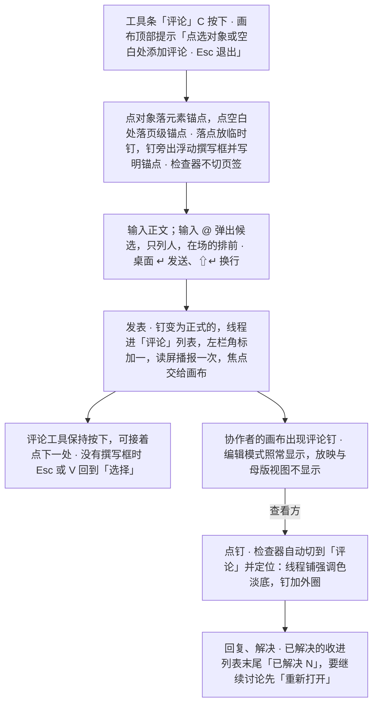

怎么读：上面一列在发起方完成。评论工具发表后不回到「选择」——这是插入工具「用后回到选择」的例外（同 Figma 评论模式），评审时常连续落多条，不必每次重点工具；撰写框没写内容时 Esc 或点外面只收起撰写框（工具照旧按下），写了内容时 Esc 与点外面都不关，要点「取消」才放弃。右侧一支是协作者看到钉、点钉进入线程；点钉是唯一允许自动切换检查器页签的操作（01 §2.3），评论工具按下时不切页签。

**边界情况**：

| 情况 | 处理 |
|---|---|
| 锚点对象被删除 | 线程转为"**已脱离锚点**"（PRD CO-04 术语，取代早期版本使用的"孤立评论"）：不再有画布锚点，锚点说明换成「原对象已删除」（工具提示写谁何时删的），仍可读/回复/标记已解决；有这类线程时筛选行第二行出现临时筛选「已脱离锚点 N」；重新锚定到其他对象是 P1 范围（「⋯」里留在原位不可用）。删除为软删除（rulings §4.15 Q3）：墓碑 TTL 内对象被恢复（撤销删除或"恢复元素"，原 id）时，线程自动回到原锚点、标注消失 |
| 筛选、排序与列表 | 分段筛选「全部 / 当前页 / 未解决 / @我」，缺省「当前页」，与画布上的钉一一对应；「全部」按时间平铺、锚点说明前写页码；排序为最新 / 最旧 / 按页码（选了即收起）；未解决在前，已解决收在列表末尾的折叠行「已解决 N」；钉与列表都不编号；@提及与作者名同为中等字重、链接加下划线，都不用强调色；左栏角标只数未解决的评论（rulings §4.25 DS-43，PRD CO-04） |
| 评审者/评论者发起评论 | 允许，`commenter` 及以上角色即可创建/回复评论（PRD CO-04）；评审模式下检查器缺省停在「评论」页签，评审条的「上一处 / 下一处评论」在未解决的线程间跳转 |
| **标记已解决的权限**（此前版本的待决事项，现已由 PRD §1 角色表确认） | `commenter`（评论者）只能解决**自己创建**的线程，他人线程的「解决」留在原位不可用并写「只能解决自己发起的评论」；`editor`（编辑者）及以上可以解决**任何**线程；`viewer`（查看者）只读，不可评论 |
| 删除 | 自己的评论或回复：先乐观隐藏，轻提示「已删除你的回复」+「撤销」，5 秒内可撤销（评论不入撤销栈）；首条评论有回复时只留「此评论已删除」。整条讨论串只有文档所有者能删（发起人只能删自己的评论与回复），走模态确认「删除此讨论串？将同时删除 N 条回复，删除后无法恢复。」，初始焦点在「取消」（rulings §4.25 DS-40） |
| 手机 / 平板（仅查看形态） | 手机（< 640）M3 起底部面板可发表与回复：面板底部常驻撰写区（44px 文本框 +「发送」），↵ 换行、只用「发送」提交，上方一行「解决评论请在更大窗口中进行」；点某条「回复」时撰写区上方出现「回复 〈名字〉 ×」；能否发表照常按角色（查看者只读）。平板（触控、≥ 640）维持只读评审（PRD NF-07），底部写「平板上只能查看评论」；面板按方向落位——竖屏与当前页上下排开、贴底补满（有空间时保留备注卡），横屏是右侧整高侧栏宽 360（2026-10-22，rulings §4.25 DS-131），状态行写「仅查看 · 在电脑上编辑」（TB-125，嵌入里同样如此，TB-159）；嵌入里手机评论面板上方那句写「当前区域太窄，暂不能解决评论」（DS-112）（rulings §4.25 DS-28、DS-46，TB-49；手机与平板的界面见 03-screens/06 §9.5、§9.6，仅查看形态见 03-screens/02 §5a.2） |
| 撰写中换页、进网格视图或切到评审模式 | 撰写框没写内容时随换页收起、不留草稿；写了内容的撰写框遇到换页（翻页、点缩略图、定位到别的页的线程等），撰写框随旧页收起，草稿按页留在内存；回到那一页时临时钉与撰写框原样恢复（已写的内容与 @ 提及都在）。进入网格视图、切到评审模式与换页同样处理：撰写框随单页（或原模式）收起，回到单页的那一页时原样恢复（rulings §4.25 TB-84）。草稿按页存、不按模式存（评审条也有「评论」工具）：切到评审模式、或从评审返回编辑之后仍停在同一页的单页画布时，撰写框当场原样恢复（TB-87）。恢复的撰写框不抢焦点：焦点留在换页的地方（左栏缩略图、翻页键或评审条「上一处 / 下一处」），点临时钉或在钉上按 ↵ / Tab 进撰写框；评论工具按不按下也不因恢复而改变（在别的页按 V 回到「选择」，回来时仍是「选择」）；撰写框随旧页收起时焦点若在框里，先交给画布再收起，不经过 `body`（TB-79，07 §2.3）。只有关闭文档才丢弃，不跨会话保存（rulings §4.25 DS-65，样张原「换页即丢弃」作废） |
| 有恢复的撰写框时又发起新评论 | 工具条「评论」上按 ↵、有选中对象时按 C、右键「添加评论」、开着评论工具点画布别处：都不另开撰写框——同一时刻只有一个，写了内容的不被挪到新落点；焦点直接进恢复的那个撰写框、光标在末尾，临时钉脉冲一次。这一次是用户自己要写评论，「打开时焦点进文本框」照常适用（rulings §4.25 TB-88，07 §2.3） |
| 草稿留着期间锚点不在了 | 锚点对象已被删除 → 回到那一页时恢复为同一页的页级锚点，框顶写「评论 · 整页」，内容与 @ 提及不丢；文本范围解析不到、元素还在 → 退为元素锚点（与线程的退化同一口径，前端 50/08 §6）；整页已被删除 → 草稿随页丢弃，不另提示（rulings §4.25 TB-92） |
| 离线时发表评论 | 照常发表、回复、解决（评论在文档状态里），本端尚未同步的条目带「待同步」，重连同步后清除；离线横幅统一提示将在重新连接后同步（见 F5）；@ 候选只来自本地的在场缓存，底部写「离线时无法搜索其他用户」 |
| 评论过多 | 面板列表虚拟滚动；画布上同一位置的钉过密时合并为聚合钉（中性底、写数量，不占身份色），点开列出这几条，点一条即定位线程 |
| 长评论 | 默认折叠 3 行 + "展开"；单条评论 ≤ 5,000 字符（PRD CO-04）；编辑过的标「已编辑」 |
| 加载 | 评论随文档一起打开（ADR-0031），没有独立拉取：评审者打开文档、检查器缺省停在「评论」页签时，页签里居中一行「正在加载评论…」，筛选与排序随整栏一起不可用；不设面板级加载失败，只有单条线程的「锚点无法解析」（只影响这一条，内容仍可读，rulings §4.25 DS-53） |
| 解决时有新回复 | 见 F4 场景 J |
| 通知 | SDK 本身不发送邮件/推送通知；评论事件（新增/@提及/已解决）通过事件回调交给集成方处理（PRD CO-04 EM-05），编辑器内的画布锚点/角标/Toast 提示不受此影响 |
| 导入含旧版评论的 pptx | 以只读方式显示导入的批注（作者名取自 `commentAuthors`）：作者头像与画布钉都是中性色、不占身份色，每条线程标「来自原文件」、不能回复与解决，底部各一个「导入为可编辑评论」（P1，rulings §4.25 DS-43） |

**相关界面**：03-screens/06（评论）、03-screens/05（右键「添加评论」与评论钉右键）、03-screens/02 §5a（仅查看形态）。

---

## F8 版本历史

2026-10-15 按 design-language-v3 第 2 批已拍板的样张改写（rulings §4.25 DS-38、DS-39、DS-40、DS-53、DS-57）；界面、状态与文案以 03-screens/07 为准，本节只写流程。

**触发**：文档菜单（左栏文件名 ▾）「版本历史」——唯一的常驻入口，编辑者及以上才有（需要 `history.read`）；命令面板「版本历史」是第二入口。网格视图里先回单页再打开；关闭后焦点回到文件名。

**主流程**：

**F8 版本历史主流程**

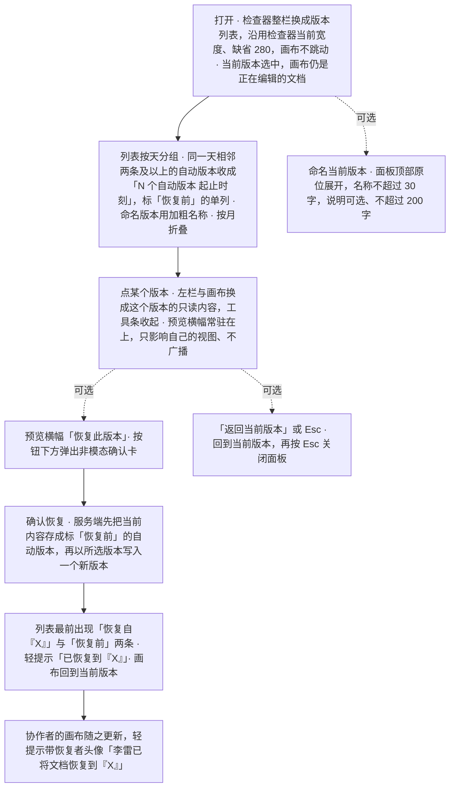

怎么读：浏览与预览只影响本地视图；虚线是三个可选动作，只有「恢复」会产生新版本并影响协作者。「恢复此版本」只在预览横幅上，列表行上不重复（质量门 Q2）；恢复用非模态确认卡而不是模态框——恢复前已自动存了「恢复前」版本，找回走版本历史、不靠撤销（rulings §4.25 DS-40，09 §3.3）。权限位（`history.read` / `history.restore`）的分流见 03-screens/07。

**边界情况**：

| 情况 | 处理 |
|---|---|
| 权限口径 | 查看历史需要 `history.read`，恢复需要 `history.restore`（PRD CO-07，两个独立能力位）；无 `history.read` 时面板入口本身不出现，而不是出现后再报错；编辑中被降权时文档菜单的「版本历史」与「重命名」「创建副本」一起留在原位、不可用，写「需要编辑权限」（与「文件 › 导出…」同一规则，rulings §4.25 TB-138；「创建副本」一项按 DS-139）；面板开着时被降权、失去 `history.read`：面板随即关闭、回到当前版本，焦点交回文件名（rulings §4.25 TB-63，同 03-screens/21 查找面板在降权时收起替换行的口径） |
| 编辑者查看（有 `history.read`，无 `history.restore` / `doc.manage`） | 可浏览与预览；「恢复此版本」「命名当前版本」留在原位不可用并提示「需要所有者权限」（恢复需 `history.restore`、命名需 `doc.manage`，两者只属于所有者）；面板顶部一行「只有所有者可以命名或恢复版本」；没有「最近删除」 |
| 评审者 / 查看者 | 没有 `history.read`，也没有文档菜单（文件名只显示、不是菜单触发器，rulings §4.25 DS-82），历史入口不出现（rulings U-09：`history.read` 只下放到编辑者；rulings §4.18 UX-17） |
| 预览中出现其他横幅 | 预览横幅是模式横幅、常驻在上，离线等横幅在它下方另占一条，最多两条（与母版视图同一例外，rulings §4.25 DS-39） |
| 离线 | 没加载过时面板只有当前版本 + 顶部一行「离线 · 无法加载版本历史，只显示本地最新内容」；加载过时显示内存里的缓存，整条时间轴置灰、不可点，顶部「离线 · 可能不是最新」；离线前已打开的预览留着；「命名当前版本」「恢复此版本」「彻底删除」离线时不可用（前端 50/08 §11） |
| 加载与出错 | 当前版本是本地的、立即可选，其下一行「正在加载版本历史…」（转圈 + 一句文字，不画骨架行）；快照较大时左栏与画布都显示「正在加载这个版本…」，「恢复此版本」等加载完才可用，换版本时取消上一个请求；加载失败时面板整块换成「版本历史加载失败 · 请检查网络连接后重试」+「重试」（rulings §4.25 DS-53） |
| 空态 | 用户可见的建文档路径（导入、新建空白、从模板新建、创建副本）都先写一个导入快照，所以列表里至少有当前版本与文档最早的那一条，下面一句「还没有其他版本。继续编辑后会自动生成版本；需要留档时，可以命名当前版本」（DS-53）；最早那一条按来源写：导入「导入自『文件名.pptx』」，新建空白「新建演示文稿」，从模板新建「从模板『〈模板名〉』新建」，创建副本「创建自『〈原文档名〉』的副本」（源文档未命名时写「创建自『未命名演示文稿』的副本」，rulings §4.25 TB-90）——来源与显示名由服务端记在这条导入快照的元数据里（rulings §4.25 DS-70，后端 60/15 §3.8）；经 API 直接建的空文档（集成与测试用）在首次压缩前列表只有「当前版本」一行与同一句说明（rulings §4.25 TB-74） |
| 快照数量很多 | 按月折叠，默认只展开最近一个月；30 天内的自动版本全量保留，更早的每天只留最后一个、标「当日最后版本」；命名版本永久保留（受配额）；列表末尾「加载更早版本」按游标翻页。自动版本按策略生成（PRD CO-07：每 10 分钟且有变更，或每 500 个 update；保留 30 天——章程 Q17 已裁决，rulings §4.16，默认值且部署配置可调） |
| 命名达上限 | 每份文档最多 200 个命名版本：表单留着、名称不丢，错误走轻提示「命名版本已达上限（每份文档 200 个）」——上限是整份文档的，不是名称写错了（前端 50/08 §9，rulings §4.25 DS-57） |
| 恢复时他人正在编辑 | 确认卡上加一行协作者头像与「…正在编辑，恢复后他们的画布会自动更新」，不阻止操作（符合软冲突而非硬阻断的整体哲学）；恢复在协同房间内以一个新事务写回，不加锁、协作者不断连 |
| 最近删除（M3，仅所有者） | 列表顶部一个缺省收起的折叠行「最近删除 N」，列出保留期内被删除的元素（不是版本）：元素与所在页 · 删除者 · 删除时间与剩余保留时长 ·「彻底删除」（中性次按钮，危险色只给确认框的主按钮）；彻底删除走模态确认，初始焦点在「取消」，确认后轻提示「已彻底删除 1 个元素」（不带撤销）；不设恢复按钮——找回走删除方撤销，或被删方在提示里点「恢复元素（含我的编辑）」（05 §6，rulings §4.25 DS-40、DS-57） |
| 以此版本创建副本 | 不做：PRD、03-07 与后端都没有这项能力，没有能力的入口不放（DS-57；要做需另走新增需求的变更） |
| 旧 `schemaVersion` 的历史版本 | 预览前经 `migrations` 透明迁移，用户无感知（章程 D6，PRD CO-07） |

**相关界面**：03-screens/07（版本历史）、03-screens/12（横幅叠放）。

---

## F9 插件启用/禁用/失败

2026-10-15 按 design-language-v3 第 2 批已拍板的样张改写（rulings §4.25 DS-38、DS-41、DS-49、DS-52、DS-54…DS-56）；界面、状态与文案以 03-screens/09（个人插件面板）为准。2026-10-01 起插件只经部署预置，启用与停用第三方插件是管理员在「管理 › 插件」的决定（03-screens/32，rulings §4.23）；本流程写普通用户看到的部分：个人启停、失败与缺插件。

**触发**：主菜单顶层「插件…」打开个人插件面板（居中对话框 640，DS-38；在「排列 ▸」之后、「帮助 ▸」之前，上下各一条分隔线，rulings §4.25 DS-18，03-screens/02 §2.3），评审、只读浏览与降权时照常可用；插件横幅、缺插件元素的检查器对象说明或右键里的「查看详情」；快捷键面板的冲突条目；命令面板；或系统检测到某插件 Fiber 进入 `FAILED`。

**主流程**：

**F9 个人启停与启动失败**

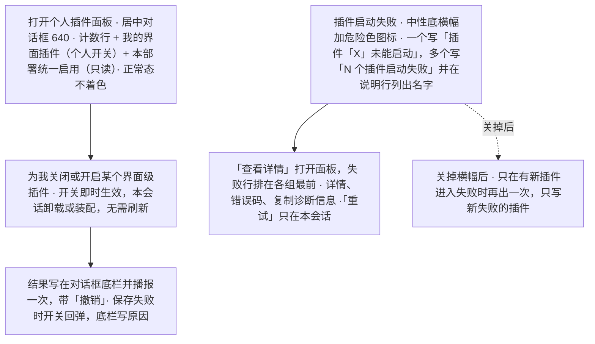

怎么读：左边一列是用户自己打开面板做个人启停；右边一列是运行时失败的处理。个人插件面板是模态对话框，遮罩会盖住画布轻提示，所以面板里的操作结果写在对话框底栏（DS-56）。插件状态的完整迁移见 03-screens/09 的生命周期状态图。

**边界情况**：

| 情况 | 处理 |
|---|---|
| 内置插件（如幻灯片核心插件束） | 不可在个人插件面板里关闭；核心组件在「本部署统一启用」里合成一行 |
| 第三方插件 | 普通用户不能启用或安装：首次启用第三方插件是管理员的决定，启用前在「管理 › 插件」展示贡献点清单与能力声明，并写明「同源可信、无运行时沙箱」（03-screens/32 §7.3，设计 06 §4） |
| 多类插件横幅同时成立 | 同一时刻只放一条，按「缺少插件 > 启动失败 > 设置已更新」取第一条没关过的，本会话里关过的不再出现（rulings §4.25 DS-54）；离线等连接类横幅在场时插件横幅让位，让位期间不算已展示（03-12 优先级） |
| 插件失败但不影响核心编辑 | 不打断用户当前操作，只出按需横幅（中性底 + 危险色图标，`role="status"`、不抢焦点，DS-41、DS-55）：一个失败时标题「插件「X」未能启动」、说明行只写「暂时不可用，其余功能照常」；多个时「N 个插件启动失败」、说明行列出插件名；内容级插件的重试写「仅在本会话重试；如持续失败，请联系管理员」 |
| 打开的文档缺少插件 | 一次性「缺少插件」横幅（中性底 + 警告色拼图，DS-41）；相关元素以占位显示——虚线框 + 图标 + 插件名 + 一行「原因，内容已保留」（DS-52）；占位可选中、移动、删除，不能改大小、不能编辑内部；选中时横幅与检查器对象说明各有一个「查看详情」，去处相同（个人插件面板，「本文档缺少的插件」分组置顶），两处都留 |
| 插件整页面板 | 设置型插件缺省留在检查器的插件分区，点分区右下的「展开」（由宿主按分区条目的 `expandPanel` 画出）或用插件的命令打开整栏面板，宽 max(400, 检查器当前宽度)，跟着触发它的选中对象，选中别的对象即收起（rulings §4.25 TB-59、TB-60）；评审与只读时就地只读展示（顶部一行权限说明、写操作不出现、不加蒙版）；宿主插件失败时面板内容换成「该面板不可用」+ 错误摘要 +「重试」，画布上的插件元素同时降级为占位（DS-38、DS-56，设计 06 §2.2、§3） |
| 插件条目很多 | 「更多」与主菜单「插入」在插件超过 3 个或任一插件超过 3 条时收进「插件 · N」小标题下、每个插件一行的子菜单；检查器插件分区超过 2 个时默认折叠（DS-49，设计 06 §2.6、§2.12） |
| 快捷键冲突 | 从快捷键面板的冲突条目进入：面板顶部说明行吸顶，写明冲突键、双方与当前生效的一方，打开时自动滚到冲突那一行；可由用户关闭的一方提供「为我关闭」，冲突一方是内容级插件时写「请联系管理员」；不提供改键（DS-56，03-screens/09） |
| 一个插件同时贡献多种槽位且部分成功部分失败 | 极端情况，按当前实现口径视为整体 Fiber 状态（`FAILED` 即全部贡献撤销），不做部分成功的中间态，避免状态解释复杂化（如未来需要更细粒度，需架构评估） |

**相关界面**：03-screens/09（个人插件面板）、03-screens/32（管理员插件管理）、设计 06 §2.2、§3。

---

## F10 母版视图与版式/主题管理（本轮新增）

**背景**：用户反馈"左侧栏与编辑器都没有考虑幻灯片母版"，本轮补齐。母版视图是编辑模式内的第二种视图模式（与评审/放映模式并列的"三种模式"是另一维度，二者正交，见 01-information-architecture.md §2.4 / §5a），且是**同一个编辑器**（左栏为母版缩略图窗格；检查器仅禁用评论；原 Ribbon「母版」页签（已废弃）的命令按 rulings §4.25 DS-1 拆到工具条、检查器分区、左栏「新建版式 ▾」、窗格右键与主菜单 / 快捷键，2026-10-07 第 1 批定稿（DS-21，03-screens/26 §1.2）；09 T-02），因此单列 F10 而不并入 F2——F2 描述的是"编辑一页内容"的通用命令回路，F10 描述的是"编辑影响一批页面的母版/版式定义"这一有质变差异的流程（一次操作的影响范围从"一页"变为"N 页"）。

**触发**：主菜单「视图 › 母版视图 ⌥⌘M」（2026-10-07 第 1 批定稿，rulings §4.25 DS-21，03-screens/02 §2.3）；或快捷键 `Mod+Alt+M`（rulings Q9；原 `Mod+Shift+M` 作废）；或命令面板搜索"母版视图"。这三个入口都不常驻；另有普通视图检查器上的两个上下文入口——无选中时「版式」节标题右侧的「编辑版式」（常驻，进入并选中本页所用的版式）与选中占位符形状时顶行的「转到版式」（同时选中版式上对应的占位符），可用性与原因同主菜单（2026-11-02，rulings §4.25 DS-147，修订 DS-21「不设常驻按钮」半句；「转到版式」的出现范围 2026-11-04 由 DS-174 定；01-information-architecture §2.4）。原主入口 Ribbon 页签行右侧的「普通｜母版」分段（rulings Q8）与「视图」页签「母版视图」按钮（03-screens/20）随 DS-1 去掉 ribbon 而取消。

**前置条件**：处于编辑模式（有 `doc.write`）且为桌面完整形态（视口 ≥ 1024、不是触控设备；rulings Q12、§4.25 TB-44：评审 / 放映 / 非完整形态不提供入口，见下）；文档已完成首屏渲染（母版/版式数据随 F1 主流程"解析母版/版式/主题"阶段先于首屏可用，见 F1 主流程与 03-screens/26"状态·加载中 / 加载失败"）。

**主流程（编辑一个占位符文本样式为例）**：

**F10 母版视图主流程：编辑一个占位符文本样式**

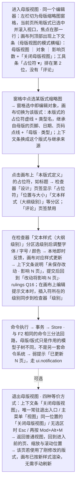

怎么读：自上而下是一次母版编辑的完整路径，与 F2 共用同一条命令回路；虚线表示退出是可选步骤，退出不丢弃已落盘的改动。

**分支/边界情况**：

| 情况 | 处理 |
|---|---|
| 评审模式 / 无编辑权限（`viewer`/`commenter`）/ 非完整形态（视口 < 1024 或触控） | **不提供入口**（rulings Q12）：评审模式下按 `Mod+Alt+M` 不切换、给一次轻提示「母版视图：评审模式下不可用」（rulings §4.25 DS-163），主菜单「视图」与命令面板的「母版视图」项与检查器的两个上下文入口禁用并注明"评审模式下不可用"；编辑模式但已被降权（`readonly-degraded`）时该项禁用、tooltip「需要编辑权限」；非完整形态时禁用、tooltip「在更大窗口中编辑」（与仅查看形态的说明同一口径，原「需要 ≥ 1024 宽度」作废，rulings §4.25 TB-44）——触控设备（平板）上写「在电脑上编辑」（含外接键盘按 `Mod+Alt+M` 时的提示，TB-136），嵌入里写「当前区域太窄，暂不可用」（DS-112），嵌入又是触控设备时以「在电脑上编辑」为准（嵌入只改写「在更大窗口中编辑」这一句，TB-159；「触控设备」只指平板，手机按窗口窄写，TB-163）；版本历史开着、文档打开中也不能进入（「关闭版本历史后可用」「文档打开后可用」，DS-162、DS-164，原因与次序以 03-screens/26 §1.1 为准）。已在母版视图中：**手动切到评审即退出母版视图**，回到进入前的页、缩放与滚动位置；**被降权时原地只读**——窗格与画布可浏览（原「可切换范围」随编辑范围一并作废，DS-146），母版的编辑类命令禁用（tooltip「需要编辑权限」），检查器各分区按 rulings §4.25 DS-15 只读展示当前值（不显示禁用控件，顶部一行说明权限），不产生「改动将影响 N 页」提示，四种退出方式照常；缩窄到 640–1024 不强制退出（窗格与检查器收成抽屉，抽屉从上下文条下沿开始、不盖住它，rulings §4.25 DS-130；03-screens/26 §6.6，rulings §4.18 UX-11 / UX-20），缩到 < 640（仅查看形态）即退出母版视图、回到进入前的位置（rulings §4.25 TB-16）；会话内的其余横幅（离线、降权、插件等）排在上下文条下方另占一条（TB-14） |
| 编辑权限但里程碑未达 `ML-03`（M3 前） | 浏览（`ML-01`）与版式应用/重置（`ML-02`，属于 F2 的一部分，非本流程）可用；M2 内占位符可选中（检查器显示类型、索引、来自哪个版式或母版）但不可移动与编辑：选中框没有手柄，旁边是锁形标签「版式编辑将在后续版本提供」——落位以 03-screens/26 §4.2 为准，放不下就不画，原因仍写在上下文条与检查器顶行（rulings §4.25 DS-156、TB-190）；上下文条写「可以查看并选中占位符，版式编辑将在后续版本提供」（PRD ML-01，样张 `master-view.m2-locked`，另有浏览版式、浏览母版、选中继承项与主题只展示一组 M2 画面）；新建版式、工具条「占位符 ▾」与检查器的编辑字段留在原位不可用并写原因，区分"需要编辑权限"与"版式编辑将在后续版本提供"（2026-10-07 第 1 批定稿） |
| 从版式改它的母版（如页脚） | 选中继承项，在检查器顶行点「在母版中编辑」：窗格选中母版并选中母版上同类型的占位符，焦点落在画布上那个占位符；不重新加载文档（rulings §4.25 DS-146、TB-205；原「切换编辑范围（版式 ⇄ 母版）」一行随编辑范围一并作废） |
| 查看用这个版式的页 | 检查器「使用此版式」下的「在普通视图查看」或窗格右键「在普通视图查看引用页」：退出母版视图并在普通视图选中这些页（rulings §4.25 DS-150） |
| 删除版式 / 母版 | **引用数 ≥ 1**（rulings Q11，2026-09-26 按 §4.20 FE-05 修订为确认后可撤销）：先弹确认对话框，文案与按钮次序（[取消][删除]）以 03-screens/26 §8 为准（rulings §4.25 DS-32；原写的「改用『与当前页相同』的默认版式」与 [删除][取消] 的次序作废）；删母版时各页改用按 order 排序的首个剩余母版中同 type 的版式（FE-23）；确认后受影响页在一个事务内改用默认版式（`defaultLayoutOf`，PRD ML-03 §1 术语），占位符按类型/索引重新匹配（与更换版式同一规则，03-screens/27），入撤销栈并给 toast「已删除版式，N 页已改用默认版式 [撤销]」；有无法匹配的元素时按 rulings Q13 统一文案 toast「N 个元素无法匹配新版式的占位符，已保留为普通形状 [撤销]」。影响范围是"批量页面"而非单一对象，且撤销栈只在会话内有效，所以先确认、确认后仍可撤销（产品默认答案 D9 的「确认 + 可撤销」双层例外，同「重置为版式默认」）。**引用数 = 0**：直接删除 + 可撤销 toast。版式多选批量删除按集合合并判定（03-screens/26 §8）；删除仅剩的母版禁用 |
| 并发编辑同一母版/版式（协同场景） | 属性级后写者胜，沿用 05-collaboration-ux.md §5 场景 C 的既有规则：受影响的字段短暂高亮 +「已更新」，不另设母版专属的冲突提示（03-screens/26 §8） |
| 关闭母版视图时存在未保存改动 | 不阻断关闭（改动已按本地乐观优先落盘为事务，退出视图不等于丢弃更改，与 F2 通用回路一致，不特殊化出"离开确认"） |
| 主题编辑（`ML-04`，M3 P1） | 通过检查器「主题」节进入：卡片展开主题画廊（内置主题与开始页模板统一为 简约 / 商务 / 暗色 / 学术 / 活力 5 套，每套 3 个色板变体，rulings §4.25 DS-33、DS-32），「调整主题」打开主题颜色与字体，普通视图与母版视图同一对弹层（取代原 Ribbon"母版"页签"编辑主题…"与"设计"页签；2026-10-07 第 1 批定稿，03-screens/28 §0），完整规格见 03-screens/28，是本流程在"批量影响范围"这一维度上的延伸（主题的影响范围是"整份文档"，比单个母版的"N 页"更大一层），流程结构相同（选择 → 调整 → 批量生效提示），不重复画一遍时序图 |

**相关界面**：03-screens/26（母版视图与母版/版式编辑，检查器分区见 §5）、03-screens/27（版式选择器分组与重置）、03-screens/28（设计主题）、03-screens/02 §2.4（母版视图在 v3 外壳中的呈现）、03-screens/03 补充 G-19（占位符属性分区）、03-screens/20（视图与缩放，主菜单「视图」入口）、03-screens/24（快捷键 `Mod+Alt+M` 与母版视图的 P、⌘M、⌘D）、03-screens/27 §4.3（只读时的「编辑版式」）。

---

## F11 分享与访问申请（2026-10-15 新增）

**背景**：分享相关的流程原来散在 F1（E5 申请访问）、F3 与 05-collaboration-ux.md §8；design-language-v3 第 2 批拍板后（rulings §4.25 DS-40、DS-47、DS-48、DS-50）合成这一条：所有者分享、非所有者查看、链接的放宽与撤销、访问申请的两端；同日回写中按 DS-66…DS-69 补了链接到期、访问申请的通知、被拒后的处理与非所有者复制到的链接。界面、状态与文案以 03-screens/08（分享对话框）为准，申请人一侧的阻断页见 03-screens/02 §6.2 与 03-screens/12，权限变化在对方那一端的即时反馈见 05-collaboration-ux.md §8；参考应用范围（PRD CO-15）。

**触发**：检查器顶行「分享」（网格视图在右上胶囊）；开始页「最近」与文档列表的卡片「⋯ › 分享…」——对话框叠在当前壳页面路由上（`/home?share=<id>`、`/documents?share=<id>`），不进编辑器，关闭后回到原列表与滚动位置、焦点回卡片，浏览器后退等于关闭（2026-10-22，rulings §4.25 TB-109）；申请人在阻断页（打开时就没有权限、链接已失效，或会话中访问被撤销）点「申请访问」。

**前置条件**：分享在 M3 开放（PRD CO-15）：M2 的「分享」按钮与卡片菜单的「分享…」留在原位、不可用，写「后续版本提供」（rulings §4.25 DS-137，§4.20 FE-06；与回收站「永久删除…」在 M2 的画法一致；「分享」按钮的工具提示写「分享 · 后续版本提供」，宿主既没给分享回调、也没标「后续版本提供」时不渲染「分享」，TB-161），阻断页上的「申请访问」同此、阻断页的说明句不变（TB-156），本流程从 M3 起。所有者（`doc.manage`）可以更改分享设置；其余角色点「分享」只能查看「谁能访问…」；所有访问都要求先登录，没有匿名访客（rulings §4.13 S-1、§4.15 Q6）。

**主流程**：

**F11 分享与访问申请**

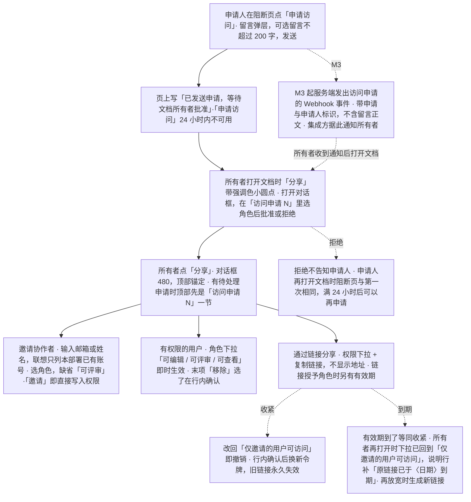

怎么读：上半是所有者在对话框里的三件事（邀请、改成员、改链接），权限都是即时生效，所以对话框没有底栏，唯一的主按钮是「邀请」；链接有两种回到「仅邀请」的路径——所有者收紧（行内确认）与有效期到了（不确认，等同收紧）。下半是访问申请从申请人到所有者的一圈：所有者打开文档时从「分享」按钮上的圆点看到有人在申请（打开编辑器时取一次，不实时推送）；要及时知道，靠 M3 起的 Webhook 事件由集成方去通知（rulings §4.25 DS-67、TB-68）。被拒的申请人不会收到任何告知（DS-68）。

**边界情况**：

| 情况 | 处理 |
|---|---|
| 非所有者点「分享」 | 打开只读的「谁能访问…」：顶部一行「只读 · 只有所有者可以更改分享设置」，成员只列姓名与角色（不显示邮箱），链接只读一行写当前有效链接的角色 +「复制链接」，下面的说明行与所有者相同、只是不写有效期与到期日（已撤销的不列）；没有邀请框、角色下拉与移除。「复制链接」复制到的与所有者相同（同 Figma）：链接授予角色时是凭链接访问的分享链接，效果与说明行一致；「仅邀请」时是文档地址（rulings §4.25 DS-69，样张 `share.no-permission-link`、`share.no-permission`）。后端的成员列表接口对非所有者只返回姓名与角色（不含邮箱），另附当前有效链接的角色，链接授予角色时再附这条链接的令牌（不含有效期与链接 id）；分享链接接口仍只给所有者，前端只发成员列表这一次请求（rulings §4.25 DS-48、TB-65、TB-86，后端 60/15 §3.4、§3.5）；所有者改回「仅邀请」时这枚令牌照样作废（DS-47）；前端的权限守卫随之放宽；原「非所有者复制的是文档地址，不是带令牌的分享链接」随 DS-69 作废；文档列表里的协作者摘要不随之放宽（rulings §4.24 TA-10） |
| 邀请失败 | 账号不存在（是否开放自助注册时文案不同）、邮箱格式不对、已有此权限、网络或服务端失败：错误内联在输入行正下方（危险色、`role="alert"`），网络或服务端失败时主按钮就地变为「重试」；不提供待接受的邀请（rulings §4.17 D1） |
| 邀请会降低已有权限 | 以本次邀请为准（覆盖），邀请前先给一行提示「该用户当前为可编辑，邀请后将变为可评审」 |
| 移除成员 | 入口在该成员的角色下拉末项「移除」（不设行尾 ×），选了在该行行内确认「移除〈名字〉？对方将立即失去访问权限」+「取消 / 移除」：焦点先落在「取消」，Esc 等同取消、不关对话框（rulings §4.25 DS-40）；对方在线时 ≤ 2 秒收到（PRD CO-05，05 §8） |
| 链接权限 | 仅邀请的用户可访问（缺省，链接本身不授予角色）/ 登录用户凭链接可查看 / 登录用户凭链接可评审，没有「可编辑」；放宽直接生效、不确认；链接授予角色时同一行多一个有效期（永久 / 7 天 / 30 天，PRD SV-06），选了期限后说明行写到期日（DS-47） |
| 收紧链接 | 改回「仅邀请」会让不在列表里、凭链接打开的人立即失去访问，且不可撤销：在这一节里行内确认，写明「不在上面列表中、凭链接打开的人将立即失去访问权限。原链接将永久失效，再次放宽时会生成新链接。」——收紧即撤销，令牌轮换；可评审 → 可查看仍有访问，直接生效（DS-40、DS-47） |
| 链接到期 | 有效期到了等同收紧：所有者再打开对话框时，链接权限下拉已回到「仅邀请的用户可访问」，说明行在含义后补一句「原链接已于〈日期〉到期」；再放宽时生成新链接，同收紧后的撤销（rulings §4.25 DS-66，样张状态 `share.link-expired`；所有者怎样从链接接口拿到到期时间见后端 60/15 §3.5） |
| 复制链接 | 点后 1.5 秒内显示「已复制」（两种文案同宽，这一行不跳），读屏播报一次；仅邀请时复制的是文档地址，链接授予角色时是带令牌的分享链接——所有者与非所有者复制到的是同一条（DS-69）：令牌加密存储、可以重取，每次复制都是同一条链接，改链接角色时令牌不变，只有收紧或到期之后再放宽才换新令牌（rulings §4.25 DS-47、TB-71）；链接授予角色、却取不到令牌时（服务端解密失败只省略令牌），「复制链接」留在原位不可用，提示「暂时无法取得分享链接，请稍后重试」，所有者与非所有者同一处理，不复制文档地址（rulings §4.25 TB-91，03-screens/08 §4.3） |
| 访问申请（所有者端） | 对话框顶部「访问申请 N」一节：逐条显示申请人、留言与时间，选角色后「批准」（次按钮，等同按人邀请）或「拒绝」；批准或拒绝后焦点交给下一条，没有了交给新加入的成员或邀请框；「分享」按钮上的圆点随条数减少、清零即消失，只有所有者看到（DS-48；PRD 原写的「待处理申请 N」统一为「访问申请 N」）。圆点的条数在所有者打开编辑器时随文档详情取一次，打开分享对话框时以申请列表为准，本端批准或拒绝后直接减一，不做实时推送（rulings §4.25 TB-68） |
| 申请人：打开时就没有权限 / 会话中访问被撤销 | 两处是同一布局的阻断页、同一个留言弹层（F1 E5）；会话中被撤销时整个工作区换成阻断页，内存里的文档与待同步更改一并清空，不提供导出（DS-50）；发送后不再另出轻提示（同一件事不说两遍）。编辑器不直接通知所有者：M3 起服务端记下申请时发出访问申请的 Webhook 事件，与评论事件同一套签名、重试与死信（PRD SV-15），载荷带文档、申请与申请人的标识、申请时间与是否附留言，不含留言正文，集成方据此通知所有者（rulings §4.25 DS-67，PRD 07 G-56；事件名与载荷以后端 60/07 §4.2、§5.1 为准）；文档在回收站里时照常记下申请，所有者恢复文档后可见（TB-73） |
| 申请被拒 | 不告知申请人：申请人再打开文档时看到的阻断页与第一次相同，满 24 小时后可以再申请；不提供查询本人申请状态的入口（rulings §4.25 DS-68） |
| 凭分享链接打开、尚未登录 | 先到登录页，登录后回到这份文档（next 由前端保住，登录失败重试也保住，rulings §4.25 TB-122）；selfSignup 关时登录页常显「没有账号？请联系管理员开通」，分享链接落地不另加提示，登录失败也不说「你还没有账号」（DS-119，F1 E0、03-33 §4.2） |
| 凭链接打开、链接已撤销或已到期 | 没有直接授权时是「链接已失效」阻断页（「这个分享链接已被撤销或已过期」+「申请访问」+「返回文档列表」），申请走同一个留言弹层（rulings §4.25 DS-71，F1 E5c、03-33 §7.3） |
| 加载、出错与离线 | 加载中两节标题都在、各一行：「正在加载成员与链接设置…」（转圈 + 一句文字）与「加载完成后可设置」，邀请输入框保持可用；加载失败时「有权限的用户」下一行危险色图标 +「成员与链接设置加载失败，请稍后重试」+「重试」，链接一节写「暂时无法设置」，不另开错误页；离线时顶部一行说明「离线时无法邀请协作者或生成分享链接」，各控件留在原位不可用，成员列表是离线前的缓存（DS-53、DS-62） |
| 大量成员 | 超过约 20 人时节标题下出现搜索框（按姓名或邮箱过滤，右侧给命中人数）；成员行的角色是无框的列表行内下拉，不排成一列框（设计 04 §4.1）；产品里列表虚拟滚动 |
| 文档已被删除 | 「分享」不可用（DS-62） |

**相关界面**：03-screens/08（分享对话框）、03-screens/12（权限变化与阻断页）、03-screens/02 §6.2（打开失败页）、03-screens/33（登录页与链接已失效）、03-screens/01（卡片「⋯」菜单的「分享…」）、05-collaboration-ux.md §8、§12。

---

## 流程总览图（状态机简化视角）

**流程总览（状态机简化视角）**

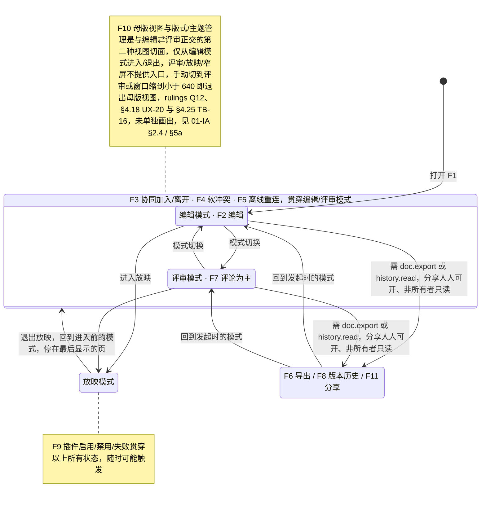

怎么读：外框内是 F3/F4/F5 贯穿的编辑与评审两种模式；进入放映可从任一模式出发，退出回到进入前的模式、停在放映里最后显示的那一页（01-IA §5.2，rulings §4.25 DS-109）；F6/F8 可从编辑或评审模式发起（按能力位：导出需 `doc.export`，版本历史需 `history.read`，评审模式下有权限的用户同样可从主菜单导出、从文档菜单打开版本历史，见 03-screens/02 §6.2），F11 的「分享」任何角色都能打开、只有所有者能改（rulings §4.25 DS-48），完成后回到发起时的模式；两条注释说明 F9 与 F10 不在主状态流上。（rulings §4.18 UX-09）

---

## F-P 原型 v2 流程映射（2026-09-15，来源 `10-prd/07-design-coverage-and-gaps.md` §3）

产品条线在覆盖矩阵中定义了原型 v2 必须演示的 15 条流程（`F-P01`–`F-P15`），与本文件的 F1–F11 不是一一对应关系——F-P 是"原型要演示到什么程度"的验收清单，F1–F11 是"设计上定义了哪些完整流程"，两者从不同维度切分同一批用户行为。下表给出映射，供实施原型 v2 时确认覆盖范围与演示方式（"可点击"须走通，"静态"仅需一帧可切换查看，见 07 §3 原表）。「演示方式」列描述的是旧版（ribbon 版，已被 DS-1 取代）playground 的演示路径；v3 迁移后的演示入口随 design-language-v3 各批更新（rulings §4.25 DS-8）：第 1 批（编辑器族 + 窄屏）已于 2026-10-07 在 `#/v3/editor?state=<场景>.<状态>` 拍板（DS-21），F-P01（打开与失败态，`main-states`）、F-P02（`slide-management`、`context-menu`）、F-P03（`insert`、`shape-library`、`undo-clipboard`）、F-P04（`text-edit`、`find-replace`）、F-P05（`image-editing`）、F-P06（`selection`、`view-zoom`）与 F-P16（下表）的 v3 演示入口按括注的场景；第 2 批（协作族）已于 2026-10-15 拍板（DS-38…DS-63）：F-P01 的保真报告部分（`fidelity`）、F-P08（`comments`）、F-P09（`offline-conflict` 的软冲突各态，在场头像与远端光标沿用第 1 批 `main-states`）、F-P10（`offline-conflict`）、F-P11（`version-history`）、F-P12（`share` 与 `offline-conflict.access-revoked`）与 F-P14 的插件部分（`plugins`）的 v3 演示入口按括注的场景；第 3 批（应用壳族）已于 2026-10-22 拍板（DS-79…DS-136）：F-P01 的文档列表、导入与打开失败部分（`documents`、`import`、`shell-pages`）、F-P07（`export`）、F-P12 的卡片「分享…」（`documents.share-from-card`）、F-P13（`present`）、F-P14 的设置与快捷键（`settings`、`shortcuts`、`command-palette`）与 F-P15（`viewer`，嵌入的形态 C 见 `embed.viewer-box`）的 v3 演示入口按括注的场景。

| F-P | 对应本文件流程 | 涉及界面（03-screens） | 演示方式 |
|---|---|---|---|
| F-P01 打开文档（成功+失败变体+保真报告） | F1 | 01、02、10、13、33 | 成功流程可点击；失败变体静态帧 ×3（v3：`documents.recent`、`import.dialog`、`import.dialog-uploading`、`import.dialog-failed-network`、`import.snapshot-opening`、`documents.trash-blocked`、`shell-pages.not-found-doc`） |
| F-P02 幻灯片管理 | F2（页管理子集） | 02、05、14 | 可点击 |
| F-P03 插入形状、变换、填充线条、撤销重做 | F2 | 02、03、04、15 | 可点击 |
| F-P04 文本编辑、格式化与查找替换 | F2 | 02、16、21 | 可点击 |
| F-P05 插入图片与裁剪 | F2 | 04、18 | 上传态静态；裁剪与替代文本可点击 |
| F-P06 多选、对齐分布、吸附与网格 | F2 | 02、17、20 | 框选与对齐可点击；参考线静态帧 |
| F-P07 导出 | F6 | 22 | 可点击（v3：`export.default`、`png`、`generating`、`exported-toast`） |
| F-P08 评论闭环 | F7 | 06 | 可点击（v3：`comments.default`、`tool`、`compose`、`locate`，手机 `comments.phone`） |
| F-P09 协同在场与软冲突 | F3、F4 | 02、05-collaboration-ux.md | 加入/跟随/"+N"可点击；软冲突（P0 高频 3–4 种，见 05-collaboration-ux.md §5）用原型控制条触发，其余按静态帧处理 |
| F-P10 离线、重连、降权与修复 | F5 | 12 | 可点击（控制条；v3：`offline-conflict` 各态） |
| F-P11 版本历史 | F8 | 07 | 可点击（v3：`version-history.default`、`preview`、`restore-confirm`、`restored`） |
| F-P12 分享与权限即时反馈 | F11、F3、05-collaboration-ux.md §8 | 08、12 | 分享可点击；目标端两帧静态（v3：`share.default`、`access-requests`、`request-access`，`offline-conflict.access-revoked`；卡片「分享…」`documents.share-from-card`） |
| F-P13 放映 | 03-screens/11 | 11 | 可点击（v3：`present.default`、`more-menu`、`page-jump`、`end`、`editor-following`、`following`） |
| F-P14 系统面板：插件管理器/设置/快捷键 | F9 | 09、23、24 | 可点击（插件 v3：`plugins.default`；设置与快捷键 v3：`settings.default`、`shortcuts.default`、`command-palette.default`） |
| F-P15 只读查看器 preset | 01-information-architecture.md §8 | 25 | 翻页/缩放/ⓘ/搜索可点击；加载/失败静态（v3：`viewer.default`、`summary`、`search`、`failed`、`narrow`） |
| F-P16 母版视图与版式/主题管理（`ML-01`–`04`；2026-09-18 措辞同步；2026-10-07 改为 v3 场景路由） | F10 | 26、27、28 | 进入母版视图（v3：主菜单「视图 › 母版视图」/ `Mod+Alt+M` / 命令面板 / 检查器「编辑版式」「转到版式」；旧稿的 Ribbon 页签行分段与视图页签按钮已被取代）→ 母版缩略图窗格选择母版与版式 → 画布上的占位符标注（虚线 + 类型名、继承点线）→ 占位符选中 → 检查器属性 → 上下文条「关闭母版视图」（或主菜单 / Esc / 快捷键）退出，为可点击闭环（v3 场景 `#/v3/editor?state=master-view.default`，入口演示 `master-view.entry`、`entry-inspector`、`goto-layout`；旧稿 `#/editor/masters` 只作对照）；分支：删除被引用版式 → 确认对话框 → 自动改用默认版式（rulings Q11，`master-view.delete-confirm`）。版式画廊与重置（27，`layout-picker.default`）、设计主题（28，`design-themes.gallery`）已在 v3 场景可点击 |

F-P09 的软冲突范围按总编排裁决执行（本轮 08 §6 Q1 的裁决结果）：v2 只把 P0 高频的 3–4 种（建议：场景 B 同位置编辑内联提示、场景 C 形状并发移动 Toast+「恢复我的值」（2026-09-24 按 rulings §4.15 Q3 由"撤销"改名）、场景 D 删除 vs 编辑 Toast+恢复）做成可点击，其余场景（含 CO-08 新增 4 行，见 `05-collaboration-ux.md` §5 补充）按静态帧处理，不在原型中逐一可点击验证。
