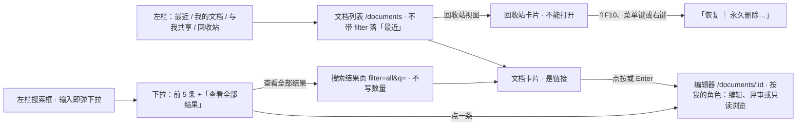
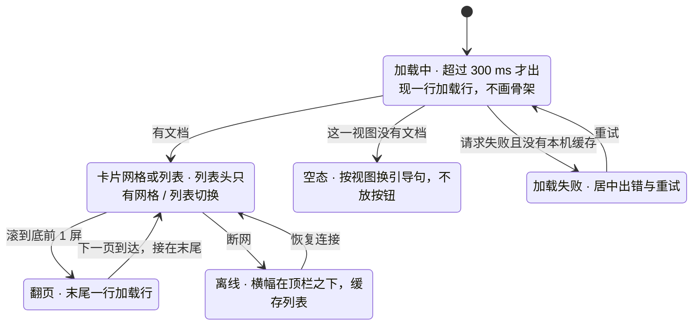
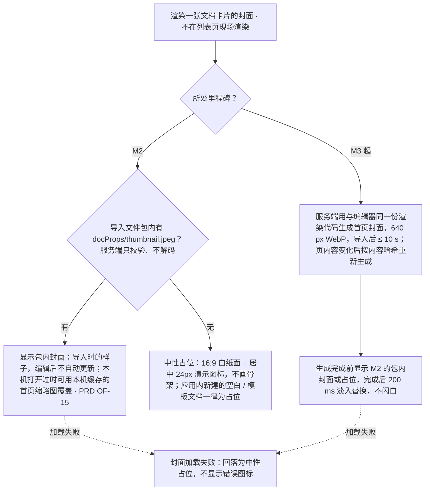

> 状态：草稿 | 负责：设计 | 更新：2026-09-18；2026-09-24（rulings §4.15 Q8：卡片封面来源——M2 包内封面、无则占位，M3 服务端渲染）；2026-09-25（补图）；2026-09-25（矛盾收口，rulings §4.18）；2026-09-25（§4.19）；2026-10-22（design-language-v3 第 3 批：按已拍板样张 `documents` 整篇改写——§1 线框按 v3 应用壳重画（左栏 220 五项 + 顶栏 56 + 横幅通道 + 列表头 + 四列卡片网格，另画卡片、搜索框下拉、回收站与窄屏），原顶卡、页内筛选 Tab 条与 shadcn / 材质层时期的写法作废；§2 左栏「最近 / 我的文档 / 与我共享 / 回收站」就是筛选、不设页内筛选条，`/documents` 不带 filter 落「最近」，「全部」只用于搜索结果，各视图次序固定、不加排序（DS-79、DS-84、TB-127）；§3 列 29 个样张状态与 3 个未采纳的备选（DS-63）；§4 卡片：开始页「最近」与文档列表同一张卡片、同一份「⋯」菜单，「移到回收站」单独末组、危险色，评审者与查看者没有「创建副本」，第二行「编辑者 · 相对时间」，我拥有的共享文档叠 2 位协作者、别人共享给我的是一枚所有者头像，卡片是链接，列表上的分享叠在列表路由上（DS-81、DS-82、DS-83、TB-108、TB-109）；§5 搜索为搜索框下拉（前 5 条 +「查看全部结果」进结果页），列表头、下拉与结果页都不写数量（DS-80）；§6 只在回收站里「永久删除…」（模态确认、不输文档名），回收站里的文档不能打开、卡片常驻「恢复」，打开回收站里的文档按所有者、有角色的非所有者、从未获授权的人三类分开（DS-85、DS-122）；§7 加载为加载行、不画骨架，空态不放按钮，横幅在顶栏之下、只横跨主区，离线时「新建演示文稿」保持 kit 主按钮不可用态，画布底上的次按钮一律 outline（DS-86、DS-88、DS-92、DS-123、TB-128）；§8「导入 .pptx」先进导入页，拖入落区照常保留，「取消」回到发起导入的那一页（DS-97、DS-98、TB-129）；§9 紧凑形态左栏收成抽屉、网格三列，手机与触控同开始页、不提供新建与导入（DS-87）；§10 卡片网格一个 Tab 停靠点、方向键漫游（TB-107）；依据 rulings §4.25 DS-63、DS-79…DS-88、DS-92、DS-97、DS-98、DS-122、DS-123、TB-107…TB-109、TB-123、TB-127…TB-129）；2026-10-22（design-language-v3 第 3 批回写补改：设计基准的源码改指转正后并入底座的件（kit `ShellLayout`、`DocumentCard`、`library`、`roving`、`DropOverlay`、`BlockingPage`，示例数据 `library.ts`、封面 `DocCover.tsx`）；§2.1「我的文档」「与我共享」与搜索结果按内容更新时间倒序，改名、移入与恢复回收站不改变次序（TB-144），网格 / 列表是本机视图偏好、与开始页「最近」共用一份（TB-131）；§3、§4.3、§7 的卡片菜单：M2 的「分享…」留在原位、不可用，标 M3、右侧「后续版本提供」（DS-137），§12 原待定一条结案；§5 搜索框下拉的键盘按 TB-130 定稿，手机与触控同用下拉、行高 44；§6 回收站的保留天数取 `GET /auth/config` 的 `trashDays`、到期按 `trashedAt` 计算（TB-141），新增 §6.1「此文档在回收站中」阻断页的完整规格（03-13 失败表引用）；§8 文件大小上限读 RuntimeConfig `limits.importMaxBytes`（TB-147），拖入松开即进上传中、跳过导入页，从导入页进入的「取消」回到打开导入页之前的那一页（TB-133）；§13 补阻断页一行；依据 rulings §4.25 DS-137、TB-130、TB-131、TB-133、TB-141、TB-144、TB-147）；2026-10-22（design-language-v3 第 3 批回写收口：§1.5、§9 手机与触控的顶部提示行按设备分开——< 640 仍写「在更大窗口中新建或导入演示文稿」，平板（触控、≥ 640）写「在电脑上新建或导入演示文稿」（TB-153）；§3「我的文档」「与我共享」两行的次序改为按内容更新时间倒序，与 §2.1 一致（TB-144）；§6 回收站卡片「恢复」失败为轻提示「无法恢复「〈名〉」」+「重试」，§6.1 阻断页「恢复」失败沿用登录页的内联错误画法，线框补内联错误一行，§3、§13 同步（TB-155、DS-120）；§6 从未获授权的人看到的阻断页上「申请访问」M2 留在原位、不可用，写「后续版本提供」，M3 起可用（TB-156）；§8 文件大小上限注明 web 容器直接读应用容器的同一部署值（TB-158）；依据 rulings §4.25 DS-120、TB-144、TB-153、TB-155、TB-156、TB-158；2026-10-22 复核修正：§1.5、§3 表后说明、§9、§11、§13 平板（触控、≥ 640）的左栏与卡片列数按窗口宽度、同桌面与紧凑，单列、搜索框在主区与不放网格 / 列表切换只对手机（TB-165），§9 注明「触控设备」只指平板（TB-163）、触控形态的搜索框不写 ⌘K（手机在主区、平板随左栏，TB-154、TB-164）、手机与平板上直接打开 `/import` 照常显示导入页（TB-167）；§4.2 第二行的来源写明 `DocumentSummary.lastEditor`、`contentUpdatedAt`（60/15 §3.3 已登记，原写「补登」）；§6 从未获授权的人看到的阻断页说明句不变、三个里程碑同一版式（TB-156）；§1.5、§3 表后说明、§9、§11、§13 平板列表头的网格 / 列表切换照常保留、同桌面与紧凑，只有手机（< 640）不放，平板搜索框随左栏、命中区 44、不写 ⌘K（TB-170）；§3 表后说明、§4.2、§5 卡片第二行与搜索下拉的「编辑者与时间」缺 `lastEditor`（系统作业建的文档）只写相对时间，`lastEditor` 与 `contentUpdatedAt` 都缺（还没有快照）时按 `createdAt` 写相对时间、不写编辑者，不拿所有者顶替，读屏名随之没有编辑者一段、列表显示时编辑者一列空着（TB-171）；§3「列表显示」一行与表后说明、§4.2、§5、§11、§13 列表显示时的「编辑者」「时间」两列、搜索下拉与搜索结果页的每一行同卡片第二行的取法（两项都缺时时间取 `createdAt`），下拉每行的读屏名缺编辑者时同样没有这一段；§2.1「我的文档」的次序写明取 `contentUpdatedAt`、还没有快照的取 `createdAt`（原写「还没有内容编辑的按建档时间」，TB-144、TB-171）；依据 rulings §4.25 TB-144、TB-154、TB-156、TB-163…TB-165、TB-167、TB-170、TB-171）；2026-10-23（design-language-v3 第 3 批评审修改：§8 改写——顶栏「导入 .pptx」（锚点 `import.entry`、`aria-haspopup="dialog"`）在本页上打开叠在列表之上的「导入」对话框（样张 `import.dialog-documents`），选文件、上传、服务端解析与失败都在框里，关闭后留在本页、焦点回到「导入 .pptx」；上传与解析中「取消」、×、Esc 都是中止并关闭，`/import` 叠在本页路由之上、后退即关闭，直接打开时背后是本页「最近」并先补一条历史，成功后替换成编辑器地址（rulings §4.25 DS-140 取代 DS-97、DS-98，TB-179，修订 TB-129、TB-133），整屏导入页与过渡页的写法作废；拖入落区改为强调色虚线加淡底（`--v3-panel` 上叠 `--v3-accent-soft`，与对话框里的拖入悬停同色）、松开即打开对话框的上传态、焦点落在「取消」，原中性的 `--v3-border-control` 虚线作废（TB-180、DS-141）；§2.1、§2.2、§3 `drop-import` 一行与表后说明、§9 手机与平板上直接打开 `/import`（手机为底部面板、平板为对话框，TB-181，修订 TB-167）、§10.3、§13 随之改；对话框按全站新画法（标题栏 40、圆角 12、× 正文色，DS-142），设计基准写明 `drop-import`、`purge-confirm`、`share-from-card` 的画面随之变，§13 永久删除确认补圆角 12、补「导入」对话框一行；依据 rulings §4.25 DS-140…DS-142、TB-179…TB-181；§8 拖入落区的对比度按设计 04 §2.6 的口径写作 4.24 / 4.57（向下截断）） | 依赖：charter v0.2；PRD `08-app-shell` AS-01、AS-02、AS-06，`05-embedding-and-integration` EM-17，`06-server-and-ops` SV-04、SV-11，`03-collaboration` CO-15；rulings §4.15 Q8、§4.18 UX-14、UX-19、§4.20 FE-06、§4.24 TA-10、§4.25 DS-40、DS-53、DS-63、DS-79…DS-88、DS-92、DS-97、DS-98、DS-120、DS-122、DS-123、DS-137、DS-140…DS-142、TB-107…TB-109、TB-123、TB-127…TB-131、TB-133、TB-141、TB-144、TB-147、TB-153…TB-156、TB-158、TB-163…TB-165、TB-167、TB-170、TB-171、TB-179…TB-181；前端 50/02 §2、§3、§8、§9.2、§9.3、§10.1；后端 60/15 §3.1、§3.3，60/17 §5；设计 03-29、03-02 §6.2、03-08、03-13、03-33；playground `#/v3/documents?state=documents.*`（`src/v3/scenarios/documents/`，底座 `src/v3/kit/`）、`#/v3/documents?state=import.dialog-documents`（`src/v3/scenarios/import/`）

# 03-01 文档列表（应用壳）

> **设计基准（2026-10-22 起，rulings §4.25 DS-79…DS-88、DS-92）**：以已拍板的 playground 第 3 批样张 `documents` 为准——路由 `#/v3/documents?state=documents.<状态 id>`（暗 / 亮另加 `&theme=dark|light`；`trash-blocked`、`reader-doc-name` 两态画在编辑器里，路由 `#/v3/editor?state=documents.<状态 id>`），29 个状态加 3 个未采纳的备选（§3）。源码在 `playground/src/v3/scenarios/documents/`：`documents.scenario.tsx`（各状态的标题与说明）、`Library.tsx`（主区：按状态取视图与初值，接上列表头、卡片网格、加载 / 空态 / 出错与搜索结果页）、`alts.tsx`（「此文档在回收站中」阻断页与三个未采纳备选的主区）。2026-10-22 转正时并入底座、开始页与文档列表共用的件在 `playground/src/v3/kit/`：`ShellLayout.tsx`（应用壳：左栏五项、搜索框下拉 `ShellSearch`、帮助菜单 `ShellHelpMenu`、顶栏按钮与不可用形态 `ShellDefaultActions`）、`DocumentCard.tsx`（文档卡片：链接、图钉与角色徽标、第二行与头像、「⋯」与右键、内联重命名）、`library.tsx`（列表头与网格 / 列表切换、卡片菜单 `docCardMenu`、列表操作与轻提示、永久删除确认与分享对话框的浮层）、`roving.ts`（卡片网格的键盘）、`DropOverlay.tsx`（拖入落区）、`BlockingPage.tsx`（阻断页）、`importDialog.tsx`（「导入」对话框的登记、开关与两个入口，对话框本身在 `scenarios/import/dialog.tsx`，§8）；示例数据与各视图的次序在 `src/v3/library.ts`，封面与无封面占位在 `src/v3/DocCover.tsx`，账户菜单的条目在 `src/v3/editor/chrome.tsx`（`accountMenuItems`，三处同一份）。对照截图 `openspec/changes/design-language-v3/screens/batch3/documents-<状态>-dark.jpg` / `-light.jpg`。2026-10-23 第 3 批评审修改起：「导入 .pptx」在本页上打开「导入」对话框（rulings §4.25 DS-140，§8），拖入落区改为强调色虚线加淡底（TB-180），对话框按全站新画法（标题栏 40、圆角 12、× 正文色，DS-142）——`drop-import`、`purge-confirm`、`share-from-card` 的画面随之变。应用壳（左栏、顶栏、横幅通道、帮助菜单与账户菜单）与开始页是同一套，以 [03-29](29-home-start-page.md) §2 为准；token 只写名字（样张作用域名 `--v3-*`），取值见设计 [04](../04-design-system.md)。此前的线框（顶部玻璃顶卡 + 页内筛选 Tab 条）、shadcn / 材质层时期的写法（`glass-strong`、`Badge`、`Skeleton`、`bg-doc-paper`）与旧路由 `#/documents` 一并作废。

全量文档的列表：最近打开的、我拥有的、别人与我共享的、回收站里的，以及跨全部文档的搜索结果。它是应用壳的页面（`apps/web` 的 `/documents`，前端 [50/02](../../50-frontend/02-app-shell-routing-and-session.md) §2、§9.2），不是编辑器本体（01 §1）；打开应用先到开始页（03-29），从开始页左栏进来。覆盖 PRD EM-17（参考应用的文档列表）、AS-02（「最近」与固定，与开始页同一份数据）、AS-06（账户菜单，三处同一份）、SV-04（卡片封面）与 SV-11、缺口 G-64（回收站）。

---

## 1. 线框

### 1.1 在应用壳中的位置（桌面 1600 × 1000，「最近」视图）

```
←──────── 220 ────────→←───────────────────── 主区（1600 宽视口下 1380）─────────────────────→
┌──────────────────────┬────────────────────────────────────────────────────────────────────────┐
│ [Logo] Cordex        │ 最近                                     [⇪ 导入 .pptx] [新建演示文稿] │
│                      ├────────────────────────────────────────────────────────────────────────┤
│ [⌕ 搜索          ⌘K] │                                                              [▦] [☰]   │
│                      │ ┌───────────────┐  ┌───────────────┐  ┌───────────────┐  ┌───────────────┐ │
│  首页                │ │  2026 年 Q2   │  │               │  │  产品路线图   │  │   设计评审    │ │
│ ▌最近                │ │   业绩汇报    │  │      [▭]      │  │               │  │               │ │
│  我的文档            │ └───────────────┘  └───────────────┘  └───────────────┘  └───────────────┘ │
│  与我共享            │ 2026 年 Q2 业绩汇报 * 未命名演示文稿     产品路线图         设计评审         │
│  回收站              │ 王小明 · 2 小时前 ●●  我 · 刚刚          李雷 · 昨天     ●  我 · 3 天前      │
│                      │ （第二行 4 张：招聘计划［可评论］· 新人培训手册 · 季度 OKR 复盘 · 客户成功案例［仅查看］） │
│                      │ （第三行 4 张：2027 预算编制说明［可评论］· 年度预算 · 市场活动复盘［仅查看］· 供应商评估） │
│  帮助                │                                                                        │
│ ──────────────────── │                                                                        │
│ (周) 周明远          │                                                                        │
└──────────────────────┴────────────────────────────────────────────────────────────────────────┘
```

图例：`▌` 当前导航项；`[▦] [☰]` 网格 / 列表切换（当前为网格）；`*` 固定的文档（标题后 12px 图钉）；`●●` 我拥有的共享文档右下叠放的两位协作者；`●` 别人共享给我的文档右下一枚所有者头像；`[▭]` 没有封面时的占位（§4.1）；`［可评论］``［仅查看］` 角色徽标（§4.2）。封面框里的文字只示意真实渲染的封面。截图：`screens/batch3/documents-recent-*.jpg`，样张 `documents.recent`。

### 1.2 文档卡片（网格与列表）

```
网格：四列，卡片内边距 8、圆角 8            列表：一行，内边距 8、圆角 8，列距 16
┌─────────────────────────────┐          ┌────────┬───────────────────┬───────┬─────────┬──────┐
│ ┌───────────────────── [⋯]┐ │          │ [封面] │ 招聘计划［可评论］│ 张三  │ 上周    │   ●  │ [⋯]
│ │      16:9 真实封面      │ │          │  120   │ 弹性              │  96   │  132    │  44  │
│ └─────────────────────────┘ │          └────────┴───────────────────┴───────┴─────────┴──────┘
│ 招聘计划［可评论］           │
│ 张三 · 上周               ● │
└─────────────────────────────┘
```

`[⋯]` 是「更多操作」按钮：网格浮在封面右上（距卡片上、右各 16，`--v3-panel` 底 + 1px 边），列表在行尾；平时不显示，悬停、焦点在卡片里或菜单开着时出现（触控形态常显，§9）。列表不画列名行（同开始页）。样张 `documents.mine`（第 2 张定格悬停、第 3 张定格键盘焦点）、`documents.list`。

### 1.3 搜索框下拉（DS-80）

```
┌──────────────────────┬──────────────
│ [⌕ 预算          ×]  │ 最近
│┌──────────────────────────────────┐
││ [▭] 2027 预算编制说明            │
││     赵敏 · 5 天前                │
││ [▭] Q3 预算执行情况              │
││     赵敏 · 10 月 9 日            │
││ [▭] 年度预算                     │
││     我 · 9 月 12 日              │
│├──────────────────────────────────┤
││ 查看全部结果                     │
│└──────────────────────────────────┘
```

下拉锚在左栏搜索框下方、左对齐，宽 340、内边距 4；每行一份文档：48 宽小封面 · 标题 · 编辑者与时间，最多 5 行；末行「查看全部结果」进搜索结果页（§5）。主区不变。样张 `documents.search-dropdown`。

### 1.4 回收站（M3）

```
│ 回收站                                                                                 │
├────────────────────────────────────────────────────────────────────────────────────────┤
│ 回收站里的文档 30 天后永久删除                                                [▦] [☰]   │
│ ┌───────────────┐  ┌───────────────┐  ┌───────────────┐                                 │
│ │░ 旧版产品介绍░│  │░ 团建方案   ░│  │░ Q1 周报合集 ░│                                 │
│ └───────────────┘  └───────────────┘  └───────────────┘                                 │
│ 旧版产品介绍 [恢复] 团建方案（草稿）[恢复] Q1 周报合集 [恢复]                             │
│ 21 天后永久删除     14 天后永久删除       3 天后永久删除                                  │
```

`░` 封面变淡（60% 不透明）；`[恢复]` 是常驻的次按钮（outline）；顶栏只有标题，不放「导入 .pptx」「新建演示文稿」。样张 `documents.trash`。

### 1.5 紧凑与手机

- **紧凑窗口（640–1024）**：左栏收成左侧抽屉，顶栏标题左侧多一枚「显示导航」开关（28）；卡片网格四列改三列，其余同桌面（§9，样张 `documents.compact`，1000 × 760）。
- **手机与触控（< 640 或 `pointer: coarse`）**：同开始页（03-29 §2.6）——不提供「导入 .pptx」「新建演示文稿」，「⋯」常显；顶部一行提示：< 640 写「在更大窗口中新建或导入演示文稿」，平板（触控、≥ 640）写「在电脑上新建或导入演示文稿」（rulings §4.25 TB-153）。手机（< 640，样张 `home.phone`）卡片单列、不放网格 / 列表切换；平板的左栏、卡片列数与列表头的网格 / 列表切换按窗口宽度，同桌面与紧凑（≥ 1024 左栏常驻、四列，640–1024 左栏收成抽屉、三列，TB-165、TB-170）。

---

## 2. 入口与视图

### 2.1 左栏就是筛选（DS-79）

左栏主导航五项「首页 / 最近 / 我的文档 / 与我共享 / 回收站」：「首页」回开始页，其余四项就是本页的筛选，列表页不设页内筛选条（同一筛选只有一个常驻入口，设计质量门 Q2）。`/documents` 不带 filter 时落「最近」；「全部」（`filter=all`）只用于搜索结果。左栏的画法、当前项、帮助菜单与账户菜单同开始页（03-29 §2.1、§2.4、§2.5）。

| 左栏项 | 路由 | 顶栏标题 | 列出的文档 | 次序（DS-84） | 顶栏右侧 |
|---|---|---|---|---|---|
| 最近（缺省） | `/documents?filter=recent` | 最近 | 我打开过的（本机缓存与服务端合并，PRD AS-02） | 固定的在前，其后按我最近打开的时间倒序 | 「导入 .pptx」「新建演示文稿」 |
| 我的文档 | `filter=owned` | 我的文档 | 我拥有的 | 按内容更新时间倒序（与卡片第二行的时间同源：取 `contentUpdatedAt`，还没有快照的取建档时间 `createdAt`，TB-144、TB-171） | 同上 |
| 与我共享 | `filter=shared` | 与我共享 | 别人拥有、我有直接授权的 | 同上 | 同上 |
| 回收站 | `filter=trashed` | 回收站 | 我拥有、已移到回收站的（PRD SV-11） | 按移入时间（`trashedAt`）倒序 | 不放 |
| 搜索结果（§5） | `filter=all&q=…` | 搜索「…」 | 能访问的全部文档，不含回收站 | 同「我的文档」 | 「导入 .pptx」「新建演示文稿」 |

- **不排序**：列表头只有网格 / 列表切换，不加排序菜单；各视图的次序固定、可预期（DS-84，不必为排序补参数与索引）。改名、移入与恢复回收站都不改变「我的文档」「与我共享」的次序，只有内容编辑会（rulings §4.25 TB-144，后端 60/15 §3.3）。开始页「最近」已拍板的排序菜单保留，只管开始页那一段，是本机的视图偏好，不带到这里；开始页按缺省「最近打开」排序时，前 8 条就是本页「最近」的前 8 条（TB-127）。
- **网格 / 列表**：与开始页「最近」同一组切换（§13），只改显示方式，不改次序与内容。它是本机的视图偏好，开始页「最近」与文档列表共用一份：在一处切成列表，另一处打开时也是列表（rulings §4.25 TB-131；存储键由前端 50/02 §10.1 登记）。
- **从别处进来**：开始页左栏四项；编辑器的阻断页（打开失败、没有访问权限、找不到该文档、此文档在回收站中）的「返回文档列表」落「最近」（03-13、03-33）；直接打开 `/import`（书签、新标签页，没有站内来路）时「导入」对话框叠在本页「最近」上，关闭后留在本页（03-13，rulings §4.25 DS-140、TB-179）。编辑器主菜单「返回首页」回开始页，不回本页（03-02 §2.3）。

**图 2-1 文档列表的入口与去向**



怎么读：左栏四项与搜索结果页都落在同一套卡片网格上；文档卡片是链接，打开后按我的角色进入编辑器的对应形态（01 §5.1）；回收站里的卡片不是链接，只能经菜单恢复或永久删除（§6）。
依据：rulings §4.25 DS-79、DS-80、DS-84、DS-85、TB-108；样张 `documents.recent`、`documents.search-dropdown`、`documents.search`、`documents.trash`。

### 2.2 顶栏与列表头

- **顶栏**（高 56，同开始页）：左侧标题是当前视图名（搜索时为「搜索「预算」」，检索词用「」包、整段不断行）；右侧「导入 .pptx」（次按钮，outline、16px 上传图标）与「新建演示文稿」（主按钮），回收站不放。「导入 .pptx」在本页上打开「导入」对话框（锚点 `import.entry`、`aria-haspopup="dialog"`，§8），「新建演示文稿」直接建档并进入编辑器（首页为标题版式，D14；03-29 §4）。
- **列表头**（高 28，内容区顶部）：左侧一句说明（12px `--v3-text-2`；只有回收站写保留天数，§6），右侧网格 / 列表切换。**不写数量**：游标分页（60/15 §3.3 的 `items`、`nextCursor`）没有总数，列表头、搜索下拉与搜索结果页都不写「N 份文档」「N 个结果」（DS-80）。加载中、出错与空态时不显示列表头（§7）。

---

## 3. 状态

样张路由均为 `#/v3/documents?state=documents.<状态 id>`（标「编辑器」的两态是 `#/v3/editor?state=…`），视口未写的按 1600 × 1000。表里的文档名、条数与天数都是样张示例，规格按规则写；示例的「今天」是 2026-10-16，相对时间 7 天内写「N 天前」「昨天」「上周」，更早写日期。

| 状态（样张标题） | 要点 | 样张 id | 里程碑 |
|---|---|---|---|
| 最近（缺省） | 左栏「最近」为当前项；列表头只有网格 / 列表切换、不写数量；固定的在前、其后按我打开的时间倒序；卡片第二行「编辑者 · 相对时间」，我拥有的共享文档右下叠 2 位协作者、别人共享给我的是一枚所有者头像，评审者 / 查看者的卡片带「可评论」「仅查看」；新建的「未命名演示文稿」没有封面，画白纸面占位 | `recent` | M2（EM-17、AS-02） |
| 我的文档 · 悬停与键盘焦点 | 只列我拥有的 9 份，按内容更新时间倒序（TB-144）；第 2 张定格悬停（铺 `--v3-card-hover`、右上出「⋯」），第 3 张定格键盘焦点（2px 强调色焦点环、偏移 1）——只为截图；Tab 进网格只停一次 | `mine` | M2 |
| 与我共享 | 别人共享给我的 6 份，按内容更新时间倒序；右下一枚所有者头像（读屏「所有者 X」）；评审者「可评论」、查看者「仅查看」，可编辑的不带徽标 | `shared` | M2 |
| 卡片「⋯」菜单（所有者，最近） | 分享… · 创建副本 · 重命名 ┊ 固定（已固定为「取消固定」）· 从最近移除 ┊ 移到回收站（危险色）；M2 的「分享…」留在原位、不可用，标 M3、右侧「后续版本提供」（DS-137，§4.3）；点「⋯」或焦点在卡片上按 ⇧F10 / 菜单键打开，锚在「⋯」下、右对齐 | `card-menu` | M2；「分享…」M3 起可用（PRD CO-15） |
| 卡片「⋯」菜单（查看者） | 只剩「分享…」（M3 起打开只读的「谁能访问…」；M2 不可用，同上）┊ 固定；没有「创建副本」「重命名」「移到回收站」 | `card-menu-reader` | M2 |
| 内联重命名 | 菜单「重命名」进入：标题换成输入框并全选原名，↵ 确认、Esc 取消、失焦保存，名字长时换到两行 | `rename` | M2 |
| 移到回收站后可撤销 | 不弹确认：卡片淡出、其后补位，焦点交给相邻卡片；主区底部轻提示「已将「设计评审」移到回收站」+「撤销」（5 秒） | `trashed-undo` | M2 |
| 回收站（M3） | 左栏「回收站」为当前项，顶栏只有标题；列表头「回收站里的文档 30 天后永久删除」；封面变淡、第二行「N 天后永久删除」、右下常驻「恢复」；卡片不是链接、不铺悬停底 | `trash` | M3（SV-11、G-64） |
| 回收站 · M2 | 说明行「移到回收站的文档可以在这里恢复」，第二行「9 天前移到回收站」；「⋯」里「永久删除…」留在原位、不可用，标 M3、右侧「后续版本提供」 | `trash-m2` | M2 |
| 永久删除确认 | 模态确认框：「永久删除「Q1 周报合集」？」+「删除后无法恢复。」，危险主按钮「永久删除」，初始焦点在「取消」 | `purge-confirm` | M3 |
| 永久删除进行中 | 卡片留在原位：「恢复」与「⋯」收起，第二行换成转圈 +「正在永久删除…」；完成后卡片消失并轻提示「已永久删除「…」」 | `purging` | M3 |
| 所有者打开回收站里的文档（编辑器） | 阻断页（§6.1）：回收站图标 · 文档名 ·「此文档在回收站中」·「恢复后即可打开和编辑；21 天后将永久删除」· 主按钮「恢复」·「返回文档列表」；「恢复」失败时主按钮上方一行内联错误（TB-155） | `trash-blocked` | M2（M2 说明不写到期天数） |
| 搜索框下拉 | 左栏搜索框下方弹出前 5 条（小封面 · 标题 · 编辑者与时间）+「查看全部结果」；没有命中时一行「没有匹配「…」的文档」；不写数量；主区不变；键盘按组合框，焦点留在搜索框（TB-130，§5） | `search-dropdown` | M2 |
| 搜索结果 | 「查看全部结果」进入：`/documents?filter=all&q=预算`，顶栏「搜索「预算」」，左栏没有当前项；同一套卡片与菜单；Esc 或 × 清空并回到搜索前的页面 | `search` | M2 |
| 搜索无结果 | 结果页居中「没有匹配「年报」的文档」+「检查拼写，或尝试其他关键词」，不放按钮 | `search-empty` | M2 |
| 我的文档为空 | 居中整块状态「这里还没有任何文档」+「新建一份演示文稿，或导入已有的 .pptx 文件」，不放按钮、不显示列表头 | `empty` | M2 |
| 与我共享为空 | 「还没有人与你共享文档」+「别人与你共享的演示文稿会显示在这里」，不放按钮 | `shared-empty` | M2 |
| 回收站为空 | 「回收站是空的」+「移到回收站的文档会保留 30 天，期间可以恢复」（M2 写「移到回收站的文档可以在这里恢复」） | `trash-empty` | M2 / M3 |
| 加载中 | 超过 300 ms 才出现：内容区居中一行加载行「正在加载文档…」，不画骨架、不显示列表头；左栏与顶栏照常可用 | `loading` | M2 |
| 加载失败 | 内容区居中：危险色图标 ·「文档列表加载失败」·「请检查网络连接后重试」·「重试」（outline）；不显示列表头 | `error` | M2 |
| 离线 | 离线横幅在顶栏之下、只横跨主区；「导入 .pptx」「新建演示文稿」留在原位、不可用；本次打开过的 2 份照常，其余变淡、不能打开；「⋯」里除「分享…」外全部不可用、顶部一行「离线时不可用」（M2 的「分享…」本来就不可用，照写「后续版本提供」，§4.3） | `offline` | M2 |
| 列表显示 | 列表行同开始页列表：120 封面 · 标题（图钉与徽标）· 编辑者 96 · 时间 132 · 头像，行尾「⋯」；编辑者与时间两列的取法同卡片第二行（§4.2，TB-171）；不画列名行 | `list` | M2 |
| 滚动翻页 | 游标分页 + 虚拟滚动，滚到底前 1 屏预取；翻页时列表末尾追加一行「正在加载更多文档…」，不整页替换 | `load-more` | M2 |
| 创建副本进行中 | 主区底部轻提示「正在创建「供应商评估」的副本…」（转圈、没有关闭按钮）；成功后直接进入新文档，不生成占位卡片 | `duplicating` | M2 |
| 访问权限被收回 | 那张卡片从列表淡出、其后补位；轻提示「「市场活动复盘」的访问权限已被更改」只出一次（中性、可关闭） | `access-changed` | M2 |
| 从卡片打开分享 | 卡片「分享…」在列表上打开分享对话框（03-08），叠在当前列表路由上 `/documents?share=<id>`；关闭回到原列表与滚动位置、焦点回到这张卡片 | `share-from-card` | M3（CO-15） |
| 编辑器里查看者的文件名（编辑器） | 评审者与查看者没有「创建副本」，编辑器文档菜单因此没有条目，左栏顶部只显示文件名、不再是菜单触发器（03-02 §2.3） | `reader-doc-name` | M2 |
| 拖入 .pptx | 文件拖进主区时，顶栏以下整块换成落区（强调色虚线 + 淡底 · 32px 文件图标 ·「松开以导入」·「只支持 .pptx，单个文件最大 200 MB」，上限读部署配置），松开即在本页上打开「导入」对话框的上传态、焦点落在「取消」；回收站视图不接收拖放（§8） | `drop-import` | M2（SV-01，TB-180） |
| 紧凑窗口 640–1024 | 1000 × 760：左栏收成左侧抽屉，顶栏左端「显示导航」开关；网格四列改三列，列表头、卡片、菜单与键盘不变 | `compact` | M2 |

样张没有单独画、行为照常的：「导入 .pptx」打开的「导入」对话框画在 import 场景（`import.dialog-documents`，03-13）；「最近」为空（与「我的文档」为空同一句）；手机与触控形态（手机同开始页 `home.phone`；平板的左栏、列数与网格 / 列表切换按窗口宽度、提示行按 TB-153，TB-165、TB-170，§9）；缺最近编辑者或还没有快照的卡片（第二行只写时间，列表显示时编辑者一列空着，搜索下拉与搜索结果页同此，TB-171，§4.2）；恢复成功的轻提示「已恢复「…」」（成功色对勾）；回收站卡片上「恢复」失败的轻提示「无法恢复「…」」+「重试」（TB-155，§6）与阻断页上的恢复失败（§6.1）；永久删除失败与创建副本失败的轻提示（+「重试」）；重命名保存失败（回滚并轻提示）。

**图 3-1 列表内容区的状态**



怎么读：箭头是内容区的切换，左栏与顶栏在各状态下照常可用；搜索结果页与回收站用同一组状态，空态与说明的文案按视图换（§5、§6、§7）。离线是叠在列表上的一层：列表保留最近一次取到的内容，横幅在顶栏之下。
依据：rulings §4.25 DS-53、DS-86、DS-88、DS-92；前端 50/02 §9.2；样张 `documents.loading`、`documents.error`、`documents.empty`、`documents.load-more`、`documents.offline`。

### 3.1 未采纳的备选（DS-63）

拍板时画给用户对照的备选留在样张里，标题前加「未采纳 · 」、说明写明由哪一条 DS 定为推荐；路由不变，实现以上表的状态为准。

| 备选 | 样张 id | 内容 | 结论 |
|---|---|---|---|
| 页内分段筛选 | `alt-filter-tabs` | 列表页保留分段「全部 / 我拥有 / 共享给我 / 最近 / 回收站」，左栏仍是四项、只作预置筛选，页面标题统一「文档」 | 未采纳，DS-79 定为左栏即筛选 |
| 列表头排序菜单 | `alt-sort-menu` | 列表头在网格 / 列表切换右侧加与开始页同一份的排序菜单（最近打开 / 最近编辑 / 名称 / 创建时间） | 未采纳，DS-84 定为不排序 |
| 回收站里的文档打开为只读预览 | `alt-trash-preview`（编辑器） | 所有者打开回收站里的文档进编辑器只读形态，画布顶部横幅「此文档在回收站中」+「恢复」 | 未采纳，DS-85 定为不能打开、换成阻断页 |
| 边输边搜、主区换成结果页 | （借 `search` 的画面） | 搜索框输入第一个字即进结果页，Esc 回到搜索前 | 未采纳，DS-80 定为搜索框下拉 |
| 写结果数 | （没有出图） | 列表全部取回时写数量，或后端补总数 | 未采纳，DS-80 定为一律不写数量 |
| 两处各一份菜单 | （没有出图） | 开始页「最近」只有固定 / 分享 / 从最近移除，文档列表只有重命名 / 分享 / 移到回收站 / 创建副本 | 未采纳，DS-81 定为同一份菜单 |
| 卡片第二行只写相对时间 | （没有出图） | 不补最近编辑者，第二行只写时间 | 未采纳，DS-83 定为「编辑者 · 相对时间」 |
| M2 不显示「分享…」，或只给只读的「谁能访问…」 | （没有出图） | 同账户菜单「个人资料…」在 M2 不显示（DS-91）；或 M2 只开放非所有者的读者视图 | 未采纳，DS-137 定为留在原位、不可用、标 M3 |
| 骨架卡片、空态放按钮、手机照常新建 | `home.alt-loading-skeleton`、`home.alt-empty-create`、`home.alt-phone-create` | 开始页的三个备选，文档列表同一取舍 | 未采纳，DS-86、DS-88、DS-87 |

---

## 4. 卡片

开始页「最近」、文档列表的各视图、搜索结果与回收站是同一张卡片、同一份「⋯」菜单（DS-81），按视图与角色增减。

### 4.1 封面（rulings §4.15 Q8；PRD SV-04）

卡片封面不由浏览器在列表页现场渲染（列表页不加载渲染引擎），按里程碑取来源：

| 阶段 | 封面来源 | 没有来源时 |
|---|---|---|
| M2 | 导入文件包内自带的封面图（`docProps/thumbnail.jpeg`，PowerPoint 保存时生成；服务端只校验、不解码） | 中性占位：16:9 白纸面（与真实封面同尺寸）+ 居中 24px `Presentation` 图标（纸面上的 `--v3-text-3`），不画骨架条；读屏名「〈文档名〉（暂无封面）」。应用内新建的空白 / 模板文档一律为占位（新建也经服务端导入内置模板字节，这些字节不带包内封面，rulings §4.19 D-M2-CONTENT） |
| M3 起 | 服务端用与编辑器同一份渲染代码生成首页封面（640 px WebP），导入后 ≤ 10 s 出现；页内容变化后按内容哈希重新生成 | 生成完成前显示 M2 的包内封面或占位，完成后淡入替换（200 ms），不闪白 |

- M2 的包内封面是导入时的样子（M2 没有 pptx 内容保存路径，文档内容只在协同快照里），编辑后不自动更新；这是过渡口径，卡片上不加「封面可能过时」之类的标记。本机打开过的文档可用本机缓存的首页缩略图覆盖过时的包内封面（PRD OF-15）。
- 封面里的外链图片一律画为占位（服务端不加载外部资源），与编辑器里的显示可能不同。
- 封面加载或生成失败：回落为上述占位，不显示错误图标。
- 封面圆角 6、1px `--v3-border`，`role="img"` 带文档名。

**图 4-1 卡片封面来源判定**



怎么读：先按里程碑分流，再按是否有来源决定显示内容；虚线是任何来源加载失败时的统一回落。占位与真实封面同尺寸，切换时卡片高度不变。
依据：rulings §4.15 Q8、§4.19 D-M2-CONTENT；PRD SV-04、OF-15；样张 `documents.recent`（「未命名演示文稿」）。

### 4.2 标题、第二行与头像（DS-83）

- **标题**：13px / 20px 500，单行截断；固定的文档标题后一枚 12px 图钉（`--v3-text-2`，PRD AS-02）；我不是编辑者时标题后一枚角色徽标——评审者「可评论」、查看者「仅查看」（两者打开后的界面不同，01 §5.1，rulings §4.18 UX-19），可编辑的不带。图钉与徽标不随标题截断被挤掉。
- **第二行**：「编辑者 · 相对时间」（12px / 16px `--v3-text-2`）——最近一次编辑内容的人（是我时写「我」）与时间，取自 `DocumentSummary` 的最近编辑者 `lastEditor` 与内容更新时间 `contentUpdatedAt`（后端 60/15 §3.3，DS-83）。缺 `lastEditor`（系统作业建的文档，没有可归属的用户）时只写相对时间；`lastEditor` 与 `contentUpdatedAt` 都缺（还没有快照）时按建档时间 `createdAt` 写相对时间、不写编辑者；不拿所有者顶替编辑者（rulings §4.25 TB-171；两种省略的来由见 60/15 §3.3）。列表显示时的「编辑者」「时间」两列（§1.2）、搜索下拉（§5）与搜索结果页的每一行取法同此——列表显示时缺 `lastEditor` 则编辑者一列空着、时间照写（TB-171；回收站视图的这两列另写，§6）。「最近」视图也写编辑时间，次序看的是我打开的时间（§2.1）。不写「编辑」二字。
- **右下头像**（16px，只画身份色、不写首字，姓名走读屏名；身份色按 TB-123）：我拥有、且共享给了别人的文档叠 2 位协作者（后者左移 3、描边取画布底色，读屏「共享给 X、Y」，取自协作者摘要，rulings §4.24 TA-10）；别人共享给我的文档是一枚所有者头像（读屏「所有者 X」）；我拥有、没有共享的不画。
- **读屏名**：整张卡片一个名字，写全「标题，编辑者 X，时间，已固定，可评论 / 仅查看，所有者 X / 共享给 X、Y」（缺编辑者时没有「编辑者 X」这一段，TB-171），不靠封面图与 16px 头像拼读。

### 4.3 「⋯」菜单（DS-81、DS-82）

| 视图 · 我的角色 | 条目 |
|---|---|
| 最近 · 所有者（开始页「最近」同此） | 分享… · 创建副本 · 重命名 ┊ 固定 / 取消固定 · 从最近移除 ┊ 移到回收站（危险色） |
| 我的文档、搜索结果 · 所有者 | 分享… · 创建副本 · 重命名 ┊ 固定 / 取消固定 ┊ 移到回收站（危险色） |
| 可编辑的共享文档 | 分享… · 创建副本 · 重命名 ┊ 固定 / 取消固定（「最近」视图另有「从最近移除」） |
| 评审者、查看者 | 分享… ┊ 固定 / 取消固定（「最近」视图另有「从最近移除」）；没有「创建副本」（rulings §4.12 U-09：创建副本要 `doc.export`，只给编辑者及以上，DS-82）、「重命名」与「移到回收站」 |
| 回收站 | 恢复 ┊ 永久删除…（危险色；M2 留在原位、不可用，标 M3、右侧「后续版本提供」） |
| 离线 | 条目同上，除「分享…」外全部留在原位、不可用，菜单顶部一行「离线时不可用」（同一原因写一行，09 §3.4 菜单条目规范第 4 条）；M2 的「分享…」照写它自己的原因「后续版本提供」 |

- 「移到回收站」只给所有者，单独放在最后一组、用危险色（销毁类与其余条目分开）；「从最近移除」只在开始页「最近」与「最近」视图出现。
- **M2 的「分享…」**（rulings §4.25 DS-137）：分享随 PRD CO-15 在 M3 开放，M2 的这一项留在原位、不可用，标 M3、右侧「后续版本提供」（§4.20 FE-06「禁用而不隐藏」；与回收站「永久删除…」在 M2 的画法一致，§6）；开始页「最近」与文档列表各视图、各角色都是这样（回收站视图没有这一项），编辑器的「分享」按钮同此（03-02 §3.5）。
- **打开**：点「⋯」，或焦点在卡片上按 ⇧F10 / 菜单键（TB-107）；锚在「⋯」下、右对齐；关闭后焦点回到卡片。卡片是链接，右键是浏览器原生的链接菜单（新标签页打开、复制链接地址），我们的菜单不加「在新标签页打开」（TB-108）；回收站卡片不是链接，右键打开同一份「恢复 ┊ 永久删除…」。
- **分享…**（M3 起可用，PRD CO-15；M2 不可用，见上一条）：所有者打开分享对话框，其余角色打开只读的「谁能访问…」（03-08 §1.3，DS-48）；对话框叠在当前壳页面的路由上（`/documents?share=<id>`；开始页 `/home?share=<id>`），关闭（× / Esc）回到原列表与滚动位置、焦点回到这张卡片，浏览器后退等于关闭（TB-109）。
- **创建副本**：服务端作业（`POST /documents/:id/duplicate`，带 `Idempotency-Key`，50/02 §8）。主区底部轻提示「正在创建「〈名〉」的副本…」（转圈，没有关闭按钮），成功后直接进入新文档；不生成占位卡片（rulings §4.18 UX-14）；失败时轻提示「无法创建副本」+「重试」（沿用同一个 `Idempotency-Key`）。新文档版本历史最早一条写「创建自『〈原文档名〉』的副本」（DS-70）。
- **重命名**：只从菜单进入（不设双击标题进入，与单击卡片打开冲突）。标题原位换成输入框（字段外观：淡底，聚焦为 1px 强调色线；文字与标题同位置、同字号），一进来全选原名；↵ 确认、Esc 取消、失焦保存；名字长时换到两行（最多两行，卡片下方随之撑高）；输入框里方向键照常移动光标、不在卡片间漫游；结束后焦点回到这张卡片。乐观更新，保存失败回滚并轻提示（50/02 §9.2）。
- **固定 / 取消固定**：立即生效、不出轻提示，标题后的图钉随之出现或消失；「最近」视图里固定的排到最前（服务端同步，rulings §4.12 U-04）。
- **从最近移除**：不删除文档。卡片立即移走、其后补位，焦点交给相邻卡片；轻提示「已从最近移除「〈名〉」」+「撤销」，5 秒到期才真正发请求（`DELETE /documents/:id/recent`，50/02 §8）；文档仍在「我的文档」或「与我共享」里。
- **移到回收站**：不弹确认（回收站里能恢复）。卡片淡出、其后补位，焦点交给相邻卡片；轻提示「已将「〈名〉」移到回收站」+「撤销」（5 秒；撤销即调恢复端点，卡片回到原位、焦点回到它）。
- 轻提示在主区底部居中、离底 24（应用壳没有底部工具条）；文档名一律用「」包。

### 4.4 不能打开的卡片

- **离线**：本会话里仍保活的文档照常可开（50/02 §2.2、§9.1），其余卡片留在原位、封面与文字变淡（头像随之变淡）、不是可跳转的链接（`role="link"` + `aria-disabled`，仍在漫游网格里能停上去），工具提示与读屏名写「离线时只能打开本次打开过的文档」（rulings §4.20 FE-06）。
- **回收站**：卡片是可聚焦的容器（`role="group"`），不是链接、不铺悬停底，Enter 不打开（§6）。

---

## 5. 搜索（DS-80）

- **搜索框**：左栏的同一个搜索框（开始页与文档列表都在左栏，03-29 §2.1）；⌘K（Windows / Linux Ctrl+K）把焦点移到这里（开始页作用域，PRD AS-01，rulings §4.25 DS-11）；有字时右侧「⌘K」提示换成 20 的清除按钮「清除搜索」。
- **下拉**（§1.3）：输入即在搜索框下方弹出即时结果，主区不变。服务端检索（去抖 300 ms，50/02 §9.2），范围是能访问的全部文档、不含回收站；最多 5 行，每行 48 宽小封面（圆角 4、1px 边）· 标题（12px 500）· 编辑者与时间（12px `--v3-text-2`；取法同卡片第二行：缺 `lastEditor` 时只写时间，还没有快照时时间取 `createdAt`，§4.2、TB-171），行高随两行文字，悬停铺 `--v3-panel-2`；点一行按我的角色打开那份文档（同卡片）。没有命中时只有一行「没有匹配「…」的文档」（检索词用「」包、不断行，同已拍板的分享「没有匹配「…」的人」）。分隔线下末行「查看全部结果」（28 高、12px `--v3-text-2`）进搜索结果页。下拉里不写数量（游标分页没有总数）。
- **下拉的键盘**（rulings §4.25 TB-130）：按组合框模式，同命令面板（03-24 §8）——焦点留在搜索框，↓ / ↑ 在各行与「查看全部结果」之间移动当前项（`aria-activedescendant`），↵ 打开当前项，还没移动时 ↵ 等于「查看全部结果」；Esc 先收起下拉、再按一次清空搜索框；点外面收起。设计 07 §1.2、§3 登记同一份。
- **手机与触控**：同用这个下拉，不另做整页搜索；每行高 44（07 §2 命中区），其余同桌面（TB-130；搜索框的位置见 §9）。
- **搜索结果页**（`/documents?filter=all&q=预算`，样张 `documents.search`）：顶栏标题「搜索「预算」」，左栏没有当前项；列表头与结果都不写数量；结果用同一张卡片（第二行与列表显示时的「编辑者」「时间」两列取法同 §4.2，TB-171），菜单按各自的视图与角色（没有「从最近移除」），链接与键盘同 §10。在结果页里改搜索框的内容，下拉照常弹出，↵ 或「查看全部结果」按新词刷新本页。搜索框里按 Esc 或点 ×：清空并回到搜索前的页面（从开始页搜的回开始页；没有站内上一页时落「最近」）。
- **结果页没有命中**（`documents.search-empty`）：居中整块状态（中性 `SearchX` 图标）「没有匹配「年报」的文档」+「检查拼写，或尝试其他关键词」，不放按钮。
- **离线**：只搜本机缓存的列表（下拉与结果页同此）。
- 检索词与筛选都写进 URL（`q=`、`filter=`），刷新与浏览器返回可以恢复（50/02 §9.2）。

---

## 6. 回收站（DS-85）

- **视图**（`documents.trash`，M3）：左栏「回收站」为当前项；顶栏只有标题；列表头一句说明「回收站里的文档 30 天后永久删除」（天数是部署配置 `retention.trashDays`，缺省 30、可配 1–365，PRD SV-11；前端从 `GET /auth/config` 的 `trashDays` 取，不在前端另配，rulings §4.25 TB-141，后端 60/15 §3.1）。只列我拥有的、按移入时间倒序。
- **卡片**：封面变淡（60%）；第二行「N 天后永久删除」（到期时刻是 `DocumentSummary.trashedAt` 加保留天数，N 是离到期还剩的天数，60/15 §3.3）；右下常驻「恢复」（次按钮，outline：画布底上的次按钮一律 outline，TB-128），指针一下就能点，不进 Tab 顺序（键盘用 ⇧F10 菜单的首项「恢复」，TB-107）；卡片不是链接、不铺悬停底；读屏名写明「〈名〉，在回收站中，N 天后永久删除」。列表显示时第 3、4 列换成「〈N 天前〉移入」与「N 天后永久删除」。
- **M2**（`documents.trash-m2`）：M2 只有移入与恢复（到期清理与永久删除是 M3，SV-11、G-64）。说明行「移到回收站的文档可以在这里恢复」，第二行「9 天前移到回收站」（不写剩余天数），「⋯」里「永久删除…」留在原位、不可用并标 M3、右侧「后续版本提供」（FE-06，同「幻灯片大小…」标 P2 的画法）。
- **恢复**：`POST /documents/:id/restore`；卡片从回收站移走、焦点交给相邻卡片，轻提示「已恢复「〈名〉」」（成功色对勾），文档回到原来的视图。失败（离线、超时、5xx）时卡片留在原位，轻提示（错误，`role="alert"`）「无法恢复「〈名〉」」+「重试」，同永久删除失败（rulings §4.25 TB-155）。
- **永久删除**：只在回收站里发起（「⋯」或右键菜单的「永久删除…」）。DS-40 第三档模态确认框（`documents.purge-confirm`）：标题「永久删除「〈名〉」？」、说明「删除后无法恢复。」，危险主按钮「永久删除」、次按钮「取消」，初始焦点在「取消」，Esc / 取消关闭后焦点回到这张卡片；不要求输入文档名，也不写「协作者将失去访问」（回收站里的文档在移入时已关闭在线会话、对所有者以外的人返回 404，60/04 表 2-1、2-2）。确认后（`POST /documents/:id/purge`，作业）卡片留在原位（`documents.purging`）：「恢复」与「⋯」收起，第二行换成转圈 +「正在永久删除…」（`role="status"`，读屏「〈名〉，正在永久删除」；进度只在回收站视图显示，前端自己跟踪作业，50/02 §8）；完成后卡片消失，轻提示「已永久删除「〈名〉」」；失败时轻提示 +「重试」。文案「永久删除文档」与「彻底删除元素」分开（rulings §4.18 CO-07）。
- **回收站里的文档不能打开**（不开放预览，编辑器不必多一种只读状态）。从旧链接或书签打开时，按三类人分开（60/02 §6 的守卫顺序：先角色、后文档状态；DS-85、DS-122）：
  - **所有者**：编辑器换成「此文档在回收站中」阻断页，规格见 §6.1。
  - **有角色的非所有者**（编辑者、评审者、查看者，或持有效链接的人）：得 404，看到「找不到该文档」阻断页（03-33 §7.2，样张 `shell-pages.not-found-doc`）。
  - **从未获授权的人**：得 403，看到「你没有权限访问此文档」+「申请访问」（03-02 §6.2、03-13）：M2 的「申请访问」留在原位、不可用，写「后续版本提供」，「返回文档列表」照常；M3 起可用（DS-48），照常记下申请、不透露在回收站中；阻断页的说明句不变，三个里程碑同一版式与文案（rulings §4.25 TB-156、TB-73）。
- **回收站为空**（`documents.trash-empty`）：中性回收站图标 ·「回收站是空的」·「移到回收站的文档会保留 30 天，期间可以恢复」（M3，天数同上取 `trashDays`；M2 写「移到回收站的文档可以在这里恢复」）。
- 回收站视图不接收拖入导入（落区不出现，§8）。

### 6.1 「此文档在回收站中」阻断页（`documents.trash-blocked`）

```
┌──────────────────────────────────────────────────────────────────┐
│                                                                  │
│                              [⊡]                                 │  ← 32px 回收站图标
│                          旧版产品介绍                            │  ← 文档名
│                        此文档在回收站中                          │  ← 标题（页面 h1）
│             恢复后即可打开和编辑；21 天后将永久删除              │  ← 说明（M2 只写前半句）
│              ⓧ 无法恢复「旧版产品介绍」，请稍后重试              │  ← 内联错误（只在恢复失败时出现）
│                     [恢复]   [返回文档列表]                      │  ← 主按钮 · outline 次按钮
│                                                                  │
└──────────────────────────────────────────────────────────────────┘
```

- **谁会看到**：文档的所有者，从旧链接、书签或浏览器历史打开回收站里的文档（`GET /documents/:id` 得 200、`status` 为 `trashed` 且带 `trashedAt`，后端 60/15 §3.3；守卫顺序见 60/02 §6）。其余两类人见上文，看不到这一页、也不会知道文档在回收站中。
- **画法**：同第 1 批「打开失败」的阻断页（kit `BlockingPage`，03-13「打开失败态」、03-02 §6.2）：替换整个工作区，不渲染左栏、检查器与工具条；画布底色上居中一列——32px 回收站图标（`Trash2`，描边 1.5，`--v3-text-2`，不用危险色）· 文档名（12px `--v3-text-2`）· 标题「此文档在回收站中」（16px 600）· 说明（12px `--v3-text-2`，最宽 420，阻断页的说明不加句号）· 一行按钮（间距 8）。
- **说明**：M3「恢复后即可打开和编辑；N 天后将永久删除」（N 与回收站卡片第二行同一算法：到期时刻是 `trashedAt` 加 `trashDays`，§6）；M2 没有到期清理（SV-11、G-64 的到期是 M3），只写「恢复后即可打开和编辑」。
- **恢复**（主按钮）：`POST /documents/:id/restore`，成功后照常打开这份文档（进编辑器，前端 50/02 的打开流程）；请求进行中保持 kit 主按钮的不可用态（rulings §4.25 DS-123）。
- **恢复失败**（离线、超时、5xx；rulings §4.25 TB-155）：沿用登录页的内联错误画法（DS-120，03-33 §4.3、§1.2）——主按钮上方一行危险色 `CircleAlert` 16 + 12px 主文字色「无法恢复「〈名〉」，请稍后重试」（`role="alert"`，出现时播报一次、不抢焦点；内联提示上距 16，按钮行上距随之改为 12），「恢复」回到可用，焦点留在原处；再点「恢复」时错误行随之消失。不另出轻提示，也不换成通用的「无法打开该文档」失败页。
- **返回文档列表**（画布底上的次按钮，outline，TB-128）：落文档列表「最近」（DS-79）。阻断页只有这一个返回入口，不另放顶部返回（同第 1 批阻断页，03-02 §6.2）。
- **焦点与读屏**：标题是页面的 `h1`；由站内操作换到这一页时（如在站内点了指向它的链接）焦点交给按钮行第一颗「恢复」，从地址栏、书签或新标签页直接打开时不抢焦点（kit `BlockingPage` 的到达聚焦，07 §2.4）。
- 回收站里的文档不能打开、不给只读预览（DS-85；未采纳的只读预览见 §3.1 `alt-trash-preview`）。03-13 打开失败表的「回收站里的文档（所有者打开）」一行引用本节。

---

## 7. 加载、空态、出错与离线

- **加载中**（DS-86，同 DS-53）：真实加载超过 300 ms 才出现；内容区居中一行加载行（14 的转圈 +「正在加载文档…」，`role="status"`），不画骨架卡片、不显示空态与列表头；左栏、顶栏照常可用。
- **翻页**：游标分页 + 虚拟滚动，滚到底前 1 屏预取下一页；列表末尾追加一行加载行「正在加载更多文档…」，不整页替换；新追加的卡片接着进漫游网格（方向键走到末尾再往下就是新的一行）。
- **空态**（DS-88）：内容区居中的整块状态（同 DS-53 的画法：中性图标 20 · 标题 13px 600 · 说明 12px `--v3-text-2`），只留引导句、不放按钮（顶栏已有「导入 .pptx」「新建演示文稿」，入口不重复），不显示列表头——「最近」与「我的文档」：演示图标「这里还没有任何文档」+「新建一份演示文稿，或导入已有的 .pptx 文件」；「与我共享」：人像图标「还没有人与你共享文档」+「别人与你共享的演示文稿会显示在这里」；回收站见 §6，搜索见 §5。
- **加载失败**（列表请求失败且没有本机缓存）：内容区居中——危险色图标 20 ·「文档列表加载失败」·「请检查网络连接后重试」·「重试」（`role="alert"`）。「重试」是画布底上的次按钮，用 outline（TB-128）；不显示列表头。有缓存时先显示缓存、不报错。
- **离线**（DS-92）：
  - 横幅在主区顶栏之下、只横跨主区（导航不动、标题不跳），高 40（DS-75；非触控形态，触控形态按钮 44、横幅随之撑高，见 03-12 §1.2、§2.1，rulings §4.25 TB-172），最多两条叠放；与编辑器离线横幅同一个件（警告浅底 + 离线云图标，DS-41）：「列表为最近一次取到的内容；本次打开过的文档可以继续编辑，其余操作将在恢复连接后可用」+「立即重连」（立即探测一次连接，50/02 §9.5）。横幅的规则见 03-12。
  - 顶栏「导入 .pptx」「新建演示文稿」留在原位、不可用，工具提示与读屏名「离线时不可用」（FE-06）：「导入 .pptx」是 outline 的不可用态，「新建演示文稿」保持 kit 主按钮的不可用态（DS-123）。
  - 卡片：本会话里仍保活的照常可开，其余变淡、不能打开（§4.4）；「⋯」里除「分享…」（M3 起打开离线形态的分享对话框：成员为离线前的缓存、邀请与链接不可用，03-08；M2 的「分享…」本来就不可用，DS-137）外全部不可用（§4.3）。
  - 搜索只搜本机缓存的列表（§5）。
- **访问权限被收回**：别人收回了我对某份文档的访问，那张卡片从列表淡出、其后补位；轻提示「「〈名〉」的访问权限已被更改」只出一次（中性、可关闭）。

---

## 8. 导入（DS-140、TB-179、TB-180）

- **「导入 .pptx」打开「导入」对话框**（rulings §4.25 DS-140）：顶栏「导入 .pptx」（锚点 `import.entry`、`aria-haspopup="dialog"`）在本页上打开叠在列表之上的「导入」对话框（宽 560、固定高 406，样张 `import.dialog-documents`）：落区「把 PowerPoint 演示文稿带进 Cordex」·「把 .pptx 文件拖到这里，单个文件最大 200 MB」·「从电脑选择文件…」；选好文件后上传、服务端解析与失败都在框里原位换，成功后关闭对话框、进编辑器（以协同快照打开）。开始页的「导入 .pptx」打开的是同一个对话框（03-29）。对话框的规格以 03-13「导入对话框」为准。2026-10-22 的整屏导入页与导入过渡页（DS-97、DS-98）由 DS-140 取代。
- **拖入落区**（`documents.drop-import`，rulings §4.25 TB-180）：开始页与文档列表上照常可以把 .pptx 拖进主区（与入口按钮无关）。文件拖进主区时，顶栏以下整块换成落区：画布底色上内缩 16 的落区框——1px 强调色虚线 + 强调色淡底、圆角 8（主区落区是页面级大块，与卡片同为 8；对话框里的落区取 4）；淡底是 `--v3-panel` 上叠 `--v3-accent-soft`，与对话框里的拖入悬停同色（直接叠在画布底上时亮色说明行对底只有 4.24:1、不到 AA，垫一层 panel 后 4.57:1；核算以设计 04 §2.6「第 3 批评审修改的核算」为准）——居中 32px 文件上传图标 ·「松开以导入」（13px 600）·「只支持 .pptx，单个文件最大 200 MB」（12px `--v3-text-2`），`role="status"`。松开即在本页上打开「导入」对话框的上传态（`import.dialog-uploading`），焦点落在底栏「取消」；拖出窗口或按 Esc 恢复原样；对话框开着时由它自己接收拖放（只有选文件阶段接收），主区落区不出现。浏览器在拖动中拿不到文件名，落区不写文件名；拖的不是 .pptx 时照样显示，松开后在对话框里报「不支持的文件格式」（03-13）。回收站视图不接收拖放。原中性的 `--v3-border-control` 虚线作废（TB-180、DS-141）。
- **文件大小上限**：对话框与落区的「单个文件最大 〈上限〉」读 RuntimeConfig `limits.importMaxBytes`（web 容器直接读应用容器的同一部署值 `scale.maxFileBytes` 渲染，缺省 200 MB；rulings §4.25 TB-147、TB-158，前端 50/02 §3、后端 60/17 §5），界面不写死。
- **关闭、取消与地址**（rulings §4.25 TB-179，修订 TB-129、TB-133）：不在列表里生成「上传中 / 解析中」卡片（rulings §4.18 UX-14）。上传与解析中「取消」、×、Esc 都是中止并关闭对话框、留在本页，失败后底栏只有「关闭」（「重试」在正文里）；关闭后焦点回到顶栏「导入 .pptx」。`/import` 叠在本页路由之上（同 `/settings`），浏览器后退等于关闭；直接打开 `/import`（没有站内来路）时背后是本页「最近」，进来时先补一条「最近」的历史，关闭后留在列表；导入成功后用替换方式换成编辑器地址，在编辑器里后退回到本页。原「过渡页的「取消」等同浏览器后退、回到发起导入的那一页」与导入页的「返回文档列表」作废。

---

## 9. 窄屏与触控（DS-87、TB-165、TB-170）

同开始页，形态按两件事取（03-29 §2.6，rulings §4.25 TB-165、TB-170）：左栏、卡片列数与列表头的网格 / 列表切换只看窗口宽度（≥ 1024 左栏常驻、四列，640–1024 抽屉、三列，< 640 抽屉、单列、不放网格 / 列表切换）；提不提供新建与导入、命中区与「⋯」看是不是手机或触控设备，判据同编辑器的仅查看形态（50/09 `detectBreakpoint`：< 640 或 `pointer: coarse`，DS-17）。抽屉与编辑器紧凑形态同一套（03-02 §5a、07 §1.2「抽屉（紧凑形态）」）。

- **紧凑窗口（640–1024，非触控）**（`documents.compact`）：左栏收成左侧抽屉，顶栏标题左侧「显示导航」开关（28 图标按钮，`aria-expanded` / `aria-controls`）。抽屉就是左栏本身（宽 220、整高、浮层阴影 `--v3-shadow`），盖在主区左侧、不加遮罩，`role="region"`「导航」（非模态）；第一行最左是按下态的「收起导航」，与顶栏开关在同一位置。用户展开时焦点交给「收起导航」；点它、Esc、点导航项都收起，焦点交回顶栏「显示导航」（先交焦点再卸载，不经过 `body`）；顶栏开关被盖住时 `inert`。卡片网格四列改三列，列表头、卡片、菜单与键盘不变（↑ / ↓ 按三列走）。
- **手机与触控（< 640 或 `pointer: coarse`）**：同开始页（03-29 §2.6）——不渲染「导入 .pptx」「新建演示文稿」，顶部一行提示（12px `--v3-text-2` + 显示器图标）：< 640 写「在更大窗口中新建或导入演示文稿」（DS-87），平板（触控、≥ 640）写「在电脑上新建或导入演示文稿」——平板是因为触控才不能新建，窗口再大也没用（rulings §4.25 TB-153，与 TB-125、TB-136 同一理由；「触控设备」只指平板，手机不论是否触控都按窗口窄写，TB-163）；主要控件命中区 44（07 §2），卡片「⋯」常显在文字行末（44 命中区，触控没有悬停）。点卡片进编辑器的仅查看形态（PRD NF-07）。在手机与平板上新建出来的文档当场不能编辑，所以不给入口（01 §6「减少控件而非缩小控件」）；直接打开 `/import` 时照常显示、不另拦：手机（< 640）是贴底的底部面板（样张 `import.dialog-phone`）、平板是对话框，触控下按钮写「选择文件…」、不写「拖到这里」，导入完成后进仅查看形态（rulings §4.25 TB-181，修订 TB-167；03-13）。
  - **手机（< 640）**（样张 `home.phone`）：搜索框在主区、提示行之下（触控高 44、不写 ⌘K；下拉同桌面，每行 44，TB-130）；左栏收进抽屉，开关与抽屉里导航项、帮助、用户行都是 44 高、间距 8；卡片单列，不放网格 / 列表切换。
  - **平板（触控、≥ 640）**：左栏与卡片列数按窗口宽度，同桌面与紧凑——≥ 1024 左栏常驻、四列，640–1024 左栏收成抽屉、三列（rulings §4.25 TB-165）；列表头的网格 / 列表切换照常保留，同桌面与紧凑，只有手机（< 640）不放（与左栏、列数按窗口宽度同一理由，TB-170）；搜索框随左栏（触控高 44、不写 ⌘K，与触控形态的菜单项不写键位提示同一理由，TB-154、TB-164、TB-170；下拉每行 44，TB-130）；其余照上面的触控形态：不提供新建与导入、命中区 44（网格 / 列表切换同此，07 §2）、「⋯」常显。样张没有单独画。

---

## 10. 交互与键盘

### 10.1 卡片网格（TB-107、TB-108）

- **卡片是链接**：`<a href="/documents/:id">`，读屏念「链接」；点按进编辑器（按我的角色：编辑、评审或只读浏览，01 §5.1）；⌘ / Ctrl 点按或中键在新标签页打开，右键是浏览器原生的链接菜单（复制链接地址）。「⋯」是与链接并列的按钮、不嵌套在链接里（TB-108）。
- **一个 Tab 停靠点**（07 §1.2b「文档卡片网格」，TB-5 的组合件口径）：整个网格只停一次，落在上次那张（第一次是第一张）；← / → 前后一张，↑ / ↓ 上下一行（列数取网格实际的列数，同编辑器幻灯片网格），Home / End 第一张 / 最后一张，到头不绕回；上下越过最后一行不完整的位置时落在最后一张；Enter 打开；⇧F10 / 菜单键打开「⋯」菜单。「⋯」不进 Tab 顺序：焦点在卡片上时露出，指针照常可点。列表显示时一行一张，键盘同网格。
- **回收站卡片**：同样在漫游网格里、可聚焦，Enter 不打开；⇧F10 / 菜单键与右键打开「恢复 ┊ 永久删除…」，首项就是「恢复」，所以卡片上的「恢复」按钮与「⋯」都不进 Tab 顺序。
- **当前那张移走时**（移到回收站、从最近移除、恢复、访问被收回）：焦点交给后一张，没有就前一张，再没有交给主区（不经过 `body`，07 §2.4）；撤销后卡片回到原位、焦点回到它。
- **悬停**：整卡铺 `--v3-card-hover`（暗色 `--v3-panel-2`、亮色白），「⋯」出现；回收站卡片与离线不能打开的卡片不铺。
- **键盘焦点**：2px 强调色焦点环、偏移 1（07 §2.1）。

### 10.2 键位

| 键 | 在哪 | 作用 |
|---|---|---|
| ⌘K / Ctrl+K | 应用壳任意处 | 焦点移到左栏搜索框（开始页作用域，§5） |
| ↓ / ↑ · ↵ · Esc | 搜索框，下拉开着 | 移动当前项 · 打开当前项（还没移动时为「查看全部结果」）· 收起下拉，再按清空（§5） |
| Tab | — | 进出卡片网格（只停一次） |
| ← → ↑ ↓ · Home / End | 卡片上 | 在卡片间移动 |
| ↵ | 卡片上 | 打开（回收站卡片不响应） |
| ⇧F10 / 菜单键 | 卡片上 | 打开「⋯」菜单 |
| ↵ · Esc | 内联重命名 | 确认 · 取消 |
| Esc | 拖入落区 | 收起落区 |
| ⌘, · ⌘/ | 应用壳任意处 | 偏好设置（03-23）· 键盘快捷键面板（03-24），由应用壳布局接住（50/02 §2.1） |

### 10.3 焦点去向

- 菜单从卡片本身打开（⇧F10 / 菜单键、回收站卡片的右键）：关闭后焦点回卡片，不落在「⋯」上；选了打开对话框或重命名的项时焦点交给那里。
- 分享对话框、永久删除确认关闭后焦点回到对应的卡片（`returnFocus`）；「导入」对话框关闭后焦点回到顶栏「导入 .pptx」（锚点 `import.entry`，§8）。
- 重命名结束、卡片移走与撤销的焦点见 §4.3、§10.1。

---

## 11. 可及性

- 地标：左栏 `nav aria-label="主导航"`（同开始页）；主区的卡片网格是 `ul`（`aria-label` 为视图名，搜索时「搜索结果」），每张卡片一个 `li`。
- 卡片读屏名写全（§4.2）；不能打开的卡片读屏名附原因；回收站卡片写明在回收站与到期（§6）；没有封面时读「〈名〉（暂无封面）」。
- 下拉：搜索框 `aria-expanded`、`aria-controls`，结果列表的读屏名「「〈检索词〉」的即时结果」，每行读作「标题，编辑者 X，时间」（缺编辑者时没有「编辑者 X」这一段，同卡片读屏名，§4.2、TB-171；07 §3），组合框模式下当前项经 `aria-activedescendant` 读出（§5）。
- 加载行与「正在永久删除…」为 `role="status"`，加载失败为 `role="alert"`；轻提示按 09 §3.3 的播报规则（每条自己是播报区，出现两帧后才放进无障碍树）。
- 「⋯」的读屏名「更多操作：〈名〉」，菜单读屏名「「〈名〉」的操作」；网格 / 列表切换为 `role="group"`「显示方式」里的两个 `aria-pressed` 按钮。
- 角色徽标、图钉与离线变淡都另有文字或读屏说明，不只靠颜色（WCAG 1.4.1）。
- 触控形态的「⋯」、左栏（含抽屉）各行与平板列表头的网格 / 列表切换命中区 ≥ 44、间距 ≥ 8（07 §2，TB-170）。

---

## 12. 边界情况

- 文件名超长：单行截断 + 省略号，完整名字在读屏名里；内联重命名时不截断，最多两行。
- 并发重命名：另一设备 / 标签页改了标题，当前列表刷新时以淡入替换更新标题，不打断正在进行的操作；我也在改这一张的标题时以本地输入为准直到失焦。
- 访问被收回：卡片淡出、补位，轻提示只出一次（§7）。
- 文档在别处被移到回收站：从原视图消失（刷新或重获焦点时，50/02 §9.5）；回收站视图里出现在最前。
- 回收站里的文档对他人：有角色的非所有者 404、从未获授权的人 403，不透露在回收站中（§6）。
- 大量文档：虚拟滚动 + 游标分页，翻页不整页替换（§7）；列表头不写数量，所以「还有多少」由滚动条与末尾加载行表达。
- 极窄窗口：按 §9 进手机形态（单列），不在桌面形态里硬挤成一列。
- M2 的「分享…」：分享随 PRD CO-15 在 M3 开放（PRD 05 定 M2 不开放分享）；M2 的卡片菜单「分享…」留在原位、不可用，标 M3、右侧「后续版本提供」，与回收站「永久删除…」在 M2 的画法一致，编辑器的「分享」按钮同此（rulings §4.25 DS-137，§4.3，03-02 §3.5）。

---

## 13. 设计规格（速查）

| 项 | 规格 | 来源 |
|---|---|---|
| 应用壳 | 左栏 220（五项主导航，项高 28、圆角 6）· 顶栏 56 · 内容区左右 32、上 24、下 32；横幅在顶栏之下、只横跨主区，高 40（非触控形态，触控形态见 03-12 §1.2，TB-172），最多两条 | 03-29 §2；kit `ShellLayout`；DS-79、DS-92 |
| 网格 / 列表的记忆 | 本机视图偏好，开始页「最近」与文档列表共用一份；缺省网格 | 50/02 §10.1；TB-131 |
| 列表头 | 高 28；左侧说明 12px `--v3-text-2`（只有回收站有）；右侧网格 / 列表两枚 24 图标按钮，当前项按下态（只铺 `--v3-panel-2`、图标描边 2，DS-35）；不写数量；手机（< 640）不放网格 / 列表切换，平板照常、触控命中区 44 | kit `library.tsx` `ListHead` / `ViewSwitch`；DS-80、DS-84、TB-170 |
| 卡片网格 | 四列（紧凑三列、手机一列；平板按窗口宽度取四列或三列，TB-165），卡片内边距 8、圆角 8，悬停 `--v3-card-hover`；封面 16:9、圆角 6、1px `--v3-border`；标题 13px / 20px 500；第二行 12px / 16px `--v3-text-2`；右下 16px 头像 | kit `DocumentCard`、`CardList`；03-29 §2.2 |
| 列表行 | 五列 120 / 弹性 / 96 / 132 / ≥ 44，列距 16，内边距 8、圆角 8；行尾「⋯」；编辑者与时间两列取法同第二行（缺 `lastEditor` 时编辑者一列空着，§4.2） | kit `DocumentCard`；TB-171 |
| 「⋯」 | 24 图标按钮（触控 44）；网格在封面右上、`--v3-panel` 底 + 1px 边，列表在行尾 | kit `DocumentCard` |
| 标题后的标记 | 12px 图钉 `--v3-text-2`；角色徽标「可评论」「仅查看」（kit `Tag`） | kit `DocumentCard` |
| 无封面占位 | 白纸面 + 24px `Presentation` 图标（纸面 `--v3-text-3`） | `DocCover.tsx` `CoverPlaceholder` |
| 回收站卡片 | 封面 60% 不透明；「恢复」28 高 outline 次按钮；不铺悬停底 | `Library.tsx` |
| 搜索框下拉 | 宽 340、内边距 4、`--v3-panel` 底 + 1px 边 + `--v3-shadow`；行内 48 宽小封面；末行「查看全部结果」28 高；手机与触控每行 44 | kit `ShellSearch`；TB-130 |
| 加载行 / 整块状态 | 转圈 14 + 一句文字；整块状态图标 20 · 标题 13px 600 · 说明 12px `--v3-text-2` | kit `LoadingRow`、`PanelState`；DS-53 |
| 拖入落区 | 画布底色上内缩 16 的落区框：1px 强调色虚线 + 淡底（`--v3-panel` 上叠 `--v3-accent-soft`）、圆角 8；32px 图标；松开打开「导入」对话框的上传态 | kit `DropOverlay`；TB-180 |
| 「导入」对话框 | kit `Dialog` 导入专用一档：560 × 固定高 406，标题栏 40、圆角 12、× 正文色；叠在本页上，规格见 03-13「导入对话框」 | kit `importDialog`、`scenarios/import/dialog.tsx`；DS-140、DS-142、TB-179 |
| 轻提示 | 主区底部居中、离底 24 | kit `LibraryToasts`（`Toasts bottom={24}`） |
| 永久删除确认 | kit `Dialog` 确认框（宽 360、圆角 12），危险主按钮，初始焦点「取消」 | 09 §3.3；DS-40、DS-142 |
| 「此文档在回收站中」阻断页 | 画布底色上居中：32px 回收站图标 `--v3-text-2` · 文档名 12px · 标题 16px 600 · 说明 12px、最宽 420 · 主按钮「恢复」+ outline「返回文档列表」，间距 8；恢复失败时主按钮上方一行内联错误（危险色图标 16 + 12px 主文字色，`role="alert"`） | kit `BlockingPage`、`alts.tsx` `TrashBlockedPage`；DS-85、TB-155 |
