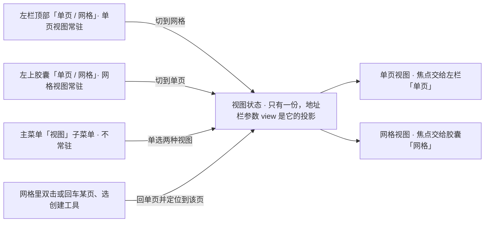
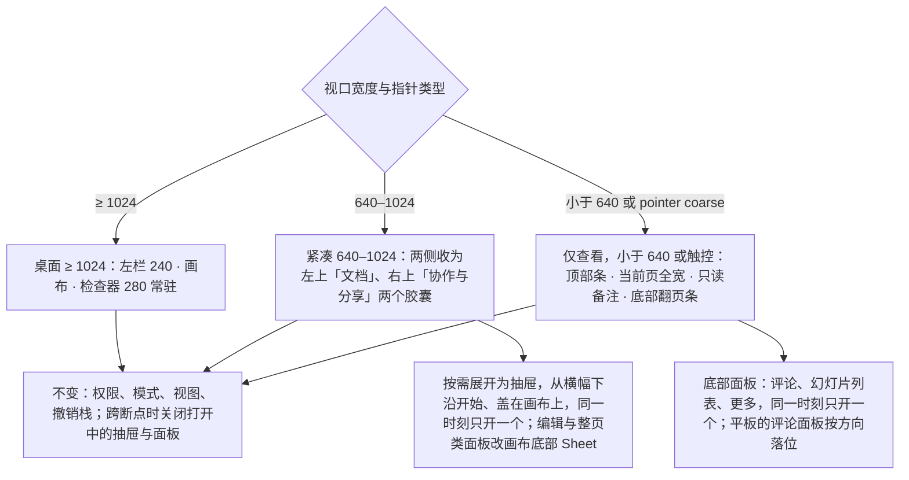
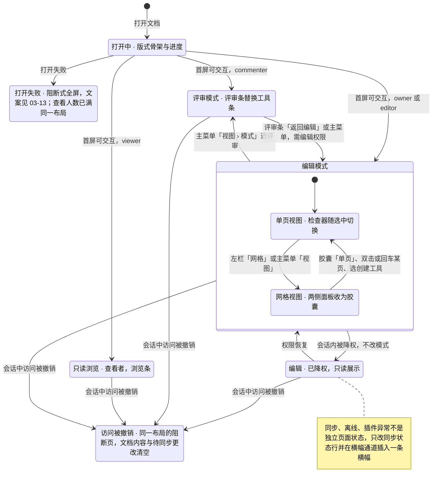
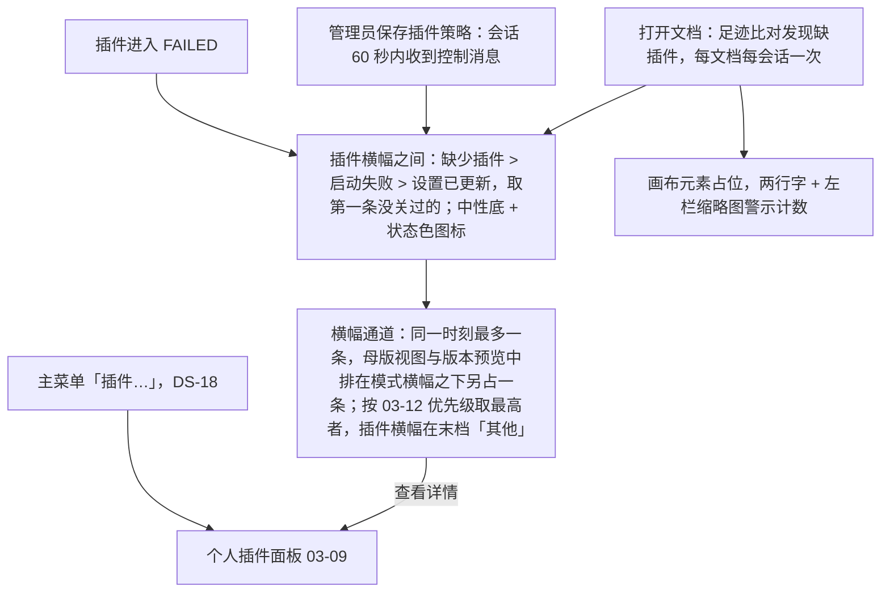

> 状态：草稿 | 负责：设计 | 更新：2026-09-18；2026-09-24（复核修正，rulings §4.17）；2026-09-25（补图）；2026-09-25（矛盾收口，rulings §4.18）；2026-09-26（§4.20 FE-08）；2026-10-01（§4.23 插件管理样张回写：「状态」新增「插件横幅」一节——缺插件横幅三种原因与「插件设置已更新」横幅的位置、层级、合并规则与状态栏插件入口；「交互说明」更多菜单的插件管理器改指个人插件面板，账户菜单补管理员可见的「管理」）；2026-10-04（design-language-v3 第 0 批：按 v3 样张整篇重写——去掉应用栏、Ribbon 与状态栏，改为左栏 / 画布与备注 / 底部工具条 / 检查器四区与网格视图两胶囊，补检查器三种选中态的分区、网格视图、主菜单「视图」与原入口去向表（rulings §4.25 DS-1…DS-6）；§2.4 母版视图入口改为「随第 1 批定稿」；加载中、错误、评审模式、各角色、离线、插件横幅、撤销被跳过等样张未覆盖的状态列为「第 1 批补齐」，保留行为要求、删去旧视觉描述；新增 §10 样张与既有口径的差异）；2026-10-04（design-language-v3 第 0 批：术语残留清理：ribbon / 状态栏 / `ui.ribbon` / `ui.statusBar` 的历史陈述改用 check-terms 认可的标记措辞（废弃、取代、作废）；§7 焦点顺序改为引用已回写的 ED-29 与 07 §1.1）；2026-10-04（design-language-v3 第 0 批：复验修正——§3.4 形状弹层改为距工具条外沿 8（距按钮 13）；「评论」随评论包出现（`when: slide.hasComments`）；「更多 › 组件」注明无对应需求；§3.5、§7 与线框的缩放读数按样张改为实测比例（÷ 1280，1600 × 1000 约 77%）与命令式菜单，§10 第 8 条记口径变化；§6.1 补场景状态参数；§6.2 横幅通道注明样张暂定位置，网格视图是否显示横幅列为 §10 第 7 条待决）；2026-10-04（design-language-v3 第 0 批：复验第 2 轮修正——§2.3 主菜单按样张底座（`kit/mainMenu.tsx`）改写为「返回首页 ┊ 文件 · 编辑 · 视图 · 插入 · 排列 ┊ 帮助」完整条目并逐项标注第 0 批拍板 / 第 1 批起草，删去「样张为占位」，logo 方标改为三种中性色；§2.1、§3.5、§5.1、§7、§8 缩放菜单改为样张共用的命令清单（放大 ⌘+ / 缩小 ⌘− / 适应窗口 ⌘0 / 适应宽度 / 50%–200%，100% ⌘1），§2.1 去掉「档位单选」，§10 第 2 条关闭；§2.4 母版视图入口与退出、§6.2 模式切换、§7.1 返回首页 / 模式 / 「?」/ 重置 / 导出各行注明样张已起草的落位；§3.4 补「全部形状 72 ›」一行；§5.1 网格胶囊同步状态补紧凑形态规则；§6.2 横幅在网格视图同样占文档流（§10 第 7 条改写）；§6.2 编辑模式降权的检查器改为控件留在原位、`aria-disabled` + 提示并加顶部说明，与评审只读展示分开；§10 第 3 条单字母工具键改为「是否采纳随第 1 批」、作用域画布或工具条）；2026-10-04（design-language-v3 第 0 批：复验第 2 轮补充——§6.2 评审模式与查看者变体补样张已起草的评审条（浏览 · 评论 · 高亮 ┊ 上一处 / 下一处评论 ┊「评审模式」+「返回编辑」）与浏览条（上一处 / 下一处评论 ┊「只读浏览中」），标第 1 批起草、待拍板；§10 新增第 9 条：评审条、浏览条与 40/10 `reviewBar` 四项的差异）；2026-10-05（design-language-v3 第 0 批修正：按 rulings §4.25 DS-13…DS-20 写入外壳类裁决——§3.2、§7.1 不设文字迷你工具条，文字格式只在检查器（DS-13）；§4.5 空内容占位符不设「插入到占位符」按钮组（DS-14），评审与只读角色下检查器只读展示当前值，§6.2 评审、查看者与降权三处统一为这一形态（DS-15）；§2.3 主菜单放「返回首页」与「插件…」，§3.5、§5.1、§7 右上角自己的头像打开账户菜单（个人资料、亮暗主题、偏好设置、退出），§6.2 插件横幅与图 6-2、§7.1 去向表同步（DS-18）；§2.3 文档菜单删「移动到…」、§3.4「更多」删「组件」（DS-19）；§1、§4 线框与 §4.1 无选中态「背景」「页面颜色」合并为「背景」一节（DS-20）；§8 紧凑与仅查看形态随第 1 批出样张（DS-17）；§10 第 4、6 条关闭，第 5 条去掉「组件」）；2026-10-05（design-language-v3 第 0 批修正：§3.2 远端协作者名签的取色由单一 token `--v3-collab` 改为按协作者 tone 取 `--v3-tone-*`（样张缺省 sage，`--v3-collab` 只是未被引用的别名），与样张 `kit/canvas.tsx` 一致）；2026-10-05（design-language-v3 第 0 批修正：快捷键值按 rulings §4.25 DS-11、DS-16 同步——§2.3 主菜单「编辑 › 替换…」提示改为 ⇧⌘H（Windows / Linux Ctrl+H）、「插入 › 链接…」改为 ⇧⌘K，表后快捷键说明补命令面板 ⌘K；§7 命令面板由 `Mod+Shift+P` 改为 `Mod+K`；§7.1「开始」编辑行的替换键改为 `Ctrl+H` / `⇧⌘H`；§10 第 1 条（放映提示 ⌘↵）、第 3 条（工具单键）关闭）；2026-10-05（design-language-v3 第 0 批修正：§7 账户菜单的条目改为以 PRD AS-06 为唯一归属（编辑器与开始页、文档列表同一个 `UserMenu`、同一份条目，删去「是否同列随第 1 批样张」，「个人资料…」的 M2 行为按 AS-06 待决）；§3.5 字段按 rulings §4.25 DS-9 与样张 `FIELD_FRAME` 改为静止 1px `--v3-border-control` 内描边、标签用 `--v3-text-2`；§4.4 评论空态文字与相对时间改用 `--v3-text-2`；§2.3、§6.2、§7.1 的快捷键面板入口补账户菜单「键盘快捷键」）；2026-10-07（design-language-v3 第 0 批修正收尾：§9 强调色上的文字按 DS-9 改用 accent-solid）；2026-10-07（design-language-v3 第 0 批余项：§2.3 写明主菜单顶层「插件…」的位置——按样张 `kit/mainMenu.tsx` 在「排列 ▸」之后、「帮助 ▸」之前，上下各一条分隔线、自成一组（rulings §4.25 DS-18；第 1 批起草，待拍板），顶层顺序改为「返回首页 ┊ 文件 · 编辑 · 视图 · 插入 · 排列 ┊ 插件… ┊ 帮助」，§6.2 插件横幅与 §7.1 去向表同步，删去「样张底座尚未列出」；§3.5 与 §1 图例写明自己的头像排在头像组第一位、是打开账户菜单的按钮，与他人头像的区分按样张写明（第 1 批起草，待拍板，DS-18），§7 账户菜单同步；§7 命令面板 `Mod+K` 与 §10 第 1、3 条（放映提示、工具单键）已于 2026-10-05 按 DS-11 结案，复核与 PRD ED-16 一致、本轮不改）；2026-10-07（design-language-v3 第 1 批：按已拍板样张（rulings §4.25 DS-21：场景 `main-states` 30 态、`narrow` 13 态与底座）定稿——开头设计基准补第 1 批场景与截图；§1、§3 按底座更新：「选择」去掉 ▾、左栏 / 检查器 / 备注可拖尺寸（03-20）、同步状态行各态、「新建幻灯片 ▾」打开版式库、隐藏页与缺插件页的缩略图（DS-25）、选中框与参考线统一强调色（DS-24）、对象不设迷你工具条（DS-13、DS-22）、工具条「图片 / 表格 / 图表 / 更多」的弹层、头像组「+N」与在线列表；§2.3 主菜单各项定稿、「帮助」写全（命令面板… ⌘K · 键盘快捷键 ⌘/ ┊ 帮助中心）、评审 / 只读浏览 / 降权下的不可用规则，文档菜单按角色列条目（降权时「重命名」「版本历史」留在原位、不可用并写「需要编辑权限」，「创建副本」照常）；§2.4 母版视图入口与退出按 DS-21 定稿（主菜单「视图 › 母版视图」、Mod+Alt+M、命令面板，不设常驻按钮；画布顶部横幅「关闭母版视图」是唯一常驻退出入口）与视图内差异；§4 线框与 §4.1–§4.3 按底座更新（无选中「放映」节、「位置与大小」「操作」分区、文本五个分区），§4.5 其余选中态定稿（含远端覆盖、只读展示、打开中）；§5.1、§5.3 网格胶囊的同步状态、方向键、拖拽与右键定稿；新增 §5a 窄屏形态（紧凑 640–1024、仅查看 < 640，DS-17）及其 13 个状态；§6 重写为状态清单（底座 6 态、main-states 30 态，标里程碑），评审条按 DS-23、查看者浏览条、降权、在场与账户菜单、同步与离线、横幅通道、插件横幅、轻提示定稿；§7「跳至画布」已实现、焦点顺序含紧凑形态、账户菜单位置；§7.1 去向表、§8、§9 同步；§10 第 5、7、8 条结案、第 9 条改指，新增第 10–13 条）；2026-10-07（design-language-v3 第 1 批：第二步按 rulings §4.25 DS-27…DS-30 与 TB 技术口径定稿——§1、§3.5、§9 检查器拖宽 240–480（TB-25）、面板尺寸按文档记在本机（TB-24），§9 新增层级行（TB-2：抽屉、底部面板、画布浮动面板与图表数据 Sheet 用 `--layer-panel`，轻提示在常驻外壳之下）；§2.1 与图 2-1 单页 / 网格视图同步到地址栏参数 `view`（TB-30）；§2.3 网格间距按 pt 书写（DS-27）、母版视图中「帮助」多「关于母版继承」（TB-15）、粘贴为纯文本 ⇧⌘V 为 P2（DS-29）；§2.4 母版横幅与其余横幅（TB-14）、缩窄到 < 640 退出母版视图（TB-16）；§3.2 删去 `toolbar.<selectionKind>`（TB-29）；§3.4 图表菜单方向；§4 线框与 §4.2 单选对齐行改为六向对齐 + 横向 / 纵向分布（TB-20）、长度单位按 DS-27；§4.3 删除线 / 上标 / 下标快捷键（DS-29）；§4.5 图片、媒体、表格、空占位符改指归属文档，连接符起终点下拉（TB-21）；§5a.1、§5a.2、§5a.3 与图 5a-1：母版视图缩窄（TB-16）、仅查看形态 M3 起可发表与回复评论（DS-28）、层级（TB-2）；§6.2 评审条与浏览条的外壳内置项（TB-1）、横幅通道的母版例外（TB-14）、撤销被跳过的恢复按钮（TB-26）、轻提示改指 03-19 §4.3；§7 文本编辑中 `Mod+=` 为下标（DS-29）、命令名「链接…」（TB-6）；§8 母版视图缩窄；§10 第 9 条（TB-1）、第 10 条（DS-28）、第 11 条（TB-25）、第 12 条结案；另按 TB-22 改缩略图右键的不可用原因为菜单顶部说明行（§3.1、§6.2），按 TB-7 注明「来自 URL」只接受 https（§3.4））；2026-10-08（design-language-v3 第 1 批收口：按 rulings §4.25 DS-31…DS-33 与 TB-31…TB-52——§2.3 主菜单「文件」加「幻灯片大小…」（P2，DS-31），「帮助」写明帮助中心与「关于母版继承」走壳意图 `help-center`（TB-39）、开发构建另有最后一组「开发者面板」（TB-40），评审、只读浏览与降权下替换快捷键只打开查找（TB-28）；§2.4、§5a.1、§5a.3 母版视图改为非完整形态即不可进入、原因写「在更大窗口中编辑」（TB-44）；§3.4「更多」补插入日期、符号后的焦点（TB-52）与插件条目的收纳（TB-31）；§4 线框与 §4.2 形状检查器加「快速样式」（「填充」节上方，DS-31）与「替代文本」节（TB-32），填充「图片」与阴影「内阴影」标 P2（TB-43），不透明度写填充与描边的 alpha（TB-47），补形状右键条目（TB-18）；§4.1 背景节写明「隐藏背景图形」「重置为版式背景」「应用到全部」的落点（PRD ED-20，TB-45），主题节补内置 5 套主题与每套 3 个变体（DS-32、DS-33），删去已修正的样张注；§4.3 字号与段落间距始终 pt（TB-33）；§4.5 异类多选带对齐行（03-17 §3），图表补类型确认与只读说明卡（TB-11、TB-13）；§5a.2、§5a.3 与图注：手机 M3 起可发表与回复、平板仍为只读评审（TB-49）；§6.2 评审条固定项与创建工具条「选择」的归属分开写（TB-38），图 6-2 横幅通道节点补母版视图例外（TB-14），加载中的「正文占位符」改称「文本占位符」（DS-30），删去已修正的样张注；§1、§9 面板尺寸的本机存储键与登出清除（TB-41）；§7.1 补快速样式与幻灯片大小的去向（DS-31）；§10 第 1 条删去已修正的样张括注，第 13 条结案）；2026-10-08（design-language-v3 第 1 批收口复核：§2.3「文件」「帮助」、§4 图例、§4.2 分区次序、§5a.2 图例与 §6.2 状态表改指 2026-10-08 补的样张状态 `file-menu`、`quick-styles`、`quick-styles-gallery`（DS-31），仅查看评论说明按样张现文（DS-28）；形状「替代文本」节仍为样张未画）；2026-10-08（§4.2 替代文本节补缺失警示范围，rulings §4.25 TB-54）；2026-10-08（design-language-v3 第 1 批评审修改：按 rulings §4.25 DS-34…DS-37、TB-55…TB-58 改控件画法——§3.5「节与控件」改为安静样式（数字与文本输入只铺淡底、悬停出细边，下拉透明底加细边，分段选中块面板色加细边并贴边，切换条按下项强调色淡底，按下的图标按钮只铺淡底、图标描边加粗，可以为空的字段不加框内标识；DS-35、DS-36、TB-55、TB-57，原 DS-9「1px 独立边界」与 `--v3-border-control` 画字段、下拉、选中块与按下态的口径作废），页签行选中去掉内描、以字重区分；§3.1 左栏「新建幻灯片 ▾」与「+」、§2.4 与 §6.2 横幅按钮改为透明底加细边的次按钮（DS-37，原 `--v3-panel-2` 淡底与 outline 写法作废）；§4.2、§4 图例与 §6.2 `quick-styles`、`quick-styles-gallery` 的样式库改为在「快速样式」节里原位展开、缩略图去掉白衬底（DS-34、TB-56，原「贴检查器左缘的弹层」作废）；§5.2 网格页悬停环改 `--v3-hover-line`；§2.2 视图切换与 §3.3 备注区注明 TB-58 的后续复核项；§9 强调色补「按下的开关」，状态矩阵同步）；2026-10-15（design-language-v3 第 2 批回写：只改与第 2 批裁决有关的段落——文首设计基准补第 2 批场景与截图；§2.3 主菜单「文件 › 保真报告」打开 280 整栏面板、是保真报告唯一的常驻入口（DS-38、DS-51），「插件…」打开 640 居中对话框（DS-38），「插入」里插件条目的收纳（DS-49），文档菜单「版本历史」打开 280 整栏面板（DS-38，原「临时加宽到 560」作废）；§3.1 同步状态行补齐第 2 批 7 态并改颜色规则——带待同步计数的用警告色图标，转为只读或文档已不存在的用中性（DS-61，原「只有离线用警告色图标」作废），缩略图评论角标读屏名带计数（DS-62）；§3.2 评论钉在编辑模式照常显示、不编号、选中加外圈（DS-43）；§3.4「评论」工具的落点、浮动撰写框与发表后保持按下（DS-44、DS-45），「更多」里插件条目的收纳（DS-49）；§3.5 检查器顶行「分享」的待处理访问申请圆点与文档已删除时不可用（DS-48、DS-62），整栏面板放什么、多宽（DS-38）；§4.4 评论页签换成第 2 批评论面板（DS-43、DS-45、DS-62）；§4.5 补插件对象的分区收纳与「展开」、降级对象、暂时不能编辑与转为只读的会话状态四行（DS-38、DS-49、DS-52、DS-56、DS-58）；§5.1 网格胶囊的「分享」同一圆点；§5a.1 紧凑形态的评论页签换成同一面板（DS-62）、整栏面板落位推迟到第 3 批（DS-38）；§5a.2 线框与要点：仅查看形态顶部条在同步异常时换成同步状态、横幅在最顶上（DS-60，改原「状态行始终写仅查看」），评论底部面板按手机画法（DS-46）；§5a.3 状态表同步；§6 图 6-1 补会话中访问被撤销的阻断页（DS-50）；§6.2 状态表与各节：「申请访问」打开留言弹层（DS-48）、访问被撤销与查看人数已满的阻断页（DS-50、DS-60）、评审与查看者的评论页签（DS-62）、降权横幅新文案与导出本地副本（DS-58）、同步状态与离线（DS-58、DS-59、DS-61）、横幅通道的底色、版本预览叠放与仅查看形态（DS-39、DS-41、DS-60；高度维持「至少 40 高」，DS-62）、插件横幅的底色、先后、单个失败的标题与两行占位（DS-41、DS-52、DS-54、DS-55），图 6-2 同步；轻提示的播报改为每条自己是播报区；列出第 1 批随之改的画面；§9 补整栏面板与个人插件面板的宽度；§10 第 10 条注明手机评论样张已拍板（DS-46）；依据 rulings §4.25 DS-38、DS-39、DS-41、DS-43…DS-46、DS-48…DS-52、DS-54…DS-56、DS-58…DS-62）；2026-10-15（design-language-v3 第 2 批回写续：§2.3「保真报告」「版本历史」、§3.5、§4.5 与 §9 的整栏面板宽度统一为「沿用检查器宽度（缺省 280）」——列表与报告类开着时检查器分隔条照常可拖，编辑与整页类宽 max(400, 检查器当前宽度)、开着时分隔条不可拖、关闭后回到原宽（rulings §4.25 TB-60）；§3.5、§4.5 插件分区的「展开」由宿主按分区条目的 `expandPanel` 画在右下，面板跟着触发它的选中对象，检查器页签只由内置包贡献（TB-59）；§3.5「分享」待处理圆点的数据来源（TB-68）；§3.1「文档正忙」用中性锁形、横幅归 03-12「权限 / 文档状态」档，§6.2 插件设置横幅与「发现新版本」合并（TB-66）；§4.5 降级对象的分区与右键改指 03-03 G-19、03-05 §3，评审、只读浏览与降权下照常出这份菜单（DS-64）；§5a.2 手机评论面板最高分两档：有撰写区 min(64dvh, 560)、只读 min(58dvh, 520)（DS-46，与 03-06 §9.5 一致）；§2.2 整栏面板开着时两枚视图按钮与「视图 › 网格视图」不可用（与 §3.5、03-07 一致）；§2.3 版本历史开着时失去 `history.read` 即关闭（TB-63），§6.2 申请被拒不告知申请人（DS-68）；同日再补：评论计数按 rulings §4.25 TB-81 只写规则、不写死示例数——§1 图例、§3.1 左栏与 §5.2 网格的评论角标是这一页未解决的条数，§4.4、§5a.2、§5a.3 的评论面板有已解决的才出「已解决 N」、仅查看形态标题取本页未解决数（第 1 批画面第 4 页 3 条都未解决），§6.2 评审条计数是可跳转的未解决条数、没有时箭头不可用并写「没有未解决的评论」，浏览条没有未解决的评论时只剩「只读浏览中」，第 1 批随之改的画面补 TB-81…TB-83；§2.2 进网格时写了内容的评论撰写框随单页收起、草稿留着，回单页的那一页时恢复、不抢焦点、工具仍是「选择」，§6.2「模式切换」补切到评审同样处理（TB-79、TB-84，03-06 §6.1））；2026-10-15（design-language-v3 第 2 批回写收口：§5a.2 仅查看形态底部翻页条「评论」的数字取本页未解决的条数，与评论面板标题「第 N 页 · M 条未解决」、缩略图角标同一口径，没有未解决的不带数字，读屏名以 03-06 §9.5 为准；幻灯片列表每页读作「第 N 页：〈标题〉」，有未解决评论的页后接「，M 条未解决评论」（rulings §4.25 TB-89）；§6.2「模式切换」补切到评审或从评审返回编辑后仍停在同一页的单页画布时，写了内容的评论撰写框当场原样恢复、不抢焦点、不改评论工具（TB-87，03-06 §6.1））；2026-10-22（design-language-v3 第 3 批：只改与第 3 批裁决有关的段落——文首设计基准补第 3 批改动本界面外壳的场景与截图；§2.2、§3.1、§5.1 左栏与网格胶囊的「单页 / 网格」改为分段控件（两项各 28，左栏顶行 52 → 56，DS-133）；§2.3 主菜单「返回首页」嵌入时不渲染（DS-112），「文件 › 导出…」⇧⌘E（DS-78）并按权限置灰——查看者「只有查看权限」、评审者与编辑模式已降权「需要编辑权限」（DS-105，原降权「导出照常」作废），「文件」不加「打印…」（DS-104），「帮助 › 帮助中心」与「关于母版继承」只在集成方配置了链接时出现、带外链图标（DS-89），评审者与查看者的文件名不再是菜单触发器、没有「创建副本」（DS-82），降权时文档菜单的「创建副本」同样留在原位不可用（U-09、DS-105 同一规则）；§2.4、§5a.1 嵌入里母版视图的不可用原因写「当前区域太窄，暂不可用」（DS-112），仅查看形态外接键盘的提示按触控与否分写（TB-125）；§3.1 同步状态行补「需要刷新 · N 项未同步」「只读 · 文档已达元素上限」（DS-126、DS-128）；§3.2 跟随时的画布外框与跟随条（DS-106），同色两人靠名签区分、另一个窗口的名签（DS-132、TB-124）；§3.3 备注区改凹陷底、亮色占位字提到次级文字色，拖动把手维持现画法（DS-134、DS-135）；§3.5 他人头像是「跟随」按钮、跟随中外圈换对方身份色（DS-106），同色第 13 位起的序号角标、在线列表的「N 个窗口」与列表最窄 256 按内容加宽（DS-132、TB-124），头像一律身份色首字（TB-123），「放映」提示「从当前页放映 ⇧F5」与两种不可用原因（TB-103、TB-111、TB-112），锁定比例未锁时是断开的链（DS-136），紧凑形态整栏面板的落位（DS-130）；§4.5 暂时不能编辑补「发现新版本」、转为只读补「文档已达元素上限」（DS-126、DS-128）；§5a 紧凑形态的非模态抽屉从横幅下沿开始，版本历史与保真报告进检查器抽屉、插件整页面板改画布底部 Sheet（DS-130），平板评论面板竖屏与当前页上下排开、横屏右侧整高侧栏 360（DS-131），触控设备的状态行「仅查看 · 在电脑上编辑」（TB-125），仅查看形态的缺插件横幅不放面板入口，§5a.3 补第 3 批窄屏复核的状态，新增 §5a.4 嵌入（按容器宽度取形态、嵌入里的出口，DS-73、DS-112、TB-115）；§6.2 加载中补协同快照打开（DS-99），打开失败补单独的「找不到该文档」与回收站里文档的三类人（DS-85、DS-122，03-33），状态表与评审、查看者、降权、在场与账户菜单各节按上面改写，横幅统一高 40（DS-75），查看器里缺插件的一行说明放进 ⓘ 卡（DS-110），列出第 3 批随之改的第 1、2 批画面，第 1 批其余画面的评论钉改为编辑起步由底座画、评审与只读浏览起步由场景画（TB-126）；§7 账户菜单条目同开始页——主题三项、M2 不显示「个人资料…」、键盘快捷键、平台管理员的「管理」、按配置出现的帮助中心，嵌入里没配置登出回调时「退出登录」不可用（DS-89…DS-91、DS-112）；§9 控件高度、头像与角标、备注区；§10 第 1、12 条补 TB-103、TB-129；依据 rulings §4.25 DS-73、DS-75、DS-78、DS-82、DS-85、DS-89…DS-91、DS-97、DS-99、DS-104…DS-106、DS-110、DS-112、DS-122、DS-123、DS-126、DS-128、DS-130…DS-136、TB-103、TB-105、TB-111、TB-112、TB-115、TB-123…TB-126、TB-128、TB-129）；2026-10-22（design-language-v3 第 3 批回写续：§2.3 主菜单「返回首页」与 §5a.4 嵌入里的出口改为宿主在 `cordex:init` 的 `intents` 里声明了 `navigate-back` 才出现、声明了 `sign-out` 时「退出登录」才可用（TB-145），「帮助 › 关于母版继承」只在集成方配置了对应链接时出现（TB-132），文档菜单降权一行补 TB-138；§2.4 不是完整形态时的不可用原因按原因分写——窗口窄「在更大窗口中编辑」、嵌入「当前区域太窄，暂不可用」、触控设备一律「在电脑上编辑」（TB-136）；§1、§3.3、§9 备注区的底色与占位字 token 回填设计 04 §2.2 定的名字 `--v3-notes-fill`、`--v3-notes-placeholder`（DS-134）；§3.3、§5a.2 备注为空一律写「这一页没有演讲者备注」，第 1 批 `narrow.narrow` 的备注卡随之改（DS-138）；§3.5 M2 的「分享」留在原位、不可用，工具提示「分享 · 后续版本提供」（DS-137）；§6.2 第 3 批随之改的画面补 DS-138、TB-138；§7 账户菜单「个人资料…」M3 起打开的对话框（TB-137）与嵌入里的「退出登录」（TB-145）；§8 缩略图同时挂载数引前端 50/10 §6（TB-135）；§10 第 12 条导入过渡页「取消」的去向按 TB-133；依据 rulings §4.25 DS-137、DS-138、TB-132、TB-133、TB-135…TB-138、TB-145；同日再补：§2.4、§5a.2、§5a.4 嵌入里又是触控设备时按原因定先后、触控优先——状态行仍写「仅查看 · 在电脑上编辑」，形态类不可用原因仍写「在电脑上编辑」，平板评论面板那一句也不改，嵌入只改写「在更大窗口中编辑」那一句（rulings §4.25 TB-159）；§3.5「分享」出不出现、可不可用由宿主给：apps/web 在 M2 声明后续提供、M3 起接分享回调，SDK 宿主两样都不给时不渲染（TB-161）；§6.2 `open-failed-access` 一行与「错误（打开失败）」补 M2 的「申请访问」留在原位不可用，工具提示「申请访问 · 后续版本提供」，「返回文档列表」照常（TB-156）；§7 命令面板补导出…、版本历史、保真报告、插件…、帮助中心这几个壳意图各注册一个无参命令进命令面板，帮助中心按配置注册（TB-162）；2026-10-22 复核修正：§2.3 文档菜单降权一行与 §6.2「第 3 批随之改的画面」「编辑模式已降权」改引 rulings §4.25 DS-139（降权时「创建副本」不可用，取代第 1 批「照常」的样张修正，`main-states.degraded-menu` 随之改），「返回首页」的去处改写产品路由 `/home`；§2.4、§5a.2 写明形态原因先判窗口窄、再判触控，手机不论是否触控都按窗口窄写（TB-163），§5a.2、§5a.3 里程碑里泛指的「触控设备」改为「平板与手机」；§6.2 `open-failed-access` 与「错误（打开失败）」的 M2 一条补阻断页说明句不变（TB-156）；§5a.2「更多」补条目不写键位提示（TB-164）；§8 嵌入一条补宿主声明 `navigate-back` 才出现（TB-145）；状态头的回写轮次字样改为「回写续 / 同日再补」；§5a.2「横幅」与 §6.2「横幅通道」位置一条写明横幅放在最顶上对整个仅查看形态（手机与平板）都成立、按钮只在一行放不下时才换到文案下方（rulings §4.25 TB-172，原「仅查看形态（< 640）」与无条件换行的写法作废）；§5a.2「横幅」与 §6.2「横幅通道」位置、外观两条补触控形态的按钮与 × 照常是触控尺寸、横幅随之撑高，DS-75 的高 40 指非触控形态，触控形态的尺寸只引用 03-12 §1.2、§11，不重复数值（TB-172））；2026-10-23（design-language-v3 第 3 批评审修改：§10 第 12 条的导入改为叠在原页上的「导入」对话框——整屏导入页与过渡页由 rulings §4.25 DS-140 取代，「取消」、× 与 Esc 中止并关闭、留在原页，失败后只有「关闭」（TB-179）；§5a.3 `narrow-review.compact-plugins-dialog` 注明对话框画法随 DS-142 改为标题栏 40、圆角 12、× 正文色，框高不变）；2026-11-04（design-language-v3 母版视图改版：设计基准补场景 `master-view` 与拍板时的对照截图；§1、§4 的截图说明注明 `editor-empty-*` 已按转正后的样张重拍；§2.3 母版视图中「保真报告」「插件…」「重置页…」与文档菜单「版本历史」留在原位不可用；§2.4 入口补检查器「编辑版式」「转到版式」两个上下文入口，母版横幅改为上下文条，画布去掉编辑范围与图例、改为占位符虚线 + 类型名与继承点线，工具条「占位符 ▾」排第 2 位，检查器面板标题与节序，窗格名称换行，可用性补版本历史开着、文档打开中与不能进入时（不论原因）按 `Mod+Alt+M` 给的轻提示，Esc 逐级；§3.4 工具条；§3.5 母版视图里头像与在线列表的「跟随」不可用（外观不变、读屏名加原因，在线列表底部的说明随之改写）、节标题动作的例子；§4 线框、§4.1「编辑版式」与版式缩略的画法及只读时的例外；§4.3、§4.5 占位符的「转到版式」顶行与只读例外；§5a 跨断点时焦点先交给画布、切网格时收起抽屉、紧凑形态的母版视图并补 `compact-master-inspector`、`viewonly-master-key` 两态；§6.2 随之改的已拍板画面与横幅通道里的上下文条；§7.1 去向表；rulings §4.25 DS-144…DS-177、TB-186、TB-195、TB-196、TB-200、TB-203…TB-205、TB-208…TB-210；需求编号、优先级与里程碑不变）；2026-11-05（prd-v3-current：§2.3 菜单快捷键提示一句里的「缩放适应 ⌘0」随 PRD ED-16 改名为「适应窗口 ⌘0」，与本文主菜单「视图 › 缩放」的条目同名；键位与界面不变） | 依赖：charter v0.2；rulings §4.25 DS-1…DS-8、DS-9、DS-11、DS-13…DS-20、DS-21…DS-37、DS-38、DS-39、DS-41、DS-43…DS-46、DS-48…DS-52、DS-54…DS-56、DS-58…DS-64、DS-68、DS-73、DS-75、DS-78、DS-82、DS-85、DS-89…DS-91、DS-97、DS-99、DS-104…DS-106、DS-110、DS-112、DS-122、DS-123、DS-126、DS-128、DS-130…DS-139、DS-144…DS-177、TB-1、TB-2、TB-6、TB-7、TB-11、TB-13…TB-16、TB-18、TB-20…TB-22、TB-24…TB-26、TB-28…TB-33、TB-38…TB-41、TB-43…TB-45、TB-47、TB-49、TB-52、TB-55…TB-60、TB-63、TB-66、TB-68、TB-79、TB-81…TB-84、TB-87、TB-89、TB-103、TB-105、TB-111、TB-112、TB-115、TB-123…TB-126、TB-128、TB-129、TB-132、TB-133、TB-135…TB-138、TB-145、TB-156、TB-159、TB-161、TB-162、TB-163、TB-164、TB-172、TB-186、TB-195、TB-196、TB-200、TB-203…TB-205、TB-208…TB-210、§4.9 Q9、§4.10 Q12 · Q14 · Q20、§4.15 Q3、§4.18、§4.20 FE-06、§4.22、§4.23；PRD ED-06、ED-12、ED-16、ED-18、ED-20、ED-22、ED-26、ED-29、ED-30、AS-06、EM-01、NF-07、PM-08、PM-10、PM-12；`03-screens/26`、`29`、`33`；playground `#/v3/editor`（`src/v3/Editor.tsx`，`editor/` 下 `LeftRail` · `Stage` · `Toolbar` · `Inspector` · `GridView` · `chrome`，主菜单条目 `kit/mainMenu.tsx`，控件原子 `ui.tsx`，token `v3.css`；场景 `scenarios/main-states/`、`scenarios/narrow/`；第 2 批 `scenarios/offline-conflict/`、`comments/`、`version-history/`、`share/`、`plugins/`、`fidelity/`；第 3 批 `scenarios/narrow-review/`、`presence-scale/`、`quiet-leftovers/`、`embed/`、`doc-banners/`、`present/`（编辑器里的跟随）、`account-menu/`、`export/`）

# 03-02 编辑器主界面

> **设计基准（2026-10-04 起，rulings §4.25 DS-1、DS-2；2026-10-07 第 1 批拍板，DS-21）**：以 playground `#/v3/editor` 样张为准，源码在 `playground/src/v3/`（底座 `Editor.tsx`、`editor/`、`kit/`；本界面的场景 `scenarios/main-states/`、`scenarios/narrow/`，状态路由 `#/v3/editor?state=<场景 id>.<状态 id>`）。对照截图在 `openspec/changes/design-language-v3/screens/`：第 0 批 `editor-*.jpg`、`grid-focus-*.jpg`（1600 × 1000 视口，另有 1440 宽网格 1 张）；第 1 批 `batch1/` 下 `main-states-review-*`、`shell-editor-main-menu-*`、`master-view-default-*`（1600 宽）、`narrow-compact-inspector-*`（1024 × 768）、`narrow-narrow-*`（390 × 844）；第 2 批（协作族，2026-10-15 拍板，rulings §4.25 DS-38…DS-63）改动本界面外壳的状态在场景 `offline-conflict`、`comments`、`version-history`、`share`、`plugins`、`fidelity`，截图在 `batch2/`；第 3 批（应用壳族，2026-10-22 拍板，rulings §4.25 DS-79…DS-136）改动本界面外壳的状态在场景 `narrow-review`（紧凑形态的整栏面板、平板评论面板）、`presence-scale`（头像角标与在线列表）、`quiet-leftovers`（视图切换、备注区、拖动把手与锁定比例）、`embed`（嵌入）、`doc-banners`（文档状态横幅）、`present.editor-following`（编辑器里的跟随）、`account-menu.editor` 与 `export.no-permission-reviewer`，截图在 `batch3/`；母版视图改版（2026-11-03 拍板，rulings §4.25 DS-144…DS-177）改动本界面的状态在场景 `master-view`（普通视图里的两个入口为 `entry-inspector`、`goto-layout`），`batch1/master-view-default-*` 按改版后的画面重拍，拍板时的对照截图在 `screens/master-view/`。本文写本界面的结构、尺寸与行为，token 只写名字（样张作用域名 `--v3-*`），取值与产品 token 映射见设计 [04](../04-design-system.md) 的 v3 改写。ribbon 版旧稿（`#/editor`：`AppBar` / `Ribbon` / `EditorShell` / `SlideCanvas`）在全量迁移后删除（DS-7）；本文此前的应用栏、Ribbon 页签与分组、状态栏、玻璃缩放胶囊、「普通｜母版」分段的线框与规格一并作废，入口去向见 §7.1。

编辑模式下的完整工作区，是 [01](../01-information-architecture.md) §2 区域划分的具体呈现。v3 以 Figma Slides 为基准（DS-1）：**底部浮动工具条只管创建，右侧检查器只管当前选中对象的属性（随选中切换），其余命令进主菜单、右键、命令面板与快捷键**；应用栏、Ribbon 与状态栏均已废弃（DS-1、DS-6）。编辑器有**单页**与**网格**两种视图（§2，DS-3、DS-4）；窗口窄于 1024 时另有**紧凑**与**仅查看**两种形态（§5a，DS-17）；评审与只读浏览时底部换成评审条 / 浏览条（§6.2，DS-23）。放映见 03-11；母版视图仍是同一个编辑器（03-26），v3 中的入口与退出见 §2.4。

---

## 1. 线框（桌面 1600 × 1000，单页视图，无选中）

```
←──────── 240 ────────→←─────────── 画布 flex（1600 宽视口下 1080）────────────→←─────────── 280 ────────────→
┌──────────────────────┬────────────────────────────────────────────────────────┬────────────────────────────┐
│ [Logo▾]  [单页][网格]│                                                        │ (周)(王)(李)      ▶ [分享] │
│ 2026 年 Q2 业绩汇报 ▾│  ┌──────────────────────────────────────────────────┐  ├────────────────────────────┤
│ ✓ 已同步             │  │                                                  │  │ [设计]  评论        77% ▾  │
│ [新建幻灯片    ▾] [+]│  │  议程                                            │  ├────────────────────────────┤
│                      │  │  ▔▔                                              │  │ 幻灯片 2                   │
│ 1 ┌───────────────┐  │  │  01  关键指标                 P3   ┌──────────┐  │  ├────────────────────────────┤
│   │ 标题页        │  │  │  ─────────────────────────────     │本季关键词│  │  │ 版式                       │
│   └───────────────┘  │  │  02  营收趋势      ↖李雷      P4   │增长 18%  │  │  │ [▭ 标题和内容          ▾]  │
│▌2 ┏━━━━━━━━━━━━━━━┓  │  │  ─────────────────────────────     │三项提升  │  │  ├────────────────────────────┤
│▌  ┃ 议程          ┃  │  │  03  区域分布                 P5   └──────────┘  │  │ 主题                       │
│▌  ┗━━━━━━━━━━━━━━━┛  │  │  04  下半年计划               P6                 │  │ [色块] Office      [调整]  │
│ 3 ┌───────────────┐  │  │                                                  │  │        思源黑体            │
│   │ 关键指标      │  │  │  2026 年 Q2 业绩汇报                           2 │  ├────────────────────────────┤
│   └───────────────┘  │  └──────────────────────────────────────────────────┘  │ 背景                       │
│ 4 ┌───────────────┐  │                                                        │ [ 纯色 │ 渐变 │ 图片 ]     │
│   │ 营收趋势 [评3]│  │                          ════                          │ [□ #FFFFFF 背景 1 │ 100%]  │
│   └───────────────┘  │  ┌──────────────────────────────────────────────────┐  │ [□][□][■][■][■][■]         │
│ ⋮                    │  │ 添加演讲者备注…                                  │  ├────────────────────────────┤
│                      │  │                                                  │  │ 放映                       │
│                      │  │                                                  │  │ [切换  无              ▾]  │
│                      │  └──────────────────────────────────────────────────┘  │ [ ] 放映时跳过此页         │
│                      │     ╭─────────────────────────────────────────────╮    │                            │
│                      │     │[选择][文本][形状][图片][表格][图表][评论][+]│    │                            │
│                      │     ╰─────────────────────────────────────────────╯    │                            │
└──────────────────────┴────────────────────────────────────────────────────────┴────────────────────────────┘
```

图例：`▌` 当前页（条目底为淡强调色）；`[评3]` 评论角标，数字是这一页未解决的评论条数（第 1 批示例第 4 页 3 条、都未解决，rulings §4.25 TB-81；口径见 03-06 §5.4）；`↖李雷` 远端协作者光标；`════` 备注区拖拽把手（可拖高度，§3.3）；`[Logo▾]` 主菜单（logo 方标 + ▾）；`(周)` 自己的头像（头像组第一位，点开账户菜单，§3.5）；「放映」节的「切换」是只读字段（§4.1）。截图：`editor-empty-dark.jpg` / `editor-empty-light.jpg`（2026-11-05 按转正后的样张重拍）、`batch1/shell-editor-main-menu-*.jpg`。

| 区域 | 尺寸 | 表面 | 源码 |
|---|---|---|---|
| 左栏 | 宽 240，贴边全高；上部内边距左右 16，缩略图列表左右 8；右缘分隔条可拖宽 160–420（范围与记忆见 03-20 §6「面板尺寸与记忆」） | `--v3-panel`，右侧 1px `--v3-border` | `LeftRail.tsx` |
| 画布 | 占满其余宽度（1600 宽视口 1080，1440 宽 920，约占应用宽 2/3，设计质量门 Q1）；幻灯片居中，左右至少 48、上 40、下 24 | `--v3-canvas` | `Stage.tsx` |
| 备注 | 画布下方，左右 48；把手 40 × 4、下距 8；文本区缺省高 120（把手可拖，§3.3） | `--v3-notes-fill`（比画布深一档的凹陷底）、不描边，悬停出细边，圆角 8（rulings §4.25 DS-134） | `Stage.tsx` |
| 底部工具条 | 距画布底 16、水平居中；内边距 4、间距 4；按钮 36（圆角 8）、图标 20；单页视图的画布底部留 72 给工具条 | `--v3-panel` + 1px `--v3-border` + `--v3-shadow`，圆角 12 | `Toolbar.tsx` |
| 检查器 | 宽 280，贴边全高；顶行 48、页签行 44（下 1px 分隔），其下属性节纵向滚动；左缘分隔条可拖宽，范围 240–480（PRD ED-12；样张上限 720 按 rulings §4.25 TB-25 改为 480，§10 第 11 条） | `--v3-panel`，左侧 1px `--v3-border` | `Inspector.tsx` |

面板贴边、1px 分隔、不悬浮；只有底部工具条、网格视图与紧凑形态的胶囊、紧凑形态的抽屉与各种弹层带阴影（DS-2）。全局字号 12 / 行高 18；含中文的文字不小于 12px，11px 只用于纯数字与西文（页码、单字母标签、快捷键提示）。分隔条只在桌面形态出现（≥ 1024）：悬停与拖动时显出 2px 中性线，键盘 ← → / ↑ ↓ 每次 8（⇧ 32）、Home / End 到最小 / 最大、Enter 或双击回到缺省（03-20，场景 `view-zoom.panel-size`）；拖出的尺寸按文档记在本机（rulings §4.25 TB-24，规则见 03-20「面板尺寸与记忆」），存储键为 `cordex.layout.{rememberKey}`（参考应用传文档 id），登出与换人时清除（TB-41，键空间以前端 50/02 §10.1 为准）。

---

## 2. 视图

### 2.1 单页与网格

| | 单页视图（默认） | 网格视图（§5） |
|---|---|---|
| 左栏 | 显示 | 不渲染，顶部内容收进左上「文档」胶囊 |
| 画布 | 当前页 + 备注 | 全部幻灯片排成网格 |
| 检查器 | 显示 | 不渲染，顶行内容收进右上「协作与分享」胶囊 |
| 底部工具条 | 常驻 | 常驻；创建工具作用于选中页（§5.3） |
| 备注 | 按主菜单「视图 › 备注」开关显示 | 不显示（开关值保留，回单页原样恢复） |
| 缩放 | 检查器页签行右端；读数为实测比例，菜单只放命令、不带选中态（§3.5） | 右上胶囊，与单页同一口径（§5.1） |

视图状态只有一份，所有入口读写同一个状态（DS-4）。样张里它是 URL 参数 `view`（缺省即单页、不写入；网格为 `view=grid`），切换只改这个参数、其余参数原样保留，用 replace 方式、不新增浏览历史记录（`params.ts`）。产品按样张做（rulings §4.25 TB-30）：参考应用 `apps/web` 把视图状态（`editorView`）同步到地址栏查询参数 `view`——缺省的单页不写，切换用 replace、不新增浏览历史，刷新后保持视图；地址栏只是视图状态的投影，与深链接的 `page`、`comment` 参数并存（01 §4）；嵌入场景由宿主决定是否同步。参数在路由表中的登记以前端 50/02 §2 为准。

### 2.2 切换入口与焦点（DS-3）

- 每种视图只有一个常驻入口：单页时在左栏顶部右侧，网格时在左上胶囊右端，两处是同一个件——「单页 / 网格」分段控件（Lucide `RectangleHorizontal` / `LayoutGrid`），与检查器的分段控件同一画法：28 高的槽只铺 `--v3-panel-2`、不描边，选中块是面板色加一道与分隔线同档的细边、贴边、圆角 4，两项各 28 × 28、间距 0，选中项图标描边加粗到 2（§3.5「节与控件」，TB-55）；仍是两个 `aria-pressed` 按钮，读屏名、工具提示与切换后的焦点交接不变；左栏顶行因此多占 4 宽（52 → 56）（2026-10-22 第 3 批拍板，rulings §4.25 DS-133；原「两枚 24px 图标按钮、当前视图是按下态」作废，第 1、2 批凡露出左栏顶行与网格胶囊的画面随之改）；紧凑形态的单页视图在左上胶囊右端（§5a）；主菜单「视图」子菜单是不常驻的第二入口（§2.3）。底部工具条不放视图开关（DS-1，设计质量门 Q2「入口唯一」）。母版视图不提供网格（§2.4）。
- 进入网格时收起形状弹层、工具回到「选择」。写了内容的评论撰写框随单页收起、草稿按页留着，回到单页的那一页时原样恢复——不抢焦点，恢复也不改工具：工具仍是「选择」，除非用户在网格里选的就是「评论」（rulings §4.25 TB-79、TB-84，03-06 §6.1）；没写内容的随之收起。
- 焦点：入口会随视图卸载的（左栏顶部、胶囊、两处的主菜单、网格里的某一页），切换后焦点交给新视图里当前视图的切换按钮（进网格 → 胶囊「网格」，回单页 → 左栏「单页」）；从常驻的底部工具条触发的切换（网格里选创建工具）焦点留在原按钮。程序移交焦点时若最近一次操作是鼠标，不显示焦点环、不弹工具提示；键盘操作照常显示。
- 打开中两枚视图按钮不可用（工具提示「文档打开后可用」，§6.2「加载中」）；检查器整栏面板开着时同样不可用，主菜单「视图 › 网格视图」同此（版本历史写「关闭版本历史后可用」，§3.5）。

**图 2-1 三个入口读写同一个视图状态**



怎么读：左侧四个来源都只改这一份视图状态，右侧两种视图由它派生；地址栏的 `view` 参数随它更新（缺省的单页不写），不是第二份状态；从工具条触发的回单页焦点留在工具条，其余来源按右侧节点写的位置移交焦点。
依据：rulings §4.25 DS-3、DS-4、TB-30；样张 `Editor.tsx` `changeView`。

### 2.3 主菜单与文档菜单

**主菜单**：左栏左上（网格与紧凑形态在左上胶囊里）高 28 的按钮，20px logo 方标（三种中性色填充：底 `--v3-text`、内框 `--v3-panel`、两条横线 `--v3-text` 与 `--v3-text-2`，不用强调色）+ ▾，向下、左对齐展开。条目是统一的一份（`kit/mainMenu.tsx` `mainMenuItems`，底座与各场景共用），顶层固定为「返回首页 ┊ 文件 ▸ · 编辑 ▸ · 视图 ▸ · 插入 ▸ · 排列 ▸ ┊ 插件… ┊ 帮助 ▸」（┊ 为分隔线；2026-10-07 第 1 批拍板，DS-21）。按 DS-1，主菜单承接创建与格式之外的其余命令，是不常驻的第二入口（设计质量门 Q2 不算重复）。DS-18 定下主菜单放「返回首页」与「插件…」两项（与 Figma 一致）：「返回首页」是第一项，其下一条分隔线；「插件…」打开个人插件面板（03-09），在「排列 ▸」之后、「帮助 ▸」之前，上下各一条分隔线、自成一组；账户类条目（个人资料、主题、偏好设置、退出等，条目以 PRD AS-06 为准）不进主菜单，在右上角自己的头像打开的账户菜单里（§7）。截图：`batch1/shell-editor-main-menu-*.jpg`。

| 顶层项 | 条目 | 状态 |
|---|---|---|
| 返回首页 | 回到开始页 `/home`（03-29，路由以前端 50/02 §2 为准）；嵌入（iframe）里不渲染这一项与其后的分隔线，宿主在 `cordex:init` 的 `intents` 里声明了 `navigate-back` 才出现（rulings §4.25 DS-112、TB-145，§5a.4）；SDK 嵌入里宿主没接「返回」的回调（`onNavigateBack`，40/10）时同样不渲染 | 定稿（DS-18、DS-21） |
| 文件 ▸ | 导出… ⇧⌘E（Windows / Linux Ctrl+Shift+E）· 保真报告 · 幻灯片大小…（P2：留在原位、置灰「后续版本提供」并带 P2 标记，PRD ED-11 边界「页面尺寸修改 P2」） | 定稿（DS-21；「幻灯片大小…」2026-10-08 按 rulings §4.25 DS-31 补入（原入口的去向见 §7.1）；样张 `main-states.file-menu`（2026-10-08 补，排在「文件」组末位，随第 1 批评审确认））；「保真报告」是保真报告唯一的常驻入口，打开检查器整栏面板（沿用检查器宽度（缺省 280），不加宽，03-10；rulings §4.25 DS-38、DS-51、TB-60，§3.5）；「导出…」打开通用导出对话框（03-22），快捷键 ⇧⌘E（2026-10-16 由 ⌘E 改，⌘E 留给居中对齐，rulings §4.25 DS-78），按权限置灰：查看者「只有查看权限」，评审者与编辑模式已降权「需要编辑权限」，⇧⌘E 同时无效（DS-105，样张 `export.no-permission-reviewer`；有编辑权限的人切到评审模式照常可导出，按权限写、不按模式写）；不设「打印…」，需要打印时导出 PDF 再用浏览器或系统打印（DS-104）；个人插件面板不在「文件」下，由顶层「插件…」打开（DS-18） |
| 编辑 ▸ | 撤销 ⌘Z · 重做 ⇧⌘Z（带步骤名，如「撤销：〈步骤名〉」；没有可撤销 / 重做的步骤时置灰并写「没有可撤销的操作」/「没有可重做的操作」）┊ 剪切 ⌘X · 复制 ⌘C · 粘贴 ⌘V · 粘贴选项 ▸（P2，置灰「后续版本提供」：保留源格式 / 仅文本 ⇧⌘V / 作为图片）· 原位复制 ⌘D · 删除 ⌫（未选中对象时剪切、复制、原位复制、删除置灰「未选中对象」）┊ 全选 ⌘A ┊ 查找… ⌘F · 替换… ⇧⌘H（Windows / Linux Ctrl+H，DS-16）┊ 重置页… | 定稿（03-19，DS-21） |
| 视图 ▸ | 单选「单页视图 / 网格视图」（与左栏顶部、胶囊同一状态）┊ 勾选「备注」——网格视图下置灰、不打勾，右侧写「网格视图下不显示」┊ 网格与参考线 ▸（显示网格 · 显示参考线 ┊ 吸附到网格 · 智能参考线（吸附到对象）┊ 网格间距 6 / 12 / 18 pt 单选，缺省 12 pt ┊ 标尺、添加参考线，P2 置灰；与画布空白处右键「网格与参考线 ▸」同一张清单）· 缩放 ▸（与 §3.5 缩放读数菜单同一份命令）┊ 母版视图 ⌥⌘M（§2.4）┊ 模式：编辑 / 评审（单选，§6.2「模式切换」） | 定稿（DS-21；网格与参考线 03-20、03-17，缩放 03-20，母版视图 03-26，模式本文 §6.2）；网格间距在文档与样张里按 pt 书写，产品按设置的度量单位显示（中文默认 cm、英文默认 in，03-23；rulings §4.25 DS-27，§4.22 SR-4 结案） |
| 插入 ▸ | 全部插入命令按工具条顺序排列，快捷键与工具条一致：文本框 T · 形状库… · 图片 ▸（此设备… / 来自 URL… ┊ 屏幕截图、相册，M4+ 置灰）· 表格… · 图表… ┊ 图标… · 符号…（未在文本框中放置光标时置灰「先在文本框中放置光标」）· 公式（M4+ 置灰）· 视频、音频（P2 置灰）┊ 页眉和页脚… · 日期和时间… · 幻灯片编号… ┊ 链接… ⇧⌘K（DS-11）· 评论 C ┊ 插件分组（插件图标 + 「〈插件名〉 · 第三方」标题，其下是该插件的插入命令，06 §2.6；插件不超过 3 个、且每个不超过 3 条时平铺，否则改成「插件 · N」小标题、每个插件一行、条目进子菜单，与工具条「更多」同一规则，rulings §4.25 DS-49） | 定稿（03-04，DS-21；插件条目的收纳 DS-49） |
| 排列 ▸ | 置于顶层 ⇧⌘] · 上移一层 ⌘] · 下移一层 ⌘[ · 置于底层 ⇧⌘[ ┊ 组合 ⌘G · 取消组合 ⇧⌘G（与右键「排列」一致） | 定稿（03-05、03-17，DS-21） |
| 插件… | 打开个人插件面板（居中对话框，宽 640，rulings §4.25 DS-38，03-09）；顶层单项、无子菜单，排在「排列 ▸」之后、「帮助 ▸」之前，上下各一条分隔线；评审、只读浏览与降权时照常可用（界面级插件的启停只影响自己）；母版视图里留在原位、不可用，写「母版视图下不可用」（rulings §4.25 DS-157） | 定稿（DS-18、DS-21、DS-157） |
| 帮助 ▸ | 命令面板… ⌘K · 键盘快捷键 ⌘/ ┊ 帮助中心 ↗——命令面板不常驻界面，在「帮助」里写出它与快捷键，用户才知道有这个入口（第二入口，Q2 不算重复）；母版视图中多一项「关于母版继承」（PRD ML-01，rulings §4.25 TB-15）。「帮助中心」只在集成方配置了帮助中心链接时出现：新标签页打开，右侧 12px 外链图标（`ExternalLink`），读屏名带「在新标签页打开」；没配置时这一项与它上面的分隔线都不出现、不占位，「帮助」只剩命令面板与键盘快捷键（2026-10-22 第 3 批拍板，rulings §4.25 DS-89，与开始页「帮助」菜单、账户菜单「帮助中心」同一规则；原「帮助中心常在、不带外链图标」作废，第 1 批主菜单画面随之改）；「关于母版继承」同一规则：只在集成方配置了它对应的链接时出现——帮助配置里的「母版与版式」指南或帮助中心链接，两者都没配置时不出现、不占位——新标签页打开、带外链图标（rulings §4.25 TB-132；配置项以前端 50/11 §4、50/02 §3 为准）。帮助中心与「关于母版继承」走壳意图 `help-center`（开关 `ShellOptions.moreMenu.helpCenter`），与其余应用级菜单项同一管线，权限、审计与遥测经同一入口（TB-39，前端 50/03 §8）。开发构建或 `features.developerMenu` 打开时，最后一组（分隔线之后）多一项「开发者面板」（TB-40，PRD PS-09）；生产缺省不出现，样张不含 | 定稿（DS-11、DS-21、DS-89、TB-15、TB-39、TB-40、TB-132） |

- **评审模式与只读浏览**（场景 `main-states.commenter`、`viewer`）：「编辑」里改文档的命令（撤销、重做、剪切、粘贴、原位复制、删除、替换…、重置页…）置灰并在右侧写原因——评审模式「评审模式下不可用」、查看者「只有查看权限」；复制、全选、查找照常；「插入」「排列」整组置灰、写同一原因；「视图 › 母版视图」置灰、写同一原因；「模式」组里评审者的「编辑」置灰并写「需要编辑权限」，查看者没有这一组；「文件 › 导出…」按权限置灰——评审者「需要编辑权限」、查看者「只有查看权限」（导出要 `doc.export`，只给编辑者及以上，rulings U-09；2026-10-22 第 3 批拍板，DS-105），有编辑权限的人切到评审模式照常可导出；「文件」其余项、「插件…」「帮助」照常。「替换…」置灰时按替换快捷键只打开查找，查找面板不显示替换行与展开按钮（rulings §4.25 TB-28，03-21）。
- **编辑模式已降权**（`readonly-degraded`，场景 `main-states.degraded-menu`）：改文档的命令同样留在原位、`aria-disabled`（不隐藏、仍可聚焦）并在右侧写「需要编辑权限」——「编辑 › 撤销 / 重做 / 剪切 / 粘贴 / 原位复制 / 删除 / 替换… / 重置页…」、「插入」「排列」整组、「视图 › 母版视图」与「文件 › 导出…」（⇧⌘E 同样无效）；复制、全选、查找、保真报告、视图、插件、帮助照常；替换快捷键同样只打开查找（TB-28）。降权后已是评审者，没有 `doc.export`，「导出…」与评审者同一句（2026-10-22 第 3 批拍板，rulings §4.25 DS-105；原「导出照常」作废，第 1 批 `degraded`、`degraded-menu` 随之改）；带走未保存的更改仍走降权横幅的「导出为本地副本」（03-12 §7.2，PRD CO-05），不受影响。与文档菜单、缩略图右键同一规则（DS-15；缩略图右键的原因写法见 §3.1，TB-22）。
- **母版视图中**：「母版视图」项在同一位置变为「关闭母版视图 ⌥⌘M」，「网格视图」与「备注」置灰并写「母版视图下不可用」「母版视图下不显示」（§2.4）；普通视图的几个入口——「文件 › 保真报告」「插件…」「编辑 › 重置页…」与文档菜单「版本历史」——留在原位、不可用，写「母版视图下不可用」，命令面板里的同名命令同一可用性，母版视图里又被降权时仍写这句（rulings §4.25 DS-157、TB-203、TB-200，03-26 §1.1）；「帮助」多一项「关于母版继承」（PRD ML-01 要求的帮助入口，rulings §4.25 TB-15；走壳意图 `help-center`，TB-39；只在集成方配置了对应链接时出现，TB-132；样张排在「帮助中心」之后、同一组）。
- 菜单里的快捷键提示以 PRD ED-16 为准（撤销 ⌘Z、重做 ⇧⌘Z、查找 ⌘F、替换 ⇧⌘H（Windows / Linux Ctrl+H；2026-10-05 由 ⌘H 改，⌘H 是 macOS 的「隐藏应用」，rulings §4.25 DS-16）、导出 ⇧⌘E（Windows / Linux Ctrl+Shift+E；居中对齐保留 ⌘E，rulings §4.25 DS-78）、链接 ⇧⌘K、命令面板 ⌘K（DS-11）、母版视图 ⌥⌘M、适应窗口 ⌘0、100% ⌘1；「粘贴选项 › 仅文本」的 ⇧⌘V 是 P2，随「粘贴选项」上线，DS-29）；单字母工具键 V / T / S / C 已登记 ED-16（§10 第 3 条已关闭）；修饰键按 macOS 顺序写（⌃⌥⇧⌘）。

菜单面板（含子菜单）：`--v3-panel` 底、1px `--v3-border`、圆角 8、内边距 4、`--v3-shadow`，最小宽 168；菜单项高 28、圆角 4、12px，悬停 `--v3-panel-2`；同一面板里有一项带 16px 图标时其余项也留出图标列；不可用时文字退到 `--v3-text-3`（不用半透明），原因写在右侧（代替快捷键，`--v3-text-2`，读屏经 `aria-describedby` 读出）；里程碑标记（P2 / M4+）跟在标签后、不变淡；单选 / 勾选项左侧留 16px 对勾列；子菜单第一项与父项同一行对齐；分组小标题 12px `--v3-text-2`、不可点。

**文档菜单**：文件名 + ▾（13px 600，超长截断），条目随角色（`chrome.tsx` `docMenuEntries`，2026-10-07 第 1 批定稿）；评审者与查看者的文件名不是菜单触发器（下表）：

| 角色 / 状态 | 条目 |
|---|---|
| 编辑模式；有编辑权限的人切到评审模式 | 重命名 · 创建副本 ┊ 版本历史 |
| 评审者（commenter）、查看者（viewer） | 没有文档菜单：左栏顶部只显示文件名（13px 600，没有 ▾、不响应悬停与点按、不进 Tab 顺序，读屏照常读到；网格与紧凑形态的左上胶囊同此）。改名要编辑权限，版本历史要 `history.read`，创建副本要 `doc.export`（服务端的创建副本端点要它），这三样评审者与查看者都没有（rulings U-09、§4.18 UX-17）；菜单里不出现做不了的事，只剩一项也不再做成触发器（2026-10-22 第 3 批拍板，rulings §4.25 DS-82，样张 `documents.reader-doc-name`；原「只有『创建副本』」作废，第 1 批 `main-states.viewer`、`commenter` 等评审、只读浏览起步的画面随之改） |
| 编辑模式已降权（`readonly-degraded`） | 条目留在原位：「重命名」「创建副本」「版本历史」都不可用并写「需要编辑权限」（不隐藏、仍可聚焦）——降权后已是评审者，没有 `doc.export`，「创建副本」与「文件 › 导出…」同一规则（U-09、DS-105；2026-10-22 用户确认，rulings §4.25 DS-139，TB-138 的「创建副本」一项由它定）；取代第 1 批拍板时的样张修正「降权时『创建副本』照常」（2026-10-07），第 1 批 `main-states.degraded-menu` 随之改；与主菜单、缩略图右键同一规则 |

样张原有的「移动到…」没有对应能力（PRD 没有文件夹或位置概念），按 DS-19 从样张删除，以后需要再走新增需求的变更（§10 第 4 条）。选「版本历史」打开检查器整栏面板（沿用检查器宽度（缺省 280），不加宽，画布不跳动；关闭后焦点回到文件名；03-07，rulings §4.25 DS-38、TB-60，§3.5），原「版本历史打开时检查器临时加宽到 560」作废；网格视图里先回单页再打开。面板开着时失去 `history.read`（如被降为可评审）：面板随即关闭、回到当前版本，焦点交回文件名（rulings §4.25 TB-63，03-07）。

### 2.4 视图模式：普通 / 母版（2026-10-07 第 1 批定稿，DS-21）

母版视图仍是**同一个编辑器**（03-26、01 §2.4）：协同连接、撤销历史与 `UnitScope` 不重建，只改变正在编辑的对象（母版 / 版式而非页）。原主入口「普通｜母版」分段长在 Ribbon 页签行右侧，随 DS-1 废弃 ribbon 而取消（rulings §4.25「被修订的既有口径」§4.9 Q8 行）。v3 按 DS-21 定稿，2026-11-03 母版视图改版按标杆重做（rulings §4.25 DS-144…DS-177；场景 `master-view`，截图 `batch1/master-view-default-*.jpg`；母版视图本身的完整规格以 03-26 为准）：

- **入口**：主菜单「视图 › 母版视图 ⌥⌘M」（§2.3）、`Mod+Alt+M`（显示 ⌥⌘M，rulings §4.9 Q9）、命令面板「母版视图」三个不常驻的入口；另有检查器上的两个上下文入口（2026-11-02 母版视图改版拍板，rulings §4.25 DS-147，修订 DS-21「不设常驻按钮」半句）：无选中时「版式」节标题右侧的「编辑版式」，是普通视图里唯一的常驻进入入口，进入母版视图并选中本页所用的版式（§4.1）；选中对象本身是占位符形状时（空占位符，或来自版式占位符的标题、文本框，含正在编辑文字），检查器顶行「继承自版式「〈名〉」」+「转到版式 ›」，进入时同时选中版式上对应的占位符（DS-174、TB-205，03-03）。左栏、工具条与胶囊上没有母版视图开关。两个上下文入口与主菜单「母版视图」同一可用性与原因（本节「可用性」）。
- **退出**：上下文条（母版视图的模式横幅，画布列顶部）右端的「关闭母版视图」（次按钮，画法同横幅按钮，§6.2「横幅通道」；工具提示带 ⌥⌘M）是**唯一的常驻退出入口**；另有主菜单「视图」同一位置的「关闭母版视图 ⌥⌘M」、再按 `Mod+Alt+M`、画布无选区时 `Esc`，四者等价。`Esc` 每按一次只退一级：收起菜单、弹层、对话框与紧凑形态的抽屉 → 进行中的拖动取消并回弹 → 创建工具或占位符的绘制态回到「选择」→ 退出提示文本编辑 → 焦点在母版窗格时交给画布 → 取消选中的占位符 → 画布无选区时退出母版视图（rulings §4.25 TB-195，逐级以 03-26 §1.1 为准）。进出时普通视图的浮动层与整栏面板怎样收起、恢复，以 03-26 §1.1 为准（DS-158、DS-162、TB-204）。退出后回到进入前的页、缩放与滚动位置，选区清空，焦点交给画布。
- **视图内差异**：
  - **上下文条**（母版视图的模式横幅，2026-11-02 母版视图改版拍板，rulings §4.25 DS-145、TB-208）：画布列顶部常驻一条（§6.2「横幅通道」），写清在哪、改谁、影响多少、怎么出去——图标 +「母版视图」┊ 对象段（选中版式「版式「〈名〉」· 继承自母版「〈名〉」」，选中母版「母版「〈名〉」· N 个版式继承此母版」；纯文字、不可点）┊ 说明段（「改动将影响 N 页（第 x 页）」/「未保存改动 · 影响 N 页」/「此版式还没有页面使用」/「只能查看母版与版式」/「正在加载母版与版式…」），右端「关闭母版视图」；与版本预览的模式横幅同形、主语是对象，段落、字重与换行以 03-26 §6.3 为准。原「母版视图」「改动将影响 N 页」两枚徽标与状态栏文案（均已废弃，DS-6）合成这一条。上下文条常驻在上；离线、同步、降权、插件等其余横幅按 03-12 的优先级在它下方另占一条，母版视图中最多两条（rulings §4.25 TB-14，§6.2「横幅通道」）。
  - **主菜单**：「视图」同一位置是「关闭母版视图 ⌥⌘M」，「网格视图」「备注」置灰；「文件 › 保真报告」「插件…」「编辑 › 重置页…」与文档菜单「版本历史」留在原位、不可用，写「母版视图下不可用」（DS-157，§2.3）；「帮助」多一项「关于母版继承」（PRD ML-01，TB-15；只在集成方配置了对应链接时出现，TB-132，§2.3）。
  - **左栏**：仍是同一个 240 左栏，主菜单、文件名与同步状态行不变；没有「单页 / 网格」（母版视图不提供网格，主菜单「网格视图」置灰「母版视图下不可用」）；「新建幻灯片 ▾ / +」换成「新建版式 ▾」（插入版式 · 复制所选版式 ┊ 新建母版 · 从模板导入母版…）与「+」（插入版式）；缩略图列表换成母版窗格：母版为整宽大缩略图（标题行「母版 名称 · N 版式 · M 页」，导入的母版带「导入」标记），其版式缩进、带左侧连接线，每行「缩略图 + 名称 / 引用页数」，引用数 0 灰字「未使用」；名称换行、不截断，缩略图里的占位符只画一种细线框（rulings §4.25 DS-149、DS-175，03-26 §3）。
  - **画布**：渲染窗格里选中的版式或母版——窗格选中即编辑对象，没有编辑范围单选与图例（rulings §4.25 DS-146、DS-148；原幻灯片左上方的「版式 | 母版」双态单选与右上方图例作废）；占位符一律画 1px 虚线并写类型名，继承自母版的页脚、日期、页码画点线并写「母版 · 〈类型〉」，放不下的类型名不写（落位以 03-26 §4.2 为准）；对象名与继承来源写在上下文条。不显示备注（主菜单「备注」置灰「母版视图下不显示」）。
  - **底部工具条**：「占位符 ▾」排在「选择」之后第 2 位（单键 P，菜单项图标是虚线框变体），后接竖分隔，其余创建工具同普通视图；没有「评论」（母版与版式不支持评论；插入占位符是母版视图专属的创建工具，DS-1「插入类走工具条」；rulings §4.25 DS-152、TB-210，03-26 §4.3）。
  - **检查器**：「评论」页签不可用（工具提示「母版与版式不支持评论」）；「设计」页签按选中对象显示版式、母版或占位符属性：面板标题只写类型（「版式」「母版」「内容占位符」…），版式与母版同一节序「对象 → 占位符 → 主题 → 背景」，与普通视图「版式 → 主题 → 背景」同序；背景分段与普通页同一图标分段，版式多首项「跟随母版」（rulings §4.25 DS-151，03-26 §5）。
- **可用性**（rulings §4.10 Q12、§4.18 UX-11 / UX-20 不变，§4.25 TB-16 补 < 640 的处理、TB-44 定进入判定）：仅编辑模式（有 `doc.write`）且处于桌面完整形态（视口 ≥ 1024、不是触控设备，§5a）时提供入口——不是完整形态（`breakpoint != 'desktop'` 或 `platform == 'mobile'`）即不可进入（TB-44）；不能进入时（不论下面哪种原因）按 `Mod+Alt+M` 不切换，给一次轻提示「母版视图：〈原因〉」（rulings §4.25 DS-163；放映中不响应——放映没有编辑器外壳，不参与入口判定），主菜单、命令面板的「母版视图」与检查器的两个上下文入口置灰并写原因（评审模式「评审模式下不可用」、非完整形态「在更大窗口中编辑」——与仅查看形态的说明同一口径，原「需要 ≥ 1024 宽度」作废，TB-44；查看者「只有查看权限」）。不是完整形态时，原因按为什么不是来写（rulings §4.25 TB-136，细化 TB-44、TB-125），判断次序是先看宽度是否 < 640、再看是否触控、最后看是否桌面宽度（rulings §4.25 TB-163）：窗口窄（宽度 < 640，或不是触控的紧凑形态；手机不论是否触控都算窗口窄，TB-163）写「在更大窗口中编辑」，嵌入（iframe）里改写「当前区域太窄，暂不可用」（容器尺寸由宿主定，DS-112，§5a.4）；触控设备（平板，触控、≥ 640）一律写「在电脑上编辑」，与那一形态的状态行同一口径——仅查看形态里外接键盘按 `Mod+Alt+M` 的轻提示同此（§5a.2）；嵌入里又是触控设备时按原因定先后、触控优先，仍写「在电脑上编辑」——嵌入只把「在更大窗口中编辑」改写为「当前区域太窄，暂不可用」（rulings §4.25 TB-159）；编辑模式已降权（`readonly-degraded`）时置灰并写「需要编辑权限」；另有两种不能进入：版本历史开着「关闭版本历史后可用」、文档打开中「文档打开后可用」（rulings §4.25 DS-162、DS-164、TB-209；完整的原因与次序以 03-26 §1.1 为准）。已在母版视图中时：缩窄到紧凑形态（640–1024）不强制退出（§5a.1）；缩窄到 < 640（进入仅查看形态）即退出母版视图，与切到评审同理（rulings §4.25 TB-16，§5a.2）；被降权原地只读（上下文条说明改为「只能查看母版与版式」，原句「，可以切换范围」随编辑范围一并作废，DS-146；新建版式与占位符工具不可用并写原因，检查器只读展示，03-26 §6）；手动切到评审即退出母版视图。

---

## 3. 各区域元素

### 3.1 左栏（240）

| 元素 | 规格 | 行为 |
|---|---|---|
| 顶行（高 28，上内边距 12） | 主菜单（§2.3）· 右侧「单页 / 网格」分段控件（两项各 28，rulings §4.25 DS-133） | 见 §2.2、§2.3；母版视图里没有「单页 / 网格」（§2.4） |
| 文档菜单 | 文件名 13px 600 + ▾，上距 8；评审者与查看者只显示文件名，没有 ▾（DS-82） | 条目随角色，见 §2.3 |
| 同步状态行 | 高 16，12px `--v3-text-2`，12px 图标 + 文字 | DS-6 起取代原状态栏的同步指示；各态见下表；任何宽度下都看得到：网格视图与紧凑形态里非缺省状态跟在左上胶囊的文件名后（§5.1、§5a） |
| 新建幻灯片 | 上距 12：「新建幻灯片 ▾」（28px 次按钮，占满剩余宽）+ 间距 8 +「+」（28px 图标按钮，与「新建幻灯片 ▾」同一画法）；两者都是透明底加 1px 细边（与分隔线同档），悬停与打开时铺 `--v3-panel-2`（rulings §4.25 DS-37，原 `--v3-panel-2` 淡底作废） | ▾ 贴左栏右缘展开版式库（与检查器「版式」同一个组件，默认高亮「与当前页相同」，当前页是标题页时第一张换成「建议：标题和内容」；方向键移动、Enter 新建、Esc 取消；03-14 D14，场景 `slide-management.new-slide-menu`）；「+」按缺省版式在当前页后新建（`Mod+M`，工具提示带 ⌘M）；评审模式与只读浏览不渲染这一行；打开中与降权时留在原位、不可用并写原因（「文档打开后可用」/「需要编辑权限」）；母版视图换成「新建版式 ▾」与「插入版式」（§2.4） |
| 缩略图列表 | `nav aria-label="幻灯片"`，上距 12、纵向滚动、左右 8、底 16；条目间距 4，条目内边距 8、圆角 6：页码（11px，宽 20，数字等宽）+ 真实幻灯片缩小渲染（圆角 4，1px `--v3-border`） | 悬停底 `--v3-panel-2`；当前页底 `--v3-accent-soft`、缩略图 1px 强调色边 + 0.5px 同色外环、页码 `--v3-text`（其余页 `--v3-text-2`）；有未解决评论的页右上角计数徽标（高 16，11px，10px 评论图标，`--v3-panel` 底 + 1px 边；数字是这一页未解决的线程数，已解决不计入，计数口径、工具提示与读屏名以 03-06 §5.4 为准，读屏名带计数，rulings §4.25 DS-62、TB-81）；以占位显示的页右上角显示警示计数（与评论徽标同位同尺寸，`--v3-warning` 三角图标 + `--v3-warning-soft` 底，一眼可与评论计数区分，读屏「N 处内容以占位显示」，§6.2「插件横幅」）；已隐藏的页页码加斜线、下方 12px 眼睛斜线图标、缩略图 60% 不透明，工具提示「已隐藏，放映时跳过」（DS-25）；打开中与首屏后，未解析完的页显示版式骨架（§6.2「加载中」）；单击切换当前页并清空选区 |

同步状态行的各态（会话状态见 [05](../05-collaboration-ux.md) §7，横幅见 [03-12](12-offline-conflict-banner.md)；2026-10-15 按 rulings §4.25 DS-61 补齐第 2 批各态，2026-10-22 按 DS-126、DS-128 补「需要刷新」与「只读 · 文档已达元素上限」）。颜色规则：还带着待同步计数的（离线、登录已过期、协同已暂停、未保存到服务器、需要刷新）用警告色图标——更改还在待同步队列里、没送到服务器；转为只读或文档已不存在时（只读 · 权限已变更 / 名额已满 / 登录账号已变更 / 文档已达元素上限、文档已被删除）用中性图标——有更改时已移入导出区、由横幅提醒导出，状态行只说明身份、不重复报警；「服务器保存延迟」本端没有未确认的更改，也用中性；打开、加载、同步、重连这类进度提示中性。原「只有离线用警告色图标」的写法由这一规则取代。SDK 嵌入的单人保存态（「已在本地保存」警告色、「保存失败 · 重试」危险色）按 03-19 §6，不在此表。

| 状态 | 图标（12px） | 文字 | 样张 |
|---|---|---|---|
| 已同步（缺省） | 对勾 | 已同步 | 底座 |
| 打开中 | 加载圈（`prefers-reduced-motion` 时不转） | 正在打开… | `main-states.opening` |
| 首屏可交互、其余页后台加载 | 加载圈 | 其余页面加载中 4/6 | `main-states.opening-rest` |
| 同步中 | 刷新 | 同步中 58% | `main-states.syncing` |
| 重连中 | 刷新 | 重连中… | `main-states.reconnecting` |
| 离线 | 离线云，`--v3-warning` | 离线 · 3 项待同步 | `main-states.offline`、`offline-grid` |
| 未保存到服务器（PG 故障期的发起方，03-12 §5） | 带感叹号的云，`--v3-warning` | 未保存到服务器 3 项（悬停或聚焦看说明「服务器存储暂时不可用，更改已暂存，恢复后自动保存」；横幅关掉后这一行留着） | `offline-conflict.server-unsaved`、`server-unsaved-closed` |
| 服务器保存延迟（PG 故障期其余协作者的弱提示，05 §7） | 带感叹号的云，中性 | 服务器保存延迟（悬停或聚焦看说明「服务器存储暂时不可用，你看到的他人修改可能尚未保存」） | `offline-conflict.server-delay-peer` |
| 登录已过期 | 钥匙，`--v3-warning` | 登录已过期 · 3 项待同步 | `offline-conflict.auth-expired` |
| 协同已暂停（隔离态） | 暂停，`--v3-warning` | 协同已暂停 · 3 项未同步 | `offline-conflict.quarantine` |
| 编辑模式已降权 | 锁 | 只读 · 权限已变更 | `main-states.degraded` |
| 名额已满、以只读身份加入 | 锁 | 只读 · 名额已满 | `offline-conflict.seats-full` |
| 重新登录回来的账号不同 | 锁 | 只读 · 登录账号已变更 | `offline-conflict.identity-changed` |
| 文档已被删除 | 带叉的文件 | 文档已被删除 | `offline-conflict.doc-deleted` |
| 发现新版本、会话已关闭（4426 / 4427，03-12 §8.6） | 刷新；带待同步计数时 `--v3-warning`，没有时中性 | 需要刷新 · 3 项未同步（没有未同步项时只写「需要刷新」） | `doc-banners.version-drift`（rulings §4.25 DS-126） |
| 元素数超过部署天花板、以只读加入（03-12 §8.6） | 锁 | 只读 · 文档已达元素上限（可聚焦，悬停或聚焦看说明，与横幅正文同一句） | `doc-banners.over-ceiling`、`over-ceiling-closed`（DS-128） |
| 文档锁定（导入或迁移，前端 50/07 §8.1） | 锁，中性 | 文档正忙 | 样张未画：同步状态行用中性锁形图标，横幅归 03-12 §2.2「权限 / 文档状态」档（rulings §4.25 TB-66），随实现 |

带说明的状态文字可聚焦（Tab 能到），悬停或聚焦时说明在这一行下方展开、按句分行（向下只暂时盖住「新建幻灯片」一行，不盖文件名）。网格视图与紧凑形态里这些非缺省状态同样跟在左上胶囊的文件名后（§5.1、§5a）；仅查看形态在顶部条里（§5a.2）。

缩略图拖拽排序（含多选、跨节，插入处 2px 强调色指示线，松手是一个撤销步）、节的显示与折叠、隐藏 / 取消隐藏、删除与撤销、键盘重排（`Mod+Shift+↑/↓`，ED-29）按 03-14 定稿（场景 `slide-management`，DS-21）。缩略图右键（左栏与网格同一份，03-05）：新建幻灯片 ⌘M · 复制幻灯片 ⌘D ┊ 更换版式… · 隐藏幻灯片（已隐藏的页为「取消隐藏」）· 移动 ▸（上移一页 ⇧⌘↑ · 下移一页 ⇧⌘↓ ┊ 移到开头 · 移到末尾）┊ 删除幻灯片 ⌫（危险色）；文档只剩 1 页时「移动」「删除」不可用并写原因；焦点在缩略图上时 `Shift+F10` 或菜单键在原位打开；评审、只读浏览与降权下改文档的条目全部留在原位、不可用，「删除」不再用危险色；原因相同，不逐项写，改为菜单顶部一行常驻说明（评审「评审模式下不可用」、只读浏览「只有查看权限」、降权「需要编辑权限」），各项照常显示快捷键、`aria-describedby` 指向说明行（rulings §4.25 TB-22，03-05 §2.3；场景 `main-states.degraded-thumb-menu`）。

### 3.2 画布

- 幻灯片居中、尽可能大：宽 = min(可用宽, 可用高 × 16/9)，由容器查询计算、不靠脚本测量；圆角 4；暗色不加阴影，亮色只加极轻的 `--v3-slide-shadow`。缩略图、网格与画布用同一个真实渲染组件（内部尺寸按容器宽度缩放），不用骨架条。画布本身 `tabIndex=-1`：是「跳至画布」与关闭浮层后无处可回时的焦点落点，不进 Tab 顺序、不画焦点环（§7）。
- **选中框**：1px 强调色线 + 四角 8px 方形手柄（白底、1px 强调色边、圆角 1）+ 框下方 8px 处的尺寸标签（高 18，`--v3-accent-solid` 底，11px 白字，数字等宽，如「264 × 176」）。选中框、拖动时的智能参考线与文件里存的参考线统一用强调色，智能参考线以线型（页面对齐实线、对象对齐虚线）与数值角标（等间距）区分（DS-24，03-17）；显示网格时的网格本身是画在纸面上的中性细线（03-20）。截图：`editor-shape-*.jpg`。
- **编辑文字**：文本框 1px 强调色框，选中文字底 `--v3-sel`（强调色 28%），插入符为强调色竖线。不设画布浮动的文字迷你工具条（DS-13）：文字格式只在检查器「文本」（§4.3），表格单元格与图表里的文字同样；粗体、斜体等保留快捷键（⌘B / ⌘I / ⌘U），满足设计质量门 Q2「入口唯一」。截图：`editor-text-*.jpg`。
- **对象不设迷你工具条**（DS-13、DS-22，2026-10-07 第 1 批定稿）：表格的字符格式在检查器「文本」，填充、边框、边距与对齐在「单元格」，插删行列、合并拆分、删除表格走右键与命令面板（M3 起画布另有悬停「+」插入手柄，03-30）；图表的「编辑数据」并入检查器「数据」分区的「展开」，「更改类型」为检查器「类型」字段的下拉（DS-26，03-31）；图片的格式同样只在检查器（03-18）。画布上唯一的浮条是图片裁剪模式框下方的「取消 Esc / 完成 ↵」，它是裁剪模式的出口（03-18）。内置对象因此不再有上下文工具条，`ui.toolbar` 的对象上下文槽位 `toolbar.<selectionKind>` 随之删除（rulings §4.25 TB-29）：插件针对所选对象的命令走检查器分区（`ui.inspectorSection`，按选中类型挂载）与右键的对象菜单（`ui.contextMenu`），见 06 §2.6。
- **远端协作者**（05 §3，场景 `main-states.presence`）：光标箭头 + 姓名签（高 20，12px 白字，圆角 4），底色为该协作者的低饱和身份色，按协作者的 tone 取 `--v3-tone-*`（头像什么色、光标就什么色；`v3.css` 另有别名 `--v3-collab`，组件未引用，不是单一取色 token；设计质量门 Q3：有彩色只有强调色、幻灯片内容与身份色）；光标静止一段时间后收起姓名签；远端对象选区为身份色 1.5px 实线框、不画手柄（手柄只属于本地操作者），姓名签贴在框左上角外侧；远端文本选区为身份色低透明度底 + 同色 2px 插入符，姓名签在插入符上方。断线、重连中与离线时在场信息随连接消失：画布上没有远端光标与选区（§6.2「同步状态与离线」）。第 13 位起复用颜色的两人在画布上同色，靠名签里的名字区分，名签不加序号——序号只在头像组与在线列表的头像上（rulings §4.25 DS-132，§3.5，样张 `presence-scale.cursors-reuse`）；同一账号在另一个窗口里也开着这份文档时，那个窗口是一个独立的远端光标，身份色同自己的头像，名签写「〈姓名〉（你 · 窗口 2）」（同一账号的多个会话统一称「窗口」，TB-124，05 §9，样张 `presence-scale.multi-session`）。
- **跟随**（05 §4，PRD CO-03，M3）：点头像组里他人的头像进入跟随（§3.5）——画布列四周 2px 对方身份色外框，画布顶部居中一条跟随条「（对方头像 20）正在跟随 王小明 ┊ 停止跟随」（画布提示条：36 高、圆角 12、面板底、1px 边、浮层阴影，`role="status"`；与放映里的跟随条是同一个件，按钮两处统一「停止跟随」，rulings §4.25 DS-106、TB-113）。跟随只同步看什么（当前页、视口），不同步选中与编辑，也不限制自己继续编辑；自己翻页、滚动、缩放或点「停止跟随」即退出，外框、跟随条与头像外圈一起消失，焦点交给画布；对方离开协同时退出并给轻提示。画布顶部同一时刻只放一条提示：插入工具这类模式提示出现时跟随条让位。跟随中进入放映即从对方当前页开始并保持跟随（03-11）。样张 `present.editor-following`。
- **评论钉**（评论锚点）：24px 身份色圆形、白色首字、左下角为尖角指向锚点，2px 白描边（落在彩色内容上也看得清）；钉与评论列表都不编号。编辑模式照常显示评论钉，只有放映与母版视图不显示（rulings §4.25 DS-43；第 1 批编辑模式停在第 4 页的画面随之补钉）；悬停或键盘聚焦钉时旁边出一张预览小卡（作者 · 时间 · 正文前两行 · 回复数，不可交互、不抢焦点），点钉打开「评论」页签并定位线程（01 §2.3 唯一的自动切换例外），选中线程的钉加强调色外圈；导入的批注用中性钉，钉过密时合并为聚合钉。评审模式与只读浏览下画布上只有钉可点。钉的视觉为第 1 批定稿，评论交互以 03-06 为准（DS-43…DS-46，场景 `comments`）。
- 点画布空白处清空选区。

### 3.3 备注

- 画布下方、底部工具条之上，左右 48：上方居中拖拽把手（40 × 4，圆角 2，`--v3-handle`），下距 8；文本区缺省高 120、圆角 8、内边距 12，占位「添加演讲者备注…」（12px / 18px）。
- **凹陷底**（2026-10-22 第 3 批拍板，rulings §4.25 DS-134；原「`--v3-panel` 底 + 1px `--v3-border`」的浮起卡片作废）：去掉描边，铺一块比画布深一档的底（`--v3-notes-fill`，暗 #151515、亮 #EBEBEB，与画布的对比两种主题都是 1.09，取值以设计 04 §2.2 为准），读作嵌进画布的输入区；悬停时出一道与分隔线同档的细边（同字段的悬停画法，DS-35）。占位字要在这块底上 ≥ 3:1：暗色用 `--v3-text-3`（4.94），亮色 `--v3-text-3` 只有 2.89，提到 `--v3-text-2`（4.81；破例沿用 DS-41 方案 B「浅底上三级文字不足 3:1 时提到次级文字色」的先例），取值记在 `--v3-notes-placeholder`（04 §2.2）。把手、高度与位置不变。第 1、2 批凡露出备注区的画面随之改（样张 `quiet-leftovers.notes-after`）。
- **拖动把手维持现画法**（DS-135）：静止 `--v3-handle` = `--v3-border-control`（与画布暗 4.52 / 亮 3.17，≥ 3:1，把手本身就是可拖的控件），悬停与拖动换 `--v3-text-2`，键盘焦点另有 2px 强调色焦点环（03-20）；左栏底部面板、Sheet 的把手同一个 token，一并不变（样张 `quiet-leftovers.handle-now`）。
- 开关在主菜单「视图 › 备注」，样张默认显示；网格视图与母版视图不显示；打开中不显示。
- 把手是备注高度的分隔条（桌面形态）：上下拖或 ↑ / ↓，范围、键盘与记忆同 §1 的分隔条（样张 64–320，缺省 120，03-20「面板尺寸与记忆」）；紧凑与仅查看形态里只是装饰、不可拖。
- 评审模式与只读浏览下备注只读：显示该页的备注；没有备注时写「这一页没有演讲者备注」（`--v3-text-2`；与查看器、仅查看形态的备注卡同一句，rulings §4.25 DS-138），不出现邀请输入的「添加演讲者备注…」。编辑备注为 M3（PRD ED-18）：M2 编辑模式下备注同样只读，呈现与评审模式相同（样张未单列 M2 态）。

### 3.4 底部工具条（只管创建，DS-1）

`role="toolbar"`、`aria-label="创建工具"`，两种视图都常驻。按钮自左至右：

| 按钮 | 图标（Lucide，20px） | 工具提示中的快捷键 | 行为 |
|---|---|---|---|
| 选择 | `MousePointer2` | V | 默认工具；不带 ▾——PRD 没有第二种选择类工具（平移是空格 + 拖动、滚轮与触控板，ED-22），▾ 没有可放的条目，同 DS-19「无对应能力的入口从样张删除」 |
| 文本 | `Type` | T | 文本工具 |
| 形状 | `Shapes` | S | 点开 4 × 3 形状弹层：矩形、圆角矩形、圆、三角形 / 菱形、星形、十字、六边形 / 左右箭头、对话气泡、直线、箭头线；弹层底边距工具条外沿 8（距形状按钮 13：工具条另有 4 内边距与 1px 边），面板圆角 8、内边距 4，单元 36（圆角 6）；整组只占一个 Tab 位，方向键在 4 × 3 里移动、首尾回绕，键盘打开时焦点进第一格；点外部或 Esc 关闭（Esc 时焦点回到「形状」），弹层开着时形状按钮不弹工具提示。网格下方一条分隔线与「全部形状 72 ›」一行（高 28、12px，数量 11px 等宽），点后在同一弹层、同一锚点换成完整形状库（内边距 12、`role="dialog"`，焦点移进形状库），收起后下次从常用形状开始（03-15 定稿，场景 `shape-library`）。截图：`editor-shapes-menu-*.jpg`（摄于这一行加入之前） |
| 图片 | `Image` | — | 点开「插入图片」菜单（向上）：此设备…（可多选）· 来自 URL…（只接受 https，下载后内嵌，rulings §4.25 TB-7）┊ 屏幕截图、相册（M4+，置灰「后续版本提供」）┊ 说明「也可以把图片拖到画布上，或直接粘贴。」（03-04） |
| 表格 | `Table` | — | 点开 8 × 10 行列网格与「插入表格…」对话框入口（03-30 §2.1） |
| 图表 | `ChartColumn` | — | 点开图表类型菜单 `ChartTypeMenu`（向上、对按钮居中，距工具条外沿 8）：五类与子类型，选定即插入（03-31） |
| 评论 | `MessageSquare` | C | 评论工具：点对象落元素锚点、点空白处（或键盘 ↵）落页级锚点，在落点旁出浮动撰写框，不切检查器页签；发表后工具保持按下、可以接着落下一条，没有撰写框时按 Esc 或 V 回到「选择」（插入工具「用后回到选择」的例外）；画布右键 / ⇧F10 菜单里的「添加评论 C」是不常驻的第二入口（rulings §4.25 DS-44、DS-45，流程见 02-user-flows F7，以 03-06 为准）；随评论包出现：未装评论包时（M2 参考应用）不渲染，主行只剩 7 项（`when: slide.hasComments`，前端 50/10 §4） |
| 更多 | `Plus` | — | 向上弹出菜单（居中，距 12）：「文本」组 页眉和页脚… · 日期和时间… · 幻灯片编号… · 符号…（不在文本编辑态时置灰「先在文本框中放置光标」）· 公式（M4+ 置灰）┊「插图」组 图标… · 视频、音频（P2 置灰）┊ 链接… ⇧⌘K ┊ 插件分组（插件图标 +「〈插件名〉 · 第三方」，其下是该插件的创建类入口，DS-5，06 §2.6；排在内置项之后——插件不超过 3 个、且每个不超过 3 条时平铺（原 TB-31 的暂行规则），否则改成「插件 · N」小标题、每个插件一行、条目进子菜单，主菜单「插入」同一规则，rulings §4.25 DS-49，样张 `plugins.more-few`、`more-many`）；不在文本编辑态时「日期和时间…」「幻灯片编号…」打开页眉和页脚对话框（右侧注明），文本编辑态时「日期和时间…」打开格式选择器、「幻灯片编号」直接在光标处插入页码字段（03-04、03-16）；从「更多」打开的日期和时间、符号弹层关闭后焦点回到文本插入符（TB-52，样张未画，随实现）；样张原有的「组件」没有对应能力，按 DS-19 删除 |

- 状态：激活为强调色底 + 白图标（`--v3-accent` / `--v3-accent-fg`，悬停 `--v3-accent-hover`）；未激活为 `--v3-text-2`，悬停 `--v3-panel-2` 底 + `--v3-text`；不可用的工具留在原位、图标退到 `--v3-text-3`，工具提示「名称 · 原因」（打开中「文档打开后可用」，降权「需要编辑权限」，§6.2）。
- 工具提示：深色实底（暗亮同为 #111111）、12px 白字、快捷键 11px 半透明白，圆角 6，距按钮 6；网格视图里创建工具的提示改为「在第 N 页添加…」。
- 图片、表格、图表点了打开各自的弹层，开着时按钮按下；选定、Esc 或点外部关闭后回到「选择」（Esc 时焦点回到按钮）。插入行为要求以 03-04、03-15、03-18、03-30、03-31 为准（DS-21）；「评论」不在此列：发表后工具保持按下（DS-44），评论交互以 03-06 为准。
- 母版视图里「占位符 ▾」排在「选择」之后第 2 位、后接竖分隔，没有「评论」（§2.4）；图片裁剪模式下工具条临时收起（03-18）；评审模式与只读浏览下整条换成评审条 / 浏览条（§6.2，DS-23）；紧凑形态条目不变、仅查看形态换成底部翻页条（§5a）。

### 3.5 检查器（280）

- **顶行（高 48，左右 16）**：协作者头像组（24px 圆形，首字白字，低饱和身份色底，后者左移 6 叠放，描边取面板底色；头像一律身份色底 + 首字，不显示 IdP 带来的头像图片，rulings §4.25 TB-123）· 右侧「放映」（28px 图标按钮，实心三角，工具提示「从当前页放映 ⇧F5」——从头放映是 F5 与命令面板，不另加控件，rulings §4.25 TB-103，§10 第 1 条；全部页都设为放映时跳过时留在原位不可用、原因「所有幻灯片都已设为放映时跳过」，TB-111；版本预览期间不可用、原因「返回当前版本后可用」，TB-112）与「分享」（28px 主按钮，`--v3-accent-solid`）。DS-6：在线人数并入头像组（读屏名「正在协作的人：N 人」），超过 5 人时第 6 位起折叠为「+N」（24px 圆形 `--v3-panel-2` 底、11px 数字），点开在线列表（PRD CO-03，场景 `main-states.presence-list`）：贴头像组左缘向下的弹层（最窄 256、按内容加宽；从头像组左缘放不下时按视口边距 8 往左让，可以伸出检查器、落在画布右侧的留白上，不盖幻灯片，rulings §4.25 DS-132，第 1 批 `presence-list` 随之改），标题「N 人在线」+ 右侧「最近编辑的在前」，逐行头像 + 姓名 + 角色标记 + 所在页，自己在最上（「（你）」、不可点），其余按最近编辑排序，点某人进入跟随，底部一行「点按协作者即可跟随其视图」；同一账号开着几个窗口时只占一个头像、一个名额，那一行写「N 个窗口」（读屏名同写，TB-124）；关闭后焦点回到「+N」；20 行放不下时列表在弹层里滚动，标题与底部说明常驻（05 §1a、§4，样张 `presence-scale.presence-list-reuse`、`multi-session`）。自己的头像排在头像组第一位（离线或重连中只剩自己时也是它），是打开账户菜单的按钮（读屏名「账户：姓名（你）」，DS-18，§7；点他人的头像不打开账户菜单）。与他人头像的区分（2026-10-07 第 1 批定稿）：与他人头像之间留 4px、不叠放，常驻 1.5px `--v3-border-control` 外圈，悬停与菜单展开时加深为 2px `--v3-text-2`。打开中头像组不出现（占位保留，右侧按钮不移位）。
- **他人的头像是「跟随」按钮**（2026-10-22 第 3 批拍板，rulings §4.25 DS-106；05 §4）：读屏名「跟随 〈姓名〉」、`aria-pressed`，工具提示「跟随 王小明」（跟随中「停止跟随 王小明」）；点按进入跟随、再点停止，点另一位即改为跟随他。跟随中这枚头像外圈 2px 换成对方身份色（外圈与头像之间留 1px 面板色，叠到相邻头像之上；身份色只标「谁」，设计质量门 Q3）；画布上的外框与跟随条见 §3.2。网格视图与紧凑形态右上胶囊里是同一组头像。第 1、2 批头像组里他人的头像随之成为按钮（样张 `present.editor-following`）。母版视图里头像组与「+N」在线列表各行的「跟随」留在原位、不可用（rulings §4.25 DS-157、TB-203）：外观不变——头像身份色不变灰、只去掉悬停外圈，在线列表的行只去掉悬停底色；读屏名在原来的后面加「（母版视图下不可用）」（头像读「跟随 〈姓名〉（母版视图下不可用）」，以 03-26 §9 为准）、工具提示写原因、`aria-disabled`，点了不跟随（DS-177）；在线列表底部的说明随之改写「母版视图下不能跟随协作者」（03-26 §1.1）；跟随中进入母版视图时先停止跟随（DS-167，03-26 §1.1）。
- **同色序号角标**（DS-132；05 §1a、§2）：身份色 12 色占满后，第 13 位起复用颜色的人头像上挂一枚数字角标，写这个颜色在场里的第几位（同色第一位不画）：圆形、面板底、与分隔线同档的 1px 细边、11px 数字（等宽，两位数时按内容加宽）；24px 头像配 14、20px 头像配 12（TB-124）。头像组里头像叠放，角标挂在这枚头像看得见的那一段（左侧 18；自己的头像不被压，取正中）的底部中线、向下多出 7，不压头像字、碰不到左右邻居；在线列表里头像不叠放，角标在头像右下。头像的读屏名带上「同色第 N 位」（如「姚远，同色第 2 位」）。一个头像只有一种角标：同一账号的窗口数不上头像，写在在线列表的那一行（上一条）。样张 `presence-scale.avatars-reuse`。
- **「分享」的状态**（2026-10-15，rulings §4.25 DS-48、DS-62）：所有者有待处理的访问申请时，按钮右上角带一个 8px 强调色小圆点（外圈 2px 面板色把它与按钮分开，`aria-hidden`，不用红色），读屏名与工具提示「分享（N 个待处理的访问申请）」，批准 / 拒绝后随条数减少、清零即消失（数据与分享对话框「访问申请 N」同一份，03-08）。这个数从哪来（M3，rulings §4.25 TB-68）：打开编辑器时随文档详情取一次（只给所有者）；打开分享对话框时以访问申请列表为准并回写；本端批准或拒绝后直接减一；不做实时推送——会话中别人新发的申请，要到下次打开分享对话框或重新打开文档时才计入，及时通知走访问申请的 Webhook 事件（DS-67）。非所有者点开的是只读的「谁能访问…」（03-08）；文档已被删除时「分享」不可用（03-12 §8.4）。分享随 PRD CO-15 在 M3 开放：M2 的「分享」留在原位、不可用、仍可聚焦，工具提示与读屏说明「分享 · 后续版本提供」，不带待处理圆点（2026-10-22，rulings §4.25 DS-137，§4.20 FE-06「禁用而不隐藏」；与卡片菜单「分享…」在 M2 的画法一致，03-01 §4.3）。按钮出不出现、可不可用由宿主给（rulings §4.25 TB-161，属性登记在 40/10 §6）：apps/web 在 M2 声明「后续版本提供」（`shareUnavailable: 'later'`），M3 起改接分享回调（`onShare`）；SDK 宿主两样都不给时不渲染「分享」——没有对应能力的入口不出现（DS-19）。网格视图右上胶囊里是同一个按钮（§5.1）。
- **页签行（高 44，下 1px 分隔）**：「设计 / 评论」两页签（`role="tablist"`；28px 高、左右 12、12px；选中只铺 `--v3-panel-2` 底、不描边，`--v3-text`、字重 500，未选中 `--v3-text-2`、字重 400，字重是选中的非颜色线索；原为 1px `--v3-seg-on-line` 内描，2026-10-08 按 rulings §4.25 DS-35 修订）· 右端缩放读数 ▾（12px，数字等宽，右对齐展开）：读数是实测比例——幻灯片显示宽 ÷ 1280，即 100% = 幻灯片按 96 DPI 的实际尺寸（16:9 缺省页 960 × 540 pt 为 1280 CSS 像素宽），与网格右上胶囊同一口径（§5.1），1600 × 1000 视口约 77%；菜单只放命令、不带选中态：放大 ⌘+ · 缩小 ⌘− ┊ 适应窗口 ⌘0 · 适应宽度 ┊ 50% · 75% · 100% ⌘1 · 150% · 200%（与主菜单「视图 › 缩放」同一份，`kit/mainMenu.tsx` `ZOOM_COMMANDS`；提示与 PRD ED-16 的 `Mod+0` / `Mod+1` 一致）；03-20 定稿的菜单另在顶部加比例输入框（10–400，↵ 确认，场景 `view-zoom.zoom-menu`）；可读名称含读数（「缩放 77%」）。口径变化与结案见 §10 第 8 条。打开中放映、分享、两个页签与缩放都不可用（工具提示「文档打开后可用」）。
- **内容区**：随选中对象切换的属性节（§4），纵向滚动。命令不在这里：创建在底部工具条，其余在主菜单、右键、命令面板与快捷键。评审、只读浏览与降权时面板顶部有一行权限说明（12px `--v3-text-2`、锁形图标、下 1px 分隔，`role="note"`）：评审模式「只读 · 评审模式下不可编辑」（只在「设计」页签）、查看者「只读 · 你只有查看权限」（两个页签都有）、降权「只读 · 需要编辑权限」；其下各节只读展示当前值（DS-15，§4.5）。第 2 批另有转为只读的会话状态（「只读 · 编辑者名额已满」「只读 · 登录账号已变更」「只读 · 文档已被删除」，同样只读展示）与暂时不能编辑的两种（「暂不可编辑 · 重新登录后恢复」「暂不可编辑 · 协同已暂停，刷新后恢复」，字段留在原位不可用），见 §4.5、03-12（rulings §4.25 DS-58）。
- 「设计」页签即原检查器的「属性」；原检查器坞的「历史」「插件」页签不再设，改为整栏面板（2026-10-15 第 2 批定稿，rulings §4.25 DS-38）。检查器页签只由内置包贡献（「设计」之外当前只有「评论」）；第三方插件的 `ui.panel{slot:'inspector'}` 条目只作整栏面板、不成为页签（rulings §4.25 TB-59）。
- **整栏面板**：检查器整栏换成一个面板，协作行（协作者 · 放映 · 分享）原样不动，「设计 / 评论」页签行换成面板标题行（标题 · 可选说明 · 面板自己的动作 ·「收起到检查器」·「关闭」Esc，kit `InspectorTakeover`）。放什么、多宽（DS-38；宽度按 rulings §4.25 TB-60 取检查器当前宽度）：**列表与报告类**沿用检查器宽度（缺省 280）、不加宽，画布不跳动——版本历史（文档菜单「版本历史」，03-07）、保真报告（主菜单「文件 › 保真报告」，03-10）；开着时检查器左缘分隔条照常可拖，拖的就是检查器宽度。**编辑与整页类**宽 max(400, 检查器当前宽度)——图表编辑数据（DS-26，03-31），以及插件里真正需要宽度的整页面板（`ui.panel{slot:'inspector'}`，如数据网格、长表单）；开着时分隔条不可拖，关闭后回到检查器原宽。设置型插件缺省留在检查器的插件分区：分区条目指明了同一插件的整页面板时（字段 `expandPanel`，以前端 50/09 §6.1 为准，TB-59），宿主在分区右下画「展开」，点了才进整栏；面板跟着触发它的选中对象，选中别的对象即收起；插件的命令或快捷键打开走 Operation `ui.openPanel`（03-09、06 §2.2）。个人插件面板（主菜单「插件…」）不是整栏面板，是居中对话框（宽 640，03-09）。整栏面板开着时「单页 / 网格」不可用（网格视图没有检查器栏；版本历史写「关闭版本历史后可用」，03-07），点画布上的评论钉先收起面板、再切到「评论」页签。原「版本历史打开时检查器临时加宽到 560」作废；紧凑形态（640–1024）里列表与报告类进右侧检查器抽屉（宽 280），编辑与整页类改画布底部 Sheet（2026-10-22 第 3 批拍板，rulings §4.25 DS-130，§5a.1）。
- 宽度：左缘分隔条可拖宽，240–480（§1，TB-25）；不设整栏折叠，要更大的画布用网格视图或把面板拖窄（rulings §4.25 DS-32，PRD ED-12）；紧凑形态里检查器是右侧抽屉、宽度固定 280（§5a）；整栏面板开着时的宽度与分隔条见上一条（TB-60）——图表数据面板展开时整栏换成完整数据网格，宽 max(400, 检查器当前宽度)（缺省即由 280 加宽到 400），画布相应收窄、图表始终可见，标题行有「收起到检查器」与「关闭」（DS-26，03-31）。

**节与控件**（`ui.tsx`）：节左右 16、上下 12，节标题 12px 600（高 16，下距 8；右侧可放一个 24px 动作，如「清除格式」、「版式」节的「编辑版式」），控件纵向间距 8，节与节之间 1px 分隔；面板标题（选中对象的名称）高 40、13px 600、下方 1px 分隔。控件用安静样式（2026-10-08 定为缺省，rulings §4.25 DS-35；取值与使用规则见设计 04 §2.6）：靠底色、标签与当前值识别，边界与分隔线同档（暗 #444、亮 #E5E5E5），只有按下、选中、聚焦与报错才加强；控件边界本身不再要求 3:1——DS-35 修订了 DS-9 的「输入框加 1px 独立边界」：原来字段、下拉、分段选中块与按下态都用 `--v3-border-control` 画 1px 边界，现在只有下面「仍 ≥ 3:1 的控件边界」一条里的控件还用它。

- **数字与文本输入**（X / Y / W / H、旋转、字号、段前、段后、不透明度数值、颜色行等，`ui.tsx` `FIELD_FRAME`）：高 28、圆角 4，只铺 `--v3-panel-2` 淡底、不描边；悬停出一道与分隔线同档的细边，底色不变；聚焦时这道线换成强调色，校验错误换成 `--v3-danger`；不可用时底色再降一档（`--v3-field-fill-off`，暗约 #323232、亮约 #F8F8F8）、文字退到 `--v3-text-3`。标签在框内左侧，单字母 11px、中文 12px、`--v3-text-2`（标签是可读信息，不用 `--v3-text-3`）；单位（pt、°、%）11px `--v3-text-2` 在框内右侧；数字等宽。字段内的分隔（颜色行「色值 │ 不透明度」、字号「20 │ ▾」）是 1px 面板色的通高切口。可以为空的字段本次不加框内标识（TB-57）。
- **下拉与选择触发器**（版式、字体、大小写、行距、列表样式、切换、文字颜色与表格填充触发器、操作行等，`SELECT_FRAME`）：同高、右侧 ▾；透明底加 1px 细边（与分隔线同档），悬停与打开时铺 `--v3-panel-2`；不可用时细边降为 `--v3-panel-2`、文字与 ▾ 退到 `--v3-text-3`。无选中态「主题」节的主题卡（§4.1）同一画法。
- **分段控件**：28 高的槽只铺 `--v3-panel-2`、不描边；选中块是面板色（`--v3-seg-on`）加 1px 细边（`--v3-seg-on-line`，与分隔线同档）、圆角 4，按 Figma 贴边——槽的内边距与项间距为 0，选中块撑满槽高，外框仍是 28（TB-55）；选中项文字 500、图标描边加粗到 2，作选中的非颜色线索（WCAG 1.4.1）；整组或某一项不可用时选中块保留、文字 `--v3-text-2`，其余退到 `--v3-text-3`。
- **多选切换条**（粗体 / 斜体 / 下划线 / 删除线、上标 / 下标、水平 / 垂直翻转）：同一个槽、每项独立开关，保留 2px 内边距与项间距，免得相邻的按下项连成一块（TB-55），项高 24、圆角 3；按下项为强调色淡底（`--v3-toggle-on`：暗 40%、亮 22%）、不描边、图标描边 2（DS-36）；整组不可用时按下项退回中性选中块。一次性动作的按钮组（增大 / 减小字号、缩进）同槽，没有按下态。
- **按钮**：按下的图标按钮（锁定比例等，`IconButton` 的 on 变体）只铺 `--v3-panel-2`、不描边，图标描边加粗到 2，与悬停（同为 `--v3-panel-2` 底、描边 1.5）区分。锁定比例未锁时是断开的链（Lucide `Unlink2`），锁定时是相连的链（`Link2`）+ 按下态：图形本身说明锁没锁，不只靠淡底；读屏名「锁定比例」与 `aria-pressed` 不变，只改这一个按钮（2026-10-22 第 3 批拍板，rulings §4.25 DS-136，规格归 03-03「位置与大小」；样张 `quiet-leftovers.lock-ratio-after`，第 1、2 批露出这个按钮的检查器画面随之改）。次按钮（图片「替换… / 裁剪」、图表「展开」等）透明底加 1px 细边（与分隔线同档）、悬停铺 `--v3-panel-2`，不可用时细边降为 `--v3-panel-2`（DS-37）；主按钮仍是 `--v3-accent-solid` 实底。
- **网格项**（色块、快速样式、版式与主题缩略）：悬停环为 1px `--v3-hover-line`（`--v3-text-3` 与分隔线之间的一档），选中项用强调色标出。
- **仍 ≥ 3:1 的控件边界**：复选框、单选圈与滑块把手的外框、插入表格网格的空格（TB-35）、自己头像的外圈仍用 `--v3-border-control`，焦点环用强调色；文字对比度（WCAG 1.4.3）不变。

颜色行 28（16px 色块 + 十六进制 + 色槽名（取主题色时，如「背景 1」）+ 切口 + 48 宽不透明度）；滑块字段为滑轨 + 数值字段；两列网格间距 8。只读行（DS-15）：64px 标签列（`--v3-text-2`）+ 值左对齐，不画字段外形。

---

## 4. 检查器的选中态

```
无选中 · 幻灯片属性             选中形状 · 矩形                 编辑文字 · 文本
┌────────────────────────────┐  ┌────────────────────────────┐  ┌────────────────────────────┐
│ (周)(王)(李)      ▶ [分享] │  │ (周)(王)(李)      ▶ [分享] │  │ (周)(王)(李)      ▶ [分享] │
├────────────────────────────┤  ├────────────────────────────┤  ├────────────────────────────┤
│ [设计]  评论        77% ▾  │  │ [设计]  评论        77% ▾  │  │ [设计]  评论        77% ▾  │
├────────────────────────────┤  ├────────────────────────────┤  ├────────────────────────────┤
│ 幻灯片 2                   │  │ 左中右 顶中底 │ 横向 纵向  │  │ 文本                       │
├────────────────────────────┤  ├────────────────────────────┤  ├────────────────────────────┤
│ 版式                   [▤] │  │ 矩形                       │  │ 字体                [清除] │
│ [▭ 标题和内容          ▾]  │  ├────────────────────────────┤  │ [西文 Inter            ▾]  │
├────────────────────────────┤  │ 位置与大小                 │  │ [中文 思源黑体  标题   ▾]  │
│ 主题                       │  │ [X 629   pt][Y 232   pt]   │  │ [字号 40   ▾][ A+ │ A- ]   │
│ [色块] Office      [调整]  │  │ [W 264  pt][H 176  pt][锁] │  │ [ B │ I │ U │ S ]          │
│        思源黑体            │  │ [旋转 0   °][ 水平 │ 垂直 ]│  │ [上标│下标][大小写 无   ▾] │
├────────────────────────────┤  ├────────────────────────────┤  ├────────────────────────────┤
│ 背景                       │  │ 快速样式                   │  │ 段落                       │
│ [ 纯色 │ 渐变 │ 图片 ]     │  │ [Ab][Ab][Ab][Ab][Ab][Ab] ▾ │  │ [左│中│右│两端│分散]       │
│ [□ #FFFFFF 背景 1 │ 100%]  │  ├────────────────────────────┤  │ [行距 1.2 ▾][减缩进│增缩进]│
│ [□][□][■][■][■][■]         │  │ 填充                       │  │ [段前 0  pt][段后 0  pt]   │
├────────────────────────────┤  │ [无│纯色│渐变│图片 P2]     │  ├────────────────────────────┤
│ 放映                       │  │ [■ #EEF2FF        │ 100%]  │  │ 颜色                       │
│ [切换  无              ▾]  │  ├────────────────────────────┤  │ [A #141B2D ][高亮  无    ] │
│ [ ] 放映时跳过此页         │  │ 描边                       │  ├────────────────────────────┤
└────────────────────────────┘  │ [ 无 │ 实线 │ 虚线 ]       │  │ 列表                       │
                                ├────────────────────────────┤  │ [• 项目符号 ▾][1. 编号  ▾] │
                                │ 阴影                       │  ├────────────────────────────┤
                                │ [无│外阴影│内阴影 P2]      │  │ 文本框                     │
                                ├────────────────────────────┤  │ [顶│中│底] [✓] 自动换行    │
                                │ 不透明度                   │  │ [自动调整  不自动调整  ▾]  │
                                │ ──────────────●  [100  %]  │  │ [文字方向  横排 · P2   ▾]  │
                                ├────────────────────────────┤  └────────────────────────────┘
                                │ 操作                       │
                                │ [单击时  无动作         ›] │
                                ├────────────────────────────┤
                                │ 替代文本                   │
                                │ [描述…              0/250] │
                                │ [ ] 标记为装饰性           │
                                └────────────────────────────┘
```

图例：选中形状的第一行「左中右 顶中底 │ 横向 纵向」是六枚对齐按钮与横向分布、纵向分布两枚按钮（§4.2）；`[Ab]` 是快速样式的主题样式缩略（图为收起态，点开后 42 格样式库在本节里原位展开，rulings §4.25 DS-34，§4.2）；「快速样式」节与填充「图片 P2」、阴影「内阴影 P2」的标记是 2026-10-08 按 rulings §4.25 DS-31、TB-43 补的，样张见 `main-states.quick-styles`；「替代文本」节（TB-32）样张未画、随实现；无选中「版式」节标题右侧的 `[▤]` 是「编辑版式」（图标同上下文条，rulings §4.25 DS-147、TB-186，§4.1）；其余按样张。截图：`editor-empty-*.jpg`（2026-11-05 按转正后的样张重拍）、`editor-shape-*.jpg`、`editor-text-*.jpg`（第 0 批，摄于「放映」「操作」「文本框」等分区加入之前）、`batch1/narrow-compact-inspector-*.jpg`（选中形状）、`batch1/text-edit-editing-*.jpg`（编辑文字）。

### 4.1 无选中 · 幻灯片属性

幻灯片本身就是默认上下文，不显示「空」占位。面板标题「幻灯片 N」，其下四节（分区 id 与次序：`slide.layout` 10 · `slide.theme` 20 · `slide.background` 30 · `slide.playback` 40）：

| 节 | 控件 |
|---|---|
| 版式 | 下拉字段，左侧 32 × 18 版式缩略；点开版式画廊（与左栏「新建幻灯片 ▾」同一个组件，按母版分组、可搜索，03-27）。缩略与版式画廊卡片同一画法：占位符一种细线框、不写类型名，提示字按缩略尺寸排、放不下的行整行省去（rulings §4.25 DS-149，03-27）。节标题右侧是 24px「编辑版式」（图标同上下文条，工具提示「编辑版式 ⌥⌘M」）：进入母版视图并选中本页所用的版式，焦点在窗格那一行；不可用时留在原位，写与主菜单「母版视图」同一条原因（DS-147、DS-166、TB-186） |
| 主题 | 一行卡片（1px 边、圆角 4、内边距 8）：28 × 28 主题色缩略 · 主题名「Office」与字体「思源黑体」两行 · 24px「调整主题」图标按钮；点卡片展开主题画廊（真实预览、变体），「调整主题」打开主题颜色与字体（03-28，场景 `design-themes`）。示例文档的「Office」是文档自带的主题；画廊里的内置主题与开始页模板统一为 5 套（简约 / 商务 / 暗色 / 学术 / 活力，rulings §4.25 DS-33，原 Office / 极简灰 / 暖色商务 / 深色科技 4 套作废），每套 3 个色板变体（DS-32），以 03-28 为准 |
| 背景 | 第 0 批样张的「背景」与「页面颜色」两节合并为这一节（DS-20）：先用分段（纯色 / 渐变 / 图片，图标）选填充方式，再选颜色——颜色行写色块 + 色值 + 色槽名（取主题色时，如「背景 1」）+ 不透明度；常用主题色做成一排 24px 色块快捷项（背景 1 / 背景 2 / 文字 1 / 文字 2 / 强调色 1 / 强调色 3，当前色 2px 强调色外圈）；渐变时颜色行的色块换成渐变预览、快捷项选渐变的起始色；图片时换成「选择图片…」按钮。PRD ED-20 的三项背景动作也在这一节：页级「隐藏背景图形」（不画母版上的装饰形状）、「重置为版式背景」与「应用到全部」——「应用到全部」写入母版级背景、不逐页复制，完成后给可撤销的轻提示（rulings §4.25 TB-45，PRD 07 G-35）；样张只画了填充方式与颜色，这三项的控件形态与次序随实现（03-28 §3.6 把背景动作归本文与 03-03） |
| 放映 | 「切换」只读字段：显示文件里带来的切换效果（缺省「无」），字段留在原位、置灰——切换效果原样保留、不可编辑（编辑为章程非目标，PRD 01 矩阵「切换效果」行；工具提示「切换效果已原样保留，M1–M3 暂不可编辑」，§10 第 13 条已结案）；勾选「放映时跳过此页」是隐藏此页的常驻入口，缩略图右键「隐藏幻灯片 / 取消隐藏」是第二入口（DS-25，03-14 D15） |

这里的「主题」节取代原 Ribbon「设计」页签的主题入口（主题编辑定稿于 03-28）；原无选中态的「切换」落在「放映」节（2026-10-07 第 1 批定稿）。只读时四节都只写当前值：版式名、主题与字体、「填充 · 纯色 · 背景 1 · #FFFFFF」、「切换 · 无」「放映时 · 播放此页 / 跳过此页」；「编辑版式」在只读时照画、留在原位不可用，写与主菜单同一条原因（评审「评审模式下不可用」、查看者「只有查看权限」、降权「需要编辑权限」）——是 DS-15「只读展示不画禁用控件」的例外，因为它是进入另一个模式的动作、不是值字段（rulings §4.25 DS-147 子题）。

### 4.2 选中形状 · 矩形

自上而下（样张的分区 id 与次序：`shape.align` 0（标题上方）· `shape.geometry` 10 · `shape.fill` 30 · `shape.stroke` 40 · `shape.shadow` 50 · `shape.opacity` 60 · `shape.action` 70；「快速样式」为 `shape.style` 20（「填充」上方，样张 `main-states.quick-styles`），「替代文本」次序 80（「操作」之后，样张未画、分区 id 随实现补），模块登记见 40/10 §4.4）：对齐行（无节标题，左右 10、上下 8：左对齐 / 水平居中 / 右对齐 / 顶对齐 / 垂直居中 / 底对齐六枚 28px 图标按钮 + 竖分隔 +「横向分布」「纵向分布」两枚；与多选的对齐行、右键「对齐与分布 ▸」是同一组命令（rulings §4.25 TB-20，03-17 §5）；单选时对齐以页面为参照、不显示「对齐参照」行，两枚分布按钮留在原位不可用、工具提示「需选中 3 个以上对象」；它是命令、不是属性，只读时不出现）→ 面板标题「矩形」→ 位置与大小（X、Y ┊ W、H + 28px「锁定比例」开关 ┊ 旋转 +「水平翻转 / 垂直翻转」切换条；文档与样张的数值按 pt 书写，产品按设置的度量单位显示（中文默认 cm、英文默认 in，03-23；rulings §4.25 DS-27）；这一分区所有对象共用，用户在对象之间切换时可以对照）→ 快速样式（「填充」节上方一行主题样式缩略图：当前样式所在强度行的 6 格 + ▾，当前样式 2px 强调色外圈，整行是一个按钮；点按或 `Enter` / `Space` / `↓` 后，42 格样式库（7 列主题色 × 6 档样式强度）在本节里、缩略行下方原位展开，下方各节随之下移，不遮挡画布；展开时节标题右侧出现「收起样式库」按钮，收起按钮、再点缩略行或 `Esc` 收起，焦点回到缩略行，点到别处不收起；样式库整组一个 Tab 位、方向键漫游，`Enter` / `Space` 或点按即换上该主题样式（一个撤销步），样式库保持展开、便于连续比较，换主题后跟着变；缩略图去掉白衬底、形状铺满格子，外圈用 `--v3-swatch-line`（TB-56）；PRD ED-06「形状样式快速库」M2 P1，原入口的去向见 §7.1；rulings §4.25 DS-31、DS-34（2026-10-08 第 1 批评审修订 DS-31 原定的「点开为样式库弹层」），键盘与读屏见 07 §1.2b，样张 `main-states.quick-styles` 与 `main-states.quick-styles-gallery`）→ 填充（分段图标「无 / 纯色 / 渐变 / 图片」+ 颜色行，如 `#EEF2FF` `100%`；「图片」按 PRD ED-06 为 P2：留在原位、不可用并标 P2，rulings §4.25 TB-43、§4.20 FE-06）→ 描边（分段「无 / 实线 / 虚线」）→ 阴影（分段「无 / 外阴影 / 内阴影」，「内阴影」同为 P2、留在原位不可用并标 P2，TB-43）→ 不透明度（滑块 + 数值字段，与图片、视频同一画法；OOXML 形状没有整体不透明度，这里同时写填充与描边颜色的 alpha，一步撤销，TB-47）→ 操作（一行「单击时 · 无动作 ›」，打开操作设置对话框，与右键「操作设置…」同一对话框，03-15）→ 替代文本（与图片同一组件：描述框、「标记为装饰性」与缺失警示，规则以 03-18 §5.4 为准，缺失警示只对不含文字的形状，TB-54；承接右键「编辑替代文本…」与 PRD ED-26；rulings §4.25 TB-32，样张未画，随实现）。形状右键另有「链接…」「操作设置…」「编辑替代文本…」一组，「更改形状 ▸」在「旋转」之后（P1，未开放前不可用；TB-18，03-05）。

### 4.3 编辑文字 · 文本

面板标题「文本」，五个分区（03-16 定稿，场景 `text-edit`，逐项以 03-16 为准）；编辑的文本框是来自版式占位符的标题或文本框时，面板标题上方另有顶行「继承自版式「〈名〉」」与下一行右对齐的「转到版式 ›」（rulings §4.25 DS-147、DS-174，03-03、03-16）。五个分区：字体（西文、中文字体分开设置，主题字体在值后标「标题 / 正文」；字号 + 增大 / 减小；「粗体 / 斜体 / 下划线 / 删除线」切换条，工具提示带 ⌘B / ⌘I / ⌘U / ⇧⌘X；上标 / 下标（⇧⌘= / ⌘=）与大小写；删除线、上标、下标三个快捷键只在文本编辑时生效（文本编辑中 ⌘= 执行下标，画布上仍为放大，rulings §4.25 DS-29）；节标题右侧「清除格式」）→ 段落（对齐「左对齐 / 居中 / 右对齐 / 两端对齐 / 分散对齐」；行距下拉 + 减少 / 增加缩进；段前、段后）→ 颜色（文字颜色、高亮）→ 列表（项目符号、编号两个下拉；列表段落时节标题右侧写「第 N 级」）→ 文本框（垂直对齐、自动换行、自动调整；文字方向 P2 置灰）。不一致的值显示「多个值」（`--v3-text-2`）。字号与段前、段后、固定行距始终用 pt，不随度量单位换算（同 PowerPoint，rulings §4.25 TB-33，03-23）；位置、大小等长度才按设置的单位显示（DS-27，§4.2）。

### 4.4 评论页签

「评论」页签的内容是第 2 批定稿的评论面板（场景 `comments`，规格以 03-06 为准；rulings §4.25 DS-43、DS-45、DS-62）：顶部是分段筛选「全部 / 当前页 / 未解决 / @我」（缺省「当前页」，与画布上的评论钉一一对应）与排序，「已脱离锚点 N」作临时筛选；线程不编号，未解决在前，已解决收在末尾一行「已解决 N」（列表折叠行，点开逐条列出；有已解决的才出这一行，rulings §4.25 TB-81），回复可展开；选中的线程铺强调色淡底（左右内缩 8、圆角 6），画布上对应的钉加外圈。面板里不常驻撰写框：新评论从工具条「评论」（C）或右键「添加评论」发起（DS-45，§3.4）；空态居中写「第 N 页还没有评论」，第二行「用工具条的「评论」（C）点选对象或空白处添加评论」。评审模式默认打开这一页签；查看者的「评论」只读（筛选照常，没有撰写框、回复框、解决与「⋯」，顶部同样有权限说明）；M2 未装评论包时没有这一页签（§6.2）。第 1 批 `main-states.review`、`commenter`、`viewer` 与 `narrow.compact-comments` 原来的「第 4 页 · 3 条评论」平铺列表随之换成这个面板（DS-62）；这些画面第 4 页的 3 条维持都未解决（与 3 枚钉、缩略图角标「3」、评审条「3 条评论」一致，TB-81），所以没有「已解决 N」一行；其余状态点钉或切到「评论」页签时也是这个面板，初始画面不变（TB-82）。

### 4.5 其余选中态（2026-10-07 第 1 批定稿，DS-21）

| 选中态 | 检查器 | 样张 |
|---|---|---|
| 多个同类对象 | 面板标题「N 个对象」；公共属性可编辑，不一致的字段显示「多个值」，输入新值即统一应用于全部选中对象；对齐行带分布（不足 3 个对象时不可用）与「对齐参照」（03-17） | `selection.multi-select` |
| 多个异类对象（如标题 + 列表 + 形状） | 对齐行（带分布与「对齐参照」）+ 交集分区（位置与大小、不透明度），类型专属分区隐藏（03-17 §3）；右键只留共有命令（03-17、03-05） | `selection.align-menu` |
| 组合编辑中 | 双击组合内的子对象进入组合编辑：组合外围浅色虚线框 +「组合编辑中」提示，检查器显示该子对象的分区；Esc 逐级退出（文本编辑 → 子对象 → 整个组合 → 取消选择，03-17） | `selection.group-edit` |
| 锁定的对象（来自原文件） | 选中框四角换成锁形，拖动无效并提示「已锁定移动」；「位置与大小」字段留在原位、不可用并写原因，其余属性照常查看（03-17） | `selection.locked` |
| 连接符 | 「连接」节写明起点 / 终点连到哪个形状的哪个连接点，拖离即断开（03-17，G-39）；起点、终点做成下拉（形状 · 连接点），是拖动连接的键盘等价（WCAG 2.5.7，rulings §4.25 TB-21；样张未画，随实现） | `selection.connector-connected` |
| 图片、已有的视频与音频 | 图片（替换 / 裁剪 / 重置 / 压缩）、不透明度、位置与大小（锁比例）、替代文本；裁剪模式下检查器只留裁剪数值、工具条临时收起；已有视频可临时播放、不写入文档（插入视频音频为 P2）；分区逐项以 03-18 §5（图片）、§9（视频与音频）为准 | `image-editing.*`、`context-menu.media` |
| 表格、单元格 | 「表格」「单元格」「文本」等分区（DS-22，§3.2）：分区、缺省展开与 M2 锁定已在 03-30 §6 定稿，评审、只读浏览与降权的只读形态在 03-30 §9 定稿（DS-15） | `table.*` |
| 图表 | 「类型」字段下拉（同一个 `ChartTypeMenu`；会丢内容的切换只在下拉底部确认，rulings §4.25 TB-11）、「数据」分区内紧凑网格（只显示前 8 × 4）+「展开」，展开即整栏换成完整数据网格，宽 max(400, 检查器当前宽度)（DS-22、DS-26、TB-60，§3.5，03-31）；M2 起非五类图表显示「此类型仅支持查看」说明卡（TB-13） | `chart.*` |
| 空内容占位符（`placeholder-empty`） | 只放占位符属性（「占位符」「位置与大小」两组），两组之上是顶行「继承自版式「〈名〉」 / 转到版式 ›」（rulings §4.25 DS-147、DS-174，03-03、03-16 §6.7）；不设「插入到占位符」按钮组（DS-14）；往占位符里插入内容走画布上占位符的图标条（可键盘与读屏操作）与底部工具条；分区与只读形态以 03-16 §6.7 为准 | `text-edit.*` |
| 插件对象 | 插件分区走 `ui.inspectorSection`（06 §2.12），排在内置分区之后，标题后带 12px 归属标识（DS-56）；插件分区超过 2 个时全部默认折叠为一行，展开状态按分区记在本机（rulings §4.25 DS-49）；需要宽度的插件由宿主在分区右下画「展开」（分区条目带 `expandPanel`，TB-59），打开该插件的整页面板（宽 max(400, 检查器当前宽度)，TB-60），面板跟着这个对象，选中别的对象即收起（DS-38，§3.5，03-09） | `plugins.panel-entry`、`sections-many` |
| 降级对象（无法显示的对象、缺插件元素） | 一种选中类型、一套分区（DS-52）：最上是对象说明（中性信息图标、标题、一句原因，带外链图标的次按钮「保真详情」/「查看详情」），然后是位置与大小（不旋转、不翻转），最后是对象自己的节；缺插件占位不能改大小（不画缩放手柄，W / H 写原因），保真占位可以缩放；右键按「能摆放」口径，评审、只读浏览与降权下照常出这份菜单（编辑类命令留在原位不可用、顶部一行写原因，rulings §4.25 DS-64）；分区以 03-03 G-19、右键以 03-05 §3 为准，两种对象的报告与面板见 03-10、03-09 | `fidelity.degraded-selected`、`plugins.missing-selected` |
| 评审模式与只读角色下的任一选中态 | 只读展示当前值（DS-15）：每节只列属性与当前值（只读行，§3.5），不画字段外形、不显示禁用控件；对齐行这类命令不出现；例外是「版式」节的「编辑版式」与占位符顶行的「转到版式」：照画、动作不可用并写原因（rulings §4.25 DS-147）；面板顶部一行说明权限（§3.5） | `main-states.review-design`、`context-menu.readonly` |
| 编辑模式已降权 | 与上一行同一形态，顶部「只读 · 需要编辑权限」（DS-15） | `main-states.degraded` |
| 打开中 | 整栏暂不可用：字段留在原位、`aria-disabled`、工具提示「文档打开后可用」（与只读展示不同：结构照常，只是现在不能用） | `main-states.opening` |
| 暂时不能编辑（登录已过期、协同已暂停、发现新版本且会话已关闭） | 与打开中同一口径：字段留在原位不可用，工具提示写原因；一组项原因相同，检查器标题上方一行写「暂不可编辑 · 重新登录后恢复」/「暂不可编辑 · 协同已暂停，刷新后恢复」/「暂不可编辑 · 发现新版本，刷新后恢复」（图标同横幅；发现新版本时工具与字段的原因写「刷新后可编辑」，rulings §4.25 DS-126）；色块、主题与版式缩略降到半透明（rulings §4.25 DS-58、TB-22，03-12 §8.5、§8.6） | `offline-conflict.auth-expired`、`quarantine`，`doc-banners.version-drift` |
| 转为只读的会话状态（名额已满、登录账号已变更、文档已达元素上限、文档已被删除） | 与降权同一形态（只读展示，DS-15），顶部一行「只读 · 编辑者名额已满」/「只读 · 登录账号已变更」/「只读 · 文档已达元素上限」/「只读 · 文档已被删除」（03-12 §6–§8；元素上限 DS-128：创建工具与评论留在原位不可用、原因「文档已达元素上限」，只读会话照常有在场信息） | `offline-conflict.seats-full`、`identity-changed`、`doc-deleted`，`doc-banners.over-ceiling` |
| 远端覆盖正在看的字段 | 字段外圈换成该协作者的身份色（2px，隔 1px 面板底），节末一行「已更新」标记 +「王小明 把 X 改成了 612 pt」；我有未提交的输入时同一行补「你还有未提交的输入 640 pt」，下面给「应用远端值 / 保留我的输入」两个按钮；没有未提交输入时只短暂高亮、直接显示新值（03-03，05 §5） | `main-states.remote-overwrite` |

---

## 5. 网格视图（DS-4）

```
┌────────────────────────────────────────────────────────────────────────────────────────────────────────────┐
│ ╭─────────────────────────────────────────────────────────────╮          ╭───────────────────────────────╮ │
│ │ [Logo▾] 2026 年 Q2 业绩汇报 ▾ │ [+ 新建幻灯片] [单页][网格] │          │ (周)(王)(李) 36% ▾ │ ▶ [分享] │ │
│ ╰─────────────────────────────────────────────────────────────╯          ╰───────────────────────────────╯ │
│                                                                                                            │
│    1                                 2                                 3                                   │
│    ┌────────────────────────────┐    ┏━━━━━━━━━━━━━━━━━━━━━━━━━━━━┓    ╔════════════════════════════╗      │
│    │ 标题页                     │    ┃ 议程                       ┃    ║ 关键指标                   ║      │
│    │                            │    ┃                            ┃    ║                            ║      │
│    └────────────────────────────┘    ┗━━━━━━━━━━━━━━━━━━━━━━━━━━━━┛    ╚════════════════════════════╝      │
│                                                                                                            │
│    4                                 5                                 6                                   │
│    ┌────────────────────────────┐    ┌────────────────────────────┐    ┌────────────────────────────┐      │
│    │ 营收趋势             [评3] │    │ 区域分布                   │    │ 下半年计划                 │      │
│    │                            │    │                            │    │                            │      │
│    └────────────────────────────┘    └────────────────────────────┘    └────────────────────────────┘      │
│                                                                                                            │
│                              ╭─────────────────────────────────────────────╮                               │
│                              │[选择][文本][形状][图片][表格][图表][评论][+]│                               │
│                              ╰─────────────────────────────────────────────╯                               │
└────────────────────────────────────────────────────────────────────────────────────────────────────────────┘
```

图例：粗框为当前页（2px 强调色环，页码也用强调色）；双线框为键盘焦点（中性色，见 §5.2）。截图：`editor-grid-dark.jpg` / `editor-grid-light.jpg`、`editor-grid-dark-1440.jpg`、`grid-focus-dark.jpg` / `grid-focus-light.jpg`。

### 5.1 两个浮动胶囊

- 共同：高 48、`--v3-panel` 底、1px 边、圆角 12、`--v3-shadow`，距画布上沿与左 / 右沿各 12；两侧面板此时都不渲染。横幅通道有横幅时，两个胶囊与网格一起排在横幅下面（横幅占文档流，§6.2「横幅通道」）。
- **左上「文档」**（`role="group"`）：主菜单 · 文件名 ▾（评审者与查看者只有文件名，DS-82）·（非缺省同步状态）· 竖分隔（高 20）·「+ 新建幻灯片」（28px 次按钮，画法同左栏「新建幻灯片 ▾」，§3.1）·「单页 / 网格」（与左栏同一个分段控件，两项各 28，切换视图时位置与长相不跳，rulings §4.25 DS-133，样张 `quiet-leftovers.view-toggle-grid-after`）——接替左栏顶部。评审模式与只读浏览没有「+ 新建幻灯片」；打开中与降权时它留在原位、不可用并写原因。
- **右上「协作与分享」**（`role="group"`）：协作者头像组（同检查器顶行，含「+N」与在线列表）· 缩放读数 ▾ · 竖分隔 · 放映 · 分享——接替检查器顶行，组里自己的头像同样打开账户菜单（DS-18，场景 `main-states.account-menu-grid`）；「分享」与检查器顶行是同一个按钮，待处理访问申请的小圆点与不可用规则相同（§3.5，DS-48）。读数是实测比例（第一页显示宽 ÷ 1280），菜单与单页同一份命令（§3.5）、不带选中态，免得勾选的档位与读数对不上。
- 同步状态（DS-6：在文件名旁）：缺省「✓ 已同步」在网格里不显示，胶囊保持最短；非缺省状态（同步中、重连中、离线 N 项待同步、只读原因等，§3.1）以同一行的图标与文字跟在文件名后面，高 28（`GridView.tsx` 的 `status`；2026-10-07 第 1 批定稿，场景 `main-states.offline-grid`）。

### 5.2 幻灯片网格

- 网格最宽 1440、在画布里水平居中；列数看画布可用宽（减去左右各 48）的容器查询：≥ 1180 三列、≥ 760 两列、否则一列（1440 与 1600 宽视口都是三列）；列距 32、行距 40，幻灯片保持 16:9。
- 上内边距 88（第一行避开胶囊）、下内边距 112（最后一行不被工具条挡住），超出时在画布内纵向滚动；同样的值设为 scroll-padding，键盘移动焦点时焦点页滚到胶囊下方、工具条上方。
- 每页：左上页码（12px，`--v3-text-2`，当前页强调色），下距 8；幻灯片框圆角 4、1px `--v3-border` 环，悬停加深为 `--v3-hover-line`（`--v3-text-3` 与分隔线之间的一档，2026-10-08 安静样式，rulings §4.25 DS-35；原「加深为 `--v3-text-3`」作废），当前页 2px 强调色环；有未解决评论的页右上角计数徽标（高 20，12px，12px 评论图标；数字口径同左栏，是这一页未解决的线程数，03-06 §5.4，rulings §4.25 TB-81）；可读名称「第 N 页」，有未解决评论时带计数（读法同左栏角标，DS-62），当前页 `aria-current`。
- **键盘焦点是「焦点环用强调色」的例外**：画在幻灯片框外，2px `--v3-text`（暗色近白、亮色近黑）、偏移 4、跟随圆角，页码区不画框。当前页已占用 2px 强调色环，焦点再用强调色会被误读为第二个选中页，改用中性色后两者一眼可分（设计质量门 Q3 例外，记录于 `openspec/changes/design-language-v3/docs-sync.md`）。

### 5.3 交互

- 单击选中该页（当前页环移过去）；双击或 Enter 回单页视图并定位到该页，焦点交给左栏「单页」。
- 键盘（2026-10-07 第 1 批定稿）：方向键在页间移动焦点（← → 前后一页，↑ ↓ 上下一行，列数取网格实际列数），Home / End 到第一页 / 最后一页；只移动焦点、不改当前页（焦点框与当前页环分开画，§5.2）；空格选中、Enter 打开。
- 底部工具条常驻：网格里的幻灯片放不了对象，点创建工具 = 打开选中页并带着这个工具回单页（提示「在第 N 页添加…」），焦点留在工具条按钮；点「选择」不切换视图。评审模式与只读浏览下底部是评审条 / 浏览条（§6.2）。
- 拖拽排序与多选：与左栏缩略图同一行为（拖拽排序即命令、键盘等价 `Mod+Shift+↑/↓`）；网格里多选拖动时源页变淡、列距正中画竖向插入线、拖动影子叠两张并带计数（03-14，场景 `slide-management.grid-reorder`）。右键菜单与左栏同一份（§3.1，03-05）。

---

## 5a. 窄屏形态（DS-17，2026-10-07 第 1 批定稿）

断点与判定同前端 `detectBreakpoint`（50/09 §6.3）与 01 §6、PRD NF-07：**桌面** ≥ 1024 · **紧凑** 640–1024（不含 1024）· **仅查看** < 640 或 `pointer: coarse`。三种形态是同一个编辑器：权限、模式（编辑 / 评审 / 只读浏览）、单页 / 网格视图与撤销栈都不因断点改变，外接键盘的快捷键照常；跨断点切换时打开中的抽屉与底部面板关闭（场景 `narrow.responsive`），焦点在要收起的左栏或检查器里时先交给画布、不掉到 body（普通视图与母版视图同一规则，rulings §4.25 DS-168，前端 50/10 §2.2）；唯一的例外是母版视图——进入仅查看形态即退出（rulings §4.25 TB-16，§5a.2）。场景 `narrow` 的形态由状态强制（截图视口见各状态），`responsive` 跟随真实视口；第 3 批窄屏复核的状态在场景 `narrow-review`（§5a.3）。嵌入（iframe）里按容器宽度取同样三种形态，出口另有规则（§5a.4）。

**图 5a-1 三种形态与各自的收纳方式**



怎么读：顶部菱形按视口宽度与指针类型分到三种形态（嵌入里按容器宽度，§5a.4）；紧凑形态把两侧面板收成胶囊、需要时展开成抽屉（非模态抽屉从横幅下沿开始，不盖横幅；插件整页面板与图表数据面板改画布底部 Sheet），仅查看形态把编辑类入口全部收起、两侧改为底部面板（评论面板：手机 M3 起可发表与回复，解决在更大窗口中进行；平板仍为只读评审，评论面板竖屏与当前页上下排开、横屏是右侧侧栏）；三种形态都指向「不变」节点，说明断点只改变呈现，不改变权限、模式与文档状态——唯一的例外是母版视图：进入仅查看形态即退出（§5a.2）。
依据：rulings §4.25 DS-17、DS-21、DS-28、DS-130、DS-131、TB-16、TB-49；PRD NF-07；样张 `scenarios/narrow/`、`scenarios/narrow-review/`、`editor/breakpoint.ts`。

### 5a.1 紧凑窗口（640–1024）

```
紧凑 · 两侧收起（1024 × 768）
┌────────────────────────────────────────────────────────────────────────────────────────────────┐
│ ╭─────────────────────────────────────────────────╮      ╭───────────────────────────────────╮ │
│ │[◧] [Logo▾] 2026 年 Q2 业绩汇报 ▾ │ [单页][网格] │      │ (周)(王)(李) 54% ▾ │ ▶ [分享] [◨] │ │
│ ╰─────────────────────────────────────────────────╯      ╰───────────────────────────────────╯ │
│                                                                                                │
│   ┌────────────────────────────────────────────────────────────────────────────────────────┐   │
│   │  议程                                                                                  │   │
│   │  ▔▔                                                                                    │   │
│   │  01  关键指标                                          P3     ┌────────────────────┐   │   │
│   │  02  营收趋势                ↖李雷                     P4     │ 本季关键词         │   │   │
│   │  03  区域分布                                          P5     │ 增长 18%           │   │   │
│   │  04  下半年计划                                        P6     └────────────────────┘   │   │
│   │                                                                                        │   │
│   │  2026 年 Q2 业绩汇报                                                                 2 │   │
│   └────────────────────────────────────────────────────────────────────────────────────────┘   │
│                                              ════                                              │
│   ┌────────────────────────────────────────────────────────────────────────────────────────┐   │
│   │ 添加演讲者备注…                                                                        │   │
│   └────────────────────────────────────────────────────────────────────────────────────────┘   │
│                         ╭─────────────────────────────────────────────╮                        │
│                         │[选择][文本][形状][图片][表格][图表][评论][+]│                        │
│                         ╰─────────────────────────────────────────────╯                        │
└────────────────────────────────────────────────────────────────────────────────────────────────┘
```

```
紧凑 · 检查器抽屉（1024 × 768）
┌──────────────────────────────────────────────────────────────────┬─────────────────────────────┐
│ ╭─────────────────────────────────────────────────╮              │ (周)(王)(李)   ▶ [分享] [◨] │
│ │[◧] [Logo▾] 2026 年 Q2 业绩汇报 ▾ │ [单页][网格] │              ├─────────────────────────────┤
│ ╰─────────────────────────────────────────────────╯              │ [设计]  评论         54% ▾  │
│                                                                  ├─────────────────────────────┤
│   ┌──────────────────────────────────────────────────────────┐   │ 左中右 顶中底 │ 横向 纵向   │
│   │  议程                                                    │   ├─────────────────────────────┤
│   │  ▔▔                                                      │   │ 矩形                        │
│   │  01  关键指标                    P3   ┏━━━━━━━━━━━━━━━┓  │   ├─────────────────────────────┤
│   │  02  营收趋势      ↖李雷         P4   ┃ 本季关键词    ┃  │   │ 位置与大小                  │
│   │  03  区域分布                    P5   ┃ 增长 18%      ┃  │   │ [X 629   pt][Y 232   pt]    │
│   │  04  下半年计划                  P6   ┗━━━━━━━━━━━━━━━┛  │   │ [W 264  pt][H 176  pt][锁]  │
│   │                                         264 × 176        │   ├─────────────────────────────┤
│   │  2026 年 Q2 业绩汇报                                   2 │   │ 填充                        │
│   └──────────────────────────────────────────────────────────┘   │ [ 无 │ 纯色 │ 渐变 │ 图片 ] │
│                               ════                               │ [■ #EEF2FF         │ 100%]  │
│   ┌──────────────────────────────────────────────────────────┐   ├─────────────────────────────┤
│   │ 添加演讲者备注…                                          │   │ 描边、阴影、不透明度、操作  │
│   └──────────────────────────────────────────────────────────┘   │ ⋮                           │
│          ╭─────────────────────────────────────────────╮         │                             │
│          │[选择][文本][形状][图片][表格][图表][评论][+]│         │                             │
│          ╰─────────────────────────────────────────────╯         │                             │
└──────────────────────────────────────────────────────────────────┴─────────────────────────────┘
```

图例：`[◧]`「显示幻灯片列表」、`[◨]`「显示检查器」（Lucide `PanelLeft` / `PanelRight`）；抽屉展开时同一角是按下态的「收起…」，同侧胶囊让位；抽屉里的分区与桌面检查器相同（§4.2，含「快速样式」「替代文本」两节），图中从略。截图：`batch1/narrow-compact-inspector-*.jpg`。

- **两侧收起**：左栏与检查器默认不渲染，收为左上「文档」胶囊（显示幻灯片列表 · 主菜单 · 文件名 ▾ ┊ 单页 / 网格）与右上「协作与分享」胶囊（协作者 · 缩放读数 ▾ ┊ 放映 · 分享 · 显示检查器）；外观与网格视图的胶囊相同（§5.1），切到网格时位置不跳。左上胶囊的同步状态与网格胶囊同一规则：缺省不显示，非缺省状态跟在文件名后（样张未画紧凑形态下的非缺省态，按 §5.1 实现）。
- **两枚面板开关在窗口两个外角**：左胶囊最左「显示幻灯片列表」、右胶囊最右「显示检查器」，28px 图标按钮、`aria-expanded`；展开后的抽屉在同一个角放「收起幻灯片列表 / 收起检查器」（按下态），开与关在同一处点。
- **抽屉**就是桌面的左栏 / 检查器本身（不另做组件变体，设计 04 §5）：贴边、1px 分隔，从横幅下沿开始（读横幅总高 `--v3-banner-h`；没有横幅时整高）——横幅里放的是模式的唯一出口与数据风险提示，被抽屉盖住就点不到（03-12 §2.1 横幅不遮挡；2026-10-22 第 3 批拍板，rulings §4.25 DS-130，原「整高」作废；只限编辑器紧凑形态的这两个非模态抽屉，带遮罩的模态抽屉照旧整高，开始页的导航抽屉不改）；盖在画布上所以带浮层阴影，层级 `--layer-panel`（盖住工具条与胶囊、低于菜单与弹层，rulings §4.25 TB-2，刻度见 04 §2.11）；宽度固定（240 / 280）、没有分隔条；展开时同侧胶囊让位（内容相同，不重复入口）。左栏抽屉含主菜单、单页 / 网格、文件名、同步状态、新建幻灯片与缩略图（`narrow.compact-rail`，800 × 1000）；检查器抽屉含协作行、设计 / 评论、缩放与随选中切换的分区（`narrow.compact-inspector`）。同一时刻只展开一个（两个都开时 640 宽只剩 120 给画布）。
- **可用区**：抽屉盖住的部分不算可用区——幻灯片、备注与底部工具条在未遮挡的区域里居中与适应窗口，选中对象不被检查器挡住；画布列宽不变。画布左右留白由 48 收到 24（「尽可能占满宽度」），上方给胶囊让出 72。
- **底部工具条**八项不变（约 338 宽，640 也放得下；主行条目不随窗口宽度增减，50/10 §4）；抽屉打开时在未遮挡区居中。
- **关闭与焦点**：Esc 或同一角的「收起…」收起抽屉。Esc 逐层：别的浮层（菜单、下拉、弹层、对话框）开着时先交给它们，轮到抽屉时收起它，同一下按键不再传给下一级（母版视图的取消选中与退出、画布）；输入法组合中不处理。用户点开关后原开关随所在区域卸载，焦点交给另一处的同名开关；状态初始就展开的抽屉不抢焦点。Tab 与 F6 顺序同桌面：左上胶囊排在画布之前、右上胶囊排在工具条之后（左栏或其胶囊 → 画布 → 备注 → 工具条 → 检查器或其胶囊）。
- **评论**：检查器抽屉的「评论」页签与桌面是同一个评论面板（筛选、线程、回复；新评论同样走评论工具，§4.4，样张 `comments.compact`；第 1 批 `narrow.compact-comments` 原来的平铺列表随之换成这个面板，rulings §4.25 DS-62），幻灯片上同时标出评论钉（与桌面同一画法），点钉时抽屉若收着先展开再定位；抽屉宽 280 不变，800 宽时幻灯片在左侧 520 里适应，备注区是这一页的演讲者备注。
- **整栏面板**（§3.5；2026-10-22 第 3 批拍板，rulings §4.25 DS-130，场景 `narrow-review`）：
  - **列表与报告类进检查器抽屉**：文档菜单「版本历史」、主菜单「文件 › 保真报告」打开右侧检查器抽屉，抽屉整栏换成同一个面板（宽 280 不变，DS-38「沿用检查器宽度」；协作行不动，标题行同桌面，最右是抽屉的「收起检查器」），右上胶囊让位；幻灯片、备注与底部工具条在未遮挡的区域里适应，不跳动。两个出口各管各的：面板的「关闭」（Esc 先关面板）回到常规检查器、抽屉还开着；「收起检查器」收起抽屉、面板仍开着，再点右上胶囊的「显示检查器」回到面板。面板开着时打开左上「显示幻灯片列表」：右抽屉连同面板收起、左抽屉展开（一次只开一个抽屉），面板没有关。面板开着时左上胶囊与左栏抽屉里的「单页 / 网格」、主菜单「视图 › 网格视图」与桌面同一原因不可用（「关闭版本历史后可用」）。预览某个版本时预览横幅常驻在上，左上胶囊与抽屉都从横幅下沿开始，「返回当前版本」「恢复此版本」不被盖住；保真报告的「定位」高亮落在未遮挡区，不被抽屉挡住。样张 `narrow-review.compact-history`、`compact-history-preview`、`compact-takeover-rail`、`compact-fidelity`。
  - **编辑与整页类改画布底部 Sheet**：在抽屉的插件分区点「展开」，插件整页面板改为画布底部 Sheet——高 46vh、整宽、上圆角 12、顶部把手、不加遮罩，层级同抽屉（`--layer-panel`），与图表数据面板同一做法（下一条，D-17）：加宽到 400 的整栏放不进 280 的抽屉。Sheet 取代抽屉里的插件分区，抽屉随之收起；标题行同桌面（插件名 +「第三方插件 · 〈供应商〉」·「收起到检查器」·「关闭」Esc）。幻灯片在 Sheet 之上的区域里适应，选中的元素始终可见，备注区不显示；底部工具条让位，Sheet 关了再出来。「收起到检查器」重新打开抽屉、焦点回「展开」；「关闭」或 Esc 后焦点交给右上胶囊的「显示检查器」。样张 `narrow-review.compact-plugin-panel`；未采纳的「全进抽屉、整页类加宽到 400」见 §5a.3。
  - 个人插件面板（主菜单「插件…」）不是整栏面板，仍是居中对话框：视口不够宽时宽取视口宽 − 32、高取 min(720, 视口高 − 64)（03-09 §2.3，样张 `narrow-review.compact-plugins-dialog`）。
- **图表数据面板**（rulings §4.22 D-17 / DF-07）：紧凑窗口里检查器是抽屉，加宽到 400 的数据面板放不下，改为画布底部 Sheet——高 46vh、整宽、上沿圆角 12、顶部把手、不加遮罩，层级同抽屉（`--layer-panel`，TB-2）；幻灯片在 Sheet 之上的区域里适应，编辑时图表始终可见；底部工具条让位，Sheet 关了再出来；从抽屉「数据」分区的「展开」打开时抽屉收起；标题行与桌面数据面板相同（编辑数据 · 子类型 ·「收起到检查器」·「关闭」Esc），「收起到检查器」重新打开检查器抽屉接住网格，焦点回「展开」（03-31，`narrow.compact-chart-data`）。
- **查找**：画布浮动面板（层级 `--layer-panel`，TB-2），宽 320，只留查找框、计数、上一个 / 下一个、「⋯ 更多」与关闭；区分大小写、全字匹配与「替换…」收在「更多」里，选了「替换…」才在下面展开替换行；命中高亮与跳页同桌面（03-21，`narrow.compact-find`）。
- **母版视图**：紧凑形态不是完整形态，不提供入口：两胶囊与抽屉里的主菜单「视图 › 母版视图」都置灰并写「在更大窗口中编辑」（rulings §4.25 TB-44；样张 `narrow.compact` 写的「需要 ≥ 1024 宽度」作废，样张跟改；嵌入里写「当前区域太窄，暂不可用」，DS-112，§5a.4）。已在母版视图中缩窄到紧凑形态时不强制退出（03-26 §6.6，rulings §4.10 Q12 不变）：母版窗格与检查器同样收成抽屉（开关在两个外角，窗格抽屉与幻灯片抽屉同一外框，有「新建版式」、没有网格切换；检查器抽屉的「评论」页签留在原位不可用），画布是母版画布（占位符虚线 + 类型名、继承项点线，§2.4；原「版式 | 母版」范围单选作废，DS-146），工具条同桌面母版视图（「占位符 ▾」在「选择」之后、没有「评论」），上下文条与「关闭母版视图」照常可用，其余横幅在上下文条下方另占一条（TB-14），两个胶囊排在上下文条下面，两个抽屉也从上下文条下沿开始、不盖住它（DS-130，第 1 批画面随之改），左上胶囊没有「单页 / 网格」（`narrow.compact-master`、`compact-master-pane`、`compact-master-inspector`）。再缩到 < 640 即退出母版视图（TB-16，§5a.2）。
- **网格视图**：与桌面网格相同（两胶囊 + 幻灯片网格，列数随画布宽 1–3 列，§5），没有抽屉；开着抽屉时切到网格视图，抽屉一并收起，回到单页时不再开着（与母版视图进出、跨断点同一口径，rulings §4.25 DS-170）。

### 5a.2 仅查看（< 640 或触控）

```
仅查看（390 × 844）                         仅查看 · 评论面板（手机，DS-46）
┌──────────────────────────────────────┐    ┌──────────────────────────────────────┐
│ [‹]  2026 年 Q2 业绩汇报        [⋯]  │    │ [‹]  2026 年 Q2 业绩汇报        [⋯]  │
│      仅查看 · 在更大窗口中编辑       │    │      仅查看 · 在更大窗口中编辑       │
├──────────────────────────────────────┤    ├──────────────────────────────────────┤
│ ┌──────────────────────────────────┐ │    │ ┌──────────────────────────────────┐ │
│ │ 议程                             │ │    │ │ 营收趋势               (李)      │ │
│ │ 01 关键指标          ┌─────────┐ │ │    │ │ ▆ ▆ ▇ █ █ █                (王)  │ │
│ │ 02 营收趋势          │增长 18% │ │ │    │ └──────────────────────────────────┘ │
│ │ 03 区域分布          └─────────┘ │ │    │ ╭──────────────────────────────────╮ │
│ │ 04 下半年计划                    │ │    │ │               ──                 │ │
│ └──────────────────────────────────┘ │    │ │ 评论  第 4 页 · 2 条未解决  [×]  │ │
│ ┌──────────────────────────────────┐ │    │ ├──────────────────────────────────┤ │
│ │ 演讲者备注                       │ │    │ │ (王) 王小明  2 小时前            │ │
│ │ 按议程四部分讲，每部分 5 分钟    │ │    │ │ 6 月的数据是否包含海外业务？…    │ │
│ │ 左右，问答留到最后。             │ │    │ │ 2 条回复  回复                   │ │
│ └──────────────────────────────────┘ │    │ │ (李) 李雷  昨天                  │ │
│                                      │    │ │ Q2 累计与财务报表对了一遍。      │ │
│                                      │    │ │ 回复                             │ │
│                                      │    │ │ › 已解决 1                       │ │
│     ╭────────────────────────────╮   │    │ ├──────────────────────────────────┤ │
│     │ [‹]   2 / 6   [›] │ [评论] │   │    │ │ ⓘ 解决评论请在更大窗口中进行     │ │
│     ╰────────────────────────────╯   │    │ │ [评论第 4 页…          ] [发送]  │ │
└──────────────────────────────────────┘    └──────────────────────────────────────┘
```

图例：`(李)` 等为评论钉（评论面板打开时才标出）；评论面板打开时底部翻页条让位。右图是手机（< 640）的评论底部面板（rulings §4.25 DS-46，样张 `comments.phone`；第 1 批 `narrow.narrow-comments` 原来的只读列表与底部说明随之换成这一画法）：标题写本页未解决的条数，未解决在前、有已解决的才收在「已解决 N」一行里（TB-81），每条可「回复」；撰写区常驻在底部（文本框 +「发送」，都是 44 高），上方一行「解决评论请在更大窗口中进行」（嵌入里改「当前区域太窄，暂不能解决评论」，rulings §4.25 DS-112）。平板（触控、≥ 640）在仅查看形态仍为只读评审（DS-46、TB-49），评论面板按方向落位（DS-131，见下文「评论」）。截图：`batch1/narrow-narrow-*.jpg`（左）、`batch2/comments-phone-*.jpg`（右）。

- 编辑器还是同一个（权限与模式不变），编辑类贡献全部收起——减少控件而不是缩小控件（01 §6）：左栏、检查器、底部创建工具条与网格视图都不渲染，画布列换成下面的查看形态（单页与网格两种视图在这一形态下呈现相同）。
- **顶部条**（高 56，贴边、下 1px 分隔，`--v3-panel`）：左「返回首页」（44px，‹）· 中间文档标题（13px 600，截断）与一行状态（`role="status"`）· 右「更多」（44px，⋯）。状态行在线时（12px 眼睛图标 + 12px `--v3-text-2`）：宽度 < 640 写「仅查看 · 在更大窗口中编辑」，手机不论是否触控都这样写（rulings §4.25 TB-163）；平板（触控、≥ 640）是因为触控才只读，写「仅查看 · 在电脑上编辑」（rulings §4.25 TB-125，TB-44 细化）；嵌入里不渲染「返回首页」，状态行只写「仅查看」（DS-112，§5a.4）——嵌入里又是触控设备时仍写「仅查看 · 在电脑上编辑」（触控优先，嵌入只改写「在更大窗口中编辑」那一句，TB-159）。离线等同步异常时换成同步状态（如「离线 · 3 项待同步」，警告色图标，与左栏同一个件，各态见 §3.1），与横幅说同一件事（2026-10-15，rulings §4.25 DS-60，样张 `offline-conflict.narrow-offline`；原「状态行始终写仅查看 · 在更大窗口中编辑」作废，在线画面 `narrow.narrow` 不变）。
- **横幅**：横幅放在最顶上对整个仅查看形态（手机与平板）都成立，顶部条排在它下面；按钮只在一行放不下时才换到文案下方（独占一行），文案照常放不下就换行；按钮与 × 照常是触控尺寸、横幅随之撑高，§6.2「横幅通道」的统一高度只指非触控形态，触控形态的尺寸以 03-12 §1.2、§11 为准（rulings §4.25 DS-60、TB-172）。这一形态没有个人插件面板，缺插件横幅不放「查看详情」与「去管理 › 插件」，只留 ×（「关闭提示」），正文只写「N 处内容以占位显示，内容已保留」（03-09 §6.2，样张 `narrow-review.narrow-plugin-banner`）。
- **当前页**全宽（左右 16、上 16），整页落在顶部条与底部翻页条之间：横屏或矮窗口时按可用高度收窄（宽 = 可用高 × 16/9）；下方是只读的演讲者备注卡（圆角 8、1px 边、`--v3-panel` 底，标题「演讲者备注」12px 600 `--v3-text-2`，正文 13px；没有备注时写「这一页没有演讲者备注」，与桌面只读态、查看器同一句，不出现邀请输入的占位——2026-10-22 第 3 批回写，rulings §4.25 DS-138，第 1 批 `narrow.narrow` 的备注卡随之改），开关是「更多 › 显示演讲者备注」（与主菜单「视图 › 备注」同一个值）。
- **底部翻页条**（与创建工具条同一外观：`--v3-panel`、1px 边、圆角 12、浮层阴影，距底 16 + 安全区，`role="toolbar"`、`aria-label="翻页与评论"`）：上一页 · 页码「2 / 6」（13px，点开幻灯片列表）· 下一页 ┊ 评论（本页有未解决的评论时带计数：数字是本页未解决的条数，与评论面板标题「第 N 页 · M 条未解决」、缩略图角标同一口径，没有未解决的不带数字；读屏名见 03-06 §9.5，rulings §4.25 TB-89）；按钮 44 × 44、间距 8；第一页 / 最后一页时上一页 / 下一页不可用并写原因（「已是第一页」/「已是最后一页」）。
- **翻页**：左右轻扫（单指、水平位移 ≥ 48 且明显大于竖直位移；页面被双指放大时不翻页，让给平移）；外接键盘 ← / PageUp 上一页、→ / PageDown 下一页、Home / End 首末页（幻灯片列表与「更多」打开时不翻页），Esc 关闭打开中的面板；焦点在输入框里或带修饰键时不处理。
- **底部面板**（Sheet）：两侧在仅查看形态只以底部面板打开，同一时刻只开一个；贴底、上圆角 12、1px 上边、`--v3-panel` 底、浮层阴影，层级 `--layer-panel`（rulings §4.25 TB-2），顶部把手 + 标题行（标题 13px 600 · 说明 12px `--v3-text-2` · 关闭 44），`role="dialog"`；不加遮罩，大窗口里最宽 560、水平居中（平板的评论面板不在此列，按方向落位，见下一条）；底部翻页条在面板打开时让位。用户点开时焦点进面板本身（读屏先读面板名），关闭后焦点回到打开它的按钮；状态初始就打开的面板不抢焦点。
  - **评论**（`narrow.narrow-comments`，2026-10-15 按 rulings §4.25 DS-46 换成手机评论面板的画法，规格以 03-06 为准，样张 `comments.phone`、`phone-reply`、`phone-viewer`、`tablet`）：标题「评论」+「第 N 页 · M 条未解决」（M 是本页未解决的条数）；本页评论未解决在前，有已解决的才在末尾收成一行「已解决 N」（列表折叠行，触控尺寸高 44）——这一画面第 4 页 3 条都未解决，标题是「第 4 页 · 3 条未解决」、没有这一行（rulings §4.25 TB-81）；每条 24px 头像、姓名、相对时间、正文 13px，下面「N 条回复」与「回复」；头像色与画布上的评论钉相同。**手机（< 640）可以发表与回复，解决在更大窗口中进行**（DS-28、DS-46，PRD NF-07「手机查看 + 评论」不变）：底部常驻撰写区（文本框 +「发送」，都是 44 高；↵ 换行，只用「发送」提交），上方一行「解决评论请在更大窗口中进行」（嵌入里改「当前区域太窄，暂不能解决评论」，DS-112）；点「回复」时那一条展开全部回复，撰写区上方出现「回复 王小明 ×」。有评论权限的角色才有撰写区，查看者只读、底部一行「你只有查看权限，只能查看评论」（PRD CO-04）。原第 1 批的只读列表与底部说明「M3 起可发表与回复；解决在更大窗口中进行」作废。幻灯片上同时标出评论钉（点按区扩到 44，点钉打开本面板并选中那一条）；翻页时换成新一页的评论，没有评论时写「第 N 页还没有评论」；面板外点按不收起（边看幻灯片边读评论）；手机上最高分两档：有撰写区时（有评论权限）min(64dvh, 560)，只读时（查看者）min(58dvh, 520)（DS-46，03-06 §9.5）。
  - **平板的评论面板**（触控、≥ 640；2026-10-22 第 3 批拍板，rulings §4.25 DS-131）：仍为只读评审，同一个面板件，没有撰写区与「回复」，底部一行「平板上只能查看评论」（DS-46，TB-49）；只改落位，按方向混用——**竖屏**与当前页上下排开：当前页照常全宽，下面照常是只读备注卡（竖屏有空间，评审时备注是读幻灯片的上下文），面板与当前页同宽、贴底，补满备注卡以下的全部高度（820 × 1180 时约 570，至少 40dvh）；只有这样排面板不足 40dvh（如备注很长）时备注卡才让位，当前页再按「给面板留 40dvh」收窄。**横屏**是右侧整高侧栏（宽 360，顶部条以下整高，左侧 1px 分隔），当前页与备注卡在左侧适应，三条线程整列放得下，超出时列表在侧栏里滚动。两种落位里面板都不浮在内容上：去掉浮层阴影、不画顶部把手（高度与宽度由版面排出、不能拖）；竖屏上圆角 12 + 上、左、右 1px 分隔线，横屏不带圆角。画布上同时标出本页的评论钉；面板外点按不收起；× 收起后底部翻页条回来、焦点回「评论」。两向的状态行都写「仅查看 · 在电脑上编辑」（TB-125）。第 2 批 `comments.tablet`（画布下方居中、宽 560、按内容高的浮层）随之改（样张 `narrow-review.tablet-comments`、`tablet-comments-landscape`；规格见 03-06 §9.6）。
  - **幻灯片列表**（`narrow.narrow-slides`）：点页码打开，标题「幻灯片」+「6 页」；两列真实缩略图（页码 + 页名，当前页 2px 强调色环、页码加粗、`aria-current`，有未解决评论的页带计数角标，口径同左栏，03-06 §5.4；每页读作「第 N 页：〈标题〉」，有未解决评论的页后接「，M 条未解决评论」，M 同角标，rulings §4.25 TB-89），点一页跳过去并收起；面板外点按即收起；最高 min(72dvh, 640)。
  - **更多**（`narrow.narrow-more`）：只放查看类命令，行高 48——从当前页放映 · 从头放映 ┊ 适应窗口 · 显示演讲者备注（勾选）；条目不写键位提示（触控形态的菜单项一律不写，键位照常列在快捷键面板，rulings §4.25 TB-164）；编辑、插入、排列等命令在这一形态不出现；面板外点按即收起。
- **母版视图**：仅查看形态没有左栏与检查器，承载不了母版视图；已在母版视图中缩窄到 < 640 时即退出母版视图，与切到评审同理，回到进入前的页、缩放与滚动位置；窗口再变宽时停在普通视图，不自动回到母版视图（rulings §4.25 TB-16）。640–1024 之间仍不强制退出（§5a.1）。
- 点按目标一律 ≥ 44 × 44、相邻间距 ≥ 8（设计 04 §5、前端 50/16）。
- 里程碑：屏幕矩阵（≥ 1024 完整、640–1024 紧凑、< 640 仅查看）为 M2；平板与手机上的触控查看与评论为 M3 P1（手机的评论含发表与回复，DS-28；平板为只读评审，TB-49），触控编辑为 M4+ P2（PRD NF-07、ED-27）；嵌入形态 M3 P2（PRD EM-01，§5a.4）。

### 5a.3 状态

| 状态 | 路由 `state=narrow.…` | 要点 | 里程碑 |
|---|---|---|---|
| 紧凑 · 两侧收起 | `compact`（1024 × 768） | 两侧收为左上、右上胶囊，开关在窗口两个外角；画布左右留白 24；工具条八项不变；「母版视图」置灰「在更大窗口中编辑」（TB-44，样张原写「需要 ≥ 1024 宽度」） | M2 |
| 紧凑 · 检查器抽屉 | `compact-inspector`（1024 × 768） | 选中要点卡后点「显示检查器」：桌面检查器原样作为右侧抽屉，右上胶囊让位；幻灯片与工具条在未遮挡区居中 | M2 |
| 紧凑 · 幻灯片抽屉 | `compact-rail`（800 × 1000） | 桌面左栏原样作为左侧抽屉，左上胶囊让位；同一时刻只展开一个抽屉 | M2 |
| 紧凑 · 评论 | `compact-comments`（800 × 1000） | 检查器抽屉「评论」页签 + 画布评论钉；幻灯片在左侧 520 里适应；页签内容换成第 2 批评论面板（分段筛选、未解决在前、已解决收起、可展开回复，DS-62，§4.4）；第 4 页 3 条都未解决，没有「已解决 N」一行（TB-81） | M3（评论） |
| 紧凑 · 图表数据面板 | `compact-chart-data`（1000 × 760） | 数据面板改为画布底部 Sheet（46vh、整宽、无遮罩），工具条让位，图表始终可见 | M3（图表编辑） |
| 紧凑 · 母版视图 | `compact-master`（1000 × 760） | 已在母版视图中缩窄不强制退出：窗格与检查器成抽屉，上下文条与「关闭母版视图」照常，胶囊与抽屉都排在上下文条下（抽屉从上下文条下沿开始，DS-130） | M2（母版编辑 M3） |
| 紧凑 · 母版视图 · 窗格抽屉 | `compact-master-pane`（1000 × 760） | 母版与版式窗格作为左侧抽屉（「新建版式」、没有网格切换） | M2（母版编辑 M3） |
| 紧凑 · 母版视图 · 检查器抽屉 | `compact-master-inspector`（1000 × 760） | 版式或母版属性作为右侧抽屉（与普通紧凑形态的检查器抽屉同一外框），从上下文条下沿开始；「评论」页签留在原位不可用；幻灯片与工具条在未遮挡的区域里居中 | M2（母版编辑 M3） |
| 紧凑 · 查找 | `compact-find`（1000 × 760） | 查找面板宽 320，替换与选项收进「⋯ 更多」 | M2 |
| 仅查看 | `narrow`（390 × 844） | 顶部条「仅查看 · 在更大窗口中编辑」（在线；离线等同步异常时换成同步状态，DS-60，样张 `offline-conflict.narrow-offline`）、当前页全宽 + 只读备注、底部翻页条（44 × 44、间距 8）、轻扫或 ← → 翻页 | M2（平板与手机上的触控 M3） |
| 仅查看 · 评论 | `narrow-comments`（390 × 844） | 底部面板按手机评论面板画（DS-46，与 `comments.phone` 同一画法）：标题写本页未解决数（这一画面「第 4 页 · 3 条未解决」），每条有「回复」，有已解决的才出「已解决 N」（这一画面没有，TB-81），底部撰写区（文本框 +「发送」）上方一行「解决评论请在更大窗口中进行」；幻灯片上标出评论钉，面板不加遮罩；平板仍为只读评审（TB-49） | M3 |
| 仅查看 · 幻灯片列表 | `narrow-slides`（390 × 844） | 点页码打开两列真实缩略图，点一页跳转并收起 | M2 |
| 仅查看 · 更多 | `narrow-more`（390 × 844） | 只有查看类命令：从当前页放映、从头放映、适应窗口、显示演讲者备注 | M2 |
| 仅查看 · 按 ⌥⌘M | `viewonly-master-key`（390 × 844） | 不进入母版视图，只出一条轻提示「母版视图：在更大窗口中编辑」，再按不另出一条（rulings §4.25 DS-163）；平板写「在电脑上编辑」（TB-136） | M2 |
| 随窗口宽度切换 | `responsive`（真实视口） | ≥ 1024 桌面、640–1024 紧凑、< 640 或触控仅查看；跨断点时关闭打开中的抽屉与面板 | M2 |

第 3 批窄屏复核（场景 `narrow-review`，路由 `#/v3/editor?state=narrow-review.<状态 id>`；2026-10-22 拍板，rulings §4.25 DS-130、DS-131）：

| 状态 | 状态 id（视口） | 要点 | 里程碑 |
|---|---|---|---|
| 紧凑 · 版本历史在检查器抽屉 | `compact-history`（1000 × 760） | 抽屉整栏换成版本历史（280）；面板「关闭」与抽屉「收起检查器」各管各的；「单页 / 网格」不可用「关闭版本历史后可用」 | M3 |
| 紧凑 · 预览某个版本 | `compact-history-preview`（1000 × 760） | 预览横幅常驻在上，胶囊与抽屉从横幅下沿开始，不盖「返回当前版本」「恢复此版本」 | M3 |
| 紧凑 · 面板开着时打开幻灯片抽屉 | `compact-takeover-rail`（1000 × 760） | 右抽屉连同面板收起、左抽屉展开，面板没有关，再点「显示检查器」回到面板 | M3 |
| 紧凑 · 保真报告在检查器抽屉 | `compact-fidelity`（1000 × 760） | 报告在抽屉整栏里，「定位」高亮落在未遮挡区 | M2 |
| 紧凑 · 插件整页面板改底部 Sheet | `compact-plugin-panel`（1000 × 760） | 46vh、整宽、上圆角 12、无遮罩；抽屉收起、工具条让位、不显示备注 | M4（第三方插件） |
| 紧凑 · 个人插件面板 | `compact-plugins-dialog`（640 × 800） | 居中对话框宽取视口宽 − 32（608）、高 min(720, 视口高 − 64)，列表在框内滚动；2026-10-23 起对话框标题栏 40、圆角 12、× 用正文色（rulings §4.25 DS-142），框高不变、画面随之改 | M2 |
| 仅查看 · 缺插件横幅 | `narrow-plugin-banner`（390 × 844） | 横幅在最顶上、竖排；不放「查看详情」「去管理 › 插件」，只留 × | M2 |
| 平板竖屏 · 评论面板 | `tablet-comments`（820 × 1180） | 当前页全宽 + 只读备注卡，面板与当前页同宽、贴底补满；状态行「仅查看 · 在电脑上编辑」 | M3 P1 |
| 平板横屏 · 评论面板 | `tablet-comments-landscape`（1180 × 820） | 右侧整高侧栏 360，当前页与备注卡在左侧 | M3 P1 |

未采纳的备选（DS-63）：`alt-takeover-drawer-400`（全部整栏面板都进右侧抽屉，编辑与整页类时抽屉加宽到 400；DS-130 定为推荐的是 `compact-plugin-panel`，画布不被压成一条，已拍板的图表数据 Sheet 不推翻）；`alt-tablet-stacked-both`（横屏也上下排开，面板只有约 330 高、第三条线程被切成半行）与 `alt-tablet-sidebar`（竖屏也用侧栏，当前页只剩约 428 × 241）——DS-131 定为按方向混用。第 3 批随之改的第 1 批画面：`compact-master`、`compact-master-pane` 的抽屉从母版横幅下沿开始（DS-130）。

### 5a.4 嵌入（`/embed`，形态 E；DS-73、DS-112、TB-115）

`apps/web` 的 `/embed/:id?mode=view|edit` 放进集成方页面的 iframe（PRD EM-01 形态 E，M3 P2；消息协议、iframe 属性与站点约束以前端 50/12 §9 为准）。嵌入里的编辑器就是本文的编辑器，没有专为嵌入另画的界面，差别只有下面几处：

- **按容器宽度取形态**（rulings §4.25 TB-115）：iframe 的视口就是宿主给的容器，按容器宽度取三种形态——≥ 1024 完整（第 0–2 批已拍板的单页视图原样）、640–1024 紧凑（§5a.1；紧凑形态的最小可用高度 400，50/12 §6）、< 640 仅查看（§5a.2）；容器尺寸变化时自动重排，跨断点时关闭打开中的抽屉与面板（PRD EM-01）。< 640 时 `mode=edit` 与 `mode=view` 都是仅查看形态（取形态与模式无关）。`mode=view` 是编辑器的查看者变体（进协同房间、计入查看者名额，看得到在场与实时修改，§6.2「查看者变体」），不是查看器壳；只要预览、不进协同房间的集成方用形态 C 的查看器（03-25）。
- **嵌入里的出口**（2026-10-22 第 3 批拍板，rulings §4.25 DS-112；apps/web 自身不变）：
  - 不渲染「返回首页」：主菜单首项与其后的分隔线、仅查看形态顶部条的「‹」（文档标题左缘让到 16）都不出现——iframe 里没有首页可回（DS-19 删去没有对应能力的入口）。宿主在 `cordex:init` 的 `intents` 里声明了 `navigate-back` 才出现，点了发 `cordex:intent` 交宿主（rulings §4.25 TB-145；协议以前端 50/12 §9 为准）。没声明时完整与紧凑形态的主菜单首项是「文件 ▸」（样张 `embed.full-menu`、`compact-menu`）。
  - 「在更大窗口中编辑」一类的说法改写，因为容器尺寸由宿主定、用户可能照做不了：仅查看形态的状态行只写「仅查看」（`embed.view-only`）；紧凑形态「视图 › 母版视图」的不可用原因写「当前区域太窄，暂不可用」（`embed.compact-menu`）；手机评论面板撰写区上方那一句写「当前区域太窄，暂不能解决评论」（03-06 §9.5）。嵌入里又是触控设备（平板）时按原因定先后、触控优先：状态行仍是「仅查看 · 在电脑上编辑」，形态类不可用原因仍是「在电脑上编辑」，平板评论面板的「平板上只能查看评论」也不改——嵌入只改写「在更大窗口中编辑」那一句（rulings §4.25 TB-159、TB-136）。
  - 导出、保真报告、版本历史、「插件…」这些应用级条目由 apps/web 在 iframe 里照常处理。
  - 账户菜单的「退出登录」与上面原则不同：登出交给宿主——宿主在 `intents` 里声明了 `sign-out` 时照常可用，点了发 `cordex:intent` 交宿主；没声明时留在原位、不可用，右侧写「由宿主应用管理登录」（rulings §4.20 FE-06「禁用而不隐藏」，§4.25 TB-145，PRD AS-06，§7）。「返回首页」是嵌入里去不了的地方，所以不渲染；「退出登录」是能做、只是要交给宿主的事，所以留着并写明去处（03-33 §9.3）。
- **嵌入自己的页面**：iframe 里没有会话时的「请在新窗口登录」三态与嵌入里的打开失败（只留「重试」「复制诊断信息」，同时向父页发 `cordex:error`）归 [03-33](33-login-session-and-error-pages.md) §9（TB-115）；同一布局的其余阻断页（没有访问权限、查看人数已满）在容器里复用，同样去掉「返回文档列表」。
- **样张**：场景 `embed`（`#/v3/embed?state=embed.<状态 id>`，iframe 里加载的编辑器态是隐藏场景 `embed-frame`）——`full`（容器 1280 × 800）、`full-menu`、`compact`（900 × 600）、`compact-menu`、`view-only`（390 × 720）、`view-mode`（1280 × 800）。样张的宿主外框（「宿主页面（演示容器，不代表任何真实产品）」与容器尺寸）只是演示容器，不是产品行为。

---

## 6. 状态

**图 6-1 编辑器主界面状态**



怎么读：从「打开中」出发的箭头是一次打开的结局——失败进阻断态（查看人数已满时握手被拒，也是这一布局），成功按角色进三种模式之一（首屏可交互后其余页在后台继续加载）；编辑模式框内是两种视图；编辑与评审之间只由用户经模式切换入口切换，会话内的权限变化只在「编辑」与「已降权」之间移动；访问被撤销是唯一离开编辑器的会话内变化：任一模式都换成同一布局的阻断页（rulings §4.25 DS-50）；同步、离线与插件状态叠加在任一模式上，不另成页面状态。
依据：rulings §4.25 DS-1…DS-4、DS-15、DS-21、DS-23、DS-50、DS-60；rulings §4.18 UX-19、UX-20；03-13；03-12 §8；02-user-flows F1；前端 50/10 §3.3 图 10-3；样张场景 `main-states`、`offline-conflict`。

### 6.1 底座状态（第 0 批）

| 状态 | 样张参数 | 截图 | 里程碑 |
|---|---|---|---|
| 无选中 | `state=empty` | `editor-empty-dark.jpg` / `-light.jpg` | M2 |
| 选中形状 | `state=shape` | `editor-shape-dark.jpg` / `-light.jpg` | M2 |
| 编辑文字 | `state=text` | `editor-text-dark.jpg` / `-light.jpg` | M2 |
| 形状弹层展开 | `state=shapes-menu` | `editor-shapes-menu-dark.jpg` / `-light.jpg` | M2 |
| 网格视图 | `view=grid` | `editor-grid-dark.jpg` / `-light.jpg`、`editor-grid-dark-1440.jpg` | M2 |
| 网格键盘焦点 | `view=grid` + Tab | `grid-focus-dark.jpg` / `-light.jpg` | M2 |

另可用场景状态 `state=<场景 id>.<状态 id>`（见 `playground/src/v3/scenarios/README.md`；写错时编辑器顶部出现错误横幅并列出可用 id），上表四个旧取值不受影响、且优先解析。本界面的第 1 批状态在场景 `main-states`（下表）与 `narrow`（§5a.3）；各功能界面的状态在各自场景（§4.5 末列）。

### 6.2 第 1 批状态（场景 `main-states`，2026-10-07 拍板，DS-21）

路由 `#/v3/editor?state=main-states.<状态 id>`；评审 / 只读角色用编辑器的 `mode`（review / viewer），不可用的工具、检查器与左栏用底座的不可用配置，与产品同一套外壳规则。截图：`batch1/main-states-review-*.jpg`。

| 状态 | 状态 id | 要点 | 里程碑 |
|---|---|---|---|
| 打开中 · 版式骨架 | `opening` | 母版与版式先出（虚线占位框 + 母版装饰与页脚，不是灰条）；画布下方进度与「取消」；同步状态行「正在打开…」；工具条、检查器、新建与视图切换不可用 | M2 |
| 首屏可交互 · 其余页面加载中 | `opening-rest` | 进度与骨架消失、编辑器可用；同步状态行「其余页面加载中 4/6」；缩略图逐项从骨架换成真实渲染 | M2 |
| 打开失败 · 通用兜底 | `open-failed` | 阻断式全屏，不渲染残缺的左栏、检查器与工具条；文档名 +「无法打开该文档」+ 重试 / 复制诊断信息 / 返回文档列表 | M2 |
| 打开失败 · 没有访问权限 | `open-failed-access` | 同一布局，锁形图标、「你没有权限访问此文档」，主操作「申请访问」：打开留言弹层（与 `share.request-access` 同一个件，DS-48），发送后按钮留在原位不可用、页内写「已发送申请，等待文档所有者批准」；M2 的「申请访问」留在原位、不可用，写「后续版本提供」，「返回文档列表」照常，阻断页的说明句不变（rulings §4.25 TB-156） | M2（「申请访问」M3 起可用） |
| 评审模式 · 编辑者切到评审 | `review` | 评审条替换工具条；画布只读、只有评论钉可点；左栏不提供新建；检查器默认「评论」，页签内容是第 2 批评论面板（DS-62，§4.4） | M3（评论包） |
| 评审模式 · 设计页签只读 | `review-design` | 「设计」页签只读展示当前值，顶部「只读 · 评审模式下不可编辑」 | M2 起（评论部分 M3） |
| 评审模式 · 无条目 | `review-empty` | 未装评论包：工具条位置只放只读提示「评审模式 · 只读」；没有评论钉、「评论」页签与缩略图评论计数 | M2 |
| 进入评审 · 主菜单的模式 | `mode-menu` | 主菜单「视图 › 模式」编辑 / 评审单选（演示停在「评审」）；放映另有检查器顶行「放映」 | M2 |
| 评审者 · 主菜单的模式切换 | `commenter` | 评审者以评审模式打开，评审条没有「返回编辑」；「模式 › 编辑」置灰「需要编辑权限」，「母版视图」与插入、排列置灰，「文件 › 导出…」置灰「需要编辑权限」（DS-105）；文件名不是菜单触发器（DS-82）；「评论」页签同 `review`（DS-62） | M3 |
| 查看者 · 只读浏览 | `viewer` | 浏览条（上一处 / 下一处评论 ┊「只读浏览中」）；「评论」页签是只读的第 2 批评论面板（DS-62）；文件名不是菜单触发器、没有文档菜单（DS-82），「文件 › 导出…」置灰「只有查看权限」（DS-105）；照常看到在场与实时修改 | M3 |
| 编辑模式已降权 | `degraded` | 危险浅底锁形横幅「你的权限已变更为「可评审」」+「3 项更改未被保存；文档已重新载入服务端版本，撤销历史已清空」+「导出为本地副本」（导出前不可关闭；后半句 2026-10-15 按 DS-58 改）；创建工具与新建不可用（「选择」「评论」照常）；检查器只读展示；同步状态行「只读 · 权限已变更」 | M3 |
| 降权 · 主菜单 | `degraded-menu` | 主菜单里改文档的命令 `aria-disabled` 并写「需要编辑权限」，「文件 › 导出…」同样不可用（DS-105）；复制、全选、查找、保真报告照常 | M3 |
| 降权 · 缩略图右键 | `degraded-thumb-menu` | 缩略图右键全部条目不可用，原因写在菜单顶部一行说明「需要编辑权限」（TB-22），删除不再用危险色 | M3 |
| 远端协作者在场 | `presence` | 多人身份色光标与姓名签、远端对象选区、远端文本选区；静止光标收起姓名签；头像组超过 5 人折叠为「+3」；他人的头像是「跟随」按钮（DS-106） | M3 |
| 在场 · 展开在线列表 | `presence-list` | 点「+3」展开在线列表：头像 + 姓名 + 角色 + 所在页，自己在最上，点某人进入跟随；列表最窄 256、按内容加宽（DS-132） | M3 |
| 账户菜单 · 单页 | `account-menu` | 检查器顶行自己的头像打开账户菜单，向下、与头像左缘对齐，落在检查器一侧不盖画布；条目同开始页（主题三项、M2 不显示「个人资料…」等，DS-89…DS-91，§7） | M2 |
| 远端覆盖正在输入的字段 | `remote-overwrite` | 字段外圈换成对方身份色，节末写谁改成了什么，给「应用远端值 / 保留我的输入」（§4.5） | M3 |
| 账户菜单 · 网格胶囊 | `account-menu-grid` | 网格右上胶囊里自己的头像打开同一份账户菜单 | M2 |
| 同步中 | `syncing` | 同步状态行「同步中 58%」；信息横幅「正在同步 12 项更改…」带确定态进度 | M2 |
| 重连中 | `reconnecting` | 同步状态行「重连中…」；横幅「正在恢复连接…」；在场信息消失，头像组只剩自己；本地照常编辑 | M2 |
| 离线 · 3 项待同步 | `offline` | 警告色离线横幅 +「立即重连」；同步状态行「离线 · 3 项待同步」；其余区域照常可用 | M3 |
| 离线 · 网格视图 | `offline-grid` | 左上胶囊在文件名后显示同一状态；横幅在网格里占文档流，胶囊与网格整体下移 | M3 |
| 撤销 · 跳过他人后写 | `undo-skipped` | 轻提示「王小明之后修改了此处，已跳过」，左侧是对方头像，可关闭；产品另带「恢复我的值」按钮（TB-26，样张未画） | M3 |
| 撤销 · 整步被跳过 | `undo-blocked` | 警告色轻提示「无法撤销：此处已被王小明删除」，整步停下；产品另带「恢复元素」按钮（TB-26，样张未画） | M3 |
| 性能弱提示 | `perf-hint` | 轻提示「本页对象较多（326 个），编辑可能变慢」，不阻断 | M2 |
| 缺少插件 · 管理员已停用 | `plugin-missing` | 中性底 + 警告色拼图横幅（DS-41；管理员另有「去管理 › 插件」）；画布原位占位，两行字「二维码形状」+「插件已停用，内容已保留」（DS-52）；左栏第 6 页警示计数 | M3（区分停用与未安装） |
| 缺少插件 · 本部署没有 | `plugin-missing-undeclared` | 横幅标题写插件 id 与所需版本；占位第二行「本部署未部署，内容已保留」 | M2 |
| 缺少插件 · 版本过旧 | `plugin-missing-version` | 横幅「版本过旧：需要 ≥ 1.2，当前 1.0」；占位第二行「需要 ≥ 1.2，内容已保留」 | M2 |
| 插件设置已更新 | `plugin-settings` | 信息横幅「管理员更新了插件设置，重新加载后生效」+「重新加载」，× 即稍后再说 | M3（PM-08） |
| 插件启动失败 | `plugin-failed` | 中性底 + 危险色图标横幅「2 个插件启动失败」（DS-41；只有一个失败时标题写「插件「X」未能启动」，DS-55）+「查看详情」打开个人插件面板 | M2 |
| 选中形状 · 快速样式 | `quick-styles` | 形状检查器「填充」节上方一行快速样式（当前样式所在强度行 6 格 + ▾，当前样式 2px 强调色外圈；缩略图去掉白衬底、外圈 `--v3-swatch-line`，TB-56），整行是一个按钮，点按或 `Enter` / `Space` / `↓` 在本节里原位展开样式库（DS-34）；填充「图片」与阴影「内阴影」为 P2，留在原位不可用（DS-31、TB-43；2026-10-08 补） | M2（P1） |
| 快速样式 · 样式库 | `quick-styles-gallery` | 42 格样式库（7 列主题色 × 6 行样式强度）在「快速样式」节里、缩略行下方原位展开，下方各节下移、画布不被遮挡，按当前主题真实渲染；节标题右侧出现「收起样式库」；整组一个 Tab 位、方向键漫游，`Enter` / `Space` 或点按即应用、样式库保持展开；收起按钮、再点缩略行或 `Esc` 收起，焦点回缩略行（DS-31、DS-34，原「贴检查器左缘向左展开」作废；04 §4.1a、07 §1.2b；2026-10-08 补） | M2（P1） |
| 主菜单 · 文件 | `file-menu` | 导出… ⇧⌘E（DS-78）· 保真报告 · 幻灯片大小…；幻灯片大小为 P2，留在原位、不可用、标 P2，右侧写「后续版本提供」（DS-31；2026-10-08 补） | M2（幻灯片大小 P2） |

P2 只出现在菜单条目（粘贴选项、标尺、视频音频、幻灯片大小等，§2.3、§3.4）与 `quick-styles` 检查器里的填充「图片」、阴影「内阴影」（TB-43）。

第 2 批拍板（2026-10-15，rulings §4.25 DS-38…DS-63）随之改的第 1 批画面，上表与 §5a.3 已按新口径写，样张随之改：`review`、`commenter`、`viewer` 与 `narrow.compact-comments` 的评论页签换成第 2 批评论面板（DS-62；第 4 页的示例评论维持 3 条都未解决、不加已解决的，与 3 枚钉、缩略图角标「3」、评审条「3 条评论」一致，规格只写规则，rulings §4.25 TB-81；其余状态点钉或切到「评论」页签时也是这个面板，初始画面不变，TB-82）；`degraded`、`degraded-menu`、`degraded-thumb-menu` 的降权横幅后半句（DS-58）；`plugin-missing`、`plugin-missing-undeclared`、`plugin-missing-version`、`plugin-failed` 的横幅改中性底加状态色图标（DS-41），三个缺插件画面第 6 页的占位由三行改两行（DS-52）；`open-failed-access` 的「申请访问」打开留言弹层（DS-48）；`narrow.narrow-comments` 换成手机评论面板（DS-46）；编辑模式停在第 4 页的画面补评论钉（DS-43：查找替换、页眉和页脚、幻灯片管理与紧凑形态的查找，见 03-21、03-04、03-14；其余第 1 批编辑起步的状态翻到第 4 页时由底座缺省画钉，TB-83；评审、只读浏览起步的状态由场景自己画，停在有评论的页时必须画，rulings §4.25 TB-126）。第 2 批与本界面外壳相关的状态在各自场景：`offline-conflict`（03-12）、`comments`（03-06）、`version-history`（03-07）、`share`（03-08）、`plugins`（03-09）、`fidelity`（03-10）。

第 3 批拍板（2026-10-22，rulings §4.25 DS-79…DS-136，回写中另定 DS-137…DS-139）随之改的第 1、2 批画面（上表与 §2–§5a 已按新口径写，样张随之改并按有意改动重存逐像素基线）：凡露出左栏顶行与网格胶囊的画面，「单页 / 网格」换成分段控件（DS-133）；凡露出备注区的画面，备注区换成凹陷底（DS-134）；露出锁定比例按钮的检查器画面，未锁时换成断开的链（DS-136）；带按钮的横幅统一高 40、各矮 1px（DS-75）；`viewer`、`commenter` 等评审、只读浏览起步的画面，文件名不再是菜单触发器（DS-82）；`degraded`、`degraded-menu` 的「文件 › 导出…」不可用并写「需要编辑权限」，评审者、查看者同样置灰（DS-105），降权时文档菜单的「重命名」「创建副本」「版本历史」不可用（DS-139，取代第 1 批拍板时「降权时『创建副本』照常」的样张修正，`degraded-menu` 随之改）；仅查看形态备注卡的空态改写「这一页没有演讲者备注」（`narrow.narrow` 等，DS-138）；主菜单「帮助 › 帮助中心」按集成方配置出现、带外链图标（DS-89）；`account-menu`、`account-menu-grid` 的条目同开始页（DS-90、DS-91）；头像组里他人的头像成为「跟随」按钮（DS-106）；`presence-list` 最窄 256、按内容加宽（DS-132）；检查器顶行与网格胶囊「放映」的工具提示改为「从当前页放映 ⇧F5」（TB-103）；`narrow.compact-master`、`compact-master-pane` 的抽屉从母版横幅下沿开始（DS-130）；第 2 批 `comments.tablet` 改为竖屏与当前页上下排开（DS-131）；第 2 批 `fidelity.viewer-shell` 的外框换成查看器桌面壳、ⓘ 卡不动（DS-110，03-10、03-25）。只在嵌入里不同、apps/web 不变的出口（DS-112）见 §5a.4。

母版视图改版（2026-11-03 拍板，rulings §4.25 DS-144…DS-177）随之改的已拍板画面（上表与 §2–§5a 已按新口径写，样张随之改并按有意改动重存逐像素基线）：凡露出检查器「版式」节的普通视图画面（无选中态，含评审、查看者与降权的只读展示），节标题右侧多「编辑版式」（DS-147）；「版式」字段的 32 × 18 缩略、版式画廊卡片与重置确认里的预览换成一种细线框、提示字整行取舍（DS-149）；选中占位符形状的画面（空占位符，与来自版式占位符的标题、文本框，含文本编辑态）检查器顶行多「继承自版式「〈名〉」/ 转到版式 ›」（DS-147、DS-174）；「主题颜色与字体」改盖检查器栏（DS-155，03-28）；快捷键面板开着的画面多母版视图的三行（TB-196，03-24）；第 1 批母版视图各态、紧凑形态的母版视图与第 2 批 `offline-conflict.master-*` 按新画法重画（DS-145…DS-156）。

#### 加载中

- 渐进式细化（03-13「打开进度」，`opening`）：母版 / 版式先解析完，画布与缩略图先画出每页真实的版式几何——母版装饰（标题下的品牌色短线、标题页左侧竖条）与页脚是真的，标题 / 文本占位符画成虚线框（不是灰色骨架条；占位符类型名「文本」取代「正文」，rulings §4.25 DS-30），内容到了就原地换成真实渲染；左栏缩略图逐项替换，不等全部页面完成。
- 进度在画布：幻灯片框下方 24 处居中一行「正在解析母版与版式…」（12px `--v3-text-2`）+ 160 宽确定态进度条 + 百分比（11px 等宽）+「取消」（outline 按钮）；同步状态行「正在打开…」（取代原状态栏解析进度）。阶段文案与取消的行为以 03-13 为准。
- 首屏可交互之前底部工具条、检查器（放映、分享、页签、缩放与各节）、左栏「新建幻灯片」与视图切换都不可用，留在原位、工具提示「文档打开后可用」（取代原禁用骨架）；头像组不出现；备注不显示。
- 首屏可交互后（`opening-rest`）：进度与骨架消失、编辑器可用；其余页在后台继续解析，同步状态行弱提示「其余页面加载中 N/M」，左栏未解析完的页仍是版式骨架。
- **协同快照打开**（2026-10-22 第 3 批拍板，rulings §4.25 DS-99；以 03-13「打开进度」为准）：M2 起服务端文档以协同快照打开、不经 Worker 分批（rulings §4.18 CO-12），快照一次装载、没有百分比——编辑器外壳照常、全部不可用（同步状态行「正在打开…」，新建、视图切换、工具条与检查器写「文档打开后可用」，头像组不出现），左栏没有缩略图、缩放读数「—」，画布中央转圈 +「正在打开…」+「取消」，不画版式骨架；超过 300 ms 才出现（DS-53），快照到达后直接出完整编辑器；「取消」回到文档列表（样张 `import.snapshot-opening`）。上面两条的版式骨架与进度只用于本地渐进打开。
- 仅有评审权限时直接以评审模式打开、查看者以只读浏览打开（02-user-flows F1 E4）。

#### 错误（打开失败）

- 阻断式全屏（`open-failed`、`open-failed-access`）：替换整个工作区，不渲染残缺的左栏、检查器与工具条；画布底色上居中一组——32px 线性图标（`--v3-text-2`，不用危险色大图标）· 文档名（12px `--v3-text-2`，知道是哪份文档时才写；无访问权限时拿不到元数据就不写）· 标题（16px 600）· 说明（12px，最宽 420）· 一行按钮（上距 24；主操作用主按钮，返回类与其余按钮用 outline——画布底上的次按钮，rulings §4.25 TB-128；画布底上的主按钮不可用或进行中保持 kit 主按钮不可用态，DS-123）。kit `BlockingPage` 由这一页提升而来，登录、回调与错误页（03-33）同一画法。
- 返回入口只有按钮组里的「返回文档列表」（原「顶部返回 + 居中返回」两处合一，设计质量门 Q2；§10 第 12 条）。
- 按错误码的主 / 次文案与按钮以 03-13「打开失败态」表为准；通用兜底为「无法打开该文档」/「请稍后重试；如果问题持续，请复制诊断信息并联系管理员」/［重试］（主按钮）［复制诊断信息］［返回文档列表］；无访问权限为「你没有权限访问此文档」/「可以向文档所有者申请访问，获得批准后即可打开」/［申请访问］（主按钮）［返回文档列表］。任何文案都不用「已损坏」。
- **文档不存在（404）单独一页**（2026-10-22 第 3 批拍板，rulings §4.25 DS-122）：「找不到该文档」/「文档可能已被删除，或链接有误」/［返回文档列表］，没有「申请访问」（对不存在的文档申请必然再得 404），与「没有访问权限」分开。回收站里的文档按三类人分：所有者看到「此文档在回收站中」+「恢复」，有角色的非所有者看到「找不到该文档」，从未获授权的人看到「你没有权限访问此文档」+「申请访问」（DS-85、TB-73）；分享链接已撤销或到期是同一布局的「链接已失效」。这几页的画法与文案以 [03-33](33-login-session-and-error-pages.md) §7 为准（样张 `shell-pages.not-found-doc`、`link-expired`）。
- 「申请访问」打开一张非模态的留言弹层（可选留言 ≤ 200 字 +「取消 / 发送」，规格以 03-08 为准）；发送后按钮留在原位不可用（24 小时内不能重复申请，工具提示写原因），页上写「已发送申请，等待文档所有者批准」，不另出轻提示（rulings §4.25 DS-48，样张 `share.request-access`、`request-access-sent`）。申请被拒不告知申请人：再打开文档时阻断页与第一次相同，满 24 小时后可以再申请（DS-68，03-08）。
- **M2**：访问申请随分享在 M3 开放（DS-48）。M2 的「申请访问」与 DS-137 的「分享」同一规则：留在原位、不可用、仍可聚焦，保持 kit 主按钮不可用态，工具提示与读屏说明「申请访问 · 后续版本提供」，不弹留言弹层；「返回文档列表」照常；阻断页的说明句不变，三个里程碑同一版式与文案（rulings §4.25 TB-156，§4.20 FE-06；规格见 03-08 §4.5）。
- 同一布局还用于会话中的两种阻断（03-12 §8）：访问被撤销时整个工作区换成「访问权限已变更」阻断页，内存里的文档与待同步更改一并清空、不提供导出（DS-50，`offline-conflict.access-revoked`）；查看人数已满时「文档当前查看人数已达上限」+「有名额空出时会自动打开，保持此页即可」，只有「返回文档列表」（DS-60，`offline-conflict.viewers-full`）。

#### 评审模式（只读）

- 画布只读：无选中手柄、无插入符，只有评论钉可点；左栏不提供新建（「新建幻灯片」一行不渲染），不可拖拽排序与删除页；缩略图右键改文档的条目不可用；备注只读（§3.3）。
- **评审条**（DS-23，`editor/Toolbar.tsx` `ReviewToolbar`，场景 `review`，截图 `batch1/main-states-review-*.jpg`）替换底部创建工具条，同一位置、同一外观（`role="toolbar"`、`aria-label="评审工具"`）：浏览（V，即选择工具）· 评论（C）· 高亮 ┊ 上一处评论 ‹「N 条评论」› 下一处评论（两枚 36px 箭头夹着 12px 计数，一看就知道翻的是评论而不是页；N 是可跳转的条数——未解决、已锚定的线程，03-06 §2.1，rulings §4.25 TB-81；没有时两枚箭头留在原位不可用并写「没有未解决的评论」）┊ 模式标识「评审模式」（12px `--v3-text-2`）+ 有编辑权限时的「返回编辑」（次级按钮）。评审者没有「返回编辑」（`commenter`）。评审条里的单字母键只有浏览 V 与评论 C。条目归属（rulings §4.25 TB-1，2026-10-08 更正括注）：「浏览」、模式标识「评审模式」与「返回编辑」由外壳内置；评论、高亮与上一处 / 下一处评论是 `ui.toolbar{slot:'reviewBar'}` 的条目（06 §2.6）；创建工具条的「选择」与此不同，仍是 slide-ui 贡献的内置条目（TB-38，40/10 §3，原「同创建工具条的『选择』」的类比作废）；内置项只和这些条目一起出现，条目全部不可见时整条换成下一条的只读提示。
- 没有条目时（M2 未装评论包、`slide.hasComments` 为假的常态，同时没有评论钉、「评论」页签与缩略图评论计数）：工具条位置只放一句只读提示「评审模式 · 只读」（眼睛图标，`role="status"`，不是工具条）；此时没有「浏览」与「返回编辑」，切回编辑经主菜单「视图 › 模式」（`review-empty`）。
- 检查器：有评论包时默认「评论」页签，内容是第 2 批评论面板（§4.4，DS-62）；「设计」页签按 DS-15 只读展示当前值——不显示禁用控件，只列属性与当前值，顶部一行「只读 · 评审模式下不可编辑」（`review-design`，§3.5、§4.5）。
- 有编辑权限的人切到评审模式后，仍可从主菜单发起导出、从文档菜单打开版本历史，完成后回到评审模式；评审者（`commenter`）没有 `doc.export` 与 `history.read`：文件名不是菜单触发器（没有文档菜单），「文件 › 导出…」置灰「需要编辑权限」（§2.3，rulings U-09、§4.18 UX-17、§4.25 DS-82、DS-105）。
- 母版视图入口不可用（§2.4）；已在母版视图中手动切到评审即退出母版视图（03-26 §6）。
- 原「◐主题 · ?」尾部区（rulings §4.20 FE-08）随 ribbon 废弃：快捷键面板经主菜单「帮助 › 键盘快捷键」、账户菜单「键盘快捷键」（PRD AS-06，§7）与 `Mod+/` 打开；亮暗切换改到账户菜单的「主题」三项（DS-18、DS-90）。

#### 查看者变体（只读浏览，`mode='view'`）

同一个编辑器（01 §5.1，场景 `viewer`）：没有评论与高亮的创建，底部是**浏览条**（`ViewerToolbar`，`aria-label="浏览工具"`）——上一处 / 下一处评论（同评审条的评论导航，`reviewBar` 条目）┊ 眼睛图标 +「只读浏览中」（外壳内置，TB-1），没有未解决的评论时只剩这一标识（原应用栏徽标与状态栏指示均已废弃，由它取代）；「评论」页签是只读的评论面板（筛选照常，没有撰写框、回复框、解决与「⋯」，§4.4，DS-62）；检查器两个页签顶部都有「只读 · 你只有查看权限」，「设计」页签只读展示当前值（DS-15）；文件名不是菜单触发器、没有文档菜单（DS-82）；主菜单没有「视图 › 模式」这一组（只读浏览是唯一模式），改文档的命令与「文件 › 导出…」置灰「只有查看权限」（§2.3，DS-105）；放映经检查器顶行 / 网格胶囊的「放映」与 F5；实时看到修改与在场（rulings §4.18 UX-19）。

#### 编辑模式已降权（`readonly-degraded`）

场景 `degraded`、`degraded-menu`、`degraded-thumb-menu`：

- 横幅（03-12 §7.1 `readonly-degraded` 权限降级分支）：危险浅底、锁形图标，「你的权限已变更为「可评审」」+「3 项更改未被保存；文档已重新载入服务端版本，撤销历史已清空」+［导出为本地副本］；导出前不可关闭（2026-10-15 按 rulings §4.25 DS-58 改后半句，原「导出后可另行申请编辑权限再重新应用」的意思移到导出对话框与「已导出本地副本」里）。「导出为本地副本」打开「导出本地副本」对话框（列出未保存的更改：命令名 + 所在页，可选演示文稿副本 .pptx 或更改摘要 .json，03-12 §7.2），导出后横幅降级为可关闭的「已导出本地副本」；降权时本端没有未同步的更改则不出横幅，只给轻提示「你的权限已变更为「可评审」」（DS-58，03-12 §7.4）。
- 创建工具不可用、留在原位，工具提示「需要编辑权限」（不隐藏；「选择」照常，降为「可评审」时「评论」仍可用），「更多」同样不可用；左栏「新建幻灯片」同样不可用（网格胶囊「+ 新建幻灯片」同此）。
- 检查器按 DS-15 与评审、只读浏览统一为只读展示当前值（只写当前值、不画可操作的字段外形、不显示禁用控件），面板顶部一行「只读 · 需要编辑权限」。
- 主菜单、文档菜单与缩略图右键里改文档的命令留在原位、`aria-disabled`（仍可聚焦）并写「需要编辑权限」：主菜单见 §2.3（含「文件 › 导出…」，rulings §4.25 DS-105）；文档菜单「重命名」「创建副本」「版本历史」都不可用（§2.3，rulings §4.25 DS-139）；缩略图右键的新建幻灯片、复制幻灯片、更换版式…、隐藏幻灯片、移动、删除幻灯片全部不可用，删除不再用危险色，原因不逐项写、改为菜单顶部一行说明「需要编辑权限」（TB-22，§3.1）。
- 同步状态行「只读 · 权限已变更」（锁形）；母版视图入口不可用；版本历史面板开着时降为可评审即随之关闭、回到当前版本（§2.3，rulings §4.25 TB-63）；原因与恢复见 03-12、05 §7 / §8。

#### 模式切换

模式切换在主菜单「视图 › 模式」（DS-23，场景 `mode-menu`、`commenter`；原应用栏「模式」下拉作废）：编辑 / 评审单选，没有编辑权限时「编辑」置灰并写「需要编辑权限」，查看者不出现这一组；评审条在有编辑权限时另有「返回编辑」，是切回编辑的常驻入口。进入评审没有常驻按钮（用户未采用「保留创建工具条 + 右上角模式开关」，DS-23）。切到评审（或从评审返回编辑）时，写了内容的评论撰写框与换页同样处理：随原模式收起、草稿按页留着；切换后仍停在同一页的单页画布时当场原样恢复，不抢焦点、不改评论工具——草稿按页存、不按模式存（rulings §4.25 TB-84、TB-87，03-06 §6.1）。放映另有检查器顶行与网格右上胶囊的「放映」按钮（F5 / Shift+F5，PRD ED-16）。

#### 在场与账户菜单

- 在场（`presence`、`presence-list`）的画布呈现见 §3.2，头像组与在线列表见 §3.5；断线、重连中与离线时在场信息消失，头像组只剩自己（§3.5）。
- 跟随（M3，PRD CO-03）：头像组里他人的头像是「跟随」按钮，跟随中外圈换成对方身份色，画布四周身份色外框、顶部跟随条「正在跟随 〈姓名〉 ┊ 停止跟随」（§3.2、§3.5，rulings §4.25 DS-106，样张 `present.editor-following`）。20 人在场时第 13 位起复用颜色的同色序号角标见 §3.5（DS-132，场景 `presence-scale`）。
- 账户菜单（`account-menu`、`account-menu-grid`）由自己的头像打开：单页在检查器顶行、网格在右上胶囊，向下、与头像左缘对齐（落在右栏一侧、不盖画布），最小宽 220；条目与次序以 PRD AS-06 为准，与开始页同一份（§7，DS-89…DS-91；样张 `account-menu.editor`）。

#### 同步状态与离线

- 不是独立页面状态：同步状态行切换文字与图标（§3.1），需要时在横幅通道插入一条横幅，其余区域照常可用（本地乐观编辑）。
- 同步中（`syncing`）：信息横幅「正在同步 12 项更改…」+ 确定态进度条与百分比；同步状态行「同步中 58%」。
- 重连中（`reconnecting`）：断线去抖 2 秒后同步状态行「重连中…」，信息横幅「正在恢复连接…」；在场信息随连接断开消失。
- 离线（`offline`、`offline-grid`）：警告浅底横幅（离线云图标 + 粗体「离线」+「更改已保存在本地，将在重新连接后同步」+［立即重连］，不可关闭）；同步状态行「离线 · 3 项待同步」（警告色图标）；网格视图里左上胶囊在文件名后显示同一状态。文案不改，写明「关闭或刷新会丢失」的文案在 M4 启用本地持久化前再定（rulings §4.25 DS-59）。各态的触发与横幅优先级以 05 §7、03-12 为准。
- 第 2 批补齐的同步状态（DS-61，§3.1；横幅见 03-12 §4–§8）：已恢复（中性底 + 成功色对勾，3 秒后滑出；离线超过 24 小时追加受影响页、换中性信息图标、不自动滑出，DS-59）、未保存到服务器（发起方）与服务器保存延迟（其余协作者）、登录已过期、协同已暂停（隔离态）、名额已满、登录账号已变更、文档已被删除。登录已过期与隔离态期间写命令被拒：工具与字段留在原位不可用，检查器标题上方一行写原因（DS-58，03-12 §8.5）。应用内离开（主菜单「返回首页」）与刷新在仍有未同步项时先弹确认（DS-59，03-12 §9）。
- 第 3 批补的文档状态横幅（2026-10-22，rulings §4.25 DS-126…DS-128，场景 `doc-banners`；规格以 03-12 §8.6 为准）：「发现新版本，刷新后继续」——警告浅底、刷新图标、不可关闭、唯一按钮「刷新」，会话已关闭时转为暂时不能编辑（§4.5），同步状态行「需要刷新 · N 项未同步」；换纪元后的「文档已替换为导入的文件 / 文档已由管理员重建」——没有未提交的更改时中性底、信息图标、可关闭、不自动消失，正文「文档已重新载入，撤销历史已清空」，主菜单「编辑 › 撤销 / 重做」不可用「没有可撤销的操作」，有未提交的更改时同「有更改过大无法同步」（危险浅底、导出前不可关闭）；「文档已达元素上限，只读打开」——中性底、锁形、可关闭、没有按钮，正文写数字与出路，编辑器只读展示，同步状态行「只读 · 文档已达元素上限」（§3.1、§4.5）。

#### 横幅通道（2026-10-07 第 1 批定稿，DS-21；§10 第 7 条结案）

- 位置：画布列顶部、左右栏之间的一条（单页视图）；占文档流——画布与备注整体下移；网格视图里两个浮动胶囊与网格整体下移；紧凑形态里两个胶囊排在横幅下面；横幅放在最顶上对整个仅查看形态（手机与平板）都成立，顶部条排在它下面；按钮只在一行放不下时才换到文案下方，按钮与 × 照常是触控尺寸、横幅随之撑高（尺寸以 03-12 §1.2 为准；rulings §4.25 DS-60、TB-172，§5a.2）。横幅把自身高度写进 `--v3-banner-h`，画布顶部的浮动面板（胶囊、查找面板、提示条等）据此让开。
- 外观（`kit/Banner.tsx`）：高 40，含底部 1px 分隔（2026-10-16，rulings §4.25 DS-75：带按钮的横幅上下内边距 5、按钮 28 垂直居中，只有文字或只带 × 的上下 6；多行时照常撑高；原「至少 40 高、是否统一推迟到第 3 批」结案，第 1、2 批带按钮的横幅各矮 1px；高 40 指桌面与紧凑这两种非触控形态，仅查看形态（手机与平板）的按钮与 × 照常是触控尺寸、横幅随之撑高，尺寸以 03-12 §1.2 为准（2026-10-22，rulings §4.25 TB-172））、左 16 右 12、12px / 18px；中性底（`--v3-panel`）给信息类横幅、已恢复、已导出本地副本、名额已满、换纪元（没有未提交的更改）、文档已达元素上限（只读打开）、模式横幅与不阻断的插件横幅，警告 / 危险浅底（`--v3-warning-soft` / `--v3-danger-soft`）只给离线、未保存到服务器、登录已过期、发现新版本与降权、隔离、文档已被删除、更改过大、换纪元有未提交的更改（逐条见 03-12 §2.4，DS-41、DS-126…DS-128）；状态色只给图标与必要文字，浅底上的正文用主文字色；左侧 16px 图标 · 粗体短标题 + 说明（不截断，放不下时换行）· 右侧按钮（次按钮：透明底加 1px 细边、与分隔线同档，浅底横幅上透出横幅底色；rulings §4.25 DS-37，原 outline（`--v3-panel` 底 + 边）写法作废；浅底上不可用或进行中的按钮文字用次级文字色，DS-41）· 可关闭的另有 24px ×（可读名称按横幅定，如「关闭提示」「稍后再说」）；× 收起后焦点交给画布。处理前不可关闭的横幅见 03-12 §2.5（DS-58 的六类，第 3 批另加「发现新版本」与「换纪元 · 有未提交的更改」两条，DS-126、DS-127）。横幅在文档流里，不占层级（04 §2.11）。
- 同一时刻最多一条，按 03-12 的优先级取最高者（连接 → 权限 / 文档状态 → 服务器保存 → 其他）。**模式横幅是例外**：母版视图（rulings §4.25 TB-14）与版本预览（DS-39）的模式横幅常驻在上（分别承载唯一的常驻出口「关闭母版视图」与「返回当前版本 / 恢复此版本」，§2.4、03-07），其余横幅（含降权、离线、插件横幅）按同一优先级在它下方另占一条，最多两条；母版视图的模式横幅是上下文条（图标 +「母版视图」┊ 对象段 ┊ 说明段 +「关闭母版视图」），与版本预览的模式横幅同形，段落与说明文字以 03-26 §6.3 为准（rulings §4.25 DS-145）。

#### 插件横幅

（rulings §4.23；PRD 09 PM-08、PM-12；2026-10-04 起 DS-6 废弃状态栏，插件异常一律走按需横幅；2026-10-15 按第 2 批裁决改底色、先后与单个失败的标题，rulings §4.25 DS-41、DS-52、DS-54、DS-55；场景 `plugin-missing`、`plugin-missing-undeclared`、`plugin-missing-version`、`plugin-settings`、`plugin-failed`，第 2 批 `plugins.banner-queue`、`failed-reshow`、`missing-detail`）

| 横幅 | 触发 | 底色与图标 | 按钮 |
|---|---|---|---|
| 缺少插件 | 打开文档时足迹比对发现插件已停用、本部署没有或版本过旧（每个文档每会话一次）；标题分别为「本文档用到了「〈插件名〉」，管理员已停用该插件」/「本文档用到了本部署没有的插件 `〈插件 id〉`（≥ 〈版本〉）」/「「〈插件名〉」版本过旧：需要 ≥ 〈版本〉，当前 〈版本〉」，同时缺多个时「本文档用到了 N 个当前不可用的插件」；说明「N 处内容以占位显示，内容已保留；可选中、移动或删除，暂不能编辑内部」 | 中性底 + 警告色拼图图标（DS-41，原警告浅底作废） | 查看详情 ·（平台管理员）去管理 › 插件 · ×「关闭提示」 |
| 插件设置已更新 | 管理员保存了插件策略，已打开的会话 ≤ 60 s 内收到控制消息；「管理员更新了插件设置，重新加载后生效」+「未同步的更改会先保存再刷新；你可以先继续编辑，稍后再重新加载」 | 中性底 + 中性刷新图标 | 重新加载（先 flush 再刷新，保存期间转圈「正在保存更改…」；仍有未同步项时先弹刷新确认，DS-59、03-12 §9）· ×「稍后再说」 |
| 插件启动失败 | 有插件进入 `FAILED`（取代原状态栏插件入口，DS-6）。一个失败时标题写名字「插件「〈插件名〉」未能启动」，说明行只写「暂时不可用，其余功能照常」；多个时标题「N 个插件启动失败」，说明行列出插件名「「A」「B」暂时不可用，其余功能照常」（DS-55） | 中性底 + 危险色图标（DS-41，原危险浅底作废） | 查看详情 · × |

- 非阻断、不抢焦点（`role=status`，polite），横幅出现时画布、工具条与检查器照常可用；用危险色图标的启动失败横幅同样用 `status`（样张 `kit/Banner.tsx` 已按此显式传 `role="status"`，§10 第 13 条已结案）。不阻断编辑、不丢数据，所以只给图标着色、整条用中性底（DS-41）。文案与交互以 [03-09](09-plugin-manager.md) §6 为准。
- 沿用 03-12「同一时刻最多一条横幅」（母版视图与版本预览中排在模式横幅下方那一条，TB-14、DS-39）：插件横幅归入优先级末档「其他」，排在连接、权限 / 文档状态、服务器保存之后，更高优先级的横幅在场时让位，等它消失再出现（缺插件横幅让位期间不算已展示，本会话仍出现一次）；「插件设置已更新」与版本漂移的「发现新版本」横幅同时成立时合并为一条，以版本漂移的文案与动作为准（PRD 07 G-87；「发现新版本」本身归 03-12 §2.2「权限 / 文档状态」档，rulings §4.25 TB-66）。
- 插件横幅之间的先后（DS-54；前端 50/10 §11 规则 10 原推迟到第 2 批）：多类同时成立时同一时刻只放一条，按「缺少插件 > 启动失败 > 设置已更新」取第一条没关过的；本会话里关过的不再出现；启动失败横幅关掉后，只在有新插件进入失败时再出现一次、只写新失败的插件，之前的仍在个人插件面板里。
- 缺插件时画布上的相关元素原位显示占位：虚线框 + 拼图图标 + 一行插件名 + 一行原因（「内容已保留」并进原因行，如「插件已停用，内容已保留」），与保真占位同一画法（DS-52，原「插件名 / 原因 / 内容已保留」三行作废）；左栏缩略图对应页右上角显示警示计数（§3.1）。选中缺插件元素时横幅不为选中而收起，检查器的对象说明另有「查看详情」，去处相同（DS-52，§4.5）。
- 没有失败、没有缺插件时界面上不显示任何插件状态（原状态栏常驻的「插件正常」随状态栏废弃）；个人插件面板的入口为横幅「查看详情」与主菜单「插件…」（DS-18，§2.3）。
- 评审模式、只读浏览同样显示这些横幅。仅查看形态没有个人插件面板，缺插件横幅不放「查看详情」与「去管理 › 插件」、只留 ×（§5a.2，03-09 §6.2）。查看器 preset 不出横幅：画布上只画占位，缺插件的一行说明放进 ⓘ 保真摘要卡的最前一行（警告色拼图图标，没有插件面板入口；2026-10-22 第 3 批拍板，rulings §4.25 DS-110，[03-25](25-viewer-preset-shell.md)）。

**图 6-2 插件横幅的来源与去向**



怎么读：上方三个来源各产生一类插件横幅，先按插件横幅之间的先后取一条（本会话关过的不再出现，启动失败关掉后只在有新失败时再出一次），再进同一条横幅通道排队（母版视图与版本预览中排在常驻的模式横幅下方那一条，TB-14、DS-39）；缺插件另在画布与左栏就地占位。横幅的「查看详情」与主菜单「插件…」通往同一个个人插件面板；原状态栏插件入口已随 DS-6 废弃。
依据：PRD 09 PM-08、PM-12；PRD 07 G-87；[03-12](12-offline-conflict-banner.md) 横幅优先级；[03-09](09-plugin-manager.md) §6；rulings §4.25 DS-6、DS-18、DS-39、DS-41、DS-52、DS-54、TB-14。

#### 撤销被跳过（协同，rulings §4.15 Q3）

本地撤销只回退自己的操作；我改过、之后被他人改写的属性跳过并给轻提示「〈X〉之后修改了此处，已跳过」（左侧是对方头像，`undo-skipped`）；整步都被跳过时本次撤销停下、不连带撤销更早一步；对象已被他人删除时警告色轻提示「无法撤销：此处已被〈X〉删除」（`undo-blocked`；02-user-flows F2、05 §6）。轻提示带文字按钮（rulings §4.25 TB-26；M3，PRD CO-09）：「已跳过」「已被修改」两类配「恢复我的值」，「已被删除」配「恢复元素」，都是新事务、可再撤销，带按钮的提示停留 5 s、悬停暂停计时（前端 50/04 §6.3、03-19 §4.2）；样张两条只画了关闭（×），按钮随实现。轻提示走 `ui.notification`，外观与位置见下条。

#### 性能弱提示与轻提示的位置

- 单页对象数逼近性能预算时的弱提示（原在已废弃的状态栏，02-user-flows F2）按 DS-6 走 `ui.notification`：轻提示「本页对象较多（326 个），编辑可能变慢」（中性图标），不阻断操作、可关闭（`perf-hint`）。
- 轻提示的位置与外观（`kit/Toast.tsx`，2026-10-07 第 1 批定稿；规格以 03-19 §4.3 为准，此处摘要）：画布列底部居中、底部工具条上方 12（距画布底 74），多条自下而上叠放、新的在下；层级在常驻外壳之下，工具条弹出的弹层可以盖住它（rulings §4.25 TB-2，04 §2.11）；高 40、`--v3-panel` 底、1px 边、圆角 8、浮层阴影、12px；左侧图标按语义（中性无图标；成功 / 警告 / 错误用对应状态色），可带文字按钮（如「撤销」）与 ×；每条轻提示自己是一个播报区（`role="status"`、polite，错误为 `alert`），内容在出现两帧后才放进无障碍树，容器本身不是播报区（2026-10-15 第 2 批口径，07 §3），不抢焦点，× 收起后焦点交给画布。

---

## 7. 交互说明

- **地标与跳转**：左栏 `<aside>`（内含 `nav aria-label="幻灯片"`）、画布 `<main>`、检查器 `<aside>`；底部工具条 `role="toolbar"`；网格与紧凑形态的胶囊 `role="group"`（「文档」「协作与分享」）；紧凑形态的抽屉 `role="region"`（「幻灯片列表」「检查器」）；检查器页签 `role="tablist"/"tab"`；视图切换为 `role="group" aria-label="视图"` 的两枚 `aria-pressed` 按钮（DS-133 改分段画法后语义不变）；头像组里自己的头像是「账户：姓名（你）」按钮，他人的头像是「跟随 〈姓名〉」按钮（`aria-pressed`，DS-106）；缩略图与网格页是 `button`（`aria-current` 标当前页）；仅图标按钮都有 `aria-label` 与工具提示，图标用 SVG、不用 emoji。页面首个可聚焦元素是「跳至画布」跳转链接（2026-10-07 第 1 批已实现）：只在聚焦时出现在左上角（距 8，`--v3-panel` 底、1px 边、圆角 6、浮层阴影、12px，聚焦环 2px 强调色），按下后焦点进画布。
- **焦点顺序**：v3 样张的 DOM 顺序为 左栏 → 画布 → 备注 → 底部工具条 → 检查器，F6 区域循环按此顺序（网格视图与备用键见 07 §1.1）；紧凑形态里左上胶囊排在画布之前、右上胶囊排在工具条之后，展开的抽屉占同侧面板的位置（§5a.1）；PRD ED-29 已同步改写，原「ribbon → 缩略图栏 → 画布 → 属性面板 → 备注 → 状态栏」顺序作废。
- **聚焦环**：`:focus-visible` 2px 强调色、偏移 1；字段类控件聚焦时 1px 强调色内描；网格页的焦点框是中性色例外（§5.2）。
- **缩放**：单页在检查器页签行右端、网格与紧凑形态在右上胶囊，主菜单「视图 › 缩放」是同一份命令；`Mod+滚轮`、`Mod+ +/-`、`Mod+0` 适应窗口、`Mod+1` 100%（PRD ED-16、ED-22）；文本编辑中 `Mod+=` 执行下标、`Mod+Shift+=` 执行上标，画布上 `Mod+=` 仍为放大（rulings §4.25 DS-29）；默认适应窗口（1600 × 1000 视口约 77%，读数口径见 §3.5）。
- **命令面板**：`Mod+K`（PRD ED-30；2026-10-05 由 `Mod+Shift+P` 改，rulings §4.25 DS-11），主菜单「帮助 › 命令面板…」是可见入口（§2.3）。DS-1 / DS-5 写的「⌘K」即命令面板；链接命令随之改为 `Mod+Shift+K`（ED-19），各处统一叫「链接…」、对话框标题「插入链接」（rulings §4.25 TB-6）。导出…、版本历史、保真报告、插件…、帮助中心这几个壳意图也进命令面板：shell-glue 为每个意图注册一个无参命令（如 `shell.openExport`）并各配一条 `ui.command`，帮助中心只在集成方配置了链接时注册（rulings §4.25 TB-162、TB-132；条目与分组以 03-24 为准）。
- **账户菜单**（DS-18；条目与次序以 PRD AS-06 为唯一归属）：右上角自己的头像点开——单页视图在检查器顶行的头像组里，网格视图与紧凑形态在右上「协作与分享」胶囊里，都排在头像组第一位（§3.5、§5.1），取代原应用栏最右头像；向下、与头像左缘对齐，最小宽 220。它与开始页用户行、文档列表打开的是同一个 `UserMenu`、同一份条目（AS-06；03-29 §2.1；2026-10-22 第 3 批补齐，样张 `account-menu.editor`）：头部（24px 头像 · 姓名 12px 600 · 邮箱 12px `--v3-text-2`，只是标识、不可聚焦）┊ 个人资料…（M3 起才出现：M2 不显示这一项与它下面的分隔线，菜单从头部直接到主题，rulings §4.25 DS-91；M3 起打开个人资料对话框——显示名可改（1–128 字）、邮箱只读、头像身份色首字只读，规格见 03-29 §2.5，TB-137）┊ 主题（小标题）浅色 / 深色 / 跟随系统（单选，与设置「外观 › 主题」同一偏好、同一组取值，出厂缺省跟随系统；选了菜单不关、立即换肤；DS-90，原「浅色 / 深色」两项作废）┊ 偏好设置… ⌘, · 键盘快捷键 ⌘/ ·（仅平台管理员）管理（盾牌图标 + 右侧弱化小字「插件」）· 帮助中心 ↗（集成方配置了才出现、新标签页打开、带外链图标，DS-89）┊ 退出登录（2026-10-07 用户确认，rulings §4.25 DS-18 补注）。头像是身份色底 + 首字（TB-123）。嵌入时登出交给宿主，宿主给了去处才可用：SDK 嵌入传了登出回调，iframe 嵌入在 `cordex:init` 的 `intents` 里声明了 `sign-out`（选了发 `cordex:intent` 交宿主，§5a.4，TB-145）；都没有时「退出登录」留在原位、不可用，写「由宿主应用管理登录」（样张 `account-menu.embedded-logout` 画的是 SDK 单人 preset 没配置登出回调，与 03-29 §2.5 一致）；集成方锁定主题时主题三项留在原位、不可用，组顶一行「由宿主应用设置」（rulings §4.20 FE-06，DS-112，§5a.4，样张 `account-menu.embedded-logout`）。退出时还有未同步更改的确认见 03-33 §8。偏好设置是设置的唯一入口（`Mod+,`，D13）。键盘快捷键与帮助中心在编辑器里另有主菜单「帮助」（§2.3），是第二入口，不替代账户菜单里的条目。「插件…」与「返回首页」在主菜单、不在账户菜单（DS-18）。

### 7.1 原入口去向（DS-1、DS-6）

| 原入口 | v3 去向 |
|---|---|
| 「开始」剪贴板（粘贴 / 剪切 / 复制） | 右键、主菜单「编辑」、`Mod+V` / `Mod+X` / `Mod+C` |
| 「开始」幻灯片（新建 ▾ / 版式 ▾ / 重置） | 新建：左栏「新建幻灯片 ▾」（版式库）与「+」、`Mod+M`；版式：检查器无选中态「版式」节；重置：主菜单「编辑 › 重置页…」与版式画廊左下「重置为版式默认」（03-27） |
| 「开始」字体 / 段落 | 检查器「文本」分区（§4.3），是文字格式的唯一入口：不设画布文字迷你工具条，粗体、斜体等另有快捷键（DS-13） |
| 「开始」绘图（形状 ▾ / 填充 / 快速样式） | 形状：工具条「形状」；填充、描边、阴影：检查器形状分区（§4.2）；快速样式：检查器形状分区「填充」节上方的主题样式缩略图（rulings §4.25 DS-31，§4.2） |
| 「开始」编辑（查找 / 替换 / 选择） | 主菜单「编辑」与快捷键（查找 `Mod+F`；替换 Windows / Linux `Ctrl+H`、macOS `⇧⌘H`，2026-10-05 由 `Mod+H` 改，DS-16）；查找替换为画布右上角浮动面板（03-21） |
| 「插入」页签 | 工具条对应工具与「更多」（§3.4）、主菜单「插入」 |
| 「设计」页签（主题 / 变体 / 幻灯片大小） | 主题与变体：检查器无选中态「主题」节（§4.1）：卡片展开主题画廊，「调整主题」编辑颜色与字体（03-28）；幻灯片大小（P2）：主菜单「文件 › 幻灯片大小…」，P2 前留在原位、不可用并标 P2（rulings §4.25 DS-31，§2.3） |
| 「视图」页签 | 主菜单「视图」（§2.3）；母版视图见 §2.4 |
| 排列（层级 / 组合 / 对齐与分布） | 对齐与分布：检查器形状分区的对齐行与右键「对齐与分布」；层级、组合：右键、主菜单「排列」与快捷键 |
| 应用栏：撤销 / 重做 | 主菜单「编辑」、`Mod+Z` / `Mod+Shift+Z`、`Mod+Y` |
| 应用栏：文件名与重命名 | 左栏文档菜单 |
| 应用栏「⋯」：导出… / 保真报告 / 插件 | 主菜单「文件 › 导出… / 保真报告」；插件（个人插件面板）：主菜单顶层「插件…」（DS-18，在「排列 ▸」与「帮助 ▸」之间，§2.3） |
| 应用栏「⋯」：版本历史 / 重命名 / 创建副本 | 文档菜单（条目随角色，§2.3） |
| 应用栏：在场头像、分享 | 检查器顶行（网格与紧凑形态：右上胶囊） |
| 应用栏：返回首页、模式下拉、账户头像 | 返回首页：主菜单「返回首页」（DS-18）；模式：主菜单「视图 › 模式」，评审时评审条另有「返回编辑」（DS-23，§6.2）；账户头像：检查器顶行（网格与紧凑形态：右上胶囊）头像组里自己的头像，点开账户菜单（DS-18，§7） |
| 页签行右侧：「普通｜母版」/「◐主题」/「?」 | 母版：主菜单「视图 › 母版视图」、`Mod+Alt+M`、命令面板与检查器「版式」节的「编辑版式」（DS-147），母版视图中上下文条的「关闭母版视图」（DS-21、DS-145，§2.4）；主题切换：账户菜单的「主题」三项（DS-18、DS-90）；「?」：主菜单「帮助 › 键盘快捷键 ⌘/」、账户菜单「键盘快捷键」（PRD AS-06，§7）、`Mod+/` |
| 状态栏（已废弃）：页码 / 已选中 N 个对象 / 缩放 | 左栏与网格的页码；检查器面板标题（「N 个对象」）；检查器页签行（网格与紧凑形态：右上胶囊） |
| 状态栏（已废弃）：同步 / 在线人数 / 插件 | 文件名旁同步状态行（§3.1）；头像组与「+N」在线列表；按需横幅（§6.2「插件横幅」） |

## 8. 边界情况

- 页面本身很大（如自定义超宽画布）或放大超过适应窗口：画布出现独立的水平 / 垂直滚动条（浏览器原生样式），滚轮或空格 + 拖动平移，「适应窗口」（`Mod+0`）一键归位（03-20）。
- 页数极多（接近 200 页规模上限）：左栏缩略图与网格视图都只渲染视口附近的真实缩略图，其余显示占位 + 页码；同时挂载的数目以前端 50/10 §6 为准（overscan 6、同时挂载不超过 12 项，rulings §4.25 TB-135）。
- 检查器有属性更新时用户正停在「评论」页签：不强制切回「设计」（01 §2.3 唯一的自动切换例外是点评论钉）。
- 文件名超长：左栏、左上胶囊与仅查看形态的顶部条都截断显示。
- 视口变宽 / 变窄：网格列数按容器宽度自适应，缩放读数随之更新；1440 宽视口画布 920，网格仍为三列；跨过 1024 或 640 时切换形态并关闭打开中的抽屉与面板（§5a）；在母版视图中缩到 < 640 即退出母版视图（TB-16，§5a.2）。
- 窄屏（640–1024 紧凑、< 640 仅查看，PRD NF-07）：两种形态见 §5a（DS-17），IA 层面的行为要求见 01 §6。
- 横幅叠在网格或紧凑胶囊上方时：胶囊排在横幅下面，不被横幅遮住（§6.2「横幅通道」）；紧凑形态的抽屉同样从横幅下沿开始（§5a.1，DS-130）。
- 嵌入（iframe）：按容器宽度取形态，不渲染「返回首页」（宿主声明了 `navigate-back` 才出现，TB-145），「在更大窗口中编辑」一类的说法改为区域太窄（§5a.4，DS-112）。

## 9. 设计规格（速查）

| 项 | 规格 | 来源 |
|---|---|---|
| 栏宽 | 左栏 240、检查器 280，贴边全高，1px 分隔；桌面形态可拖宽（左栏 160–420、检查器 240–480、备注 64–320，按文档记在本机，键 `cordex.layout.{rememberKey}`，登出与换人时清除；03-20，rulings §4.25 TB-24、TB-25、TB-41），紧凑形态的抽屉固定宽、从横幅下沿开始（DS-130） | `LeftRail.tsx`、`Inspector.tsx`、`editor/resize.tsx` |
| 整栏面板与插件对话框 | 检查器整栏面板：版本历史、保真报告沿用检查器宽度（缺省 280，不加宽；开着时分隔条照常可拖）；图表编辑数据与插件整页面板宽 max(400, 检查器当前宽度)（开着时分隔条不可拖，关闭后回到原宽）；协作行不动，页签行换成面板标题行（§3.5）。个人插件面板是居中对话框，宽 640（rulings §4.25 DS-38、TB-60） | `kit/InspectorTakeover.tsx`、`kit/Dialog.tsx` |
| 控件高度 | 28（字段、下拉、文字按钮、菜单项、页签、28px 图标按钮、左栏与网格胶囊的视图切换分段，DS-133）；24（主题卡调整按钮）；36（工具条按钮）；44（仅查看形态的触控按钮） | `ui.tsx` |
| 头像与角标 | 圆形，身份色底 + 白色首字（TB-123）：头像组与账户菜单头部 24，在线列表与评论 20；同色第 13 位起的序号角标——24 配 14、20 配 12，面板底 + 与分隔线同档的细边 + 11px 数字，头像组里挂在可见段的底部中线、在线列表里在右下（DS-132、TB-124）；跟随中外圈 2px 对方身份色、与头像之间留 1px 面板色（DS-106） | kit `Avatar`、`scenarios/presence-scale/people.tsx` |
| 备注区 | 凹陷底 `--v3-notes-fill`（暗 #151515 / 亮 #EBEBEB，取值以 04 §2.2 为准）、不描边，悬停出与分隔线同档的细边；占位字 `--v3-notes-placeholder`（暗色 = `--v3-text-3`、亮色 = `--v3-text-2`，DS-134）；把手 40 × 4、`--v3-handle` 不变（DS-135） | `Stage.tsx` |
| 圆角 | 4（字段、缩略图、幻灯片）/ 6（文字按钮、缩略图条目、工具提示）/ 8（菜单、备注、工具条按钮、轻提示）/ 12（工具条、胶囊、底部面板上沿） | `ui.tsx`、各组件 |
| 图标 | Lucide，16px、描边 1.5；工具条、形状弹层与仅查看形态 20px | `ui.tsx` `ICON` / `ICON_LG` |
| 字号 | 正文 12 / 18；文件名、面板标题 13 600；节标题 12 600；含中文 ≥ 12，11 只给数字与西文 | `v3.css`、`ui.tsx` |
| 阴影 | 只给浮层：工具条、胶囊、紧凑形态的抽屉、底部面板、菜单、弹层、轻提示用 `--v3-shadow`；幻灯片亮色 `--v3-slide-shadow`、暗色无 | `v3.css` |
| 层级 | 左栏、检查器、底部工具条与胶囊为常驻外壳 `--layer-chrome`；紧凑形态的抽屉、仅查看形态的底部面板、画布浮动面板（查找替换）与图表数据 Sheet 为 `--layer-panel`（盖住外壳、低于菜单与弹层）；菜单与弹层 `--layer-dropdown`；轻提示在常驻外壳之下，工具条弹出的弹层可以盖住它；横幅在文档流里、不占层级（rulings §4.25 TB-2，名称与刻度以 04 §2.11 为准） | 样张 `z-20` / `z-30` / `z-50` / `z-[15]` |
| 强调色 | `--v3-accent`（亮 #3A5CE6 / 暗 #5B7CFF，DS-2），衍生 `--v3-accent-hover`、`--v3-accent-soft`、`--v3-sel`；带文字的强调色实底（主操作按钮、画布尺寸标签）用 `--v3-accent-solid`、其上文字为白，`--v3-accent` 底上只放图标（rulings §4.25 DS-9，设计 04 §2）；选中框、参考线与焦点环都用强调色（DS-24）；按下的开关（粗体 / 斜体 / 下划线 / 删除线、上标 / 下标、翻转、查找的 Aa 与 ab）用强调色淡底（暗 40%、亮 22%），强调色的使用范围随之补上「按下的开关」（DS-36，04 §1 第 6 条） | `v3.css` |
| 状态矩阵 | 默认 `--v3-text-2`；悬停 `--v3-panel-2` 底 + `--v3-text`；激活（工具）强调色底白图标；选中（页签、按下的图标按钮）只铺 `--v3-panel-2` 底、不描边，另以字重 500 或图标描边 2 与悬停区分；分段控件（含左栏与网格胶囊的视图切换，DS-133）的选中块为面板色加细边、贴边（TB-55）；按下的开关为强调色淡底（DS-36）；控件画法见 §3.5「节与控件」（DS-35）；聚焦 2px 强调色环（网格页为中性色例外；输入框为 1px 强调色内描边，07 §2.1）；不可用文字退到 `--v3-text-3`，不用半透明、不隐藏，原因写在工具提示或菜单项右侧；只读展示只写当前值、不画字段外形（DS-15） | `ui.tsx` |
| 断点 | 桌面 ≥ 1024 · 紧凑 640–1024 · 仅查看 < 640 或 `pointer: coarse`（§5a） | `editor/breakpoint.ts` |

### 应用的 UX 规则

| 规则 id | 落实方式 |
|---|---|
| `keyboard-nav`（ui-ux-pro-max, Accessibility/Keyboard Navigation） | 视图切换按钮组 `role="group"` + `aria-pressed`，检查器页签 `role="tablist"`，网格页方向键移动、Enter 打开；视图切换与抽屉开合后焦点交给新出现的同名按钮，不掉到 `body` |
| `color-not-only`（ui-ux-pro-max, Accessibility/Color Only） | 当前页同时用强调色环、页码变色与 `aria-current` 三重编码；激活工具用底色块 + `aria-pressed`；网格焦点与当前页分用中性色与强调色，形状（偏移 4 的外框 vs 贴边环）也不同；参考线用线型与数值角标区分（DS-24） |
| `sticky-nav-offset`（ui-ux-pro-max, Navigation/Sticky Navigation） | 网格的上 / 下内边距与 scroll-padding 同为 88 / 112，键盘移动焦点时焦点页落在胶囊下方、工具条上方；单页视图画布底部留 72 给工具条，备注不被遮挡；横幅高度写进 `--v3-banner-h`，浮动胶囊与面板据此下移 |
| `touch-target-size`（ui-ux-pro-max, Touch/Target Size） | 仅查看形态的按钮 44 × 44、间距 ≥ 8，评论钉点按区扩到 44（§5a.2） |

## 10. 样张与既有口径的差异

| # | 差异 | 处理 |
|---|---|---|
| 1 | ~~「放映」工具提示写 ⌘↵；PRD ED-16 为 F5（从头）/ Shift+F5（当前页）~~ | 已关闭（2026-10-05，rulings §4.25 DS-11）：放映按 ED-16 为 F5 / Shift+F5，样张「放映」提示已改为 F5，⌘↵ 作废（紧凑形态右上胶囊的提示也已改为 F5，2026-10-08 复核）。第 3 批再改：按钮从当前页开始放映，三处按钮（检查器协作行、网格与紧凑形态右上胶囊）的提示由「F5」改为「从当前页放映 ⇧F5」，与 ED-16 一致；从头放映仍是 F5 与命令面板，不加控件（rulings §4.25 TB-103，§3.5） |
| 2 | ~~网格缩放菜单提示 ⌘+ / ⌘− / ⇧1，与 ED-16 缩放适应 `Mod+0`、100% `Mod+1` 不一致~~ | 已关闭（2026-10-04 复验）：样张单页与网格共用 `ZOOM_COMMANDS`（§3.5），提示为 放大 ⌘+、缩小 ⌘−、适应窗口 ⌘0、100% ⌘1，与 ED-16、ED-22 一致 |
| 3 | ~~工具单键 V / T / S / C 是 v3 新增（主菜单「插入」里文本框 T、评论 C 的提示同此）~~ | 已关闭（2026-10-05，rulings §4.25 DS-11）：四个单键已登记 ED-16（其余工具不设单键），只在焦点位于画布或工具条时生效（`focusRegion in ('canvas', 'toolbar')`），文本编辑态、IME 组合态与任何输入框内不触发（前端 50/09 §8、07 §1.3）；评审条只有浏览 V、评论 C，查看者没有工具键；快捷键面板里单列「工具」一组，组标题下写明「焦点在画布或工具条、不在输入时生效」（rulings §4.25 TB-105，03-24） |
| 4 | ~~文档菜单「移动到…」：PRD 没有文件夹或位置概念~~ | 已关闭（2026-10-05，DS-19）：从样张删除，不实现；以后需要再走新增需求的变更（§2.3） |
| 5 | ~~工具条「更多」为 视频 / 音频 / 符号 / 链接；图标（ED-32）、截图与相册（ED-34）、页眉和页脚（ED-31）未列~~ | 已关闭（2026-10-07，DS-21）：「更多」按 03-04 定稿为「文本」组（页眉和页脚… · 日期和时间… · 幻灯片编号… · 符号… · 公式 M4+）、「插图」组（图标… · 视频、音频 P2）、链接… ⇧⌘K 与插件分组；屏幕截图、相册在工具条「图片」菜单里（M4+ 置灰）；「组件」按 DS-19 删除（§3.4） |
| 6 | ~~无选中态「背景」与「页面颜色」两节取值重叠~~ | 已关闭（2026-10-05，DS-20）：合并为「背景」一节——先选填充方式（纯色 / 渐变 / 图片）再选颜色，常用主题色做成色块快捷项（§4.1） |
| 7 | ~~横幅通道：样张渲染在画布列顶部（单页视图在左右栏之间）；网格视图里同样占文档流，两个浮动胶囊与网格整体下移~~ | 已关闭（2026-10-07，DS-21）：按样张定稿，紧凑形态的胶囊同样排在横幅下面；同一时刻最多一条的规则不变（§6.2「横幅通道」，03-12） |
| 8 | ~~缩放读数：第 0 批拍板时单页为固定档位「57%」、网格为实测比例，两种口径并存~~ | 已关闭（2026-10-07，DS-21）：单页、网格与紧凑胶囊统一为实测比例，100% = 幻灯片按 96 DPI 的实际尺寸（16:9 缺省页 1280 CSS 像素宽），菜单只放命令、不带选中态；比例输入框（10–400）见 03-20（§3.5） |
| 9 | ~~评审条与浏览条：评审条在 `reviewBar` 四项（评论、高亮、上一处 / 下一处评论，40/10 §3）之外另有「浏览」工具、「评审模式」标识与「返回编辑」按钮；浏览条在有跳转条目时也显示「只读浏览中」，而 40/10 的只读提示只在条目全部不可见时出现~~ | 已关闭（2026-10-07，rulings §4.25 TB-1；2026-10-08 更正括注，TB-38）：「浏览」、模式标识「评审模式」「返回编辑」与浏览条的「只读浏览中」由外壳内置（创建工具条的「选择」则仍是 slide-ui 贡献的内置条目，原「同创建工具条的『选择』」作废），`ui.toolbar{slot:'reviewBar'}` 只承载评论、高亮与上一处 / 下一处等条目（§6.2，06 §2.6）；内置项只和评审条目一起出现，条目全部不可见时整条换成只读提示「评审模式 · 只读」；浏览条有跳转条目时同时显示「只读浏览中」，没有时只剩这一标识。40/10 §3、50/10 §3.2 的登记随之改写 |
| 10 | ~~仅查看形态（< 640）的评论只读，回复与解决在更大窗口中进行（样张 `narrow.narrow-comments`）；PRD NF-07 写手机「查看 + 评论」（M3，P1），01 §8.3 同此~~ | 已关闭（2026-10-07，rulings §4.25 DS-28，用户未采用推荐的「手机只读评论」）：M3 起仅查看形态的评论面板在手机（< 640）上可发表与回复，解决仍在更大窗口中进行；平板（触控、≥ 640）仍为只读评审（2026-10-08，TB-49）；NF-07 不变；手机评论的样张已随第 2 批拍板（2026-10-15，DS-46：`comments.phone`，`narrow.narrow-comments` 随之换成同一画法），第 1 批样张的只读说明作废（§5a.2） |
| 11 | ~~检查器拖宽范围：样张 240–720（`editor/resize.tsx` `PANEL_LIMITS`，场景 `view-zoom.panel-size`）；PRD ED-12 为 240–480，前端 50/10 §2.1 已按 ED-12 写~~ | 已关闭（2026-10-07，rulings §4.25 TB-25）：按 PRD ED-12 为 240–480；样张上限已由 720 改为 480（`editor/resize.tsx` `PANEL_LIMITS`），03-20 §6 随之改（§1） |
| 12 | ~~打开失败的返回入口：样张只在按钮组里放「返回文档列表」（原「顶部返回 + 居中返回」两处合一，Q2）；03-13「打开失败态」仍写「保留顶部"返回列表"」~~ | 已关闭（2026-10-07）：按样张定稿（§6.2「错误（打开失败）」），03-13「打开失败态」与「超出规模上限」线框已同步改写。第 3 批拍板时导入写成整屏导入页与过渡页（rulings §4.25 DS-97、DS-98，与登录、错误页同一画法：失败页带「返回文档列表」，过渡页的「取消」等同浏览器后退，TB-129、TB-133）；2026-10-23 起由 DS-140 取代：选文件、拖入、上传、解析与失败都在叠在原页上的「导入」对话框里，「取消」、× 与 Esc 都是中止并关闭、留在原页，`/import` 叠在来路之上、后退即关闭，失败后底栏只有「关闭」、「重试」是正文里的次按钮（TB-179，修订 TB-129、TB-133；03-13「导入对话框」）。编辑器打开失败的阻断页与它的「返回文档列表」不受影响 |
| 13 | ~~样张与产品口径的两处小出入：无选中「放映」节的「切换」字段工具提示写「切换效果的编辑在 M3 提供」，而切换效果的编辑是章程非目标（PRD 01 矩阵「切换效果」行；03-03 写「已保留，暂不可编辑」）；`kit/Banner.tsx` 的危险色调用 `role="alert"`，§6.2 要求插件横幅非阻断 `role=status`~~ | 已关闭（样张已修正，2026-10-08 复核）：「切换」只读、工具提示改为「切换效果已原样保留，M1–M3 暂不可编辑」（§4.1）；`Banner` 新增 `role` 参数，「N 个插件启动失败」横幅显式用 `status`（§6.2） |
