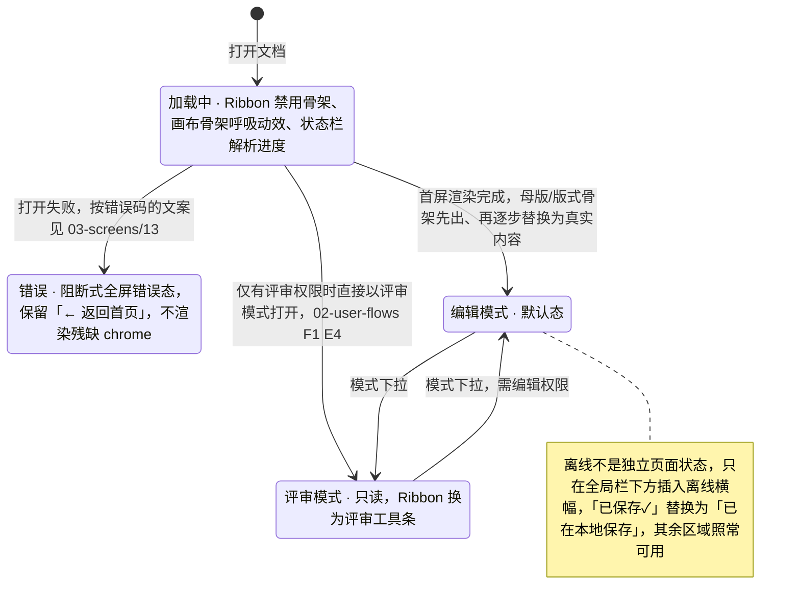

> 状态：草稿 | 负责：设计 | 更新：2026-09-18；2026-09-24（复核修正，rulings §4.17）；2026-09-25（补图）；2026-09-25（矛盾收口，rulings §4.18） | 依赖：charter v0.2；rulings §4.8 Q8 / §4.9 Q9 / §4.10 Q12 · Q14 · Q20；09 v3.0 §2–§3、T-01 / T-02；`03-screens/26`、`29`；playground `#/editor`（`AppBar` / `Ribbon` / `EditorShell` / `SlideCanvas`）

# 03-02 编辑器主界面

> **设计基准（2026-09-15 起）**：组件规格以 [`09-design-specification.md`](../09-design-specification.md) v3.0（shadcn Rhea + 材质层）为准；对应 playground 路由 `#/editor`（[已发布 artifact](https://claude.ai/code/artifact/cf6e1a1a-986b-48bb-b743-5758dff419d2)，源码 `playground/src/routes/`）。本文引用的 `mockups/*.html` 与线框图为历史静态稿，以 playground 实际渲染为终稿。

编辑模式下的完整工作区，是 01-information-architecture.md §2 区域网格的具体呈现。放映模式、评审模式的独立差异见对应专属文件（03-screens/11）与本文件的模式差异小节。**§2.4"视图模式：普通 / 母版"**（2026-09-15 新增；原"缩略图侧栏顶部分段"方案于 2026-09-16 作废）：Ribbon 页签行右侧常驻的「普通 | 母版」分段（`ViewModeSwitch`）是进入 `03-screens/26` 母版视图的主入口；母版视图是**同一个编辑器**（09 v3.0 T-02），不是本文件之外的另一套区域内容。**2026-09-18 修订**：按 rulings §4.10 回写——应用栏右侧顺序与「⋯」菜单（Q14 / Q20）、母版视图入口可用性（Q12）、缩放胶囊位置、Ribbon「开始」页签分组按 playground `HomeTab` 重画、去除旧 token 变量名与旧图标口径（T8）。

---

## 线框（桌面，编辑模式，默认态：已选中一个形状）

```
┌─────────────────────────────────────────────────────────────────────────┐
│[← 返回首页] 季度汇报.pptx ✎  ↶ ↷  已保存✓  (●B)(●C)(+2) [分享] [编辑 ▾] [⋯] (头像)│
├─────────────────────────────────────────────────────────────────────────┤
│[开始][插入][设计][切换][视图][数据图表插件▸]        [普通|母版] [◐主题] [?] │
│┌剪贴板───┐┌幻灯片───┐┌字体──────────────┐┌段落──────────┐┌绘图───┐┌编辑──────┐│
││[粘贴▾] ││[新建▾]  ││系统 UI 字体▾ 18▾  ││≡ ≡ ≡ ≡        ││[形状▾]││查找 ⌘F   ││
││剪切 复制││版式▾ 重置││B I U S 𝐀 ✎ ⌫     ││• 1. ⇤ ⇥ 行距▾ ││填充   ││替换 ⌘H 选择││
│└────────┘└─────────┘└──────────────────┘└──────────────┘└───────┘└──────────┘│
├──────────┬──────────────────────────────────────────────┬───────────────┤
│ 1 ▪当前  │  ┌──────────────────────────────────────┐    │ 属性│评论│历史│插件│
│ ┌──────┐ │  │                                        │    ├───────────────┤
│ │      │ │  │        ╭─────────────╮  ← C 的选区      │    │位置与大小 ▾   │
│ └──────┘ │  │        │   标题文本   │                  │    │ X:120 Y:80    │
│ 2        │  │        ╰─────────────╯                  │    │ 宽:320 高:96  │
│ ┌──────┐ │  │        [■ 已选中的形状，我的选区]         │    │旋转:0°        │
│ │      │ │  │           ▪ ▪ ▪ (拖拽手柄)               │    │填充 ▾         │
│ └──────┘ │  │                                        │    │ ■ #4A54E1     │
│ 3        │  │   B →┊ (远端光标+姓名标签)                │    │边框 ▾         │
│ ┌──────┐ │  │                                        │    │阴影/效果 ▾    │
│ │      │ │  └──────────────────────────────────────┘    │文本 ▾         │
│ │      │ │      ( − ──●───── +  100%  适应窗口▾ ) ←玻璃胶囊 │对齐与分布 ▾   │
│ [+新建]  │  │                                            ├───────────────┤
│          │  │                                            │插件A：更多属性 🧩│
├──────────┴──────────────────────────────────────────────┴───────────────┤
│ 第 1/12 页   已选中 1 个对象      🟢已同步   👥3人在线   🧩插件正常        │
└─────────────────────────────────────────────────────────────────────────┘
```

Ribbon「开始」页签分组已按 playground `HomeTab` 实际分组重画：剪贴板 / 幻灯片 / 字体 / 段落 / 绘图 / 编辑，每组 = 左侧大按钮（60px）+ 右侧一列两行小控件（28px），组标题 11px 极淡、组间无竖线（09 §3）；此前线框中的「排列」组与「▾更多」溢出为历史静态稿（作废）。应用栏（48px）自左至右：「← 返回首页」（落到应用首页 `#/home`，`03-screens/29`）· 文档名 + 重命名 · 撤销 / 重做 · 保存 / 同步态；右侧顺序：在场头像堆叠 · 分享 · 模式下拉（编辑 / 评审）· 「⋯」· 账户头像（`UserMenu`，rulings §4.10 Q14）。

上图未画出**备注区**（01-information-architecture.md §2.3a 新补充的区域），因为其默认折叠态不占用垂直空间；展开时在状态栏上方插入一条可调高度的横条（占用文档流空间，画布视口相应变矮，而非覆盖画布），标题栏为"备注 ▾/▴"+ 字数提示，内容为纯文本编辑区，键盘焦点顺序上位于属性面板之后、状态栏之前（PRD ED-29，见 07-accessibility-and-i18n.md §1.1）。

上图 Ribbon 页签行右侧的「普通 | 母版」分段（`ViewModeSwitch`）是母版视图的主入口，见下方 §2.4；`mockups/02-editor-main.html` 中缩略图侧栏顶部的分段控件为历史静态稿（2026-09-16 作废），以 playground `#/editor` 实际渲染为准。

### 2.4 视图模式：普通 / 母版（2026-09-15 新增；2026-09-16 起改为 Ribbon 页签行右侧分段，rulings §4.8 Q8；2026-09-18 按 §4.10 Q12 回写；对应 `03-screens/26` ML-01）

```
│[开始][插入][设计][切换][视图][数据图表插件▸]        [普通|母版] [◐主题] [?] │
                                                       ↑ 页签行右侧常驻的 `ViewModeSwitch`
```

- 二选一分段（`ToggleGroup type="single" size="sm"`，两项 `ToggleGroupItem`：Lucide `Presentation`「普通」/ `LayoutTemplate`「母版」，`aria-label="视图模式"`），默认「普通」；切到「母版」即进入 `03-screens/26` 定义的母版视图——**同一个编辑器**（09 v3.0 T-02）：Ribbon 最左插入「母版」页签（强调色），开始 / 插入 / 切换 / 视图 / 插件页签照常可用，仅隐藏「设计」页签；缩略图栏切换为母版缩略图窗格（母版大缩略图 + 缩进 16px、带连接线的版式小缩略图，无折叠，列表式键盘）；检查器仅禁用「评论」；分段本身处于「母版」档。不是弹窗、不是新 preset（playground 里两档对应 `#/editor` 与 `#/editor/masters` 两条路由，仅为演示拆分）。
- 这是母版视图的**主入口**；等价次入口：「视图」页签「窗口」组的「母版视图」按钮（`03-screens/20`）、快捷键 `Mod+Alt+M`（⌘⌥M；原草案 `Mod+Shift+M` 作废，rulings §4.9 Q9）。
- 退出：母版页签最右「关闭」组的「关闭母版视图」大按钮（红色 `CircleX`）/ 分段切回「普通」/ Esc（画布无选区时）/ 再按 `Mod+Alt+M`；回到进入前的页、缩放与滚动位置，选区清空。
- 尺寸与键盘：控件高 28（页签行小控件统一 28，09 §3），胶囊圆角，宽度按内容自适应；选中态由 `[data-slot="toggle-group-item"][data-state="on"]` 规则显式化（09 §2）；键盘 `←`/`→` 在两档间移动，`Enter`/`Space` 激活。
- **可用性（rulings §4.10 Q12、§4.18 UX-11 / UX-20）**：仅编辑模式（有 `doc.write`）且视口 ≥ 1024 提供入口——评审模式、放映模式、窄屏（< 1024）下分段**不渲染**（页签行右侧不留占位空档），`Mod+Alt+M` 无效；评审与放映模式没有 Ribbon、「视图」页签不存在；编辑模式已降权时「视图」页签「母版视图」按钮禁用并 tooltip「需要编辑权限」，窄屏时 tooltip「需要 ≥ 1024 宽度」；已在母版视图中时把窗口缩窄不强制退出、被降权原地只读，手动切到评审即退出母版视图。

---

## 状态

**编辑器主界面状态切换**



怎么读：从「加载中」出发的三条箭头是一次打开的三种结局，编辑与评审两态之间由应用栏模式下拉切换；选中态变体只改变检查器坞内容，不改变这里的页面状态。

### 加载中（打开文档尚未完成首屏渲染）

```
┌─────────────────────────────────────────────────────────────────────────┐
│[≡] 正在打开 季度汇报.pptx …                                                │
├─────────────────────────────────────────────────────────────────────────┤
│（Ribbon 区显示为禁用骨架，不可交互）                                        │
├──────────┬──────────────────────────────────────────────┬───────────────┤
│ [骨架]   │              ▓▓▓▓▓▓▓▓▓▓▓▓（画布骨架，呼吸动效）  │  [骨架]        │
│ [骨架]   │                                              │               │
├──────────┴──────────────────────────────────────────────┴───────────────┤
│ 正在解析… ▓▓▓▓▓▓▓▓░░░░░░░░ 62%                                            │
└─────────────────────────────────────────────────────────────────────────┘
```

渐进式细化：母版/版式骨架先出现（灰底 + 占位框），随后逐步替换为真实内容；缩略图侧栏逐项从骨架变为真实缩略图，不等待全部页面完成。

### 错误（打开失败）

见 03-screens/01 的"进入编辑器失败"分支与 02-user-flows.md F1 边界 E3/E5：阻断式全屏错误态，替换整个主体区域（保留应用栏的「← 返回首页」入口），不渲染残缺的 chrome。线框为通用兜底文案；按错误码的主/次文案以 03-screens/13「打开失败态」表为准，任何文案都不使用"已损坏"措辞。

```
┌─────────────────────────────────────────────────────────────────────────┐
│[← 返回首页]                                                               │
├─────────────────────────────────────────────────────────────────────────┤
│                                                                           │
│                    ⚠ 无法打开该文档                                       │
│                 请稍后重试；如果问题持续，请联系管理员                  │
│                        [ 返回文档列表 ]                                    │
│                                                                           │
└─────────────────────────────────────────────────────────────────────────┘
```

### 评审模式（只读）

```
┌─────────────────────────────────────────────────────────────────────────┐
│[← 返回首页] 季度汇报.pptx  评审模式    (●B)(●C) [分享] [评审 ▾] [⋯] (头像)   │
├─────────────────────────────────────────────────────────────────────────┤
│ [💬评论] [🖊高亮] [◂上一处评论] [下一处评论▸]              [◐主题][?]      │
├──────────┬──────────────────────────────────────────────┬───────────────┤
│ 1 ▪当前  │                                                │ 评论│历史      │
│ 2        │           （画布只读：无选中手柄/无插入符）        ├───────────────┤
│ 3        │              ① 评论锚点图钉                     │ 线程 #1        │
│（不可拖拽 │                                                │ 王小明：这里的  │
│ 排序）   │                                                │ 数据需要核对   │
│          │                                                │ [回复][已解决] │
├──────────┴──────────────────────────────────────────────┴───────────────┤
│ 第 1/12 页                              🟢已同步   👥3人在线              │
└─────────────────────────────────────────────────────────────────────────┘
```

评审模式下整条 Ribbon 由单行评审工具条取代，**「视图」页签不存在**：不渲染「普通 | 母版」分段，`Mod+Alt+M` 无效，命令面板「母版视图」项禁用并注明"评审模式下不可用"（rulings §4.10 Q12、§4.18 UX-11）；已在母版视图中手动切到评审即退出母版视图（03-screens/26 §6）。编辑模式但已被降权（`readonly-degraded`，Ribbon 仍在）是另一种情况：「视图」页签「母版视图」按钮禁用，tooltip「需要编辑权限」。应用栏无撤销 / 重做，右侧顺序同编辑模式（在场头像 · 分享 · 模式下拉 · ⋯ · 账户头像）；有 `doc.export` / `history.read` 的用户可从「⋯」发起导出与版本历史，完成后回到评审模式（02-user-flows 流程总览）；检查器的「历史」Tab 同样只对有 `history.read` 的编辑者及以上出现（例如主动切到评审的编辑者），评审者（`commenter`）只看到「评论」（rulings U-09、§4.18 UX-17）。

**查看者变体（只读浏览，`mode='view'`）**：只有查看权限的用户进入同一编辑器（01-information-architecture §5.1）。与上图相比：工具条去掉「💬评论」「🖊高亮」，只留「◂上一处评论」「下一处评论▸」；检查器「评论」面板只读（无回复 / 已解决 / 输入框），没有「历史」Tab；模式下拉只列「只读浏览」与「放映」，应用栏徽标为「只读浏览中」（评审模式的徽标是「评审模式」，见上图）；实时看到修改与在场（rulings §4.18 UX-19）。

### 离线

顶部全局栏下方插入离线横幅（见 03-screens/12），其余区域正常可用（本地乐观编辑），画布不受影响；顶部"已保存✓"替换为"已在本地保存"。

### 选中态变体

| 选中态 | 检查器坞表现 |
|---|---|
| 未选中任何对象 | 显示幻灯片级属性（背景、版式、切换），非"空"占位——幻灯片本身即默认上下文 |
| 单个对象 | 完整属性分区（见 03-screens/03） |
| 多个同类对象 | 公共属性可编辑，非公共字段显示"多个值" |
| 多个异类对象（形状+图片） | 仅显示交集属性（位置/大小/排列/透明度），类型专属分区（如"文本"）隐藏 |
| 正在编辑文本（插入符在文本框内） | 画布上方浮现迷你悬浮工具条（字体/字号/加粗/颜色），检查器坞"文本"分区自动展开定位 |

---

## 交互说明

- **地标与跳转**（2026-09-15 评审）：应用栏 `<header>`、画布 `<main>`、缩略图侧栏与检查器坞 `<aside aria-label>`、状态栏 `<footer>`；页面首个可聚焦元素为"跳至画布"跳转链接（仅聚焦时可见）；Ribbon 页签与检查器坞页签为 `role="tablist"/"tab"` 的 `button`；缩略图项与评论钉是 `button`（可聚焦、有可读名称）；所有仅图标按钮使用 SVG 图标 + `aria-label`，不用 emoji。
- Ribbon 页签切换：点击或 `Ctrl+Alt+方向键`（见 07-accessibility-and-i18n.md 键盘模型）。
- 缩略图拖拽排序：拖拽时其余缩略图让位动画（150–200ms ease-out，09 §1.4），松手即产生一次 Mutation；键盘等效操作：选中后 `Mod+Shift+↑/↓`（PRD ED-29，`Mod` 为 Ctrl/Cmd）。
- 画布缩放：画布底部居中的玻璃胶囊（`glass rounded-full`：− / 滑块 / + / 百分比 / 模式下拉，09 §3「画布区」，playground `SlideCanvas` `ZoomBar`；**不在状态栏**）、`Mod+滚轮`、`Mod+ +/-`；模式下拉含「适应窗口 / 适应宽度 / 50% / 75% / 100% / 150% / 200%」，默认 `zoom="fit"`。
- 检查器坞折叠：坞左边缘拖拽手柄或点击顶部全局栏图标，折叠后画布区域自动扩展占满。
- Ribbon 页签行右侧自左至右：视图模式分段（§2.4）· 「◐主题」亮 / 暗切换（个人偏好，见设计 04 §3）· 「?」（Lucide `CircleHelp`）打开快捷键面板（`03-screens/24`；快捷键面板共三个入口：此「?」、账户菜单「键盘快捷键」、`Mod+/`）。
- 进入母版视图的三个等价入口（§2.4 页签行右侧分段、Ribbon「视图」页签「母版视图」按钮、`Mod+Alt+M`）与可用性限制（Q12）见 §2.4 与 03-screens/20、26，不在此重复列出。
- 应用栏「⋯」更多菜单（rulings §4.10 Q20，`DropdownMenu`）：导出…（`Mod+E`，03-screens/22）/ 保真报告（03-screens/10）/ 版本历史（03-screens/07）/ 插件管理器（03-screens/09）/ 重命名 / 创建副本 /（开发者，仅开发模式）。
- 账户头像（`UserMenu` avatar 形态，应用栏最右，28px 无在场环）：姓名与邮箱、设置（`Mod+,`，唯一入口，03-screens/23）、键盘快捷键（`Mod+/`）、帮助中心、退出登录（PRD AS-06 / D13）；应用栏与侧栏不再单独放「设置」按钮。

## 边界情况

- 页面本身很大（如自定义超宽画布）：画布视口出现独立的水平/垂直滚动条（浏览器原生滚动条样式，不自定义，保证系统一致性），"适应窗口"始终可一键归位。
- 缩略图侧栏页数极多（接近 Q5 规模上限 200 页）：使用虚拟滚动，仅渲染视口附近的缩略图为真实图像，其余显示占位灰块 + 页码。
- 检查器坞同时存在"属性"更新与用户正在滚动查看"评论"：不因属性变化强制切回属性 Tab（见 01-information-architecture.md §2.3 的唯一自动切换例外）。
- 窄屏（<640px，"仅查看"断点，PRD NF-07）：见 01-information-architecture.md §6，缩略图/检查器坞收为抽屉，Ribbon 收为精简查看态工具条；本文件的桌面线框在窄屏下的等效结构由该章节统一定义，不在此重复线框。

---

## 设计规格（§2.4 视图模式分段 —— **2026-09-16 起为 Ribbon 页签行右侧的 `ViewModeSwitch`，缩略图栏顶部不再放置**，见 09 v3.0 §2「分段控制」与 §3「悬浮工具卡」；2026-09-18 按 Q12 补可用性）

| 项 | 规格 |
|---|---|
| 组件 | `ToggleGroup type="single" size="sm"`（shadcn Rhea 复制件）+ 两个 `ToggleGroupItem`（Lucide `Presentation`「普通」/ `LayoutTemplate`「母版」），`aria-label="视图模式"` |
| 尺寸 | 高 28（页签行小控件统一 28，09 §3），宽度按内容自适应，胶囊 `rounded-full` |
| 位置 | Ribbon 页签行（36px）右侧，自左至右：视图模式分段 · 主题切换 · 「?」帮助 |
| 字号 | `text-xs` 12（与页签一致） |
| 状态矩阵 | 默认 = `text-muted-foreground`；悬停 = `bg-accent`；选中（当前档）= `[data-slot="toggle-group-item"][data-state="on"]`（浅色前景 8% 底、暗色白 14% 底 + 内高光，09 §2）；聚焦 = `:focus-visible` 环 `--ring`；不可用（评审 / 放映 / 视口 < 1024）= 控件整体不渲染而非置灰（Q12，不留空隙）；加载 / 错误 / 空 = 不适用（纯视图态切换，无网络依赖） |
| 对应基准 | playground `Ribbon.tsx` `ViewModeSwitch`（`#/editor` 普通档、`#/editor/masters` 母版档）；`mockups/02-editor-main.html`、`mockups/26-master-view.html` 中缩略图栏顶部的分段为历史静态稿（作废） |

### 应用的 UX 规则

| 规则 id | 落实方式 |
|---|---|
| `keyboard-nav`（ui-ux-pro-max, Accessibility/Keyboard Navigation） | 分段控件为 `ToggleGroup type="single"`（Radix 提供 `role="group"` 与 `aria-checked`），`←`/`→` 移动、`Enter`/`Space` 激活，与 Ribbon 页签、检查器坞 Tab 共用同一键盘模型，不新造一套手势 |
| `color-not-only`（ui-ux-pro-max, Accessibility/Color Only） | 选中档不仅靠 `accent` 文字色区分，同时叠加背景色块 + 阴影，三重编码 |
| `sticky-nav-offset`（ui-ux-pro-max, Navigation/Sticky Navigation，检索"sidebar navigation nested"） | 分段常驻悬浮工具卡的页签行右侧，随工具卡固定于顶部、不占用缩略图栏空间；普通 / 母版两档同位置切换，不引起布局跳动 |
