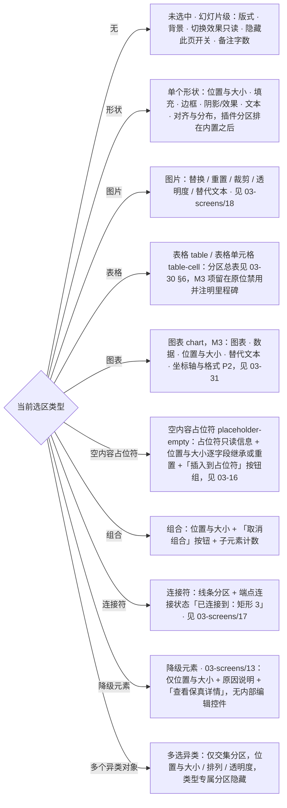
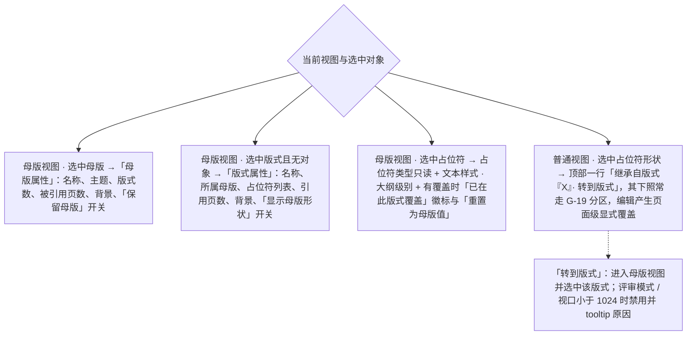

> 状态：草稿 | 负责：设计 | 更新：2026-09-18；2026-09-25（补图）；2026-09-30（§4.21 剩余缺口样张回写：G-19 表格行拆为 `table` / `table-cell` 并链到 [03-30](30-table-editing.md) §6，补 `chart`（[03-31](31-chart-editing.md)）与 `placeholder-empty`（[03-16](16-text-editing-and-formatting.md)）两行，分区图同步；迷你工具条槽位 `chart-selected` 按 50/10 §5 改名 `chart`，`table-cell` 补全为插入 ▾、合并、拆分、填充 ▾、边框 ▾；样张经主会话抽查，最终以用户确认为准）；2026-09-30（§4.22 设计待决收口：`placeholder-empty` 改为占位符、位置与大小、插入到占位符三组，位置与大小逐字段标「继承自版式」或「已覆盖 · 重置」；表格行补 M2 锁定口径与插入后取 `table-cell`；迷你工具条补 M2 单元格选区的文本条与条尾「表格结构 M3」）；2026-09-30（§4.22 复核修正：G-19 表 `table-cell` 补「表格样式（收起）」并指向 03-30 §6.1；「只读」补表格、图表分区的锁定形态例外） | 依赖：charter v0.2；rulings §4.10（Q12、Q16、T8 视觉基线）；PRD `07-design-coverage-and-gaps.md` G-14 / G-19 / G-74；09 v3.0 §1.1、§2（属性行 / 检查器分区）；playground `Inspector.tsx`（`PropertyRow` / `MixedValueField`）

# 03-03 格式/属性面板

> **设计基准（2026-09-15 起）**：组件规格以 [`09-design-specification.md`](../09-design-specification.md) v3.0（shadcn Rhea + 材质层）为准；对应 playground 路由 `#/editor`（检查器坞"属性"Tab，无独立路由）（[已发布 artifact](https://claude.ai/code/artifact/cf6e1a1a-986b-48bb-b743-5758dff419d2)，源码 `playground/src/routes/`）。本文引用的 `mockups/*.html` 与线框图为历史静态稿，以 playground 实际渲染为终稿。

检查器坞的"属性"Tab 内容（`ui.panel`，`slot: 'inspector'`，内置）。采用手风琴式分区，遵循渐进展示原则：默认展开与当前选中对象最相关的 1–2 个分区，其余折叠。

---

## 线框（单个形状选中）

```
┌───────────────────┐
│ 属性│评论│历史│插件  │
├───────────────────┤
│ ▾ 位置与大小        │
│   X [120 ] Y [80  ]│
│   宽[320 ] 高[96  ]│
│   旋转[0°]  ☐锁定比例│
│ ▾ 填充              │
│   ● 纯色 ○渐变 ○图片│
│   [■ #4A54E1]       │
│   不透明度 [──●──]80%│
│ ▸ 边框              │
│ ▸ 阴影/效果          │
│ ▾ 文本              │
│   字体[微软雅黑▾]     │
│   字号[18▾] 行距[1.0▾]│
│   [B][I][U][𝐀][𝐀]   │
│   对齐[≡][≡][≡][≡]  │
│ ▸ 对齐与分布          │
├───────────────────┤
│ 🧩插件A：更多属性     │
│ ▸ 数据绑定（插件A提供）│
└───────────────────┘
```

区域说明：分区标题可点击折叠/展开（状态持久化到本地偏好）；插件贡献的属性分区固定排在内置分区之后，以分隔线 + 归属图标区分（设计 06 §2.2）。

---

## 状态

### 空（未选中对象）

显示"幻灯片"级属性：背景填充、应用的版式、当前页切换效果（只读展示，切换效果编辑属章程非目标，见 README 术语补充/待决事项）。面板标题区显示"幻灯片属性"而非对象名。

### 加载

选中对象后，若属性尚未从 Store 同步完成（理论上极短暂，网络协同延迟场景可见），分区显示为灰色骨架行，输入控件禁用，不显示"多个值"这类具备语义的占位（避免误导为真实状态）。

### 只读（评审模式 / 无编辑权限）

整个面板输入控件替换为只读展示态（数值仍可见，但无输入框描边、无法聚焦），顶部追加一行说明"只读 · 评审模式下不可编辑"。颜色板/字体等触发型控件（如"填充"色块）点击不弹出选择器，仅 tooltip 提示原因。表格与图表分区例外：控件留在原位、`aria-disabled`、仍可聚焦，tooltip「需要编辑权限」（rulings §4.20 FE-06；[03-30](30-table-editing.md) §9、[03-31](31-chart-editing.md)「未开放、只读角色与其它模式」，50/24 §2.7）。

### 离线

面板可正常编辑（本地乐观优先，与 02-user-flows.md F5 一致）；有更改尚未同步时，面板顶部出现小图标 + "更改将在重新连接后同步"，不阻塞继续编辑。

### 混合值（多选）

```
│ ▾ 位置与大小        │
│   X [多个值] Y [多个值]│   ← 多个对象位置不同，显示"多个值"（`MixedValueField`：只读、斜体淡色占位）
│   宽[240 ] 高[多个值]│   ← 宽度相同则正常显示，高度不同显示"多个值"
```

用户在"多个值"字段输入新值即统一应用到全部选中对象（产生一次事务、一次撤销粒度）。混合值统一显示"多个值"（不再用"—"，与 02-editor-main.md 选中态表与 playground `MixedValueField` 一致）。

### 校验错误

数值输入非法（如宽度输入负数、字号超出支持范围）时，字段以 `aria-invalid` 进入错误态（描边转 `--destructive`，由 `Input` / `Field` 复制件提供），下方追加 `FieldError` 一行内联错误文案（如"宽度必须大于 0"），不使用浏览器原生校验气泡或 `alert()`；失焦前不提交非法值到 Store。

---

## 交互说明

- **可见标签**（2026-09-15 评审，规则 input-labels）：位置与大小的 X/Y/宽/高是 `<label>` 而不是输入框内的值前缀（`X: 120` 的写法不可取，值只含数字），单位以 `aria-describedby` 的说明文字给出；颜色字段的色块是可聚焦的按钮（`aria-label` 含当前色值），十六进制输入框单独可编辑；输入框为 Rhea 填充式字段：`bg-input/50` 填充 + `border-transparent`，悬停 64%，聚焦转 `--card`（暗色白 10%）+ `--ring` 焦点环（09 §1.1 / §2「文本 / 数值输入」）；`--border-control`（≥ 2.5:1）只用于 `ToggleGroup variant="outline"` 等描边型控件，**不用于字段描边**。

- 数值字段支持拖拽微调（按住字段标签左右拖动，类似专业设计工具的"scrubbing"交互）与键盘 `↑/↓`（Shift 加速）。
- 颜色选择器为 `Popover`（自动玻璃化，09 §6.3），含"最近使用"色板、当前主题色板、自定义色值输入（Hex/RGB）。
- 分区折叠状态、面板宽度均为个人偏好，随浏览器本地存储持久化，不同步到协同其他成员。
- 插件贡献分区若渲染出错，仅该分区显示错误态（"该属性区不可用" + 重试），不影响其余内置分区（设计 06 §3）。

## 边界情况

- 极窄检查器坞（用户手动拖到最小宽度，或窄屏抽屉态）：X/Y、宽/高等成对字段从同行改为纵向堆叠，保证单个输入框最小可用宽度。
- 字体列表很长：改为可搜索的 `Select`（输入过滤），而非纯下拉长列表。
- 数值单位：本设计文档不预设默认单位（pt/cm/inch），见本目录 README「待决事项」。
- 用户输入未提交时遭遇软冲突（F4 场景 C）：见 02-user-flows.md F4，字段级"应用远端值 / 保留我的输入"内联提示优先于本面板的其他视觉反馈。

---

## 补充（2026-09-15，G-14/G-19，来源 `10-prd/07-design-coverage-and-gaps.md`）

上方"数值单位…见本目录 README「待决事项」"一条已由产品默认答案 D1 解决：内部单位始终 EMU；显示单位随语言默认（zh-CN → cm，en-US → in），用户可在设置（03-screens/23）切换 cm/in/pt/px；字号始终 pt 不受此设置影响；数值输入允许带单位后缀（如 `2.5cm`）自动换算。本条待决事项标记为已解决，原文保留以便追溯。

### G-19 按选区类型的分区总表（替代本文件此前"仅覆盖单个形状"的范围）

| 选区类型 | 分区 | 说明 |
|---|---|---|
| 未选中（幻灯片级） | 版式（可换，见 03-screens/14）、背景（G-35，纯色/渐变/图片/隐藏背景图形/应用到全部/重置）、切换效果（只读"已保留，暂不可编辑"）、隐藏此页开关、备注字数 | 幻灯片本身即默认上下文，非"空"占位 |
| 图片 | 见 03-screens/18 完整分区（替换/重置/裁剪/透明度/替代文本） | — |
| 表格（`table`，整表选中）/ 表格单元格（`table-cell`，格内编辑或多格选区） | `table`：位置与大小、表格样式与 6 个标志（M3）、文本（全部单元格）、替代文本；`table-cell`：表格样式与 6 个标志（M3，收起）、单元格（填充、边框、边距、垂直对齐、文字方向，M3）、文本（所选单元格）、行高与列宽（M3，收起）。插入后插入符在首格，取 `table-cell`。分区与展开状态以 [03-30](30-table-editing.md) §6.1 为准 | M2 可改 X、Y 与文本；宽高与 M3 项留在原位、`aria-disabled` 可聚焦，tooltip「M3 提供」，读屏名附「（M3 提供）」（2026-09-30 由 03-30 落地，原「表格编辑文件待新建」作废；rulings §4.22 后样张已按此画 M2 态） |
| 图表（`chart`，M3） | 图表（类型、标题、图例、数据标签）、数据（紧凑网格，可展开）、位置与大小、替代文本、坐标轴与格式（P2 灰显），见 [03-31](31-chart-editing.md)「检查器（`selectionKind: chart`）」 | 导入的非五类图表只显示位置与大小、替代文本与「此类型仅支持查看」 |
| 空内容占位符（`placeholder-empty`，R-d-72） | 三组（rulings §4.22 定稿）：**占位符**（类型、索引、来自版式，只读）；**位置与大小**（X、Y、宽、高，可改；每个字段注明「继承自版式」，改过的字段标「已覆盖 · ↺重置」，重置回版式值，一个撤销步——占位符的重置由这里逐字段承担）；**插入到占位符**按钮组（表格、图片、图表 M3、视频 P2；表格弹出与插入页签同一网格，禁用项 `aria-disabled` 并以 tooltip 给原因），见 [03-16](16-text-editing-and-formatting.md)「检查器『插入到占位符』按钮组」 | 只指页上空的内容族占位符；有内容的占位符仍按承载的内容类型走对应分区（50/10 §5）；评审、查看角色下「插入到占位符」组不出现（与图标条同，03-16），位置与大小只读 |
| 组合 | 位置与大小 + "取消组合"按钮 + 子元素计数 | — |
| 连接符 | 线条分区（同 G-14）+ 端点连接状态"已连接到：矩形 3" | 见 03-screens/17 |
| 降级元素（03-screens/13） | 仅"位置与大小" + 原因说明 + "查看保真详情"入口 | 不提供任何内部编辑控件 |
| 多选（异类） | 仅交集分区（位置与大小/排列/透明度），类型专属分区隐藏 | 沿用本文件已有"混合值"规则 |

迷你工具条（`ui.toolbar`）按选区类型区分槽位：`text-editing`（字体/字号/B/I/颜色/对齐/项目符号，见 03-screens/16）、`image-selected`（裁剪/替换/替代文本，见 03-screens/18）、`chart`（即 `toolbar.chart`，按 50/10 §5 的 `toolbar.<selectionKind>` 命名，原写 `chart-selected`；M3：编辑数据、更改类型 ▾，见 [03-31](31-chart-editing.md)「画布：选中框与迷你工具条」）、`table-cell`（M3：插入 ▾、合并、拆分、填充 ▾、边框 ▾，见 [03-30](30-table-editing.md) §4；M2 的单元格选区沿用 `text-editing` 条，条尾加一个 `aria-disabled` 的「表格结构 M3」入口，M3 起整条换成 `table-cell`）。所有迷你工具条画在画布的屏幕覆盖层，文字 12px、不随缩放变小。

**按选区类型选择属性分区（普通视图）**



怎么读：从左侧的选区类型出发，每条箭头指向检查器坞「属性」Tab 该显示的分区组合；多选同类对象走对应类型分区并对不同值显示「多个值」。

### G-14 填充 / 线条 / 效果分区完整化（替代本文件此前"仅分区标题"的边框/阴影）

- **填充**：类型单选（无/纯色/渐变/图片 P2/图案 P2）；纯色 = 色块 + Hex + 透明度滑杆；渐变 = 类型（线性/径向）、角度、2–10 个可拖动增删的 stop（每个含颜色+位置）、8 个预设渐变缩略图。
- **边框（线条）**：无/纯色、宽度（0.25–100 pt，阶梯下拉+输入）、虚线类型（8 种图示）、箭头首尾类型与尺寸（线条/连接符可见）、端点/连接（P2）。
- **阴影/效果**：9 种预设缩略图 + 无；自定义（颜色/透明度/模糊/距离/角度）默认折叠。
- 多选时任一属性变更对全部选中对象生效并计一个撤销步；混合值显示"多个值"（沿用本文件已有规则）。
- Ribbon"绘图"分组的"快速样式 ▾"（P1）：6×7 主题样式缩略图库，效果等价于同时设置填充+线条+阴影为预设组合。

### 占位符属性的范围边界（2026-09-15，ML-03，来源 `03-screens/26-master-view-and-editing.md`）

普通编辑模式下选中一个占位符（如标题/正文占位符）时，本文件已有的选区类型规则（上方 G-19 表）照常适用——占位符按其承载的内容类型（文本/图片/表格…）走对应分区，**不**在检查器坞新增"占位符"专属分区；用户在普通视图里编辑占位符文字/样式产生的是**页面级显式覆盖**，与编辑器对待任何其他形状/文本框完全一致（呼应章程"忠实优先"：不为占位符在编辑期打通一条模型不支持的特殊路径）。

"占位符类型"（`type`/`idx` 只读展示）、"文本样式（大纲级别）"选择器、"重置为母版值"这些**母版专属**的属性面板内容，仅在母版视图（`03-screens/26` §6）中出现——那里选中的占位符是"版式/母版上的定义本身"，而非"某一页上的一个覆盖实例"，两者是继承链的不同层级，因此用不同的属性面板呈现，不合并进本文件的 G-19 表。

唯一例外是页上**空的**内容族占位符（`placeholder-empty`，R-d-72；G-19 表）：它没有承载内容可走，检查器给只读的「占位符」信息（类型、索引、来自版式）、逐字段标注继承的「位置与大小」与「插入到占位符」按钮组；这里的「已覆盖 · 重置」只把本页的显式覆盖改回版式值，不改版式本身，仍是页面级操作（2026-09-30，rulings §4.22）。

### 母版视图与继承上下文的三种分区（2026-09-18 补，PRD G-74 / ML-03，M3；playground `#/editor/masters` 目前只演示占位符属性态，其余待出稿）

| 上下文 | 分区内容 | 说明 |
|---|---|---|
| 母版视图 · 选中版式且无对象 | **版式属性**：名称（可编辑，同母版内唯一性内联校验）、所属母版、占位符列表（类型 · 索引，点击选中画布上对应占位符）、引用页数（可点击列表，点击在普通视图打开该页）、背景、「显示母版形状」开关 | 面板标题「版式属性」；只读浏览态（M2 / 无 `doc.write`）字段禁用 |
| 母版视图 · 选中母版 | **母版属性**：名称、主题（链接到 03-screens/28 主题面板）、版式数、被引用页数、背景、「保留母版」开关（关闭且引用数 = 0 时说明「导出前将移除」） | 面板标题「母版属性」 |
| 普通视图 · 选中占位符形状 | 面板顶部一行说明「继承自版式『X』· [转到版式]」，其下照常走 G-19 表对应分区 | 「转到版式」进入母版视图并选中该版式；遵守 Q12 可用性（评审模式 / 视口 < 1024 下该链接禁用并 tooltip 原因） |

**继承链不同层级的属性面板**



怎么读：母版视图里编辑的是继承链上的定义本身，普通视图里编辑的是某一页上的覆盖实例，两者用不同面板呈现、不合并；虚线是从页面跳回定义的入口。只读浏览态（M2 / 无 `doc.write`）下这些字段禁用。

---

## 设计规格（本次新增：占位符母版属性区）

| 区域 | 尺寸 | 说明 |
|---|---|---|
| "占位符类型"分区 | 单行只读文本，`text-2xs`(11px) 说明 + `text-sm`(14px) 主文案 | 无输入控件，纯展示，不占用分区折叠/展开状态（恒定展开） |
| "文本样式（大纲级别）"级别选择器 | `Select` + `SelectTrigger size="sm"`（28px） | 与检查器其余字段统一 28px 小控件（09 §3），见 03-screens/26 设计规格 |
| "已在此版式覆盖"徽标 | `Badge` 语义色 `bg-info-muted text-info-foreground`，`rounded-full`（Rhea 默认） | 复用 09 §2 `Badge`，不新建变体 |
| "重置为母版值"按钮 | `Button variant="ghost" size="sm"`（28px），图标 Lucide `RotateCcw` 16（`size-4`） | 循环箭头隐喻"恢复上一级"；图标一律 Lucide 线性（09 S-05），不再使用 sprite 类名 |

### 状态矩阵（占位符母版属性区，仅母版视图内出现）

| 元素 | 默认 | 悬停 | 按下 | 禁用 | 聚焦 | 加载 | 错误 | 空 |
|---|---|---|---|---|---|---|---|---|
| 级别选择器 | 显示当前级别取值 | — | 展开下拉 | 只读浏览态禁用 | `focus-visible` | — | — | — |
| "重置为母版值" | 该级别有覆盖时可用 | `bg-accent`（ghost 默认） | `bg-accent/80` | 无覆盖时禁用（非错误，是正常的"无需重置"态） | `focus-visible` | — | — | — |
| "已在此版式覆盖"徽标 | 有覆盖时显示 | — | — | — | — | — | — | 无覆盖时不显示（不是"空徽标"，是徽标整体不出现） |

对应基准：playground `#/editor/masters`（检查器"属性"页签的占位符属性态）；[`mockups/26-master-view.html`](../mockups/26-master-view.html) 为历史静态稿（检查器坞"文本样式（大纲级别）"分区，含覆盖徽标与重置按钮的可视状态）。

### 应用的 UX 规则

| 规则 id | 来源 | 落实方式 |
|---|---|---|
| `color-not-only` | `ui-ux-pro-max --domain ux "color picker swatches accessible"` | "已在此版式覆盖"状态同时用徽标文字 + accent 色，不仅靠颜色区分于"未覆盖"态 |
| `focus-appearance-aaa` | `ui-ux-pro-max --domain ux "modal dialog focus"` | 级别选择器与重置按钮的 `:focus-visible` 环沿用 `--ring`（亮 #3A5CE6 / 暗 #7DA2FF，09 §1.1） |
