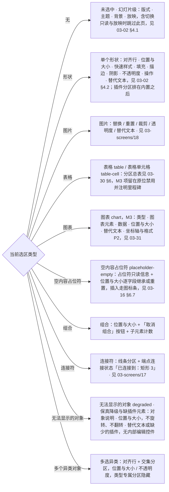
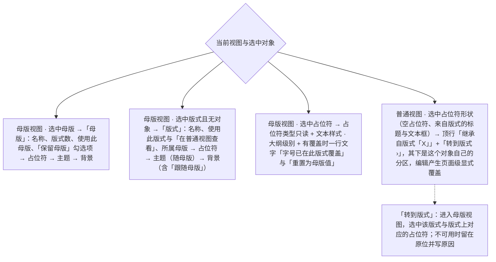

> 状态：草稿 | 负责：设计 | 更新：2026-09-18；2026-09-25（补图）；2026-09-30（§4.21 剩余缺口样张回写：G-19 表格行拆为 `table` / `table-cell` 并链到 [03-30](30-table-editing.md) §6，补 `chart`（[03-31](31-chart-editing.md)）与 `placeholder-empty`（[03-16](16-text-editing-and-formatting.md)）两行，分区图同步；迷你工具条槽位 `chart-selected` 按 50/10 §5 改名 `chart`，`table-cell` 补全为插入 ▾、合并、拆分、填充 ▾、边框 ▾；样张经主会话抽查，最终以用户确认为准）；2026-09-30（§4.22 设计待决收口：`placeholder-empty` 改为占位符、位置与大小、插入到占位符三组，位置与大小逐字段标「继承自版式」或「已覆盖 · 重置」；表格行补 M2 锁定口径与插入后取 `table-cell`；迷你工具条补 M2 单元格选区的文本条与条尾「表格结构 M3」）；2026-09-30（§4.22 复核修正：G-19 表 `table-cell` 补「表格样式（收起）」并指向 03-30 §6.1；「只读」补表格、图表分区的锁定形态例外）；2026-10-07（design-language-v3 第 1 批：只做第 1 批裁决直接要求的最小改动——设计基准下补 v3 现状说明（检查器结构与各选中态分区以 03-02 §3.5、§4 与对象界面为准）；「只读」按 rulings §4.25 DS-15 改为只读展示当前值、删去表格与图表分区的禁用控件例外（03-30 §9、03-31）；G-19 表「图表」行改为「类型」「图表元素」等六节、「空内容占位符」行改为两组（DS-14，03-16 §6.7），分区图同步；迷你工具条一段改为全部取消（DS-13、DS-22，图片见 03-18 §1.4），`toolbar.<selectionKind>` 槽位按 TB-29 删除；占位符范围边界一段删去「插入到占位符」按钮组；G-14「快速样式」的原 Ribbon 入口作废、按 DS-1 落在检查器形状分区（样张未画，随实现））；2026-10-08（design-language-v3 第 1 批收口：按 rulings §4.25 DS-27、DS-30…DS-32、TB-24、TB-32、TB-33、TB-41、TB-44、TB-45——G-14 快速样式落在形状检查器「填充」节上方（DS-31）；G-19 表「未选中」行改为 v3 四节并写明三项背景动作的落点（PRD ED-20，TB-45），「多选（异类）」行与分区图同步 03-02 §4.5；分区图的形状节点补快速样式与替代文本（TB-32）；「交互说明」的面板宽度改为按文档记在本机、不设整栏折叠（TB-24、TB-41、DS-32）；数值单位一条按 DS-27 结案并补段落间距始终 pt（TB-33）；母版视图分区的 M2 与降权分开写（03-26 §5），「转到版式」在非完整形态不可用并写「在更大窗口中编辑」（TB-44）；「标题 / 正文占位符」改称「标题 / 文本占位符」（DS-30））；2026-10-08（design-language-v3 第 1 批评审修改：G-14 快速样式改为点开后 42 格样式库在「快速样式」节里原位展开（rulings §4.25 DS-34，原「样式库弹层」作废）；「交互说明」的可见标签一条补 v3 字段画法改指 03-02 §3.5 的安静样式（DS-35），原 Rhea 填充式字段取值作废）；2026-10-15（design-language-v3 第 2 批：按 rulings §4.25 DS-38、DS-49、DS-52、DS-53、DS-58、DS-60、DS-62 与第 2 批样张回写——「v3 现状」补「评论」页签的内容以 03-06 为准（DS-62），检查器整栏临时换成整栏面板时按 DS-38；「加载」改为首屏可交互前整栏暂不可用、不画骨架行（DS-53，03-02 §4.5「打开中」）；「离线」去掉检查器顶部的同步提示行（第 1 批已拍板的 `main-states.offline` 没有这一行），补登录已过期与协同已暂停期间字段留在原位不可用、检查器标题上方一行写原因（DS-58）；「交互说明」补插件分区超过 2 个时默认折叠、设置型插件点「展开」进 400 整栏（DS-49、DS-38）；「边界情况」补两人同时更换同一页的版式写在「版式」字段处并给「恢复我的值」（DS-60）；G-19 表「降级元素」行改为「无法显示的对象」——保真降级与缺插件元素共用选中种类 `degraded` 与一套分区：对象说明（与第 1 批图表「此类型仅支持查看」同一画法：中性信息图标、标题、一句原因，「保真详情」/「查看详情」是带外链图标的次按钮，不用警告色）→ 位置与大小（不旋转、不翻转；缺插件占位不能改大小）→ 对象自己的节（替代文本、缺少的插件），分区图同步（DS-52））；2026-10-15（design-language-v3 第 2 批回写续：「v3 现状」整栏面板的宽度改为「沿用检查器宽度（缺省 280）」与 max(400, 检查器当前宽度)，并写明两类面板开着时分隔条能否拖（rulings §4.25 TB-60）；「交互说明」插件分区的「展开」改为分区条目带 `expandPanel` 时由宿主画在分区右下，面板跟着触发它的选中对象、选中别的即收起，第三方条目不成为检查器页签（TB-59）；「加载」「离线」两处补引 TB-75（与已拍板样张对齐，规则不变；「离线」补第 2 批样张 `offline-conflict.offline-no-network`）；G-19「无法显示的对象」补评审、只读浏览与降权下右键照常出菜单（DS-64））；2026-10-22（design-language-v3 第 3 批：只改与第 3 批裁决有关的两处——线框后补「锁定比例」一段：未锁时是断开的链（Lucide `Unlink2`），锁定时是相连的链（`Link2`）+ 按下态，读屏名与 `aria-pressed` 不变，线框里的复选框与第 1 批「两种状态同一图标」的画法作废，第 1、2 批露出这个按钮的画面随之改（rulings §4.25 DS-136，样张 `quiet-leftovers.lock-ratio-after`）；「母版视图与继承上下文」表「转到版式」一行补嵌入里的不可用原因「当前区域太窄，暂不可用」（DS-112、TB-136）；2026-10-22 复核修正：文首设计基准写明 2026-10-07 起由「v3 现状」取代、旧路由 `#/editor` 不再作实现依据（rulings §4.25 DS-7）；「母版视图与继承上下文的三种分区」标题与「设计规格」末尾的对应基准改指第 1 批场景 `master-view` 与 03-26 §5、§7，去掉「其余待出稿」，旧路由 `#/editor/masters` 与 mockups 标为历史稿（DS-21、DS-7））；2026-11-04（design-language-v3 母版视图改版：「占位符属性的范围边界」补「转到版式」只在选中对象本身是占位符形状时出现，母版专属属性的引用改指 03-26 §5；「母版视图与继承上下文的三种分区」按 03-26 §5 整表刷新——面板标题只写类型、版式与母版同一节序「对象 → 占位符 → 主题 → 背景」，「普通视图 · 选中占位符形状」一行的适用面收窄到空占位符与来自版式占位符的标题、文本框（填进占位符的表格、图表、图片与媒体不出这一行），补「转到版式」选中对应占位符（同时选中几个这样的框时只选中版式）、只读照画、可用性与样张出处；分区图同步；「母版视图 · 选中母版」一行与分区图里的「保留母版」写勾选项（与窗格右键的「保留母版」同一个值）；「设计规格」「状态矩阵」「应用的 UX 规则」的覆盖标记改为纯文字；rulings §4.25 DS-147、DS-150、DS-151、DS-162、DS-164、DS-174、TB-205；需求编号、优先级与里程碑不变） | 依赖：charter v0.2；rulings §4.25 DS-7、DS-13…DS-15、DS-21、DS-22、DS-27、DS-30…DS-32、DS-34、DS-35、DS-38、DS-49、DS-51…DS-53、DS-58、DS-60、DS-62、DS-64、DS-112、DS-136、DS-147、DS-150、DS-151、DS-162、DS-164、DS-174、TB-24、TB-29、TB-32、TB-33、TB-41、TB-44、TB-45、TB-59、TB-60、TB-75、TB-136、TB-205；playground `#/v3/editor?state=fidelity.degraded-selected`、`plugins.missing-selected`、`plugins.sections-many`、`offline-conflict.auth-expired`；rulings §4.10（Q12、Q16、T8 视觉基线）；PRD `07-design-coverage-and-gaps.md` G-14 / G-19 / G-74；09 v3.0 §1.1、§2（属性行 / 检查器分区）；playground `Inspector.tsx`（`PropertyRow` / `MixedValueField`）

# 03-03 格式/属性面板

> **设计基准（2026-09-15 起）**：组件规格以 [`09-design-specification.md`](../09-design-specification.md) v3.0（shadcn Rhea + 材质层）为准；对应 playground 路由 `#/editor`（检查器坞"属性"Tab，无独立路由）（[已发布 artifact](https://claude.ai/code/artifact/cf6e1a1a-986b-48bb-b743-5758dff419d2)，源码 `playground/src/routes/`）。本文引用的 `mockups/*.html` 与线框图为历史静态稿，以 playground 实际渲染为终稿。2026-10-07 起这条基准由下面的「v3 现状」取代：旧路由 `#/editor` 的检查器坞随 v3 全量迁移删除，不再作实现依据（rulings §4.25 DS-7）。

> **v3 现状（2026-10-07，design-language-v3 第 1 批定稿）**：检查器的结构（顶部协作行、「设计 / 评论」两页签、随选中对象切换的分区）、各选中态的分区与评审 / 只读形态以 [03-02](02-editor-main.md) §3.5、§4 为准，对象的分区逐项见 03-16（文本、空内容占位符）、03-17（多选、连接符）、03-18（图片）、03-30（表格）、03-31（图表）与 03-26 §5（母版视图）。本文的线框、「属性 / 评论 / 历史 / 插件」四页签与手风琴分区写法属旧稿（检查器坞已改称检查器）；其余规则（混合值、校验错误、远端覆盖正在输入的字段、G-14 的取值范围、母版视图三种分区）在不与上述文档冲突处仍有效。「评论」页签的内容（筛选、线程、回复、已解决、只读与窄屏形态）以 [03-06](06-comments-panel.md) 为准（2026-10-15 第 2 批定稿，rulings §4.25 DS-43…DS-46、DS-62）。检查器整栏临时换成整栏面板时，协作行不动、页签行换成面板标题行，宽度按两类取（DS-38、TB-60，03-02 §3.5）：版本历史、保真报告沿用检查器宽度（缺省 280），开着时检查器分隔条照常可拖；插件整页面板、图表编辑数据宽 max(400, 检查器当前宽度)，开着时分隔条不可拖、关闭后回到原宽；各面板见 03-07、03-10、06 §2.2 与 03-31。

检查器坞的"属性"Tab 内容（`ui.panel`，`slot: 'inspector'`，内置）。采用手风琴式分区，遵循渐进展示原则：默认展开与当前选中对象最相关的 1–2 个分区，其余折叠。

---

## 线框（单个形状选中）

```
┌───────────────────┐
│ 属性│评论│历史│插件  │
├───────────────────┤
│ ▾ 位置与大小        │
│   X [120 ] Y [80  ]│
│   宽[320 ] 高[96  ]│
│   旋转[0°]  ☐锁定比例│
│ ▾ 填充              │
│   ● 纯色 ○渐变 ○图片│
│   [■ #4A54E1]       │
│   不透明度 [──●──]80%│
│ ▸ 边框              │
│ ▸ 阴影/效果          │
│ ▾ 文本              │
│   字体[微软雅黑▾]     │
│   字号[18▾] 行距[1.0▾]│
│   [B][I][U][𝐀][𝐀]   │
│   对齐[≡][≡][≡][≡]  │
│ ▸ 对齐与分布          │
├───────────────────┤
│ 🧩插件A：更多属性     │
│ ▸ 数据绑定（插件A提供）│
└───────────────────┘
```

区域说明：分区标题可点击折叠/展开（状态持久化到本地偏好）；插件贡献的属性分区固定排在内置分区之后，以分隔线 + 归属图标区分（设计 06 §2.2）。

**锁定比例**（v3 的「位置与大小」节里 W / H 右侧 28 × 28 的图标按钮；2026-10-22 第 3 批拍板，rulings §4.25 DS-136）：未锁时是断开的链（Lucide `Unlink2`），锁定时是相连的链（`Link2`）+ 按下态（只铺 `--v3-panel-2`、图标描边加粗到 2，03-02 §3.5「按钮」）——图形本身说明锁没锁，不只靠淡底；点按在两者之间切换，读屏名「锁定比例」与 `aria-pressed` 不变。上面线框里的「☐锁定比例」复选框是旧稿写法，第 1 批「两种状态都是相连的链、只靠按下态区分」的画法也随之作废（未采纳的对照留在样张 `quiet-leftovers.lock-ratio-now`）；第 1、2 批露出这个按钮的检查器画面随之改（样张 `quiet-leftovers.lock-ratio-after`）。

---

## 状态

### 空（未选中对象）

显示"幻灯片"级属性：背景填充、应用的版式、当前页切换效果（只读展示，切换效果编辑属章程非目标，见 README 术语补充/待决事项）。面板标题区显示"幻灯片属性"而非对象名。

### 加载

文档打开中、首屏可交互前，检查器整栏暂不可用：字段留在原位、`aria-disabled`，工具提示「文档打开后可用」（与只读展示不同：结构照常，只是现在不能用；03-02 §4.5「打开中」，样张 `main-states.opening`）。不画灰色骨架行（rulings §4.25 DS-53：骨架行容易被读成内容；与已拍板样张对齐，TB-75），也不显示「多个值」这类有语义的占位（避免误导为真实状态）；原「分区显示为灰色骨架行」作废。「评论」页签的加载见 03-06 §9.2。

### 只读（评审模式 / 无编辑权限）

评审模式、只读浏览与编辑模式已降权统一为只读展示当前值（rulings §4.25 DS-15）：不显示禁用控件，每节只列属性与当前值（64 宽标签列 + 值，不画字段外形、不可聚焦），面板顶部一行说明权限（「只读 · 评审模式下不可编辑」/「只读 · 你只有查看权限」/「只读 · 需要编辑权限」，03-02 §3.5、§4.5）。表格与图表同样如此：表格只列位置、大小两行与样式名、已勾选的选项，不出样式库（[03-30](30-table-editing.md) §9）；图表各节只读展示（[03-31](31-chart-editing.md)「未开放、只读角色与其它模式」）。原「表格与图表分区例外：控件留在原位、`aria-disabled`、仍可聚焦」与「触发型控件点击不弹选择器、仅 tooltip 提示原因」两条写法随 DS-15 作废。

### 离线

面板可正常编辑（本地乐观优先，与 02-user-flows.md F5 一致）；离线只由横幅与文件名下方的同步状态行提示（「离线 · 3 项待同步」，03-02 §6.2、03-12），检查器不另出提示行（原「面板顶部小图标 +「更改将在重新连接后同步」」作废：第 1 批已拍板的 `main-states.offline` 与第 2 批 `offline-conflict.offline-no-network` 都没有这一行，rulings §4.25 TB-75）。

**登录已过期、协同已暂停**（rulings §4.25 DS-58，03-12）：这期间写命令被拒，检查器的字段留在原位、不可用（不是只读展示），检查器标题上方一行说明写原因——「暂不可编辑 · 重新登录后恢复」「暂不可编辑 · 协同已暂停，刷新后恢复」（图标同横幅；一组项原因相同，用一行说明，rulings §4.25 TB-22），色块、主题与版式缩略降到半透明。样张 `offline-conflict.auth-expired`、`offline-conflict.quarantine`。

### 混合值（多选）

```
│ ▾ 位置与大小        │
│   X [多个值] Y [多个值]│   ← 多个对象位置不同，显示"多个值"（`MixedValueField`：只读、斜体淡色占位）
│   宽[240 ] 高[多个值]│   ← 宽度相同则正常显示，高度不同显示"多个值"
```

用户在"多个值"字段输入新值即统一应用到全部选中对象（产生一次事务、一次撤销粒度）。混合值统一显示"多个值"（不再用"—"，与 02-editor-main.md 选中态表与 playground `MixedValueField` 一致）。

### 校验错误

数值输入非法（如宽度输入负数、字号超出支持范围）时，字段以 `aria-invalid` 进入错误态（描边转 `--destructive`，由 `Input` / `Field` 复制件提供），下方追加 `FieldError` 一行内联错误文案（如"宽度必须大于 0"），不使用浏览器原生校验气泡或 `alert()`；失焦前不提交非法值到 Store。

---

## 交互说明

- **可见标签**（2026-09-15 评审，规则 input-labels）：位置与大小的 X/Y/宽/高是 `<label>` 而不是输入框内的值前缀（`X: 120` 的写法不可取，值只含数字），单位以 `aria-describedby` 的说明文字给出；颜色字段的色块是可聚焦的按钮（`aria-label` 含当前色值），十六进制输入框单独可编辑；输入框为 Rhea 填充式字段：`bg-input/50` 填充 + `border-transparent`，悬停 64%，聚焦转 `--card`（暗色白 10%）+ `--ring` 焦点环（09 §1.1 / §2「文本 / 数值输入」）；`--border-control`（≥ 2.5:1）只用于 `ToggleGroup variant="outline"` 等描边型控件，**不用于字段描边**。v3 的字段画法以 03-02 §3.5「节与控件」为准，上面的 Rhea 取值随 rulings §4.25 DS-2 作废：2026-10-08 起数字与文本输入只铺 `--v3-panel-2` 淡底、不描边、悬停出细边，下拉透明底加细边（安静样式，DS-35）；可见标签与色块按钮的规则不变。

- 数值字段支持拖拽微调（按住字段标签左右拖动，类似专业设计工具的"scrubbing"交互）与键盘 `↑/↓`（Shift 加速）。
- 颜色选择器为 `Popover`（自动玻璃化，09 §6.3），含"最近使用"色板、当前主题色板、自定义色值输入（Hex/RGB）。
- 面板宽度是个人偏好：按文档记在本机（键 `cordex.layout.{rememberKey}`，登出与换人时清除；rulings §4.25 TB-24、TB-41，规则见 03-20 §6），不同步到协同其他成员；检查器不设整栏折叠（DS-32，PRD ED-12）。原「分区折叠状态随本地存储持久化」属旧稿手风琴写法，v3 检查器以 03-02 §3.5 为准。
- 插件分区排在内置分区之后，节标题后带归属标识（设计 06 §2.12）；同一选中对象的插件分区超过 2 个时全部默认折叠为一行（标题 + 归属 + ▸），点标题行展开，展开状态按分区记在本机，内置分区的位置与长短不随插件数量变化（rulings §4.25 DS-49，样张 `plugins.sections-few`、`plugins.sections-many`）。设置型插件（如「现场投票」）缺省就在插件分区里；分区条目指明了同一插件的整页面板时（字段 `expandPanel`，以前端 50/09 §6.1 为准，rulings §4.25 TB-59），宿主在分区右下画「展开」，点了才把整栏换成插件整页面板（宽 max(400, 检查器当前宽度)，TB-60）；面板跟着触发它的选中对象，选中别的对象即收起；第三方插件的整页面板不成为检查器页签（DS-38，样张 `plugins.panel-entry`、`plugins.panel`）。
- 插件贡献分区若渲染出错，仅该分区显示错误态（"该属性区不可用" + 重试），不影响其余内置分区（设计 06 §3）。

## 边界情况

- 极窄检查器坞（用户手动拖到最小宽度，或窄屏抽屉态）：X/Y、宽/高等成对字段从同行改为纵向堆叠，保证单个输入框最小可用宽度。
- 字体列表很长：改为可搜索的 `Select`（输入过滤），而非纯下拉长列表。
- 数值单位：本设计文档不预设默认单位（pt/cm/inch），见本目录 README「待决事项」（D1 已于 2026-10-07 按 rulings §4.25 DS-27 结案，见下方补充）。
- 用户输入未提交时遭遇软冲突（F4 场景 C）：见 02-user-flows.md F4，字段级"应用远端值 / 保留我的输入"内联提示优先于本面板的其他视觉反馈。
- 两人同时更换同一页的版式（F4 场景 I）：后写者胜，不弹轻提示，提示写在受影响的字段本身——「版式」字段外圈换成对方的身份色，节末写明「王小明同时把这一页改成了「仅标题」，你选的「标题和内容」没有生效」并给「恢复我的值」（新事务），与 03-02 §4.5「远端覆盖正在看的字段」同一画法（rulings §4.25 DS-60，样张 `offline-conflict.conflict-layout`）。

---

## 补充（2026-09-15，G-14/G-19，来源 `10-prd/07-design-coverage-and-gaps.md`）

上方"数值单位…见本目录 README「待决事项」"一条已由产品默认答案 D1 解决：内部单位始终 EMU；显示单位随语言默认（zh-CN → cm，en-US → in），用户可在设置（03-screens/23）切换 cm/in/pt/px；字号始终 pt 不受此设置影响；数值输入允许带单位后缀（如 `2.5cm`）自动换算。本条待决事项标记为已解决，原文保留以便追溯。2026-10-07 起：文档与样张的数值按 pt 书写，产品按设置的度量单位显示（rulings §4.25 DS-27，README D1 结案）；段前、段后与固定行距同字号一样始终用 pt，不随度量单位换算（2026-10-08，TB-33，03-23）。

### G-19 按选区类型的分区总表（替代本文件此前"仅覆盖单个形状"的范围）

| 选区类型 | 分区 | 说明 |
|---|---|---|
| 未选中（幻灯片级） | v3 四节以 [03-02](02-editor-main.md) §4.1 为准：版式（可换，见 03-screens/14、27）、主题（03-28）、背景（G-35：纯色 / 渐变 / 图片，节内另有页级「隐藏背景图形」、「重置为版式背景」与「应用到全部」——后者写入母版级背景、不逐页复制，rulings §4.25 TB-45，PRD ED-20）、放映（切换效果只读"已保留，暂不可编辑"；「放映时跳过此页」是隐藏此页的常驻入口，DS-25）；第 1 批样张没有「备注字数」，不再列出 | 幻灯片本身即默认上下文，非"空"占位 |
| 图片 | 见 03-screens/18 完整分区（替换/重置/裁剪/透明度/替代文本） | — |
| 表格（`table`，整表选中）/ 表格单元格（`table-cell`，格内编辑或多格选区） | `table`：位置与大小、表格样式与 6 个标志（M3）、文本（全部单元格）、替代文本；`table-cell`：表格样式与 6 个标志（M3，收起）、单元格（填充、边框、边距、垂直对齐、文字方向，M3）、文本（所选单元格）、行高与列宽（M3，收起）。插入后插入符在首格，取 `table-cell`。分区与展开状态以 [03-30](30-table-editing.md) §6.1 为准 | M2 可改 X、Y 与文本；宽高与 M3 项留在原位、`aria-disabled` 可聚焦，tooltip「M3 提供」，读屏名附「（M3 提供）」（2026-09-30 由 03-30 落地，原「表格编辑文件待新建」作废；rulings §4.22 后样张已按此画 M2 态） |
| 图表（`chart`，M3） | 类型（下拉，打开 `ChartTypeMenu`）、图表元素（标题、图例、数据标签）、数据（紧凑网格 +「展开」）、位置与大小、替代文本、坐标轴与格式（P2），见 [03-31](31-chart-editing.md)「检查器（`selectionKind: chart`）」 | 导入的非五类图表只显示位置与大小、替代文本与「此类型仅支持查看」 |
| 空内容占位符（`placeholder-empty`，R-d-72） | 两组（rulings §4.25 DS-14）：**占位符**（类型、索引、来自版式，只读）；**位置与大小**（X、Y、宽、高，可改；改过的字段框内出「重置为版式值」↺，重置回版式值，一个撤销步——占位符的重置由这里逐字段承担）；往占位符里插入内容走画布上的占位符图标条与底部工具条，见 [03-16](16-text-editing-and-formatting.md) §6.7「检查器 placeholder-empty」（原第三组「插入到占位符」按钮组随 DS-14 作废） | 只指页上空的内容族占位符；有内容的占位符仍按承载的内容类型走对应分区（50/10 §5）；评审、只读浏览与降权下按 DS-15 只读展示（03-16 §6.7 `placeholder-readonly`） |
| 组合 | 位置与大小 + "取消组合"按钮 + 子元素计数 | — |
| 连接符 | 线条分区（同 G-14）+ 端点连接状态"已连接到：矩形 3" | 见 03-screens/17 |
| 无法显示的对象（`degraded`：保真降级的占位、缺插件元素；03-screens/13、03-screens/09） | 三组，自上而下（rulings §4.25 DS-52）：**对象说明**——与第 1 批图表「此类型仅支持查看」同一画法：中性信息图标（次级文字色）+ 12px 600 标题 + 一句次级文字色的原因（含「已原样保留」），下面是带 14px 外链图标的次按钮：保真降级「保真详情」打开保真报告（03-10），缺插件元素「查看详情」打开个人插件面板（03-09）；不用警告色，也不写「可以移动、缩放、复制和删除」（能做什么由画布手柄与右键菜单表达）。**位置与大小**——不旋转、不翻转，节末注明「此类对象不旋转、不翻转」；保真占位能改大小，缺插件占位不能（W / H 留在原位不可用，节末写「插件不可用时不能调整大小」，画布不画缩放手柄、只留 1px 选中框与尺寸角标）。**对象自己的节**——保真降级为「替代文本」（graphicFrame 系可改，AlternateContent 系只读并注明「此类对象的替代文本需在 PowerPoint 中修改」，前端 50/25 §2.5），缺插件元素为「缺少的插件」（插件、id、原因、需要的版本）。面板标题是对象类型名加「（占位）」，如「新式图表（占位）」「二维码形状（占位）」 | 不提供任何内部编辑控件，右键见 03-05 §3「无法显示的对象」（评审、只读浏览与降权下照常出这份菜单，编辑类命令留在原位不可用，rulings §4.25 DS-64，03-05 §4）；评审、只读浏览与降权下检查器按 DS-15 只读展示。选中缺插件元素时横幅也有一个「查看详情」，两处都留、去处相同；选中保真降级的对象时画布顶部的页级提示条让位，由这里的对象说明来讲（DS-51、DS-52）。原「仅位置与大小 + 原因说明 +「查看保真详情」」作废。样张 `fidelity.degraded-selected`、`plugins.missing-selected` |
| 多选（异类） | 对齐行 + 交集分区（位置与大小、不透明度），类型专属分区隐藏（以 03-02 §4.5、03-17 §3 为准） | 沿用本文件已有"混合值"规则 |

迷你工具条已全部取消（2026-10-07 定稿）：原按选区类型区分的四个槽位——`text-editing`（文字，rulings §4.25 DS-13）、`image-selected`（图片，03-18 §1.4）、`chart` 与 `table-cell`（图表、表格，DS-22；含 M2 单元格选区沿用文字条与条尾「表格结构 M3」的写法）——一并作废，`ui.toolbar` 的 `toolbar.<selectionKind>` 槽位按 TB-29 删除。原条上命令的去处见设计 04 §4.2「原上下文工具条上的命令去了哪里」：格式只在检查器，其余在右键、主菜单、命令面板与快捷键。

**按选区类型选择属性分区（普通视图）**



怎么读：从左侧的选区类型出发，每条箭头指向检查器「设计」页签该显示的分区组合；多选同类对象走对应类型分区并对不同值显示「多个值」。
依据：03-02 §4；03-17 §3；rulings §4.25 DS-31、TB-32

### G-14 填充 / 线条 / 效果分区完整化（替代本文件此前"仅分区标题"的边框/阴影）

- **填充**：类型单选（无/纯色/渐变/图片 P2/图案 P2）；纯色 = 色块 + Hex + 透明度滑杆；渐变 = 类型（线性/径向）、角度、2–10 个可拖动增删的 stop（每个含颜色+位置）、8 个预设渐变缩略图。
- **边框（线条）**：无/纯色、宽度（0.25–100 pt，阶梯下拉+输入）、虚线类型（8 种图示）、箭头首尾类型与尺寸（线条/连接符可见）、端点/连接（P2）。
- **阴影/效果**：9 种预设缩略图 + 无；自定义（颜色/透明度/模糊/距离/角度）默认折叠。
- 多选时任一属性变更对全部选中对象生效并计一个撤销步；混合值显示"多个值"（沿用本文件已有规则）。
- 快速样式（P1）：7 列（主题色槽）× 6 行（样式强度）共 42 格的主题样式库，效果等价于同时设置填充+线条+阴影为预设组合。原入口 Ribbon「绘图」分组的「快速样式 ▾」随 ribbon 废弃作废；v3 按 rulings §4.25 DS-31 放在形状检查器「填充」节上方：一行主题样式缩略图，点开后 42 格样式库在本节里、缩略行下方原位展开，下方各节下移、不遮挡画布（DS-34，原「点开为样式库弹层」作废；规格见 03-02 §4.2，前端 50/18 FMT-07）；样张 `main-states.quick-styles` 与 `main-states.quick-styles-gallery`（2026-10-08 补，第 1 批评审按 DS-34 修订）。

### 占位符属性的范围边界（2026-09-15，ML-03，来源 `03-screens/26-master-view-and-editing.md`）

普通编辑模式下选中一个占位符（如标题 / 文本占位符；「文本」取代「正文」，rulings §4.25 DS-30）时，本文件已有的选区类型规则（上方 G-19 表）照常适用——占位符按其承载的内容类型（文本/图片/表格…）走对应分区，**不**在检查器坞新增"占位符"专属分区（检查器顶行的「转到版式」只在选中对象本身是占位符形状时出现，见下文「母版视图与继承上下文的三种分区」，rulings §4.25 DS-174）；用户在普通视图里编辑占位符文字/样式产生的是**页面级显式覆盖**，与编辑器对待任何其他形状/文本框完全一致（呼应章程"忠实优先"：不为占位符在编辑期打通一条模型不支持的特殊路径）。

"占位符类型"（`type`/`idx` 只读展示）、"文本样式（大纲级别）"选择器、"重置为母版值"这些**母版专属**的属性面板内容，仅在母版视图（`03-screens/26` §5）中出现——那里选中的占位符是"版式/母版上的定义本身"，而非"某一页上的一个覆盖实例"，两者是继承链的不同层级，因此用不同的属性面板呈现，不合并进本文件的 G-19 表。

唯一例外是页上**空的**内容族占位符（`placeholder-empty`，R-d-72；G-19 表）：它没有承载内容可走，检查器给只读的「占位符」信息（类型、索引、来自版式）与逐字段标注继承的「位置与大小」两组（原第三组「插入到占位符」按钮组随 rulings §4.25 DS-14 作废，03-16 §6.7）；这里的「已覆盖 · 重置」只把本页的显式覆盖改回版式值，不改版式本身，仍是页面级操作（2026-09-30，rulings §4.22）。

### 母版视图与继承上下文的三种分区（2026-09-18 补，PRD G-74 / ML-03，M3；v3 样张是第 1 批场景 `master-view`，2026-11-03 母版视图改版拍板后按 [03-26](26-master-view-and-editing.md) §5 整表刷新，分区与字段以 03-26 §5 为准，rulings §4.25 DS-21、DS-147、DS-151、DS-174）

| 上下文 | 分区内容 | 说明 |
|---|---|---|
| 母版视图 · 选中版式且无对象 | **版式**（概要，字段以 03-26 §5 为准）：对象节，不写节标题（名称——同一母版内唯一、≤ 64 字、行内校验；使用此版式「N 页 · 第 x 页」+「在普通视图查看」；所属母版）→ 占位符（标题、页脚显示与否）→ 主题（节标题右侧写「随母版」）→ 背景（跟随母版 / 纯色 / 渐变 / 图片，「隐藏背景图形」）。原「占位符列表（点击选中）」不设；原「引用页数（可点击列表）」由「在普通视图查看」承担，与窗格右键「在普通视图查看引用页」同一条命令（DS-150）；原「显示母版形状」开关即背景节的「隐藏背景图形」 | 面板标题只写类型「版式」（原「版式属性」作废，rulings §4.25 DS-151）；三种不可编辑的原因（会话内降权、M2、继承项）写在面板顶行：M2 时字段留在原位不可用并写「版式编辑将在后续版本提供」，会话内被降权（无 `doc.write`）时按 rulings §4.25 DS-15 只读展示当前值（03-26 §5） |
| 母版视图 · 选中母版 | **母版**（概要，字段以 03-26 §5 为准）：对象节（名称；版式「N 个」；使用此母版「N 页」；「保留母版」勾选项，说明「没有页面使用时也不删除」，与窗格右键的「保留母版」同一个值（03-26 §3）——没勾且没有页面使用时导出前提示，03-26 §8）→ 占位符（标题、文本、页脚、页码、日期）→ 主题（链接到 03-screens/28 主题面板）→ 背景；与版式同一骨架「对象 → 占位符 → 主题 → 背景」 | 面板标题只写类型「母版」（原「母版属性」作废，DS-151） |
| 普通视图 · 选中占位符形状 | 只在选中对象本身是占位符形状时出现——空占位符，或来自版式占位符的标题、文本框（含正在编辑文字）：面板顶部一行信息图标 +「继承自版式「X」」，下一行右对齐「转到版式 ›」，其下是这个对象自己的分区（空占位符为「占位符」「位置与大小」两组，见上文「占位符属性的范围边界」；标题与文本框走 G-19 表的文本分区）。填进占位符的表格、图表、图片与媒体按各自对象的分区，不出这一行（2026-11-04，rulings §4.25 DS-174；原「其下照常走 G-19 表对应分区」字面上也含填入后的对象，适用面随之收窄）。样张：普通视图选中空内容占位符见 `master-view.goto-layout` 与 03-16 选中空占位符的各态（含评审只读的 `text-edit.placeholder-readonly`），编辑与选中文字见 03-16 的文字各态（03-16 §2） | 「转到版式」进入母版视图，选中本页所用的版式与版式上对应的占位符（按继承链匹配：同类型、同索引），焦点落在画布上那个占位符；文档里找不到这个版式时整行不画，找不到对应占位符时只选中版式（rulings §4.25 DS-147、TB-205）；同时选中同一页上几个来自版式占位符的框时，顶行照写，「转到版式」只选中版式（对应的占位符不止一个）。只读展示（评审、查看者、降权）时这一行照画、动作不可用并写原因（DS-147）。可用性与主菜单「母版视图」相同，含版本历史开着「关闭版本历史后可用」、文档打开中「文档打开后可用」（DS-162、DS-164，原因与次序以 03-26 §1.1 为准）；遵守 Q12 与 rulings §4.25 TB-44 的可用性（评审模式或非完整形态下该链接不可用并写原因：「评审模式下不可用」/「在更大窗口中编辑」；嵌入（iframe）里写「当前区域太窄，暂不可用」，rulings §4.25 DS-112、TB-136，与 03-02 §2.4 同一口径） |

**继承链不同层级的属性面板**



怎么读：母版视图里编辑的是继承链上的定义本身，普通视图里编辑的是某一页上的覆盖实例，两者用不同面板呈现、不合并；虚线是从页面跳回定义的入口，只在选中对象本身是占位符形状时出现（填进占位符的表格、图表、图片与媒体没有这条线，DS-174）。M2 时这些字段留在原位不可用（「版式编辑将在后续版本提供」），会话内被降权时只读展示当前值（DS-15，03-26 §5）。

---

## 设计规格（本次新增：占位符母版属性区）

| 区域 | 尺寸 | 说明 |
|---|---|---|
| "占位符类型"分区 | 单行只读文本，`text-2xs`(11px) 说明 + `text-sm`(14px) 主文案 | 无输入控件，纯展示，不占用分区折叠/展开状态（恒定展开） |
| "文本样式（大纲级别）"级别选择器 | `Select` + `SelectTrigger size="sm"`（28px） | 与检查器其余字段统一 28px 小控件（09 §3），见 03-screens/26 设计规格 |
| "已在此版式覆盖"标记 | 一行不带边框的 12/18 次级文字（如「字号已在此版式覆盖」），后接「重置为母版值」；有覆盖才出现 | 2026-11-03 起不用 `Badge`（原语义色 `rounded-full` 徽标作废，rulings §4.25 DS-151；画法以 03-26 §5、§7 为准） |
| "重置为母版值"按钮 | `Button variant="ghost" size="sm"`（28px），图标 Lucide `RotateCcw` 16（`size-4`） | 循环箭头隐喻"恢复上一级"；图标一律 Lucide 线性（09 S-05），不再使用 sprite 类名 |

### 状态矩阵（占位符母版属性区，仅母版视图内出现）

| 元素 | 默认 | 悬停 | 按下 | 禁用 | 聚焦 | 加载 | 错误 | 空 |
|---|---|---|---|---|---|---|---|---|
| 级别选择器 | 显示当前级别取值 | — | 展开下拉 | 只读浏览态禁用 | `focus-visible` | — | — | — |
| "重置为母版值" | 该级别有覆盖时可用 | `bg-accent`（ghost 默认） | `bg-accent/80` | 无覆盖时禁用（非错误，是正常的"无需重置"态） | `focus-visible` | — | — | — |
| "已在此版式覆盖"标记 | 有覆盖时显示 | — | — | — | — | — | — | 无覆盖时不显示（整行不出现，不留空行） |

对应基准：v3 以第 1 批场景 `master-view` 与 [03-26](26-master-view-and-editing.md) §5、§7 为准（rulings §4.25 DS-21），本节的尺寸与 token 与之冲突时以 03-26 为准；旧路由 `#/editor/masters`（检查器"属性"页签的占位符属性态）与 [`mockups/26-master-view.html`](../mockups/26-master-view.html)（检查器坞"文本样式（大纲级别）"分区，含覆盖徽标与重置按钮的可视状态）是历史稿，不再作实现依据（DS-7）。

### 应用的 UX 规则

| 规则 id | 来源 | 落实方式 |
|---|---|---|
| `color-not-only` | `ui-ux-pro-max --domain ux "color picker swatches accessible"` | "已在此版式覆盖"状态用文字标记（如「字号已在此版式覆盖」）与「重置为母版值」按钮表达，不靠颜色区分于"未覆盖"态（rulings §4.25 DS-151） |
| `focus-appearance-aaa` | `ui-ux-pro-max --domain ux "modal dialog focus"` | 级别选择器与重置按钮的 `:focus-visible` 环沿用 `--ring`（亮 #3A5CE6 / 暗 #7DA2FF，09 §1.1） |
