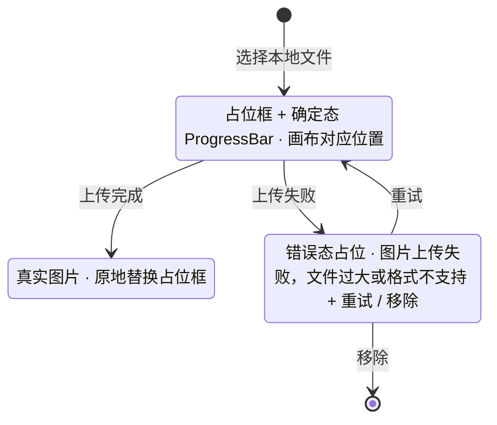

> 状态：草稿 | 负责：设计 | 更新：2026-09-18；2026-09-25（补图） | 依赖：charter v0.1
> **实现口径（2026-09-18）**：组件、token 与图标以 `09-design-specification.md` v3.1、`04-design-system.md` v0.5 与 `playground/` 为准；本文中的 `--cordex-*` 变量、Phosphor 图标、`i-*` sprite 类名与 `btn-*` 类名为原设计系统 v0.3 记号，已作废，仅保留交互与状态定义。

# 03-04 插入菜单

> **设计基准（2026-09-15 起）**：组件规格以 [`09-design-specification.md`](../09-design-specification.md) v3.0（shadcn Rhea + 材质层）为准；对应 playground 路由 `#/editor/insert`（[已发布 artifact](https://claude.ai/code/artifact/cf6e1a1a-986b-48bb-b743-5758dff419d2)，源码 `playground/src/routes/`）。本文引用的 `mockups/*.html` 与线框图为历史静态稿，以 playground 实际渲染为终稿。

对应 Ribbon"插入"页签（`ui.ribbon`）及其若干按钮触发的 flyout 画廊（`--cordex-z-dropdown`）。覆盖：文本框、形状、图片、表格、图表、图标、批注、插件插入项。

---

## 线框（Ribbon"插入"页签）

```
┌─────────────────────────────────────────────────────────────────────────┐
│[开始][插入][设计][切换][视图][数据图表插件▸]                               │
│┌文本────┐┌形状────┐┌图像────┐┌表格────┐┌图表────┐┌链接与批注┐┌插件─────┐  │
││[T]文本框││[▭]形状▾││[🖼]图片 ││[▦]表格▾││[📊]图表▾││[🔗][💬] ││[🧩]流程图│  │
│└────────┘└────────┘└────────┘└────────┘└────────┘└─────────┘└─────────┘  │
└─────────────────────────────────────────────────────────────────────────┘
```

### 形状按钮 flyout（点击"形状▾"展开）

```
┌───────────────────────────────┐
│ 最近使用                        │
│ [▭][◯][➔]                     │
├───────────────────────────────┤
│ 基本形状                        │
│ [▭][◯][△][◇][⬠][⬡]          │
│ 箭头                            │
│ [→][⇒][↔][⤴]                 │
│ 线条                            │
│ [╱][╲][┄][⌐]                 │
└───────────────────────────────┘
```

### 表格按钮 flyout（网格选择行列数）

```
┌───────────────────────────────┐
│  插入表格                       │
│  ▢▢▢▢▢▢▢▢                    │
│  ▢▢▣▣▢▢▢▢     ← hover 高亮至此 │
│  ▢▢▢▢▢▢▢▢          2 × 3 表格  │
│  ▢▢▢▢▢▢▢▢                    │
│  [自定义行列数…]                │
└───────────────────────────────┘
```

---

## 状态

### 关闭 / 展开

flyout 默认关闭；点击或键盘 `Enter/Space` 触发展开，展开时首项自动获得焦点（键盘可用方向键在网格中导航，见 07-accessibility-and-i18n.md）。

### 加载中（图片/媒体插入）

选择本地文件后，画布对应位置先插入一个带 `ProgressBar`（确定态）的占位框，上传完成后原地替换为真实图片；失败则占位框变为错误态（见下）。

### 错误（上传失败/格式不支持）

```
┌─────────────────────┐
│  ⚠ 图片上传失败        │
│  文件过大或格式不支持    │
│  [重试]  [移除]        │
└─────────────────────┘
```

**图片/媒体插入的占位框状态**



怎么读：占位框先于上传完成出现在画布上，成功与失败都在原位置切换，不移动也不弹窗；协同模式下的上传取消等扩展见 03-screens/18。

### 只读（评审模式）

"插入"页签整体不出现（见 01-information-architecture.md §5.1 模式对照表：评审模式的 Ribbon 替换为评审工具条），因此插入菜单在评审模式下不可达，无需单独的禁用态设计。

### 空（无最近使用形状）

"形状"flyout 不显示"最近使用"分区，直接从"基本形状"开始，不留空白分组标题。

---

## 交互说明

- "图表"按钮插入的图表默认可编辑数据（见章程 §10 Q7：M3 起图表数据可编辑；M1/M2 插入的图表以当前静态样式呈现，数据编辑入口在 M3 前禁用并提示"数据编辑将在后续版本提供"）。
- 表格网格选择器支持键盘：方向键移动高亮范围，Enter 确认，Esc 取消；超过默认网格（8×8）范围时下方"自定义行列数"输入框联动。
- 插件贡献的插入项遵循设计 06 §2.1 Ribbon 规则：默认新建独立分组，排在内置分组之后，分组标题带归属标识。
- 快速插入（补充路径）：命令面板搜索"插入"可直达任一插入命令，无需先切换到"插入"页签，与设计 06 §2.5"命令是唯一行为入口"一致。

## 边界情况

- flyout 展开位置超出视口：自动向左/向上翻转，保持完全可见。
- 触屏设备：表格网格选择器改为"先点击展开数字输入"而非依赖 hover 预览（hover 在触屏上无意义）。
- 插入的对象超出画布边界：允许插入（用户后续可移动），不强制居中裁剪限制，仅在插入瞬间将其带入视口可见区域。
- 粘贴富文本/外部图片直接插入（非通过本菜单）：遵循 02-user-flows.md F2 的"粘贴外部内容"边界，降级策略不在本文件重复定义。
