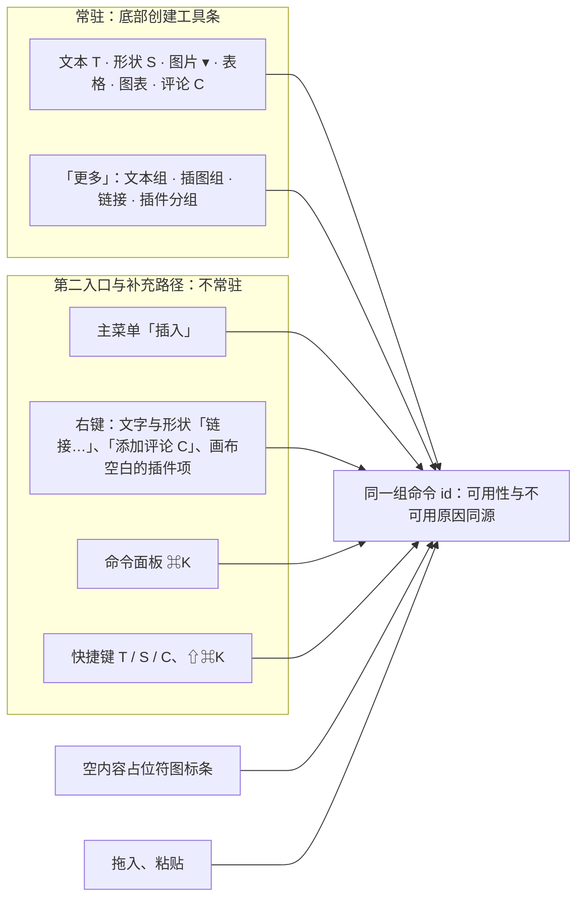
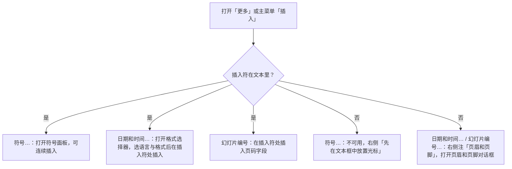
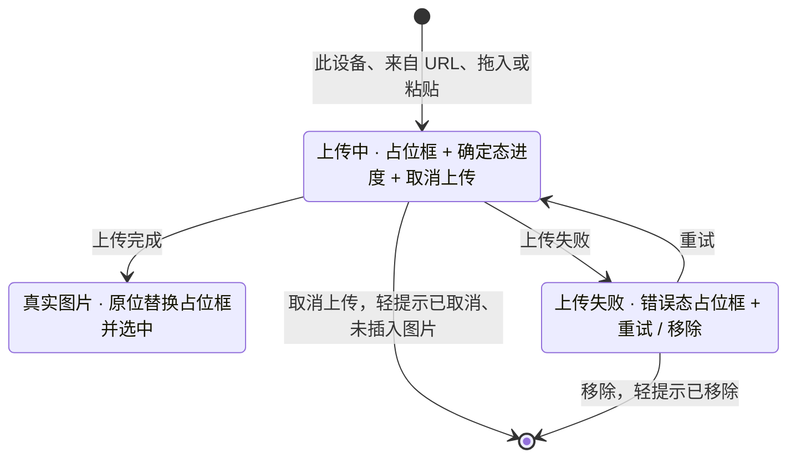

> 状态：草稿 | 负责：设计 | 更新：2026-09-18；2026-09-25（补图）；2026-09-26（§4.21 整合：交互说明删「M1/M2 插入静态图表」，改为图表插入与数据编辑都在 M3（R-d-74、ED-15a）；表格对话框上限 10 × 8；线框与新面板待用户确认样张后由设计线回写）；2026-09-30（§4.21 样张确认回写：插入页签按 playground 定为唯一七组分组表与线框；删去「M1/M2 可插入静态图表」残留，图表 M3；补图标、符号、页眉和页脚、日期和时间、幻灯片编号入口；视频 / 音频 P2 禁用而不隐藏并给原因；图片 ▾ 菜单、超链接对话框、里程碑标记与尺寸）；2026-09-30（§4.21 剩余缺口样张回写：文本组「日期和时间」在文本编辑态改为打开格式选择器，规格链到 03-16；表格、图表入口补「编辑细节见 03-30 / 03-31」）；2026-09-30（§4.21 剩余缺口样张回写 · 整合：图表 ▾ 菜单首行按样张改为「[M3] 五类 · 插入后打开数据面板」，禁用表「图表 ▾（M2）」一行的原因改为样张原文并链到 03-31）；2026-09-30（§4.21 剩余缺口样张回写 · 复核修正：空内容占位符「表格」图标的去向改指 03-30 §13 第 7 条；表格网格与形状库一样不抢焦点；「禁用而不隐藏」出处改为 rulings §4.20 FE-06；登记公式入口与「M4+ 也禁用显示」口径的冲突，待用户拍板）；2026-09-30（§4.22 设计待决收口：文本组第三列补禁用的「公式」（M4+），公式入口定稿；表格网格改为 8 行 × 10 列、读数「R 行 × C 列 表格」，「插入表格…」先关网格再开对话框，对话框上限待性能评估（暂按 75 × 75）；空内容占位符的表格图标定为同一网格弹层（用户裁决 Q2），插入落点按 Q1 填入空内容占位符；图表 ▾ 改用共享 `ChartTypeMenu`）；2026-09-30（§4.22 复核修正：图片 ▾ 的屏幕截图、相册改为 `aria-disabled` + tooltip 原因并补原因文案；图表插入后改写为展开检查器「数据」分区；插入落点补「已选中的空占位符优先」；表格 toast 补填入占位符时的写法）；2026-10-05（design-language-v3 第 0 批修正：只改快捷键值——线框与分组表的超链接由 `⌘K` / `Ctrl+K` 改为 `⇧⌘K` / `Ctrl+Shift+K`（rulings §4.25 DS-11）；Ribbon 插入页签本身已被 DS-1 取代，界面描述随第 1 批回写）；2026-10-07（design-language-v3 第 1 批：按 `insert` 样张整篇改写为 v3 插入入口——设计基准改 v3；§1 线框按 v3 外壳重画（左栏 240、检查器 280、底部创建工具条与「更多」）；§2 新增插入入口总表与图 2-1（工具条、「更多」、图片 ▾、主菜单「插入」、右键、⌘K、占位符图标条）；§3 工具条上的插入工具（「选择」去掉 ▾）；§4「更多」两种上下文、插件分组与键盘（DS-19 无「组件」）；§5 图片 ▾；§6 主菜单「插入」；原插入页签七组、表格网格、超链接对话框、图表菜单的重复规格删去，改指 03-30、03-16、03-31，「从 URL 插入图片」对话框与上传占位框的外观改指 03-18 §3、§4；§7 状态逐个列出样张状态与路由，禁用原因改为右侧短原因 + 工具提示全文，评审改为评审条替换工具条、降权留位不可用（DS-15、DS-23），上传中不另发轻提示、补取消上传；依据 rulings §4.25 DS-1、DS-5、DS-11、DS-19、DS-21、DS-23）；2026-10-07（design-language-v3 第 1 批：按 rulings §4.25 TB-6、TB-7、TB-12、DS-30 与第一步各线影响修订——§2 链接行的右键条目改名「链接…」并改指 03-16 §5.1、图 2-1 同步，母版视图「占位符」行去掉不存在的「母版窗格右键」、补占位符类型（DS-30，03-26 §4.3）；§3 图表菜单首行改「五类 · 插入后展开数据」（TB-12）；§4.2 链接条目写明打开「插入链接」对话框；§4.4、§7.2 日期和时间格式选择器与符号面板关闭后焦点回到文本插入符（03-16 §7.1、03-15 §8）；§5、§7.1「来自 URL」只接受 https（TB-7），下载阶段的轻提示与上传占位框分开写；§7.6 上传失败文案按 03-18 §4；§8 连续插入的错位改按 pt 书写为 14.4 pt（0.2 in，DS-27））；2026-10-08（design-language-v3 第 1 批收口：§7.1「来自 URL」行改记样张原文「支持 https 地址的…」，删去「按 TB-7 跟改」（样张已改）；§8 连续插入的错位改回 0.2 in——它是引用 PowerPoint 默认值的行为常量，不属界面显示值，按 rulings §4.25 TB-37 保留原单位，取代上一条的 14.4 pt 写法；§4.4、§7.2 日期和时间、符号弹层关闭后焦点回到文本插入符补引 TB-52）；2026-10-15（design-language-v3 第 2 批回写续：只改「评论」相关的几处——文首改指 03-06 §2，§2 入口总表「评论」行的规格改指 03-06 §2.2，第二入口补右键与 ⇧F10 菜单「添加评论 C」（对象菜单与画布空白处菜单，rulings §4.25 DS-44），图 2-1 右键节点同步；§3 工具表「评论」行改为点对象或空白处发起评论、落点旁出浮动撰写框，按钮上按 ↵ 直接在当前页落钉（DS-44、DS-45、TB-62）；§3「按下与回落」补评论工具是例外：发表或取消后保持按下，没有撰写框时 Esc / V 回到「选择」（DS-44，03-06 §2.3）；§7.1 其他场景表补评论工具两个状态）；2026-10-23（design-language-v3 第 3 批评审修改：§7.2「对话框」一条写明画法是 kit 对话框，随 rulings §4.25 DS-142 改为标题栏 40、圆角 12、× 正文色，`insert.image-url` 与 03-15、03-30 的对话框各态随之改画）；2026-11-04（design-language-v3 母版视图改版：§2 入口总表「占位符（母版视图）」一行改为「占位符 ▾」排在「选择」之后第 2 位、菜单项图标为虚线框变体，补充路径补单键 P 与命令面板「插入占位符…」；§3 母版视图一条同改；§8 键盘等价补「占位符 ▾」菜单项上按 Enter 插入，快捷键补母版视图的 P；rulings §4.25 DS-152、TB-196、TB-202、TB-207、TB-210；需求编号、优先级与里程碑不变） | 依赖：charter v0.1；rulings §4.21（R-d-61、R-d-67、R-d-74、R-d-75、q-media-insert、q-extra-inserts）、§4.20 FE-06（禁用而不隐藏）、§4.25 DS-1、DS-5、DS-11、DS-15、DS-19、DS-21…DS-27、DS-30、DS-44、DS-45、DS-152、TB-6、TB-7、TB-12、TB-37、TB-52、TB-62、TB-196、TB-202、TB-207、TB-210；playground v3 `src/v3/scenarios/insert/`、`src/v3/editor/insert-menus.tsx`、`src/v3/editor/Toolbar.tsx`、`src/v3/kit/mainMenu.tsx`

# 03-04 插入菜单

> **设计基准（2026-10-07 起，rulings §4.25 DS-1、DS-21）**：以 playground `#/v3/editor` 第 1 批样张为准：场景 `insert`（插入入口与它打开的面板）与 `shape-library`（形状弹层与插入工具态，规格在 03-15），源码 `playground/src/v3/scenarios/insert/`；工具条「更多」「图片 ▾」的条目在底座 `src/v3/editor/insert-menus.tsx`，工具条本身在 `src/v3/editor/Toolbar.tsx`，主菜单「插入」在 `src/v3/kit/mainMenu.tsx`（`INSERT_ITEMS`），场景与真实工具条用同一份条目。状态路由为 `#/v3/editor?state=<场景>.<状态>&theme=dark|light`（§7.1）。外壳的尺寸与外观（左栏、画布、检查器、工具条本身）以 [03-02](02-editor-main.md) 为准，本文只写插入入口。原「插入」页签（七组、56 × 60 大按钮，R-d-61）随 ribbon 作废（DS-1），去向见 §2；`ui.ribbon` 贡献点已删除，插入类入口由 `ui.toolbar` 的 `create` / `create.more` 槽位取代（DS-5）。

本文写**插入从哪里进**：底部创建工具条上的工具（只管创建，DS-1）、工具条「更多」菜单、「图片 ▾」菜单、主菜单「插入」（不常驻的第二入口），以及右键、命令面板与快捷键里的插入命令。入口打开的面板与之后的交互各有归属，本文只引用：形状弹层、形状库、插入工具态、变换手柄、操作设置、页眉和页脚、图标、符号见 [03-15](15-insert-menu-and-shape-library.md)；表格网格与「插入表格…」见 [03-30](30-table-editing.md) §2；图表类型菜单见 [03-31](31-chart-editing.md)；「插入链接」对话框、日期和时间格式选择器与空内容占位符图标条见 [03-16](16-text-editing-and-formatting.md)；图片插入后的操作见 [03-18](18-image-editing.md)；评论工具、浮动撰写框与锚点见 [03-06](06-comments-panel.md) §2。

---

## 1. 线框（桌面 1600 × 1000，第 2 页无选中，「更多」打开、未在编辑文字）

```
←───── 240 ─────→←──────────────────── 画布（1600 宽视口下 1080） ─────────────────────→←──────── 280 ────────→
┌────────────────┬──────────────────────────────────────────────────────────────────────┬──────────────────────┐
│[Logo▾]   [▭][▦]│                                                                      │(周)(王)(李)  ▶ [分享]│
│Q2 业绩汇报 ▾   │  ┌────────────────────────────────────────────────────────────────┐  │[设计] 评论      77% ▾│
│✓ 已同步        │  │ 议程                                                           │  ├──────────────────────┤
│[新建幻灯片▾][+]│  │ ▔▔                                                             │  │幻灯片 2              │
│                │  │ 01  关键指标                      P3    ┌───────────────────┐  │  ├──────────────────────┤
│1 ┌──────────┐  │  │                                         │ 本季关键词        │  │  │版式                  │
│  │ 标题页   │  │  │ 02  营收趋势                 ┌──────────────────────────────────┐ │[▭ 标题和内容      ▾] │
│  └──────────┘  │  │                              │ 文本                             │ ├──────────────────────┤
│2 ┏━━━━━━━━━━┓  │  │ 03  区域分布                 │ ▭ 页眉和页脚…                    │ │主题                  │
│  ┃ 议程     ┃  │  │                              │ ◷ 日期和时间…         页眉和页脚 │ │[色块] Office  [调整] │
│  ┗━━━━━━━━━━┛  │  │ 04  下半年计划               │ # 幻灯片编号…         页眉和页脚 │ ├──────────────────────┤
│3 ┌──────────┐  │  │ 2026 年 Q2 业绩汇报          │ Ω 符号…     先在文本框中放置光标 │ │背景                  │
│  │ 关键指标 │  │  └──────────────────────────────│ Σ 公式 [M4+]        后续版本提供 │ │[ 纯色 │ 渐变 │ 图片 ]│
│  └──────────┘  │                                 ├──────────────────────────────────┤ │[□ #FFFFFF         ▾] │
│4 ┌──────────┐  │  ┌──────────────────────────────│ 插图                             │ │[□][■][■][■][■][■]    │
│  │ 营收趋势 │  │  │ 添加演讲者备注…              │ ☆ 图标…                          │ ├──────────────────────┤
│  └──────────┘  │  │                              │ ▷ 视频 [P2]         后续版本提供 │ │放映                  │
│⋮               │  │                              │ ♪ 音频 [P2]         后续版本提供 │ │[切换  无          ▾] │
│                │  │                              ├──────────────────────────────────┤ │☐ 放映时跳过此页      │
│                │  └──────────────────────────────│ ∞ 链接…                      ⇧⌘K │ │                      │
│                │                                 ├──────────────────────────────────┤ │                      │
│                │                                 │ ⊞ 流程图插件 · 第三方            │ │                      │
│                │                                 │ ⇄ 流程图节点                     │ │                      │
│                │                                 └──────────────────────────────────┘ │                      │
│                │                                                                      │                      │
│                │          ╭───────────────────────────────────────────────╮           │                      │
│                │          │[选择][文本][形状][图片][表格][图表][评论][ + ]│           │                      │
│                │          ╰───────────────────────────────────────────────╯           │                      │
│                │                                                                      │                      │
└────────────────┴──────────────────────────────────────────────────────────────────────┴──────────────────────┘
```

图例：`[ + ]` 是「更多」（Lucide `Plus`）；工具条其余按钮自左至右为选择（`MousePointer2`）、文本（`Type`）、形状（`Shapes`）、图片（`Image`）、表格（`Table`）、图表（`ChartColumn`）、评论（`MessageSquare`），按钮里只有 20px 图标，名称在工具提示里。菜单条目前的字符只是示意，实际为 16px Lucide 线性图标（`PanelBottom`、`Calendar`、`Hash`、`Omega`、`Sigma`、`Sticker`、`Video`、`AudioLines`、`Link2`；插件分组标题为 `Blocks`，插件条目的图标由插件给出，样张为 `Workflow`），不用 emoji。`[M4+]`、`[P2]` 是里程碑标记；条目右侧的灰字是说明或不可用原因。「更多」菜单向上弹出、与「+」水平居中，靠近画布右缘时向左平移保持完整可见。对应样张 `insert.more`。

---

## 2. 插入入口总表

三类入口：**常驻**——底部创建工具条（主行八项，第三方不能进主行）与它的「更多」菜单；**第二入口**——主菜单「插入」（不常驻，设计质量门 Q2 不算重复）；**补充路径**——右键、命令面板（⌘K）、快捷键、空内容占位符图标条、拖入与粘贴。所有入口只持有同一个命令 id，可用性与不可用原因同源（[06](../06-extensibility-ux.md) §2.5）。

| 插入什么 | 常驻入口 | 第二入口与补充路径 | 命令 / 面板 | 里程碑 | 规格 |
|---|---|---|---|---|---|
| 文本框 | 工具条「文本」（T）→ 插入工具态 | 主菜单「插入 › 文本框」；⌘K | `slide.insertShape`（`textBox`） | M2 P0 | 03-15 §3 |
| 形状（常用 12 项；全部形状 72 项、10 类，含线条、连接符、动作按钮） | 工具条「形状」（S）→ 常用 4 × 3 →「全部形状 72 ›」原位展开形状库 → 插入工具态 | 主菜单「插入 › 形状库…」；⌘K | `slide.insertShape`（`preset`；线条与连接符为 `cxnSp`） | 形状、线条、动作按钮 M2 P0；连接符 M2 P1；调整手柄与更改形状 P1；曲线类绘制 P2 | 03-15 §1–§5 |
| 图片（本地、URL、拖入、粘贴） | 工具条「图片 ▾」→ 此设备… / 来自 URL… | 主菜单「插入 › 图片 ▸」；占位符图标条「图片」；拖入画布；粘贴；⌘K | `slide.insertPicture`；有空占位符时 `slide.fillPlaceholder` | M2 P0 | §5；03-18 |
| 屏幕截图、相册 | 「图片 ▾」里，不可用、标 `M4+` | 主菜单「插入 › 图片 ▸」同样不可用 | — | M4+ P2（ED-34） | §7.3 |
| 表格 | 工具条「表格」→ 8 行 × 10 列网格 +「插入表格…」 | 主菜单「插入 › 表格…」；占位符图标条「表格」（同一网格）；⌘K | `slide.insertTable` / `slide.fillPlaceholder` | 插入与单元格文字 M2 P1；结构与样式 M3 P1 | 03-30 §2 |
| 图表 | 工具条「图表」→ `ChartTypeMenu`（五类 + 子类型） | 主菜单「插入 › 图表…」；占位符图标条「图表」（同一菜单）；⌘K | `slide.insertChart` / `slide.fillPlaceholder` | M3 P1；M2 工具不可用并给原因 | 03-31 |
| 评论 | 工具条「评论」（C），随评论包出现；点对象或空白处落钉，落点旁出浮动撰写框 | 主菜单「插入 › 评论」（进入同一个评论工具）；右键与 ⇧F10 菜单「添加评论 C」（对象菜单与画布空白处菜单，03-05 §3，rulings §4.25 DS-44） | `comments.addThread` | M3 | 03-06 §2.2 |
| 页眉和页脚 | 「更多 › 页眉和页脚…」 | 主菜单「插入 › 页眉和页脚…」；⌘K | `slide.setHeaderFooter` | M2 P2；母版侧复选 M3 | 03-15 §6 |
| 日期和时间 | 「更多 › 日期和时间…」：未在编辑文字时打开页眉和页脚，插入符在文本里时打开格式选择器 | 主菜单「插入 › 日期和时间…」 | `slide.insertField` / `slide.setHeaderFooter` | M2 P2 | §7.4；03-16 |
| 幻灯片编号 | 「更多 › 幻灯片编号」：同上分流，插入符在文本里时直接插入页码字段 | 主菜单「插入 › 幻灯片编号…」 | `slide.insertField` / `slide.setHeaderFooter` | M2 P2 | §7.4 |
| 符号 | 「更多 › 符号…」（仅文本编辑态） | 主菜单「插入 › 符号…」 | 符号面板 → `slide.insertText` | M3 P2 | 03-15 §8 |
| 公式 | 「更多 › 公式」，不可用、标 `M4+` | 主菜单同样不可用 | — | M4+（q-equation） | §7.3 |
| 图标 | 「更多 › 图标…」 | 主菜单「插入 › 图标…」；⌘K | 插入图标对话框 → `slide.insertIcons` | M3 P2 | 03-15 §7 |
| 视频、音频 | 「更多 › 视频 / 音频」，不可用、标 `P2` | 主菜单同样不可用；占位符图标条「视频」同样不可用 | `slide.insertMedia` | M2 P2（ED-35） | §7.3；已有媒体见 03-18 |
| 链接 | 「更多 › 链接…」（⇧⌘K） | 主菜单「插入 › 链接…」；文字与形状右键「链接…」（03-05 §3）；`Mod+Shift+K` | 「插入链接」对话框 → `slide.setHyperlink` | M2 P1 | 03-16 §5.1 |
| 插件的插入项（样张：流程图节点） | 「更多」末尾的插件分组 | 主菜单「插入」末尾同一分组；画布空白右键的插件分组；⌘K | 插件命令 | 由插件决定（可插拔验收 M2 P0） | §4.3 |
| 空内容占位符填入 | 占位符中央图标条（图片、表格、图表、视频） | 工具条「图片」「表格」「图表」按 §8 落点规则填入 | `slide.fillPlaceholder` | 图片 M2 P1；表格随 ED-10；图表 M3；视频 P2 | 03-16 |
| 占位符（母版视图） | 母版视图里工具条的「占位符 ▾」排在「选择」之后第 2 位、后接竖分隔，没有「评论」；菜单项图标是虚线框变体，把「图片占位符」与静态图片分开；占位符类型以 03-26 §4.3 为准（rulings §4.25 DS-152、TB-210；DS-30：「文本」取代「正文」、不提供 SmartArt） | 单键 P（只在母版视图，TB-196）；⌘K「插入占位符… P」打开同一个菜单（无参命令 `slide.openPlaceholderMenu`，TB-207）；母版视图的版式与母版右键不含插入占位符（03-26 §1.2） | `slide.addPlaceholder` | M3 | 03-26 §4.3 |

非目标不出现入口（R-d-75）：SmartArt、OLE 对象、3D 模型、墨迹、缩放定位、屏幕录制。

**图 2-1 插入入口与命令**



怎么读：左边是用户能看见的入口，常驻的只有底部工具条与它的「更多」；右边所有入口最后都落到同一组命令上，所以同一个插入项在各处的可用与否、不可用原因一致，主菜单与「更多」并列不算重复入口。
依据：rulings §4.25 DS-1、DS-5、DS-11；设计 06 §2.5；样张 `src/v3/editor/insert-menus.tsx`、`src/v3/kit/mainMenu.tsx`。

---

## 3. 底部工具条上的插入工具

工具条的外观、尺寸与 Tab 停靠见 [03-02](02-editor-main.md) §3.4 与 [07](../07-accessibility-and-i18n.md) §1.2；本节只写各工具与插入有关的行为。

| 工具 | 单键（ED-16） | 点按结果 | 按下态与弹层 |
|---|---|---|---|
| 选择 | V | 回到普通选择，退出插入工具态 | 当前工具时按下；样张去掉了原「选择 ▾」的 ▾：PRD 没有第二种选择类工具（平移是空格 + 拖动、滚轮与触控板，ED-22），▾ 没有可放的条目（同 DS-19「无对应能力的入口从样张删除」） |
| 文本 | T | 进入文本框插入工具态（03-15 §3）；键盘在按钮上按 Enter 直接在视口中心插入文本框并进入编辑 | 工具态期间按下 |
| 形状 | S | 打开形状弹层：常用 4 × 3 +「全部形状 72 ›」（03-15 §1、§2）；选定后进入插入工具态 | 弹层开着与工具态期间都按下；单键 S 在单页视图里同时展开常用 4 × 3，网格视图里先回单页、不展开 |
| 图片 | — | 打开「图片 ▾」菜单（§5） | 菜单开着时按下，`aria-haspopup="menu"`、`aria-expanded` |
| 表格 | — | 打开 8 行 × 10 列网格弹层（03-30 §2.1） | 弹层开着时按下，`aria-haspopup="dialog"` |
| 图表 | — | 打开 `ChartTypeMenu`，首行说明「五类 · 插入后展开数据」（03-31；「数据面板」只指加宽到 400 的面板，rulings §4.25 TB-12） | 菜单开着时按下，`aria-haspopup="menu"`；M2 不可用 |
| 评论 | C | 进入评论工具：在画布上点对象或空白处发起评论，落点旁出浮动撰写框，不切检查器页签（03-06 §2.2）；键盘在按钮上按 ↵ 直接在当前页落钉、打开撰写框——有选中对象时为元素锚点，否则为页级（rulings §4.25 DS-44、TB-62，03-06 §7.1） | 工具开着时按下，发表或取消后仍按下（下面「按下与回落」）；随评论包出现（`when: slide.hasComments`），未装时不渲染、主行只剩七项 |
| 更多 | — | 打开「更多」菜单（§4） | 菜单触发器，`aria-haspopup="menu"`；不带工具提示，只在不可用时用工具提示说明原因 |

- **弹层位置**：图片、表格、图表的弹层锚在各自按钮上方、水平居中，距按钮 13（距工具条外沿 8，与形状弹层一致）；「更多」菜单距按钮 12。放不下时按 8px 边距平移进视口。
- **按下与回落**：图片、表格、图表的弹层开着时该工具是当前工具（强调色底）；选定、Esc 或点外部关闭后回到「选择」，Esc 关闭时焦点回到按钮；再点同一按钮即收起。评论工具是例外：发表或取消后保持按下，可以接着落下一条；没有撰写框时按 Esc 或 V 回到「选择」（rulings §4.25 DS-44，03-06 §2.3）。
- **网格视图**：创建工具作用于选中页，点了先打开这一页（回单页）再弹出或进入工具态，工具提示改为「在第 N 页添加…」（03-02 §5.3）。
- **不可用**：工具留在原位、图标退到 `--v3-text-3`，工具提示写「名称 · 原因」（编辑权限降级为「需要编辑权限」；图表在 M2 的原因见 §7.3）。工具条按钮不挂里程碑标记。
- **母版视图**：工具条在「选择」之后插入「占位符 ▾」（单键 P，插入占位符），后接竖分隔，没有「评论」，其余工具不变（rulings §4.25 DS-152、TB-210，03-26 §4.3）。

---

## 4. 「更多」菜单

### 4.1 形态

- 锚在「更多」上方、水平居中、距按钮 12；面板 `--v3-panel` 底、1px `--v3-border`、圆角 8、内边距 4、`--v3-shadow`，最小宽 168（菜单面板规格同 03-02 §2.3）。条目高 28、圆角 4、12px；左侧 16px 图标列；右侧是说明或不可用原因（12px `--v3-text-2`，纯西文 11px）与快捷键提示（11px）；分组小标题高 24、12px `--v3-text-2`，与条目文字左对齐；组间 1px 分隔线。
- 四组，自上而下：**文本**（页眉和页脚… · 日期和时间… · 幻灯片编号 · 符号… · 公式）┊ **插图**（图标… · 视频 · 音频）┊ 链接… ┊ **插件分组**。样张原有的「组件」没有对应能力，按 DS-19 删除，以后需要再走新增需求的变更。
- 菜单内容随插入符是否在文本里切换（§4.2、§7.4），其余与选中对象无关；「更多」本身在评审模式、只读浏览下不出现，编辑权限降级时留在原位、不可用（§7.7）。

### 4.2 条目与两种上下文

| 条目 | 未在编辑文字（`insert.more`） | 插入符在文本里（`insert.more-editing`） | 命令 / 面板 | 里程碑 |
|---|---|---|---|---|
| 页眉和页脚… | 打开页眉和页脚对话框 | 同左 | `slide.setHeaderFooter`（03-15 §6） | M2 P2 |
| 日期和时间… | 右侧注「页眉和页脚」，打开页眉和页脚对话框 | 打开日期和时间格式选择器（锚在「更多」上方、宽 332，03-16「日期和时间格式选择器」） | `slide.setHeaderFooter` / `slide.insertField` | M2 P2 |
| 幻灯片编号 | 显示为「幻灯片编号…」、右侧注「页眉和页脚」，打开页眉和页脚对话框 | 显示为「幻灯片编号」、右侧注「插入页码字段」，直接在插入符处插入页码字段 | 同上 | M2 P2 |
| 符号… | 不可用，右侧「先在文本框中放置光标」 | 打开符号面板（锚在「更多」上方、宽 468，03-15 §8） | `slide.insertText` | M3 P2 |
| 公式 | 不可用、`M4+`，右侧「后续版本提供」 | 同左 | — | M4+ |
| 图标… | 打开插入图标对话框（03-15 §7） | 同左 | `slide.insertIcons` | M3 P2 |
| 视频、音频 | 不可用、`P2`，右侧「后续版本提供」 | 同左 | `slide.insertMedia` | M2 P2 |
| 链接… | 右侧快捷键 ⇧⌘K（Windows / Linux Ctrl+Shift+K，DS-11）；为选中的对象打开「插入链接」对话框 | 同左，为选中的文字加链接 | `slide.setHyperlink`（03-16 §5.1；命令名与对话框标题统一，rulings §4.25 TB-6） | M2 P1 |
| 插件条目 | 插件分组标题下，由插件命令决定 | 同左 | 插件命令 | 由插件决定 |

名称带「…」的条目会再打开对话框或弹层，不带的直接执行。不可用条目的完整原因见 §7.3。

### 4.3 插件分组

- 第三方的创建类入口只进「更多」（`slot:'create.more'`，`order ≥ 100`、必带 `owner`），排在内置项之后，前面一条分隔线和一行分组标题：12px 插件图标（`Blocks`）+「〈插件名〉 · 第三方」（12px `--v3-text-2`，不可选），读屏名「〈插件名〉（第三方）」（设计 06 §2.6、§4）。第三方不能进主行。
- 选了插件条目即执行插件命令；需要在画布上落点的插件元素进入插入工具态（03-15 §3），其余按默认落点插入。插件被停用或未加载时它的条目不出现（条目可见性只看 `when`）。

### 4.4 键盘与焦点

- 在「更多」上按 Enter、Space 或 ↓ 打开菜单，焦点到第一项；↑ ↓ 在条目间移动，不可用项同样可停，读屏经 `aria-describedby` 读出右侧原因；Enter 选择；Esc 关闭并把焦点还给「更多」。
- 选了会打开对话框或弹层的条目（页眉和页脚…、图标…、符号…、日期和时间…）：菜单收起，焦点交给新打开的对话框或弹层。页眉和页脚、插入图标对话框关闭后焦点回到「更多」；往文本里插东西的两个弹层——符号面板与日期和时间格式选择器——插入、取消、关闭或 `Esc` 后焦点回到文本插入符，文本编辑态不退出（rulings §4.25 TB-52；03-15 §8、03-16 §7.1；样张未画，通用弹层关闭后把焦点交回「更多」，随实现按本条）。

---

## 5. 「图片 ▾」菜单与「从 URL 插入图片」

```
┌────────────────────────────────────────┐
│ ⤒ 此设备…                       可多选 │
│ ∞ 来自 URL…                 下载后内嵌 │
├────────────────────────────────────────┤
│ ◫ 屏幕截图 [M4+]          后续版本提供 │  ← 禁用而不隐藏：文字退到 text-3，右侧写原因
│ ▤ 相册 [M4+]              后续版本提供 │
├────────────────────────────────────────┤
│   也可以把图片拖到画布上，或直接粘贴。 │  ← 常驻说明行，不可选
└────────────────────────────────────────┘
```

- **条目**：此设备…（`Upload`，右侧「可多选」）打开系统文件选择，可多选；来自 URL…（`Link2`，右侧「下载后内嵌」）打开「从 URL 插入图片」对话框，图片下载后内嵌、不保留外链，部署关闭外部资源时留在原位、不可用并给原因（03-18 §3）；屏幕截图、相册（`Camera`、`GalleryHorizontalEnd`，`M4+`）不可用，右侧「后续版本提供」（ED-34）；末尾常驻说明行「也可以把图片拖到画布上，或直接粘贴。」，不可选。对应样张 `insert.image-menu`。
- **选定之后**：每张图片先在画布上出上传占位框（§7.5），页上有空内容占位符时按 §8 的落点规则填入；上传完成后原位换成图片并选中。拖入画布与粘贴是同等的独立路径（02-user-flows F2、PRD ED-17）；文件类型、大小上限与多选的错位规则见 [03-18](18-image-editing.md) §3。
- **「从 URL 插入图片」对话框**（样张 `insert.image-url`）：宽 480，地址输入 +「取消」「插入」，只接受 https 地址（rulings §4.25 TB-7，50/14 §5）；插入后对话框关闭、焦点回到「图片」。下载期间画布上还没有元素，只出中性轻提示「正在下载图片，完成后内嵌到文稿」（不带撤销）；下载完成后与本地文件走同一条路径，按 §8 的落点出上传占位框（§7.5），上传中不再另发轻提示。对话框的线框、文案、地址校验与安全限制（部署关闭外部资源时入口不可用）见 [03-18](18-image-editing.md) §3，本文不重复。

---

## 6. 主菜单「插入」（第二入口）

```
┌────────────────┐
│ 返回首页       │
├────────────────┤
│ 文件         › │
│ 编辑         › │
│ 视图         › │ ┌───────────────────────────────┐
│▸插入         › │ │ T 文本框                    T │
│ 排列         › │ │ ◇ 形状库…                     │
├────────────────┤ │ ▣ 图片                      › │
│ 插件…          │ │ ▦ 表格…                       │
├────────────────┤ │ ▥ 图表…                       │
│ 帮助         › │ ├───────────────────────────────┤
└────────────────┘ │ ☆ 图标…                       │
                   │ Ω 符号…  先在文本框中放置光标 │
                   │ Σ 公式 [M4+]     后续版本提供 │
                   │ ▷ 视频 [P2]      后续版本提供 │
                   │ ♪ 音频 [P2]      后续版本提供 │
                   ├───────────────────────────────┤
                   │ ▭ 页眉和页脚…                 │
                   │ ◷ 日期和时间…                 │
                   │ # 幻灯片编号…                 │
                   ├───────────────────────────────┤
                   │ ∞ 链接…                   ⇧⌘K │
                   │ ✎ 评论                      C │
                   ├───────────────────────────────┤
                   │ ⊞ 流程图插件 · 第三方         │
                   │ ⇄ 流程图节点                  │
                   └───────────────────────────────┘
```

- **位置**：左栏左上主菜单（logo ▾）的「插入 ▸」，子菜单第一项与「插入」同一行对齐（03-02 §2.3）。对应样张 `insert.main-menu`。
- **条目**：全部插入命令按工具条顺序排列，快捷键提示与工具条一致——文本框 T · 形状库… · 图片 ▸ · 表格… · 图表… ┊ 图标… · 符号… · 公式（M4+）· 视频、音频（P2）┊ 页眉和页脚… · 日期和时间… · 幻灯片编号… ┊ 链接… ⇧⌘K · 评论 C ┊ 插件分组。「图片 ▸」的子项与「图片 ▾」相同；「形状库…」「表格…」「图表…」打开工具条上同一个弹层（形状弹层直接显示完整形状库、表格网格、图表类型菜单），锚在对应工具按钮上（样张未画，随实现按此）。
- **与「更多」同一组命令**：可用性与原因相同。样张主菜单是静态条目，只画了未在编辑文字时的样子（符号…不可用，日期和时间…、幻灯片编号…打开页眉和页脚）；插入符在文本里时按 §7.4 同样分流。
- **整组不可用**：评审模式、只读浏览与编辑权限降级时「插入 ▸」本身不可用并写原因（§7.7）。

---

## 7. 状态

### 7.1 样张状态

路由前缀 `#/v3/editor?state=`，加 `&theme=dark|light`。

| 状态 | 路由 | 要点 | 里程碑 |
|---|---|---|---|
| 更多 · 未在编辑文字 | `insert.more` | 文本组：日期和时间… / 幻灯片编号…右侧注「页眉和页脚」；符号…、公式（M4+）、视频音频（P2）不可用，右侧写原因；插件分组带归属标识 | 页眉和页脚组 M2 P2；符号、图标 M3 P2；视频音频 M2 P2；公式 M4+；链接 M2 P1 |
| 更多 · 光标在文本里 | `insert.more-editing` | 符号…可用；日期和时间…打开格式选择器（03-16）；幻灯片编号直接插入页码字段 | 同上 |
| 图片 ▾ | `insert.image-menu` | 此设备… / 来自 URL… ┊ 屏幕截图、相册（M4+ 不可用）┊ 拖入与粘贴说明；「图片」按下 | M2 P0；截图与相册 M4+ |
| 来自 URL | `insert.image-url` | 对话框 480，下载后内嵌，只接受 https（TB-7），格式与大小限制写在输入框下方（样张原文「支持 https 地址的 JPG、PNG、GIF、SVG，单张不超过 25 MB。」，03-18 §3） | M2 P0 |
| 主菜单 · 插入 | `insert.main-menu` | 全部插入命令按工具条顺序，第二入口 | 同各条目 |
| 页眉和页脚 · 版式缺占位符 · 插入图标 · 图标无结果 · 符号面板 | `insert.header-footer`、`insert.header-footer-missing`、`insert.icons`、`insert.icons-empty`、`insert.symbols` | 面板的规格与状态见 03-15 §9 | 页眉和页脚 M2 P2；图标、符号 M3 P2 |

其他场景里与插入入口有关的状态：

| 状态 | 路由 | 本文落点 |
|---|---|---|
| 形状 ▾ · 全部形状入口 | `shape-library.quick` | §3；规格见 03-15 §1 |
| 上传中 / 上传失败 | `image-editing.uploading`、`image-editing.upload-failed` | §7.5、§7.6 |
| 插入网格 · 3 行 × 4 列 | `table.grid` | §3、§8；规格见 03-30 §2.1 |
| 工具条「图表」· 五类与子类型 | `chart.menu` | §3、§8；规格见 03-31 |
| M2 · 图表禁用 | `chart.m2-disabled` | §7.3 |
| 日期和时间 · 格式选择器 | `text-edit.datetime` | §7.4；规格见 03-16 |
| 评论工具 · 点选位置 / 浮动撰写框 | `comments.tool`、`comments.compose` | §3；规格见 03-06 §2.2、§2.3 |
| 评审模式 · 评审者 · 降权 · 降权主菜单 | `main-states.review`、`main-states.commenter`、`main-states.degraded`、`main-states.degraded-menu` | §7.7 |
| 紧凑 · 两侧收起 · 仅查看 | `narrow.compact`、`narrow.narrow` | §7.8 |

### 7.2 关闭 / 展开

- **菜单**（「更多」「图片 ▾」、主菜单「插入」）：键盘打开时焦点到第一项；Esc 关闭并把焦点还给触发按钮；点外部关闭时焦点留在用户点的地方。
- **弹层**（形状弹层、表格网格、符号面板、日期和时间格式选择器、图表类型菜单）：用户打开时焦点移进弹层第一个可聚焦项——形状弹层例外，只在键盘打开时进第一格、指针打开时焦点留在「形状」上（03-15 §1）；Esc 或弹层里的按钮关闭后焦点回到锚点按钮，点外部关闭时焦点留在用户点的地方。符号面板与日期和时间格式选择器例外：它们往文本里插东西，关闭后焦点回到文本插入符（§4.4，rulings §4.25 TB-52）。
- **对话框**（页眉和页脚、插入图标、操作设置、从 URL 插入图片、插入表格）：模态；画法是 kit 对话框——标题栏 40、圆角 12、× 用正文色（2026-10-23 按 Figma 统一，rulings §4.25 DS-142，设计 04 §4.1a；`insert.image-url` 与 03-15、03-30 的对话框各态随之改画）；打开时焦点落在正文第一个可操作的控件，Tab 只在框内循环；Esc、点遮罩、右上「×」或「取消」关闭，焦点回到打开它的按钮（从菜单打开的回到「更多」或「图片」）。
- 样张里一进状态就打开的弹层与对话框不抢焦点，是为了截图干净，不是产品行为。

### 7.3 禁用而不隐藏（里程碑与前置条件）

本里程碑范围内暂不可用的条目留在原位（rulings §4.20 FE-06；M4+ 条目同样，50/10 §4）：菜单项 `aria-disabled`、仍可聚焦、方向键可达，文字与图标退到 `--v3-text-3`（不用半透明），右侧写短原因（`--v3-text-2`，读屏经 `aria-describedby`），完整原因放在悬停或聚焦时的工具提示里（样张菜单只画了右侧短原因，工具提示随实现，文案按下表）。里程碑标记是中性小标签：1px `--v3-border` 边、圆角 4、高 16、11px `--v3-text-2`（含中文时高 18、12px），挂在名称后面，不随条目变淡。实现前的 P2 条目同样按本节禁用（50/10 §4「里程碑可见性」）；样张按实现后的形态画页眉和页脚组、符号与图标。

| 条目 | 位置 | 标记 | 右侧短原因（样张原文） | 完整原因（工具提示） |
|---|---|---|---|---|
| 符号…（未在编辑文字） | 「更多」、主菜单 | — | 先在文本框中放置光标 | 先在文本框中放置光标，再插入符号 |
| 公式 | 「更多」、主菜单 | M4+ | 后续版本提供 | 暂不支持插入公式（M4+）。文稿里已有的公式照常查看、放映、移动和缩放。 |
| 视频、音频 | 「更多」、主菜单、占位符图标条 | P2 | 后续版本提供 | 视频、音频插入排在后续版本（P2）。文稿里已有的音视频照常查看、放映、移动和缩放。 |
| 屏幕截图 | 「图片 ▾」、主菜单「图片 ▸」 | M4+ | 后续版本提供 | 插入屏幕截图排在后续版本（M4+）。现在可以先用系统截图，再从「此设备…」上传。 |
| 相册 | 「图片 ▾」、主菜单「图片 ▸」 | M4+ | 后续版本提供 | 相册（多张图片每图一页）排在后续版本（M4+）。现在可以从「此设备…」逐张插入图片。 |
| 图表（M2） | 工具条「图表」 | — | — | 图表 · 插入图表在 M3 提供：需要装载图表编辑组件。文稿里已有的图表照常查看、放映、移动和缩放。（样张 `chart.m2-disabled`，提示按句分三行；M3 起可用，禁用态的其余部分见 03-31） |
| 曲线、任意多边形、自由曲线 | 形状库「线条」行末 | P2（行尾一个） | — | 曲线 · 绘制曲线排在后续版本（P2）（另两项同式，03-15 §2） |
| 「鼠标悬停」页签 | 操作设置对话框 | P2 | — | 悬停触发的动作排在后续版本（P2）；导入文件里已有的悬停动作原样保留 |
| 幻灯片编号 / 日期和时间 / 页脚（版式没有对应占位符） | 页眉和页脚对话框 | — | 当前版式没有此占位符 | 同左（03-15 §6） |
| 任一创建工具与「更多」（编辑权限降级） | 工具条 | — | — | 〈名称〉 · 需要编辑权限（§7.7） |

### 7.4 文本组随文本编辑态切换

**图 7-1 文本组随文本编辑态切换**



怎么读：「页眉和页脚…」任何时候都打开对话框；另外三项按插入符是否在文本里分流——在文本里就地插入字段或符号，不在文本里时日期和编号改走页眉和页脚（菜单右侧注明去向），符号不可用并写原因。格式选择器锚在「更多」上方、宽 332，语言、13 种 `datetimeN` 格式、「自动更新」与插入后的提示见 [03-16](16-text-editing-and-formatting.md)「日期和时间格式选择器」（样张 `text-edit.datetime`）；页码字段插入后轻提示「已插入幻灯片编号字段」带撤销（样张未画）。
依据：样张 `src/v3/editor/insert-menus.tsx` `moreMenu`、`src/v3/editor/Toolbar.tsx` `MORE_ALIAS_OUTSIDE_TEXT`；rulings §4.21 q-extra-inserts。

### 7.5 加载中（上传占位框）

选好本地文件、拖入、粘贴或从 URL 插入图片后（从 URL 插入的在下载完成后，§5），画布对应位置先出一个上传占位框（每张图一个，按落点与尺寸画在幻灯片上），上传完成后原位换成图片并选中，不移动、不弹窗：

- 占位框带确定态进度与「取消上传」；上传中不另发轻提示，进度只在占位框里（同一信息不在同屏出现两次）。
- 「取消上传」去掉占位框、不插入图片，轻提示「已取消上传，未插入图片」。
- 图片占位框的线框、尺寸与文案见 [03-18](18-image-editing.md) §4（样张 `image-editing.uploading`），协同中他人看到的加载占位同处说明；视频、音频插入（P2）开放后沿用同一形态。

### 7.6 错误（上传失败 / 格式不支持）

上传失败或格式不支持时，占位框原位变为错误态（危险色浅底与虚线、「图片上传失败」与原因「文件过大或格式不支持（单张上限 25 MB）」、「重试」「移除」，文字区 `role="alert"`），不移动、不弹窗；「重试」回到上传中，「移除」去掉占位框并轻提示「已移除上传失败的图片」。外观与文案见 03-18 §4（样张 `image-editing.upload-failed`）。

**图 7-2 图片插入的占位框状态**



怎么读：占位框先于上传完成出现在画布上，成功、失败都在原位置切换，不移动也不弹窗；取消与移除都不留下元素。
依据：样张 `src/v3/scenarios/insert/picture-flow.tsx`、`picture-overlays.tsx`；PRD ED-07。

### 7.7 只读：评审模式、查看者与编辑权限降级

- **评审模式**（编辑者切到评审、评审者打开）：底部是评审条（浏览 · 评论 · 高亮 ｜ 上一处 / 下一处评论 ｜「评审模式」，有编辑权限时另有「返回编辑」），替换创建工具条，所以创建工具与「更多」都不出现（DS-23，03-02 §6.2）；主菜单「插入 ▸」不可用、右侧写「评审模式下不可用」；命令面板里的插入命令同样不可用并给原因。样张 `main-states.review`、`main-states.commenter`；M2 未装评论包时评审条没有条目，工具条位置只放「评审模式 · 只读」提示（`main-states.review-empty`）。
- **查看者**：底部是浏览条（上一处 / 下一处评论 ┊「只读浏览中」），主菜单「插入 ▸」不可用、写「只有查看权限」（`main-states.viewer`）。
- **编辑权限降级**（`readonly-degraded`）：会话还在编辑界面里，创建工具与「更多」留在原位、不可用，工具提示「需要编辑权限」（降为可评审后「评论」仍可用）；主菜单「插入 ▸」不可用、写「需要编辑权限」（`main-states.degraded`、`main-states.degraded-menu`，DS-15）。

### 7.8 网格视图与窄屏

- **网格视图**：工具条常驻；创建工具与「更多」里的插入项作用于选中页，先打开这一页（回单页）再弹出或进入工具态（03-02 §5.3）。
- **紧凑窗口**（640–1024）：工具条八项不变，「更多」「图片 ▾」与各弹层同桌面，放不下时按 8px 边距平移（`narrow.compact`）。
- **仅查看**（< 640 或触控）：没有创建工具条，底部是翻页浮动条，插入入口全部收起（`narrow.narrow`）。

---

## 8. 交互说明

- **工具态与直接插入**：需要在画布上落点的工具（文本框、形状库全部条目、声明需要落点的插件元素）进入插入工具态——十字光标、单击或拖出、Esc 取消，视觉与状态机见 [03-15](15-insert-menu-and-shape-library.md) §3；图片、图标、表格、图表不经工具态，直接插入后选中。
- **插入落点**（用户裁决 2026-09-30 Q1，rulings §4.22）：页上有空的内容占位符（`obj`，或与所插内容同类的 `pic` / `tbl` / `chart`）时，图片、表格、图表填入阅读序第一个（已选中的空占位符优先），保留 `p:ph`（`slide.fillPlaceholder`）；不想放进占位符时拖出即可。没有空占位符时按默认落点插入（50/10 §7.4）。表格网格与图表类型菜单开着时，画布上用悬停框标出将要填入的位置（样张 `table.grid`、`chart.menu`）。
- **键盘等价**（WCAG 2.5.7）：焦点在「文本」按钮或形状弹层的格子上按 Enter，按默认尺寸插到视口中心，连续插入同一工具依次错位 0.2 in（PRD ED-05 的行为常量，引用 PowerPoint 默认值、保留原单位，rulings §4.25 TB-37；50/10 §7.4、设计 07 §1.2a）；表格网格与图表菜单本身可用方向键与 Enter 选择（03-30 §2.1、03-31）；母版视图里焦点在「占位符 ▾」菜单的某一类型上按 Enter（Space 同），同样按该类型的默认尺寸插到视口中心并选中、焦点交给画布，连续插入依次错位，同类上限与不可用原因不变（rulings §4.25 TB-202，03-26 §4.3）。
- **快捷键**：工具单键 V / T / S / C 等同点按对应工具，只在焦点位于画布或工具条、且不在文本编辑态与 IME 组合态时生效；图片、表格、图表与「更多」不设单键；链接 `Mod+Shift+K`（显示 ⇧⌘K）（PRD ED-16，rulings §4.25 DS-11）；母版视图另有 P，打开「占位符 ▾」菜单，生效条件与 V / T / S / C 相同（rulings §4.25 DS-152、TB-196，03-26 §4.3）。
- **命令面板**：⌘K 搜索「插入」可直达任一插入命令（设计 06 §2.5），不可用的命令同样列出并给原因（PRD ED-30）。
- **图表在 M3**：图表的插入与数据编辑都在 M3（rulings §4.21 R-d-74、q-chart-route；PRD ED-15a），插入五类之一后展开检查器「数据」分区、焦点在首个数值格（03-31）；M2 工具不可用并给原因（§7.3）。
- **图标的位置**：图标在「更多」的「插图」组（与视频、音频同组）与主菜单「插入 › 图标…」；原「插入 › 形状 › 图标…」随插入页签作废。
- **主菜单与「更多」并存**：主菜单「插入」是不常驻的第二入口、条目与工具条同序，不算重复入口（设计质量门 Q2）；常驻入口只有工具条与「更多」。

## 9. 边界情况

- 菜单或弹层超出视口：自动翻转或按 8px 边距平移，保持完全可见；形状库格子区最大高度为视口高度减 280，超出在弹层内滚动（03-15 §2）。
- 触屏设备：表格网格改为先展开数字输入，不依赖悬停预览（03-30 §2.1）；不可用条目的原因改为长按显示。
- 插入的对象超出画布边界：允许插入（之后可移动），不强制裁剪，只在插入瞬间把它带入视口可见区域。
- 粘贴富文本或外部图片（不经本菜单）：遵循 [02-user-flows](../02-user-flows.md) F2 的「粘贴外部内容」边界，降级策略不在本文重复。
- 文稿里已有的视频、音频：虽然插入是 P2，已有媒体照常查看、放映、移动和缩放，编辑态可临时播放（03-18「视频与音频（已有媒体）」，样张 `image-editing.video`）。
- 插件条目对应的插件在会话中失败：条目按设计 06 §3 降级，不留下无响应的入口。
