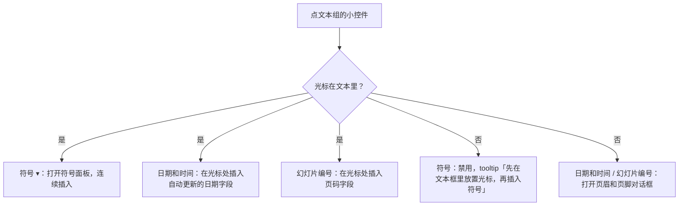
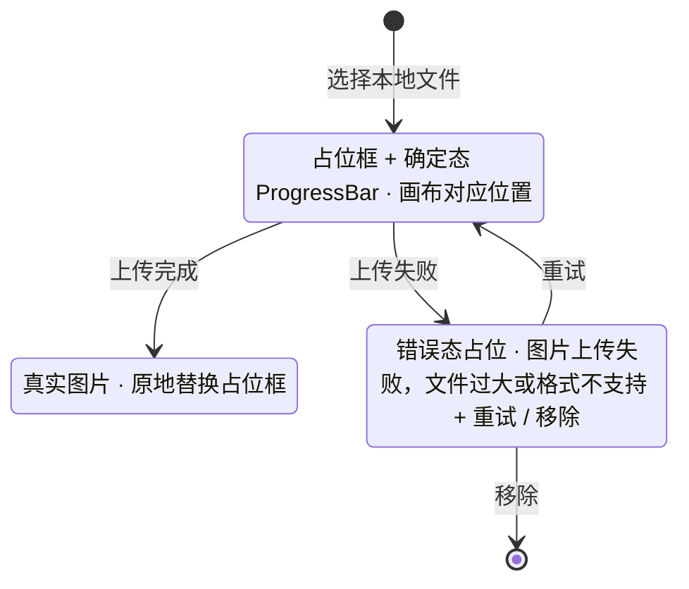

> 状态：草稿 | 负责：设计 | 更新：2026-09-18；2026-09-25（补图）；2026-09-26（§4.21 整合：交互说明删「M1/M2 插入静态图表」，改为图表插入与数据编辑都在 M3（R-d-74、ED-15a）；表格对话框上限 10 × 8；线框与新面板待用户确认样张后由设计线回写）；2026-09-30（§4.21 样张确认回写：插入页签按 playground 定为唯一七组分组表与线框；删去「M1/M2 可插入静态图表」残留，图表 M3；补图标、符号、页眉和页脚、日期和时间、幻灯片编号入口；视频 / 音频 P2 禁用而不隐藏并给原因；图片 ▾ 菜单、超链接对话框、里程碑标记与尺寸） | 依赖：charter v0.1；rulings §4.21（R-d-61、R-d-67、R-d-74、R-d-75、q-media-insert、q-extra-inserts）；playground `InsertTab.tsx`
> **实现口径（2026-09-18）**：组件、token 与图标以 `09-design-specification.md` v3.1、`04-design-system.md` v0.5 与 `playground/` 为准；本文中的 `--cordex-*` 变量、Phosphor 图标、`i-*` sprite 类名与 `btn-*` 类名为原设计系统 v0.3 记号，已作废，仅保留交互与状态定义。

# 03-04 插入菜单

> **设计基准（2026-09-15 起）**：组件规格以 [`09-design-specification.md`](../09-design-specification.md) v3.0（shadcn Rhea + 材质层）为准；对应 playground 路由 `#/editor/insert`（[已发布 artifact](https://claude.ai/code/artifact/cf6e1a1a-986b-48bb-b743-5758dff419d2)，源码 `playground/src/routes/`）。本文引用的 `mockups/*.html` 与线框图为历史静态稿，以 playground 实际渲染为终稿。
>
> **样张确认（2026-09-30）**：用户已确认 playground `#/editor/insert` 的 §4.21 插入样张（演示状态：默认 · 插入页签、形状库 · 72 项、插入工具态 · 拖出、动作按钮 · 操作设置、页眉和页脚对话框、图标面板、符号面板 · 编辑文本、禁用原因 · 视频 P2、变换手柄）。本文的分组、控件、尺寸、交互与禁用原因文案以样张源码 `playground/src/components/editor/ribbon/InsertTab.tsx` 为准；形状库、插入工具态、操作设置、页眉和页脚、图标与符号面板的完整规范见 [03-15](15-insert-menu-and-shape-library.md)，图片插入后的操作见 [03-18](18-image-editing.md)。

对应 Ribbon"插入"页签（`ui.ribbon`）及其按钮触发的弹出面板与对话框。覆盖：文本框、页眉和页脚、符号、日期和时间、幻灯片编号、形状、图标、图片、视频、音频、表格、图表、超链接、批注、插件插入项。

---

## 线框（Ribbon"插入"页签）

七组自左至右固定顺序（rulings §4.21 R-d-61，唯一分组；前端 [50/10](../../50-frontend/10-editor-shell-and-interaction.md) §4 分组表以本节为准）。大按钮 56 × 60（图标 20、文字 11px），小控件行高 28（图标 14），组内小控件按一列两行堆叠；组名 11px 在组底部；Ribbon 内容区高 91。

```
┌────────────────────────────────────────────────────────────────────────────────────────────┐
│[开始][插入][设计][切换][视图][数据图表插件]                                                      │
│┌文本─────────────────────────────────┐┌形状────┐┌图像────────────┐┌表格┐┌图表┐┌链接与批注──┐┌⊞流程图插件┐│
││ [T]   [▭ 页眉和页脚…] [◷ 日期和时间]   ││[◇] [☆] ││ [▣]  [▷ 视频 P2]││[▦] ││[▥]M3││[∞ 超链接… ⌘K]││  [⇄]     ││
││文本框  [Ω 符号 ▾  ]  [# 幻灯片编号]   ││形状▾ 图标││图片▾ [♪ 音频 P2]││表格▾││图表▾││[✎ 批注]     ││ 流程图   ││
│└────────────────────────────────────┘└────────┘└───────────────┘└───┘└────┘└───────────┘└─────────┘│
└────────────────────────────────────────────────────────────────────────────────────────────┘
```

（线框里的字符只是示意，实际图标为 Lucide 线性图标：Type、PanelBottom、Omega、Calendar、Hash、Shapes、Sticker、ImagePlus、Video、AudioLines、Table、ChartColumn、Link2、MessageSquarePlus、Workflow；不使用 emoji。）

### 分组与控件（样张定稿）

| 组 | 控件（形态） | 里程碑 / 可用性 | 点击结果 |
|---|---|---|---|
| 文本 | 文本框（大按钮）；页眉和页脚…、符号 ▾（小控件一列）；日期和时间、幻灯片编号（小控件一列） | 文本框 M2 P0；页眉和页脚、日期和时间、幻灯片编号 M2 P2；符号 M3 P2 | 文本框进入插入工具态（03-15）；页眉和页脚打开对话框；符号在文本编辑态打开符号面板，否则禁用；日期和时间、幻灯片编号见下文「随文本编辑态切换」 |
| 形状 | 形状 ▾（大按钮，插入工具态时保持按下态）；图标（大按钮） | 形状 M2 P0（曲线类绘制 P2）；图标 M3 P2 | 形状打开形状库弹出面板（72 项）；图标打开图标面板对话框；tooltip「插入图标（M3）：线性图标，插入后可改色」 |
| 图像 | 图片 ▾（大按钮）；视频、音频（小控件一列，禁用 + P2 标记） | 图片 M2 P0；视频、音频 P2（q-media-insert） | 图片打开下拉菜单（见下）；视频、音频不可点，悬停或聚焦给出原因 |
| 表格 | 表格 ▾（大按钮） | M2 插入并编辑单元格文字；行列增删、合并与样式 M3（q-table-depth） | 8 × 8 悬停网格 +「插入表格…」；插入后 toast「已插入 R × C 表格」，说明「M2 可编辑单元格文字；行列增删、合并与样式在 M3」 |
| 图表 | 图表 ▾（大按钮，右上角 M3 标记） | M3 P1（ED-15a）；M2 禁用 | 下拉：柱形图、条形图、折线图、饼图、面积图、散点图（柱形与条形同属一类，共五类）；菜单顶部说明「M3 · 插入后自动打开数据面板」；插入示例数据 4 类别 × 3 系列 |
| 链接与批注 | 超链接…（`⌘K` / `Ctrl+K`）、批注（小控件一列） | 超链接 M2 P1（R-d-67）；批注 M3（未装评论包时整项不出现） | 超链接打开超链接对话框；批注在选中对象上添加批注，无选中时 toast「选中一个对象后可添加批注」 |
| 插件 | 第三方贡献的分组，组名前带插件图标（Blocks）作归属标识，读屏名「流程图插件（第三方）」 | 由插件决定 | 由插件命令决定（样张：插入流程图节点） |

里程碑标记（`MilestoneTag`）：`M3`、`P2`、`M4+` 这类短标签，11px 文字、14px 高胶囊、info 语义色，与禁用控件并排时不随按钮一起变淡；大按钮上挂在右上角，不占布局、不改变 56 × 60。

非目标不出现入口（R-d-75）：SmartArt、OLE 对象、3D 模型、墨迹、缩放定位、屏幕录制。公式不在本页签样张中（M4+ 立项，q-equation）。

### 形状按钮弹出面板

完整规范见 [03-15](15-insert-menu-and-shape-library.md)「形状库」：10 类、首批 72 项，类名在左、每类一行 12 格，格子 28、缩略图 20；底部提示行「单击画布插入 1 in × 1 in，或拖出大小 · Shift 锁定比例 · Alt 从中心 · Esc 取消」。

### 图片按钮下拉菜单

```
┌──────────────────────────┐
│ ⤒ 此设备…                 │
│ ∞ 来自 URL…               │  ← 下载后内嵌，不保留外链
├──────────────────────────┤
│ ◫ 屏幕截图          M4+  │  ← 禁用
│ ▤ 相册              M4+  │  ← 禁用
└──────────────────────────┘
```

「此设备…」选文件后进入上传占位（见下文「加载中」）；「来自 URL…」下载后内嵌，不保留外链（集成方可禁用该项）；屏幕截图、相册 M4+ P2（q-extra-inserts），样张中以禁用项 + `M4+` 标记出现。

### 表格按钮弹出面板（网格选择行列数）

```
┌───────────────────────────────┐
│  插入表格                       │
│  ▢▢▢▢▢▢▢▢                    │
│  ▢▢▣▣▢▢▢▢     ← 悬停高亮至此   │
│  ▢▢▢▢▢▢▢▢                    │
│  ▢▢▢▢▢▢▢▢                    │
│          2 × 3 表格            │  ← 未悬停时「移入选择表格尺寸」
│  [▦ 插入表格…]                 │  ← 输入行列数，上限 10 × 8
└───────────────────────────────┘
```

格子 16 × 16、间距 4，8 列 8 行；每格读屏名「R 行 C 列」。

### 超链接对话框（链接与批注 › 超链接…）

标题「插入超链接」，说明「仅支持 http/https/mailto/tel 协议。」；单选「网页 URL / 本文稿中的页」；网页 URL 显示「地址」输入，本文稿中的页显示「目标页」选择（「点击选择本文稿中的目标页」）；「显示文字」输入；底部左侧「移除链接」、右侧「确定」，确定后 toast「已插入超链接」。宽度 384（`sm:max-w-sm`）。

---

## 状态

### 关闭 / 展开

弹出面板默认关闭；点击或键盘 `Enter/Space` 触发展开。形状库、图标面板、符号面板展开时不抢焦点到首项（样张 `onOpenAutoFocus` 阻止），键盘用户按 `Tab` 进入网格后用方向键导航（见 07-accessibility-and-i18n.md）；表格网格与下拉菜单沿用 Radix 默认焦点。`Esc` 关闭并把焦点还给触发按钮。

### 禁用而不隐藏（里程碑与前置条件）

本里程碑范围内暂不可用的条目留在原位、禁用，并用 tooltip 给原因（rulings §4.21）。禁用小控件用 `aria-disabled`（仍可聚焦与悬停，tooltip 可达），文字与图标 50% 不透明度，里程碑标记保持原色。

| 条目 | 标记 | 原因文案（tooltip，样张原文） |
|---|---|---|
| 视频、音频 | P2 | 视频、音频插入排在后续版本（P2）。文稿里已有的音视频照常查看、放映、移动和缩放。 |
| 符号（不在文本编辑态） | — | 先在文本框里放置光标，再插入符号 |
| 形状库里的曲线、任意多边形、自由曲线 | — | 绘制曲线 / 任意多边形 / 自由曲线排在后续版本（P2） |
| 操作设置的「鼠标悬停」页签 | P2 | 悬停触发的动作排在后续版本（P2）；导入文件里已有的悬停动作原样保留 |
| 图片 ▾ 的屏幕截图、相册 | M4+ | 菜单项禁用（M4+） |
| 图表 ▾（M2） | M3 | M2 整个按钮禁用，tooltip 说明图表插入在 M3 提供（PRD D21）；M3 起可用，按钮仍挂 M3 标记直到该里程碑发布 |

**文本组随文本编辑态切换**



怎么读：「页眉和页脚…」任何时候都打开对话框；另外三个小控件按光标是否在文本里分流——在文本里就地插字段或符号，不在文本里时日期和编号改为走页眉和页脚（tooltip 同步改为「未在编辑文字：打开页眉和页脚，…」），符号禁用并说明原因。

### 加载中（图片/媒体插入）

选择本地文件后，画布对应位置先插入一个带 `ProgressBar`（确定态）的占位框，上传完成后原地替换为真实图片；失败则占位框变为错误态（见下）。样张的上传中帧为虚线占位框内旋转图标 +「正在上传图片…」，同时 toast「正在上传图片…」，完成后同一条 toast 变为「图片上传完成」。

### 错误（上传失败/格式不支持）

```
┌─────────────────────┐
│  ⚠ 图片上传失败        │
│  文件过大或格式不支持    │
│  [重试]  [移除]        │
└─────────────────────┘
```

**图片/媒体插入的占位框状态**



怎么读：占位框先于上传完成出现在画布上，成功与失败都在原位置切换，不移动也不弹窗；协同模式下的上传取消等扩展见 03-screens/18。

### 只读（评审模式）

"插入"页签整体不出现（见 01-information-architecture.md §5.1 模式对照表：评审模式的 Ribbon 替换为评审工具条），因此插入菜单在评审模式下不可达，无需单独的禁用态设计。样张在「只读」演示状态与 commenter / viewer 角色下以只读细条「评审模式下"插入"页签不出现」代替 Ribbon。

### 空（无最近使用形状）

"形状"弹出面板不显示"最近使用"分区，直接从"线条"开始，不留空白分组标题。

---

## 交互说明

- "图表"按钮的插入与数据编辑都在 M3（2026-09-26，rulings §4.21 R-d-74、q-chart-route；PRD ED-15a）：插入五类之一后默认打开数据面板；M1/M2 不提供图表插入，按钮禁用并在 tooltip 说明原因。原「M1/M2 插入的图表以当前静态样式呈现、数据编辑入口在 M3 前禁用」一条已作废（2026-09-30 样张确认，线框中不再出现静态图表路径）。
- 表格网格选择器支持键盘：方向键移动高亮范围，Enter 确认，Esc 取消；超过默认网格（8 × 8）范围用"插入表格…"输入行列数，上限 10 × 8，与 PRD ED-10 一致（2026-09-26）。
- 需要在画布上落点的工具（文本框、形状库全部条目、声明落点的插件元素）进入插入工具态：十字光标、单击或拖出、Esc 取消，视觉与状态机见 [03-15](15-insert-menu-and-shape-library.md)「插入工具态」；图片、图标、表格、图表不经工具态，直接按默认落点插入后选中。
- 图标（形状组）打开「插入图标」对话框，符号（文本组）打开非模态符号面板，页眉和页脚打开对话框，三者的规范见 [03-15](15-insert-menu-and-shape-library.md)。图标放在形状组而不是图像组，是样张确认的位置（与 PowerPoint 把图标和形状放在同一「插图」组一致）；PRD 与前端文档里「插入 › 图像 › 图标…」的路径以本文为准。
- 插件贡献的插入项遵循设计 06 §2.1 Ribbon 规则：默认新建独立分组，排在内置分组之后，分组标题带归属标识。
- 快速插入（补充路径）：命令面板搜索"插入"可直达任一插入命令，无需先切换到"插入"页签，与设计 06 §2.5"命令是唯一行为入口"一致。

## 边界情况

- 弹出面板展开位置超出视口：自动向左/向上翻转，保持完全可见；形状库最大高度为视口高度减 280，超出时面板内纵向滚动。
- 触屏设备：表格网格选择器改为"先点击展开数字输入"而非依赖悬停预览（悬停在触屏上无意义）；禁用条目的原因改为长按显示。
- 插入的对象超出画布边界：允许插入（用户后续可移动），不强制居中裁剪限制，仅在插入瞬间将其带入视口可见区域。
- 粘贴富文本/外部图片直接插入（非通过本菜单）：遵循 02-user-flows.md F2 的"粘贴外部内容"边界，降级策略不在本文件重复定义。
- 文稿里已有的视频、音频：虽然插入是 P2，已有媒体照常查看、放映、移动和缩放，编辑态可点击临时播放（见 03-18「视频与音频（已有媒体）」）。
