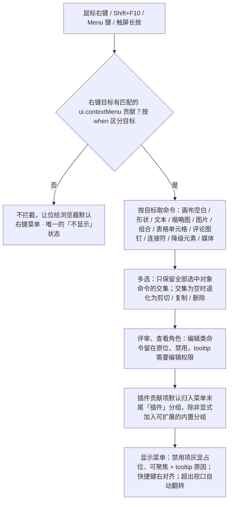

> 状态：草稿 | 负责：设计 | 更新：2026-09-15；2026-09-25（补图）；2026-09-30（§4.21 剩余缺口样张回写：「表格单元格」变体按 [03-30](30-table-editing.md) §5.3 改为 M2 / M3 两态——菜单平铺、「插入」小标题带 M3 标记、四个插入项、合并 / 拆分…、删除行 / 列 / 表格用危险色；M2 的禁用原因由 tooltip 改为菜单内常驻说明行；M2 下「删除表格」是否可用待 03-30 §13 第 19 条；样张经主会话抽查，最终以用户确认为准）；2026-09-30（§4.21 剩余缺口样张回写 · 复核修正：普通格的「拆分单元格…」没有对应命令，改为待 03-30 §13 第 23 条；样张禁用项的实现差异指向 03-30 §12 第 10 行）；2026-09-30（§4.22 设计待决收口：表格单元格变体定稿——粘贴、删除文本已入样张，结构项 `aria-disabled` 并以 `aria-describedby` 指向常驻说明行，M2「删除表格」可用，普通格「拆分单元格…」禁用并给原因、不做拆分对话框，无编辑权限时除复制外禁用；「只读（评审模式）」由「不出现」改为禁用而不隐藏）；2026-09-30（§4.22 复核修正：「禁用项」不透明度由 40% 更正为 50%，与样张及 03-04、03-31 一致） | 依赖：charter v0.1；[03-30](30-table-editing.md) §5.3；rulings §4.20 FE-06、§4.22

# 03-05 上下文菜单

> **设计基准（2026-09-15 起）**：组件规格以 [`09-design-specification.md`](../09-design-specification.md) v3.0（shadcn Rhea + 材质层）为准；对应 playground 路由 `#/editor`（右键菜单，无独立路由；表格单元格变体见 `#/editor/table` 的「右键菜单 · 行列与合并（M3）」「M2 · 结构编辑灰显」两态）（[已发布 artifact](https://claude.ai/code/artifact/cf6e1a1a-986b-48bb-b743-5758dff419d2)，源码 `playground/src/routes/`）。本文引用的 `mockups/*.html` 与线框图为历史静态稿，以 playground 实际渲染为终稿。

对应 `ui.contextMenu` 贡献点（设计 06 §2.3）。触发方式：鼠标右键、键盘 `Shift+F10` / `Menu` 键、触屏长按。按目标（`when`）区分内容。

---

## 线框：画布空白处右键

```
┌─────────────────────┐
│ 粘贴            Ctrl+V│
│ 全选            Ctrl+A│
├─────────────────────┤
│ 网格与参考线      ▸   │
│ 幻灯片属性…            │
├─────────────────────┤
│ 🧩 插件                │
│   插入流程图节点        │
└─────────────────────┘
```

## 线框：形状选中右键

```
┌─────────────────────┐
│ 剪切            Ctrl+X│
│ 复制            Ctrl+C│
│ 粘贴            Ctrl+V│
│ 删除              Del │
├─────────────────────┤
│ 置于顶层          ▸   │
│ 组合            Ctrl+G│
│ 旋转              ▸   │
├─────────────────────┤
│ 编辑替代文字…           │
│ 添加批注               │
├─────────────────────┤
│ 🧩 插件A：设置数据源     │
└─────────────────────┘
```

## 线框：文本选中右键

```
┌─────────────────────┐
│ 剪切            Ctrl+X│
│ 复制            Ctrl+C│
│ 粘贴（保留格式）  Ctrl+V│
│ 粘贴（纯文本）          │
├─────────────────────┤
│ 字体…                  │
│ 超链接…          Ctrl+K│
│ 添加批注               │
└─────────────────────┘
```

## 线框：缩略图右键

```
┌─────────────────────┐
│ 新建幻灯片        Ctrl+M│
│ 复制幻灯片             │
│ 删除幻灯片        Del  │
├─────────────────────┤
│ 隐藏幻灯片             │
│ 切换效果…              │
└─────────────────────┘
```

---

## 状态

### 无适用命令

若右键目标（如某个插件自定义元素类型）没有任何匹配的 `ui.contextMenu` 贡献，**不拦截**浏览器默认右键菜单（设计 06 §2.3）。这是本菜单唯一的"不显示"状态——自定义菜单要么完整出现，要么让位给系统菜单，不存在"空白菜单"态。

### 禁用项

灰显（文字与图标 50% 不透明度，与 03-04、03-31 及样张一致），仍占位显示（不隐藏）：`aria-disabled`、仍可聚焦，方向键可达，选中不执行；hover/聚焦时 tooltip 说明禁用原因（如「需要编辑权限」/「所选对象不支持此操作」，原因由 `explainWhen` 或权限门给出，50/10 §4；rulings §4.20 FE-06）。一组项共用同一原因时可改为菜单内一行常驻说明，各项以 `aria-describedby` 指向它（见「表格单元格变体」）。

### 只读（评审模式）

禁用而不隐藏（rulings §4.20 FE-06；50/10 §4）：菜单内容与编辑模式相同，剪切、粘贴、删除、置于顶层、组合等编辑类命令留在原位、禁用，tooltip「需要编辑权限」；复制、全选、网格与参考线等查看类命令照常可用；「添加批注」按评论权限（评审者可用，查看者禁用并给原因）。表格单元格变体同此口径：除「复制」外全部禁用（03-30 §9 与图 6）。

### 离线

不影响菜单本身的命令集合（本地操作依然可用，遵循乐观本地优先）；仅当某命令本质需要网络（当前上下文中不存在此类命令，预留规则供后续新增命令判断）时才禁用。

---

## 交互说明

- **删除不弹确认框，改为可撤销 toast**（2026-09-15 评审，规则 undo-support / confirmation-dialogs）："删除"与"删除幻灯片"立即执行，随后出现 5 秒 toast「已删除 1 个对象 [撤销]」（`role="status"`、`aria-live="polite"`、不抢焦点，"撤销"按钮可 Tab 到达）；只有不可撤销的销毁性操作（如永久删除版本、移除协作者）才使用确认对话框。删除类菜单项使用 `danger-emphasis` 文字并与普通项分组分隔。
- 菜单语义：`role="menu"` + `role="menuitem"`（必须是 `button`），`↑`/`↓` 移动、`Esc` 关闭并把焦点归还到画布/触发元素；菜单项命中区 ≥ 28px 高。
- 快捷键提示右对齐，自动读取该命令绑定的 `ui.shortcut`，插件无需重复声明文案（设计 06 §2.3）。
- 子菜单（如"置于顶层"）采用 hover-intent 延迟（约 200ms）展开，避免鼠标划过时误触发；键盘方向键右/左展开收起子菜单。
- 菜单超出视口边缘时自动翻转：右侧空间不足则向左展开，底部空间不足则向上展开，保证完整可见。
- `Esc` 关闭菜单并将焦点归还触发元素（右键的原对象，或键盘触发时的原聚焦元素）。
- 多选时仅显示所有选中对象命令的交集；若交集为空，退化为仅剪贴板类通用命令（剪切/复制/删除）。
- 插件贡献项默认归入菜单末尾"插件"分组（分隔线 + 归属标签），除非插件显式声明加入某个标记为可扩展的内置分组（设计 06 §2.3）。

**右键菜单内容的组装**



怎么读：先判定是否拦截浏览器菜单，拦截后按目标取命令，再依次叠加多选交集、只读角色禁用与插件分组三条规则；只读只改可用性、不删菜单项；自定义菜单要么完整出现，要么让位给系统菜单，不存在空白菜单。

## 边界情况

- 触屏长按：呼出位置以长按点为锚点，若锚点接近屏幕边缘则自动内缩，保证菜单不超出可视区域。
- 极小窗口（400px）：菜单最大宽度不超过视口宽度的 90%，超长命令标签换行而不横向溢出。
- 同时按右键与正在进行拖拽操作：拖拽状态优先，右键菜单在拖拽结束前不触发。

---

## 补充（2026-09-15，G-16/G-26，来源 `10-prd/07-design-coverage-and-gaps.md`）

本文件此前只给出画布空白/形状/文本/缩略图四种变体，补齐 ED-08、ED-12 要求的其余目标类型；全部新增变体沿用本文件已定的通用规则（图标 16×16、快捷键右对齐、多选取交集、无匹配命令不拦截浏览器菜单）。

### 新增变体

```
图片右键                          组合右键
┌─────────────────────┐         ┌─────────────────────┐
│ 剪切/复制/粘贴/删除     │         │ 取消组合      Mod+⇧+G│
├─────────────────────┤         │ 进入组合编辑           │
│ 裁剪                  │         ├─────────────────────┤
│ 替换图片               │         │ 置于顶层 ▸ / 添加批注   │
│ 重置图片               │         └─────────────────────┘
├─────────────────────┤
│ 置于顶层 ▸ / 组合       │         表格单元格右键：M2 / M3 两态，
├─────────────────────┤         见下文「表格单元格变体」
│ 编辑替代文字…            │         （2026-09-30 按 03-30 §5.3 更新）
│ 另存为图片 P2 / 添加批注  │
└─────────────────────┘

评论图钉右键                        连接符 / 降级元素 / 媒体 右键
┌─────────────────────┐         ┌─────────────────────┐
│ 解决                  │         │ 复制 / 删除            │
│ 复制链接               │         │ 查看保真详情（降级元素）  │
│ 删除线程（权限内）       │         │ 播放 / 替换海报（媒体）  │
└─────────────────────┘         └─────────────────────┘
```

### 规则补充

- **多选异类**：仅显示全部选中对象命令的交集（本文件已有原则），新增变体同样遵循；如同时选中图片+形状，仅保留"剪切/复制/粘贴/删除/置于顶层/组合"等共有项。
- **组合右键**："取消组合"拆一层；"进入组合编辑"等价于双击（见 03-screens/17 G-10）。
- **表格单元格**：M2 / M3 两态见下文「表格单元格变体」（2026-09-30 按 03-30 §5.3 更新；原「M2 灰显并 tooltip 说明原因」改为菜单内常驻说明行，M3 起启用，见 G-62；2026-09-30 §4.22 定稿）。
- **评论图钉右键**：解决/复制链接为 `commenter` 及以上可见；删除线程仅评论所有者与 `owner` 可见（权限矩阵见 03-screens/06 补充 D2）。
- **降级元素右键**（03-screens/13）：仅提供复制/删除/查看保真详情，不提供任何编辑类命令。
- G-16（ED-08）補充：占位符参与组合时 toast"占位符将转换为普通形状"（可撤销）；`Mod+D` 复制在原位右下偏移 0.2 in，连续按住保持相同偏移量。

### 表格单元格变体（2026-09-30，G-32 / G-62，按 03-30 §5.3）

在单元格或单元格选区上右键（或 `Shift+F10` / 菜单键）。完整说明、可用性判断图与命令对应见 [03-30](30-table-editing.md) §5.3、§10；本节只登记本菜单族的变体形态。左为 M3（演示状态「右键菜单 · 行列与合并（M3）」），右为 M2（「M2 · 结构编辑灰显」）：

```
表格单元格右键（M3）                 表格单元格右键（M2）
┌────────────────────────────┐   ┌──────────────────────────────────┐
│ 剪切                    ⌘X │   │ 剪切                          ⌘X │
│ 复制                    ⌘C │   │ 复制                          ⌘C │
│ 粘贴                    ⌘V │   │ 粘贴                          ⌘V │
│ 删除文本                 ⌫ │   │ 删除文本                       ⌫ │
├────────────────────────────┤   ├──────────────────────────────────┤
│ 插入 [M3]                   │   │ [M3] 表格结构编辑将在后续版本提供； │
│ ▤ 在上方插入行              │   │      当前可编辑单元格文字与字符格式 │
│ ▤ 在下方插入行              │   │ ▤ 在上方插入行      （aria-disabled）│
│ ▥ 在左侧插入列              │   │ ▤ 在下方插入行      （aria-disabled）│
│ ▥ 在右侧插入列              │   │ ▥ 在左侧插入列 …    （aria-disabled）│
├────────────────────────────┤   ├──────────────────────────────────┤
│ ⊞ 合并单元格                │   │ ⊞ 合并单元格        （aria-disabled）│
│ ⊟ 拆分单元格…  （普通格禁用） │   │ ⊟ 拆分单元格…       （aria-disabled）│
├────────────────────────────┤   ├──────────────────────────────────┤
│ × 删除行          （危险色）  │   │ × 删除行 / 删除列   （aria-disabled）│
│ × 删除列          （危险色）  │   │ × 删除表格      （危险色，M2 可用）│
│ × 删除表格        （危险色）  │   └──────────────────────────────────┘
└────────────────────────────┘
```

- **结构**：平铺，不用子菜单（原「插入行列 ▸」作废）。分组依次为剪贴板（剪切、复制、粘贴、删除文本）┊ 「插入」小标题（带 M3 标记）与四个插入项 ┊ 合并单元格、拆分单元格… ┊ 删除行、删除列、删除表格（`danger-emphasis` 文字，与普通项分组分隔，沿用本文「交互说明」第一条）。宽 240，贴指针右侧展开，底部避让 48。
- **禁用的实现**：不可用项一律 `aria-disabled`、仍可聚焦，方向键可达，选中不执行（本文「禁用项」）。
- **M3 可用条件**：合并需选区 ≥ 2 格；拆分只对合并格，拆回合并前的格。普通格上「拆分单元格…」禁用，tooltip「只有合并过的单元格可以拆分」，不做按行列数拆分的对话框（定稿，rulings §4.22；按行列数拆分推迟，见 03-30 §13 第 23 条）。删除行 / 列作用于选区覆盖的全部行 / 列，删光即删表。每项一个撤销步，toast 带「撤销」。
- **M2 禁用原因**：「插入」小标题换成一行常驻说明「M3 表格结构编辑将在后续版本提供；当前可编辑单元格文字与字符格式」（M3 为里程碑标记），行列插删与合并拆分全部 `aria-disabled`、以 `aria-describedby` 指向这一行。菜单里禁用项的 tooltip 不易触达，所以 M2 这一组的原因写在菜单内，不再逐项 tooltip；本文「禁用项」一节的 tooltip 规则对其余禁用原因（无编辑权限、普通格拆分等）照常适用。剪贴板项照常可用。
- **M2 的「删除表格」**：可用（定稿，rulings §4.22），与整表选中按 `Delete` 同一口径（50/24 §2.6；命令 `slide.deleteShapes`，03-30 §10）；M2 只禁用行列插删与合并拆分。
- **无编辑权限**（评审、查看角色）：除「复制」外全部禁用，tooltip「需要编辑权限」（03-30 §9 与其图 6；与本文「只读（评审模式）」同一口径）。权限先于里程碑判断：此时 M2 的常驻说明行换回普通的「插入 M3」小标题。
