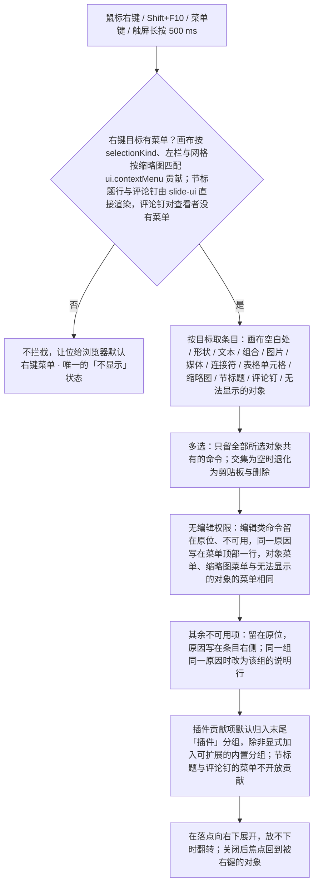

> 状态：草稿 | 负责：设计 | 更新：2026-09-15；2026-09-25（补图）；2026-09-30（§4.21 剩余缺口样张回写：「表格单元格」变体按 [03-30](30-table-editing.md) §5.3 改为 M2 / M3 两态——菜单平铺、「插入」小标题带 M3 标记、四个插入项、合并 / 拆分…、删除行 / 列 / 表格用危险色；M2 的禁用原因由 tooltip 改为菜单内常驻说明行；M2 下「删除表格」是否可用待 03-30 §13 第 19 条；样张经主会话抽查，最终以用户确认为准）；2026-09-30（§4.21 剩余缺口样张回写 · 复核修正：普通格的「拆分单元格…」没有对应命令，改为待 03-30 §13 第 23 条；样张禁用项的实现差异指向 03-30 §12 第 10 行）；2026-09-30（§4.22 设计待决收口：表格单元格变体定稿——粘贴、删除文本已入样张，结构项 `aria-disabled` 并以 `aria-describedby` 指向常驻说明行，M2「删除表格」可用，普通格「拆分单元格…」禁用并给原因、不做拆分对话框，无编辑权限时除复制外禁用；「只读（评审模式）」由「不出现」改为禁用而不隐藏）；2026-09-30（§4.22 复核修正：「禁用项」不透明度由 40% 更正为 50%，与样张及 03-04、03-31 一致）；2026-10-05（design-language-v3 第 0 批修正：只改快捷键值——「文本选中右键」线框的超链接由 `Ctrl+K` 改为 `Ctrl+Shift+K`（macOS ⇧⌘K，rulings §4.25 DS-11）；界面描述随第 1 批回写）；2026-10-07（design-language-v3 第 1 批：按已拍板的 context-menu 场景整篇改写——§1 线框按 v3 外壳重画，并按目标画出形状、文本、画布空白处、缩略图、组合、图片、媒体、连接符、多选、节标题与评审模式的菜单；§2 外观与通用规则改为 v3（面板与主菜单同一画法，不可用项文字退到 text-3、原因写在右侧或菜单内说明行，原「50% 不透明 + 悬停提示」作废）；§3 各目标条目表：去掉「字体…」「幻灯片属性…」「切换效果…」，「置于顶层 ▸」改为「排列 ▸」，新增「原位复制」「移动 ▸」「更换版式…」「重置页…」「对齐与分布 ▸」与节标题菜单，表格单元格变体只改呈现措辞（M3 的「插入」为普通小标题、评审者只读时带 M3 标记）；§4 无编辑权限按 rulings §4.22 D-10 禁用而不隐藏，同一原因写在菜单顶部一行；§5 状态表列全 10 个样张状态与路由；§7 补「菜单开着时目标被他人删除」；§8 原条目去向；§9 待确认三条；依据 rulings §4.25 DS-1、DS-9、DS-13、DS-15、DS-21、DS-23）；2026-10-07（design-language-v3 第 1 批：按 rulings §4.25 TB-6、TB-17、TB-18、TB-19、TB-22、TB-23 与 DS-29 修订——§1.1、§1.2 形状菜单补「更改形状 ▸」（在「旋转」之后，P1）与「链接… · 操作设置… · 编辑替代文本…」一组，文本菜单「超链接…」改名「链接…」、「粘贴为纯文本」改为 P2 不可用，画布空白处「粘贴选项」补原因，无编辑权限的缩略图菜单改为顶部说明行；§2.2、§2.3 分组顺序与同因说明行；§3 形状、文本、画布空白处、缩略图、节标题各行改写，节标题菜单由 slide-ui 直接渲染、不开放贡献，新增「母版视图的版式 / 母版缩略图」行（指 03-26 §3），降级元素改「随第 3 批」；§4 评审时缩略图右键与降权同一形态；§5 补样张跟改项；§6 补「链接…」「操作设置…」「编辑替代文本…」的去向；图 6-1 节标题不走 `ui.contextMenu`；§8 补原条目去向；§9 四条待确认按 TB-18、TB-19、TB-22、TB-6 定稿关闭；§6 原位复制的偏移改按 pt 书写为 14.4 pt（0.2 in，DS-27））；2026-10-08（design-language-v3 第 1 批收口：§1.2 评审时缩略图菜单的顶部说明改为「评审模式下不可用」、§4 同此并删去「两处样张跟改」（样张底座 `thumb-menu.tsx` 已按模式取说明），§2.3 补顶部说明行文案，§8 同步，§9 新增第 5 条（rulings §4.25 TB-51）；§1.2 多选线框与 §3「多选」行的「顶端对齐 / 底端对齐」改为「顶对齐 / 底对齐」，与检查器对齐行同一组命令标题（TB-20，样张已统一）；§3「降级元素」行登记与 50/25 §2.5 的条目差别随第 3 批定稿；§5 第 2 行与「降权 · 缩略图右键」行删去已完成的「样张跟改」；§6 形状「编辑替代文本…」落到形状检查器「替代文本」节（TB-32），原位复制偏移改回 0.2 in（PowerPoint 默认值保留原单位，TB-37，取代上一条的 14.4 pt 写法）；§9 第 2–4 条「样张跟改」改为「样张已改」）；2026-10-08（design-language-v3 第 1 批收口复核：§1.1 图例、§5 状态表第 1、3 行与 §7 第 1 条改指 2026-10-08 补入样张的形状右键四项与画布「粘贴选项 ▸」（TB-18、TB-19）；§6「删除不弹确认」的例外补上会波及其他页的操作（FE-05、DS-32））；2026-10-15（design-language-v3 第 2 批：按 rulings §4.25 DS-40、DS-44、DS-52 与第 2 批样张回写——§1.2 画布空白处菜单在「重置页…」与插件分组之间加「添加评论 C」一组（粘贴选项展开的 `undo-clipboard.paste-options` 同此，DS-44），并补评论钉、无法显示的对象两张菜单线框；§2.2 分组顺序、§2.4 焦点与落点补「添加评论」、评论钉菜单与占位菜单；§3「画布空白处」行加「添加评论 C」，「评论图钉」行改为「评论钉」并按样张 `comments.pin-menu` 写全——解决（已解决的为「重新打开」）· 复制链接 ┊ 删除讨论串…，整条讨论串只有文档所有者能删，确认文案「删除此讨论串？将同时删除 N 条回复，删除后无法恢复。」（DS-40）；「降级元素」行改为「无法显示的对象」：保真降级与缺插件元素同一份「能摆放」菜单——剪切 · 复制 · 粘贴 · 原位复制 ┊ 排列 · 组合 ┊ 编辑替代文本… · 添加评论 ┊ 查看保真详情（缺插件元素为「查看详情」）┊ 删除，原「复制 · 删除 · 查看保真详情」作废（DS-52）；§4 补这两种菜单在评审与只读浏览下的形态；§5 状态表第 3 行与其他场景表补第 2 批的右键状态；§6 二次确认改为三档——模态确认框只给不可撤销的销毁与会波及其他页的操作，恢复版本用锚在按钮下的非模态确认卡，移除成员与收紧链接用行内确认，原把「移除协作者」列为确认对话框的例子作废（DS-40）；「添加评论」补进入评论工具与编辑文字时的例外（DS-44）；图 6-1 目标名同步；§8 补四行原条目去向）；2026-10-15（design-language-v3 第 2 批回写续：文首、§2.5、§3「评论钉」行、§4 与图 6-1——评论钉的菜单由 slide-ui `CommentPins` 直接渲染，不走 `ui.contextMenu`、不开放插件贡献，查看者在钉上右键不拦截浏览器菜单（rulings §4.25 TB-61）；§3「无法显示的对象」行、§4、§5 其他场景表与 §8——评审、只读浏览与降权下照常出「能摆放」菜单，编辑类命令留在原位不可用、顶部一行写原因，「复制」、有评论权限时的「添加评论」与「查看保真详情 / 查看详情」照常可用，样张说明与前端 50/25 §2.5 的「评审、只读浏览没有这份菜单」作废（DS-64，§4.22 D-10）；核对画布空白处「添加评论 C」、§6 三档确认、评论钉「删除讨论串…」只给所有者与「能摆放」口径，均已按 DS-40、DS-44、DS-52 写好）；2026-10-22（design-language-v3 第 3 批复核修正：§7「触屏长按」一条补触控形态（手机与平板）的菜单项不写键位提示（rulings §4.25 TB-164）；其余段落逐段核对，没有受第 3 批裁决影响的地方） | 依赖：charter v0.1；[03-30](30-table-editing.md) §5.3；rulings §4.20 FE-06、§4.22；rulings §4.25 DS-21…DS-26、DS-29、DS-40、DS-44、DS-52、DS-64、TB-6、TB-17…TB-20、TB-22、TB-23、TB-32、TB-37、TB-51、TB-61、TB-164；playground `#/v3/editor?state=comments.pin-menu`、`fidelity.degraded-menu`、`plugins.missing-menu`

# 03-05 上下文菜单

> **设计基准（2026-10-07 起，rulings §4.25 DS-21）**：以 playground 第 1 批「右键菜单」场景为准，路由 `#/v3/editor?state=context-menu.<状态 id>`（§5 列全 10 个状态）；菜单组件 `src/v3/kit/ContextMenu.tsx`、`src/v3/kit/Menu.tsx`，条目 `src/v3/scenarios/slides-selection/menus.tsx`，缩略图条目 `src/v3/editor/thumb-menu.tsx`（单页左栏与网格同一份），表格单元格条目 `src/v3/scenarios/table/menus.tsx`。外壳以 [03-02](02-editor-main.md) 为准；token 只写名字（样张作用域名 `--v3-*`），取值见设计 [04](../04-design-system.md)。旧稿各菜单线框与「禁用项 50% 不透明 + 悬停提示原因」的画法作废（§8）。

对应 `ui.contextMenu` 贡献点（设计 06 §2.3）：画布上的对象与空白处走槽位 `canvas`（按 `selectionKind` 过滤），左栏与网格的缩略图走 `thumbnail`，母版视图的母版、版式缩略图走 `masterThumbnail` / `layoutThumbnail`（50/09 §6.1，菜单见 03-26 §3）；左栏节标题行的菜单由 slide-ui 直接渲染，不走 `ui.contextMenu`、不开放插件贡献（rulings §4.25 TB-23）；画布评论钉的菜单同此，由 slide-ui `CommentPins` 直接渲染（TB-61）。v3 中右键是第二入口（DS-1）：创建在底部工具条、格式在检查器，右键只放剪贴板、排列与组合、对象专属命令、评论与删除，并与主菜单、命令面板（`Mod+K`）、快捷键指向同一批命令。触发：鼠标右键、键盘 `Shift+F10` / 菜单键、触屏长按 500 ms（PRD ED-27，50/10 §7.3）。覆盖缺口 **G-26**（ED-12，按选区类型的右键菜单全部变体）与 **G-16**（ED-08，组合、层级与对象操作的右键入口）；表格单元格变体对应 **G-32** / **G-62**（§3.1）。

---

## 1. 线框

### 1.1 单页视图 · 形状上的右键（第 2 页要点卡）

```
←──── 240 ─────→←───────────────────── 画布 ──────────────────────→←───────── 280 ─────────→
┌──────────────┬──────────────────────────────────────────────────┬────────────────────────┐
│ [▣▾]  [▭][▦] │                                                  │ (周)(王)(李) ▶ [分享]  │
│ 2026 年 Q2 ▾ │ ┌──────────────────────────────────────────────┐ ├────────────────────────┤
│ ✓ 已同步     │ │ 议程                                         │ │ [设计]  评论    77% ▾  │
│ [新建…▾][+]  │ │                                              │ ├────────────────────────┤
│ 1 ┌────────┐ │ │ 01 关键指标          P3                      │ │ 对齐行（03-17）        │
│   └────────┘ │ │                           ▪─────────────▪    │ ├────────────────────────┤
│▌2 ┏━━━━━━━━┓ │ │ 02 营收趋势          P4   │ 本季关键词  │    │ │ 矩形                   │
│▌  ┃ 议程   ┃ │ │                           │ 增长 18%    │    │ ├────────────────────────┤
│▌  ┗━━━━━━━━┛ │ │ 03 区域分布 ┌──────────────────────────────┐ │ │ 位置与大小             │
│ 3 ┌────────┐ │ │             │ 剪切                      ⌘X │ │ │ [X 629 pt][Y 232 pt]   │
│   └────────┘ │ │ 04 下半年计 │ 复制                      ⌘C │ │ ├────────────────────────┤
│ ⋮            │ │             │ 粘贴                      ⌘V │ │ │ 填充 · 描边 · 阴影 …   │
│              │ └─────────────│ 原位复制                  ⌘D │─┘ │                        │
│              │               ├──────────────────────────────┤   │                        │
│              │               │ 排列                       › │   │                        │
│              │               │ 旋转                       › │   │                        │
│              │               │ 更改形状                   › │   │                        │
│              │               │ ░ 组合   需选中 2 个以上对象 │   │                        │
│              │               ├──────────────────────────────┤   │                        │
│              │               │ 链接…                    ⇧⌘K │   │                        │
│              │               │ 操作设置…                    │   │                        │
│              │               │ 编辑替代文本…                │   │                        │
│              │               │ 添加评论                   C │   │                        │
│              │               ├──────────────────────────────┤   │                        │
│              │               │ 删除                       ⌫ │   │                        │
│              │               ├──────────────────────────────┤   │                        │
│              │               │ 插件                         │   │                        │
│              │               │ 设置数据源…     数据图表增强 │   │                        │
│              │               └──────────────────────────────┘   │                        │
│              │                                                  │                        │
│              │     ╭──────────────────────────────────────╮     │                        │
│              │     │ 底部创建工具条（03-02）              │     │                        │
│              │     ╰──────────────────────────────────────╯     │                        │
└──────────────┴──────────────────────────────────────────────────┴────────────────────────┘
```

图例：菜单是浮在画布上的一层（盖住幻灯片与选中框），从右键落点向右下展开，放不下时翻转；`░` 开头的条目不可用；检查器不因菜单打开而变化。样张状态：`context-menu.shape`（样张里菜单更靠右、压到检查器上，「排列」子菜单展开）；「更改形状 ▸」（未开放前不可用）、「链接…」「操作设置…」「编辑替代文本…」按 rulings §4.25 TB-18 于 2026-10-08 补入样张。

### 1.2 按目标的菜单

本节线框的记号：`░` 开头的条目不可用（文字、图标与快捷键退到 `--v3-text-3`，右侧写原因，或由菜单内说明行统一说明）；`›` 有子菜单；`✓` 勾选或单选的当前项；`P2` / `M3` 为里程碑标记；删除类条目（删除、删除幻灯片、删除行 / 列 / 表格、删除讨论串…）用危险色 `--v3-danger`；16px 图标列在线框里省略。

形状（「排列」展开）：

```
┌────────────────────────────────┐
│ 剪切                        ⌘X │
│ 复制                        ⌘C │
│ 粘贴                        ⌘V │
│ 原位复制                    ⌘D │
├────────────────────────────────┤ ┌──────────────────┐
│ 排列                         › │ │ 置于顶层     ⇧⌘] │
│ 旋转                         › │ │ 上移一层      ⌘] │
│ 更改形状                     › │ │ 下移一层      ⌘[ │
│ ░ 组合     需选中 2 个以上对象 │ │ 置于底层     ⇧⌘[ │
├────────────────────────────────┤ └──────────────────┘
│ 链接…                      ⇧⌘K │
│ 操作设置…                      │
│ 编辑替代文本…                  │
│ 添加评论                     C │
├────────────────────────────────┤
│ 删除                         ⌫ │
├────────────────────────────────┤
│ 插件                           │
│ 设置数据源…       数据图表增强 │
└────────────────────────────────┘
```

文本（编辑态选中文字；「粘贴为纯文本」P2，上线前不可用、右侧写原因代替快捷键 ⇧⌘V）：

```
┌──────────────────────────────────┐
│ 剪切                          ⌘X │
│ 复制                          ⌘C │
│ 粘贴                          ⌘V │
│ ░ 粘贴为纯文本  P2  后续版本提供 │
├──────────────────────────────────┤
│ 链接…                        ⇧⌘K │
│ 添加评论                       C │
└──────────────────────────────────┘
```

画布空白处（「网格与参考线」展开；「添加评论 C」一组在「重置页…」与插件分组之间，rulings §4.25 DS-44）：

```
┌──────────────────────────────────┐
│ 粘贴                          ⌘V │
│ ░ 粘贴选项  P2  后续版本提供   › │
│ 全选                          ⌘A │
├──────────────────────────────────┤ ┌──────────────────────────────────┐
│ 网格与参考线                   › │ │   显示网格                       │
│ 更换版式…                        │ │ ✓ 显示参考线                     │
│ 重置页…                          │ ├──────────────────────────────────┤
├──────────────────────────────────┤ │   吸附到网格                     │
│ 添加评论                       C │ │ ✓ 智能参考线          吸附到对象 │
├──────────────────────────────────┤ ├──────────────────────────────────┤
│ 插件                             │ │   网格间距                       │
│ 插入流程图节点       ACME 流程图 │ │   6 pt                           │
└──────────────────────────────────┘ │ ✓ 12 pt                          │
                                     │   18 pt                          │
                                     ├──────────────────────────────────┤
                                     │ ░ 标尺  P2          后续版本提供 │
                                     │ ░ 添加参考线  P2    后续版本提供 │
                                     └──────────────────────────────────┘
```

缩略图（「移动」展开）、仅剩 1 页时的缩略图：

```
┌────────────────────────┐                      ┌──────────────────────────────────┐
│ 新建幻灯片          ⌘M │                      │ 新建幻灯片                    ⌘M │
│ 复制幻灯片          ⌘D │                      │ 复制幻灯片                    ⌘D │
├────────────────────────┤                      ├──────────────────────────────────┤
│ 更换版式…              │                      │ 更换版式…                        │
│ 隐藏幻灯片             │ ┌──────────────────┐ │ 隐藏幻灯片                       │
│ 移动                 › │ │ 上移一页     ⇧⌘↑ │ │ ░ 移动              只有 1 页  › │
├────────────────────────┤ │ 下移一页     ⇧⌘↓ │ ├──────────────────────────────────┤
│ 删除幻灯片           ⌫ │ ├──────────────────┤ │ ░ 删除幻灯片   文档至少保留 1 页 │
└────────────────────────┘ │ 移到开头         │ └──────────────────────────────────┘
                           │ 移到末尾         │
                           └──────────────────┘
```

组合、图片：

```
┌────────────────────────┐  ┌──────────────────────────────────┐
│ 剪切                ⌘X │  │ 剪切                          ⌘X │
│ 复制                ⌘C │  │ 复制                          ⌘C │
│ 粘贴                ⌘V │  │ 粘贴                          ⌘V │
│ 原位复制            ⌘D │  │ 原位复制                      ⌘D │
├────────────────────────┤  ├──────────────────────────────────┤
│ 取消组合           ⇧⌘G │  │ 裁剪                             │
│ 进入组合编辑      双击 │  │ 替换图片…                        │
│ 排列                 › │  │ 重置图片                         │
├────────────────────────┤  ├──────────────────────────────────┤
│ 添加评论             C │  │ 排列                           › │
├────────────────────────┤  │ 旋转                           › │
│ 删除                 ⌫ │  │ ░ 组合       需选中 2 个以上对象 │
└────────────────────────┘  ├──────────────────────────────────┤
                            │ 编辑替代文本…                    │
                            │ ░ 另存为图片…  P2   后续版本提供 │
                            │ 添加评论                       C │
                            ├──────────────────────────────────┤
                            │ 删除                           ⌫ │
                            └──────────────────────────────────┘
```

媒体（「旋转」展开）、连接符：

```
┌────────────────────────────────┐                    ┌────────────────────────────────┐
│ 剪切                        ⌘X │                    │ 剪切                        ⌘X │
│ 复制                        ⌘C │                    │ 复制                        ⌘C │
│ 粘贴                        ⌘V │                    │ 粘贴                        ⌘V │
│ 原位复制                    ⌘D │                    │ 原位复制                    ⌘D │
├────────────────────────────────┤                    ├────────────────────────────────┤
│ 播放                         ↵ │                    │ 排列                         › │
│ 替换海报…                      │                    │ ░ 组合     需选中 2 个以上对象 │
│ ░ 裁剪  P2        后续版本提供 │                    ├────────────────────────────────┤
├────────────────────────────────┤                    │ 添加评论                     C │
│ 排列                         › │ ┌────────────────┐ ├────────────────────────────────┤
│ 旋转                         › │ │ 向右旋转 90°   │ │ 删除                         ⌫ │
│ ░ 组合     需选中 2 个以上对象 │ │ 向左旋转 90°   │ └────────────────────────────────┘
├────────────────────────────────┤ └────────────────┘
│ 编辑替代文本…                  │
│ 添加评论                     C │
├────────────────────────────────┤
│ 删除                         ⌫ │
└────────────────────────────────┘
```

多选（异类三个对象，「对齐与分布」展开）、节标题（已折叠的节）：

```
┌──────────────────────┐                  ┌────────────────────────┐
│ 剪切              ⌘X │                  │ 展开此节               │
│ 复制              ⌘C │                  ├────────────────────────┤
│ 粘贴              ⌘V │                  │ 全部折叠               │
│ 原位复制          ⌘D │                  │ 全部展开               │
├──────────────────────┤ ┌──────────────┐ ├────────────────────────┤
│ 对齐与分布         › │ │ 左对齐       │ │ 节的新增、重命名与排序 │
│ 排列               › │ │ 水平居中     │ │ 将在后续版本提供       │
│ 组合              ⌘G │ │ 右对齐       │ └────────────────────────┘
├──────────────────────┤ │ 顶对齐       │
│ 添加评论           C │ │ 垂直居中     │
├──────────────────────┤ │ 底对齐       │
│ 删除               ⌫ │ ├──────────────┤
└──────────────────────┘ │ 横向分布     │
                         │ 纵向分布     │
                         ├──────────────┤
                         │   对齐参照   │
                         │ ✓ 所选对象   │
                         │   页面       │
                         └──────────────┘
```

评论钉（文档所有者；菜单贴在钉的右侧展开，「删除讨论串…」用危险色）、无法显示的对象（新式图表占位；缺插件元素同一结构，末组换成「查看详情」、替代文本的原因写「插件不可用时不能修改」，rulings §4.25 DS-52）：

```
┌────────────────────────┐  ┌──────────────────────────────────────────┐
│ 解决                   │  │ 剪切                                  ⌘X │
│ 复制链接               │  │ 复制                                  ⌘C │
├────────────────────────┤  │ 粘贴                                  ⌘V │
│ 删除讨论串…            │  │ 原位复制                              ⌘D │
└────────────────────────┘  ├──────────────────────────────────────────┤
                            │ 排列                                   › │
                            │ ░ 组合               需选中 2 个以上对象 │
                            ├──────────────────────────────────────────┤
                            │ ░ 编辑替代文本…   需在 PowerPoint 中修改 │
                            │ 添加评论                               C │
                            ├──────────────────────────────────────────┤
                            │ 查看保真详情                             │
                            ├──────────────────────────────────────────┤
                            │ 删除                                   ⌫ │
                            └──────────────────────────────────────────┘
```

评审模式下的形状、编辑模式已降权时的缩略图（§4；同一原因写在菜单顶部一行，各项不再逐项写原因，rulings §4.25 TB-22）：

```
┌──────────────────────────────────┐  ┌────────────────────────────────┐
│ 评审模式：编辑类命令需要编辑权限 │  │ 需要编辑权限                   │
├──────────────────────────────────┤  ├────────────────────────────────┤
│ ░ 剪切                        ⌘X │  │ ░ 新建幻灯片                ⌘M │
│ 复制                          ⌘C │  │ ░ 复制幻灯片                ⌘D │
│ ░ 粘贴                        ⌘V │  ├────────────────────────────────┤
│ ░ 原位复制                    ⌘D │  │ ░ 更换版式…                    │
├──────────────────────────────────┤  │ ░ 隐藏幻灯片                   │
│ ░ 排列                         › │  │ ░ 移动                       › │
│ ░ 旋转                         › │  ├────────────────────────────────┤
│ ░ 更改形状                     › │  │ ░ 删除幻灯片                 ⌫ │
│ ░ 组合                        ⌘G │  └────────────────────────────────┘
├──────────────────────────────────┤
│ ░ 链接…                      ⇧⌘K │
│ ░ 操作设置…                      │
│ ░ 编辑替代文本…                  │
│ 添加评论                       C │
├──────────────────────────────────┤
│ ░ 删除                         ⌫ │
├──────────────────────────────────┤
│ 插件                             │
│ ░ 设置数据源…       数据图表增强 │
└──────────────────────────────────┘
```

评审模式与只读浏览下的缩略图菜单同右侧这一形态，顶部说明分别换成「评审模式下不可用」（与主菜单同一口径，rulings §4.25 TB-51）「只有查看权限」（§4）；左侧对象菜单的顶部说明「评审模式：编辑类命令需要编辑权限」不变，因为其中「复制」「添加评论」仍可用。

---

## 2. 外观与通用规则

菜单的取值以 playground `kit/Menu.tsx`、`kit/ContextMenu.tsx` 与 `ui.tsx`（`MENU_CONTENT` / `MENU_ITEM`）为准，设计 04 §4.1「Menu」、§4.1a「ContextMenu」与 §4.1b 通用行为契约有解释；本节按右键菜单的用法摘要。

### 2.1 面板与条目

- **面板**：与主菜单同一画法（03-02「主菜单与文档菜单」）——`--v3-panel` 底、1px `--v3-border`、圆角 8、内边距 4、`--v3-shadow`，最小宽 168，宽度随内容；分隔线 1px `--v3-border`、上下各 4。
- **条目**：高 28、圆角 4、12px；悬停或键盘高亮时底色 `--v3-panel-2`。一行从左到右：勾选 / 单选时的 16px 对勾列 · 16px 图标列（`--v3-text-2`；同一面板有一项带图标即全体留出这一列，文字对齐）· 名称（可带 P2 / M3 标记）· 右侧补充说明或不可用原因（12px `--v3-text-2`，纯西文 11px）· 快捷键（11px `--v3-text-2`，自动读取命令绑定的 `ui.shortcut`，插件不必重复声明，06 §2.3）· 子菜单箭头（12px）。
- **小标题**（「插件」「对齐参照」「网格间距」「插入」）：高 24、12px `--v3-text-2`，与条目文字左缘对齐，不可点。**说明行**：12px / 18px `--v3-text-2`，最宽 280，可换行、可带标记，不可点。
- **子菜单**：贴父项右侧 4 展开，第一项与父项同一行对齐；指针悬停或按 `→` 展开，`←` 收起。
- **危险项**（删除类）：文字 `--v3-danger`，单独一组；对象菜单里它在评论之后、插件分组之前（无法显示的对象在详情入口之后），缩略图菜单与评论钉菜单里在最后。

### 2.2 分组与顺序

剪贴板（剪切 · 复制 · 粘贴 · 原位复制；文本为粘贴为纯文本）┊ 对象专属命令（裁剪、播放、取消组合等）┊ 排列 · 旋转 · 更改形状 · 组合（多选时「对齐与分布」排在最前；「更改形状」只在形状菜单）┊ 链接 · 操作设置 · 替代文本 · 添加评论（形状四项齐全，其余目标只出适用的几项）┊ 删除 ┊ 插件分组（小标题「插件」，条目右侧注明来源插件）。插件贡献默认进末尾的「插件」分组（分隔线 + 归属），除非显式加入标记为可扩展的内置分组（06 §2.3）；没有插件贡献时不出现这一组。画布空白处没有删除：「添加评论」单独一组，排在「更换版式… · 重置页…」之后、插件分组之前（rulings §4.25 DS-44）。无法显示的对象在「编辑替代文本… · 添加评论」之后另有一组详情入口（「查看保真详情」或「查看详情」），再是删除（DS-52）。

### 2.3 不可用项

- **留在原位、不隐藏**（rulings §4.20 FE-06、§4.22 D-10）：文字、图标与快捷键退到 `--v3-text-3`（不用半透明）；`aria-disabled`、仍可聚焦，方向键能停上去，选了不执行；危险项不可用时退回普通的不可用色。
- **原因**：写在条目右侧（代替快捷键），读屏经 `aria-describedby` 读到；一组项共用同一原因时改为菜单内一行常驻说明（在菜单顶部或该组位置），这些项不再逐项写原因、照常显示快捷键，`aria-describedby` 都指向说明行——对象菜单与缩略图菜单在评审、只读浏览与降权下都按此写（rulings §4.25 TB-22）。原因由 `explainWhen` 或权限门给出（50/09 §6.2）。
- **样张里的原因文案**：「需选中 2 个以上对象」「需选中 3 个以上对象」「单选时固定为页面」「后续版本提供」（P2 项另带 P2 标记）「只有 1 页」「文档至少保留 1 页」「只有合并过的单元格可以拆分」「需要编辑权限」；菜单顶部说明行：对象菜单评审时「评审模式：编辑类命令需要编辑权限」，缩略图菜单按情形「评审模式下不可用」（TB-51）/「只有查看权限」/「需要编辑权限」（§4）。

### 2.4 打开、定位与焦点

- **打开**：右键在指针处打开；焦点在画布对象上按 `Shift+F10` / 菜单键，对当前选区打开；焦点在缩略图上按 `Shift+F10` / 菜单键，对该页打开（锚在缩略图内）。在缩略图上右键同时切到被点的那一页。
- **定位**：从落点向右下展开（贴指针右侧 2），离视口边缘 8 以内放不下时自动翻转（右侧不够向左、底部不够向上），子菜单同理；在同一目标上再右键，菜单在新的指针处重开。
- **键盘**：`role="menu"` / `menuitem`（勾选项 `menuitemcheckbox`、单选 `menuitemradio`）；`↑` / `↓` 移动（不可用项也会停）、`→` / `←` 开合子菜单、`Enter` 执行、`Esc` 关闭。
- **焦点**：关闭后焦点回到被右键的对象（缩略图、评论钉、无法显示的对象的占位等可聚焦的元素）；画布上的对象把焦点交回画布；选了某项后焦点已被新打开的对话框或弹层接走（如「更换版式…」「重置页…」「链接…」「操作设置…」，以及「添加评论」打开的浮动撰写框，03-06 §6.1）时不抢回，「编辑替代文本…」把焦点交给检查器的描述框（§6）；从「查看保真详情」「查看详情」打开的报告或面板关闭后，焦点回到占位。
- **评论钉与占位的落点**（第 2 批）：评论钉的菜单锚在钉上、贴钉的右侧展开（不在指针处，所以不盖住钉），右键与 ⇧F10 / 菜单键同一位置（03-06 §5.1）；无法显示的对象在占位上右键先选中被点的那一个，⇧F10 / 菜单键在同一落点打开同一份菜单，缺插件的二维码占位较窄，菜单改贴占位右缘展开，不压住选中框下方的尺寸角标。
- 在菜单里点按不会触发画布的「点空白处取消选中」。

### 2.5 多选、空交集与不拦截

- 多选只显示全部所选对象都支持的命令；交集为空时退化为剪贴板与删除。
- 右键目标没有任何匹配的 `ui.contextMenu` 贡献时（如某种插件自定义元素），**不拦截**浏览器默认右键菜单——这是本菜单唯一的「不显示」状态，不存在空菜单（06 §2.3）。查看者在评论钉上右键同此：钉的菜单由 slide-ui 直接渲染、不对查看者开放，钉上不拦截浏览器菜单（rulings §4.25 TB-61）。

## 3. 各目标的条目

条目自上而下，`┊` 为分隔线；快捷键按 macOS 写，Windows / Linux 按 PRD ED-16 对应。

| 目标 | 槽位与条件 | 条目 | 说明 |
|---|---|---|---|
| 画布空白处 | `canvas`，无选中 | 粘贴 ⌘V ·（粘贴选项 ▸，P2）· 全选 ⌘A ┊ 网格与参考线 ▸ · 更换版式… · 重置页… ┊ 添加评论 C ┊ 插件分组 | 「粘贴选项 ▸」（保留源格式 / 仅文本 / 作为图片）M2 留在原位不可用、标 P2、右侧写「后续版本提供」（03-19 §1.3）；「网格与参考线 ▸」与主菜单「视图 › 网格与参考线 ▸」是同一张清单（03-17 §7）；「更换版式…」打开版式画廊（03-14 §3.6），「重置页…」确认后可撤销（03-27）。「添加评论 C」与按 C 相同，进入评论工具并在当前页放页级临时钉、打开浮动撰写框（默认落点，03-06 §2.2、§6.1，rulings §4.25 DS-44）；随评论包出现（§6）。原「幻灯片属性…」去掉：点空白处时检查器已显示幻灯片属性 |
| 形状 | `canvas`，`selectionKind` 为形状 | 剪切 ⌘X · 复制 ⌘C · 粘贴 ⌘V · 原位复制 ⌘D ┊ 排列 ▸ · 旋转 ▸ · 更改形状 ▸ · 组合 ⌘G ┊ 链接… ⇧⌘K · 操作设置… · 编辑替代文本… · 添加评论 C ┊ 删除 ⌫ ┊ 插件分组 | 排列 ▸：置于顶层 ⇧⌘] · 上移一层 ⌘] · 下移一层 ⌘[ · 置于底层 ⇧⌘[；旋转 ▸：向右旋转 90° · 向左旋转 90° ┊ 水平翻转 · 垂直翻转；单选时「组合」不可用（「需选中 2 个以上对象」）。更改形状 ▸ 展开形状库的图库（只列形状，不列线条与动作按钮；选一项即换几何、保留文字与样式，50/22 §2.4），M2 P1（PRD ED-05），未开放前留在原位不可用、右侧写「后续版本提供」；「链接…」「操作设置…」「编辑替代文本…」的去向见 §6。这四项按 PRD ED-19、03-15 §5 与 50/22 §2.4 放进形状菜单（rulings §4.25 TB-18），样张只画了「编辑替代文本…」，其余随实现 |
| 文本 | `canvas`，文本编辑态选中文字 | 剪切 ⌘X · 复制 ⌘C · 粘贴 ⌘V ·（粘贴为纯文本，P2）┊ 链接… ⇧⌘K · 添加评论 C | 「粘贴为纯文本」与「粘贴选项」同为 P2：M2 留在原位不可用、标 P2、右侧写「后续版本提供」，上线后右侧显示快捷键 ⇧⌘V（`Mod+Shift+V`，PRD ED-16 登记为 P2，rulings §4.25 DS-29、TB-19）。「链接…」M2 P1（PRD ED-19），与工具条「更多」、主菜单「插入」同名（TB-6），打开「插入链接」对话框（03-16 §5.1）。原「字体…」去掉：字体在检查器「文本 · 字体」（DS-1、DS-13） |
| 组合 | `canvas`，选中整个组合 | 剪贴板四项 ┊ 取消组合 ⇧⌘G · 进入组合编辑 · 排列 ▸ ┊ 添加评论 C ┊ 删除 ⌫ | 「取消组合」拆一层；「进入组合编辑」右侧注「双击」，等价于双击（03-17 §6.1） |
| 图片 | `canvas`，图片 | 剪贴板四项 ┊ 裁剪 · 替换图片… · 重置图片 ┊ 排列 ▸ · 旋转 ▸ · 组合 ┊ 编辑替代文本… · 另存为图片…（P2）· 添加评论 C ┊ 删除 ⌫ | 替换图片保留位置、尺寸与裁剪范围；重置图片撤销全部裁剪与调整；「另存为图片…」不可用（「后续版本提供」）；样张的插件只给形状贡献命令，所以没有插件分组；细节见 03-18 |
| 媒体 | `canvas`，文稿里已有的视频 / 音频 | 剪贴板四项 ┊ 播放 ↵ · 替换海报… · 裁剪（P2）┊ 排列 ▸ · 旋转 ▸ · 组合 ┊ 编辑替代文本… · 添加评论 C ┊ 删除 ⌫ | 播放是临时播放、不写入文档；替换海报为 M2 P1；「裁剪」不可用（「后续版本提供」）；旋转 ▸ 只有向右 / 向左旋转 90°，视频没有翻转；插入视频、音频仍是 P2，这里只处理已有媒体（03-18） |
| 连接符 | `canvas`，连接符 | 剪贴板四项 ┊ 排列 ▸ · 组合 ┊ 添加评论 C ┊ 删除 ⌫ | 位置与大小由两端的连接点决定，所以没有旋转与翻转；连接状态在检查器「连接」里看，拖离端点即断开，不另设菜单项；没有替代文本与插件分组（03-17 §8） |
| 多选 | `canvas`，多个对象 | 剪贴板四项 ┊ 对齐与分布 ▸ · 排列 ▸ · 组合 ⌘G ┊ 添加评论 C ┊ 删除 ⌫ | 对齐与分布 ▸：左对齐 · 水平居中 · 右对齐 · 顶对齐 · 垂直居中 · 底对齐 ┊ 横向分布 · 纵向分布（不足 3 个对象时不可用）┊ 对齐参照：所选对象 / 页面（03-17 §5；命令标题与检查器对齐行同一组，rulings §4.25 TB-20）；替代文本这类逐个对象的命令不出现 |
| 缩略图 | `thumbnail`，单页左栏与网格同一份 | 新建幻灯片 ⌘M · 复制幻灯片 ⌘D ┊ 更换版式… · 隐藏幻灯片 · 移动 ▸ ┊ 删除幻灯片 ⌫ | 移动 ▸：上移一页 ⇧⌘↑ · 下移一页 ⇧⌘↓ ┊ 移到开头 · 移到末尾；已隐藏的页显示「取消隐藏」；只剩 1 页时「移动」写「只有 1 页」、「删除幻灯片」写「文档至少保留 1 页」并不用危险色（03-14 §3）；评审模式、只读浏览与降权时条目留在原位、不可用，同一原因写在菜单顶部一行（§4，rulings §4.25 TB-17、TB-22） |
| 节标题 | 左栏节标题行；菜单由 slide-ui 直接渲染，不走 `ui.contextMenu`、没有插件分组（rulings §4.25 TB-23） | 展开此节（或折叠此节）┊ 全部折叠 · 全部展开 ┊ 说明行「节的新增、重命名与排序将在后续版本提供」 | M2 只能折叠 / 展开；M3 的增删改入口也在这里，届时再定是否开放贡献槽位（03-14 §3.4，TB-23） |
| 母版视图的版式 / 母版缩略图 | `layoutThumbnail` / `masterThumbnail`（母版视图左栏） | 见 03-26 §3（版式与母版各一份） | M3；条目、线框与可用条件以 03-26 §3 为准；会话内降权时按 §4 留在原位、不可用 |
| 表格单元格 | `canvas`，单元格或单元格选区 | 见 §3.1 | 03-30 |
| 评论钉 | 画布上的评论钉（随评论包出现）；菜单由 slide-ui `CommentPins` 直接渲染，不走 `ui.contextMenu`、没有插件分组（rulings §4.25 TB-61，同节标题）；查看者没有这份菜单，钉上右键不拦截浏览器菜单（§2.5） | 解决（已解决的线程为「重新打开」）· 复制链接 ┊ 删除讨论串… | 「解决」「复制链接」评论者及以上可用；评审者对他人发起的线程、导入的批注，「解决」留在原位不可用并写原因（「只能解决自己发起的评论」「来自原文件的批注不能解决」）。「删除讨论串…」只给文档所有者（发起人只能在线程的「⋯」里删自己的评论与回复，rulings §4.25 DS-40），用危险色，打开模态确认框「删除此讨论串？」——说明「将同时删除 N 条回复，删除后无法恢复。」（没有回复时「删除后无法恢复。」），初始焦点在「取消」（§6）。菜单贴在钉的右侧展开、不盖住钉（§2.4），关闭后焦点回到钉；右键不切检查器页签。规格见 03-06 §5.1、§6.5、§6.6，样张 `comments.pin-menu` |
| 无法显示的对象（保真降级的占位、缺插件元素） | `canvas`，`selectionKind` 为 `degraded`（两种对象共用，50/10 §5） | 剪切 ⌘X · 复制 ⌘C · 粘贴 ⌘V · 原位复制 ⌘D ┊ 排列 ▸ · 组合 ┊ 编辑替代文本… · 添加评论 C ┊ 查看保真详情（缺插件元素为「查看详情」）┊ 删除 ⌫ | 按「能摆放」口径（50/25 §2.2、§2.5，rulings §4.25 DS-52）：能移动、复制、删除与排列，不进入内部编辑，没有格式类命令，也没有旋转与翻转；单选时「组合」不可用（「需选中 2 个以上对象」）。「编辑替代文本…」改不了时留在原位、不可用并写原因——只能在 PowerPoint 里改的（AlternateContent 系，如样张的新式图表）写「需在 PowerPoint 中修改」，缺插件元素写「插件不可用时不能修改」；SmartArt、嵌入对象这类替代文本可改的照常可用（50/25 §2.5）。「查看保真详情」打开保真报告（03-10），缺插件元素的「查看详情」打开个人插件面板（03-09，「本文档缺少的插件」置顶），与检查器对象说明的入口同一个去处（03-03 G-19）。评审、只读浏览与降权下照常出这份菜单，编辑类命令留在原位不可用（§4，rulings §4.25 DS-64）。原「复制 · 删除 · 查看保真详情」与「两处差别随第 3 批定稿」作废。样张 `fidelity.degraded-menu`、`plugins.missing-menu` |

### 3.1 表格单元格变体（G-32 / G-62，03-30 §5.3）

在单元格或单元格选区上右键（或 `Shift+F10` / 菜单键）。完整说明、可用性判断与命令对应见 [03-30](30-table-editing.md) §5.3；本节只登记本菜单族的变体形态。样张：`#/v3/editor?state=table.context-menu`（M3）、`#/v3/editor?state=table.m2-menu`（M2）、`#/v3/editor?state=table.readonly`（评审者）；对照截图 `openspec/changes/design-language-v3/screens/batch1/table-context-menu-dark.jpg` / `-light.jpg`。左为 M3，右为 M2：

```
┌────────────────────────────────────────────┐  ┌──────────────────────────────────────┐
│ 剪切                                    ⌘X │  │ 剪切                              ⌘X │
│ 复制                                    ⌘C │  │ 复制                              ⌘C │
│ 粘贴                                    ⌘V │  │ 粘贴                              ⌘V │
│ 删除文本                                 ⌫ │  │ 删除文本                           ⌫ │
├────────────────────────────────────────────┤  ├──────────────────────────────────────┤
│ 插入                                       │  │ M3 表格结构编辑将在后续版本提供；    │
│ 在上方插入行                               │  │    当前可编辑单元格文字与字符格式    │
│ 在下方插入行                               │  │ ░ 在上方插入行                       │
│ 在左侧插入列                               │  │ ░ 在下方插入行                       │
│ 在右侧插入列                               │  │ ░ 在左侧插入列                       │
├────────────────────────────────────────────┤  │ ░ 在右侧插入列                       │
│ 合并单元格                                 │  ├──────────────────────────────────────┤
│ ░ 拆分单元格…   只有合并过的单元格可以拆分 │  │ ░ 合并单元格                         │
├────────────────────────────────────────────┤  │ ░ 拆分单元格…                        │
│ 删除行                                     │  ├──────────────────────────────────────┤
│ 删除列                                     │  │ ░ 删除行                             │
│ 删除表格                                   │  │ ░ 删除列                             │
└────────────────────────────────────────────┘  │ 删除表格                             │
                                                └──────────────────────────────────────┘
```

- **结构**：平铺，不用子菜单（原「插入行列 ▸」作废）。分组依次为剪贴板（剪切、复制、粘贴、删除文本）┊「插入」小标题与四个插入项 ┊ 合并单元格、拆分单元格… ┊ 删除行、删除列、删除表格（危险色，沿用 §2.1）。宽度随内容（最小 168），在指针处向右下展开。
- **不可用的实现**：不可用项一律 `aria-disabled`、仍可聚焦，方向键可达，选中不执行（§2.3）。
- **M3 可用条件**：合并需选区 ≥ 2 格；拆分只对合并格，拆回合并前的格。普通格上「拆分单元格…」不可用，右侧写「只有合并过的单元格可以拆分」，不做按行列数拆分的对话框（rulings §4.22 D-05；按行列数拆分推迟，见 rulings §4.22 DF-04）。删除行 / 列作用于选区覆盖的全部行 / 列，删光即删表。每项一个撤销步，提示带「撤销」。
- **M2 的不可用原因**：「插入」小标题换成一行常驻说明「表格结构编辑将在后续版本提供；当前可编辑单元格文字与字符格式」（句首带 M3 标记），行列插删与合并拆分全部 `aria-disabled`、以 `aria-describedby` 指向这一行，不再逐项写原因。剪贴板项照常可用。
- **M2 的「删除表格」**：可用（rulings §4.22 D-04），与整表选中按 `Delete` 同一口径（命令 `slide.deleteShapes`，03-30）；M2 只禁用行列插删与合并拆分。
- **无编辑权限**（评审、查看角色）：除「复制」外全部不可用，菜单顶部一行说明「需要编辑权限：评审模式下只能复制」（rulings §4.22 D-10）。权限先于里程碑判断：此时 M2 的常驻说明行换回普通的「插入」小标题，并带 M3 标记。

## 4. 只读与无编辑权限（rulings §4.22 D-10）

- **评审模式**（编辑者切到评审、评审者）：菜单条目与编辑模式相同，编辑类命令留在原位、不可用；同一原因写在菜单顶部一行常驻说明（样张「评审模式：编辑类命令需要编辑权限」），各项 `aria-describedby` 指向它；删除不再用危险色；插件分组里改文档的命令同样不可用。照常可用：复制、全选、网格与参考线等查看类命令，以及评审者有评论权限时的「添加评论」。画布不画选中手柄、只描 1px 框；检查器按 DS-15 只读展示当前值、没有对齐行；底部是评审条（DS-23）。样张 `context-menu.readonly`。
- **只读浏览**（查看者）：同一形态，「添加评论」也不可用，顶部说明写「只有查看权限」（与主菜单的查看者口径一致）；样张未画，随实现。
- **编辑模式已降权**：同一形态，顶部说明「需要编辑权限」。
- **缩略图右键**（左栏与网格同一份）：三种情形都是同一形态——新建、复制、更换版式…、隐藏 / 取消隐藏、移动、删除都留在原位、不可用（评审时的「更换版式…」同样如此，rulings §4.25 TB-17），同一原因写在菜单顶部一行、各项照常显示快捷键、不再逐项写原因（TB-22），删除不用危险色；顶部说明按情形写「评审模式下不可用」（与主菜单同一口径，rulings §4.25 TB-51）「只有查看权限」「需要编辑权限」。样张底座 `editor/thumb-menu.tsx` 按模式取这三种说明：`main-states.degraded-thumb-menu` 已按此画，`layout-picker.readonly` 的状态说明已改，在该状态里右键缩略图即见评审时的说明行（原「逐项写原因」与「评审时没有『版式』」的写法作废）。
- **评论钉**：评审者照常有钉的菜单，他人发起的线程「解决」不可用并写原因；查看者没有评论权限，没有这份菜单，钉上右键不拦截浏览器菜单（§2.5，rulings §4.25 TB-61）。
- **无法显示的对象**（保真降级的占位、缺插件元素，rulings §4.25 DS-64，即 §4.22 D-10 的禁用而不隐藏）：评审模式、只读浏览与降权下照常出这份「能摆放」菜单——剪切、粘贴、原位复制、排列、组合、编辑替代文本…与删除留在原位、不可用，同一原因写在菜单顶部一行（评审「评审模式：编辑类命令需要编辑权限」、只读浏览「只有查看权限」、降权「需要编辑权限」）；「复制」、有评论权限时的「添加评论」与「查看保真详情」/「查看详情」照常可用。样张 `fidelity.degraded-menu`、`plugins.missing-menu` 说明里的「评审、只读浏览没有这份菜单」（占位上按 ⇧F10 不出菜单）与前端 50/25 §2.5 的同一句作废，样张随之改。
- **表格单元格**：见 §3.1「无编辑权限」。

## 5. 状态

样张路由前缀统一为 `#/v3/editor?state=`，后接 `<场景 id>.<状态 id>`。每个状态都有暗、亮两套，截图按 playground `src/v3/scenarios/README.md`「截图约定」拍摄（1600 × 1000）。「添加评论」随评论包出现（M3），未装评论包的 M2 参考应用里各菜单都没有这一项（§6）。

| # | 状态 | 要点 | 路由 | 里程碑 |
|---|---|---|---|---|
| 1 | 形状 | 剪贴板一组在前；排列（展开）、旋转、更改形状、组合（单选不可用并写原因）；链接、操作设置、替代文本、添加评论；删除单独一组用危险色；插件贡献项在末尾「插件」分组并注明来源。「更改形状 ▸」「链接…」「操作设置…」「编辑替代文本…」2026-10-08 按 TB-18 补入样张（更改形状未开放前不可用） | `#/v3/editor?state=context-menu.shape` | M2（更改形状、链接、操作设置 M2 P1；插件分组为示例） |
| 2 | 文本 | 剪切、复制、粘贴、粘贴为纯文本（P2，不可用，右侧「后续版本提供」代替 ⇧⌘V）；链接…、添加评论；不再有「字体…」（TB-19、TB-6） | `#/v3/editor?state=context-menu.text` | M2（链接 M2 P1；粘贴为纯文本 P2） |
| 3 | 画布空白处 | 粘贴、全选；「网格与参考线」展开（与主菜单「视图」同一张清单）；更换版式、重置页；添加评论 C（2026-10-15 按 DS-44 加在插件分组之前，样张随之改）；插件分组；不再有「幻灯片属性…」。「粘贴」之后是「粘贴选项 ▸」（P2，M2 不可用并写「后续版本提供」，与 `undo-clipboard.paste-options` 同一组，03-19 §1.3；2026-10-08 补入样张） | `#/v3/editor?state=context-menu.canvas` | M2（粘贴选项、标尺、添加参考线 P2；添加评论 M3） |
| 4 | 缩略图 | 新建（⌘M）、复制；更换版式、隐藏、移动（展开，⇧⌘↑ / ⇧⌘↓）；删除单独一组；任意一页右键都在指针处重开并切到该页；不再有「切换效果…」 | `#/v3/editor?state=context-menu.thumbnail` | M2 |
| 5 | 组合 | 取消组合（⇧⌘G，拆一层）、进入组合编辑（等价于双击）、排列、添加评论、删除；检查器为组合的位置与大小 +「包含 4 个对象 · 取消组合」 | `#/v3/editor?state=context-menu.group` | M2 |
| 6 | 图片 | 裁剪、替换图片…、重置图片；排列、旋转、组合（单选不可用）；替代文本、另存为图片（P2 不可用）、添加评论；删除；没有插件分组 | `#/v3/editor?state=context-menu.image` | M2（另存为图片 P2） |
| 7 | 媒体（视频 / 音频） | 已有视频选中：播放（↵，临时播放、不写入文档）、替换海报…、裁剪（P2 不可用）；旋转只有 90° 两项；替代文本、添加评论；删除 | `#/v3/editor?state=context-menu.media` | M2（替换海报 M2 P1；裁剪 P2） |
| 8 | 连接符 | 已连接的箭头连接符：只留剪贴板、排列、组合（单选不可用）、添加评论与删除，没有旋转、翻转、替代文本与插件分组 | `#/v3/editor?state=context-menu.connector` | M2 P1（PRD ED-28） |
| 9 | 评审模式 · 禁用而不隐藏 | 菜单与编辑模式相同，编辑类命令留在原位、不可用，原因写在菜单顶部一行；复制与添加评论可用；画布不画手柄，检查器只读展示当前值 | `#/v3/editor?state=context-menu.readonly` | M2 |
| 10 | 删除后可撤销 | 「删除」立即执行、不弹确认；画布底部 5 秒提示「已删除 1 个对象」+「撤销」（`role="status"`、不抢焦点，「撤销」可 Tab 到达） | `#/v3/editor?state=context-menu.object-deleted` | M2 |

其他场景里的右键菜单状态：

| 状态 | 路由 | 说明 |
|---|---|---|
| 异类多选 · 对齐与分布菜单 | `#/v3/editor?state=selection.align-menu` | 多选菜单，「对齐与分布」展开（03-17） |
| 节标题右键 | `#/v3/editor?state=slide-management.section-menu` | 03-14 |
| 隐藏页右键 · 取消隐藏 | `#/v3/editor?state=slide-management.thumb-menu-hidden` | 03-14 |
| 仅剩 1 页 · 删除不可用 | `#/v3/editor?state=slide-management.last-slide` | 03-14 |
| 降权 · 缩略图右键 | `#/v3/editor?state=main-states.degraded-thumb-menu` | 改文档的条目全部不可用；同一原因「需要编辑权限」按 TB-22 写在菜单顶部一行（§4） |
| 母版视图 · 版式 / 母版右键 | `#/v3/editor?state=master-view.context-menu`、`#/v3/editor?state=master-view.master-context-menu` | 03-26 §3（M3） |
| 表格单元格右键 | `#/v3/editor?state=table.context-menu`、`#/v3/editor?state=table.m2-menu`、`#/v3/editor?state=table.readonly` | §3.1（03-30） |
| 画布空白处 · 粘贴选项 | `#/v3/editor?state=undo-clipboard.paste-options` | 「粘贴选项 ▸」（保留源格式 / 仅文本 / 作为图片，P2）展开（03-19）；「重置页…」之后同样加一组「添加评论 C」（DS-44，样张随之改） |
| 评论钉右键 | `#/v3/editor?state=comments.pin-menu` | 解决 · 复制链接 ┊ 删除讨论串…（文档所有者），菜单贴在钉右侧展开（03-06 §5.1） |
| 编辑文字时右键「添加评论」之后 | `#/v3/editor?state=comments.compose-text` | 文本菜单的「添加评论 C」打开的浮动撰写框，撰写时工具仍是「选择」（03-06 §2.2） |
| 无法显示的对象 · 右键 | `#/v3/editor?state=fidelity.degraded-menu` | 「能摆放」菜单，末组「查看保真详情」（03-10、03-13，DS-52）；评审、只读浏览与降权下照常出这份菜单（§4，DS-64，样张说明随之改） |
| 缺插件元素 · 右键 | `#/v3/editor?state=plugins.missing-menu` | 同一份菜单，末组「查看详情」，贴占位右缘展开（03-09，DS-52）；评审、只读浏览与降权下同上（DS-64） |

## 6. 交互说明

- **删除不弹确认框，给可撤销的轻提示**（2026-09-15 评审，规则 undo-support / confirmation-dialogs）：「删除」与「删除幻灯片」立即执行，画布底部（工具条上方居中）出现 5 秒轻提示「已删除 1 个对象」/「已删除 N 页」+「撤销」，`role="status"`、`aria-live="polite"`、不抢焦点，「撤销」可 Tab 到达；二次确认按下面三档（rulings §4.25 DS-40），口径同设计 09 §3.3。
- **二次确认的三档**（DS-40）：
  - **模态确认对话框**只用于两类：不可撤销的销毁性操作——彻底删除元素（版本历史「最近删除」，03-07）、删除整条讨论串（「删除此讨论串？将同时删除 N 条回复，删除后无法恢复。」，03-06 §6.6）、应用内离开或刷新会丢失未同步更改（03-12），初始焦点在安全项（「取消」「留下」）；以及会波及其他页、要先看清后果的操作——删除被引用的版式或母版、重置页，确认后仍可撤销（rulings §4.20 FE-05、§4.25 DS-32）。
  - **锚在按钮下的非模态确认卡**给能找回的操作：恢复版本——恢复前服务端先把当前内容存成标「恢复前」的自动版本，找回走版本历史、不靠本会话的撤销，所以不归入上面「会波及其他页」那一类（03-07）。
  - **行内确认**给在对象上就地确认的操作：移除成员（入口在角色下拉里）、把链接收紧到「仅邀请」（03-08），不另开模态。原把「移除协作者」列为确认对话框的例子作废。
- **右键是第二入口**：同一命令在主菜单（「编辑」「排列」）、命令面板（`Mod+K`）与快捷键里都能执行；格式在检查器、创建在底部工具条，右键不重复放它们（DS-1）。
- **「添加评论」随评论包**：由评论包贡献，未装评论包时（M2 参考应用）不出现，与工具条「评论」同一口径（`when: slide.hasComments`，50/10 §4）。选了与按 C 相同，进入评论工具（rulings §4.25 DS-44）：对象菜单里落元素锚点（钉在对象右上角），画布空白处菜单里在当前页放页级临时钉（默认落点），都在钉旁打开浮动撰写框、不切检查器页签，发表后评论工具保持按下；编辑文字时对选中文字发起的「添加评论」是例外——撰写时工具仍是「选择」，发表或取消后回到文字编辑（03-06 §2.2、§2.3）。
- **「链接…」「操作设置…」「编辑替代文本…」的去向**：「链接…」（`Mod+Shift+K`）打开「插入链接」对话框（03-16 §5.1），为选中的文字或形状设链接；「操作设置…」打开操作设置对话框（03-15 §5），与检查器「操作」一行是同一个对话框；「编辑替代文本…」不开对话框，检查器切到该对象并把焦点移到「替代文本」节的描述框：图片、图标与视频见 03-18 §5.4；形状检查器在「操作」之后有同一组件的「替代文本」节（描述框、标记为装饰性、缺失警示，PRD ED-26，rulings §4.25 TB-32，03-02 §4.2），样张未画，随实现。
- **组合与原位复制**：占位符参与组合时提示「占位符将转换为普通形状」（可撤销）；「原位复制」（`Mod+D`）在原位右下偏移 0.2 in，连续执行保持相同偏移（PRD ED-08；偏移是引用 PowerPoint 默认值的行为常量，按 rulings §4.25 TB-37 保留原单位）。
- **离线**：不影响菜单的命令集合（本地操作照常，乐观本地优先）；只有本质上需要网络的命令才不可用（当前菜单里没有这类命令，规则留给以后新增的命令）。

**图 6-1 右键菜单内容的组装**



怎么读：先判定是否拦截浏览器菜单（节标题行与评论钉的菜单是内置的：节标题总会拦截，评论钉对查看者不出菜单、不拦截），拦截后按目标取条目，再依次叠加多选交集、权限、其余不可用原因与插件分组四条规则；权限与不可用只改条目的可用性、不删条目——无法显示的对象在评审、只读浏览与降权下同样整份出现；自定义菜单要么完整出现，要么让位给系统菜单，不存在空菜单。
依据：设计 06 §2.3；rulings §4.20 FE-06、§4.22 D-10；rulings §4.25 DS-1、DS-21、DS-64、TB-22、TB-23、TB-61。

## 7. 边界情况

- 触屏长按：以长按点为锚点，接近屏幕边缘时自动内缩，菜单不超出可视区域；触控形态（手机与平板）的菜单项不写键位提示（rulings §4.25 TB-164）。
- 极小窗口：菜单最宽不超过视口宽度的 90%，超长的命令名换行而不横向溢出。
- 正在拖动时按右键：拖动优先，拖动结束前不打开菜单。
- 菜单开着时目标对象被他人删除：菜单关闭、不执行任何命令，焦点回到画布；对象消失的提示按 05 §5 的总规则（当前操作的对象整体消失时追加一条 Toast，场景 D 带「恢复元素（含我的编辑）」，P1）；样张未画，随实现。

## 8. 原条目去向

| 原条目（旧稿） | v3 | 依据 |
|---|---|---|
| 画布空白处「幻灯片属性…」 | 去掉：点空白处时检查器已显示幻灯片属性 | DS-1 |
| 文本「字体…」 | 去掉：字体在检查器「文本 · 字体」 | DS-1、DS-13 |
| 文本「粘贴（保留格式）」「粘贴（纯文本）」 | 「粘贴 ⌘V」「粘贴为纯文本」（P2，M2 不可用；上线后 ⇧⌘V） | DS-21、DS-29、TB-19 |
| 文本「超链接…」（第 0 批与样张的写法） | 「链接… ⇧⌘K」，与工具条「更多」、主菜单「插入」同名 | TB-6 |
| 缩略图「切换效果…」 | 去掉：切换效果编辑是章程非目标（章程 §2.3），只读显示在检查器「放映 › 切换」（03-14 §3.5） | DS-21 |
| 缩略图「复制幻灯片」（无快捷键）、「删除幻灯片 Del」 | 「复制幻灯片 ⌘D」「删除幻灯片 ⌫」，另加「更换版式…」「移动 ▸」 | DS-21 |
| 形状、组合、图片「置于顶层 ▸」 | 「排列 ▸」：置于顶层 · 上移一层 · 下移一层 · 置于底层 | DS-21 |
| 「编辑替代文字…」「添加批注」 | 「编辑替代文本…」「添加评论 C」 | DS-21 |
| 新增条目 | 剪贴板组「原位复制 ⌘D」；多选「对齐与分布 ▸」；画布空白处「更换版式…」「重置页…」；节标题「全部折叠 / 全部展开」 | DS-21 |
| 新增条目（形状） | 「更改形状 ▸」（在「旋转」之后）与「链接… · 操作设置… · 编辑替代文本…」一组 | TB-18 |
| 连接符、降级元素与媒体合成一个菜单 | 连接符、媒体各自成菜单（§3）；降级元素第 1 批不变，第 2 批改为「无法显示的对象」的「能摆放」菜单（见本表「降级元素」一行） | DS-21、DS-52 |
| 禁用项 50% 不透明 + 悬停提示原因 | 文字退到 `--v3-text-3`，原因写在右侧或菜单内说明行（§2.3） | DS-9、DS-21 |
| 只读（评审模式）提示「需要编辑权限」 | 同一原因写在菜单顶部一行（§4），对象菜单与缩略图菜单同一形态（说明文字按情形，评审时缩略图菜单写「评审模式下不可用」），仍是禁用而不隐藏 | rulings §4.22 D-10、DS-21、TB-22、TB-51 |
| 降级元素「复制 · 删除 · 查看保真详情」 | 「无法显示的对象」按「能摆放」口径：剪切 · 复制 · 粘贴 · 原位复制 ┊ 排列 · 组合 ┊ 编辑替代文本… · 添加评论 ┊ 查看保真详情（缺插件元素「查看详情」）┊ 删除，与前端 50/25 §2.5 一致 | DS-52 |
| 无法显示的对象在评审与只读浏览下没有菜单（第 2 批样张说明与前端 50/25 §2.5 原写法） | 照常出同一份菜单：编辑类命令留在原位不可用、顶部一行写原因，「复制」、有评论权限时的「添加评论」与详情入口照常可用（§4） | DS-64、rulings §4.22 D-10 |
| 评论图钉「解决 · 复制链接 · 删除线程」，删除线程给评论所有者与文档所有者 | 评论钉「解决 · 复制链接 ┊ 删除讨论串…」，整条讨论串只有文档所有者能删，模态确认 | DS-40 |
| 画布空白处没有「添加评论」 | 「重置页…」之后加一组「添加评论 C」，与按 C 相同 | DS-44 |
| 确认对话框的例子「永久删除版本、移除协作者」 | 例子改为彻底删除元素、删除整条讨论串、离开或刷新会丢失未同步更改；移除成员用行内确认，恢复版本用非模态确认卡（§6） | DS-40 |

## 9. 待确认（已全部定稿）

第 1 批文档回写中提出的四条，2026-10-07 由 rulings §4.25 定稿关闭；第 5 条在第二步样张核对中提出，2026-10-08 由 TB-51 定稿关闭；编号保留供他处引用，本文正文已按定稿写。

| # | 问题 | 定稿 | 依据 |
|---|---|---|---|
| 1 | 形状右键要不要放链接、「操作设置…」「更改形状 ▸」 | 放进形状菜单：「链接… ⇧⌘K」「操作设置…」「编辑替代文本…」一组，「更改形状 ▸」在「旋转」之后（P1，未开放前不可用）；2026-10-08 已补入样张（§3「形状」） | TB-18 |
| 2 | 文本右键「粘贴为纯文本 ⇧⌘V」 | 与「粘贴选项」同为 P2：留在原位、不可用、标 P2；快捷键 `Mod+Shift+V` 登记进 PRD ED-16（P2），随「粘贴选项」上线；样张已改（§3「文本」） | TB-19、DS-29 |
| 3 | 同一原因的写法 | 一组项原因相同时用菜单顶部的说明行，缩略图右键的只读与降权同此；样张已改（§2.3、§4） | TB-22 |
| 4 | 文本右键「超链接…」的名称 | 统一为「链接…」，对话框标题「插入链接」；右键与 PRD ED-19 的「超链接…」随之改名，样张已改（[03-16](16-text-editing-and-formatting.md) §10 第 20 条同时关闭） | TB-6 |
| 5 | 评审时缩略图右键顶部说明行的文字 | 用「评审模式下不可用」，与主菜单同一口径（样张原文）；对象菜单评审时仍写「评审模式：编辑类命令需要编辑权限」（§1.2、§4） | TB-51 |
