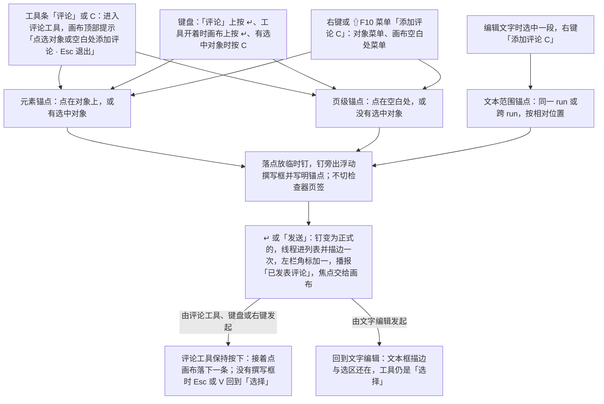
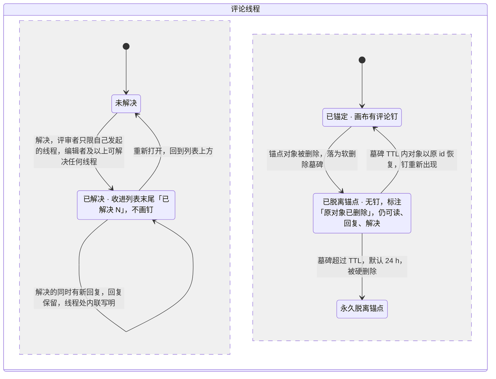

> 状态：草稿 | 负责：设计 | 更新：2026-09-18；2026-09-24（rulings §4.15 Q3：软删除下锚点随原 id 恢复）；2026-09-25（补图）；2026-10-15（design-language-v3 第 2 批：按已拍板样张 `comments` 整篇改写——§1 线框按 v3 外壳重画（检查器「评论」页签：分段筛选与排序、线程、回复串、「已解决 N」折叠行；画布评论钉、悬停卡与落点旁的浮动撰写框；手机评论面板）；§2 入口：工具条「评论」（C）是新评论唯一的常驻入口，点对象落元素锚点、点空白处或按 ↵ 落页级锚点，右键 / ⇧F10「添加评论 C」是不常驻的第二入口，原面板底部撰写框作废（DS-45）；评论工具发表后保持按下，编辑文字时对选中文字发起评论是例外（DS-44）；§3 列 31 个样张状态与 6 个未采纳的备选（DS-63）；§4 筛选用分段控件、缺省「当前页」，钉与列表都不编号，选中铺强调色淡底，作者名与 @提及中等字重 500、链接加下划线，导入批注每条标「来自原文件」并各带「导入为可编辑评论」（DS-43）；§5 编辑模式照常显示评论钉（DS-43），钉用发起人的身份色（DS-42）；§6 桌面 ↵ 发送、⇧↵ 换行，已解决先重新打开才能回复（DS-44），整条讨论串只有文档所有者能删、模态确认「删除此讨论串？将同时删除 N 条回复，删除后无法恢复。」（DS-40）；§9 手机可发表与回复、平板只读评审（DS-46），加载只画「转圈 + 一句文字」、不设面板级加载失败（DS-53），第 1 批评审、评审者、查看者与紧凑抽屉画面的评论页签换成本文的面板（DS-62）；依据 rulings §4.25 DS-40、DS-42…DS-46、DS-53、DS-62、DS-63）；2026-10-15（design-language-v3 第 2 批回写续：§6.1 新增「换页」——写了内容的浮动撰写框随旧页收起，草稿按页留在内存，回到那一页时临时钉与撰写框原样恢复，关闭文档即丢弃，样张原「换页即丢弃」作废（rulings §4.25 DS-65），§2.3、§7.2、§10 同步；§2.2「键盘 ↵」行与 §7.1 键位表写明 ↵ 只在评论工具开着或焦点在工具条「评论」上时落钉，没开工具时选中对象上的 ↵ 仍是进入文字编辑（TB-62）；§5.1、§9.1 钉的右键菜单由 slide-ui `CommentPins` 直接渲染、不开放插件贡献，查看者在钉上右键不拦截浏览器菜单（TB-61）；§11 手机评论面板补只读时的最高 min(58dvh, 520)，与 §9.5、03-02 §5a.2 一致（DS-46）；同日再补：§6.1「换页」扩为「换页、进网格视图与切到评审模式」——三种情形同样处理（rulings §4.25 TB-84），列出换页的入口，恢复的撰写框不抢焦点、从临时钉或撰写框进入，评论工具是否按下不因恢复而改变，收起时焦点在框里先交给画布（TB-79），措辞与 02 F7、05 §10 对齐；§2.3、§7.1、§7.2、§8、§9.2、§10 同步；§3 示例口径按 TB-81 改写——评论场景第 4 页 2 条未解决、1 条已解决，第 1 批画面维持 3 条都未解决、没有「已解决 N」一行，规格写规则（标题与缩略图角标取未解决数，评审条取可跳转的未解决条数，有已解决的才出「已解决 N」），§4.3、§9.5 同步；§3、§5.1 补样张范围：其余状态切到「评论」页签时也是本文的面板（TB-82），其余第 1 批编辑态翻到第 4 页时的钉随第 3 批（TB-83））；2026-10-15（design-language-v3 第 2 批回写收口：§6.1「换页、进网格视图与切到评审模式」补四点——切到评审或从评审返回编辑后仍停在同一页的单页画布时，撰写框当场原样恢复，草稿按页存、不按模式存（rulings §4.25 TB-87）；恢复的撰写框还在时用户又明确发起新评论（「评论」上按 ↵、有选中对象时按 C、右键「添加评论」、开着评论工具点画布别处）不另开撰写框，焦点直接进这个撰写框、光标在末尾，临时钉脉冲一次（TB-88）；草稿保留期间锚点不在了——对象已删恢复为同一页的页级锚点（框顶「评论 · 整页」）、文本范围解析不到退为元素锚点、整页已删草稿随页丢弃（TB-92）；文本范围撰写框同样按页留草稿，恢复时文字编辑不随之恢复，发送或取消后回到画布「选择」（与前端 50/08 §5.4 一致）；§2.3、§7.1、§7.2、§9.2、§10 同步；§9.5 底部翻页条「评论」的数字取本页未解决的条数、没有未解决的不带数字，读屏名改为「评论（本页 M 条未解决）」/「评论（本页没有未解决的评论）」（TB-89）；同日再补：§6.1「又发起新评论」补评论工具照各入口原有的规则按下、TB-88 只改撰写框与焦点的去向，编辑文字时对选中文字发起评论的例外照旧（rulings §4.25 TB-97），「工具」一条同步；「锚点不在了」补整页被删、草稿已丢弃后撤销删页，草稿不回来（TB-99））；2026-10-22（design-language-v3 第 3 批：只改与第 3 批裁决有关的段落——§1.4、§3、§9.6、§11 平板（触控、≥ 640）只读评论面板按方向落位：竖屏与当前页上下排开、有空间时保留只读备注卡，横屏改右侧整高侧栏 360，两种落位都去掉浮层阴影与把手，第 2 批 `comments.tablet` 随之改（DS-131，原「画布下方居中、宽 560 的浮层」与「落位随第 3 批窄屏复核」作废），平板状态行「仅查看 · 在电脑上编辑」（TB-125）；§1.4、§9.5 嵌入（iframe）里手机评论面板撰写区上方那一句改为「当前区域太窄，暂不能解决评论」，apps/web 不变（DS-112）；§3 后与 §5.1 第 1 批其余画面的评论钉：编辑起步的状态由底座缺省画（TB-83），评审、只读浏览起步的状态由场景自己画、停在有评论的页时必须画（TB-126，原「随第 3 批集成补」结案）；依据 rulings §4.25 DS-112、DS-131、TB-125、TB-126）；2026-10-22（design-language-v3 第 3 批回写续：§9.6 平板竖屏保留的只读备注卡注明同 03-02 §5a.2，这一页没有备注时写「这一页没有演讲者备注」（rulings §4.25 DS-138）；同日再补：§9.6 补嵌入（iframe）里平板的底部一句与状态行都不改写，触控的原因优先、嵌入只改写「在更大窗口中…」那一类说法（rulings §4.25 TB-159）；2026-10-22 复核修正：正文逐节核对，与 DS-112、DS-131、DS-138、TB-125、TB-126、TB-159、TB-163（「触控设备」只指平板，§9.6 已按平板写）一致，未改；状态头的回写轮次字样改为「回写续 / 同日再补」）；2026-10-23（design-language-v3 第 3 批评审修改：删除讨论串的确认框圆角随 rulings §4.25 DS-142 改为 12——§3 `comments.delete-thread` 一行与 §11「删除确认」一行同步）；2026-11-04（design-language-v3 母版视图改版：§9.2 母版视图一条改为工具条没有「评论」、「占位符 ▾」排在「选择」之后；rulings §4.25 DS-152；需求编号、优先级与里程碑不变） | 依赖：charter v0.2；PRD CO-04、NF-07；rulings §4.15 Q3、§4.25 DS-23、DS-28、DS-40、DS-42…DS-46、DS-53、DS-62、DS-63、DS-65、DS-112、DS-131、DS-138、DS-152、TB-49、TB-61、TB-62、TB-79、TB-81…TB-84、TB-87…TB-89、TB-92、TB-97、TB-99、TB-125、TB-126、TB-159；前端 50/08；playground `#/v3/editor?state=comments.*`（`src/v3/scenarios/comments/`）、`#/v3/editor?state=narrow-review.tablet-comments*`（`src/v3/scenarios/narrow-review/tablet.tsx`）

# 03-06 评论面板

> **设计基准（2026-10-15 起，rulings §4.25 DS-43…DS-46、DS-53、DS-62）**：以已拍板的 playground 第 2 批样张 `comments` 为准——路由 `#/v3/editor?state=comments.<状态 id>`（暗 / 亮另加 `&theme=dark|light`），31 个状态加 6 个未采纳的备选（§3）。源码在 `playground/src/v3/scenarios/comments/`：`comments.scenario.tsx`（各状态的标题与说明）、`Panel.tsx`（评论页签：筛选行、列表、空态与加载）、`Thread.tsx`（线程、回复串、「已解决 N」、线程菜单与导入批注）、`Composer.tsx`（撰写框与 @ 候选）、`RichText.tsx`（正文：提及、链接、折叠）、`canvas.tsx`（评论钉、悬停卡、聚合钉、评论工具与浮动撰写框、键盘新建、钉的右键菜单）、`chrome.tsx`（左栏角标、评审条与浏览条、轻提示、删除确认）、`phone.tsx`（仅查看形态的评论面板）、`model.ts` 与 `store.ts`（示例线程、筛选、权限与场景状态）；「已解决 N」用共用的列表折叠行 `kit/controls.tsx` 的 `FoldRow`。对照截图 `openspec/changes/design-language-v3/screens/batch2/comments-<状态>-dark.jpg` / `-light.jpg`。第 3 批（2026-10-22 拍板，rulings §4.25 DS-131）平板评论面板的按方向落位在场景 `narrow-review`（`#/v3/editor?state=narrow-review.tablet-comments`、`tablet-comments-landscape`，源码 `playground/src/v3/scenarios/narrow-review/tablet.tsx`，截图 `screens/batch3/narrow-review-<状态>-*.jpg`）。外壳、浮层、控件与轻提示的通用规格见 [03-02](02-editor-main.md) 与设计 [04](../04-design-system.md)；数据、命令与权限以前端 [50/08](../../50-frontend/08-comments-and-version-history.md) 为准。此前的线框（「属性 / 评论 / 历史 / 插件」四页签、编号图钉、面板底部撰写框）与 shadcn / 材质层时期的写法（`--cordex-*` 变量、Phosphor 图标、`i-*` 与 `btn-*` 类名、旧路由 `#/editor/comments`）一并作废。

评论在检查器的「评论」页签里看与回复，在画布上用评论钉标出位置，新评论从评论工具在画布上发起。覆盖 PRD CO-04 的视图与线程操作、缺口 **G-50**（撰写框、@ 候选、锚点创建的路径、重新打开 / 编辑 / 删除、缩略图角标、深链定位）与手机评论（PRD NF-07，rulings §4.25 DS-28、DS-46）。评论随评论包出现（`when: slide.hasComments`；M3 只装在 `preset-slide-collab`，50/08 §2）：未装时没有「评论」页签、评论工具、评论钉与角标（§9.2）。

---

## 1. 线框

### 1.1 在编辑器中的位置（桌面 1600 × 1000，第 4 页，「评论」页签停在「当前页」）

```
←──────── 240 ─────────→←────────────── 画布 flex ──────────────→←──────────── 280 ────────────→
┌──────────────────────┬────────────────────────────────────────┬──────────────────────────────┐
│ [Logo▾]  [单页][网格]│                                        │ (周)(王)(李)       ▶ [分享]  │
│ 2026 年 Q2 业绩汇报 ▾│  ┌──────────────────────────────────┐  ├──────────────────────────────┤
│ ✓ 已同步             │  │ 营收趋势                         │  │  设计  [评论]         77% ▾  │
│ [新建幻灯片  ▾] [+]  │  │ 6 月营收 4,800 万元，创年内新高；│  ├──────────────────────────────┤
│ 1 ┌──────── [评1]┐   │  │ Q2 累计 1.28 亿元(李)，同比 +18% │  │ [全部|当前页|未解决|@我]  ⇅  │
│   └──────────────┘   │  │                              (王)│  ├──────────────────────────────┤
│ 2 ┌──────────────┐   │  │  ▁▁ ▁▁ ▃▃ ▅▅ ▆▆ ██               │  │ 图表 1                       │
│   └──────────────┘   │  │  1 月 … 6 月                     │  │ (王) 王小明  2 小时前        │
│ 3 ┌──────── [评1]┐   │  └──────────────────────────────────┘  │ 6 月的数据是否包含海外业务？ │
│   └──────────────┘   │                  ════                  │ 建议在图注里写清口径。       │
│▌4 ┏━━━━━━━━ [评2]┓   │  ┌──────────────────────────────────┐  │ 2 条回复                     │
│▌  ┗━━━━━━━━━━━━━━┛   │  │ 演讲者备注                       │  ├──────────────────────────────┤
│ 5 ┌──────────────┐   │  └──────────────────────────────────┘  │ 「1.28 亿元」                │
│   └──────────────┘   │                                        │ (李) 李雷  昨天              │
│ 6 ┌──────────────┐   │   ╭────────────────────────────────╮   │ Q2 累计与财务报表对了一遍，  │
│   └──────────────┘   │   │ [选择][文本] … [评论][+]       │   │ 数字一致。                   │
│                      │   ╰────────────────────────────────╯   ├──────────────────────────────┤
│                      │                                        │ › 已解决 1                   │
└──────────────────────┴────────────────────────────────────────┴──────────────────────────────┘
```

图例：画布上的 `(王)` `(李)` 是评论钉（未解决的线程各一枚，发起人的身份色，左下尖角指向锚点；第 4 页另有 1 条已解决的，不画钉）；协作行的 `(周)(王)(李)` 是头像组；`[评2]` 缩略图右上角的评论角标（这一页的未解决数）；`⇅` 排序；`›` 折叠行箭头。面板里没有常驻撰写框，新评论从工具条「评论」在画布上点选（§2.2）。截图：`screens/batch2/comments-default-*.jpg`，样张 `comments.default`。

### 1.2 评论页签的结构

```
┌──────────────────────────────────────────┐
│ [全部|当前页|未解决|@我]            ⇅    │  ← 筛选行：分段控件 + 排序（吸顶）
│ [已脱离锚点 3]                           │  ← 临时筛选：有已脱离锚点的线程时才有
├──────────────────────────────────────────┤
│ ╭──────────────────────────────────────╮ │  ← 选中的线程：主体铺强调色淡底
│ │ 图表 1                        ✓   ⋯  │ │     （左右内缩 8、圆角 6）
│ │ (王) 王小明  2 小时前                │ │
│ │ 6 月的数据是否包含海外业务？建议在图 │ │
│ │ 注里写清口径。                       │ │
│ ╰──────────────────────────────────────╯ │
│   ┊ (李) 李雷  1 小时前                  │  ← 回复串：左侧细线连成一串，
│   ┊ 包含，海外占 6%。图注我来补一句。    │     在淡底之外
│   ┊ (周) 周明远  40 分钟前               │
│   ┊ @李雷 补完后我再核一遍数字。         │
│   ┊ [回复…                            ]  │  ← 回复框：聚焦后展开为两行 + 底部一行
├──────────────────────────────────────────┤
│  「1.28 亿元」                           │  ← 未选中：锚点说明 · 作者行 · 正文
│  (李) 李雷  昨天                         │     （折叠 3 行）·「N 条回复」；
│  Q2 累计与财务报表对了一遍，数字一致。   │     悬停或聚焦时才出「解决」「⋯」
├──────────────────────────────────────────┤
│  › 已解决 1                              │  ← 折叠行：点开逐条列出已解决的摘要
└──────────────────────────────────────────┘
```

页签内容自上而下：筛选行（§4.1）→ 线程列表（未解决在前，已解决收在末尾「已解决 N」，§4.2–§4.3）。「已脱离锚点 N」只在有这类线程时出现在筛选行第二行（图中借 `comments.detached` 的计数）。`✓` 是「解决」、`⋯` 是线程菜单，都是 24 的图标按钮；`┊` 是回复串左侧的细线。样张 `comments.locate`（选中的线程）、`comments.detached`（临时筛选）。

### 1.3 画布上的评论：浮动撰写框与悬停卡

```
(周)  ╭────────────────────────────────────╮      ╭──────────────────────────────╮
      │ 评论 · 图表 1                      │      │ (王) 王小明  2 小时前        │ (王)
      │ ┌────────────────────────────────┐ │      │ 6 月的数据是否包含海外业务？ │
      │ │ 5 月环比只涨了 4 个点，要不要在│ │      │ 建议在图注里写清口径。       │
      │ │ 说明文字里写原因？             │ │      │ 2 条回复 · 点按查看          │
      │ │                                │ │      ╰──────────────────────────────╯
      │ └────────────────────────────────┘ │
      │ [@]                  [取消] [发送] │
      ╰────────────────────────────────────╯
```

左：评论工具在第 4 页图表上点下去——落点放临时钉（自己的钉 `(周)`，外加强调色圈），钉旁出浮动撰写框，首行写明锚点，图表画 1px 强调色虚线框（不画手柄）；检查器停在「设计」、不切页签（§6.1，样张 `comments.compose`）。右：悬停或键盘聚焦钉时的预览卡；靠右的钉卡片放在左侧（§5.2，样张 `comments.pin-hover`）。

### 1.4 紧凑、手机与平板

```
┌────────────────────────────────────────┐
│ [‹]  2026 年 Q2 业绩汇报          [⋯]  │
│      仅查看 · 在更大窗口中编辑         │
├────────────────────────────────────────┤
│ ┌────────────────────────────────────┐ │
│ │ 营收趋势            (李)           │ │
│ │                          (王)      │ │
│ └────────────────────────────────────┘ │
│ ╭────────────────────────────────────╮ │
│ │                ──                  │ │
│ │ 评论  第 4 页 · 2 条未解决     [×] │ │  ← 标题：本页未解决数
│ ├────────────────────────────────────┤ │
│ │ (王) 王小明  2 小时前              │ │
│ │      6 月的数据是否包含海外业务？  │ │
│ │      建议在图注里写清口径。        │ │
│ │      2 条回复    回复              │ │  ← 触控文字按钮（点按区 44）
│ ├────────────────────────────────────┤ │
│ │ (李) 李雷  昨天                    │ │
│ │      Q2 累计与财务报表对了一遍，   │ │
│ │      数字一致。                    │ │
│ │      回复                          │ │
│ ├────────────────────────────────────┤ │
│ │ › 已解决 1                         │ │  ← 折叠行的触控形态（高 44）
│ ├────────────────────────────────────┤ │
│ │ ⓘ 解决评论请在更大窗口中进行       │ │  ← 撰写区（有评论权限时）
│ │ [评论第 4 页…            ] [发送]  │ │     文本框 44 高；↵ 换行，只用「发送」
│ ╰────────────────────────────────────╯ │
└────────────────────────────────────────┘
```

- **手机（< 640，仅查看形态）**：上图，底部面板可发表与回复，解决在更大窗口中进行（DS-46，§9.5，样张 `comments.phone`，390 × 844）；嵌入（iframe）里撰写区上方那一句改为「当前区域太窄，暂不能解决评论」（rulings §4.25 DS-112）。
- **平板（触控、≥ 640）**：同一面板，只读评审——没有撰写区与「回复」，底部一行「ⓘ 平板上只能查看评论」；按方向落位：竖屏与当前页上下排开（当前页与只读备注卡在上，面板贴底补满），横屏是右侧整高侧栏 360（§9.6，rulings §4.25 DS-131，样张 `narrow-review.tablet-comments`、`tablet-comments-landscape`）。
- **紧凑窗口（640–1024）**：检查器抽屉的「评论」页签与桌面完全相同（§9.4，样张 `comments.compact`，800 × 1000）。

---

## 2. 入口

### 2.1 查看评论

- **检查器「评论」页签**（`ui.panel{slot:'inspector'}`，slide-ui 贡献，50/08 §2）：点页签打开；评审模式打开文档时缺省停在这一页签（rulings §4.25 DS-23）。
- **点画布上的评论钉**：检查器自动切到「评论」并定位这条线程（§5.1）。这是唯一允许 UI 自动切换检查器页签的场景（01 §2.3），深链 `?comment={threadId}` 同此（§6.7）。
- **评审条 / 浏览条的「上一处 / 下一处评论」**：在未解决、已锚定的线程间按页码与落点（自上而下、自左向右）跳转，定位方式同点钉；两枚箭头之间的计数「N 条评论」是可跳转的条数，没有时两枚箭头不可用并写「没有未解决的评论」（03-02 §6.2）。
- 左栏缩略图与网格的评论角标只标出哪一页有未解决的评论（§5.4），点缩略图照常是换页。

### 2.2 新建评论：锚点创建的路径（原「锚点创建三种路径」，DS-45 改写）

新评论的**常驻入口只有底部工具条「评论」（C）**（评审条上是同一个工具）：在画布上点对象落元素锚点，点空白处落页级锚点。面板里不常驻撰写框（rulings §4.25 DS-45：质量门 Q2「常驻入口唯一」，同 Figma 评论都钉在位置上；原「无选中时在面板底部撰写框发起页级评论」作废）。右键与 ⇧F10 / 菜单键打开的菜单里的「添加评论 C」是不常驻的第二入口（03-05 §3），主菜单「插入 › 评论 C」进入同一个评论工具（03-04）。

| 路径 | 怎么触发 | 锚点 | 撰写时的工具 |
|---|---|---|---|
| 评论工具 · 点对象 | 工具条「评论」或单键 C，再点画布上的对象（悬停的对象出强调色细框） | 元素锚点，钉落在点下去的位置 | 评论 |
| 评论工具 · 点空白处 | 同上，点幻灯片空白处 | 页级锚点，钉落在点下去的位置 | 评论 |
| 键盘 ↵ | 焦点在工具条「评论」上按 ↵；或评论工具开着、焦点在画布上按 ↵（只有这两种情形；没开评论工具时，选中对象上的 ↵ 仍是进入文字编辑，rulings §4.25 TB-62） | 有选中对象时为元素锚点（钉落在对象右上角），否则为页级锚点（钉落在默认落点，§6.1） | 评论 |
| 键盘 C | 有选中对象时按 C（没有选中对象时只进入评论工具） | 元素锚点，钉落在对象右上角 | 评论 |
| 右键 / ⇧F10「添加评论 C」 | 对象菜单；画布空白处菜单（03-05 §3，DS-44） | 对象菜单为元素锚点（钉落在对象右上角）；空白处菜单为页级锚点（默认落点） | 评论（与按 C 相同） |
| 编辑文字时右键「添加评论 C」 | 文本编辑态选中一段文字，右键或 ⇧F10 / 菜单键 | 文本范围锚点（同一 run 或跨 run，按相对位置），钉落在选区末尾 | 仍是「选择」（例外，§2.3） |
| 手机评论面板的撰写区 | 仅查看形态（< 640）底部面板「发送」（§9.5） | 页级锚点 | — |

**图 2-1 锚点创建的路径**



怎么读：四条入口各自产生一种锚点，之后共用「临时钉 + 浮动撰写框 → 发表」这一段；发表之后分两路——评论工具保持按下，只有编辑文字时发起的评论回到文字编辑。钉与列表都不编号（DS-43），原「临时图钉编号沿用当前页最大编号 + 1、提交后刷新为正式序号」作废。
依据：rulings §4.25 DS-43、DS-44、DS-45；样张 `comments.tool`、`comments.compose`、`comments.compose-text`、`comments.mention`。

### 2.3 评论工具：按下与回落（DS-44）

- **按下时**：画布顶部居中一条提示「（评论图标）**评论** 点选对象或空白处添加评论 ┊ Esc 退出」（与插入工具态同一外观，03-04）；指针是评论光标（深色气泡 + 白色加号，尖角即落点）；悬停的对象出强调色细框，点下去就是这个对象的元素锚点。检查器页签不变（01 §2.3「点评论钉是唯一的自动切换」不变）。
- **发表或取消后评论工具保持按下**，可以接着点画布落下一条（同 Figma 评论模式；评审时常连续落多条）——这是图片、表格、图表等插入工具「用后回到选择」（03-04 §3「按下与回落」）的例外。没有撰写框时按 **Esc** 或 **V** 回到「选择」；Esc 逐层：先关 @ 候选，再关撰写框（写了内容时不关，§6.1），最后才退出工具。
- **撰写框空着时点画布别处**：同一个撰写框跟着临时钉移到新落点、焦点放回文本框；写了内容时点别处不动（不丢稿）。写了内容时换页、进网格视图或切到评审模式，草稿按页留在内存，回到单页的那一页时原样恢复，不抢焦点，也不改变评论工具是否按下（§6.1「换页、进网格视图与切到评审模式」，rulings §4.25 DS-65、TB-79、TB-84）。
- **网格视图**：进网格视图时工具回到「选择」（03-02 §2.2），写了内容的撰写框随单页收起、草稿按页留着（§6.1）。在工具条「评论」上点按或按 ↵，先带着评论工具回到单页（创建工具在网格里点了都是先回单页，03-02 §5.3），按 ↵ 时接着放页级临时钉、打开撰写框——一次 ↵ 就到；回到的那一页留着草稿时不另放，焦点直接进恢复的撰写框（§6.1，rulings §4.25 TB-88）。
- **例外：编辑文字时对选中的文字发起评论**：撰写时工具仍是「选择」（不进入评论工具），发表或取消（含 Esc）后回到文字编辑——文本框的 1px 强调色描边与选区还在、检查器仍是「文本」，点空白处才退出编辑（样张 `comments.compose-text`）。写了内容时换页、进网格视图或切换模式，文字编辑随之结束；回来恢复的这个撰写框发表或取消后回到画布「选择」，不回到文字编辑（§6.1）。

---

## 3. 状态

样张路由均为 `#/v3/editor?state=comments.<状态 id>`；未写视口的按 1600 × 1000，截图约定见 playground `src/v3/scenarios/README.md`。评论场景的示例文档第 4 页有 3 条评论（2 条未解决、1 条已解决），人与落点同第 1 批 `main-states`、`narrow`；第 1 批画面里第 4 页的 3 条维持都未解决、不加已解决的（张三那条没有解决，也没有后补的回复），与那里的 3 枚评论钉、缩略图角标「3」、评审条「3 条评论」一致，所以那些画面没有「已解决 N」一行（rulings §4.25 TB-81）。本文里的条数都是样张示例；规格按规则写：标题与缩略图角标取这一页未解决的条数，评审条取可跳转的（未解决、已锚定）条数（§2.1），有已解决的才出「已解决 N」。

| 状态（样张标题） | 要点 | 样张 id | 里程碑 |
|---|---|---|---|
| 评论页签 · 当前页 | 缺省筛选「当前页」，只有一组、不画组头；未解决在前，已解决收成末尾一行「已解决 1」；面板没有常驻撰写框；画布上未解决的线程各一枚钉，左栏角标 = 未解决数 | `comments.default` | M3（PRD CO-04） |
| 点评论钉 · 定位线程 | 检查器自动切到「评论」，线程滚入视口、主体铺强调色淡底并描边淡出一次，展开回复与回复框；钉加强调色外圈、脉冲一次，锚点对象画 1px 强调色虚线框 | `comments.locate` | M3 |
| 筛选 · 全部 | 不分页、不分状态，按时间平铺，锚点说明前写页码；筛选行第二行出现临时筛选「已脱离锚点 1」；一条「锚点无法解析」；两条已解决收在「已解决 2」 | `comments.all` | M3 |
| 筛选 · 未解决 · 排序 | 跨全文档筛出待处理的线程；排序菜单（最新 / 最旧 / 按页码）停在「按页码」：按页分组，组头「第 N 页 · 页名」+ 未解决条数 | `comments.unresolved` | M3 |
| 筛选 · @我 | 提及自己的线程（本地计算）；选中后画布切到第 3 页、钉加外圈，文本范围锚点铺强调色淡底 | `comments.mentions` | M3 |
| 已脱离锚点 | 一次删掉 3 个带评论的对象：临时筛选「已脱离锚点 3」按下、四项分段都不选；锚点说明换成「原对象已删除」，没有钉；「⋯」里「重新锚定…」P1、不可用 | `comments.detached` | M3（重新锚定 P1） |
| 已解决 · 展开与角标 | 「已解决 N」点开逐条摘要，再点展开完整对话（顶部「周明远 已解决 · 1 天前」，「解决」换成「重新打开」，没有回复框）；选中时画布临时显示它的钉；左栏角标工具提示「2 条未解决 · 另有 1 条已解决」 | `comments.resolved` | M3 |
| 解决时有新回复（场景 J） | 回复保留、线程仍是已解决；只在这条线程处内联写「解决之后又有 1 条新回复」，收起时摘要右侧「有新回复」；不出全局轻提示与横幅（05 §5） | `comments.resolved-reply` | M3 |
| 长评论 · 链接与提及 | 长正文折叠 3 行 +「展开」；提及中等字重 500、链接加下划线，都不用强调色；「已编辑」的工具提示写编辑时间 | `comments.rich-text` | M3 |
| 空态 | 「第 2 页还没有评论」+「用工具条的「评论」（C）点选对象或空白处添加评论」；不用插画 | `comments.empty` | M3 |
| 加载中（评审者打开文档） | 检查器缺省停在「评论」：居中一行转圈 +「正在加载评论…」，筛选与排序随整栏不可用；不画骨架行；评审条整条不可用 | `comments.loading` | M3 |
| 编辑中 · 悬停评论钉 | 编辑模式照常显示评论钉；悬停或键盘聚焦钉时出预览卡，不可交互、不抢焦点；检查器停在「设计」 | `comments.pin-hover` | M3 |
| 右键评论钉 | 解决 · 复制链接 ┊ 删除讨论串…（只有文档所有者）；菜单贴在钉右侧展开、不盖住钉；右键不切页签 | `comments.pin-menu` | M3 |
| 评论钉过密 · 聚合钉 | 落点几乎重合的钉合并为中性深色的聚合钉「3」；点开列表，点一条即定位，那一组按小幅偏移展开 | `comments.cluster` | M3 |
| 评论工具 · 点选位置 | 工具条「评论」按下：顶部提示条「点选对象或空白处添加评论 · Esc 退出」；悬停的对象出强调色细框；评论光标 | `comments.tool` | M3 |
| 评论工具 · 浮动撰写框 | 落点放临时钉，钉旁浮动撰写框「评论 · 图表 1」；不切检查器页签；发表后评论工具保持按下；写了内容时换页（或进网格视图）草稿按页留着，回到这一页原样恢复、不抢焦点、不改评论工具（§6.1） | `comments.compose` | M3 |
| 右键「添加评论」· 文本范围 | 编辑文字时选中一段、右键「添加评论 C」：临时钉落在选区末尾，撰写框贴在选区下方、写明引文「评论 · 「4,800 万元」」；工具仍是「选择」，发表或取消后回到文字编辑 | `comments.compose-text` | M3 |
| 撰写框 · @提及候选 | 评论工具点在空白处（页级），撰写框里输入 @ 或点「@」弹出候选：只列人，在场的排在最前，不标角色 | `comments.mention` | M3 |
| 编辑自己的评论 | 「⋯ › 编辑」：正文原位换成编辑框（取消 / 保存）；保存后标「已编辑」 | `comments.edit-own` | M3 |
| 删除自己的回复 · 可撤销 | 乐观隐藏，轻提示「已删除你的回复」+「撤销」，5 秒内可撤销 | `comments.delete-reply` | M3 |
| 删除讨论串 · 确认 | 文档所有者删整条讨论串：模态确认「删除此讨论串？」「将同时删除 2 条回复，删除后无法恢复。」，危险色主按钮、初始焦点在「取消」（DS-40）；确认框圆角 2026-10-23 起为 12（rulings §4.25 DS-142），画面随之改 | `comments.delete-thread` | M3 |
| 离线 · 待同步 | 照常发表、回复、解决；本端未同步的条目带「待同步」；@ 候选只来自本地在场缓存，底部「离线时无法搜索其他用户」 | `comments.offline` | M3 |
| 导入的只读批注 | 原文件批注只读：作者名取自原文件、中性头像与中性钉、每条标「来自原文件」，不能回复与解决；每条底部「导入为可编辑评论」 | `comments.imported` | M3（导入 P1） |
| 评审者 · 只能解决自己的 | 评审模式打开、检查器缺省「评论」；他人线程的「解决」留在原位、不可用，工具提示「解决 · 只能解决自己发起的评论」；评审条「上一处 / 下一处评论」可用 | `comments.commenter` | M3 |
| 查看者 · 只读 | 顶部「只读 · 你只有查看权限」，筛选照常、线程可展开阅读；没有回复框、解决与「⋯」，钉没有右键菜单；浏览条「上一处 / 下一处评论 ┊ 只读浏览中」 | `comments.viewer` | M3 |
| M2 · 未装评论包 | 工具条主行七项（没有「评论」）、没有「评论」页签、钉与角标，主菜单「插入」里没有「评论」 | `comments.m2-no-package` | M2 |
| 紧凑窗口 · 检查器抽屉 | 800 × 1000：检查器抽屉的「评论」页签与桌面相同，新评论同样走评论工具；点钉时抽屉收着先展开再定位 | `comments.compact` | M3 |
| 手机 · 发表评论 | 390 × 844：底部面板列出本页评论 + 常驻撰写区（44 高文本框 +「发送」），上方「解决评论请在更大窗口中进行」 | `comments.phone` | M3 P1（PRD NF-07） |
| 手机 · 回复 | 点某条的「回复」：那一条展开全部回复并铺选中底色，撰写区上方「回复 王小明 ×」 | `comments.phone-reply` | M3 P1 |
| 手机 · 查看者只读 | 没有撰写区与「回复」，底部「你只有查看权限，只能查看评论」 | `comments.phone-viewer` | M3 P1 |
| 平板 · 只读评审 | 820 × 1180（触控）：没有撰写区与「回复」，底部「平板上只能查看评论」；第 3 批按方向落位后，竖屏与当前页上下排开（DS-131，§9.6；横屏的右侧侧栏见 `narrow-review.tablet-comments-landscape`），状态行「仅查看 · 在电脑上编辑」（TB-125） | `comments.tablet` | M3 P1（PRD NF-07，TB-49） |

第 1 批随之改变的画面（DS-43、DS-46、DS-62，样张随之改画）：评审模式 `main-states.review`、评审者 `main-states.commenter`、查看者 `main-states.viewer` 与紧凑抽屉 `narrow.compact-comments` 的评论页签换成本文的面板（分段筛选、未解决在前、已解决收起、可展开回复），原「第 4 页 · 3 条评论」平铺列表作废——这几个画面第 4 页的 3 条都未解决，没有「已解决 N」一行（TB-81）；其余状态点钉或手动切到「评论」页签时也是本文的面板，初始画面不变（rulings §4.25 TB-82）；仅查看形态 `narrow.narrow-comments` 换成手机评论面板的画法（§9.5）；编辑模式停在第 4 页的 12 个画面补画评论钉（§5.1），其余第 1 批编辑起步的状态翻到第 4 页时由底座缺省画钉（TB-83）；评审、只读浏览起步的状态由场景自己画，停在有评论的页时必须画（rulings §4.25 TB-126）。

### 3.1 未采纳的备选（DS-63）

拍板时画给用户对照的备选留在样张里，标题前加「未采纳 · 」、说明写明由哪一条 DS 定为推荐；路由不变，实现以上表的推荐状态为准（rulings §4.25 DS-63）。

| 备选 | 样张 id | 内容 | 结论 |
|---|---|---|---|
| 筛选收进一个下拉 | `comments.alt-filter-menu` | Figma 的做法：「显示」（全部 / 当前页 / 未解决 / @我 / 已脱离锚点 N）与「排序」两组收进一个下拉，筛选行只剩当前筛选与条数 | 未采纳，DS-43 定为分段控件 |
| 分段控件、缺省停在「全部」 | （借 `comments.all` 的画面） | 打开评论时列出全部页、每条写所在页，同 Figma 缺省 | 未采纳，DS-43 定为缺省「当前页」 |
| 导入批注只在列表顶部提示一次 | （没有出图） | 顶部一行「N 条批注来自原文件」+「全部导入为可编辑评论」，每条只留标签 | 未采纳，DS-43 定为每条标「来自原文件」并各带按钮 |
| 撰写框在检查器 | `comments.alt-compose-panel` | 点选后检查器自动切到「评论」，撰写框在列表顶部，画布只留临时钉 | 未采纳，DS-44 定为落点旁浮动撰写框 |
| 评论工具按下时切到「评论」页签 | `comments.alt-tool-tab` | 同 Figma 评论模式，工具回到「选择」时恢复原页签；需改 01 §2.3 | 未采纳，DS-44 定为不切页签 |
| 面板底部常驻撰写框（评论工具只认对象） | `comments.alt-panel-composer` | 本文原写法：页级评论在面板底部撰写，点空白处不落钉，面板底部常年占 52 | 未采纳，DS-45 定为面板不常驻撰写框 |
| 评论页签加载失败 | `comments.alt-load-failed` | 整块换成居中的「评论加载失败 · 重试」，筛选随之不可用 | 未采纳，DS-53 定为不设面板级加载失败（§9.2） |
| 平板也能发表 | `comments.alt-tablet-compose` | 平板与手机一致，可发表与回复；需改 PRD NF-07 | 未采纳，DS-46 定为平板只读评审 |

---

## 4. 评论页签：筛选、列表与线程

### 4.1 筛选与排序（DS-43）

- **筛选行**常驻页签顶部，滚动时吸顶（`--v3-panel` 底、下 1px 分隔，左右 16、上下 8）：分段控件「全部 / 当前页 / 未解决 / @我」（安静样式，rulings §4.25 DS-35；28 高，占满剩余宽度；每一段的工具提示与读屏名为「全部评论 / 当前页的评论 / 未解决的评论 / 提及我的评论」）+ 右侧「排序」28 图标按钮（菜单触发器，不带工具提示，读屏名「排序：最新」）。
- **缺省「当前页」**：列表与画布上的评论钉一一对应（看到的钉就是列表里的线程），换筛选只要一次点击；换页时列表随之换。
- **口径**（PRD CO-04）：「全部」不分页、不分状态，按时间平铺，锚点说明前写页码；「当前页」只列正在看的页；「未解决」跨全文档筛出待处理的线程；「@我」是回复的 `mentions` 含当前用户的线程（本地内存计算，50/08 §5），是巡查待办的主要入口。
- **临时筛选「已脱离锚点 N」**：有 ≥ 1 条已脱离锚点的线程时出现在筛选行第二行（断链图标 + 文字 + 11px 数字，高 28、圆角 4，工具提示「原对象已删除的评论」），不占固定筛选位；与四项互斥，按下时四项都不选，再点回到「全部」；这些线程都处理掉（恢复或删除）后它随之消失、筛选回到「全部」。
- **排序**：「最新 / 最旧 / 按页码」单选菜单（右对齐展开，小标题「排序」，选了即收起），按最近活动排。「按页码」时按页分组：组头「第 N 页 · 页名」（12px 600 主文字色）+ 未解决条数（紧跟标题，12px 次级文字色，0 不写；第一组以外上方 1px 分隔）。「当前页」只有一组，不画组头。每一组里未解决在前，已解决收在组末「已解决 N」（§4.3）。

### 4.2 线程

- **收起（缺省）**：锚点说明（12px 次级文字色——元素名「图表 1」、文本范围的引文「「1.28 亿元」」、页级「整页」；跨页列表前加「第 N 页 · 」）→ 作者行（20 头像 · 姓名 · 相对时间）→ 正文（折叠 3 行，§4.4）→「N 条回复」（12px 次级文字色）。线程之间 1px 分隔。右上角「解决」（✓）与「⋯」两个 24 图标按钮平时隐藏，悬停或键盘焦点在这一条里时出现。
- **钉与列表都不编号**（DS-43；原「① ②」编号作废）：线程与钉靠锚点说明、作者与位置对应。
- **选中**（点线程主体、点评论钉、评审条翻到、深链）：线程主体（锚点说明 · 作者行 · 正文）铺强调色淡底 `--v3-accent-soft`，左右内缩 8、圆角 6，与左栏当前页、版本历史选中行同一画法；定位时描边（1px 强调色）一次后淡出；展开全部回复与回复框，二者都在淡底之外的面板底上（回复串的连线与次按钮细边在两套主题里都看得清）；「解决」「⋯」常显。画布上对应的钉加强调色外圈，锚点对象画 1px 强调色虚线框（不画手柄，区别于选中对象），文本范围锚点铺强调色淡底，页级锚点不另标。再点一次线程主体即收起。点面板里另一页的线程会换到那一页、钉脉冲一次。
- **回复串**：回复左侧一条 1px `--v3-border` 细线连成一串（在作者头像中线上，读屏为嵌套列表），条间距 12；每条：20 头像 · 姓名 · 时间 ·（「已编辑」/「待同步」）· 悬停才出现的「⋯」，下一行正文。串尾是回复框（§6.3）。
- **线程菜单「⋯」**：编辑（自己的首条评论）· 复制链接 · 重新锚定…（P1，已脱离锚点时出现，不可用并写「后续版本提供」）┊ 删除评论（自己的）/ 删除讨论串…（文档所有者）。**回复菜单「⋯」**：编辑（自己的）┊ 删除回复（自己的，可撤销）/ 删除回复…（文档所有者删他人的，确认后不可撤销）。没有可用条目时不出「⋯」。删除见 §6.6。

### 4.3 已解决与「已解决 N」

- 已解决的线程收在列表（或页组）末尾的一行「› 已解决 N」（Figma 默认也把已解决的藏起来）；没有已解决的线程时不出这一行（rulings §4.25 TB-81：规格写规则，不按示例里的条数）。这一行是第 2 批统一的**列表折叠行**（设计 04 列表折叠行 `FoldRow`，与版本历史的月份行、自动版本组行、「最近删除」同一个件）：高 32；12px `ChevronRight`（描边 1.5）在文字前，展开时转 90°，减少动态效果时不转场；文字 12px 次级文字色，悬停铺 `--v3-panel-2`、文字转主色；箭头左缘距面板内缘 16、与列表正文对齐；整行是一个按钮，带 `aria-expanded`。
- **展开后逐条摘要**：✓ · 发起人 ·（跨页时「第 N 页 · 」）回复数（没有回复写「没有回复」）·（解决后有新回复时右侧「有新回复」），下一行正文最多两行（不逐条截成一行省略号）。点摘要展开完整对话：顶部一行「✓ 周明远 已解决 · 1 天前」，「解决」的位置换成「重新打开」（↺），没有回复框——要继续讨论先重新打开（DS-44）。
- 选中一条已解决的线程（深链、点钉、评审条）时「已解决 N」自动展开，画布临时显示它的钉。
- 已解决不计入左栏角标（§5.4）。解决与重新打开的操作见 §6.5。

### 4.4 作者名、正文、提及与链接

- **作者名**一律中等字重 500（线程、回复、悬停卡、聚合钉列表、手机面板同此；设计 04 §2.8 的 600 只给节标题），时间 12px 次级文字色；原 03-02 §4.4「姓名 12px 600」作废（DS-43、DS-62）。
- **正文**：纯文本 + 换行 + @提及 + 自动识别的链接，≤ 5,000 字（PRD CO-04），12px / 18px 主文字色；长正文默认折叠 3 行，下面「展开」，展开后同一位置是「收起」（12px 次级文字色）。附件与表情反应为 P2，不出入口。
- **@提及**：中等字重 500（与作者名同一档、仍比正文 400 重），不用强调色。**链接**：加下划线（下划线 `--v3-text-3`，悬停转主文字色），不用强调色。强调色只给主操作、当前工具、选中与按下的开关，不挪作链接色（质量门 Q3，DS-43）。
- **「已编辑」**：12px 次级文字色，可聚焦，工具提示「编辑于〈时间〉」。**「待同步」**：离线时本端尚未同步的条目，云朵划线图标 + 12px 次级文字色（§9.3）。

### 4.5 已脱离锚点与锚点无法解析

- **已脱离锚点**（锚点对象被删除，PRD CO-04 术语，取代早期的「孤立评论」）：锚点说明换成断链图标 +「原对象已删除」（可聚焦，工具提示「张三 昨天 18:20 删除了「文本框 4」。24 小时内恢复该对象后，评论会回到原处。」），没有画布钉，照常可读、回复与解决。删除是软删除（rulings §4.15 Q3，墓碑 TTL 默认 24 h）：TTL 内锚点对象以原 id 恢复（删除方撤销，或他人「恢复元素」）时线程自动回到原锚点、钉重新出现、标注消失；TTL 过后对象被硬删除，线程永久脱离锚点（重新锚定为 P1）。
- **锚点无法解析**（50/08 §5：单条线程的锚点解析出错）：锚点说明换成提示图标 +「锚点无法解析」（工具提示「找不到评论所在的位置，评论内容不受影响」），只影响这一条，内容照常可读，没有钉。

**图 4-1 评论线程的两条状态轴**



怎么读：外框内被虚线隔开的两个区域是同一线程上互相独立的两条状态轴（一条是解决状态，一条是锚定状态），二者可以任意组合；锚点能否回来只取决于被删对象是否在墓碑 TTL 内以原 id 恢复；已解决的线程即使已锚定也不画钉（选中时临时显示）。
依据：PRD CO-04；50/08 §6；rulings §4.15 Q3。

### 4.6 导入的批注（来自原文件）

- 打开带现代或旧式评论的 pptx 时，原文件里的批注以只读方式显示（50/08 §7）：作者名取自原文件（`commentAuthors`）；头像用中性底（`--v3-panel-3` 底、次级文字色首字），不占身份色——作者不是协作者，身份色只给「谁」（质量门 Q3）；锚点说明后标「来自原文件」标签（1px 细边、圆角 4，12px 次级文字色）；不能回复、编辑与解决（线程上没有「解决」，钉右键里的「解决」不可用并写「来自原文件的批注不能解决」）。
- 每条线程底部各一个次按钮「导入为可编辑评论」（P1；DS-43 定为每条各一个）：协同模式经服务端改写（50/08 §7），之后可回复与解决；按钮随之消失，焦点交给这条线程的作者行，轻提示「已导入为可编辑评论」。
- 画布上的钉同样是中性色（专用颜色变量 `--v3-pin-neutral`，深色底白字）。

---

## 5. 画布上的评论

### 5.1 评论钉

- **画法**（第 1 批定稿）：24 圆形、左下角为尖角指向锚点（钉尖即锚点位置）、2px 白描边（落在彩色内容上也看得清）、白色首字（12px 500）；底色是发起人的身份色（12 色，按用户哈希取色，同一场里撞色顺延，rulings §4.25 DS-42，设计 04 §2.4）。导入批注与聚合钉用中性深色。
- **哪些线程有钉**：已锚定、未解决的线程各一枚；已解决的不画（选中时临时显示）；已脱离锚点、锚点无法解析的没有钉。
- **何时显示**：编辑模式照常显示（DS-43），评审模式与只读浏览同此；只有放映与母版视图不显示（50/08 §5）；未装评论包时没有。仅查看形态只在评论面板打开时标钉，点按区外扩到 44、钉的大小不变（§9.5）。第 1 批编辑模式停在第 4 页的 12 个画面——查找替换 6 态（`find-replace.default`、`no-match`、`replace`、`replaced`、`replaced-partial`、`searching`）、页眉和页脚 2 态（`insert.header-footer`、`header-footer-missing`）、幻灯片管理 3 态（`slide-management.deleted`、`hidden`、`thumb-menu-hidden`）与紧凑形态的查找（`narrow.compact-find`）——随 DS-43 补画钉；其余第 1 批编辑起步的状态是翻到第 4 页才出钉，由底座缺省画（rulings §4.25 TB-83）；评审、只读浏览起步的状态由场景自己画，停在有评论的页时必须画（TB-126）。
- **态**：选中、正在撰写的临时钉（自己的钉）与键盘焦点——白描边外再加 2px 强调色圈（质量门 Q3「选中」）；定位时脉冲一次（强调色圈外扩，减少动态效果时不播）。
- **点钉 = 定位线程**：换到线程所在页 → 选中它（§4.2；已解决的选中即展开）→ 检查器切到「评论」（01 §2.3 唯一的自动切换）→ 线程滚入视口并描边一次、钉脉冲一次；当前筛选看不到这条线程时先回到「当前页」；紧凑形态里先展开检查器抽屉。焦点留在钉上，读屏播报「已定位到第 4 页：王小明的评论」。检查器被整栏面板（版本历史、保真报告、插件整页面板等，rulings §4.25 DS-38）占着时，点钉先收起面板再切到「评论」并定位（焦点留在钉上），与点面板「关闭」后再点「评论」同一结果。
- **右键钉**（或焦点在钉上按 ⇧F10 / 菜单键）：菜单贴在钉的右侧展开（锚在钉上、不在指针处，所以不盖住钉）——解决（已解决的为「重新打开」）· 复制链接 ┊ 删除讨论串…（只有文档所有者）；评审者对他人发起的线程、导入的批注，「解决」留在原位不可用并写原因；查看者没有这份菜单，钉上右键不拦截浏览器菜单（03-05 §2.5）。关闭后焦点回到钉；右键不切检查器页签。这份菜单由 slide-ui `CommentPins` 直接渲染，不走 `ui.contextMenu`、不开放插件贡献（rulings §4.25 TB-61）。条目与权限以 03-05 §3「评论钉」为准（样张 `comments.pin-menu`）。

### 5.2 悬停预览卡（PRD CO-04「悬停预览」）

悬停或键盘聚焦钉时，钉旁出一张 240 宽的预览卡（弹层面板：`--v3-panel` 底、1px 边、圆角 8、浮层阴影，内边距 12）：作者行（20 头像 · 姓名 500 · 时间）→ 正文前两行 →「N 条回复 · 点按查看」（12px 次级文字色；没有回复时只写「点按查看」）。不可交互、不抢焦点（`role="tooltip"`）；落点在幻灯片右侧 40% 的钉卡片放在左侧。选中的钉与正在撰写时不出。

### 5.3 聚合钉

同一位置的钉堆叠过密（落点几乎重合）时合并为聚合钉：同一形状、中性深色、写数量（不占身份色），读屏名「3 条评论，展开选择」。点开是 264 宽的弹层列表：标题「3 条评论」，逐条「头像 · 姓名 / 正文预览」（预览最多两行，超出才省略，完整内容在线程里），点一条即定位那条线程、焦点交给展开后的那一枚钉；选中的那一组按小幅偏移展开成单独的钉。样张 `comments.cluster`。

### 5.4 左栏与网格的评论角标

每页缩略图右上角一枚中性小签（评论图标 + 数字，画法见 03-02 §3.1、§5.2）：数字 = 这一页的未解决线程数，已解决不计入，没有未解决的不显示；工具提示「2 条未解决 · 另有 1 条已解决」；读屏名带计数（「第 4 页，2 条未解决评论，另有 1 条已解决」，rulings §4.25 DS-62）。发表、解决、删除后立即更新。与保真警示角标同在右上角时并排（警示在左、评论在右）。

---

## 6. 撰写、回复与线程操作

### 6.1 浮动撰写框（DS-44）

- **位置与外观**：弹层面板，宽 288、内边距 12，锚在临时钉上、距钉 10（落点在幻灯片右侧 40% 时放在钉左侧，否则右侧，上沿对齐；放不下时翻到另一侧）；文本范围锚点的撰写框贴在选区下方、左缘对齐，不盖住这一行。首行「评论 · 〈锚点〉」（12px 次级文字色：「评论 · 图表 1」「评论 · 整页」「评论 · 「4,800 万元」」）；文本框（安静样式字段：只铺淡底、聚焦时换强调色线，DS-35；三行 12px / 18px，占位「写评论，输入 @ 提及协作者」）；底部一行：「@」（24 图标按钮「提及协作者」）· 字数（接近上限时才出现）· 右侧「取消」（写了内容才出现，次按钮）与「发送」（主按钮）。
- **不切检查器页签**：撰写框就在落点旁，检查器停在哪个页签就是哪个（DS-44，01 §2.3）。
- **键位**：桌面 ↵ 发送、⇧↵ 换行；输入法组合中的 ↵ 不发送（07 §4）；手机见 §9.5。
- **「发送」不可用**：内容为空或超过 5,000 字时留在原位、不可用并写原因（「先输入评论内容」「超过 5,000 字」）；剩 500 字以内时显示字数「4,612 / 5,000」（11px 数字等宽），超过时字数转危险色。
- **关闭**：没写内容时 Esc 或点外面即取消（只收起撰写框，评论工具照旧按下）；写了内容时 Esc 与点外面都不关（免得丢稿，点画布别处也不把稿子挪到新落点），点「取消」才放弃。
- **换页、进网格视图与切到评审模式**（rulings §4.25 DS-65、TB-79、TB-84、TB-87、TB-88、TB-92、TB-97、TB-99；与 02 F7「撰写中换页」、05 §10「换页时的草稿」同一口径）：
  - **哪些情形**：当前页变化——点左栏缩略图、翻页键或数字跳页（03-20 §7）、在评论列表里定位到别页的线程、评审条「上一处 / 下一处评论」跳到别页等；进入网格视图；切到评审模式（主菜单「视图 › 模式」），从评审返回编辑同此（TB-87）。三种情形同样处理（TB-84）。
  - **收起与留稿**：没写内容的撰写框随之收起、临时钉一并去掉，不留草稿；写了内容的撰写框随旧页（或单页视图、原模式）收起，草稿按页留在内存——每页至多一份，锚点、已写的内容与插入的 @ 提及都在。草稿只在本机内存里，不进文档、不同步给协作者、不入撤销栈；关闭文档即丢弃，不跨会话保存。
  - **恢复**：回到单页视图的那一页时，临时钉与撰写框原样恢复（内容与 @ 提及都在；@ 候选不再弹出），可以接着写、「发送」或「取消」。切换模式不换页：切到评审或从评审返回编辑后仍停在同一页的单页画布时，撰写框当场原样恢复——草稿按页存、不按模式存，评审条也有「评论」工具（TB-87）；焦点与工具同下两条。
  - **焦点**（TB-79）：收起时焦点若还在撰写框里，先交给画布再收起，不经过 body（07 §2.3、§2.4）；恢复时不抢焦点——焦点留在用户换页（或切换模式）的地方（左栏缩略图、画布、评审条「上一处 / 下一处」等），撰写框照常能用指针与键盘到达：点撰写框，或点临时钉、在临时钉上按 ↵ 或 Tab，焦点进文本框、光标在末尾。这是 07 §2.3「打开时焦点进文本框」的例外：恢复的撰写框不是用户此刻打开的。
  - **工具**（TB-79）：评论工具是否按下不因恢复而改变——在别的页按 V 回到「选择」后，回来时仍是「选择」；进网格视图时工具已回到「选择」（03-02 §2.2），从网格回到单页也还是「选择」（在网格里点的就是工具条「评论」时除外，那是用户自己选的工具）。在「选择」下恢复的撰写框照常能写、能发送，发表或取消后工具仍是「选择」；之后用户又发起新评论的，工具照各入口的规则按下（下条，TB-97）。
  - **又发起新评论**（TB-88）：恢复的撰写框还在时，用户又明确发起新评论——工具条「评论」上按 ↵、有选中对象时按 C、右键（或 ⇧F10）菜单里的「添加评论」、开着评论工具点画布别处——都不另开撰写框（同一时刻只有一个，写了内容的不被挪走，§2.3）：焦点直接进恢复的那个撰写框、光标在末尾，临时钉脉冲一次（减少动态效果时不播，§5.1）。这一次是用户自己要写评论，07 §2.3「打开时焦点进文本框」照常适用。评论工具照各入口原有的规则按下（rulings §4.25 TB-97）：工具条「评论」上按 ↵、有选中对象时按 C、右键「添加评论」本来就进入评论工具，开着评论工具点画布别处时工具本来就按着；TB-88 只改撰写框与焦点的去向。编辑文字时对选中文字发起评论的例外照旧：工具仍是「选择」（§2.3）。
  - **锚点不在了**（TB-92）：草稿留着的这段时间里锚点不在了，回到那一页时按现状恢复——锚点对象已被删除：恢复为同一页的页级锚点，临时钉与撰写框仍在原处，框顶改为「评论 · 整页」，已写的内容与 @ 提及不丢；文本范围解析不到、元素还在：退为这个元素的元素锚点，框顶改写元素名，临时钉落在元素上（同 §10「文本范围找不到、元素还在」的线程，50/08 §6）；整页已被删除：草稿随页丢弃，不另提示；之后撤销删页，页回来了、草稿不回来——草稿不入撤销栈，撤销只恢复文档内容、不恢复本机界面状态（rulings §4.25 TB-99）。
  - **文本范围撰写框**（编辑文字时对选中文字发起的，§2.3 例外）：同样按页留草稿；换页等情形让文字编辑随之结束，回到那一页时只恢复临时钉与撰写框，文字编辑不随之恢复（文本框描边与选区不回来）；发送或取消（含 Esc）后回到画布「选择」——焦点交给画布，不回到文字编辑。
  - 样张原「换页即丢弃临时钉与撰写框」作废，样张已随之改（`comments.compose`、`comments.mention` 的说明；草稿收起与恢复不另设静态状态）。
- **发表**：↵ 或「发送」后临时钉变为正式的钉，线程进列表并描边一次，左栏角标加一，读屏播报「已发表评论」一次，焦点交给画布；评论工具保持按下（§2.3）。
- **焦点**：键盘或右键菜单打开的撰写框记着来源（工具条「评论」、画布、被右键的对象），因 Esc /「取消」关闭时焦点交回来源；指针在画布上点出来的与发送之后，焦点交给画布；都是先交出焦点再收起，不经过 body（07 §2.3）。用户打开的撰写框焦点进文本框、光标在末尾；换页等情形之后恢复的撰写框不抢焦点，用户又发起新评论时焦点才直接进它（见本节「换页、进网格视图与切到评审模式」，TB-88）。
- **默认落点**（键盘新建页级评论、空白处菜单「添加评论」）：从标题右侧的上沿空白起，挑离它最近、同时满足下面几条的位置——临时钉在幻灯片内，不盖标题、已有的钉与文字；撰写框不盖标题与已有的钉，离每一行幻灯片文字至少 8；撰写框依次试钉右侧上沿对齐 → 右侧下沿对齐 → 左侧 → 钉的上方；幻灯片里放不下时才允许伸出幻灯片（伸出最少的优先，仍在画布内）。按当页实际版面计算，不按页号写死。

### 6.2 @ 提及候选

- 输入 @（或点「@」）弹出候选：挂在文本框上的 listbox（弹层面板，与文本框同宽，画布撰写框与回复框里在文本框下方展开），焦点留在文本框（`aria-activedescendant`）。只列人：20 头像 · 姓名，**不标角色**（分享对话框的「可编辑 / 可评审」不在这里出现第二套词）；在场的排在最前，其余按最近协作（50/08 §4）；最多 6 条，随输入过滤。
- ↑↓ 选择、↵ 或 Tab 插入（写入「@姓名 」）、Esc 只取消候选（不退出撰写框）。
- 没有用户目录回调时 @ 作为普通字符插入、不弹候选；离线时候选只来自本地在场缓存，底部一行「离线时无法搜索其他用户」（§9.3）。

### 6.3 回复

- 选中线程后串尾是回复框：收起时是一行「回复…」（28 高安静字段），聚焦或有内容时展开为两行 + 底部一行（「@」·「取消」（有内容时）·「回复」）；读屏名「回复〈发起人〉」。↵ 发送、⇧↵ 换行；Esc 先关候选，之后不清空已写的内容，点「取消」才清空。
- 发送后回复接在串尾，播报「已回复王小明」，焦点留在回复框。
- 已解决的线程没有回复框：要继续讨论先「重新打开」（DS-44）；导入的只读批注、查看者也没有。

### 6.4 编辑自己的评论

「⋯ › 编辑」：正文原位换成编辑框（两行，底部「取消」「保存」；↵ 保存、Esc 取消），用户打开时焦点进编辑框、光标在末尾；保存后作者行尾标「已编辑」。保存或取消后焦点回到这一条的「⋯」（「⋯」藏着时退到作者行）。只能编辑自己的评论（50/08 §4）。

### 6.5 解决与重新打开

- **解决**：线程右上角「解决」或钉右键「解决」。线程收进「已解决 N」，轻提示「已解决」+「重新打开」；焦点交给它的摘要行（「已解决 N」展开着时），否则交给同一组的「已解决 N」。
- **重新打开**：展开的已解决线程里「解决」的位置是「重新打开」（钉右键同名）。线程回到未解决、移回列表上方，焦点交给它新出现的「解决」，播报「已重新打开王小明的评论」。
- **权限**（PRD CO-04 角色表，50/08 §4）：评审者只能解决 / 重新打开自己发起的线程，他人线程的「解决」留在原位、不可用，工具提示「解决 · 只能解决自己发起的评论」（禁用而不隐藏，rulings §4.20 FE-06）；编辑者及以上可解决任何线程；查看者没有「解决」。

### 6.6 删除

- **删除自己的评论或回复**：「⋯ › 删除评论 / 删除回复」先乐观隐藏，轻提示「已删除你的评论 / 已删除你的回复」+「撤销」，5 秒内可撤销（「撤销」只是取消尚未执行的删除，评论不入撤销栈，50/08 §3、§5）。首条评论有回复时只留「此评论已删除」（次级文字色），线程保留。被删的那条与它的「⋯」随之消失，焦点交给这条线程的作者行（整条没了交给同页相邻的线程，再没有交给画布）。
- **删除整条讨论串只给文档所有者**（发起人只能删自己的评论与回复，rulings §4.25 DS-40；原「评论发起人也能删整条讨论串」作废）：线程「⋯ › 删除讨论串…」或钉右键同名项打开**模态确认框**——标题「删除此讨论串？」，说明「将同时删除 N 条回复，删除后无法恢复。」（没有回复时「删除后无法恢复。」），「取消」·「删除」（危险色实底），初始焦点在「取消」（03-05 §6）。取消或 Esc 后焦点回到打开它的「⋯」或评论钉；删除后线程立即消失、不可撤销，轻提示「已删除讨论串」，焦点交给同页相邻线程的作者行。
- **文档所有者删除他人的回复**：「删除回复…」打开同一种确认框「删除这条回复？」「这是〈某某〉的回复，删除后无法恢复。」，确认后轻提示「已删除回复」，焦点交给这条线程的作者行。

### 6.7 复制链接与深链

- 线程「⋯ › 复制链接」与钉右键「复制链接」复制这条线程的深链（`?comment={threadId}`，01 §4），轻提示「已复制评论链接」；评论者及以上可用。
- 用深链打开文档：跳到对应页 → 检查器切到「评论」→ 线程选中、滚入视口并描边一次 → 钉脉冲一次（同点钉，§5.1）。

### 6.8 轻提示

评论操作的反馈都是中性轻提示（画布底部、工具条上方居中，规格见 03-19 §4.3），用户操作出来的 5 秒后自己收起：「已解决」+「重新打开」、「已删除你的评论 / 回复」+「撤销」、「已复制评论链接」、「已删除讨论串」、「已删除回复」、「已导入为可编辑评论」。「解决之后又有新回复」不用轻提示，写在线程处（§4.3，05 §5 场景 J）。

---

## 7. 交互与键盘

### 7.1 键位

| 位置 | 键 | 结果 |
|---|---|---|
| 画布或工具条（不在输入框、文本编辑态与 IME 组合中） | C | 进入评论工具；有选中对象时接着落元素锚点、打开撰写框（07 §1.3：单字母工具键的作用域） |
| 工具条「评论」上 | ↵ | 打开评论工具，并在当前页落钉、打开撰写框：有选中对象时为元素锚点，否则为页级临时钉（网格视图里先回单页再放） |
| 评论工具开着、焦点在画布上、没有选中对象 | ↵ | 当前页放页级临时钉、打开撰写框 |
| 有选中对象 | C（评论工具开着时 ↵ 同此） | 落元素锚点（钉在对象右上角）、打开撰写框 |
| 评论工具没开、有选中对象 | ↵ | 仍是进入文字编辑，不落钉；要落评论按 C（rulings §4.25 TB-62） |
| 画布上 | ⇧F10 / 菜单键 | 打开画布菜单（03-05 画布空白处同一份条目；选中了对象时是该对象的菜单），其中有「添加评论 C」 |
| 评论工具开着、没有撰写框 | Esc / V | 回到「选择」 |
| 撰写框、回复框 | ↵ / ⇧↵ / Esc | 发送 / 换行 / 逐层关闭（先关 @ 候选；没写内容时关撰写框；写了内容时不关） |
| @ 候选 | ↑↓ / ↵、Tab / Esc | 选择 / 插入 / 只关候选 |
| 评论钉 | ↵、空格 / ⇧F10、菜单键 | 定位线程 / 打开钉的菜单 |
| 临时钉（正在撰写的新评论） | ↵、空格、Tab | 焦点进撰写框、光标在末尾（换页等情形之后恢复的撰写框从这里进，§6.1，TB-79）；⇧Tab 照常往回 |
| 线程作者行（按钮） | ↵、空格 | 选中或收起这条线程（`aria-expanded`）；Tab 依次到「解决」「⋯」、回复与回复框 |
| 评审条 / 浏览条 | 「上一处 / 下一处评论」 | 在未解决、已锚定的线程间跳转（§2.1） |
| 手机评论面板 | Esc | 关闭面板（文本框里有字时不关） |

查看者没有评论工具与单键 C（03-02 §10 第 3 条）；评审条只响应 V（浏览）与 C（评论）。换页等情形之后恢复的撰写框还在时，表里发起新评论的键（「评论」上或评论工具开着时画布上的 ↵、有选中对象时的 C、⇧F10 菜单里的「添加评论」）不另开撰写框，焦点进恢复的那个撰写框、光标在末尾（§6.1，rulings §4.25 TB-88）。

### 7.2 焦点去向（不经过 body，07 §2.3）

| 操作 | 焦点交给 |
|---|---|
| 点钉定位 | 留在钉上 |
| 聚合钉列表里选一条 | 展开后的那一枚钉 |
| 钉的菜单关闭 | 钉 |
| 撰写框：Esc /「取消」/ 发送 | 来源（「评论」、画布、被右键的对象）/ 来源 / 画布 |
| 撰写框随旧页（或单页视图、原模式）收起时焦点还在框里 | 画布：先交出焦点再收起（§6.1，TB-79） |
| 回到有草稿的那一页（换页、从网格回到单页、切到评审模式或从评审返回编辑之后），撰写框原样恢复 | 不移动，留在换页的地方（左栏缩略图、画布、评审条「上一处 / 下一处」等）；点撰写框或临时钉、在临时钉上按 ↵ 或 Tab 才进文本框（§6.1，TB-79、TB-84、TB-87） |
| 恢复的撰写框还在时又发起新评论（§6.1「又发起新评论」所列几种） | 恢复的那个撰写框的文本框，光标在末尾；不另开撰写框，临时钉脉冲一次（TB-88） |
| 恢复的文本范围撰写框：发送、取消（含 Esc） | 画布，不回到文字编辑（§6.1） |
| 解决 | 这条的摘要行；「已解决 N」收着时交给「已解决 N」 |
| 重新打开 | 这条新出现的「解决」，找不到时交给作者行 |
| 编辑结束（保存或取消） | 这一条的「⋯」，藏着时交给作者行 |
| 删除自己的评论或回复 | 这条线程的作者行；整条没了交给同页相邻线程 |
| 删除确认框：取消或 Esc / 删除 | 打开它的「⋯」或钉 / 相邻线程的作者行 |
| 导入为可编辑评论 | 这条线程的作者行 |
| 手机面板：打开 / 关闭 / 发送 | 面板本身 / 底部条的「评论」按钮 / 留在面板（文本框） |

### 7.3 检查器页签

唯一的自动切换是点评论钉与深链（01 §2.3）；评论工具按下、撰写、右键「添加评论」都不切页签（DS-44）——不切走，也不切过来：评论工具按下之前就开着「评论」页签时，按下后照旧停在「评论」（样张 `comments.offline`）。选区变化、属性被远端更新都不打断用户停在「评论」页签。

---

## 8. 可及性

- **结构**：「评论」页签是检查器 `tablist` 里的一个 `tab` 与对应的 `tabpanel`（07 §1.2）；筛选是一组 `aria-pressed` 按钮（`aria-label`「筛选评论」），临时筛选同样用 `aria-pressed`；排序是菜单触发器（`aria-haspopup="menu"`）。列表为有序列表（每组「第 4 页的评论列表」、已解决「已解决的评论」），回复为嵌套列表「回复」，保留层级（07 §3「评论线程」）。
- **读屏名**：线程作者行按钮「王小明的评论：〈正文前 40 字〉，2 条回复」（`aria-expanded`，命中区高 24）；已解决摘要「已解决：王小明的评论，周明远于 1 天前解决，展开」（解决后有新回复时补「，解决后有新回复」）；评论钉「姓名的评论：正文」，聚合钉「3 条评论，展开选择」，临时钉「新评论」；撰写框「添加评论（图表 1）」、回复框「回复王小明」、编辑框「编辑评论」——不只靠占位文字。文本框为 `combobox` + `aria-multiline` + `aria-autocomplete="list"`，候选为 `listbox` / `option`。
- **恢复的撰写框**（换页、进网格视图或切到评审模式之后回到那一页，§6.1，rulings §4.25 TB-79）：不抢焦点；撰写框照常在 Tab 能到的位置——临时钉「新评论」是按钮，在它上面按 ↵ 或 Tab 进文本框（§7.1）。
- **播报**（polite，一次）：「已发表评论」「已回复王小明」「已定位到第 4 页：王小明的评论」「已重新打开王小明的评论」——走常驻在画布列的播报区，检查器停在「设计」页签时也读得到；「解决之后又有 N 条新回复」是 `role="status"`；轻提示自己是 status 播报区，出现两帧后才放进无障碍树（07 §3）。
- **不可用项**：留在原位、`aria-disabled`、工具提示「名称 · 原因」（「解决 · 只能解决自己发起的评论」、内容为空时的「发送」等，rulings §4.20 FE-06）；加载中筛选与排序随整栏不可用，原因「文档打开后可用」。
- **颜色与字重**：强调色只给选中（线程淡底、钉外圈、锚点虚线框）、当前工具与主按钮；提及与链接不用强调色（Q3）；身份色只给钉与头像；作者名与提及用中等字重区分；时间、锚点说明、空态第二句、角标数字用次级文字色（承载可读信息，rulings §4.25 DS-9）。
- **触控**：仅查看形态的按钮与行 44（「已解决 N」、「回复」「N 条回复」、关闭、「发送」），评论钉点按区外扩到 44（07 §2）。
- **减少动态效果**：钉的脉冲不播，「已解决 N」的箭头不转场。

---

## 9. 角色、模式与窄屏

### 9.1 角色与权限（PRD CO-04，50/08 §4）

| 角色 | 发表、回复 | 编辑、删除 | 解决 / 重新打开 | 删除讨论串 | 钉的菜单 |
|---|---|---|---|---|---|
| 所有者 | 可 | 自己的；他人的回复可删（确认后不可撤销） | 任何线程 | 可（模态确认） | 解决 · 复制链接 ┊ 删除讨论串… |
| 编辑者 | 可 | 自己的 | 任何线程 | — | 解决 · 复制链接 |
| 评审者（评论者） | 可 | 自己的 | 只限自己发起的，他人的留在原位不可用并写原因 | — | 解决（他人的不可用）· 复制链接 |
| 查看者 | — 只读 | — | — | — | 没有菜单，钉上右键不拦截浏览器菜单（TB-61） |

### 9.2 模式与视图

- **编辑模式**：检查器缺省「设计」；评论钉照常显示（DS-43）；评论工具在底部工具条。
- **评审模式**（DS-23）：评审条替换工具条（浏览 V · 评论 C · 高亮 ┊ 上一处 / 下一处评论 ┊「评审模式」+ 有编辑权限时「返回编辑」，03-02 §6.2）；检查器缺省「评论」；画布只读，只有评论钉可点。从编辑切到评审（或从评审返回编辑）时，写了内容的浮动撰写框与换页同样处理，草稿按页留着；切换后仍停在同一页的单页画布时当场原样恢复，不抢焦点、不改评论工具（§6.1，rulings §4.25 TB-84、TB-87）。样张 `comments.commenter`。
- **只读浏览（查看者）**：浏览条「上一处 / 下一处评论 ┊ 只读浏览中」；「评论」页签顶部一行「只读 · 你只有查看权限」，筛选照常、线程可展开阅读，没有回复框、解决与「⋯」，钉没有右键菜单；没有评论工具。样张 `comments.viewer`。
- **编辑模式已降权**：降为「可评审」时评论照常可用（03-02 §6.2）；降为查看者按查看者。名额已满以只读身份加入的按查看者（不能评论，50/08 §5、03-12）。
- **母版视图**：「评论」页签不可用（工具提示「母版与版式不支持评论」），画布不显示钉，工具条没有「评论」（「占位符 ▾」排在「选择」之后，rulings §4.25 DS-152，03-02 §2.4）。**放映**：不显示评论入口与钉。
- **文档打开中**：评论是文档状态的一部分，随文档一起打开（ADR-0031），没有独立拉取。检查器缺省停在「评论」时（评审模式），页签里居中一行转圈 +「正在加载评论…」（与插件列表同一件），筛选与排序随整栏不可用（「文档打开后可用」，03-02 §6.2），评审条整条不可用；不画灰色骨架行（rulings §4.25 DS-53：骨架行容易被读成内容，质量门 Q8；原「3–4 条骨架行、筛选保持可交互」作废）。样张 `comments.loading`。
- **不设面板级加载失败**（DS-53）：原「评论加载失败 [重试]」作废；只有单条线程的「锚点无法解析」（§4.5）。
- **M2 未装评论包**（`when: slide.hasComments` 为假）：工具条主行七项、没有「评论」页签、钉、角标与主菜单「插入 › 评论」，单键 C 无效，右键里没有「添加评论」（03-02 §3.4、03-04、03-05 §6）。样张 `comments.m2-no-package`；评审模式下的同一情形见 `main-states.review-empty`。

### 9.3 离线（02 F7，50/08 §11）

照常发表、回复、解决与删除自己的（评论在文档状态里，重连后提交）；本端尚未同步的条目在作者行尾带「待同步」，重连同步后统一清除；离线横幅与同步状态行同离线态（03-12、03-02 §6.2）；在场信息消失（头像组只剩自己）；@ 候选只来自本地在场缓存，底部一行「离线时无法搜索其他用户」。样张 `comments.offline`。

### 9.4 紧凑窗口（640–1024）

检查器抽屉的「评论」页签与桌面完全相同（筛选、线程、回复；新评论同样走评论工具），画布同时标出评论钉；点钉时检查器抽屉若收着先展开再定位（03-02 §5a.1）。样张 `comments.compact`（800 × 1000）。

### 9.5 手机（< 640，仅查看形态，DS-46、DS-28）

- **底部面板**：底部翻页条的「评论」打开（按钮上的数字是本页未解决的条数，与下面的标题、缩略图角标同一口径，没有未解决的不带数字；读屏名「评论（本页 M 条未解决）」，没有未解决的读「评论（本页没有未解决的评论）」，rulings §4.25 TB-89），面板打开时画布标出评论钉、翻页条让位。贴底、上圆角 12、不加遮罩，宽度满屏、最宽 560 居中（平板的落位另见 §9.6）；最高 min(64dvh, 560)（只读时 min(58dvh, 520)）；把手 + 标题行（「评论」13px 600 +「第 N 页 · M 条未解决」12px 次级文字色 + 44 关闭；M 是本页未解决的条数，样张 `comments.phone` 为「第 4 页 · 2 条未解决」）。
- **列表**：本页评论，未解决在前，有已解决的才在末尾收成一行「已解决 N」（同一个折叠行的触控形态：高 44、13px、箭头 16；TB-81）；每条 24 头像 · 姓名 13px 500 · 时间 12px，下一行正文 13px / 20px；下面是触控文字按钮「N 条回复」（展开 / 收起回复）与「回复」（点按区 44）。没有「解决」与「⋯」——解决在更大窗口中进行。
- **撰写区**（有评论权限的角色才有）：上方一行「ⓘ 解决评论请在更大窗口中进行」（以可读文字说明，07 §3）；嵌入（iframe）里这一句改为「ⓘ 当前区域太窄，暂不能解决评论」——容器尺寸由宿主定，用户可能照做不了「更大窗口」（rulings §4.25 DS-112，03-02 §5a.4；apps/web 不变）；44 高文本框（13px，占位「评论第 4 页…」，读屏名「添加评论」，最多长到 120 高）+「发送」（44 高主按钮；内容为空时不可用并写原因）。↵ 换行、只用「发送」提交（软键盘没有 ⇧）；输入法组合中不提交。手机上发表的是页级评论。软键盘弹出时撰写区随可视视口上移、不被遮挡（样张无法模拟，随实现）。
- **回复**：点某条的「回复」——那一条展开全部回复并铺选中底色（内缩 8、圆角 6，`aria-current`），撰写区上方「回复 王小明 ×」，文本框读屏名「回复王小明」；发送后焦点留在面板里，播报「已回复王小明」。样张 `comments.phone-reply`。
- **点钉**：面板里那一条铺选中底色并展开，播报「已定位到第 4 页：王小明的评论」。
- **焦点**：用户打开面板时焦点落在面板本身（读屏先读「评论」），Esc 关闭（文本框里有字时不关），关闭后焦点回到底部条的「评论」按钮；状态里一出现就开着的面板不抢焦点。
- **查看者**：没有撰写区与「回复」，底部一行「ⓘ 你只有查看权限，只能查看评论」（`comments.phone-viewer`）。
- **第 1 批 `narrow.narrow-comments`** 换成这一画法（DS-46）：标题「第 4 页 · 3 条」改为未解决数（这一画面第 4 页 3 条都未解决，写「第 4 页 · 3 条未解决」，也没有「已解决 N」一行，rulings §4.25 TB-81），加「回复」与撰写区，底部原「M3 起可发表与回复；解决在更大窗口中进行」改为撰写区上方的「解决评论请在更大窗口中进行」。

### 9.6 平板（触控、≥ 640，DS-46、TB-49、DS-131）

落在仅查看形态，维持只读评审（PRD NF-07）：同一面板件，没有撰写区与「回复」，底部一行「ⓘ 平板上只能查看评论」（与手机「解决评论请在更大窗口中进行」同一句式）；标题、线程、「已解决 N」折叠行与手机相同（§9.5）。顶部条的状态行写「仅查看 · 在电脑上编辑」——平板是因为触控才只读，不是窗口小（rulings §4.25 TB-125）。嵌入（iframe）里也一样：底部那一句与状态行都不改写——触控的原因优先，嵌入只改写「在更大窗口中…」那一类说法（如手机撰写区上方那一句，§9.5；rulings §4.25 TB-159，03-02 §5a.4）。

**落位按方向混用**（2026-10-22 第 3 批拍板，rulings §4.25 DS-131；原「画布下方居中、宽 560 的浮层」作废，第 2 批 `comments.tablet` 随之改为竖屏上下排开）：

- **竖屏**（样张 `narrow-review.tablet-comments`，820 × 1180）：与当前页上下排开。当前页照常全宽（788 × 443），下面照常是只读备注卡（同 03-02 §5a.2；这一页没有备注时写「这一页没有演讲者备注」，rulings §4.25 DS-138）——竖屏有空间，评审时备注是读幻灯片的上下文；面板与当前页同宽、贴底，补满备注卡以下的全部高度（约 570，至少 40dvh）。只有这样排面板不足 40dvh（如备注很长）时，备注卡才让位，当前页再按「给面板留 40dvh」收窄。
- **横屏**（样张 `narrow-review.tablet-comments-landscape`，1180 × 820）：右侧整高侧栏，宽 360、顶部条以下整高（约 764），左侧 1px 分隔线；当前页（788 × 443）与备注卡在左侧适应。三条线程整列放得下（展开回复与「已解决 1」也放得下），超出时列表在侧栏里滚动、标题行与底部说明常驻。
- **两种落位共同**：面板不浮在内容上——去掉浮层阴影，不画顶部把手（高度与宽度由版面排出、不能拖）；竖屏上圆角 12 + 上、左、右 1px 分隔线，横屏不带圆角、只留左侧分隔线。画布上同时标出本页的评论钉，点钉让面板里那一条铺选中底色；面板外点按不收起（边看幻灯片边读评论）；翻页条在面板打开时让位（左右轻扫、外接键盘照常翻页），× 收起后翻页条回来、焦点回「评论」。设备转动时换落位。
- 未采纳的备选（DS-63）：两向都上下排开（`narrow-review.alt-tablet-stacked-both`：横屏时当前页只剩约 718 × 404、面板只有约 330，第三条线程被切成半行）；两向都用右侧侧栏（`narrow-review.alt-tablet-sidebar`：竖屏时当前页只剩约 428 × 241，大半屏是空的）——DS-131 定为按方向混用。

---

## 10. 边界情况

- **评论很多**：列表虚拟滚动；单文档 ≤ 5,000 条线程、单线程 ≤ 500 条回复时面板打开 ≤ 300 ms（PRD CO-04 性能预算，50/08 §3）。
- **钉过密**：合并为聚合钉（§5.3）。
- **解决的同时有新回复**（05 §5 场景 J）：回复保留、线程仍是已解决，只在面板里这条线程处内联写明（§4.3），不出全局轻提示与横幅。
- **锚点对象被删除、恢复或硬删除**：§4.5。
- **文本范围找不到、元素还在**（如协同换纪元后）：退化为元素锚点显示，钉落在元素上（50/08 §6）。
- **正文超长**：超过 5,000 字时「发送」不可用并写原因（§6.1）。
- **离线发表**：照常发表，带「待同步」（§9.3）；离线期间被降为查看者时，重连后评论更新被拒，按 03-12 进入未同步更改的处理。
- **网格视图**：网格里只有缩略图评论角标、没有钉；评论工具与「评论」上的 ↵ 先带着工具回单页（§2.3）；进网格时写了内容的撰写框随单页收起、草稿留着（§6.1，TB-84）。
- **整栏面板开着时点钉**：先收起面板再定位（§5.1）。
- **写了内容时换页、进网格视图或切到评审模式**：撰写框随旧页（或单页视图、原模式）收起，草稿按页留在内存，回到单页的那一页时临时钉与撰写框原样恢复，不抢焦点，评论工具是否按下不变；切到评审或从评审返回编辑后仍在同一页的单页画布时当场恢复；没写内容的随之收起、不留草稿；关闭文档即丢弃（§6.1，rulings §4.25 DS-65、TB-79、TB-84、TB-87）。
- **恢复的撰写框还在时又发起新评论**：不另开撰写框，焦点进恢复的那个撰写框、光标在末尾，临时钉脉冲一次（§6.1，TB-88）。
- **草稿留着时锚点不在了**：锚点对象已被删除 → 恢复为同一页的页级锚点（框顶「评论 · 整页」），内容与 @ 提及不丢；文本范围解析不到、元素还在 → 退为元素锚点；整页已被删除 → 草稿随页丢弃，不另提示（§6.1，TB-92）。
- **文本范围撰写框遇到换页等情形**：同样按页留草稿；恢复时文字编辑不随之恢复，发送或取消后回到画布「选择」，不回到文字编辑（§6.1）。

---

## 11. 设计规格（速查）

| 项 | 规格 | 来源 |
|---|---|---|
| 筛选行 | 左右 16、上下 8，吸顶，`--v3-panel` 底、下 1px `--v3-border`；分段控件 28 高（安静样式）+ 排序 28 图标按钮；临时筛选 28 高、圆角 4 | `Panel.tsx` `FilterBar` |
| 组头（按页码） | 高 32，「第 N 页 · 页名」12px 600 主文字色 + 未解决数 12px 次级文字色；第一组以外上方 1px 分隔 | `Panel.tsx` `GroupHeader` |
| 线程 | 外框左右 8；主体内边距 8、圆角 6，选中 `--v3-accent-soft`、悬停 `--v3-panel-2`，定位描边 1px `--v3-accent` 后淡出；线程之间 1px `--v3-border` | `Thread.tsx` `ThreadItem` |
| 锚点说明 | 12px / 16px 次级文字色；「来自原文件」标签 1px 细边、圆角 4、12px（西文 11px） | `AnchorLine`、kit `Tag` |
| 作者行 | 20 头像 · 姓名 12px 500 主文字色 · 时间 12px 次级文字色；作者行按钮命中高 24 | `ThreadItem`、`ReplyItem` |
| 正文 | 12px / 18px 主文字色，折叠 3 行；提及 500、链接下划线 `--v3-text-3` | `RichText.tsx` |
| 回复串 | 左侧 1px `--v3-border` 连线（作者头像中线），条间距 12 | `ThreadItem` |
| 「解决」「⋯」 | 24 图标按钮，图标 16；未选中时悬停或聚焦才显示 | `ThreadItem` |
| 「已解决 N」 | 高 32；12px `ChevronRight` 描边 1.5、展开转 90°；文字 12px 次级文字色；箭头左缘 16（触控形态高 44、13px、箭头 16） | kit `FoldRow` |
| 评论钉 | 24 圆、左下尖角、2px 白描边、白色首字 12px 500，身份色底；选中 / 临时 / 焦点外加 2px `--v3-accent` 圈；导入批注与聚合钉 `--v3-pin-neutral`；仅查看形态点按区 44 | `canvas.tsx` `Pin` |
| 悬停卡 | 宽 240、内边距 12，弹层面板（`--v3-panel`、1px 边、圆角 8、`--v3-shadow`） | `HoverCard` |
| 聚合钉列表 | 宽 264、内边距 4，条目圆角 4，正文预览最多两行 | `ClusterList` |
| 浮动撰写框 | 宽 288、内边距 12、距钉 10；文本框三行 12px / 18px（安静样式字段）；底部 28 高按钮，「发送」主按钮、「取消」次按钮 | `DraftComposer`、`Composer.tsx` |
| @ 候选 | 弹层面板、内边距 4，行高 32，20 头像 + 12px 姓名，最多 6 条 | `Composer.tsx` |
| 空态 | 居中、上下 40、左右 16，12px / 18px；第一句主文字色，第二句次级文字色 | kit `EmptyNote` |
| 加载 | 居中、上下 40：转圈 14 + 12px 次级文字色「正在加载评论…」，`role="status"` | kit `LoadingRow` |
| 删除确认 | 模态确认框（kit `Dialog` confirm：宽 360、圆角 12，rulings §4.25 DS-142）：标题 + 说明（句末句号）+「取消」·（危险色实底）「删除」，初始焦点「取消」 | `chrome.tsx` `DeleteConfirm`、03-05 §6 |
| 手机评论面板 | 上圆角 12、最宽 560、最高 min(64dvh, 560)（只读时 min(58dvh, 520)，§9.5）；标题行 48；行与按钮 44；文本框 44 高、13px；「发送」44 高主按钮 | `phone.tsx` |
| 平板评论面板 | 同一个面板件，按方向落位（DS-131，§9.6）：竖屏与当前页同宽、贴底补满（至少 40dvh），上圆角 12 + 上左右 1px 分隔线；横屏右侧整高侧栏 360、左侧 1px 分隔线、无圆角；两种都无浮层阴影、无把手 | `phone.tsx`（layout：stacked / sidebar）、`narrow-review/tablet.tsx` |
| 左栏角标 | 见 03-02 §3.1 | `chrome.tsx` `CommentRailList` |
