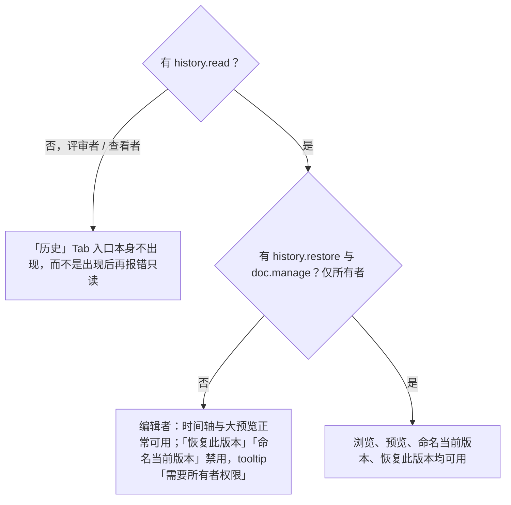
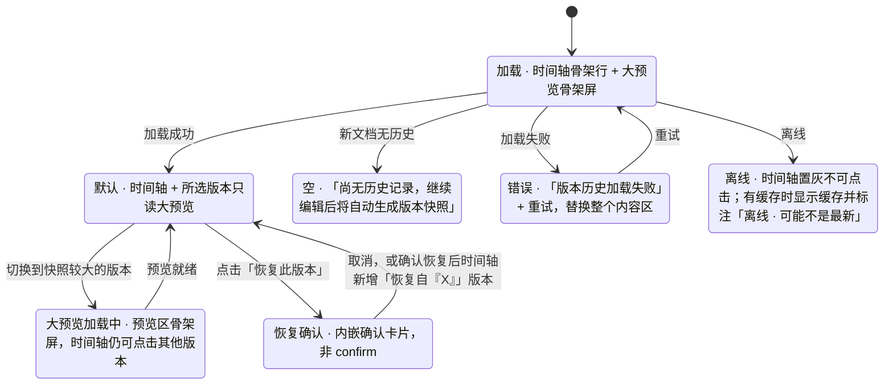

> 状态：草稿 | 负责：设计 | 更新：2026-09-18；2026-09-24（rulings §4.16 Q17：自动版本策略已裁决）；2026-09-25（补图）；2026-09-25（矛盾收口，rulings §4.18）；2026-09-25（§4.19） | 依赖：charter v0.2（Q17 自动版本策略已裁决，rulings §4.16）；PRD `03-collaboration.md` CO-07

# 03-07 版本历史

> **设计基准（2026-09-15 起）**：组件规格以 [`09-design-specification.md`](../09-design-specification.md) v3.0（shadcn Rhea + 材质层）为准；对应 playground 路由 `#/editor/history`（[已发布 artifact](https://claude.ai/code/artifact/cf6e1a1a-986b-48bb-b743-5758dff419d2)，源码 `playground/src/routes/`）。本文引用的 `mockups/*.html` 与线框图为历史静态稿，以 playground 实际渲染为终稿。

检查器坞的"历史"Tab 内容（`ui.panel`，内置），大预览可扩展为全屏浮层。

---

## 线框（默认态）

```
┌───────────────────────────────────────────────┐
│ 属性│评论│历史│插件                              │
├──────────────┬──────────────────────────────────┤
│ 今天          │                                  │
│ ●14:32 我      │        （该版本的只读大预览）        │
│ ●11:05 王小明  │                                  │
│ ─────────    │                                  │
│ 昨天          │                                  │
│ ★"提案定稿" 我 │                                  │
│ ●16:20 李雷    │                                  │
│ ─────────    │        [ 命名当前版本 ]             │
│ 9月10日       │        [ 恢复此版本 ]              │
│ ●…            │                                  │
└──────────────┴──────────────────────────────────┘
```

时间轴左列：按天分组，`●` 为自动快照（时间戳 + 头像），`★` 为手动命名版本（加粗名称 + 作者头像）；点击任一项，右侧切换为该快照的只读大预览。

---

## 状态

### 空（新文档，无历史）

```
│ 当前版本               │
│ 尚无历史记录，继续编辑   │
│ 后将自动生成版本快照     │
```

不显示时间轴分组标题，仅一行说明。

### 加载

左列时间轴显示骨架行（若干灰条），右侧大预览显示骨架屏（灰底 + 呼吸动效）。

### 错误

"版本历史加载失败 [重试]"，替换整个面板内容区。

### 只读（编辑者，无恢复权限）

权限口径精确到独立能力位（PRD CO-07；角色表见 rulings U-09 与 M-08）：查看历史需要 `history.read`（所有者与编辑者有，评审者与查看者没有），恢复需要 `history.restore`，命名当前版本需要 `doc.manage`（M-09 create-named-snapshot），后两者只属于所有者。编辑者有 `history.read` 但无 `history.restore` / `doc.manage`：时间轴与预览正常可用，"恢复此版本"与"命名当前版本"按钮禁用并 tooltip 说明"需要所有者权限"。评审者与查看者没有 `history.read`，"历史"Tab 入口本身不出现在检查器坞（而不是出现后再报错只读，rulings §4.18 UX-17）。

**两个能力位的分流**



怎么读：先判能否看见入口（`history.read`，编辑者及以上），再判能否写入（恢复与命名只属于所有者）；编辑者看到的禁用提示是「需要所有者权限」，不是「需要编辑权限」。

### 离线

```
│  离线时无法加载版本历史   │
│  仅显示本地最近编辑状态   │
```

整个时间轴置灰不可点击；若本地已缓存过历史数据（曾经加载过），显示缓存内容并标注"离线 · 可能不是最新"，缓存与否属实现细节，设计侧只要求给出这两种可能呈现之一并保持提示语一致。

### 大预览加载中（切换到某历史版本，快照较大）

预览区骨架屏替代，时间轴列表本身保持可继续点击其他版本（不因单个预览加载阻塞浏览）。

### 最近删除（M3，仅所有者；「彻底删除元素」的唯一入口）

rulings §4.18 CO-07：元素级「彻底删除」只对已删除（墓碑态）的元素开放、只能由文档所有者发起。入口放在本面板：所有者的时间轴顶部多一个可折叠分组「最近删除」（编辑者不显示），列出当前文档中仍在墓碑保留期内（默认 24 h，部署可配）的已删除元素：

```
│ 最近删除（3）                          ▾ │
│ 矩形 3 · 第 2 页 · 王小明 · 2 小时前      │
│   22 小时后自动清除          [彻底删除]   │
```

- 每行：元素类型与名称、所在页、删除者、删除时间与剩余保留时长。找回元素仍走既有路径（删除方撤销，或被删方的「恢复元素（含我的编辑）」，05-collaboration-ux §6），本分组不另设恢复按钮。
- 点 [彻底删除] 弹确认对话框（`AlertDialog`，不可撤销的销毁性操作才用确认框，同 03-screens/05）：

```
┌──────────────────────────────────────┐
│ 彻底删除"矩形 3"？                      │
│ 删除后无法恢复。历史版本仍含该内容，       │
│ 要连历史清除请永久删除文档。              │
│                  [取消]  [彻底删除]     │
└──────────────────────────────────────┘
```

- 确认后服务端立即硬删并写审计（`document.element_purged`），该行消失，toast「已彻底删除 1 个元素」（不带撤销）；删除方此后再撤销该步按"整步被跳过"处理，提示"无法撤销：该内容已被彻底删除"。只清当前文档状态：历史版本与更新记录按保留期仍含该内容，引用的图片原件按 30 天无引用回收。
- 离线时 [彻底删除] 禁用，tooltip「离线时不可用」（需服务端执行）。
- 术语：文档级回收站操作称「永久删除文档」，本处称「彻底删除元素」，两者不混用。

---

**版本历史面板状态**



怎么读：箭头是面板内容区的切换；恢复永远先经过内嵌确认卡片，确认后以快照内容创建新版本，当前更改不丢失。

## 交互说明

- "恢复此版本"点击后弹出内嵌确认卡片（非浏览器 `confirm()`）：

```
┌─────────────────────────────┐
│ 恢复到"提案定稿"？              │
│ 将创建一个新版本，当前更改不会丢失│
│ 若有协作者正在编辑，他们的画布将  │
│ 自动更新为恢复后的内容           │
│              [取消]  [确认恢复] │
└─────────────────────────────┘
```

- 手动命名版本：输入名称（≤ 30 字符），提交后该节点在时间轴中以 `★` + 加粗名称呈现，区别于自动快照。
- 大预览支持切换页面浏览该历史版本的其他页（缩略图迷你条，仅在历史预览态出现）。

## 边界情况

- 快照数量很多：按月折叠分组，默认展开最近一个月；"加载更早版本"按钮触发分页加载。自动版本生成策略（PRD CO-07）：每 10 分钟且有变更，或每 500 个 update 生成一次；30 天内全量保留，此后每天只保留最后一个，保留至部署配置 `retention.autoSnapshotDailyDays`（默认 365 天，0 = 永久；rulings §4.19 C-06，细化章程 Q17）；命名版本为用户手动创建，永久保留，每文档上限 200。版本历史界面随 M3 交付（PRD 05 §0.3）。这一策略解释了"今天"分组下为何可能出现密集的自动版本节点。
- 巨大文档的快照预览：渐进渲染（同 F1 打开流程的骨架细化策略），不因预览生成阻塞时间轴其余部分。
- 协同中查看历史：仅影响当前用户本地视图，不广播给其他协作者（不会让别人也看到你在翻历史）。
- 恢复操作产生的新版本本身也会出现在时间轴中，形成"恢复自 X"的可追溯记录（自动生成的版本名建议格式"恢复自『提案定稿』"，具体文案由内容团队最终确认）。
