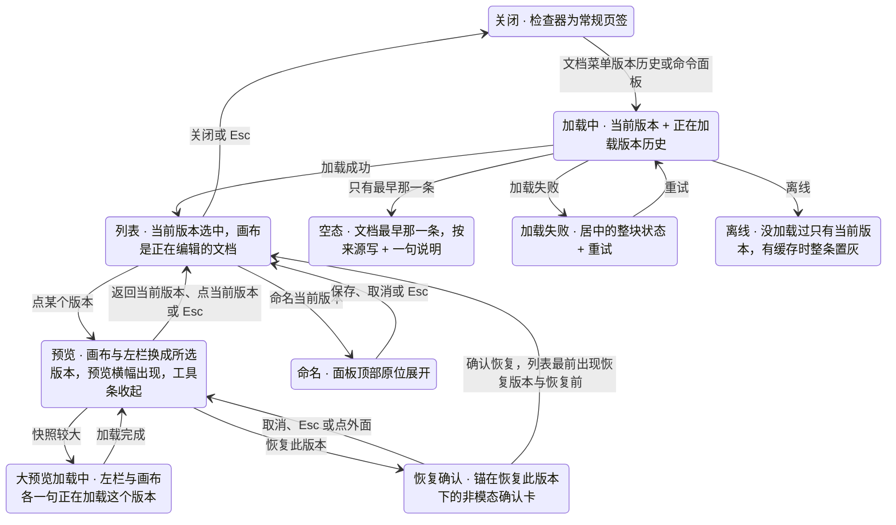
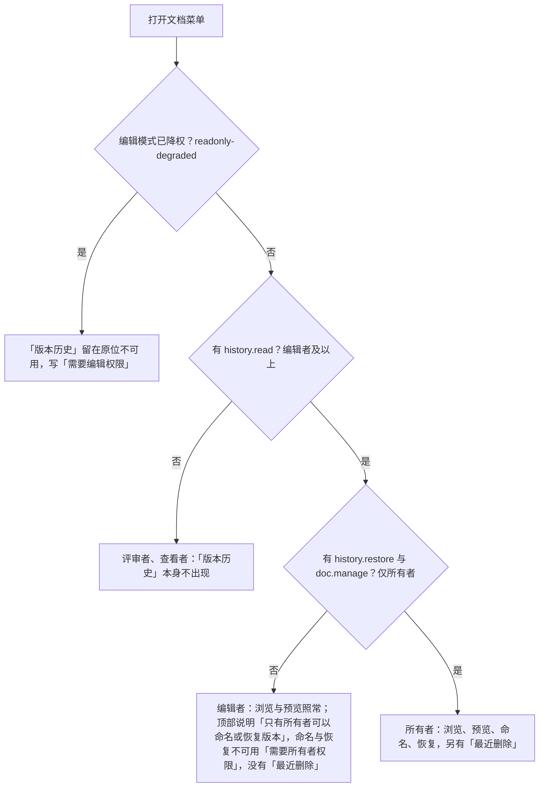

> 状态：草稿 | 负责：设计 | 更新：2026-09-18；2026-09-24（rulings §4.16 Q17：自动版本策略已裁决）；2026-09-25（补图）；2026-09-25（矛盾收口，rulings §4.18）；2026-09-25（§4.19）；2026-10-15（design-language-v3 第 2 批：按已拍板样张 `version-history` 整篇改写——①落位：文档菜单「版本历史」打开检查器整栏面板，宽度沿用检查器（缺省 280）、不加宽，原「检查器临时加宽到 560」作废，紧凑形态的落位随第 3 批（DS-38）；②预览：画布与左栏换成所选版本的只读内容、底部工具条收起，横幅通道出预览横幅（唯一的「返回当前版本 / 恢复此版本」），离线等横幅在它下方另占一条、最多两条，原「缩略图迷你条」作废（DS-39）；③列表：当前版本在最上、按天分组，同一天相邻两条及以上的自动版本收成「N 个自动版本」、标「恢复前」的单列，按月折叠，30 天以前标「当日最后版本」，命名版本只靠加粗名称区分（● / ★ 作废），「加载更早版本」是安静行（DS-57）；④命名在面板顶部原位展开，名称 ≤ 30 字，达上限时表单留着、错误走轻提示（DS-57）；⑤恢复用锚在横幅按钮下的非模态确认卡，恢复后列表最前出现「恢复自『X』」与「恢复前」自动版本（DS-40）；⑥「最近删除」只给所有者、缺省收起，「彻底删除」是中性次按钮，确认走模态确认框、初始焦点在「取消」（DS-40、DS-57）；⑦加载为「转圈 + 一句话」、出错为居中的整块状态、空态显示导入版本加一句说明（DS-53、DS-62）；⑧不做「以此版本创建副本」；4 个备选状态标「未采纳」（DS-63）；补焦点交接、读屏与边界；依据 rulings §4.25 DS-38、DS-39、DS-40、DS-53、DS-57、DS-62、DS-63；同日再补：§1.1、§8 写明整栏面板就是检查器当前宽度、开着时检查器左缘分隔条照常可拖（TB-60），§3、§4.3、§8 命名表单的说明 ≤ 200 字、到上限不再接收输入、接近上限才显示计数、服务端建快照时同样校验（TB-64），§5.3 空态写明用户可见的建文档路径都先写导入快照、`POST /documents` 直接建的空文档只有「当前版本」一行与同一句说明（TB-74），§7 面板打开期间失去 `history.read` 时面板关闭、回到当前版本、焦点交回文件名，所有者降为编辑者时按编辑者呈现（TB-63）；同日再补：§3、§4.1、§5.3、图 3-1 文档最早那一条按来源写——导入「导入自『文件名.pptx』」、新建空白「新建演示文稿」、从模板新建「从模板『〈模板名〉』新建」、创建副本「创建自『〈原文档名〉』的副本」，来源与显示名由后端在这条 `import` 快照的元数据里给出（60/15 §3.8），显示名按建档时记下，空态的首条随之按来源写；文档不是导入来的时，月份行摘要「导入版本」的写法待定（DS-70）；同日再补：§4.1 最早那一条的类别名按来源分，导入来的仍叫「导入版本」（样张 `version-history.older` 不变），新建空白、从模板新建、创建副本叫「初始版本」，月份行摘要随之写「7 月 · 初始版本」，上一条的「写法待定」就此定下；§6 版本行读屏名带同一类别名（如「新建演示文稿，初始版本，〈作者〉，〈时间〉」）；§4.1 源文档没有标题时副本这一条写「创建自『未命名演示文稿』的副本」，与空标题的统一显示一致（60/04 §3.1、60/15 §3.8）；§4.1 收组、§4.2 预览横幅里泛指这一类的「导入版本」改称「最早那一条」；§3 表后「样张没有单独画」补这几处（rulings §4.25 TB-90）；同日再补：§4.1「按月折叠」的摘要改为当月有任一 `import` 行（含覆盖导入写下的那条）就写它的类别名，覆盖导入为「导入版本」，没有命名版本、也没有 `import` 行时才写「N 个自动版本」（rulings §4.25 TB-98））；2026-10-22（design-language-v3 第 3 批：只改与第 3 批裁决有关的段落——§1.3、§3 紧凑形态（640–1024）里版本历史进右侧检查器抽屉的整栏（宽 280），面板「关闭」与抽屉「收起检查器」各管各的，预览时抽屉从横幅下沿开始、不盖「返回当前版本」「恢复此版本」（DS-130，原「落位随第 3 批」结案）；§2、§3 评审者与查看者的文件名不再是菜单触发器、没有文档菜单，降权时「创建副本」与「重命名」「版本历史」一样留在原位不可用（DS-82，U-09）；§4.2 预览期间「放映」不可用、原因「返回当前版本后可用」（TB-112）；§8 预览横幅统一高 40（DS-75）；依据 rulings §4.25 DS-75、DS-82、DS-130、TB-112）；2026-10-22（design-language-v3 第 3 批回写续：§2「不出现与不可用」与 §3 状态表 `degraded-menu` 一行注明降权时文档菜单「重命名」「创建副本」「版本历史」不可用「需要编辑权限」由 rulings §4.25 TB-138 定（与「文件 › 导出…」同一规则，DS-105）；同日再补：§2 命令面板「版本历史」写明是 shell-glue 注册的无参命令 `shell.openVersionHistory` 与一条 `ui.command`，条目以 03-24 为准（rulings §4.25 TB-162）；2026-10-22 复核修正：§2「不出现与不可用」与 §3 状态表 `degraded-menu` 一行改引 rulings §4.25 DS-139（降权时「创建副本」不可用，取代第 1 批「照常」的样张修正）；状态头的回写轮次字样改为「回写续 / 同日再补」）；2026-10-23（design-language-v3 第 3 批评审修改：确认框圆角随 rulings §4.25 DS-142 改为 12——§3 `purge-confirm`、§3.1 `alt-confirm-dialog` 与 §8「彻底删除确认框」一行同步）；2026-11-04（design-language-v3 母版视图改版：§1.1「面板开着时」补不能进入母版视图（原因「关闭版本历史后可用」，`Mod+Alt+M` 只给轻提示），母版视图里「版本历史」留在原位不可用；rulings §4.25 DS-157、DS-162、DS-163、TB-203、TB-209；需求编号、优先级与里程碑不变） | 依赖：charter v0.2（Q17 自动版本策略已裁决，rulings §4.16）；PRD `03-collaboration.md` CO-07、CO-08（彻底删除元素）；rulings §4.18 CO-07 / UX-17、§4.19 C-06 / N1 / D-M2-CONTENT、§4.25 DS-1、DS-15、DS-26、DS-35、DS-37、DS-38…DS-41、DS-43、DS-53、DS-57、DS-58、DS-62、DS-63、DS-70、DS-75、DS-82、DS-105、DS-130、DS-139、DS-157、DS-162、DS-163、TB-14、TB-60、TB-63、TB-64、TB-74、TB-90、TB-98、TB-112、TB-138、TB-162、TB-203、TB-209；前端 50/08 §9–§11、50/04 §7.1；后端 60/04 §3.1、60/15 §3.8；ADR-0038；playground `#/v3/editor?state=version-history.*`（`src/v3/scenarios/version-history/`）、`#/v3/editor?state=narrow-review.compact-history*`（`src/v3/scenarios/narrow-review/`）

# 03-07 版本历史

> **设计基准（2026-10-15 起，rulings §4.25 DS-38…DS-40、DS-57）**：以已拍板的 playground 第 2 批样张 `#/v3/editor?state=version-history.<状态 id>` 为准（22 个状态，另有 4 个标「未采纳」的备选，§3），源码在 `playground/src/v3/scenarios/version-history/`（`version-history.scenario.tsx` 各状态的标题与说明，`HistoryPanel.tsx` 整栏面板与列表，`chrome.tsx` 预览期间的画布、左栏、工具条、横幅与恢复确认卡，`data.ts` 示例数据与收组规则，`slides.tsx` 各历史版本的真实渲染，`alt.tsx` 备选）；对照截图 `openspec/changes/design-language-v3/screens/batch2/version-history-<状态>-dark.jpg` / `-light.jpg`；编辑器外壳以 [03-02](02-editor-main.md) 为准，整栏面板、列表折叠行、加载行与整块状态等底座件见 `playground/src/v3/scenarios/README.md` §3a、§3b。此前「检查器『历史』页签 + 右侧只读大预览」的线框、shadcn / 材质层时期的写法与旧路由 `#/editor/history` 作废。

查看文档的历史版本，预览、命名与恢复（PRD CO-07，P1，M3；PRD 07 G-60）；同一面板承载「彻底删除元素」的唯一入口「最近删除」（PRD CO-08 末条，rulings §4.18 CO-07）。按 DS-38，版本历史是检查器的整栏面板，与检查器同宽，画布不跳动；按 DS-39，预览时画布与左栏换成所选版本的只读内容。版本对比为 P2，不在本版。

---

## 1. 线框

### 1.1 在编辑器中的位置（桌面 1600 × 1000，预览命名版本「提案定稿」）

```
←──────── 240 ────────→←──────────────────── 画布 flex ────────────────────→←──────────── 280 ────────────→
┌──────────────────────┬────────────────────────────────────────────────────┬──────────────────────────────┐
│ [Logo▾]  [单页][网格]│ ⟲ 正在查看昨天 16:20 的版本 「提案定稿」· 仅你可见 │ (周)(王)(李)      ▶  [分享]  │
│ 2026 年 Q2 业绩汇报 ▾│                  [返回当前版本] [恢复此版本]       ├──────────────────────────────┤
│ ✓ 已同步             ├────────────────────────────────────────────────────┤ 版本历史              ⊕   ×  │
│ 1 ┌──────────────┐   │                                                    ├──────────────────────────────┤
│   └──────────────┘   │   ┌────────────────────────────────────────────┐   │ › 最近删除 3                 │
│▌2 ┏━━━━━━━━━━━━━━┓   │   │ 议程                                       │   ├──────────────────────────────┤
│▌  ┗━━━━━━━━━━━━━━┛   │   │ 01 关键指标            ┌──────────┐        │   │ 当前版本                     │
│ 3 ┌──────────────┐   │   │ 02 营收趋势            │ 增长 17% │        │   │ 今天                         │
│   └──────────────┘   │   │ 03 区域分布            └──────────┘        │   │ › 7 个自动版本 09:40–14:32   │
│ 4 ┌──────────────┐   │   └────────────────────────────────────────────┘   │ 昨天                         │
│   └──────────────┘   │                        ════                        │▐提案定稿                     │
│ 5 ┌──────────────┐   │   ┌────────────────────────────────────────────┐   │▐交财务核对前的版本，         │
│   └──────────────┘   │   │ 这一页没有演讲者备注                       │   │▐数字以此为准                 │
│                      │   └────────────────────────────────────────────┘   │▐(李) 李雷 · 16:20            │
│                      │                （底部工具条收起）                  │ › 9 个自动版本 09:10–15:50   │
│                      │                                                    │ （更早的日期与月份）         │
│                      │                                                    │ › 9 月 · 2 个命名版本        │
│                      │                                                    │ ⟲ 加载更早版本               │
└──────────────────────┴────────────────────────────────────────────────────┴──────────────────────────────┘
```

图例：`⟲` 历史图标；`⊕` 「命名当前版本」（书签加号图标）；`▌` 左栏当前页；`▐` 正在预览的版本（强调色淡底）；`›` 折叠行的箭头（展开时转 90°）；`════` 备注把手（预览时只作显示、不能拖）。截图：`screens/batch2/version-history-preview-*.jpg`，样张 `version-history.preview`。

- **整栏面板**：文档菜单「版本历史」打开后，检查器整栏换成版本列表（底座件 `InspectorTakeover`，先例是图表「编辑数据」，DS-26）；沿用检查器宽度（缺省 280）、不加宽，画布不跳动（DS-38；原「检查器临时加宽到 560」与 400 宽的备选都作废）。面板的宽度就是检查器当前的宽度：用户拖宽过检查器，面板也是那么宽；面板开着时检查器左缘的分隔条照常可拖，拖的就是检查器宽度，关闭面板后检查器保持拖后的宽度（rulings §4.25 TB-60；编辑与整页类整栏面板宽 max(400, 检查器宽度)、开着时分隔条不可拖，见 03-02 §3.5）。协作行（协作者 · 放映 · 分享）原样不动，「设计 / 评论」页签行换成面板标题行。整栏面板同一时刻只开一个（50/10 §5）。
- **预览期间**（DS-39）：画布与左栏换成所选版本的只读内容，底部工具条收起，横幅通道出预览横幅，离线等横幅在它下方另占一条（§4.2）。
- **面板开着时**：左栏顶部「单页 / 网格」与主菜单「视图 › 网格视图」留在原位不可用，写「关闭版本历史后可用」（网格视图没有检查器栏，放不下面板）；同样不能进入母版视图——主菜单「视图 › 母版视图」与命令面板「母版视图」写同一句，按 `Mod+Alt+M` 只给一次轻提示「母版视图：关闭版本历史后可用」（rulings §4.25 DS-162、DS-163、TB-209，原因与次序以 03-26 §1.1 为准）。母版视图里文档菜单「版本历史」与命令面板同名命令留在原位、不可用，写「母版视图下不可用」（DS-157、TB-203，03-26 §1.1）。

### 1.2 面板结构（默认态，所有者）

```
┌──────────────────────────────────────┐
│ (周)(王)(李)            ▶   [分享]   │  ← 协作行 48，原样不动
├──────────────────────────────────────┤
│ 版本历史                    ⊕    ×   │  ← 标题行 44：命名当前版本 · 关闭
├──────────────────────────────────────┤
│ ⓘ 说明行                             │  ← 离线、编辑者时才有（§5）
├──────────────────────────────────────┤
│ 命名当前版本                         │  ← 展开时才有，原位展开（§4.3）
│ [名称 交付终稿                 4/30] │
│ [补齐下半年计划，数字已与财务核对  ] │
│                       [取消] [保存]  │
├──────────────────────────────────────┤
│ › 最近删除 3                         │  ← 仅所有者、有已删除元素时；缺省收起（§4.5）
├──────────────────────────────────────┤
│▐当前版本                             │  ← 总在最上；选中铺强调色淡底
│ 今天                                 │  ← 日期小标题
│ › 7 个自动版本 09:40–14:32           │  ← 自动版本组（折叠行）
│ 昨天                                 │
│ 提案定稿                             │  ← 命名版本：名称加粗
│ 交财务核对前的版本，数字以此为准     │  ← 说明
│ (李) 李雷 · 16:20                    │  ← 作者 · 时刻
│ › 9 个自动版本 09:10–15:50           │
│ 10 月 2 日                           │
│ 16:48 (张) 张三                      │  ← 只有一条的自动版本单列
│ › 9 月 · 2 个命名版本                │  ← 更早的月份收起（月份行）
│ › 8 月 · 1 个命名版本                │
│ ⟲ 加载更早版本                       │  ← 安静行：再取一页
│ 较早的自动版本按天保留，             │  ← 保留口径说明
│ 命名版本永久保留                     │
└──────────────────────────────────────┘
```

- **标题行**（高 44，下 1px 分隔）：「版本历史」（13px 600）· 右侧「命名当前版本」（28 图标按钮，书签加号图标；表单展开时为按下态）·「关闭」（28 图标按钮，工具提示 Esc）。
- **内容区**纵向滚动，自上而下：说明行（离线、编辑者时才有，§5）→ 命名表单（展开时，§4.3）→「最近删除」（仅所有者、有已删除元素时，§4.5）→ 版本列表（§4.1）→ 列表末尾（「加载更早版本」与保留口径说明）。
- 版本列表的容器左右、上下各 8；行左右内缩 8、圆角 6，悬停铺 `--v3-panel-2`；行内文字左缘距面板内缘 16（与日期小标题、折叠行的箭头对齐）。

### 1.3 紧凑与仅查看形态

- **紧凑窗口（640–1024）**（2026-10-22 第 3 批拍板，rulings §4.25 DS-130；场景 `narrow-review`，视口 1000 × 760）：入口仍是左上「文档」胶囊里的文档菜单；选「版本历史」打开右侧检查器抽屉，抽屉整栏换成本面板（宽 280 不变，DS-38「沿用检查器宽度」；协作行不动，标题行同桌面「版本历史 · 命名当前版本 · 关闭 Esc」，最右是抽屉的「收起检查器」），右上胶囊让位；幻灯片、备注与底部工具条在未遮挡的区域里适应，不跳动（`compact-history`）。
  - **两个出口各管各的**：面板的「关闭」（Esc 先关面板）回到常规检查器、抽屉还开着；抽屉的「收起检查器」收起抽屉、面板仍开着，再点右上胶囊的「显示检查器」回到面板。面板开着时点左上「显示幻灯片列表」：右抽屉连同面板收起、左抽屉展开（一次只开一个抽屉），面板没有关（`compact-takeover-rail`）。
  - **面板开着时**左上胶囊与左栏抽屉里的「单页 / 网格」、主菜单「视图 › 网格视图」与桌面同一原因不可用（「关闭版本历史后可用」）。
  - **预览某个版本**：预览横幅常驻在上，左上胶囊与左右两个抽屉都从横幅下沿开始，不盖住横幅右端的「返回当前版本」「恢复此版本」（紧凑形态的非模态抽屉从横幅下沿开始，03-02 §5a.1）；画布在未遮挡区显示所选版本、底部工具条收起，版本列表仍在右侧抽屉里，可以接着点别的版本；打开左上「显示幻灯片列表」时左抽屉里是所选版本的页（`compact-history-preview`）。
- **仅查看（< 640 或触控）**：没有文档菜单，不提供版本历史（03-02 §5a.2）。

---

## 2. 入口、打开与关闭

- **入口**：文档菜单（左栏文件名 ▾；网格视图在左上「文档」胶囊里）「重命名 · 创建副本 ┊ 版本历史」，编辑者及以上才有（需要 `history.read`，03-02 §2.3）；命令面板「版本历史」是第二入口（shell-glue 注册的无参命令 `shell.openVersionHistory` 与一条 `ui.command`，rulings §4.25 TB-162；条目以 03-24 为准），主菜单里不另设（常驻入口唯一，设计质量门 Q2）。原检查器「历史」页签与应用栏「⋯ → 版本历史」作废（rulings §4.25 DS-1）。文档菜单的顶边贴住文件名下沿，把下面的同步状态行整行盖住（不切在半行字上）。样张：`version-history.entry`。
- **打开**：选「版本历史」后检查器整栏换成版本列表，焦点落在选中的版本上（打开时是「当前版本」一行）。面板已开着时再选一次，焦点移进面板（加载失败时落在「重试」）。网格视图里先回单页再打开（网格视图没有检查器栏，同主菜单「文件 › 保真报告」），关闭后焦点交给单页里同一个文件名。
- **关闭**：标题行「关闭」或 Esc——面板收起，画布与左栏回到当前版本，检查器回到常规页签，焦点交回文件名。Esc 逐层（设计 07 §2.3「一下 Esc 关一层」）：菜单、弹层、对话框开着时先关它们；命名表单开着时先收起表单；正在预览时先回到当前版本；最后才关闭面板。
- **评论钉**：编辑模式照常显示评论钉（DS-43）。面板开着时点画布上的评论钉，先收起面板、再切到「评论」页签并定位线程，焦点留在钉上（检查器被面板占着时没有页签，点了要有可见反馈）。
- **两个动作的入口**：「命名当前版本」的常驻入口只有标题行这一个按钮，命令面板是第二入口（§4.3）；「恢复此版本」只在预览横幅上，列表行上不重复（设计质量门 Q2，§4.4）。
- **不出现与不可用**（权限分流见 §5.1）：评审者、查看者的文件名不是菜单触发器、没有文档菜单，「版本历史」自然不出现（2026-10-22 第 3 批拍板，rulings §4.25 DS-82：他们也不能「创建副本」，菜单只剩一项不再做成触发器；样张 `version-history.no-access` 随之改）；编辑模式已降权时「重命名」「创建副本」「版本历史」都留在原位不可用、写「需要编辑权限」，不隐藏、仍可聚焦（DS-15；降权后没有 `doc.export`，「创建副本」同一规则，2026-10-22 用户确认，rulings §4.25 DS-139，取代第 1 批拍板时「降权时『创建副本』照常」的样张修正，03-02 §2.3；样张 `version-history.degraded-menu`）。

---

## 3. 状态

样张路由均为 `#/v3/editor?state=version-history.<状态 id>`（暗 / 亮另加 `&theme=dark|light`）。示例文档的「现在」是 10 月 8 日 14:40 前后，文档 7 月 28 日从 .pptx 导入。全部为 M3（PRD CO-07，P1）；「最近删除」两态是 PRD CO-08 末条的「彻底删除元素」（P1，M3）。

| 状态（样张标题） | 要点 | 样张 id |
|---|---|---|
| 打开版本历史 · 当前版本 | 检查器整栏换成版本列表（与检查器同宽，协作行不动）；「当前版本」选中，画布仍是正在编辑的文档；今天 7 个、昨天 9 个、10 月 6 日 4 个自动版本各收成一行，10 月 2 日只有一条、单列；9 月、8 月收起；末尾「加载更早版本」与保留说明；所有者的列表上方多一行收起的「最近删除 3」 | `version-history.default` |
| 入口 · 文档菜单「版本历史」 | 文档菜单「重命名 · 创建副本 ┊ 版本历史」，顶边贴住文件名下沿；选「版本历史」打开面板、焦点落在当前版本，关闭后回到文件名 | `version-history.entry` |
| 预览命名版本「提案定稿」 | 画布与左栏换成这个版本的只读内容（5 页，「增长 17%」），左栏不提供新建，工具条收起；预览横幅「正在查看昨天 16:20 的版本」+「『提案定稿』· 仅你可见」+「返回当前版本」「恢复此版本」 | `version-history.preview` |
| 自动版本分组 · 预览自动版本 | 展开「7 个自动版本 09:40–14:32」逐条列出（新的在前、缩进一档，每行时刻 · 贡献者）；预览 13:50 的自动版本，横幅写「自动版本 · 王小明、李雷 · 仅你可见」 | `version-history.auto-group` |
| 较早的月份 · 按天保留 | 展开 9 月：30 天内的自动版本全量保留，更早的每天只留最后一个、标「当日最后版本」，命名版本照常；「加载更早版本」按游标翻页，翻出 7 月（导入的原始文件） | `version-history.older` |
| 命名当前版本 | 面板顶部原位展开一节：名称（≤ 30 字，计数常显）、说明（可选，≤ 200 字，接近上限才显示计数，TB-64）、「取消 / 保存」；名称为空时「保存」不可用 | `version-history.name-version` |
| 命名完成 | 「今天」最前面出现这个命名版本（加粗名称 + 说明 + 作者与时刻），成功轻提示「已将当前版本命名为『交付终稿』」 | `version-history.named` |
| 命名 · 已达上限 | 每份文档 200 个命名版本已满：表单留着、名称不丢，错误轻提示「命名版本已达上限（每份文档 200 个）」（DS-57） | `version-history.name-limit` |
| 恢复确认 | 点横幅「恢复此版本」：按钮下方弹出非模态确认卡「恢复到『提案定稿』？」+ 说明 + 正在编辑的协作者 +「取消 / 确认恢复」（DS-40） | `version-history.restore-confirm` |
| 恢复完成 | 画布与左栏回到当前版本（内容已是「提案定稿」），横幅消失、工具条回来；「今天」最前面出现「恢复自『提案定稿』」与单列的「恢复前」自动版本，成功轻提示「已恢复到『提案定稿』」 | `version-history.restored` |
| 协作者收到恢复提示 | 其他在线协作者的画布随之更新（撤销栈不变），轻提示带恢复者头像「李雷已将文档恢复到『提案定稿』」；打开版本历史可见「恢复自『提案定稿』· 李雷」 | `version-history.restored-remote` |
| 大预览加载中 | 快照较大：左栏列表区中央与画布幻灯片位置各一句「正在加载这个版本…」（转圈 + 一句话）；横幅已切到这个版本，「恢复此版本」不可用「版本加载完成后可用」；列表照样可点 | `version-history.preview-loading` |
| 加载中 | 「当前版本」本地即有、立即可选，其下一行「正在加载版本历史…」 | `version-history.loading` |
| 加载失败 | 内容区换成居中的整块状态：危险色图标、「版本历史加载失败」「请检查网络连接后重试」、次按钮「重试」（DS-53、DS-62） | `version-history.error` |
| 空态 · 只有导入时的版本 | 当前版本 + 今天「导入自『2026 年 Q2 业绩汇报.pptx』」+ 一句说明（DS-53）；这一条按文档来源写，示例文档是导入的（DS-70，§4.1） | `version-history.empty` |
| 编辑者 · 只能浏览与预览 | 面板顶部一行「只有所有者可以命名或恢复版本」；「命名当前版本」「恢复此版本」留在原位不可用，提示「需要所有者权限」；没有「最近删除」 | `version-history.editor-role` |
| 评审者 · 没有入口 | 文件名不是菜单触发器、没有文档菜单，「版本历史」不出现（第 3 批按 DS-82 改：原「文档菜单只有『创建副本』」作废） | `version-history.no-access` |
| 降权 · 文档菜单里不可用 | 「重命名」「创建副本」「版本历史」都不可用「需要编辑权限」（第 3 批按 DS-82、DS-105 改，rulings §4.25 DS-139 定：降权后没有 `doc.export`，「创建副本」不再照常）；降权横幅正文为「3 项更改未被保存；文档已重新载入服务端版本，撤销历史已清空」（DS-58） | `version-history.degraded-menu` |
| 离线 · 没加载过 | 面板顶部「离线 · 无法加载版本历史，只显示本地最新内容」，列表只有当前版本；「命名当前版本」不可用；「最近删除」照常显示、「彻底删除」不可用 | `version-history.offline` |
| 离线 · 显示缓存（预览中） | 面板顶部「离线 · 可能不是最新；恢复连接前不能切换、命名或恢复版本」，整条列表置灰不可点，正在预览的一行保持选中；预览横幅在上、离线横幅在下（DS-39） | `version-history.offline-cached` |
| 最近删除（所有者） | 展开「最近删除 3」：一句说明 + 每条「元素 · 第 N 页 · 删除者 · 删除时间」/ 剩余保留时长 /「彻底删除」（中性次按钮） | `version-history.recently-deleted` |
| 彻底删除确认 | 模态确认框「彻底删除『矩形 3』？」+ 说明 +「取消 / 彻底删除」（危险色），初始焦点在「取消」；确认后该行消失、轻提示「已彻底删除 1 个元素」（不带撤销）；确认框圆角 2026-10-23 起为 12（rulings §4.25 DS-142），画面随之改 | `version-history.purge-confirm` |

样张没有单独画、行为照常的：不是导入来的文档的最早一条、月份行摘要与读屏名（§4.1、§6）；撤销此次恢复（ADR-0038 定稿后出稿，§4.4）；恢复与命名失败时的提示（§4.4）；命名说明接近 200 字时的计数（§4.3）；服务端保存降级期（§5.2）；API 直接建的空文档（§5.3）；面板打开期间被降权（§7）。紧凑形态里的落位已随第 3 批出样张：`narrow-review.compact-history`、`compact-history-preview`、`compact-takeover-rail`（§1.3，DS-130）。

### 3.1 未采纳的备选

拍板时画给用户对照的备选留在样张里，标题前加「未采纳 · 」，实现以上表的推荐状态为准（rulings §4.25 DS-63）。

| 备选（样张标题） | 画法 | 样张 id | 结论 |
|---|---|---|---|
| 左栏换成版本列表 | 版本列表放进左栏（上半部分照常），检查器留着、只读；该版本的页只能放进底部 64 宽的缩略图迷你条（取代工具条），左栏失去页面导航 | `version-history.alt-rail-list` | 未采纳，DS-38、DS-39 定为推荐：列表在与检查器同宽的整栏面板里，预览时左栏换成该版本的页 |
| 整栏加宽到 400 | 沿用图表数据面板的 400：画布由 1080 收到 960，打开面板时画布跳动，也没有多显示什么 | `version-history.alt-wide` | 未采纳，DS-38 定为推荐：沿用检查器宽度（缺省 280），不加宽（TB-60） |
| 恢复确认用对话框 | 模态确认框（遮罩挡住整个界面），把恢复归进 03-05 §6 的第二类（会波及其他页、确认后靠撤销找回）；确认框圆角随 DS-142 改为 12，画面随之改 | `version-history.alt-confirm-dialog` | 未采纳，DS-40 定为推荐：锚在按钮下的非模态确认卡 |
| 以此版本创建副本 | 版本行右键菜单「恢复此版本 · 以此版本创建副本」 | `version-history.alt-duplicate` | 未采纳，DS-57 定为推荐：不做——PRD、本文与后端都没有这项能力，没有能力的入口不放；要做须另走新增需求的变更 |

**图 3-1 版本历史面板的状态**



怎么读：箭头是面板与编辑器呈现的切换。打开后先经「加载中」，再按结果分到列表、空态、出错或离线；只有「预览」会换掉画布与左栏、收起工具条并出现预览横幅；恢复一定先经过非模态确认卡，确认后回到当前版本，列表最前多出恢复版本与「恢复前」自动版本。命名表单从列表或预览中都能展开，命名的是当前版本。大预览加载中也可以直接换版本或回到当前版本（图里省略）。
依据：PRD CO-07；rulings §4.25 DS-39、DS-40、DS-53、DS-57、DS-70；样张 `version-history.*`。

---

## 4. 交互

### 4.1 列表

- **当前版本**：总在最上（高 32），打开面板时选中；点它 = 回到正在编辑的文档。它与预览横幅「返回当前版本」是同一件事的两处入口——列表里的选择与预览中的出口，两处都留（DS-39）。加载中、离线没加载过时它也在（本地即有）。
- **按天分组**：日期小标题「今天 / 昨天 / 10 月 6 日…」（12px 500 `--v3-text-2`，上 12、下 4）；当天的版本新的在前。
- **四种版本行**（`SnapshotMeta.kind`，50/08 §9）：
  - 自动版本（`auto`）：一行，高 32——时刻（12px 数字等宽，主文字色）· 贡献者头像（16，叠放）· 贡献者姓名（`--v3-text-2`；最多列三人，再多写「等 N 人」）；30 天以前的标「当日最后版本」，恢复前服务端自动存的标「恢复前」（行尾小标签）。
  - 命名版本（`named`）：多行，上下 8、行距 4——名称（12px 600 加粗，主文字色）· 说明（`--v3-text-2`，可选）· 作者头像 +「作者 · 时刻」（`--v3-text-2`）。命名版本只靠加粗名称区分，原 ● / ★ 记号作废（DS-57）。
  - 恢复版本（`restore`）：「恢复自『X』」（X 为命名版本的名称，否则为「10 月 6 日 18:05 的版本」这样的时间）· 恢复者 · 时刻。
  - 导入版本 / 初始版本（`import`，文档最早的那一条）：标题按文档来源写（rulings §4.25 DS-70）——导入「导入自『文件名.pptx』」，新建空白「新建演示文稿」，从模板新建「从模板『〈模板名〉』新建」，创建副本「创建自『〈原文档名〉』的副本」；源文档没有标题时，副本这一条写「创建自『未命名演示文稿』的副本」，与空标题在别处的显示一致（后端记下的原文档名是空串，60/15 §3.8、60/04 §3.1；TB-90）。下一行是创建者头像 +「创建者 · 时刻」。类别名同样按来源分（TB-90）：导入来的叫「导入版本」，新建空白、从模板新建、创建副本都叫「初始版本」；行上只显示标题，类别名用在月份行摘要（见下）与读屏名（§6）。用户能走到的建文档路径都先写这条 `import` 快照（TB-74），来源与显示名（文件名、模板名、原文档名）由后端写进它的元数据（60/15 §3.8 `SnapshotMeta`），前端按来源取文案（50/08 §9）；显示名是建档时记下的，原文档或模板之后改名，这一条不跟着变。样张示例文档是导入的，只画了第一种。`migration` / `epoch` 的系统标签同一画法（样张不单列）。
- **收组**（DS-57）：同一天里相邻两条及以上的自动版本收成一行「N 个自动版本 起–止」（起止按先后写，如「09:40–14:32」），只有一条时单列；命名、恢复版本与最早那一条等非自动版本把前后的自动版本隔开，隔开后各段再按这条规则；**标「恢复前」的自动版本单列、不并进相邻的组**——它是恢复留下的找回点，要一眼看得到。组行是折叠行，缺省收起；点开逐条列出（新的在前），缩进一档（左内边距 26，文字与组标题的文字对齐）。组的条数与起止由当天的版本推导，命名、恢复之后新增的版本同样参与收组。
- **按月折叠**：默认只展开最近一个月；更早的月份各收成一行「9 月 · 2 个命名版本」，与上方隔 8；展开后同样按天列出、按天收组。摘要是当月的命名版本数；没有命名版本时，当月有任一 `import` 行就写它的类别名——导入来的「导入版本」（样张「7 月 · 导入版本」），新建空白、从模板新建、创建副本「初始版本」（如「7 月 · 初始版本」，rulings §4.25 TB-90）；不只文档最早那一条，覆盖导入写下的那条 `import` 也算（行上同样写「导入自『文件名.pptx』」），类别名为「导入版本」（rulings §4.25 TB-98）；没有命名版本、也没有 `import` 行时才写「N 个自动版本」。月份与摘要之间用「·」隔开，免得连读成日期。
- **保留口径**（PRD CO-07；rulings §4.16 Q17、§4.19 C-06）：自动版本每 10 分钟且有变更、或每 500 个 update 生成一个，所以「今天」会很密，这正是收组的原因；自动版本 30 天内全量保留，更早的每天只留当天最后一个、标「当日最后版本」，保留至部署配置 `retention.autoSnapshotDailyDays`（默认 365，0 = 永久）；命名版本永久保留，每份文档上限 200；`import` / `migration` / `restore` / `epoch` 按自动版本口径。
- **列表末尾**：「加载更早版本」按游标翻页（50/08 §9）。它是「再取一页」的安静行，不是折叠行（没有 `aria-expanded`）：高 32、左对齐、不满宽、不描边，前面一个 12px 历史图标（描边 1.5）与折叠行的箭头同一列，文字 12px 常规字重 `--v3-text-2`，悬停铺 `--v3-panel-2` 并转主文字色。点了先换成左对齐的加载行「正在加载…」，加载完出现更早的月份（样张为 7 月：导入的原始文件）；没有更早的版本时这一行不再出现。其下隔 12 是保留口径说明「较早的自动版本按天保留，命名版本永久保留」（12px `--v3-text-2`，不写死天数）。
- **折叠行**（设计 04 §2.14 登记的列表折叠行，与评论「已解决 N」同一个件）：月份行、自动版本组行与「最近删除」都用它——高 32；12px 箭头在文字前（描边 1.5，展开时转 90°，减少动态效果时不转场）；文字 12px `--v3-text-2`；箭头左缘距面板内缘 16，与列表正文对齐；箭头与文字间距 6；整行一个按钮、带 `aria-expanded`；悬停铺 `--v3-panel-2`、文字转主文字色，悬停底的形状同版本行（左右内缩 8、圆角 6）；离线显示缓存时置灰并带 `aria-disabled`。
- **选中**：正在预览的版本（含「当前版本」）铺强调色淡底（`--v3-accent-soft`）、文字 500（选中的非颜色线索，DS-35），行带 `aria-current`。

### 4.2 预览（DS-39）

点某一行就预览这个版本：

- **画布**换成该版本的只读预览，几何与编辑时相同（幻灯片 + 备注）；没有选中、远端光标与评论钉（评论属于当前文档，预览只看内容）。备注只读，这一页没有备注时写「这一页没有演讲者备注」（`--v3-text-2`）；备注把手只作显示、不能拖。
- **左栏**换成该版本的页（取代原「缩略图迷你条」），缩略图不带评论角标，不提供「新建幻灯片」；当前页不在这个版本里时（页数更少）落到它的最后一页，左栏与画布同步。
- **底部工具条收起**（只读，没有可创建的东西）；画布仍给它留着位置，进出预览时画布不跳。
- **「放映」不可用**：检查器协作行与网格胶囊的「放映」留在原位、不可用，原因「返回当前版本后可用」（rulings §4.25 TB-112）。
- **预览横幅**（模式横幅，常驻在上）：信息横幅（`--v3-panel` 底），历史图标（`--v3-text-2`）+ 粗体「正在查看〈哪天 时刻〉的版本」+ 说明（`--v3-text-2`）：命名版本「『名称』· 仅你可见」，自动版本「自动版本 · 贡献者 · 仅你可见」，恢复版本与最早那一条写它的标题；右侧「返回当前版本」「恢复此版本」（次按钮，DS-37）。横幅里不写「只读预览」：只读已由工具条收起、左栏不提供新建与标题「正在查看…的版本」表达。
- **横幅叠放**：预览横幅承载唯一的「返回当前版本 / 恢复此版本」，不能让位；离线、降权等横幅按 03-12 的优先级在它下方另占一条，最多两条——母版视图已有的两条叠放例外（rulings §4.25 TB-14）扩到版本预览（DS-39）。样张：`version-history.offline-cached`。
- **只影响自己**：预览不改当前协同会话、不向他人广播（本端在场信息仍报告实时文档的视图，50/08 §9）；其他协作者照常编辑，回到当前版本时看到的是最新内容。
- **换版本**：预览期间列表照样可点；换版本时取消上一个请求、释放上一个预览（50/08 §9）。
- **大预览加载中**（快照较大）：左栏与画布都不留着切换前那个版本的页（旧页带着当前文档的评论角标，像是这个版本的页）——左栏列表区中央、画布上幻灯片位置的面板色框里各写「正在加载这个版本…」（转圈 14 + 12px `--v3-text-2`，DS-53，不画骨架条），加载完换成这个版本的页；横幅已切到这个版本，不再写「正在加载…」，「恢复此版本」不可用、写「版本加载完成后可用」。
- **旧 schemaVersion**：预览前经 `migrations` 透明迁移，用户无感知（章程 D6，PRD CO-07）。
- **回到当前版本**：横幅「返回当前版本」、点列表「当前版本」或 Esc；画布与左栏换回正在编辑的文档，工具条回来，横幅消失。关闭面板同样回到当前版本。

### 4.3 命名当前版本（DS-57）

- 点标题行「命名当前版本」，在面板顶部（说明行之下、「最近删除」之上）原位展开一节「命名当前版本」：
  - 名称字段（28 高安静样式字段，框内左侧标签「名称」12px `--v3-text-2`，右侧计数「4/30」11px `--v3-text-2` 常显，占位「如：提案定稿」）：≤ 30 字，到上限后不再接收输入；
  - 说明（可选，两行文本框，占位「说明（可选）：这一版改了什么」）：≤ 200 字（沿用 PRD 07 G-60，rulings §4.25 TB-64），到上限后不再接收输入；计数平时不显示，接近上限（写到 180 字起）才在框内右下出现「N/200」（11px `--v3-text-2`，样张的说明远未到上限，所以不显示计数）；服务端建快照时同样校验（60/15 §3.8），超长的请求只会来自绕过界面的调用；
  - 右对齐「取消」（次按钮）「保存」（主按钮）；名称为空时「保存」不可用，写「请输入名称」。
- 用户打开时焦点进名称框。名称框里 ↵ 即保存（输入法组合中的 ↵ 不提交，名称为空不提交）；Esc 或「取消」收起表单，焦点交给「当前版本」一行。
- **保存**：先把本端未落库的更改 flush，再提交命名（`POST /documents/:id/snapshots`，需要 `doc.manage`，50/08 §9）；成功后表单收起、焦点交给「当前版本」一行，「今天」最前面出现这个命名版本（与今天原有的版本一起按 §4.1 收组），成功轻提示「已将当前版本命名为『交付终稿』」。
- **达到上限**：每份文档 200 个命名版本（409 `server.snapshots.named_limit_reached`，业务上限而不是配额）。表单留着、名称不丢，错误轻提示「命名版本已达上限（每份文档 200 个）」（文案取该错误码的提示语）。轻提示在画布底部、离名称框较远，这是有意的：上限是整份文档的，不是名称写错了（DS-57，50/08 §9）。
- 命名需要 `doc.manage`，只有所有者有：编辑者看到按钮不可用、提示「需要所有者权限」；离线时不可用「离线时不可用」（§5）。
- 不用模态对话框（未采纳的写法）：原位展开不遮挡画布，也不离开列表。

### 4.4 恢复（DS-40）

- **入口**只在预览横幅「恢复此版本」（Q2）。点了在按钮正下方弹出**非模态确认卡**（锚在按钮下 6、右对齐，宽 320，内边距 16），不是浏览器 `confirm()`，也不是模态对话框：

  ```
  ┌──────────────────────────────────────────────┐
  │ 恢复到「提案定稿」？                         │
  │ 将以这个版本的内容创建一个新版本，           │
  │ 当前更改不会丢失。                           │
  │ (王)(李) 王小明、李雷正在编辑，              │
  │          他们的画布会自动更新为恢复后的内容  │
  │                        [取消]  [确认恢复]    │
  └──────────────────────────────────────────────┘
  ```

  - 标题「恢复到〈X〉？」（13px 600）：命名版本写「『名称』」，其余写「10 月 6 日 18:05 的版本」；说明 12px `--v3-text-2`，按分句换行。
  - 有其他协作者正在编辑时多一行他们的头像与姓名「…正在编辑，他们的画布会自动更新为恢复后的内容」——提示但不阻止（02 F8）；离线时没有在场信息，不写这一行。
  - 「取消」（次按钮）·「确认恢复」（主按钮）。用户打开时焦点落在「取消」；Esc、点外面或「取消」关闭，焦点回「恢复此版本」。
- **为什么不用模态确认**：恢复会替换整份文档、协作者的画布随之更新，但恢复前服务端先把当前内容存成一个自动版本（标「恢复前」），找回走版本历史、不靠本会话的撤销，所以不归 03-05 §6 的第二类（会波及其他页、确认后靠撤销找回）；能找回的操作用锚在按钮下的非模态确认卡（DS-40）。
- **确认恢复**：先 flush 本端未落库的更改，再 `POST /documents/:id/snapshots/:snapshotId/restore`（需要 `history.restore`）；服务端在 Room 内以一个新事务写回，不加锁，在线协作者不断连（rulings §4.19 N1，50/08 §10）。完成后：
  - 画布与左栏回到当前版本（内容已是所恢复的版本），预览横幅消失、工具条回来，焦点交给列表「当前版本」一行；
  - 「今天」最前面出现两行：「恢复自『提案定稿』」（恢复版本），和恢复前服务端先存的自动版本（标「恢复前」，单列、不并进下面的组）——「当前更改不会丢失」就落在这一行；
  - 成功轻提示「已恢复到『提案定稿』」。
- **其他在线协作者**：画布随协同更新为恢复后的内容（撤销栈不变）；收到恢复事件（CONTROL.event version.restored，50/08 §10）后出轻提示，左侧是恢复者头像「李雷已将文档恢复到『提案定稿』」（没有名称时写该版本的时间，02 F8）；发起方不重复提示。他们打开版本历史时可见「恢复自『提案定稿』· 李雷」。样张：`version-history.restored-remote`。
- **失败**（50/08 §10 第 7 步，样张未画，随实现）：版本不存在 → 刷新列表；文档正忙（覆盖导入或迁移中）→ 轻提示「文档正忙，请稍后再试」；服务端保存处于降级期 → 轻提示「服务器暂时无法保存，请稍后再试」；网络错误可重试。
- **撤销此次恢复**：由 ADR-0038 定义（草稿，M2 出口评审前定稿；未定稿则 M3 的版本恢复不开工），前端落点是版本面板上最近一次恢复的条目，确认卡与成功轻提示预留动作位（50/08 §10 第 5 步）；样张未画，ADR 定稿后出稿。
- **不做「以此版本创建副本」**（DS-57）：PRD、本文与后端都没有这项能力，没有能力的入口不放（同 rulings §4.25 DS-19 的口径）；要做须另走新增需求的变更（`version-history.alt-duplicate`，§3.1）。

### 4.5 最近删除与彻底删除元素（M3 P1，仅所有者）

- **位置**：面板顶部（说明行与命名表单之下、版本列表之上）一节，下 1px 分隔；标题是折叠行「最近删除 3」（计数 12px `--v3-text-2`），缺省收起，开合在本次打开的面板里保持。只有所有者看得到（编辑者不显示）；没有已删除元素时不显示这一节（如刚导入的文档）。这是「彻底删除元素」的唯一入口（rulings §4.18 CO-07，PRD 07 G-52）。
- **内容**：展开后先是一句说明「到期后自动清除；要找回，请由删除者撤销，或由被删方在提示里恢复」（12px `--v3-text-2`），再逐条列出：「元素类型与名称 · 第 N 页」（主文字色）+「· 删除者 · 删除时间」（`--v3-text-2`）；下一行左侧剩余保留时长「22 小时后自动清除」（`--v3-text-2`），右侧「彻底删除」。列的是墓碑保留期内（默认 24 小时，部署可配）被删除的**元素**，不是版本；数据来自本地文档状态（50/04 §7.1），离线时照常显示。
- 不设恢复按钮：找回仍走删除方撤销，或被删方在软冲突提示里「恢复元素（含我的编辑）」（设计 05 §6，样张 `offline-conflict.conflict-deleted`）。
- **「彻底删除」是中性次按钮**（DS-57）：危险色只给确认框的主按钮。点了弹**模态确认框**（不可撤销的销毁，DS-40）：

  ```
  ┌────────────────────────────────────────┐
  │ 彻底删除「矩形 3」？                   │
  │ 删除后无法恢复。历史版本仍含该内容，   │
  │ 要连历史清除请永久删除文档。           │
  │                  [取消]  [彻底删除]    │
  └────────────────────────────────────────┘
  ```

  紧凑确认框（宽 360，无分隔线、无关闭钮），初始焦点在安全项「取消」；「彻底删除」是危险色实心按钮（`--destructive-solid`，DS-41）。
- **确认后**：服务端立即硬删并写审计 `document.element_purged`，该行消失，中性轻提示「已彻底删除 1 个元素」（不带撤销），焦点交回「最近删除」标题行。只清当前文档状态：历史版本与更新记录按保留期仍含该内容，引用的图片原件按 30 天无引用回收（PRD CO-08 末条）——确认框与提示如实说明，不承诺「彻底消失」。删除方此后再撤销该步按「整步被跳过」处理，提示「无法撤销：该内容已被彻底删除」（50/04 §6.3）。
- 离线时「彻底删除」不可用、写「离线时不可用」（需服务端执行）。
- **术语**：文档级称「永久删除文档」，元素级称「彻底删除元素」，两者不混用。

### 4.6 键盘

- 版本列表里 ↑ ↓ 在「当前版本」、版本行、组行与月份行之间移动焦点，Enter / Space 预览所选版本或展开 / 收起；「最近删除」标题行与「加载更早版本」用 Tab 到达。
- Esc 逐层：见 §2。
- 命名表单：名称框里 ↵ 保存，Esc 取消。
- 预览横幅的两个按钮、恢复确认卡、彻底删除确认框按设计 07 §2.3 的浮层规则（确认卡是弹层，Tab 在层内循环；确认框是模态，焦点陷阱）。

---

## 5. 权限、离线与加载

### 5.1 权限

权限精确到能力位（PRD CO-07；角色表见 rulings U-09 与 M-08）：查看历史需要 `history.read`（所有者与编辑者有，评审者与查看者没有），恢复需要 `history.restore`，命名当前版本需要 `doc.manage`，后两者只属于所有者。

**图 5-1 能力位的分流**



怎么读：先看是否处于降权（降权时入口留在原位、不可用，不隐藏，DS-15），再看能否看见入口（`history.read`，编辑者及以上），最后看能否写入（命名与恢复只属于所有者）。编辑者看到的原因是「需要所有者权限」，不是「需要编辑权限」。
依据：PRD CO-07；rulings §4.18 UX-17；03-02 §2.3；样张 `version-history.editor-role`、`no-access`、`degraded-menu`。

- **编辑者**（`version-history.editor-role`）：面板顶部一行说明「只有所有者可以命名或恢复版本」（锁形图标，与离线说明、降权检查器、分享对话框非所有者视图的「只读 · …」同一画法，DS-15），原因不只在悬停提示里；「命名当前版本」与横幅「恢复此版本」留在原位不可用，提示「需要所有者权限」；列表顶部没有「最近删除」。
- **评审者、查看者**：入口本身不出现，而不是出现后再报错（rulings §4.18 UX-17）。

### 5.2 离线与服务端保存降级

- **离线 · 没加载过**（`version-history.offline`）：离线横幅照常在横幅通道（同步状态行「离线 · 3 项待同步」，头像组只剩自己）；面板顶部说明行「离线 · 无法加载版本历史，只显示本地最新内容」（离线云图标），列表只有「当前版本」；「命名当前版本」不可用「离线时不可用」；「最近删除」读本地文档状态，照常显示，「彻底删除」不可用。
- **离线 · 显示缓存**（`version-history.offline-cached`）：曾经加载过时显示内存里的缓存（只在内存里，50/08 §9），说明行「离线 · 可能不是最新；恢复连接前不能切换、命名或恢复版本」；整条列表置灰、不可点（文字退到 `--v3-text-3`，行带 `aria-disabled`），正在预览的那一行保持选中；折叠行与「加载更早版本」同样不可用；离线前已打开的预览留着，「恢复此版本」不可用「恢复连接后才能恢复版本」；预览横幅在上、离线横幅在下（§4.2）。
- 重连中与离线同样处理（50/08 §11）。
- **服务端保存降级期**（Room 的保存状态不是正常，50/08 §11）：列表可能缺最近的自动版本；「命名当前版本」与「恢复此版本」预先不可用，写「服务器暂时无法保存」（样张未画，随实现）。

### 5.3 加载、出错与空态（DS-53）

- **加载中**（`version-history.loading`）：「当前版本」本地即有、立即可选；其下一行「正在加载版本历史…」（转圈 14 + 12px `--v3-text-2`，行高 32、左对齐），不画骨架条（设计质量门 Q8）；画布照常是正在编辑的文档。只有版本历史打开时才请求，结果只在内存缓存（50/08 §9）。
- **加载失败**（`version-history.error`）：内容区换成居中的整块状态——危险色图标（20）、标题「版本历史加载失败」（13px 600）、说明「请检查网络连接后重试」（12px `--v3-text-2`）、「重试」（次按钮），上下各 48；这是面板内联错误态，不进横幅通道（03-12 的使用准则）。用户打开面板（或面板开着时再选「版本历史」）时焦点落在「重试」；点「重试」回到加载中，焦点交给「当前版本」一行，加载完成后出列表。面板与对话框的整块出错统一用这一种画法（DS-62）。
- **空态**（`version-history.empty`）：用户能走到的建文档路径——导入、新建空白、从模板新建、创建副本——都先写一个导入快照（60/15 §3.3、§3.9，rulings §4.19 D-M2-CONTENT、§4.25 TB-74），所以列表里至少有一条：「当前版本」+「今天」+ 文档最早的那一条（按来源写，§4.1：导入「导入自『2026 年 Q2 业绩汇报.pptx』」、新建空白「新建演示文稿」、从模板新建「从模板『〈模板名〉』新建」、创建副本「创建自『〈原文档名〉』的副本」，rulings §4.25 DS-70）+ 一句说明「还没有其他版本。继续编辑后会自动生成版本；需要留档时，可以命名当前版本。」（12px `--v3-text-2`）。原「只有一行说明、不显示分组标题」作废（DS-53）。
- **API 直接建的空文档**：`POST /documents` 建的空文档（API 与测试用，界面上没有这个入口）在第一次压缩出自动版本之前没有任何快照，列表只有「当前版本」一行，其下是同一句说明，不写日期小标题（TB-74；后端 60/05 §3.2 不改）。样张未画。

---

## 6. 可及性

- **区域与标题行**：整栏面板是带名称的区域（「版本历史」）；「命名当前版本」按钮带 `aria-pressed`（表单开合），「关闭」的工具提示含 Esc。
- **列表语义**：`role="list"`（「版本」），每一行（含日期小标题、折叠行）是一个 `listitem`；选中行带 `aria-current`。版本行是按钮，读屏名写全：自动版本「13:50，自动版本，王小明、李雷」（30 天以前加「当日最后版本」，恢复前的加「恢复前」），其余是「标题，类别，作者，时间」——命名版本如「提案定稿，命名版本，李雷，昨天 16:20」，恢复版本的类别是「恢复版本」，文档最早那一条的类别按来源（§4.1，rulings §4.25 TB-90）：导入来的「导入自『2026 年 Q2 业绩汇报.pptx』，导入版本，〈作者〉，〈时间〉」，新建空白、从模板新建、创建副本是「初始版本」，如「新建演示文稿，初始版本，〈作者〉，〈时间〉」；头像只作显示。离线显示缓存时行带 `aria-disabled`，读屏名后加「（离线时不能切换版本）」。加载行与列表末尾的说明在列表之外。
- **折叠行**：整行一个按钮、带 `aria-expanded`；不可用时 `aria-disabled`、仍可聚焦。
- **状态与说明**：说明行 `role="note"`；加载行 `role="status"`；加载失败的整块状态 `role="alert"`；预览横幅 `role="status"`、不抢焦点。
- **预览**：画布读屏名「画布：历史版本预览，只读」，大预览加载中为「画布：正在加载历史版本」；「正在加载这个版本…」只由左栏那一行（`role="status"`）播报一次，画布中央的同一句只作显示——同一件事只走一条读屏通道。
- **不可用控件**一律 `aria-disabled`、仍可聚焦，读屏名带原因（如「恢复此版本（需要所有者权限）」），工具提示「名称 · 原因」（rulings §4.20 FE-06）。
- **轻提示**：每条轻提示自己是一个播报区（`role="status"`，错误为 `alert`），内容在出现两帧后才放进无障碍树（设计 07 §3）；同一件事不再另用播报区重复。
- **焦点不经过 body**（设计 07 §2、§2.3）：
  - 从文档菜单打开：菜单收起、条目卸载的那一刻焦点直接交给选中的版本，不先绕回文件名；从网格视图打开时，视图切换的几帧里焦点交给画布列，面板挂上后再接走。关闭面板：先把焦点交回文件名、再收起面板。
  - 会让触发元素卸载的操作先把焦点交给等效位置、再改状态：横幅「返回当前版本」与预览中按 Esc → 「当前版本」一行；命名表单的「保存」「取消」、↵、Esc → 「当前版本」一行；「重试」→ 先切到加载中，在同一个任务里交给「当前版本」一行；「加载更早版本」→ 先交给加载行（可程序聚焦，读屏名「正在加载更早版本」），加载完交给新出现的第一行（样张为「7 月」月份行），用户已把焦点移到别处时不动；恢复完成 → 「当前版本」一行。
  - 浮层（恢复确认卡、彻底删除确认框）关闭时，在内容卸载的同一个任务里把焦点交回触发处（「恢复此版本」、「最近删除」标题行）；指针点外面关闭时，同一次按压里落在不可聚焦处的 mousedown 不再把焦点移到 body。

---

## 7. 边界情况

- **快照很多**：按月折叠 + 游标翻页（§4.1）；「今天」很密时靠收组。
- **巨大文档的快照预览**：大预览加载中（§4.2），不阻塞列表的其余部分。
- **恢复时他人正在编辑**：确认卡里提示，不阻止（软冲突而非硬阻断）；恢复事务与协作者的并发更新按 CRDT 合并，不触发「导出后重载」（rulings §4.19 N1）。
- **找回被恢复覆盖的内容**：每次恢复都在「今天」最前面留下标「恢复前」的自动版本，预览它再恢复即可；「撤销此次恢复」另见 ADR-0038（§4.4）。
- **面板打开期间被降权**（rulings §4.25 TB-63）：失去 `history.read`（降为可评审或可查看，进入 `readonly-degraded`）时面板随即关闭、画布与左栏回到当前版本，焦点交回文件名——与查找面板打开期间被降权时替换行随即收起同一口径（03-21 §2）；之后文档菜单的「版本历史」留在原位不可用（03-02 §2.3）。所有者降为编辑者时仍有 `history.read`，面板留着、改按编辑者呈现（§5.1）：顶部出说明行「只有所有者可以命名或恢复版本」，「命名当前版本」「恢复此版本」不可用，「最近删除」一节不再显示；正展开的命名表单与恢复确认卡随之收起，焦点交给「当前版本」一行。样张未画，随实现。
- **协同中查看历史**：只影响自己的视图，不广播（§4.2）。
- **恢复操作的可追溯**：恢复本身产生的新版本出现在列表里，名为「恢复自『X』」（§4.4）。

---

## 8. 设计规格（速查）

| 项 | 规格 | 来源 |
|---|---|---|
| 整栏面板 | 沿用检查器宽度（缺省 280），不加宽（DS-38）；开着时检查器左缘分隔条照常可拖，拖的就是检查器宽度（TB-60）；协作行 48 不动；标题行 44：「版本历史」13px 600 · 「命名当前版本」28 图标按钮（书签加号，按下态为表单展开）· 「关闭」28 图标按钮；下 1px 分隔；内容区纵向滚动 | `kit/InspectorTakeover.tsx`、`HistoryPanel.tsx` |
| 列表容器与行 | 容器左右、上下 8；行左右内缩 8、圆角 6；悬停 `--v3-panel-2`；选中 `--v3-accent-soft` 底 + 文字 500 | `HistoryPanel.tsx` |
| 当前版本 | 高 32，12px 主文字色 | 同上 |
| 日期小标题 | 12px 500 `--v3-text-2`，上 12、下 4 | 同上 |
| 自动版本行 | 高 32：时刻 12px 数字等宽 · 头像 16 叠放 · 姓名 12px `--v3-text-2`；行尾小标签「当日最后版本 / 恢复前」（1px 边、圆角 4、12px `--v3-text-2`） | 同上、`kit/controls.tsx` `Tag` |
| 命名 / 恢复 / 导入行 | 上下 8、行距 4：标题 12px（命名 600）· 说明 12px `--v3-text-2` · 头像 16 +「作者 · 时刻」12px `--v3-text-2` | `HistoryPanel.tsx` |
| 组内版本 | 左内边距 26（文字与组标题的文字对齐） | 同上 |
| 折叠行 | 高 32、箭头 12（描边 1.5，展开转 90°）、文字 12px `--v3-text-2`、箭头左缘 16、间距 6；整行按钮；月份行上距 8 | `kit/controls.tsx` `FoldRow` |
| 加载更早版本 | 安静行：高 32、左对齐、不满宽不描边；历史图标 12（描边 1.5）；12px 常规 `--v3-text-2`，悬停转主色；与下方保留说明隔 12 | `HistoryPanel.tsx` `ListEnd` |
| 说明行 | 12px `--v3-text-2`，图标 16（离线云 / 锁形），左右 16、上下 10，下 1px 分隔，`role="note"` | `kit/controls.tsx` `InspectorNotice` |
| 命名表单 | 一节（左右 16、上下 12，节标题 12px 600）：名称字段 28（框内标签 12px、计数 11px 常显，≤ 30 字）· 说明 2 行（≤ 200 字，180 字起框内右下显示计数 11px，TB-64）· 右对齐「取消」次按钮「保存」主按钮 | `HistoryPanel.tsx` `NameForm` |
| 最近删除 | 一节（左右 8、上下 4，下 1px 分隔）；标题为折叠行「最近删除 N」（计数 12px）；展开：说明 12px、条目间距 12、「彻底删除」次按钮 | `HistoryPanel.tsx` `RecentlyDeleted` |
| 预览横幅 | 信息横幅（`--v3-panel` 底）、历史图标 16 `--v3-text-2`、粗体标题 + `--v3-text-2` 说明、两个次按钮；高 40、含 1px 底边，带按钮的上下内边距 5（横幅统一高度，rulings §4.25 DS-75，03-12 §1.2） | `chrome.tsx` `PreviewBanner`、`kit/Banner.tsx` |
| 恢复确认卡 | 弹层：宽 320、内边距 16、圆角 8、浮层阴影；锚在「恢复此版本」下 6、右对齐；标题 13px 600；说明 12px `--v3-text-2`；协作者行头像 16；按钮右对齐 | `chrome.tsx` `RestoreConfirm` |
| 彻底删除确认框 | 紧凑确认框：宽 360、圆角 12（2026-10-23，rulings §4.25 DS-142）、无分隔线、无关闭钮；「取消」次按钮 ·「彻底删除」危险实心（`--destructive-solid`） | `kit/Dialog.tsx` |
| 加载行 | 转圈 14 + 12px `--v3-text-2`；列表里行高 32、左对齐，左栏大预览加载时整块居中 | `kit/controls.tsx` `LoadingRow` |
| 加载失败 | 居中整块：危险色图标 20 · 标题 13px 600 · 说明 12px `--v3-text-2` ·「重试」次按钮；上下 48 | `kit/controls.tsx` `PanelState` |
| 大预览加载（画布） | 幻灯片位置一块 `--v3-panel` 底、1px 边的框，中央转圈 14 + 12px `--v3-text-2` | `chrome.tsx` `LoadingStage` |
| 轻提示 | 外观与位置见 03-19 §4.3：命名成功、恢复成功为成功色图标；达上限为错误色；彻底删除为中性；协作者的恢复提示左侧是恢复者头像 | `chrome.tsx` `VhToasts` |
