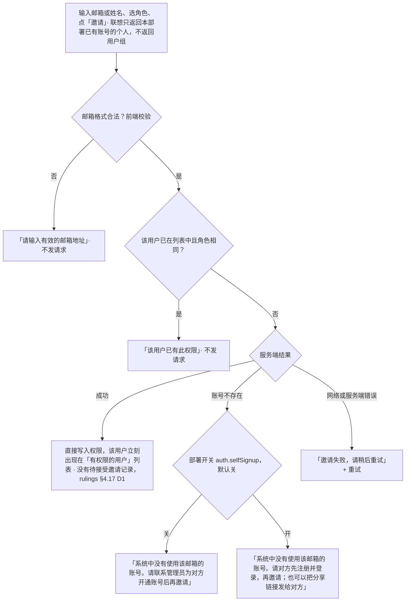
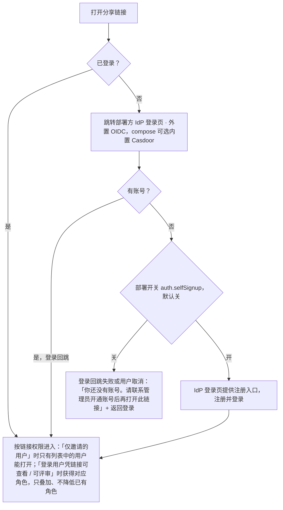

> 状态：草稿 | 负责：设计 | 更新：2026-09-15；2026-09-24（rulings §4.15：T-0 单组织去租户、Q6 按人分享 / 组管理推迟 / 分享链接要求登录 / `auth.selfSignup` 默认关）；2026-09-24（复核修正，rulings §4.17）；2026-09-25（补图）；2026-09-25（矛盾收口，rulings §4.18） | 依赖：charter v0.1；rulings §4.13 S-1、§4.15 T-0 / Q6、§4.18 BE-02
>
> **2026-09-24 修订说明（rulings §4.15）**：一次部署 = 一个组织，界面中不再出现"组织内 / 组织外 / 租户"的区分；M3 只按人分享（用户组授权随 U-11 推迟，邀请输入框不搜索组）；链接权限去掉"任何拥有链接的人"（含匿名语义），分享链接始终要求登录（延续 S-1 不匿名）；邀请失败区分"账号不存在"并按部署开关 `auth.selfSignup`（默认关）给出不同文案；删除"席位上限"措辞（自托管无按席位计费，房间在场名额见 05 §1、03-screens/12）。

# 03-08 分享与权限对话框

> **设计基准（2026-09-15 起）**：组件规格以 [`09-design-specification.md`](../09-design-specification.md) v3.0（shadcn Rhea + 材质层）为准；对应 playground 路由 `#/editor/share`（[已发布 artifact](https://claude.ai/code/artifact/cf6e1a1a-986b-48bb-b743-5758dff419d2)，源码 `playground/src/routes/`）。本文引用的 `mockups/*.html` 与线框图为历史静态稿，以 playground 实际渲染为终稿。

`ui.dialog` 贡献（内置），使用 `DialogShell`（设计 04 §4.1）。

---

## 线框（默认态，所有者/管理者视角）

```
┌───────────────────────────────────────────────┐
│ 分享"季度汇报.pptx"                          [×]│
├───────────────────────────────────────────────┤
│ 邀请协作者                                       │
│ 邀请协作者（可见标签）                          │
│ [例如 lilei@example.com........] [可评审▾] [邀请]  │
│ 输入同事的邮箱或姓名，默认权限为"可评审"（帮助文字）│
├───────────────────────────────────────────────┤
│ 有权限的用户                                     │
│ (●我) 我（所有者）                     所有者     │
│ (●B) 王小明  wang@example.com      [可编辑▾][×] │
│ (●C) 李雷    li@example.com        [可评审▾][×] │
├───────────────────────────────────────────────┤
│ 通过链接分享                                     │
│ 🔗 https://…/d/8f2a…            [复制链接]       │
│ 链接权限：[登录用户凭链接可查看▾]                   │
│ 打开链接需要先登录（帮助文字）                     │
│ ☐ 允许通过链接访问的用户下载/打印                   │
└───────────────────────────────────────────────┘
```

**邀请对象只有"人"**（rulings §4.15 Q6：组管理 U-11 推迟，M3 只按人分享）：邀请输入框的联想只返回本部署内已有账号的用户（姓名 + 邮箱），不返回用户组、不出现"组"图标或"组成员展开"之类的行；"有权限的用户"列表同样只有个人行。组授权若将来恢复，另行设计，不在本界面预留占位。

链接权限下拉选项（单组织，rulings §4.15 T-0；原"组织内可查看 / 组织内可评审 / 任何拥有链接的人可查看"三项作废）：

| 选项 | 含义 |
|---|---|
| 仅邀请的用户可访问（默认） | 链接本身不授予任何角色；只有列表中的用户能打开 |
| 登录用户凭链接可查看 | 本部署的任意已登录账号打开链接即获得"可查看" |
| 登录用户凭链接可评审 | 同上，获得"可评审"（可评论） |

- 下拉下方常驻帮助文字"打开链接需要先登录"：分享链接**始终要求登录**，没有匿名/访客访问（rulings §4.13 S-1，§4.15 Q6 延续）。未登录者打开链接先走部署方 IdP 登录（OIDC），登录回跳后按链接角色进入；无账号者的处理见"边界情况"。
- 链接角色只叠加在已登录用户已有的权限之上，不会降低其已有角色（与 ADR-0029 `ShareLinkGuard` 口径一致）。
- 不提供"可编辑"链接角色：编辑权限只通过按人邀请授予。

---

## 状态

### 空（尚无额外成员）

"有权限的用户"仅显示所有者一行，不显示空状态插画（这是正常初始态，不是需要引导的"空"）。

### 加载

成员列表显示骨架行（头像圆点 + 灰条 + 角色下拉骨架），邀请输入框保持可用。

### 错误（邀请失败）

```
│ [输入邮箱...] [可编辑▾] [邀请]              │
│ ⚠ 系统中没有使用该邮箱的账号。请联系管理员为对方  │
│   开通账号后再邀请                            │
```

内联错误文案出现在输入区正下方，不使用 `alert()`。按原因区分（原"该邮箱未注册，或已达到席位上限"合并文案作废——自托管部署不按席位计费，不存在"席位上限"这一邀请失败原因）：

| 原因 | 文案 | 说明 |
|---|---|---|
| 账号不存在，`auth.selfSignup` 关（默认） | "系统中没有使用该邮箱的账号。请联系管理员为对方开通账号后再邀请" | 账号由管理员邀请或在 IdP 中创建（rulings §4.15 Q6）；不提供"仍然邀请"之类的待定邀请入口 |
| 账号不存在，`auth.selfSignup` 开 | "系统中没有使用该邮箱的账号。请对方先注册并登录，再邀请；也可以把分享链接发给对方" | 注册在 IdP 完成，本对话框不承载注册 |
| 邮箱格式不合法 | "请输入有效的邮箱地址" | 前端校验，不发请求 |
| 该用户已在列表中且角色相同 | "该用户已有此权限" | 不发请求 |
| 网络/服务端错误 | "邀请失败，请稍后重试" + [重试] | — |

`auth.selfSignup` 是部署级开关（默认关），前端从运行时配置读取，只决定文案分支，不改变邀请流程本身。

**邀请只对已存在账号生效**（rulings §4.17 D1）：服务端没有"待接受邀请"记录，邀请成功即直接写入权限、该用户立刻出现在"有权限的用户"列表中；对没有账号的邮箱只给上表错误文案，界面不出现"已邀请 · 未接受"行、撤回邀请或"仍然邀请"等待定邀请入口。

**邀请协作者的判定流程**



怎么读：前两个菱形是前端校验，不发请求；之后只有「成功」一条路径会改变权限，账号不存在时按部署开关给出两种文案，界面不留任何待定邀请。错误文案都内联显示在输入区正下方。

### 离线

```
│ ⚠ 离线时无法邀请协作者或生成分享链接 │
```

邀请输入框、链接权限下拉、"复制链接"均禁用；已加载的成员列表以缓存内容只读展示。

### 权限不足（非所有者/管理者打开）

```
┌───────────────────────────────────────────────┐
│ 谁能访问"季度汇报.pptx"                      [×]│
├───────────────────────────────────────────────┤
│ (●我) 王小明（我）                     可编辑    │
│ (●A) 张三（所有者）                    所有者    │
│ (●C) 李雷                              可评审    │
│                                                 │
│ 仅所有者或管理者可以更改分享设置                    │
└───────────────────────────────────────────────┘
```

整体降级为只读查看态：无邀请输入框、无角色下拉（纯文本角色标签）、无移除按钮、无链接分享区（或仅展示只读的当前链接权限说明）。

---

## 交互说明

- **表单与对话框语义**（2026-09-15 评审，规则 input-labels / modal-escape）：邀请输入框有可见标签"邀请协作者"与持久帮助文字，占位符只做示例、不承担标签职责；校验错误显示在字段下方并以 `aria-describedby` 关联；对话框 `role="dialog"` + `aria-modal="true"` + `aria-labelledby`，焦点进入/循环/归还规则同 03-screens/10；"移除协作者"为不可撤销操作，走确认。
- 角色下拉：可编辑 / 可评审 / 可查看（术语对应章程角色概念，具体命名与 PRD 权限模型对齐，见 README 待决事项）。变更即时生效，见 05-collaboration-ux.md §8"权限变化即时反馈"。
- 移除某成员：与上条一致走确认——点击 `×` 后在该行内嵌确认（"移除 王小明？对方将立即失去访问权限" + [移除] [取消]，不另开模态），确认后该行 240ms 淡出；移除**自己**时确认文案为"你将无法继续访问此文档"，确认后跳转回文档列表。（2026-09-24 删去原"不使用二次确认"旧说法，rulings §4.17 复核 M22。）
- "复制链接"点击后按钮短暂变为"已复制 ✓"（1.5 秒后恢复），不使用系统级通知。
- 链接权限从更严格改为更宽松时（如"仅邀请的用户"→"登录用户凭链接可查看"）不需要二次确认；从宽松收紧、撤销链接或链接到期时，已凭旧链接角色进入的用户按"直接授权与仍有效的链接角色取高者"重新计算权限：在线协同会话在 **1 秒内**被降权——仍有角色的降为该角色（`readonly-degraded` 权限降级横幅），不再有任何角色的进入"访问权限已变更"阻断并引导申请访问；其余 HTTP 请求同样按新权限判定（见 03-screens/12 权限变更分支）。他人修改**其他成员**的权限不会踢出或打断这些链接会话（rulings §4.18 BE-02）。不存在匿名会话（S-1）。

## 边界情况

- 邀请一个已经拥有更高权限的用户（如已是可编辑，又被邀请为可评审）：以本次邀请的角色为准（覆盖），邀请前给出内联提示"该用户当前为可编辑，邀请后将变为可评审"，避免误降权。
- 大量成员：列表虚拟滚动 + 搜索框过滤（超过约 20 人时显示搜索框）。
- 转移所有权：不在当前范围内设计（见 README 待决事项，需产品确认是否需要该能力）。
- ~~组织外邮箱邀请~~（已结案，rulings §4.15 T-0）：单组织部署没有"组织内 / 组织外"之分，能被邀请的就是本部署中已有账号的用户；原"不允许邀请外部邮箱"错误态删除。
- 无账号者打开分享链接：先跳转部署方 IdP 登录页。`auth.selfSignup` 关（默认）时，IdP 登录页不显示注册入口，本应用在登录回跳失败/用户取消时显示"你还没有账号。请联系管理员开通账号后再打开此链接"+ [返回登录]；`auth.selfSignup` 开时，由 IdP 登录页提供注册入口，注册并登录后按链接角色进入。登录 / 注册页本身属于 IdP（compose 可选内置 Casdoor），其主题定制见 README 缺口 G-66。
- 用户组：不支持按组邀请（U-11 推迟）。粘贴一个邮件组地址时按普通邮箱处理（多半命中"账号不存在"文案），不做特殊识别。

**打开分享链接的登录与进入流程**



怎么读：任何路径都必须先登录才会到达「按链接权限进入」，没有匿名 / 访客分支；登录与注册页属于 IdP，本应用只负责回跳后的处理。链接永远不授予「可编辑」，编辑权限只通过按人邀请授予。
