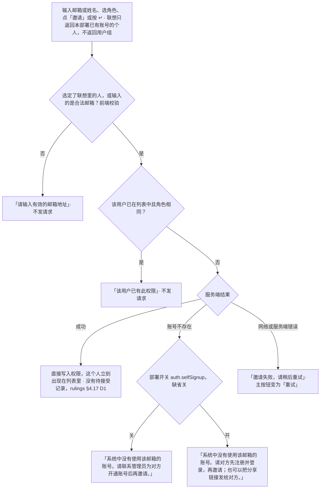
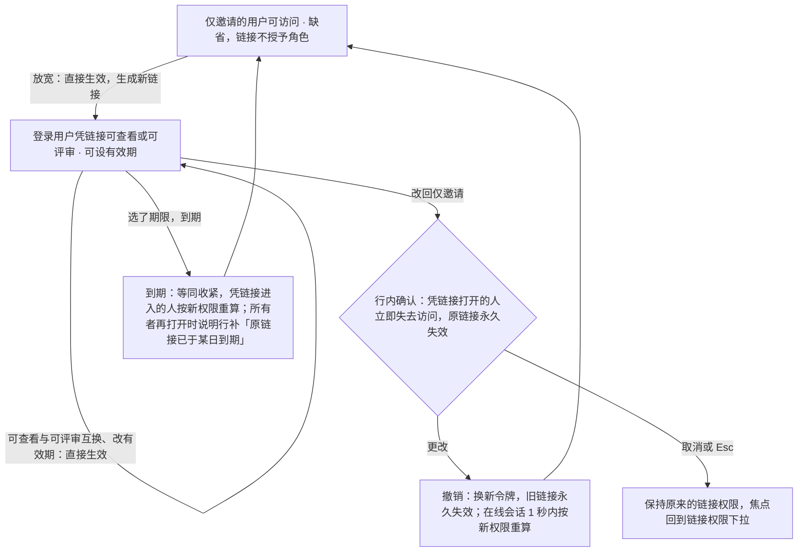
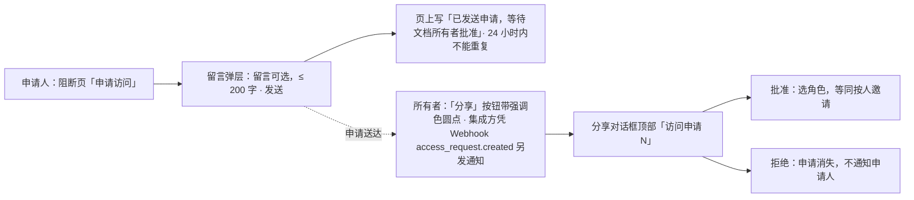
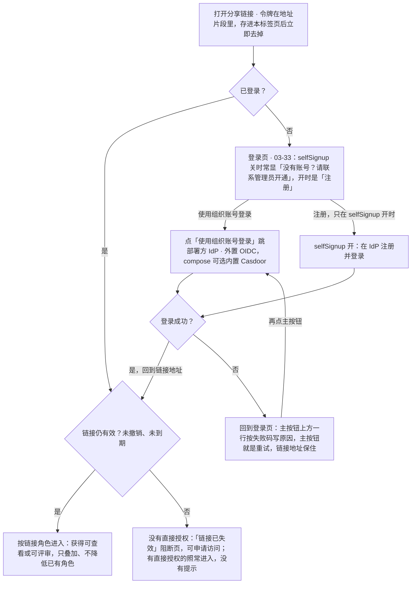

> 状态：草稿 | 负责：设计 | 更新：2026-09-15；2026-09-24（rulings §4.15：T-0 单组织去租户、Q6 按人分享 / 组管理推迟 / 分享链接要求登录 / `auth.selfSignup` 默认关）；2026-09-24（复核修正，rulings §4.17）；2026-09-25（补图）；2026-09-25（矛盾收口，rulings §4.18）；2026-10-03（rulings §4.24 AL-5：删去「允许通过链接访问的用户下载/打印」开关，PRD 无此需求、浏览器内无法真正阻止导出；AL-1 重申链接不授予可编辑）；2026-10-15（design-language-v3 第 2 批：按已拍板样张 `share` 整篇改写——①线框按 v3 重画：检查器顶行「分享」打开 480 宽、顶部锚定的对话框，节序为访问申请（有时）· 邀请协作者 · 有权限的用户 · 通过链接分享，没有底栏，唯一的主按钮是「邀请」；②成员行的角色是 Select 的列表行内变体（无框文字「可编辑 ⌄」，悬停、聚焦、展开时才铺底），「移除」收进角色下拉末项、就地行内确认，原行尾 × 作废（DS-40）；③链接区不显示地址，只留权限下拉 +「复制链接」一行，有效期（永久 / 7 天 / 30 天）只在链接授予角色时出现，改回「仅邀请」即撤销、行内确认写明原链接永久失效（DS-47）；④非所有者打开只读的「谁能访问…」（不显示邮箱，顶部一行「只读 · 只有所有者可以更改分享设置」）；所有者端在对话框顶部「访问申请 N」一节选角色后批准 / 拒绝，「分享」按钮带强调色待处理圆点；申请人在阻断页「申请访问」打开留言弹层，发送后页内写「已发送申请，等待文档所有者批准」（DS-48）；⑤加载为「转圈 + 一句话」、加载失败为内联错误行，邀请一节照常可用、链接一节写「暂时无法设置」，原骨架行作废（DS-53、DS-62）；⑥离线说明改为中性说明行，文档已被删除时「分享」不可用（DS-62）；§3 列 26 个样张状态与 2 个未采纳的备选（DS-63）；补焦点交接与读屏；依据 rulings §4.25 DS-1、DS-15、DS-35…DS-37、DS-40、DS-42、DS-47、DS-48、DS-53、DS-62、DS-63；同日再补：§3、§4.3、§6 链接到期等同收紧——所有者再打开时链接权限回到「仅邀请的用户可访问」、说明行补「原链接已于〈日期〉到期」、再放宽时生成新链接，状态 `share.link-expired`（样张随后补画），图 4-2 补到期一支（DS-66）；§4.4、图 4-3 写明所有者另经集成方收到通知，依据是 M3 新增的 Webhook 事件 `access_request.created`（DS-67）；§4.4、§4.5、§6 申请被拒不告知申请人，再打开时阻断页与第一次相同、满 24 小时可再申请（DS-68）；§1.3、§4.3 非所有者只拿到姓名、角色与当前有效链接的角色，「复制链接」一律复制文档地址，文档列表的协作者摘要不放宽（TB-65）；§2 待处理圆点的数据来源与刷新时机（TB-68）；§3.1、§4.3 删去「令牌只在创建时返回一次」，不显示地址的理由改为简洁，复制取所有者可见的令牌（TB-71）；§6 回收站里的文档照常收申请（TB-73）；同日再补：设计基准与 §3 的状态数改为 28（DS-66 的 `share.link-expired` 已画，新增 `share.no-permission-link`）；§1.3、§3、§4.3、§6、§7 链接授予角色时非所有者的「复制链接」复制分享链接、说明行的含义与所有者相同，令牌取自成员列表读者视图的 `link`（只在链接授予角色时带令牌，不含有效期与链接 id），`GET …/share-links` 仍只给所有者、前端只发一次请求，原「非所有者一律复制文档地址」作废（DS-69、TB-86，修订 TB-65 的同一句）；§4.3、§6 对话框开着时链接到期，下一次改动得 404 后不出提示、重新取链接设置并换成到期的显示，日期取该链接的 `expiresAt`，再放宽按新建处理（DS-66、TB-72；50/02 §8、50/15 §4.3）；同日再补：§4.3「复制链接」补令牌暂时取不到时的写法——服务端解密失败只省略令牌，链接授予角色时「复制链接」留在原位、不可用，写「暂时无法取得分享链接，请稍后重试」，说明行照常，所有者与非所有者同一处理，不退而复制文档地址；§1.3、§3 表后「样张没有单独画」、§6 各补一句指向它（rulings §4.25 TB-91）；同日再补：§3 状态表 `share.link-expired` 的状态名改为「链接 · 已到期」，与样张标题一致，「所有者再打开对话框」写在说明列（DS-66））；2026-10-22（design-language-v3 第 3 批：只改与第 3 批裁决有关的段落——§2 入口补开始页「最近」与文档列表卡片「⋯」菜单的「分享…」（同一份卡片菜单，DS-81；查看者的卡片菜单同样有，打开只读的「谁能访问…」，DS-82），对话框叠在当前壳页面路由上，关闭后回到原列表与滚动位置、焦点回卡片，浏览器后退等于关闭（TB-109，原「随第 3 批」结案）；§1.4、§6 申请人一侧：文档不存在（404）是单独的「找不到该文档」、不给「申请访问」（DS-122），回收站里的文档按三类人分（DS-85、TB-73），链接已撤销或到期是「链接已失效」阻断页、照常可以申请访问（03-33）；§4.5 发送后的「申请访问」保持 kit 主按钮不可用态（DS-123）；§6「无账号者打开分享链接」与图 6-1 按登录页改写：先到登录页、必须点一下才跳 IdP，selfSignup 关时登录页常显「没有账号？请联系管理员开通」、分享落地不另加，登录失败回登录页内联报错、不再说「你还没有账号」，重试保住链接地址（DS-118…DS-120、TB-122）；§7 头像一律身份色首字（TB-123）；依据 rulings §4.25 DS-81、DS-82、DS-85、DS-118…DS-120、DS-122、DS-123、TB-73、TB-109、TB-122、TB-123）；2026-10-22（design-language-v3 第 3 批回写续：§2 入口写明开始页与文档列表上叠的壳页面路由 `/home?share=<id>`、`/documents?share=<id>`（TB-109，路由登记在 50/02 §2），非所有者从卡片打开的同样是只读的「谁能访问…」，「关闭」一条补从卡片打开的焦点交回那张卡片；§2 新增 M2 一条——对话框随 PRD CO-15 在 M3 开放，M2 的编辑器「分享」与卡片菜单「分享…」留在原位、不可用，写「后续版本提供」（rulings §4.25 DS-137）；同日再补：§4.5 新增 M2 一条——阻断页照常出现，「申请访问」与 M2 的「分享」同一规则：留在原位、不可用、保持 kit 主按钮不可用态，工具提示「申请访问 · 后续版本提供」，不弹留言弹层，「返回文档列表」照常，M3 起可用；§1.4、§2 M2 一条与 §3「样张没有单独画」随之引用（rulings §4.25 TB-156）；2026-10-22 复核修正：§1.4、§4.5 的 M2 一条补阻断页的说明句不变、三个里程碑同一版式与文案（rulings §4.25 TB-156），§6「回收站里的文档」从未获授权的人一行注明申请 M3 起才记下；状态头的回写轮次字样改为「回写续 / 同日再补」）；2026-10-23（design-language-v3 第 3 批评审修改：对话框按 rulings §4.25 DS-142 改为标题栏 40、圆角 12、× 用正文色（悬停铺 `--v3-panel-2`），原圆角 8、标题栏 48、× 次级文字色作废——§1.2 线框注记与「对话框」一条、§3 写明开对话框的各态随之改画（一出现就展开的下拉随正文上移 8）、§7 速查同步） | 依赖：charter v0.1；PRD `03-collaboration.md` CO-05、CO-15，`06-server-and-ops.md` SV-06、SV-15；PRD 07 G-56、G-61；rulings §4.13 S-1、§4.15 T-0 / Q6、§4.17 D1、§4.18 BE-02、§4.24 AL-1 / AL-5 / TA-10、§4.25 DS-1、DS-15、DS-35…DS-37、DS-40、DS-42、DS-47、DS-48、DS-50、DS-53、DS-62、DS-63、DS-66…DS-69、DS-81、DS-82、DS-85、DS-118…DS-120、DS-122、DS-123、DS-137、TB-65、TB-68、TB-71…TB-73、TB-86、TB-91、TB-109、TB-122、TB-123、TB-156；前端 50/02 §2、§8、§11，50/10 §2.3，50/15 §4.3；后端 60/02 §7、60/07 §4.2、60/09 §6、60/15 §3.2…§3.5；playground `#/v3/editor?state=share.*`（`src/v3/scenarios/share/`）

# 03-08 分享与权限对话框

> **设计基准（2026-10-15 起，rulings §4.25 DS-47、DS-48）**：以已拍板的 playground 第 2 批样张 `#/v3/editor?state=share.<状态 id>` 为准（28 个状态，含回写中补的 `share.link-expired`（DS-66）与 `share.no-permission-link`（DS-69），另有 2 个标「未采纳」的备选，§3），源码在 `playground/src/v3/scenarios/share/`（`share.scenario.tsx` 各状态的标题与说明，`ShareDialog.tsx` 对话框与各节，`InviteBox.tsx` 邀请与联想，`LinkBlock.tsx` 链接权限、有效期与复制，`parts.tsx` 分节、角色下拉与行内确认，`RequestAccess.tsx` 申请人的留言弹层，`ShareLayer.tsx` 入口与「分享」按钮的待处理圆点，`people.ts` 示例数据）；对照截图 `openspec/changes/design-language-v3/screens/batch2/share-<状态>-dark.jpg` / `-light.jpg`；编辑器外壳以 [03-02](02-editor-main.md) 为准。此前的线框（只读链接地址行、行尾 ×、骨架行、警告色离线条、「仅所有者或管理者可以更改分享设置」）以及 shadcn / 材质层时期的写法与旧路由 `#/editor/share` 作废。

所有者在这里按人邀请协作者、改角色与移除、设置链接权限与有效期、处理访问申请；非所有者打开的是只读的「谁能访问…」。覆盖 PRD CO-15（分享与访问入口，P1，M3）、PRD SV-06（权限管理与分享链接：可设角色与过期）与 PRD CO-05 的申请访问（PRD 07 G-56、G-61）。对话框是 `ui.dialog` 的内置贡献（kit `Dialog`，宽 480）。

几条不变的前提：一次部署 = 一个组织，界面不出现「组织内 / 组织外 / 租户」（rulings §4.15 T-0）；只按人分享，组管理（U-11）推迟，邀请框的联想不返回用户组、不出现「组」行，「有权限的用户」也只有个人行（rulings §4.15 Q6）；分享链接始终要求登录，没有匿名或访客访问（rulings §4.13 S-1）；邀请只对已存在账号生效，邀请即直接写入权限，没有「已邀请 · 未接受」行、撤回邀请或「仍然邀请」之类的待定邀请（rulings §4.17 D1）。

---

## 1. 线框

### 1.1 入口与位置

```
┌────────────────────────────────┐
│ (周)(王)(李)        ▶  [分享]• │  ← •：有待处理的访问申请时的圆点
└────────────────────────────────┘
```

- 「分享」在检查器顶行右端（28 高主按钮，`--v3-accent-solid`，03-02 §3.5）；网格视图与紧凑形态在右上「协作与分享」胶囊里，是同一个按钮（DS-1）。
- 对话框水平居中、顶部锚定：距视口顶 max(64, 12vh)，内容增减时只向下伸展（最大高随之扣除），标题与邀请框不跟着上下移动——加载完成、邀请成功、出错、访问申请、人多时的搜索框、收紧确认多出的几行都会改变高度。遮罩盖住编辑器（`--scrim`）。截图：`screens/batch2/share-default-*.jpg`，样张 `share.default`。

### 1.2 对话框结构（所有者视角，有一条访问申请）

```
┌────────────────────────────────────────────────────────────┐
│ 分享「2026 年 Q2 业绩汇报」                             ×  │  ← 标题栏 40：标题 13px 600 · 关闭（Esc）；没有底栏
├────────────────────────────────────────────────────────────┤
│ 访问申请 1                                                 │  ← 有待处理申请时才有，排在最上（§4.4）
│ (魏) 魏宁  wei.ning@example.com · 10 分钟前                │
│      周五评审要用，麻烦开一下查看权限                      │  ← 申请人的留言
│      [可查看 ⌄]  [批准]  拒绝                              │  ← 批准后的权限 · 次按钮 · 文字按钮
├────────────────────────────────────────────────────────────┤
│ 邀请协作者                                                 │  ← 可见标签即节标题（§4.1）
│ [例如 lilei@example.com          ] [可评审 ⌄] [邀请]       │  ← 唯一的主按钮
│ 输入同事的邮箱或姓名，默认权限为「可评审」                 │  ← 持久帮助文字；出错时换成错误行
├────────────────────────────────────────────────────────────┤
│ 有权限的用户 3                                             │  ← 节标题 + 计数（§4.2）
│ (周) 周明远（你）                                  所有者  │  ← 所有者一行是静态文字
│      zhou.mingyuan@example.com                             │
│ (王) 王小明                                       可编辑 ⌄ │  ← 行内角色下拉：无框，悬停才铺底
│      wang.xiaoming@example.com                             │
│ (李) 李雷                                         可评审 ⌄ │
│      li.lei@example.com                                    │
├────────────────────────────────────────────────────────────┤
│ 通过链接分享                                               │  ← §4.3
│ [锁 仅邀请的用户可访问                ⌄] [链 复制链接]     │  ← 不显示链接地址（DS-47）
│ 只有上面列出的人能打开此链接。打开链接需要先登录。         │  ← 说明行；收紧时换成行内确认
└────────────────────────────────────────────────────────────┘
```

链接授予角色时，同一行多一个「有效期」：

```
┌────────────────────────────────────────────────────────────┐
│ 通过链接分享                                               │
│ [楼 登录用户凭链接可评审  ⌄] [有效期 7 天 ⌄] [链 复制链接] │  ← 授予角色时才有「有效期」
│ 本部署的任何人凭链接即可查看和评论，链接 10 月 15 日到期。 │
│ 打开链接需要先登录。                                       │
└────────────────────────────────────────────────────────────┘
```

图例：`(周)` 等为身份色头像；`⌄` 下拉；`锁` / `楼` / `链` 分别是「仅邀请」的锁形图标、「凭链接」的楼宇图标与链接图标；`[ ]` 框内是带细边的字段、下拉或按钮，`可编辑 ⌄` 不带框是成员行里的行内角色下拉。截图：`screens/batch2/share-access-requests-*.jpg`、`share-link-expiry-*.jpg`。

- **对话框**：宽 480（窗口窄时不超过视口宽 − 32）、圆角 12、`--v3-panel` 底、1px 边、浮层阴影；标题栏 40（含下方 1px 分隔）：标题「分享『文件名』」（13px 600）+ 右上「关闭」（24 的 ×，用正文色、悬停铺 `--v3-panel-2`，工具提示 Esc）。标题栏、圆角与 × 是 kit 对话框的画法（设计 04 §4.1a），2026-10-23 按 Figma 统一（rulings §4.25 DS-142；原圆角 8、标题栏 48、× 用次级文字色作废）。权限即时生效，所以**没有底栏**（没有「完成 / 应用」）；唯一的主按钮是「邀请」（设计质量门 Q3）。
- **各节**同检查器的分节：左右 16、上下 12，节标题 12px 600，标题后的计数 12px `--v3-text-2`，节与节之间 1px 通栏分隔。顺序：访问申请（有时）→ 邀请协作者 → 有权限的用户 → 通过链接分享。

### 1.3 非所有者：「谁能访问…」（DS-48）

```
┌────────────────────────────────────────────────────────────┐
│ 谁能访问「2026 年 Q2 业绩汇报」                         ×  │
├────────────────────────────────────────────────────────────┤
│ 锁 只读 · 只有所有者可以更改分享设置                       │  ← 说明行（DS-15）
├────────────────────────────────────────────────────────────┤
│ 有权限的用户 4                                             │
│ (周) 周明远（你）                                  可编辑  │  ← 单行，不显示邮箱
│ (张) 张三                                          所有者  │
│ (王) 王小明                                        可编辑  │
│ (李) 李雷                                          可评审  │
├────────────────────────────────────────────────────────────┤
│ 通过链接分享                                               │
│ 锁 仅邀请的用户可访问                        [链 复制链接] │  ← 当前链接权限只读一行
│ 只有上面列出的人能打开此链接。打开链接需要先登录。         │
└────────────────────────────────────────────────────────────┘
```

链接授予角色时（样张 `share.no-permission-link`，rulings §4.25 DS-69），只读一行写当前链接权限，说明行的含义与所有者相同：

```
│ 通过链接分享                                               │
│ 楼 登录用户凭链接可查看                      [链 复制链接] │  ← 复制的是分享链接
│ 本部署的任何人凭链接即可查看。打开链接需要先登录。         │  ← 不写有效期与到期日
```

- 编辑者、评审者、查看者点「分享」，打开的是这个只读视图（样张 `share.no-permission`；链接授予角色时 `share.no-permission-link`）：标题「谁能访问『文件名』」；顶部一行说明「只读 · 只有所有者可以更改分享设置」（锁形图标，与检查器的只读说明同一组件，DS-15）；没有访问申请一节、邀请框、角色下拉与移除，不画不可用控件。
- 成员只列头像（20）、姓名（自己加「（你）」）与角色文字（`--v3-text-2`，右对齐），单行 32 高，**不显示邮箱**；顺序同所有者视角（§4.2）。
- 链接只读一行：当前链接权限（图标 + 文字）+「复制链接」；下面一行说明，含义与所有者相同（§4.3 链接权限表的「说明行」），不写有效期与到期日。「复制链接」与所有者一致（rulings §4.25 DS-69，同 Figma）：链接为「仅邀请」时复制文档地址（列表里的人都能打开）；链接授予角色时复制凭链接访问的分享链接（带令牌），效果与说明行一致；令牌暂时取不到时与所有者同一处理（§4.3，rulings §4.25 TB-91）。所有者改回「仅邀请」或链接到期后这条令牌照样作废（DS-47、DS-66），此前复制出去的分享链接随之失效（§6）。原「非所有者一律复制文档地址、拿不到带令牌的分享链接」（TB-65 的这一句）作废。
- 后端成员列表接口（`GET /documents/:id/permissions`，60/15 §3.4）与前端的权限守卫随之放宽到能读文档的角色（DS-48）；对非所有者只给姓名与角色（不含邮箱），另附当前有效链接的摘要 `link`——链接的角色，链接授予角色时另带令牌；不含有效期与链接 id，不列已撤销、已到期的链接（rulings §4.25 TB-65、DS-69、TB-86）。链接设置（`GET …/share-links`）仍只给所有者；非所有者打开对话框时前端只发成员列表这一次请求，只有这一处链接摘要（60/15 §3.5，50/02 §8）。文档列表卡片上的协作者摘要不随之放宽，仍只给所有者（rulings §4.24 TA-10）。原「仅所有者或管理者可以更改分享设置」作废：没有「管理者」角色，只有所有者能管理分享。

### 1.4 申请人一侧：阻断页与留言弹层（DS-48）

```
                         锁（32）
                   你没有权限访问此文档
       可以向文档所有者申请访问，获得批准后即可打开
                [申请访问]  [返回文档列表]
         ┌────────────────────────────────────────┐
         │ 申请访问                               │
         │ 文档所有者批准后即可打开               │
         │ ┌────────────────────────────────────┐ │
         │ │ 留言（可选）：说明你为什么需要访问 │ │
         │ │                              0/200 │ │
         │ └────────────────────────────────────┘ │
         │                         [取消] [发送]  │
         └────────────────────────────────────────┘
```

发送之后：

```
                         锁（32）
                   你没有权限访问此文档
       可以向文档所有者申请访问，获得批准后即可打开
             ✓ 已发送申请，等待文档所有者批准
                [申请访问]  [返回文档列表]
```

- 阻断页占满整个工作区（不渲染左栏、检查器与工具条），与第 1 批「打开失败 · 没有访问权限」（`main-states.open-failed-access`）同一页面与文案；留言弹层与发送后的样子见 §4.5。样张 `share.request-access`、`share.request-access-sent`。
- 同一个件的另一处入口：会话中访问被撤销后的阻断页（DS-50，03-12，样张 `offline-conflict.access-revoked` / `access-requested`）。分享链接已撤销或到期、又没有直接授权时是同一布局的「链接已失效」阻断页（断链图标，第一句「这个分享链接已被撤销或已过期」），「申请访问」打开同一个弹层（[03-33](33-login-session-and-error-pages.md) §7.3，样张 `shell-pages.link-expired`）。
- 文档不存在（404）不用这一页：单独的「找不到该文档」阻断页，只有「返回文档列表」，不给「申请访问」——对不存在的文档申请必然再得 404（2026-10-22 第 3 批拍板，rulings §4.25 DS-122，03-33 §7.2）。
- M2 的阻断页照常出现，「申请访问」留在原位、不可用，阻断页的说明句不变（§4.5，rulings §4.25 TB-156）。

### 1.5 紧凑与仅查看形态

- **紧凑窗口（640–1024）**：「分享」在右上「协作与分享」胶囊里（同一个按钮，同样带待处理圆点），对话框同桌面。
- **仅查看（< 640 或触控）**：没有「分享」入口——这一形态的「更多」只放查看类命令（03-02 §5a.2）。申请人一侧的阻断页与留言弹层在窄屏上的画法样张未画，随实现。

---

## 2. 入口、打开与关闭

- **入口**：编辑器里是检查器顶行（网格视图与紧凑形态在右上胶囊里）的「分享」，对话框路由 `/documents/:id/share`（50/02 §2）。开始页「最近」与文档列表的卡片「⋯」菜单（同一份卡片菜单，rulings §4.25 DS-81）里的「分享…」打开同一个对话框（PRD AS-02，03-29、03-01 §4.3）：对话框叠在当前壳页面的路由上——开始页 `/home?share=<id>`、文档列表 `/documents?share=<id>`（列表原有的查询参数照留，路由登记以前端 50/02 §2 为准），不进编辑器；关闭后回到原列表与原来的滚动位置、焦点回到那张卡片，浏览器后退等于关闭（rulings §4.25 TB-109）。非所有者（编辑者、评审者、查看者）从卡片打开的同样是只读的「谁能访问…」（DS-82、DS-48）。
- **打开什么**：所有者打开「分享『文件名』」（§1.2）；非所有者打开只读的「谁能访问『文件名』」（§1.3，DS-48）。
- **「分享」不可用**：文档打开中「文档打开后可用」（03-02 §3.5）；文档已被删除「文档已被删除」（DS-62，样张 `offline-conflict.doc-deleted`）。留在原位、仍可聚焦，工具提示「分享 · 原因」。离线时「分享」照常可点，对话框里写明离线（§4.6）。
- **M2**：本对话框随 PRD CO-15 在 M3 开放。M2 的编辑器「分享」按钮与卡片菜单「分享…」都留在原位、不可用：按钮的工具提示「分享 · 后续版本提供」，菜单项标 M3、右侧写「后续版本提供」（2026-10-22，rulings §4.25 DS-137，§4.20 FE-06「禁用而不隐藏」；与回收站「永久删除…」在 M2 的画法一致，03-02 §3.5、03-01 §4.3）。用户未采用的备选：M2 不显示；M2 只给只读的「谁能访问…」。申请人一侧阻断页上的「申请访问」同一规则（§4.5，rulings §4.25 TB-156）。
- **待处理圆点**（DS-48，样张 `share.request-pending`）：所有者有待处理的访问申请时，「分享」右上角一个 8px 强调色圆点，带 2px 面板色外圈，`aria-hidden`；按钮的读屏名与工具提示为「分享（N 个待处理的访问申请）」。不用红色：设计质量门 Q3 把状态色留给失败、离线、冲突这类风险。圆点由待处理申请数驱动，与对话框里「访问申请 N」是同一份数据：批准或拒绝后随之减少，清零即消失。数据来源（rulings §4.25 TB-68）：所有者打开编辑器时随文档详情取一次待处理数（60/15 §3.3，只给所有者）；打开分享对话框时以访问申请列表为准、回写圆点；本端批准或拒绝后直接减一；不做实时推送——对话框关着时新到的申请，要到下次打开编辑器或打开分享对话框才出现在圆点上，及时的提醒由集成方发给所有者（§4.4，DS-67）。数值由宿主传给 `ShareButton`（属性名见前端 50/10 §2.3）。只有所有者看到（非所有者的只读视图没有这一节，也不带点）；按钮不可用时不带点；检查器顶行与网格胶囊里的「分享」是同一个。已知代价：「分享」本身是强调色主按钮，圆点与它同色、只靠 2px 面板色外圈分开，亮色下不太显眼。
- **打开时的焦点**：用户打开时落在正文第一个控件——有访问申请时是第一条申请的角色下拉，否则是邀请输入框；只读视图是「复制链接」。
- **关闭**：右上 ×、Esc 或点遮罩；焦点交回打开它的「分享」（从开始页、文档列表卡片打开的交回那张卡片，TB-109）。Esc 逐层（设计 07 §2.3「一下 Esc 关一层」）：联想列表、下拉菜单、行内确认开着时先关它们，不越级关掉对话框。

---

## 3. 状态

样张路由均为 `#/v3/editor?state=share.<状态 id>`（暗 / 亮另加 `&theme=dark|light`）；示例的「今天」是 10 月 8 日。全部为 M3（PRD CO-15、SV-06；访问申请为 PRD CO-05 / PRD 07 G-56）。2026-10-23 起对话框按 rulings §4.25 DS-142 改为标题栏 40、圆角 12、× 用正文色（§1.2）：除不开对话框的 `share.request-pending`、`request-access`、`request-access-sent`，下表与 §3.1 各态随之改画，要点不变；一出现就展开的下拉（`share.link-expiry`、`link-menu`）随正文上移 8。

| 状态（样张标题） | 要点 | 样张 id |
|---|---|---|
| 所有者视角 | 邀请协作者 ┊ 有权限的用户（自己第一，所有者一行静态「所有者」，其余是行内角色下拉「可编辑 ⌄」）┊ 通过链接分享（缺省「仅邀请的用户可访问」·「复制链接」，说明行常驻「打开链接需要先登录」）；没有底栏，唯一主按钮「邀请」 | `share.default` |
| 空 · 只有所有者 | 有权限的用户只有所有者一行，不画空状态插画（这是正常初始态） | `share.empty` |
| 加载中 | 两节标题都在：「有权限的用户」一行「正在加载成员与链接设置…」，成员区按 3 行留高；「通过链接分享」一行「加载完成后可设置」；邀请一节照常可用；不画骨架行（DS-53） | `share.loading` |
| 加载失败 | 同一结构：「有权限的用户」一行危险色图标 +「成员与链接设置加载失败，请稍后重试」+「重试」（次按钮）；链接一节同一位置写「暂时无法设置」；邀请一节照常可用；不另开错误页（DS-53、DS-62） | `share.load-failed` |
| 邀请 · 联想 | 输入「王小」：只返回本部署已有账号的个人，按显示名前缀、至少 2 个字；联想行只有头像与姓名，已在列表里的写「已有权限 · 可编辑」 | `share.invite-suggest` |
| 邀请成功 | 王小雨立刻出现在有权限的用户里（排在所有者之后的第一位，短暂铺一层 `--v3-panel-2` 底），输入框清空，读屏「已邀请王小雨（可评审）」 | `share.invite-added` |
| 邀请失败 · 账号不存在 | `auth.selfSignup` 关（缺省）：「系统中没有使用该邮箱的账号。请联系管理员为对方开通账号后再邀请。」不提供「仍然邀请」 | `share.invite-no-account` |
| 邀请失败 · 账号不存在（可自助注册） | `auth.selfSignup` 开：「系统中没有使用该邮箱的账号。请对方先注册并登录，再邀请；也可以把分享链接发给对方。」 | `share.invite-no-account-signup` |
| 邀请失败 · 邮箱格式不对 | 「请输入有效的邮箱地址」，前端校验、不发请求 | `share.invite-invalid` |
| 邀请失败 · 已有此权限 | 李雷已是「可评审」又被邀请为「可评审」：「该用户已有此权限」，不发请求 | `share.invite-duplicate` |
| 邀请 · 会降低已有权限 | 王小明当前「可编辑」，被邀请为「可评审」：邀请前先给一行警告色图标的提示「该用户当前为可编辑，邀请后将变为可评审」，以本次邀请为准 | `share.invite-downgrade` |
| 邀请失败 · 网络或服务端 | 「邀请失败，请稍后重试」；主按钮就地变为「重试」（改了输入框变回「邀请」），输入内容保留 | `share.invite-failed` |
| 成员 · 角色下拉 | 「可编辑 / 可评审 / 可查看」（右侧一句能做什么）┊「移除」（危险色）；变更即时生效 | `share.role-menu` |
| 成员 · 移除前行内确认 | 该行就地换成「移除王小明？对方将立即失去访问权限」+「取消 / 移除」，焦点先落「取消」；确认后该行 240ms 淡出（DS-40） | `share.remove-confirm` |
| 大量成员 | 超过约 20 人：节标题下出现搜索框（按姓名或邮箱过滤，右侧写命中人数），列表在节内滚动，邀请与链接两节留在原位 | `share.many-members` |
| 链接 · 权限下拉 | 三项：仅邀请的用户可访问（缺省）/ 登录用户凭链接可查看 / 登录用户凭链接可评审；末尾一行「编辑权限只能通过邀请授予」 | `share.link-menu` |
| 链接 · 凭链接可查看 | 放宽不确认；同一行多一个「有效期」；说明「本部署的任何人凭链接即可查看。打开链接需要先登录。」 | `share.link-view` |
| 链接 · 有效期 | 有效期下拉：永久有效 / 7 天 / 30 天（右侧写到期日）；选了期限后说明行写「链接 10 月 15 日到期」（DS-47） | `share.link-expiry` |
| 链接 · 收紧前确认 | 改回「仅邀请的用户可访问」：说明行换成行内确认，写明凭链接打开的人立即失去访问、原链接永久失效、再次放宽时生成新链接（DS-40、DS-47）；可评审 → 可查看直接生效 | `share.link-tighten` |
| 链接 · 已到期 | 所有者再打开对话框（布局同所有者视角）：到期等同收紧，链接权限下拉回到「仅邀请的用户可访问」，有效期不再出现，说明行在含义之后补「原链接已于〈日期〉到期」（日期取该链接的 `expiresAt`）；不经确认、不设「续期」，再放宽时生成新链接、这句随之消失（DS-66） | `share.link-expired` |
| 链接 · 已复制 | 「复制链接」变为「已复制」1.5 秒，同宽不跳，读屏「已复制链接」；不用系统级通知 | `share.link-copied` |
| 离线 | 顶部中性说明行「离线时无法邀请协作者或生成分享链接；成员列表为离线前的内容」（DS-62）；各控件留在原位不可用「离线时不可用」 | `share.offline` |
| 权限不足 · 非所有者打开 | 「谁能访问…」只读：顶部「只读 · 只有所有者可以更改分享设置」，成员只列姓名与角色，链接只读一行「仅邀请的用户可访问」+「复制链接」（复制文档地址）（DS-48） | `share.no-permission` |
| 权限不足 · 链接已开启 | 同上，所有者已把链接设为「登录用户凭链接可查看」：只读一行楼宇图标 +「登录用户凭链接可查看」+「复制链接」，说明行与所有者相同「本部署的任何人凭链接即可查看。打开链接需要先登录。」，不写有效期与到期日；「复制链接」复制凭链接访问的分享链接（带令牌，DS-69） | `share.no-permission-link` |
| 访问申请（所有者端） | 对话框顶部「访问申请 1」：申请人、留言与时间，选角色后「批准」（次按钮）或「拒绝」（DS-48） | `share.access-requests` |
| 有待处理的访问申请 · 「分享」按钮带提示 | 对话框关着：「分享」右上角强调色小圆点，读屏名与工具提示「分享（2 个待处理的访问申请）」 | `share.request-pending` |
| 申请访问 · 留言弹层（申请人） | 阻断页「申请访问」下方的非模态小弹层：留言（可选，≤ 200 字，计数常显）+「取消 / 发送」 | `share.request-access` |
| 申请访问 · 已发送（申请人） | 弹层收起，「申请访问」留在原位不可用（24 小时内不能重复），页上写「已发送申请，等待文档所有者批准」；不另出轻提示 | `share.request-access-sent` |

样张没有单独画、行为照常的：角色变更、移除、链接设置与批准 / 拒绝提交失败时的反馈（随实现）；令牌暂时取不到时不可用的「复制链接」（§4.3，TB-91）；对话框开着时链接到期（下一次改动后换成 `share.link-expired` 的显示，§4.3）；非所有者离线；申请被拒或仍在等待时申请人再打开文档（与第一次相同，§4.5）；会话中访问被撤销的阻断页（03-12，接同一个留言弹层）；M2 阻断页上留在原位、不可用的「申请访问」（§4.5，rulings §4.25 TB-156）。

### 3.1 未采纳的备选

拍板时画给用户对照的备选留在样张里，标题前加「未采纳 · 」，实现以上表的推荐状态为准（rulings §4.25 DS-63）。

| 备选（样张标题） | 画法 | 样张 id | 结论 |
|---|---|---|---|
| 行尾 × 移除 | 每行角色下拉后面一个 ×（所有者一行留空位对齐），点 × 后同样行内确认（原线框） | `share.alt-remove-x` | 未采纳，DS-40 定为推荐：「移除」收进角色下拉末项，每行只有一个控件 |
| 显示链接地址 | 链接区第一行只读链接地址 +「复制链接」，第二行「链接权限」下拉（原线框） | `share.alt-link-url` | 未采纳，DS-47 定为推荐：不显示地址，只留权限下拉与「复制链接」一行——为简洁，同 Figma；「复制链接」取所有者可见的令牌拼出分享链接（60/15 §3.5，TB-71） |

---

## 4. 交互

### 4.1 邀请协作者

- **输入框**：可见标签即节标题「邀请协作者」（`aria-labelledby` 指向它），持久帮助文字「输入同事的邮箱或姓名，默认权限为「可评审」」（`aria-describedby`），占位「例如 lilei@example.com」只做示例、不承担标签职责（2026-09-15 评审规则 input-labels）。28 高安静样式字段（DS-35）。
- **角色下拉**：带细边的 Select（宽 88），缺省「可评审」，三项同成员行（§4.2）。
- **「邀请」**（主按钮）：输入为空时不可用，写「先输入同事的邮箱或姓名」。↵（联想收起时）等同「邀请」。
- **联想**（combobox）：按显示名前缀、至少 2 个字；邮箱只做精确匹配、不回显（防枚举，`GET /users?query=`，60/15 §3.2），所以联想行只有头像（20）与姓名，输入完整邮箱命中时显示的是用户自己输入的那串邮箱；只返回本部署已有账号的个人。已在列表里的人右侧注明「已有权限 · 可编辑」。没有命中时一行说明：「没有姓名以「X」开头的同事；也可以输入完整邮箱」，输入的是邮箱时「输入完整邮箱后按「邀请」」。↑ ↓ 选择、↵ 选定（选定后框内先放这个人的身份色圆点，表示这串文字已对应到一个人），Esc 先收起联想、不关对话框；输入法组合中的 ↵ 不提交。
- **成功**：直接写入权限（`PUT /documents/:id/permissions`，没有待接受记录，rulings §4.17 D1），这个人立刻出现在「有权限的用户」里（排在所有者之后的第一位，短暂铺一层 `--v3-panel-2` 底），输入框清空、焦点留在输入框，读屏 polite 播报「已邀请王小雨（可评审）」。
- **错误**：内联在这一行正下方——危险色图标 + 危险色文字，`role="alert"`；输入框 `aria-invalid` 并 `aria-describedby` 指向它，框线换成危险色；不用 `alert()`。按原因区分：

| 原因 | 文案 | 说明 |
|---|---|---|
| 账号不存在，`auth.selfSignup` 关（缺省） | 系统中没有使用该邮箱的账号。请联系管理员为对方开通账号后再邀请。 | 服务端返回 `permission.principal_not_found`（60/15 §3.4）；账号由管理员在 IdP 中创建（rulings §4.15 Q6）；不提供「仍然邀请」之类的待定邀请入口 |
| 账号不存在，`auth.selfSignup` 开 | 系统中没有使用该邮箱的账号。请对方先注册并登录，再邀请；也可以把分享链接发给对方。 | 注册在 IdP 完成，本对话框不承载注册 |
| 邮箱格式不合法 | 请输入有效的邮箱地址 | 前端校验，不发请求 |
| 该用户已在列表中且角色相同 | 该用户已有此权限 | 不发请求 |
| 网络 / 服务端错误 | 邀请失败，请稍后重试 | 主按钮就地变为「重试」（同一请求只留一个入口，设计质量门 Q2），改了输入框就变回「邀请」；输入内容保留 |

- **会降低已有权限**（不是错误）：对方已有更高角色（如已是可编辑，又被邀请为可评审）时，邀请前在同一位置给一行提示（警告色图标，正文主文字色）「该用户当前为可编辑，邀请后将变为可评审」；仍可邀请，以本次邀请为准（覆盖），避免误降权。
- `auth.selfSignup` 是部署级开关（缺省关），只决定「账号不存在」的文案分支，不改变邀请流程本身。原「该邮箱未注册，或已达到席位上限」的合并文案作废：自托管部署不按席位计费，没有「席位上限」这一失败原因。

**图 4-1 邀请协作者的判定**



怎么读：前两个菱形是前端校验，不发请求；之后只有「成功」一条路径会改变权限，账号不存在时按部署开关给出两种文案，界面不留任何待定邀请。错误都内联在输入行正下方。会降低对方已有权限时的提示在提交前就出现，不是一个分支（图中省略）。
依据：rulings §4.15 Q6、§4.17 D1；PRD SV-06；样张 `share.invite-*`。

### 4.2 有权限的用户：角色与移除

- **成员行**（高 40）：身份色头像（24，12 色按用户 id 稳定取色，DS-42）· 姓名（自己加「（你）」，`--v3-text-2`）与邮箱（`--v3-text-2`）两行 · 右端角色。顺序：自己第一，其次所有者，其余按加入顺序（最近邀请的排在所有者之后的第一位）。
- **所有者一行**是静态「所有者」（`--v3-text-2`，右对齐，右缘与其余行的「⌄」同一列）：转让所有权不在 M3（PRD 07 D5，P2），文档的所有者也不能被降级或移除（`permission.last_owner`，60/15 §3.4）。只有所有者能管理分享，所以对话框里不会出现「移除自己」。
- **角色下拉的列表行内变体**（设计 04 §4.1 的 Select 变体）：平时无框无底，是右对齐到行尾的文字「可编辑 ⌄」（宽 88、高 28）；悬停、键盘聚焦、展开时铺 `--v3-panel-2`；不可用（离线）时文字与 ⌄ 退到 `--v3-text-3`、悬停不铺底，`aria-disabled`、仍可聚焦。人多时右侧一列不会排成二十多个框。邀请行与访问申请行的下拉仍是带细边的 Select。
- **下拉菜单**（右对齐展开，最小宽 184）：单选「可编辑 · 编辑与评论」「可评审 · 查看与评论」「可查看 · 只能查看」（右侧一句能做什么，`--v3-text-2`）┊「移除」（危险色）。角色对应章程的角色：可编辑 = editor、可评审 = commenter、可查看 = viewer。选定即收起、即时生效，读屏「王小明的权限已改为可评审」；对方 ≤ 2 秒收到（PRD CO-05，设计 05 §8）。
- **移除**（DS-40：入口在角色下拉里，行内确认，不另开模态）：选「移除」后该行就地换成确认——头像 +「移除王小明？对方将立即失去访问权限」+「取消」（次按钮）「移除」（危险色）：

  ```
  │ (王) 移除王小明？对方将立即失去访问权限      [取消] [移除] │
  ```

  用户打开的确认焦点先落在「取消」（确认句经组的 `aria-describedby` 一起念出）；Esc 等同「取消」、不关对话框；「取消」后焦点回这一行的角色下拉。确认后（`DELETE /documents/:id/permissions/:principalId`）该行 240ms 淡出，读屏「已移除王小明」，焦点交给下一行的角色下拉（没有了交给邀请输入框）。原「点行尾 × 再确认」作废（§3.1）。
- **大量成员**（超过约 20 人）：节标题下出现搜索框「搜索姓名或邮箱」（按姓名或邮箱过滤；有输入时右侧写命中人数「N 人」，读屏 polite 播报「找到 N 位」；没有命中时一行「没有匹配「X」的人」）；列表在节内滚动（最高 260，多露出半行，看得出还能往下滚），邀请与链接两节留在原位；产品里列表虚拟滚动。

### 4.3 通过链接分享（DS-47）

- **一行三件**：链接权限下拉（带细边的 Select，占满剩余宽）·（链接授予角色时）有效期下拉（宽 132，「有效期 永久有效」）·「复制链接」（次按钮，带链接图标，宽 96）；下面一行说明。**不显示链接地址**（为简洁，同 Figma）：地址是一长串令牌，显示出来只多占一行。「复制链接」取所有者可见的令牌拼出分享链接；令牌在服务端加密保存、可以重取，重开对话框后照样能复制同一条链接（DS-47；rulings §4.25 TB-71，60/09 §6、60/15 §3.5）。
- **链接权限**（单组织，rulings §4.15 T-0；原「组织内可查看 / 组织内可评审 / 任何拥有链接的人可查看」三项作废）：

| 选项 | 图标 | 含义 | 说明行 |
|---|---|---|---|
| 仅邀请的用户可访问（缺省） | 锁 | 链接本身不授予任何角色，只有列表中的用户能打开 | 只有上面列出的人能打开此链接。打开链接需要先登录。 |
| 登录用户凭链接可查看 | 楼宇 | 本部署任意已登录账号打开链接即获得「可查看」 | 本部署的任何人凭链接即可查看。打开链接需要先登录。 |
| 登录用户凭链接可评审 | 楼宇 | 同上，获得「可评审」（可评论） | 本部署的任何人凭链接即可查看和评论。打开链接需要先登录。 |

- 菜单（最小宽 264）末尾隔线一行说明「编辑权限只能通过邀请授予」：链接不授予「可编辑」（rulings §4.24 AL-1）。原「允许通过链接访问的用户下载 / 打印」开关已删（rulings §4.24 AL-5：PRD 无此需求，浏览器内也无法真正阻止导出）。
- 说明行常驻「打开链接需要先登录」：分享链接始终要求登录（S-1）。链接角色只叠加在已登录用户已有的权限之上，不会降低其已有角色（ADR-0029 `ShareLinkGuard`）。
- **有效期**（PRD SV-06「可设角色与过期」，PRD 07 G-61）：永久有效 / 7 天 / 30 天（菜单最小宽 184，右侧写到期日，如「10 月 15 日到期」）；只在链接授予角色时出现；选了期限后说明行在含义之后写「链接 10 月 15 日到期」。读屏「链接将于 10 月 15 日到期」/「链接改为永久有效」。
- **放宽**（仅邀请 → 凭链接可查看 / 可评审）直接生效、不确认，生成一条新链接（撤销过或已到期的旧链接不会复活）。**可查看 ↔ 可评审**直接生效，改的是同一条链接的角色（DS-47 补「改链接角色」端点，60/15 §3.5）；可评审 → 可查看时，已凭链接进入的会话按 03-12 降权。读屏「链接权限已改为『登录用户凭链接可查看』」。
- **收紧到「仅邀请」= 撤销**（DS-47）：不在列表中、凭链接在线的人会立即失去访问，而且不可撤销，所以在这一节里**行内确认**（DS-40）——说明行的位置换成确认：

  ```
  │ 改为「仅邀请的用户可访问」？不在上面列表中、               │
  │ 凭链接打开的人将立即失去访问权限。原链接将   [取消] [更改] │
  │ 永久失效，再次放宽时会生成新链接。                         │
  ```

  按分句换行，确认行变三行、对话框随之向下伸展。用户选了「仅邀请」后焦点落在「取消」（链接权限菜单关闭时不再把焦点抢回下拉）；「取消」「更改」或 Esc 之后焦点回到「链接权限」下拉。确认后换新令牌、旧链接永久失效（60/09 §6：收紧 = 撤销后新建）。
- **到期等同收紧**（rulings §4.25 DS-66，样张 `share.link-expired`）：选了期限的链接到期后，凭它进入的人按下一条重算权限；所有者再打开对话框时，链接权限下拉回到「仅邀请的用户可访问」（有效期随之不再出现），说明行在含义之后补一句到期日，位置同有效期那一句——「只有上面列出的人能打开此链接，原链接已于〈日期〉到期。打开链接需要先登录。」。日期取该链接的 `expiresAt`（所有者读到的链接记录，60/15 §3.5）。这里没有确认，也不另设「续期」：要再分享就像撤销之后一样重新放宽，按新建处理、生成一条新链接（服务端在同一事务里先撤销这条已过期的旧链接，DS-47、TB-72），这句随之消失。
  - **对话框开着时链接到期**：界面不按本机时钟自己翻转；下一次改动（改链接角色、改有效期或改回「仅邀请」）得 404 时不出提示，重新取链接设置、换成上面的显示（50/02 §8、50/15 §4.3）；焦点交给「链接权限」下拉——有效期下拉随之卸载，焦点不经过 `body`（§5）。
  - 非所有者的只读视图在到期后只看到「仅邀请的用户可访问」，不写到期，「复制链接」随之复制文档地址（TB-65、DS-69）。
- **权限重算**（rulings §4.18 BE-02）：收紧、撤销或链接到期时，已凭旧链接角色进入的用户按「直接授权与仍有效的链接角色取高者」重新计算：在线协同会话在 **1 秒内**被降权——仍有角色的降为该角色（降权横幅），不再有任何角色的整个工作区换成阻断页并可申请访问（DS-50，03-12）；其余请求同样按新权限判定（60/02 §9.6）。他人修改**其他成员**的权限不会踢出或打断这些链接会话。不存在匿名会话。
- **复制链接**：点了按钮短暂变为「已复制」（对勾图标，1.5 秒后恢复），两种文案同宽、这一行不跳，读屏 polite「已复制链接」；不用系统级通知。仅邀请时复制的是文档地址（列表里的人能打开）；链接授予角色时复制带令牌的分享链接（`{publicUrl}/documents/{docId}#share={token}`，令牌在地址片段里、不进请求与日志，50/02 §11）。所有者与非所有者相同（rulings §4.25 DS-69，§1.3）：所有者的令牌取自链接设置里仍有效的那一条（60/15 §3.5），非所有者的取自成员列表读者视图的 `link`（60/15 §3.4，TB-86）。
  - **令牌暂时取不到**（rulings §4.25 TB-91）：服务端解密令牌失败时只在响应里省略令牌、不报错（所有者的链接设置与非所有者的 `link` 同此，60/15 §3.4、§3.5）。这时链接授予角色的「复制链接」留在原位、不可用（仍可聚焦，§5），写「暂时无法取得分享链接，请稍后重试」；这一节的其余控件与说明行照常。所有者与非所有者同一处理，不退而复制文档地址——复制出的地址对不在列表里的人打不开，与说明行不符。仅邀请时复制的是文档地址、用不到令牌，不受影响。

**图 4-2 链接权限的放宽与收紧**



怎么读：只有一个方向要确认——从授予角色改回「仅邀请」，因为它会立即踢掉凭链接在线的人且不可撤销；放宽、在可查看与可评审之间切换、改有效期都直接生效。到期不经确认，等同收紧：回到「仅邀请」，所有者再打开时说明行写明到期日。撤销或到期之后再放宽，生成的是一条新链接，旧链接不会复活。
依据：rulings §4.25 DS-40、DS-47、DS-66，§4.18 BE-02，§4.24 AL-1；60/09 §6；样张 `share.link-*`。

### 4.4 访问申请（所有者端，DS-48）

- **位置**：对话框最上面一节「访问申请 N」（N 为待处理条数）；有待处理申请、且成员与链接设置已加载时才出现；只有所有者看到。PRD 07 G-56 原称「待处理申请 N」，统一为「访问申请 N」（DS-48）。
- **每条**：头像（24）· 一行「姓名 邮箱 · 10 分钟前」（姓名主文字色，邮箱与时间 `--v3-text-2`）· 下一行留言（申请人写的正文，12px 主文字色，不加引号；没有留言时写「申请访问此文档」）· 再下一行，在文字列下方：批准后的权限（带细边的 Select，宽 88，缺省「可查看」）·「批准」（次按钮）·「拒绝」（文字按钮）。「邀请」仍是对话框里唯一的主按钮（设计质量门 Q3）。
- **批准**等同按人邀请（所选角色）：直接写入权限，这个人出现在「有权限的用户」里（排在所有者之后），这条申请消失，读屏「已批准魏宁的申请（可查看）」。**拒绝**：申请消失，读屏「已拒绝魏宁的申请」；不通知申请人，对方再打开文档时看到的阻断页与第一次相同，满 24 小时后可以再申请（rulings §4.25 DS-68，§4.5）。处理后焦点交给下一条申请的第一个控件；没有了交给新加入的成员（批准时）或邀请输入框，不落回对话框本身。「分享」按钮上的圆点随之减少（§2）。
- 离线时角色下拉、「批准」「拒绝」不可用，写「离线时不可用」。
- **申请从哪来**：申请人在阻断页「申请访问」发出（§4.5）。所有者另由集成方发通知（PRD 07 G-56）：M3 新增 Webhook 事件 `access_request.created`，与评论事件同一套签名、重试与死信（PRD SV-15），载荷只带文档、申请与申请人的标识、申请时间与是否附了留言，不含留言正文；集成方据此通知所有者（rulings §4.25 DS-67，事件登记见后端 60/07 §4.2）。本应用内的提示只有「分享」按钮上的圆点与这一节，不另发站内通知。申请、批准、拒绝的接口与「24 小时内不能重复申请」的判定由后端登记（60/15 §3.4）。

**图 4-3 访问申请的往返**



怎么读：左边是申请人一侧，发送后只在页上说明、不另出轻提示；虚线是申请送达所有者，所有者从「分享」按钮上的圆点（或集成方据 Webhook 事件发的通知）得知，在对话框顶部逐条处理。拒绝不回传给申请人：对方再打开时看到的仍是第一次的阻断页，满 24 小时后可以再申请。
依据：rulings §4.25 DS-48、DS-67、DS-68；PRD 07 G-56，PRD SV-15；样张 `share.request-access`、`share.request-access-sent`、`share.request-pending`、`share.access-requests`。

### 4.5 申请访问（申请人，DS-48）

- **两处入口共用同一个件**：打开时就没有权限的阻断页（与第 1 批 `main-states.open-failed-access` 同一页面，它的「申请访问」现在打开这个弹层），以及会话中访问被撤销后的阻断页（DS-50，03-12）。阻断页：锁形图标（32）· 标题「你没有权限访问此文档」· 说明「可以向文档所有者申请访问，获得批准后即可打开」·「申请访问」（主按钮）「返回文档列表」。
- **留言弹层**：点「申请访问」，在它下方 8、居中弹出一张非模态小弹层（宽 320，内边距 12）——标题「申请访问」· 说明「文档所有者批准后即可打开」（`--v3-text-2`）· 留言框（可选，3 行，占位「留言（可选）：说明你为什么需要访问」，≤ 200 字，计数「0/200」常显）·「取消」（次按钮）「发送」（主按钮）。用户打开时焦点进留言框；Esc、「取消」或点外面关闭，焦点回「申请访问」；再点「申请访问」也会收起。「申请访问」带 `aria-haspopup="dialog"` 与 `aria-expanded`。
- **发送之后**：弹层收起；「申请访问」留在原位不可用（不隐藏、仍可聚焦；画布底上的主按钮保持 kit 主按钮的不可用态，rulings §4.25 DS-123），工具提示「已发送申请，24 小时内不能重复申请」；页上（说明之下）多一行成功色对勾 +「已发送申请，等待文档所有者批准」（常驻，`role="status"`，polite 播报一次）；焦点留在「申请访问」上。不再另出轻提示（同一件事不说两遍；PRD 07 G-56 原写的轻提示「已发送申请，所有者将收到通知」随之不用）。「返回文档列表」照常。
- **再次打开**（rulings §4.25 DS-68）：申请人离开后再打开这份文档，阻断页与第一次相同——「申请访问」可用，没有「已发送」那一行；申请是否已被处理、是否被拒绝都不显示，也没有查询本人申请状态的入口。24 小时内再发送，服务端不生成新申请、也不替换原来的留言，页上照样写「已发送申请，等待文档所有者批准」、按钮不可用（60/15 §3.4）；满 24 小时后再发送，这条申请回到所有者的「访问申请」，时间与留言换成新的。被批准后再打开即直接进入文档。
- **M2**（2026-10-22，rulings §4.25 TB-156）：访问申请随分享在 M3 开放（DS-48）。M2 的阻断页照常出现，「申请访问」与 M2 的「分享」同一规则（DS-137）——留在原位、不可用、仍可聚焦，保持 kit 主按钮的不可用态（DS-123），工具提示与读屏说明「申请访问 · 后续版本提供」，点了不弹留言弹层；「返回文档列表」照常（§4.20 FE-06「禁用而不隐藏」）。阻断页的说明句「可以向文档所有者申请访问，获得批准后即可打开」不变，三个里程碑同一版式与文案（TB-156）。M3 起可用，即上面几条。

### 4.6 加载、出错与离线（DS-53、DS-62）

- **加载中**（`share.loading`）：两节标题都在、各一行占位——「有权限的用户」是一行「正在加载成员与链接设置…」（转圈 14 + 12px `--v3-text-2`，左对齐、行高 32），成员区按加载完成时的 3 行留高（120）；「通过链接分享」一行「加载完成后可设置」（`--v3-text-2`，行高 28）。不画灰色骨架行（设计质量门 Q8）；邀请一节照常可用；对话框顶部锚定，加载完成时标题、邀请框与链接一节都不跳。
- **加载失败**（`share.load-failed`）：同一结构——「有权限的用户」下一行危险色图标 +「成员与链接设置加载失败，请稍后重试」（与「〈对象〉加载失败」的说法一致）+「重试」（次按钮，只出现这一次），`role="alert"`，成员区同样留高；「通过链接分享」同一位置、同一行高写「暂时无法设置」（失败时已不在加载，重试成功后才有链接设置），这一节不会时有时无；邀请一节照常可用；不另开错误页。分享对话框保留这种内联错误行，不用面板的整块状态（DS-53）。点「重试」回到加载中，焦点交给加载行本身（读屏名「正在加载成员与链接设置」），加载完成后交给邀请输入框。
- **离线**（`share.offline`）：对话框顶部一行中性说明（离线云图标，与只读说明、版本历史面板的离线说明同一组件）「离线时无法邀请协作者或生成分享链接；成员列表为离线前的内容」；原警告色说明条作废，警告色只在横幅通道（DS-62）。邀请输入框、角色下拉、「邀请」、成员行的角色下拉、链接权限、有效期与「复制链接」都留在原位、不可用（工具提示「离线时不可用」，仍可聚焦）；成员列表是离线前的缓存。背后的编辑器同时是离线横幅与同步状态行「离线 · 3 项待同步」。

### 4.7 键盘

- 对话框里 Tab 依次经过：（访问申请各条的角色下拉 ·「批准」·「拒绝」）→ 邀请输入框 → 邀请后的权限 →「邀请」→（搜索框）→ 各成员行的角色下拉 → 链接权限 →（有效期）→「复制链接」→「关闭」，在框内循环。
- 下拉菜单里方向键选择、↵ 选定；联想列表 ↑ ↓ 选择、↵ 选定。
- Esc 逐层：联想 → 下拉菜单 → 行内确认（等同「取消」）→ 对话框（§2）。

---

## 5. 可及性

- **对话框**：`role="dialog"` + `aria-modal="true"` + `aria-labelledby`（标题）；Tab 在框内循环，遮罩后的界面不可达；关闭后焦点回「分享」（设计 07 §2.3）。各节不作为地标（几节都成地标反而啰嗦），需要的控件用 `aria-labelledby` 指向节标题（邀请输入框）。
- **邀请框**：`role="combobox"`、`aria-autocomplete="list"`、`aria-expanded`、`aria-controls`、`aria-activedescendant`；联想列表 `role="listbox"`（「本部署的同事」），头像首字不进选项的读屏名。
- **下拉的读屏名**带当前值：「王小明的权限：可编辑」「邀请后的权限：可评审」「批准魏宁后的权限：可查看」「链接权限：仅邀请的用户可访问」「链接有效期：7 天」。
- **行内确认**：`role="group"`（「确认」）+ `aria-describedby` 指向确认句，焦点落到「取消」时连同整句一起念出。
- **播报**：邀请成功、角色改变、移除、批准与拒绝、链接权限与有效期改变、已复制，经对话框里一个 polite 播报区；搜索结果数另有一个 polite 区。错误行 `role="alert"`；加载行 `role="status"`；说明行 `role="note"`。
- **「分享」按钮**：读屏名带待处理数「分享（N 个待处理的访问申请）」，圆点 `aria-hidden`。
- **不可用控件**一律 `aria-disabled`、仍可聚焦，读屏名带原因，工具提示「名称 · 原因」（rulings §4.20 FE-06）。
- **焦点不经过 body**（设计 07 §2、§2.3）：下拉菜单与弹层关闭时，在内容卸载的同一个任务里把焦点交回触发处；指针点外面关闭时，同一次按压里落在遮罩或不可聚焦处的 mousedown 不再把焦点移到 body。会让触发元素卸载的操作先交出焦点再改状态：「重试」先同步切到加载中、在同一个任务里交给加载行；移除确认后交给下一行的角色下拉；收紧确认收起后交回「链接权限」；批准 / 拒绝后交给下一条申请；发送申请后焦点回「申请访问」。

---

## 6. 边界情况

- **邀请已有更高权限的用户**：邀请前提示，以本次邀请为准（§4.1）。
- **转移所有权**：不在当前范围（PRD 07 D5，P2）。
- **组织外邮箱**：单组织部署没有「组织内 / 组织外」之分，能被邀请的就是本部署中已有账号的用户；原「不允许邀请外部邮箱」错误态已删除（rulings §4.15 T-0）。
- **用户组**：不支持按组邀请（U-11 推迟）。粘贴一个邮件组地址时按普通邮箱处理（多半命中「账号不存在」），不做特殊识别。
- **链接失效**：打开已撤销或已到期的链接、又没有直接授权时显示「链接已失效」阻断页——「这个分享链接已被撤销或已过期」「可以向文档所有者申请访问，获得批准后即可打开」+「申请访问」「返回文档列表」（[03-33](33-login-session-and-error-pages.md) §7.3；原「链接已失效，请向文档所有者索取新链接」一句作废）；另有直接授权的照常进入，没有提示。
- **链接到期后对话框里的呈现**：到期等同收紧（DS-66，§4.3）——凭链接进入的人按 §4.3 的规则重算权限；所有者再打开对话框时链接权限是「仅邀请的用户可访问」，说明行补「原链接已于〈日期〉到期」，再放宽时生成新链接（样张 `share.link-expired`）；对话框开着时到期，下一次改动后换成同一显示（§4.3）。
- **非所有者复制出去的分享链接**：与所有者复制的是同一条（DS-69）。所有者改链接角色或有效期时令牌不变，复制出去的链接照常可用；所有者改回「仅邀请」或链接到期后随之失效，打开时按上面「链接失效」处理（DS-47、DS-66）。
- **令牌暂时取不到**：链接授予角色时「复制链接」不可用、写「暂时无法取得分享链接，请稍后重试」，不退而复制文档地址；所有者与非所有者相同（TB-91，§4.3）。
- **申请被拒绝**：不告知申请人，再打开时的阻断页与第一次相同，满 24 小时后可以再申请（DS-68，§4.5）。
- **回收站里的文档**：按三类人分（rulings §4.25 DS-85、DS-122，03-33 §7.2）——所有者看到「此文档在回收站中」+「恢复」；有角色的非所有者（含持有效链接的人）看到「找不到该文档」；从未获授权的人看到的阻断页与文档在用时相同，申请照常记下（M3 起；M2 的「申请访问」不可用，§4.5），所有者恢复文档后在「访问申请」里看到（TB-73），不向没有权限的人透露文档是否在回收站。
- **文档已被删除**：「分享」不可用（§2）。
- **会话中访问被撤销**：整个工作区换成阻断页，可申请访问（DS-50，03-12，§4.5）。
- **无账号者打开分享链接**：未登录时先到本应用的登录页（[03-33](33-login-session-and-error-pages.md) §4；地址片段里的令牌先存进本标签页再去掉，登录往返在同一标签页里，令牌照样在，50/02 §11）。登录页必须点「使用组织账号登录」才跳部署方 IdP。`auth.selfSignup` 关（缺省）时登录页主按钮下常显一行「没有账号？请联系管理员开通」，分享链接落地不另加；`auth.selfSignup` 开时这一行换成「注册」按钮，注册在 IdP 完成，注册并登录后按链接角色进入（2026-10-22 第 3 批拍板，rulings §4.25 DS-119）。登录失败（令牌无效、账号已停用、登录服务不可达）回到登录页，主按钮上方一行按失败码写原因，主按钮就是重试——登录失败不一定是没有账号，不按失败推断「你还没有账号」（DS-120）；重试保住链接地址，登录后照常回到那份文档（TB-122）。登录 / 注册页本身属于 IdP（compose 可选内置 Casdoor），其主题定制见 PRD 07 缺口 G-66。原「登录回跳失败或用户取消时显示『你还没有账号…』+『返回登录』」作废。

**图 6-1 打开分享链接的登录与进入**



怎么读：任何路径都必须先登录才会到达「链接仍有效？」，没有匿名 / 访客分支；登录页是本应用的（03-33），IdP 的登录与注册页属于部署方，本应用只负责回跳后的处理；登录失败一律回到登录页内联报错，不推断「没有账号」。链接永远不授予「可编辑」，编辑权限只通过按人邀请授予；收紧到「仅邀请」或到期后，旧链接走「已失效」一支。
依据：rulings §4.13 S-1、§4.15 Q6、§4.24 AL-1、§4.25 DS-47、DS-118…DS-120、TB-122；50/02 §4.4、§11；60/02 §7。

---

## 7. 设计规格（速查）

| 项 | 规格 | 来源 |
|---|---|---|
| 对话框 | 宽 480（不超过视口宽 − 32）、圆角 12、`--v3-panel` 底、1px 边、浮层阴影；顶部锚定，距顶 max(64, 12vh)、只向下伸展；标题栏 40：标题 13px 600 + 右上 24 的关闭（× 正文色，DS-142）；没有底栏；遮罩 `--scrim` | `kit/Dialog.tsx`、`ShareDialog.tsx` |
| 分节 | 左右 16、上下 12；节标题 12px 600，计数 12px `--v3-text-2`；节间 1px 通栏分隔 | `parts.tsx` `Block`（`Section`） |
| 邀请行 | 输入框 28 高安静样式字段（出错时框线 `--v3-danger`）· 角色 Select 宽 88（带细边）·「邀请」主按钮；帮助文字 / 错误行 12px，错误行危险色图标 16 | `InviteBox.tsx` |
| 联想列表 | 弹层表面、内边距 4；行高 32、圆角 4，头像 20，选中行 `--v3-panel-2`；「已有权限 · 角色」12px `--v3-text-2` 右对齐 | 同上 |
| 成员行 | 高 40：头像 24（身份色底 + 首字，不显示 IdP 带来的头像图片，rulings §4.25 TB-123）· 姓名 12px 主文字色 + 邮箱 12px `--v3-text-2` · 角色（行内下拉：无框文字「可编辑 ⌄」，宽 88、高 28，悬停 / 聚焦 / 展开铺 `--v3-panel-2`；所有者为静态 `--v3-text-2` 文字，右对齐） | `ShareDialog.tsx` `MemberRow`、`parts.tsx` `RoleSelect` |
| 角色菜单 | 最小宽 184、右对齐展开；单选三项 + 右侧说明 `--v3-text-2` ┊「移除」危险色 | `parts.tsx` |
| 行内确认 | 说明 12px 主文字色（按分句换行）·「取消」次按钮 · 危险按钮（「移除」/「更改」） | `parts.tsx` `InlineConfirm` |
| 搜索框（> 约 20 人） | 28 高字段，左侧放大镜，有输入时右侧「N 人」12px `--v3-text-2`；列表最高 260、节内滚动 | `ShareDialog.tsx` |
| 链接行 | 链接权限 Select（占满剩余宽，左侧锁形 / 楼宇图标 16）· 有效期 Select 宽 132（「有效期」`--v3-text-2` + 当前值）·「复制链接」次按钮宽 96（链接 / 对勾图标）；说明 12px `--v3-text-2` | `LinkBlock.tsx` |
| 链接菜单 | 链接权限最小宽 264（末尾说明行「编辑权限只能通过邀请授予」）；有效期最小宽 184（右侧到期日） | 同上 |
| 访问申请 | 头像 24；首行 24 高；留言 12px 主文字色；操作行：Select 宽 88 ·「批准」次按钮 ·「拒绝」文字按钮 | `ShareDialog.tsx` `RequestRow` |
| 只读视图 | 说明行（锁形图标）；成员行 32 高、头像 20、无邮箱、角色右对齐 `--v3-text-2`；链接只读一行 28 高：当前链接权限（锁形 / 楼宇图标 16 `--v3-text-2` + 12px 主文字色）+「复制链接」，下面说明 12px `--v3-text-2`（含义与所有者相同，不写有效期与到期日，DS-69） | `ShareDialog.tsx` `ReadonlyBody`、`LinkBlock.tsx` `ReadonlyLink` |
| 加载 / 失败 | 加载行：转圈 14 + 12px `--v3-text-2`，行高 32；失败行：危险色图标 16 + 12px 主文字色 +「重试」次按钮；成员区留高 120；链接一节一行 28 高 `--v3-text-2` | `ShareDialog.tsx` |
| 离线说明 | 中性说明行：离线云图标 16 + 12px `--v3-text-2`，左右 16、上下 10，下 1px 分隔，`role="note"` | `kit/controls.tsx` `InspectorNotice` |
| 「分享」待处理圆点 | 8px `--v3-accent` 圆点，2px `--v3-panel` 外圈，按钮右上角外移 4；`aria-hidden` | `editor/chrome.tsx` `ShareButton` |
| 留言弹层 | 弹层：宽 320、内边距 12、圆角 8、浮层阴影；锚在「申请访问」下 8、居中；标题 13px 600；说明 12px `--v3-text-2`；留言框 3 行、计数常显；「取消」次按钮 ·「发送」主按钮 | `RequestAccess.tsx` |
| 已发送说明 | 成功色对勾 16 + 12px 主文字色，居中，在说明之下 12 | `RequestAccess.tsx` `RequestSentLine` |
