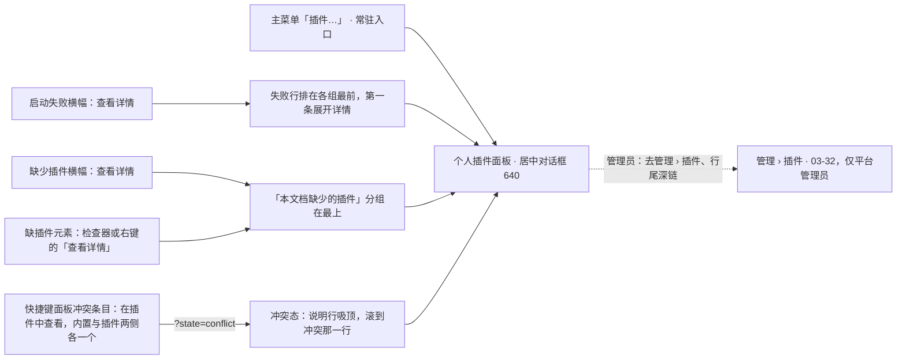
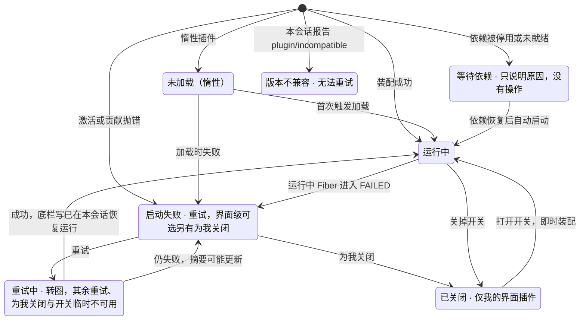
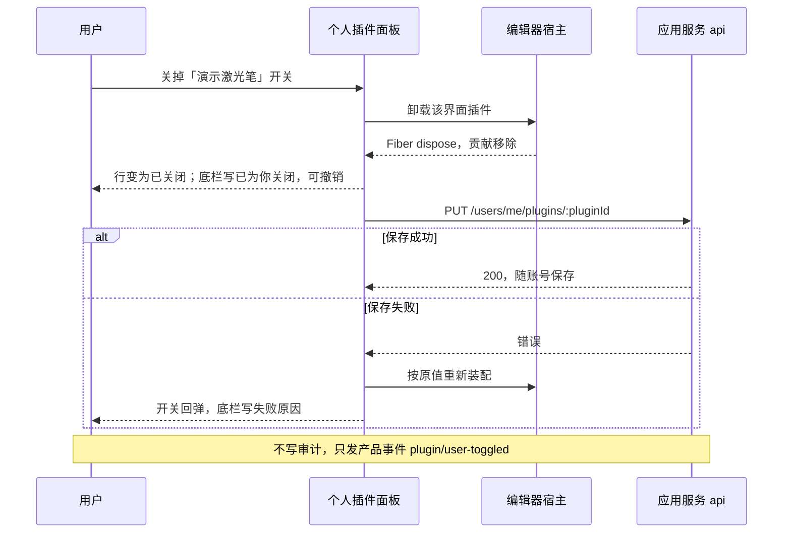
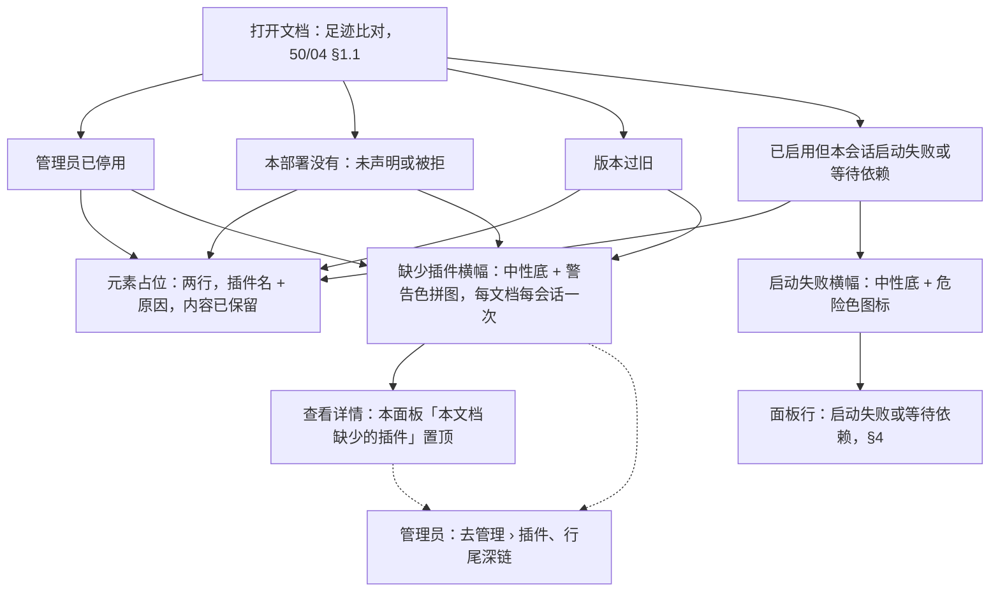

> 状态：草稿 | 负责：设计 | 更新：2026-09-15；2026-09-25（补图）；2026-10-01（§4.23 插件管理样张回写：按用户确认的 playground `#/editor/plugins` 样张整篇重写为「个人插件面板」——三分组（本文档缺少的插件 / 我的界面插件 / 本部署统一启用）、「为我关闭」即时生效、「由管理员统一」、失败详情与本会话重试、等待依赖、会话级版本不兼容（PS-07 客户端上报）、快捷键冲突入口、只读角色、「插件设置已更新」重新加载横幅、缺插件三种原因横幅与详情、空 / 加载 / 错误，状态清单 14 态；旧稿的用户侧首次启用确认卡、依赖冲突卡与「启用 / 禁用本地即时生效」迁往管理员稿 [03-32](32-admin-plugin-management.md)）；2026-10-15（design-language-v3 第 2 批：按已拍板样张 `plugins` 整篇改写，§1–§9 的节号与含义不变，新增 §10–§15——①入口：常驻入口只有主菜单「插件…」，另有横幅、缺插件元素与快捷键面板的「查看详情」，原应用栏「⋯ › 插件管理器」与状态栏插件入口作废（DS-1、DS-6、DS-18）；②对话框宽 640、各状态固定高 720（不超过视口高 − 64），分组不套卡片，行高 54、行距 55、行间无线、组间一条贴边分隔，正常态不着色，开关为安静样式，开关、重试与复制诊断信息的反馈写在对话框底栏（DS-36、DS-38、DS-41、DS-56）；③平台管理员只在计数行右端留一个「去管理 › 插件」，内容级失败行与「本文档缺少的插件」行尾为深链图标（DS-56）；④快捷键冲突的说明行吸顶、打开时滚到冲突那一行（DS-56）；⑤加载为「转圈 + 一句话」、出错为居中的整块状态，原骨架行作废（DS-53）；⑥插件横幅中性底加状态色图标，多类横幅同时成立时的先后与重现，单个插件失败写名字（DS-41、DS-54、DS-55）；⑦缺插件元素：纸面占位两行、不能改大小、横幅与检查器两个「查看详情」都留，检查器分区与右键引用 03-03 G-19、03-05 §3（DS-52）；⑧新增 §10 插件整页面板：设置型插件缺省留在检查器插件分区，「展开」进至少 400 的整栏，评审与只读就地只读展示、不加蒙版，归属标识 12px（DS-38、DS-56）；⑨新增 §11 插件条目的收纳，规则引用 06 §2.6、§2.12（DS-49）；⑩§12 列 28 个样张状态，6 个备选标「未采纳」（DS-63）；依据 rulings §4.25 DS-36、DS-38、DS-41、DS-49、DS-52…DS-56、DS-62…DS-64、TB-59、TB-60、TB-70；同日再补：§2.1、§4.1、§6.3、§15 管理员深链的地址定为 `/admin/plugins?plugin=<pluginId>`——进页后打开该插件的详情抽屉、在清单里选中这一行并滚进可视区，被拒插件同样能开，部署没有声明这个插件时把 id 填进搜索框，§15 待登记一行结案（TB-76）；§3.1、§4.1 失败详情的错误码改为架构 30/10 登记的 `kernel.plugin_failed`，另起一行「阶段」写启动或贡献（`details.phase`），原两个演示码不再使用（TB-77）；§3 写明两组都把失败行排在组内最前，§4.1 补「为我关闭」失败行后这一行回到组内原位、焦点交给它的开关（TB-78））；同日再补：§4.1「复制诊断信息」由三行改为四行，加阶段（rulings §4.25 TB-96）；2026-10-22（design-language-v3 第 3 批：只改与第 3 批裁决有关的段落——§2.3、§10.2、§12、§13、§15 紧凑形态（640–1024）里插件整页面板改画布底部 Sheet（46vh、整宽、上圆角 12、无遮罩，同图表数据面板，DS-130），个人插件面板在紧凑形态仍是居中对话框、宽取视口宽 − 32、高 min(720, 视口高 − 64)（kit 对话框原有的最大宽高），仅查看形态的缺插件横幅不放「查看详情」与「去管理 › 插件」、正文只写占位一句（没有面板可去），三项推迟结案；§3、§4.1 面板与「复制诊断信息」里的插件标识一律写 cordis 插件 id，与管理页同一写法（TB-121）；§6.2、§15 查看器里缺插件的一行说明放进 ⓘ 保真摘要卡（DS-110，推迟结案）；§15 横幅高度统一为 40 结案（DS-75）；依据 rulings §4.25 DS-75、DS-110、DS-130、TB-121）；2026-10-22（design-language-v3 第 3 批回写续：§1 入口表、图 1 与 §4.4 快捷键面板冲突条目的按钮文案「查看插件管理器」改为「在插件中查看」，被占的内置条目与插件组那一条下面各有一个，对话框盖在快捷键面板上、面板留着；§4.4 补「为我关闭」之后快捷键面板即时刷新（插件组那一条与两处冲突行一起消失），关闭对话框后焦点回「在插件中查看」、按钮已卸载时交给被占的内置条目（与 03-24 §6 一致，依据已拍板样张 `shortcuts.conflict`，rulings §4.25 DS-115）；同日再补：§1 入口表命令面板一行写明是 shell-glue 注册的无参命令 `shell.openPluginManager` 与一条 `ui.command`，条目以 03-24 为准（rulings §4.25 TB-162）；2026-10-22 复核修正：§6 开头的横幅高度由残留的「至少 40 高、推迟到第 3 批」改为统一高 40（rulings §4.25 DS-75，与 §15 一致）；§4.4 冲突入口改名一句去掉「随第 3 批」，注明按已拍板样张 `shortcuts.conflict`（DS-115）；§6 开头与 §8 引 03-12 横幅关闭规则的节号由 §2.6 更正为 §2.5；状态头的回写轮次字样改为「回写续 / 同日再补」；§2.3 仅查看形态的横幅由「按 03-12 的窄屏画法」改指 03-12 §11，写明手机与平板都在最顶上（rulings §4.25 TB-172）；§6 开头注明横幅高 40 与 24px × 指非触控形态，仅查看形态的尺寸见 03-12 §1.2（TB-172））；2026-10-23（design-language-v3 第 3 批评审修改：个人插件面板随 rulings §4.25 DS-142 改为标题栏 40、圆角 12、× 用正文色——§2 线框注记与 §2.1「标题行」写明框高 720 不变、标题栏矮下来的 8 留给列表区，§12 写明开着面板的各态随之改画，§13 速查同步）；2026-11-04（design-language-v3 母版视图改版：§1 入口表主菜单「插件…」与命令面板两行补母版视图里留在原位、不可用，写「母版视图下不可用」；rulings §4.25 DS-157、TB-203；需求编号、优先级与里程碑不变） | 依赖：charter v0.2 §2.3；rulings §4.23（三题裁决与 O-1…O-4）、§4.25 DS-1、DS-6、DS-15、DS-18、DS-21、DS-23、DS-26、DS-36、DS-38、DS-41、DS-49、DS-52…DS-56、DS-59、DS-62…DS-64、DS-75、DS-110、DS-115、DS-130、DS-157、TB-59、TB-60、TB-70、TB-76…TB-78、TB-121、TB-162、TB-172、TB-203；PRD [09 插件管理](../../10-prd/03-features/09-plugin-manager.md) PM-01、PM-03、PM-08、PM-10、PM-11、PM-12、PM-14、PM-15、PM-16，[04 插件 SDK](../../10-prd/03-features/04-plugin-sdk.md) PS-07、PS-11、PS-13，[01 打开与保真](../../10-prd/03-features/01-open-and-fidelity.md) OF-13；前端 [50/03](../../50-frontend/03-preset-assembly-and-plugins.md) §5.1、§10，[50/04](../../50-frontend/04-document-commands-and-undo.md) §1.1，[50/02](../../50-frontend/02-app-shell-routing-and-session.md) §2、§10.1、§12，[50/07](../../50-frontend/07-collaboration-client.md) §9，[50/09](../../50-frontend/09-ui-system-and-theming.md) §5a.6、§6.1，[50/10](../../50-frontend/10-editor-shell-and-interaction.md) §5、§11，[50/16](../../50-frontend/16-i18n-and-accessibility.md) §8.1；设计 [06](../06-extensibility-ux.md) §2.2、§2.6、§2.12、§3、§4，[04](../04-design-system.md) §4.1c，[03-02](02-editor-main.md) §2.3、§6.2，[03-03](03-properties-panel.md) G-19，[03-05](05-context-menu.md) §3，[03-12](12-offline-conflict-banner.md) §2，[03-24](24-keyboard-shortcuts-panel.md)，[03-32](32-admin-plugin-management.md)；playground `#/v3/editor?state=plugins.*`（`src/v3/scenarios/plugins/`）

# 03-09 个人插件面板

> **设计基准（2026-10-15 起，rulings §4.25 DS-38、DS-41、DS-49、DS-52…DS-56）**：以已拍板的 playground 第 2 批样张 `#/v3/editor?state=plugins.<状态 id>` 为准（28 个状态，另有 6 个标「未采纳」的备选，§12），源码在 `playground/src/v3/scenarios/plugins/`（`plugins.scenario.tsx` 各状态的标题与说明，`PluginList.tsx` 面板内容，`PluginsPanel.tsx` 对话框与主菜单接线，`banners.tsx` 插件横幅与缺插件的页，`degraded.tsx` 缺插件元素的选中、检查器与右键，`poll.tsx` 插件整页面板，`more.tsx`「更多」的收纳，`sections.tsx` 检查器插件分区的收纳，`data.ts` 一次部署的演示数据，`store.ts` 场景状态，`bits.tsx` 状态文字与图标块）；对照截图 `openspec/changes/design-language-v3/screens/batch2/plugins-<状态>-dark.jpg` / `-light.jpg`；第 1 批 `main-states` 的 5 个插件横幅状态与这里是同一个横幅件（§6）；第 3 批（2026-10-22 拍板，rulings §4.25 DS-130）紧凑与仅查看形态的三个状态在场景 `narrow-review`（`compact-plugins-dialog`、`compact-plugin-panel`、`narrow-plugin-banner`，截图 `screens/batch3/narrow-review-<状态>-*.jpg`）。编辑器外壳以 [03-02](02-editor-main.md) 为准，对话框、整栏面板、开关、加载行、整块状态与归属标识等底座件见 `playground/src/v3/scenarios/README.md` §3a、§3b 与设计 04 §4.1c。此前按 shadcn / 材质层画的线框、旧路由 `#/editor/plugins` 与它的 14 个演示态（2026-10-01 样张）作废。

本面板即 PS-11 所称「扩展」面板（PRD PM-10，二者合一），面向**每一位用户**：看本会话装配了哪些插件、哪个出了问题、能不能自己处理；在管理员开放的范围内开关只影响自己的界面插件。它**不**决定部署里有哪些插件、哪些强制启用——那是平台管理员在「管理 › 插件」（[03-32](32-admin-plugin-management.md)）里的事（rulings §4.23）。

本文另写插件在编辑器里露面的几处：插件横幅与缺插件的内容（§6）、插件整页面板与检查器插件分区（§10）、插件条目很多时的收纳（§11）。§1–§9 的节号与上一版相同（别的文档按节号引用）；全部样张状态见 §12。

---

## 1. 入口

| 入口 | 位置 | 打开后 |
|---|---|---|
| 主菜单「插件…」 | 主菜单顶层单项，在「排列 ▸」之后、「帮助 ▸」之前，上下各一条分隔线（[03-02](02-editor-main.md) §2.3，rulings §4.25 DS-18、DS-21）；评审、只读浏览与降权时照常可用；母版视图里留在原位、不可用，写「母版视图下不可用」（DS-157，03-26 §1.1） | 默认态；关闭后焦点回主菜单按钮（`plugins.entry-menu`） |
| 插件启动失败横幅「查看详情」 | 横幅通道（§6.4） | 失败行排在各组最前，第一条失败行展开详情 |
| 缺少插件横幅「查看详情」 | 横幅通道（§6.2） | 「本文档缺少的插件」分组在最上 |
| 缺插件元素的「查看详情」 | 选中占位时检查器最上的对象说明，或占位右键菜单的末组（§6.6） | 同上；从右键打开的，关闭后焦点回到被右键的占位 |
| 快捷键面板冲突条目「在插件中查看」 | [03-24](24-keyboard-shortcuts-panel.md) §6「冲突标记」：被占的内置条目与插件组那一条下面各有一个 | 冲突态：说明行吸顶，滚到冲突那一行；对话框盖在快捷键面板上、面板留着（§4.4） |
| 命令面板 | 与主菜单同一条命令，不常驻的第二入口（02 F9）：shell-glue 注册的无参命令 `shell.openPluginManager` 与一条 `ui.command`（rulings §4.25 TB-162；条目以 03-24 为准）；与主菜单同一可用性，母版视图里同样不可用（TB-203） | 默认态 |

- 常驻入口只有主菜单「插件…」（设计质量门 Q2）；横幅、检查器与右键里的「查看详情」只在对应情形出现。原应用栏「⋯ › 插件管理器」（D27）与状态栏插件入口（「插件正常 / N 个插件启动失败 / 本文档缺少插件」三种文字）随应用栏、状态栏一并作废（rulings §4.25 DS-1、DS-6）；没有失败、没有缺插件时界面上不显示任何插件状态（06 §3）。
- 平台管理员在面板里多一个「去管理 › 插件」（§2.1），跳到 `/admin/plugins`（03-32）；普通用户看不到任何通往管理页的控件。
- 查看器 preset（`preset-slide-viewer`）与 `/render` 页面没有这个面板，也没有插件横幅（§4.5，[03-25](25-viewer-preset-shell.md)）。

**图 1 个人插件面板的入口与去向**



怎么读：左列五个入口都打开同一个对话框，只有主菜单是常驻的；横幅、缺插件元素与快捷键面板会带着上下文进入（失败行排前、缺少的插件置顶、冲突行滚进可视区）。虚线表示只有平台管理员在面板里有通往管理页的入口，普通用户没有。
依据：PRD PM-10「入口」、PM-11、PM-12；rulings §4.25 DS-6、DS-18、DS-52、DS-56；本文 §1。

---

## 2. 线框

面板是编辑器之上居中的模态对话框，遮罩盖住整个编辑器（左栏、画布、检查器与横幅）。默认态（编辑模式、普通成员、没有失败）：

```
┌────────────────────────────────────────────────────────────────┐
│ 插件                                                         × │  ← 标题栏 40
├────────────────────────────────────────────────────────────────┤
│ 本会话已装配的插件。「我的界面插件」只影响你，不影响协作者，   │  ← 说明
│ 也不会进入文档。                                               │
│ 运行中 15 · 等待依赖 1 · 未加载 1             [去管理 › 插件]* │  ← 计数行
│                                                                │
│ 我的界面插件 4 [M3]                                            │
│ 只影响你自己；切换即时生效，随账号保存                         │
│  ▣ 英文语言包 0.3.2 · 内置                ✓ 运行中   (●)   ⌄   │
│    管理员默认开 · 界面文案的 English 翻译                      │
│  ▣ 演示激光笔 0.4.0 · 内置                ✓ 运行中   (●)   ⌄   │
│    管理员默认开 · 放映时按住 L 显示激光点                      │
│  ▣ 聚焦搜索 0.2.1 · 内置                  ✓ 运行中   (●)   ⌄   │
│    管理员默认开 · 打开全局搜索浮窗（只读命令）                 │
│  ▣ 字数统计 0.1.3 · 内置                  ⊘ 已关闭   (○)   ⌄   │
│    管理员默认关 · 在命令面板里查看本页与全文字数               │
├────────────────────────────────────────────────────────────────┤  ← 组与组之间一条贴边分隔
│ 本部署统一启用 14  [锁] 由管理员统一                           │
│ 会影响文档内容或渲染的插件，所有协作者一致；个人不能关闭       │
│  ▣ 品牌素材包 2.0.0 · 第三方 · ACME          ⧗ 等待依赖    ⌄   │
│    组织标志、配色与版式素材                                    │
│    「模板库」已被管理员停用；依赖恢复后自动启动，无需重试      │
│  ▣ 核心组件 4 个 · 内置                        ✓ 运行中    ⌄   │
│    内核、幻灯片文档模型、协同存储（Yjs）、DOM 渲染器           │
│  ▣ 编辑器界面 0.3.2 · 内置                     ✓ 运行中    ⌄   │
│    强制启用的界面插件 · 底部工具条、缩略图栏、检查器与菜单     │
│  …（其余各行，列表在框内滚动）                                 │
├────────────────────────────────────────────────────────────────┤
│ 已为你关闭「演示激光笔」                                [撤销] │  ← 底栏：有反馈时才有（§5）
│ 立即生效，只影响你；随账号保存，换设备也沿用                   │
└────────────────────────────────────────────────────────────────┘
```

图例：`▣` 插件图标块；`(●)` / `(○)` 开关开 / 关；`⌄` 展开详情；`[锁]` 12px 锁形图标；`*` 只有平台管理员才有。行与行之间没有分隔线，靠图标与行距分行。截图：`batch2/plugins-default-*.jpg`（默认）、`plugins-user-off-*.jpg`（带底栏）。

### 2.1 头部

- **标题行**（kit 对话框的标题栏，高 40）：「插件」（13px 600）+ 右上「关闭」（24 的 ×，用正文色，Esc）；2026-10-23 按 rulings §4.25 DS-142 统一（原标题栏 48、× 次级文字色作废）。框高照旧固定 720（§2.2），标题栏矮下来的 8 留给列表区。
- **说明**（样张原文，对话框说明句末带句号，rulings §4.25 DS-62）：「本会话已装配的插件。「我的界面插件」只影响你，不影响协作者，也不会进入文档。」
- **计数行**（12px `--v3-text-2`）：按本会话状态计数，只列非零项，顺序固定为运行中 → 启动失败 → 等待依赖 → 版本不兼容 → 未加载，项与项之间「·」（折行时「·」留在上一行末尾）；「运行中」把核心组件的 4 个成员算在内。「启动失败」「版本不兼容」两项前带与行内同一个危险色图标，其余不着色（状态色只给图标，DS-41；样张 `plugins.failed` 为「运行中 13 · 启动失败 2 · 等待依赖 1 · 版本不兼容 1 · 未加载 1」）。只读角色在末尾追加「只读：编辑类命令不可用」（§4.5）。
- **平台管理员**：计数行右端一个「去管理 › 插件」（盾牌图标的 ghost 文字按钮，不用强调色链接，设计质量门 Q3），跳 `/admin/plugins`。整个对话框只有这一个文字入口——它紧挨着计数，管到面板里所有的问题；逐个插件的深链在内容级失败行与「本文档缺少的插件」各行行尾（24px 图标按钮，读屏名「在管理页查看「〈插件名〉」」，直达管理页里这个插件的详情，§4.1、§6.3）。深链的地址是 `/admin/plugins?plugin=<pluginId>`（rulings §4.25 TB-76，登记在前端 50/02 §2）：进页后打开该插件的详情抽屉，在清单里选中这一行并滚进可视区；被拒插件也在清单里，同样能打开；部署没有声明这个插件时（「本部署没有此插件」里未声明的那种）把 id 填进搜索框，清单显示搜索无结果（03-32 §1、§4.3）。普通用户不显示、不占位（PRD PM-10：管理员在编辑器里仍是普通用户，只多这几个入口；rulings §4.25 DS-56）。

### 2.2 对话框

- **形态**（rulings §4.25 DS-38）：居中模态对话框，宽 640（`Dialog` lg）——插件管理是设置类、低频、与当前选中无关，一行要放下状态、开关与展开三件，640 能让插件说明保持一行；遮罩 `--scrim`。未采纳的备选「放进检查器整栏面板」见 §12.1。
- **高度**（DS-56）：各状态固定 720（视口不够时取视口高 − 64），与内容无关；加载中、加载失败、空态与列表同一个框高，打开后、数据到了、重试之后框体都不跳。头部（标题与说明）固定，其下是列表区（可聚焦的滚动区，读屏名「插件列表」），计数行与各分组都在列表区里、在框内滚动。
- **焦点**：用户打开时落在对话框本身，不自动聚焦第一个开关（避免误触），Tab 先到列表区；Tab 在框内循环。「×」、Esc、点遮罩关闭，焦点回到打开它的控件——主菜单按钮、横幅的「查看详情」、检查器的「查看详情」；从右键菜单打开的回到被右键的占位（菜单已卸载）。焦点不经过 `body`（设计 07 §2.4）。
- **反馈写在底栏**（DS-56）：模态遮罩会盖住画布底部的轻提示，所以开关、重试、复制诊断信息与开关保存失败的结果写在对话框底栏——左边一句（12px 主文字色，可带一行 `--v3-text-2` 说明；成功带成功色对勾、失败带危险色图标），可撤销的右边带「撤销」（次按钮）；同一句经面板里的 polite 播报区读出一次（§8）。底栏只在有反馈时出现，关闭对话框时随之清掉，不另弹轻提示。

### 2.3 紧凑与仅查看形态

- **紧凑窗口（640–1024）**：主菜单在左上「文档」胶囊里（[03-02](02-editor-main.md) §5a.1），「插件…」照常可用；对话框仍是居中的同一个，视口不够宽时宽取视口宽 − 32、高取 min(720, 视口高 − 64)，列表在框内滚动，其余同桌面——这就是 kit 对话框原有的最大宽高，由此推出、不另定（2026-10-22 第 3 批窄屏复核，样张 `narrow-review.compact-plugins-dialog`，640 × 800 下宽 608、高 720）。
- **仅查看（< 640 或触控）**：没有主菜单，「更多」只放查看类命令（03-02 §5a.2），不提供个人插件面板；横幅按 03-12 §11 排在最顶上，手机与平板都如此（DS-60、TB-172）。缺插件横幅在这一形态里不放「查看详情」与「去管理 › 插件」——没有面板可去（按 PRD PM-12 查看器「无面板入口」类推，01 §6「减少控件而非缩小控件」），只留 ×（「关闭提示」，触控 44），正文去掉编辑类的后半句，只写「N 处内容以占位显示，内容已保留」（2026-10-22 第 3 批窄屏复核，样张 `narrow-review.narrow-plugin-banner`，§6.2）。

## 3. 三个分组

分组自上而下固定为下表顺序；分组为空时连标题一起隐藏，不显示「暂无」。

| 分组 | 何时出现 | 标题后 | 说明行（样张原文） | 行尾 |
|---|---|---|---|---|
| 本文档缺少的插件 | 打开的文档足迹里有插件在本会话不可用（PRD PM-12，§6.3） | 数量 | 相关内容以占位显示、数据原样保留；可选中、移动、删除，不能编辑内部 | 原因 +（平台管理员）深链图标 |
| 我的界面插件 | 管理员至少把一个界面级插件设为「允许用户选择」 | 数量 + `M3` 标记 | 只影响你自己；切换即时生效，随账号保存（M2 构建为「开关在 M3 提供；现在可以查看状态、诊断信息与重试」） | 状态 + 开关 + 展开 |
| 本部署统一启用 | 始终（至少含核心组件） | 数量（核心组件按 4 个计）+ 锁形「由管理员统一」（12px 图标 + 12px `--v3-text-2` 文字，不是控件） | 会影响文档内容或渲染的插件，所有协作者一致；个人不能关闭 | 状态 + 展开（无开关） |

- **画法**（DS-38、DS-56）：分组不套卡片（对话框就是唯一的一层）；分组标题 12px 600（`h2`），数量 12px `--v3-text-2`，说明 12px `--v3-text-2`。第一组紧跟计数行（上距 16）；从第二组起，组的顶部一条贴边（横贯对话框）的 1px 分隔、线下留 16。行与行之间不画线（§3.1；标杆对照「密度：行间分隔线」，同分享、版本历史的列表）。
- 「本部署统一启用」= 内容级插件 + 管理员强制启用的界面级插件（PRD PM-10）；被拒、已停用的插件不进会话，也不出现在这里——普通用户看不到被拒插件（PRD 09 §5 非目标）。
- **核心组件合成一行**：内核必需与契约必需插件（样张为内核、幻灯片文档模型、协同存储（Yjs）、DOM 渲染器 4 个）合成「核心组件 4 个 · 内置」一行，第二行列出成员名，展开后逐行「名称 `id@版本`」。它们不会单独失败到只影响一个插件，合并减少噪音。
- **插件标识**：面板里写的插件 id（核心组件展开后的 `id@版本`、「复制诊断信息」的第一行、「本文档缺少的插件」各行与深链 `?plugin=`）一律是 cordis 插件 id，与管理员插件管理页同一写法——内置单元写单元名，如 `kernel`、`store-yjs`、`render-dom`、`comments`；单元名本身带作用域的照写，如 `@cordexjs/model-slide`；第三方插件就是它的 id，如 `acme:qr-shape`（2026-10-21，rulings §4.25 TB-121；§4.24 TA-5，对应表见前端 50/03 §11，40/16 §2）。原样张里写 npm 包名（如 `@cordexjs/kernel`）的地方随之改。
- **需要处理的排在前面**：启动失败（含重试中）→ 版本不兼容 → 等待依赖的行排在各组最前——「我的界面插件」与「本部署统一启用」两组都这样排（rulings §4.25 TB-78），「本部署统一启用」里排在核心组件行之前——其余按部署声明顺序；没有问题行时核心组件行是「本部署统一启用」的第一行。
- 强制启用的界面级插件第二行以「强制启用的界面插件」开头；部署声明文件把界面级升为内容级的插件（样张「查看水印」）在名称后带标记「内容级 · 部署指定」（可聚焦，工具提示「插件声明为界面级，部署声明文件把它升为内容级：全员统一，个人不能关闭」；标记 18 高、上下各收 1px，不撑高行）。
- **里程碑**：M2 只有只读、诊断与本会话重试；「我的界面插件」的开关 M3 起可用——M2 构建里开关留在原位不可用（`aria-disabled`、可聚焦，工具提示「M3 提供」），分组标题带 `M3` 标记（PRD 09 §4，样张 `plugins.m2`）。

### 3.1 插件行

```
│  ▣  名称 版本 · 来源 [作用域标记]*            状态   (开关)*   ⌄    │
│     第二行：管理员默认开 · 你已关闭* · 插件说明                     │
│     说明行*：等待依赖 / 版本不兼容 / 失败摘要 / 只读 / 冲突         │
│     [重试] [为我关闭]* 或一句说明                （启动失败时）     │
│     贡献 · 能力声明（展开后）                                       │
│     错误码 · 阶段 · traceId · [复制诊断信息]（展开后，启动失败时）  │
```

- **外形**：一行三列——32px 图标块（圆角 4、`--v3-panel-2` 底、16px 图标 `--v3-text-2`；插件没有图标时用拼图兜底；「已关闭」与本部署没有的插件图标退到 `--v3-text-3`，不用半透明）· 内容 · 右侧（状态、开关、展开）。行左右内缩 8、圆角 6、上下 10，悬停铺 `--v3-panel-2`，当前项（快捷键冲突）铺强调色淡底；行高 54、行距 55（列表行间 1px 透明间隔），行间不画分隔线。
- **第一行**：名称 12px 500（「已关闭」时退到 `--v3-text-2`），其后 12px `--v3-text-2` 的「版本 · 来源」；来源是「内置」或「第三方 · 〈供应商〉」。
- **第二行**（12px `--v3-text-2`）：「我的界面插件」以「管理员默认开 / 关」开头，用户的选择与默认值不同时追加「· 你已开启 / 你已关闭」，再接插件说明；640 宽里保持一行。
- **状态**（12px 图标 + 12px 文字；状态不只靠颜色，PRD PM-16；正常态不着色，DS-41）：

| 状态 | 图标 | 着色 | 何时 |
|---|---|---|---|
| 运行中 | 对勾 | 不着色（图标与文字 `--v3-text-2`） | Fiber 已激活 |
| 等待依赖 | 沙漏 | 不着色 | 所依赖的插件被管理员停用或服务尚未就绪（§4.2） |
| 未加载（惰性） | 虚线圆 | 不着色 | 惰性插件尚未触发加载（样张「图表渲染」，本页没有图表） |
| 已关闭 | 圆圈斜线 | 不着色 | 用户为自己关闭了这个界面插件（§5） |
| 启动失败 | 圆圈叉 | 图标危险色，文字主文字色 | 本会话 Fiber `FAILED`（§4.1） |
| 版本不兼容 | 八角形感叹号 | 图标危险色，文字主文字色 | 本会话报告 `plugin/incompatible`（§4.3） |

  危险组的两个图标不与警告三角（缺插件原因、冲突说明）和「已关闭」的圆圈斜线同形；原「运行中成功色、等待依赖信息色」作废（DS-41：正常态不着色，v3 不单设信息色）。
- **开关**（只在「我的界面插件」）：安静样式的 `Switch`——关为槽色淡底加细边，开为强调色底加白色圆钮（按下的开关属强调色的用途，rulings §4.25 DS-36；04 §4.1c）。
- **展开**：24px 图标按钮（展开后翻转），读屏名「展开 / 收起「〈名称〉」详情」、`aria-expanded`。展开后在同一行里、内容列下方缩进列出键值（标签列 56、12px），不另铺浅底卡片：**贡献**（`point ×N`，等宽 11px 文字，不画胶囊；含中文的如「实现 store」用 12px 正文字体）· **能力声明**（同上，未声明写「未声明」，末尾「（仅展示）」，PRD PS-13）；启动失败的行另有**错误码**、**阶段**（启动 / 贡献）、**traceId** 与「复制诊断信息」（次按钮）。失败摘要已在说明行写全，详情里不重复。
- **Tab 顺序**：同一行先到右上的开关与展开，再到下面的「重试 / 为我关闭」与详情里的按钮（与阅读顺序一致，视觉位置不变）。

## 4. 行的状态与操作

**图 2 插件行在本会话里的状态**



怎么读：每个状态对应行尾的一种状态文字；只有「启动失败」有按钮可点，「等待依赖」与「版本不兼容」都不提供重试（重试不会改变依赖或版本关系）。「已关闭」只出现在「我的界面插件」，开关两个方向都即时生效、无需刷新。
依据：PRD PM-10、PM-08（rulings §4.23 O-1 个人启停即时热切换）；PRD PS-07、PS-11。

### 4.1 启动失败：详情与本会话重试（`plugins.failed`、`failed-admin`、`retrying`）

```
│  ▣  现场投票 0.9.1 · 第三方 · Beta Labs           ⊗ 启动失败    ⌃    │
│     在幻灯片上插入投票并实时统计                                     │
│     激活超时：投票服务 poll.betalabs.io 在 10 s 内无响应             │
│     [重试]  仅在本会话重试；如持续失败，请联系管理员                 │
│     贡献      slide.shapeKind ×1  core.command ×2  ui.toolbar ×1     │
│               ui.inspectorSection ×1  ui.panel ×1                    │
│     能力声明  network: poll.betalabs.io  （仅展示）                  │
│     错误码    kernel.plugin_failed                                   │
│     阶段      启动                                                   │
│     traceId   4bf92f3577b34da6a3ce929d0e0e4736                       │
│     [复制诊断信息]                                                   │
```

- **说明行**：面向用户的失败摘要，主文字色，不加「启动失败：」前缀（状态名已在右侧），如「激活超时：投票服务 poll.betalabs.io 在 10 s 内无响应」「render.overlay 贡献在初始化时抛出异常」。从启动失败横幅进入时第一条失败行展开详情。
- **错误码与阶段**（rulings §4.25 TB-77）：启动与贡献失败是同一个码 `kernel.plugin_failed`（登记在架构 30/10），`details.phase` 为 `activate` / `contribution`；详情里错误码下另起一行「阶段」，写「启动」或「贡献」（样张：现场投票为启动，演示激光笔为贡献）。样张原来的两个演示码不再使用，不另设 `plugin` 域的码。
- **重试**（任何用户可用，PRD PS-11）：只在本会话 `fiber.restart()`，不改部署状态。点后按钮变为转圈 +「重试中…」（`aria-busy`），面板里其余「重试」「为我关闭」与开关临时不可用（留在原位、可聚焦，工具提示「正在重试另一个插件」/「重试进行中」）。成功则行回到「运行中」，底栏写「「〈名称〉」已在本会话恢复运行」（成功色对勾），播报「「〈名称〉」已恢复运行」；「重试中…」随失败态卸载，焦点交给这一行的开关或「展开」，不落回对话框本身。仍失败则回到启动失败，摘要可能更新。
- **界面级可选插件**（样张「演示激光笔」，在「我的界面插件」里）：「重试」旁是次按钮「为我关闭」，等同关掉开关（§5）。关掉后这一行不再是需要处理的行，回到组内按声明顺序的位置（「我的界面插件」同样把失败行排在最前，rulings §4.25 TB-78）；「为我关闭」随失败态卸载，焦点在同一个任务里交给这一行的开关，不经过 `body`（07 §2.4）。
- **内容级或强制启用插件**（在「本部署统一启用」里）：「重试」旁一句「仅在本会话重试；如持续失败，请联系管理员」。平台管理员看到「仅在本会话重试；如持续失败，请在管理页查看」，行尾状态旁多一个深链图标「在管理页查看「〈名称〉」」（DS-56，样张 `failed-admin`；原失败行里与计数行同名同去处的「去管理 › 插件」按质量门 Q2 去掉）。
- **复制诊断信息**：复制 `plugin: <id>@<版本>`（cordis 插件 id，§3，TB-121）、`code`（`kernel.plugin_failed`）、`phase`（`activate` / `contribution`，详情里写「启动 / 贡献」）、`traceId` 四行，底栏写「已复制诊断信息」；不含文档内容（50/03 §10，rulings §4.25 TB-96）。
- 失败本身由客户端经错误上报管线上报（PRD PM-15），管理员页据此统计近 24 h 失败会话数（03-32 §4）；面板不单独提供「上报」。

### 4.2 等待依赖

- 说明行（样张原文）：「「模板库」已被管理员停用；依赖恢复后自动启动，无需重试」；依赖不是被停用而是服务尚未就绪时写「依赖的服务尚未就绪；依赖恢复后自动启动，无需重试」。状态名已在右侧，说明行不再以「等待依赖：」开头。
- 不提供重试，也不提供「一并启用」——启用依赖是管理员的事（03-32 §5.3）。依赖恢复后该行自动变为运行中。
- 等待依赖是正常的中间态，不是错误：不着色（DS-41），不计入启动失败。

### 4.3 版本不兼容（本会话报告，`plugins.failed` 中的「甘特图」）

部署校验已拦下 `hostApi` 不覆盖宿主的插件（部署级「版本不兼容」，只在管理员页出现，普通用户看不到）。本面板展示的是另一种情况：插件通过了部署校验，但**本会话**加载时报告 `plugin/incompatible`（PRD PS-07 客户端版本协商），例如浏览器缓存了旧宿主。

- 说明行（样张原文）：「需要宿主 0.4–0.5，当前 0.3；无法重试，如需使用请联系管理员」；平台管理员看到的结尾是「无法重试，请在管理页查看」。
- 不提供重试。该事件同启动失败一样经客户端错误上报管线上报（PRD PM-15），带插件 id、版本、错误码与插件集指纹，管理员页据此计入失败会话。
- 排在启动失败之后、等待依赖之前（§3「需要处理的排在前面」）。

### 4.4 快捷键冲突（`plugins.conflict`、`conflict-locked`）

从快捷键面板冲突条目的「在插件中查看」进入（[03-24](24-keyboard-shortcuts-panel.md) §6，带 `?state=conflict`；被占的内置条目与插件组那一条下面各有一个；原文案「查看插件管理器」2026-10-22 按已拍板样张 `shortcuts.conflict` 改为现名，v3 这个面板叫「插件」，rulings §4.25 DS-115）。对话框盖在快捷键面板上，快捷键面板留着：

```
│ [键盘] 快捷键冲突：⌘−                                             │  ← 说明行，吸顶
│        内置「缩小」与插件「聚焦搜索」绑定了同一快捷键，当前由内置 │
│        命令生效。「聚焦搜索」是你的界面插件，可以为你关闭。       │
├───────────────────────────────────────────────────────────────────┤
│ 运行中 15 · 等待依赖 1 · 未加载 1                                 │
│ 我的界面插件 4 [M3]                                               │
│  …                                                                │
│ ░▣ 聚焦搜索 0.2.1 · 内置                  ✓ 运行中   (●)   ⌄    ░ │  ← 当前项：强调色淡底
│ ░  管理员默认开 · 打开全局搜索浮窗（只读命令）                  ░ │
│ ░  ⚠ 与内置「缩小」冲突（⌘−）  [为我关闭]                       ░ │
```

- **说明行**（DS-56）：列表区最上、计数行之上，面板底、下方 1px 分隔（说明行件，同分享的离线说明），只有键盘图标用警告色，文字主文字色：粗体「快捷键冲突：〈键〉」，下接「内置「〈命令〉」与插件「〈插件〉」绑定了同一快捷键，当前由内置命令生效。」再接一句——冲突一方是你的界面插件时「「〈插件〉」是你的界面插件，可以为你关闭。」；是内容级或强制启用的插件时「「〈插件〉」由管理员统一启用，个人不能关闭；如需调整，请联系管理员。」（样张 `conflict-locked`：流程图形状包的 ⌥⌘M 与内置「母版视图」冲突）。说明行吸顶：列表滚动时常驻在顶部，高亮行滚到中间时说明仍在眼前；`role="note"`。
- **相关插件行**是当前项画法（强调色淡底、圆角 6、左右内缩 8，同保真报告的当前项），打开时自动滚到对话框内容区中间（已在可视区时不动）；行内警告色三角 +「与内置「缩小」冲突（⌘−）」（主文字色）+ 次按钮「为我关闭」——关闭后按钮留在原位不可用（工具提示「已为你关闭」）；不可由用户关闭的一方行内写「请联系管理员」，不出现「为我关闭」。
- **为我关闭之后**（与 03-24 §6 一致）：该插件随即卸载、它的快捷键一并注销，背后的快捷键面板即时刷新——插件组那一条与两处冲突行一起消失。关闭本对话框后焦点回到打开它的「在插件中查看」；那颗按钮已随冲突行卸载时，焦点交给被占的内置条目（如「缩小」，只可被程序聚焦、不进 Tab 顺序），不掉到 `body`。
- 不提供自定义改键（PRD PM-11 非目标）；管理员在 03-32 详情里看到同一冲突。

### 4.5 只读角色（`plugins.readonly`）

对当前文档只有查看或评审权限（查看者、评审者、凭链接查看）时，主菜单「插件…」打开的是同一个面板（评审、只读浏览与降权时「插件…」照常可用，03-02 §2.3）：

- 计数行末尾「只读：编辑类命令不可用」；「本部署统一启用」里声明了写能力位命令的插件（样张为评论、数据图表增强、流程图形状包、现场投票）在第二行之下注明锁形 +「编辑类命令不可用（你只有查看权限）」——括注写当前不能编辑的原因，与主菜单同一写法（03-02 §2.3）；这些插件照常运行、照常渲染。
- 「我的界面插件」的开关照常可用：个人启停只影响自己的界面，与文档权限无关（PRD PM-01）。
- 查看器 preset（`preset-slide-viewer`）与 `/render` 页面**不渲染**本面板，也没有插件横幅；缺插件元素只显示占位与一行说明（PRD PM-12，[03-25](25-viewer-preset-shell.md)）。
- 原「应用栏标题旁的「仅查看」徽标、状态栏左侧「只读浏览中」」随应用栏、状态栏作废；只读的标识在评审条 / 浏览条与检查器说明行（03-02 §6.2）。

## 5. 为我关闭 / 开启（「我的界面插件」，M3；`plugins.user-off`、`toggle-failed`）

- 开关为 `role="switch"`（安静样式，§3.1），读屏名「〈名称〉，个人设置，只影响你」（PRD PM-16）。切换**即时生效**：本会话立刻装配或卸载该插件（Fiber 启动或 dispose，卸载后它贡献的工具条「更多」条目、检查器分区、命令与覆盖层随即消失、无残留），无需刷新（rulings §4.23 O-1）。
- **反馈写在底栏**（DS-56）：「已为你关闭「〈名称〉」」/「已为你开启「〈名称〉」」+ 说明「立即生效，只影响你；随账号保存，换设备也沿用」+「撤销」；同一句 polite 播报一次。原「画布轻提示带撤销」作废（模态遮罩会盖住轻提示）。
- 选择随账号保存在服务端（rulings §4.23 O-2，`PUT /users/me/plugins/:pluginId`），不写审计、只进产品事件 `plugin/user-toggled`（PRD PM-14、PM-15）。保存失败时开关回弹（本会话按原值重新装配），底栏写失败原因（危险色图标）：「没能保存「〈名称〉」的设置，已恢复为〈开启 / 关闭〉」+「网络连接中断；再拨一次开关即可重试」，不另给按钮（50/18 PLG-02）。
- 关闭后该行状态为「已关闭」，图标退到 `--v3-text-3`、名称退到 `--v3-text-2`；与管理员默认值不同时第二行追加「· 你已关闭」。
- 管理员之后把它改为「强制启用」时，个人选择暂时失效（保留记录），该插件移到「本部署统一启用」；改回「允许用户选择」时恢复（PRD PM-03）。
- 重试进行中所有开关临时不可用，避免与重试的装配交错（§4.1）。

**图 3 为我关闭的即时生效**



怎么读：纵线是参与方，自上而下是时间；界面先在本会话卸载插件并在底栏给出反馈，再把选择存到服务端，存失败才回弹。整个过程不刷新页面、不影响协作者。
依据：PRD PM-08、PM-10、PM-14；rulings §4.23 O-1、O-2；rulings §4.25 DS-56；50/18 PLG-02。

## 6. 插件横幅与缺插件内容

插件横幅一律不阻断编辑、不丢数据：画在横幅通道里（位置、让位与两条叠放见 [03-02](02-editor-main.md) §6.2、[03-12](12-offline-conflict-banner.md) §2），归入优先级末档「其他」；`role="status"`、polite，不抢焦点；横幅出现时面板不自动打开。画法（rulings §4.25 DS-41）：中性底（`--v3-panel`）加状态色图标——缺少插件是警告色拼图、启动失败是危险色圆圈感叹号、设置已更新是中性刷新图标；状态色只给图标，标题与说明用主文字色；按钮是次按钮；可关闭的带 24px ×（读屏名「关闭提示」，设置已更新为「稍后再说」，03-12 §2.5）。第 1 批 `main-states` 的 5 个插件横幅（`plugin-missing`、`plugin-missing-undeclared`、`plugin-missing-version`、`plugin-settings`、`plugin-failed`）与第 2 批 `plugins` 场景是同一个横幅件；缺少插件与启动失败两类原为警告 / 危险浅底，2026-10-15 改为中性底，文案与按钮不变（DS-41）。横幅统一高 40、含底部 1px 分隔，带按钮的上下内边距 5，多行时照常撑高（2026-10-16，rulings §4.25 DS-75，03-12 §1.2；原「横幅至少 40 高、是否统一推迟到第 3 批」的写法结案，§15）；高 40 与 24px × 指非触控形态，仅查看形态（手机与平板）的按钮与 × 照常是触控尺寸、横幅随之撑高（rulings §4.25 TB-172，03-12 §1.2，§2.3）。

### 6.1 插件设置已更新（PRD PM-08，M3；`main-states.plugin-settings`、`plugins.reload-saving`）

```
│ ↻  管理员更新了插件设置，重新加载后生效                     [重新加载]  ×  │
│    未同步的更改会先保存再刷新；你可以先继续编辑，稍后再重新加载            │
```

- **触发**：管理员在 03-32 保存了策略变更，已打开的会话在 ≤ 60 s 内或下次重连时收到控制消息（rulings §4.23 O-1）。
- 中性底 + 中性刷新图标（`--v3-text-2`）。「重新加载」点后按钮变为转圈 +「正在保存更改…」（不可用），保存期间 × 收起（不能中途「稍后再说」）；先 flush 未确认的更改再刷新（复用版本漂移流程，50/02 §12），flush 后仍有未同步项时弹应用内的刷新确认框、初始焦点在「取消」（03-12 §9，rulings §4.25 DS-59）；刷新完成后轻提示「已重新加载，按新的插件设置装配」。
- ×「稍后再说」：关闭横幅、继续编辑；同一份策略在本会话里不再提示，收到新的策略变更时再出现一次（50/07 §9）。不强制踢出、不中断编辑。
- 与版本漂移的「发现新版本」同时成立时合并为一条，以版本漂移的文案与动作为准（PRD 07 G-87）。

### 6.2 缺少插件（PRD PM-12；`main-states.plugin-missing`、`-undeclared`、`-version`，`plugins.missing-detail`）

打开的文档足迹里有插件在本会话不可用时（足迹比对见 50/04 §1.1、ADR-0050），文档照常打开，相关元素以占位显示、数据原样保留，横幅通道出一次「缺少插件」横幅（每个文档每会话一次；更高档的横幅在场时让位，让位期间不算已展示）。三种原因各一套标题（样张原文，示例插件「二维码形状」`acme:qr-shape`）：

| 原因 | 横幅标题 | 占位的原因行 |
|---|---|---|
| 管理员已停用 | 本文档用到了「二维码形状」，管理员已停用该插件 | 插件已停用，内容已保留 |
| 本部署没有此插件（未声明或被拒） | 本文档用到了本部署没有的插件 `acme:qr-shape`（≥ 1.2） | 本部署未部署，内容已保留 |
| 版本过旧 | 「二维码形状」版本过旧：需要 ≥ 1.2，当前 1.0 | 需要 ≥ 1.2，内容已保留 |
| 同时缺多个插件 | 本文档用到了 N 个当前不可用的插件 | 各自的原因 |

```
│ [拼图] 本文档用到了 3 个当前不可用的插件  5 处内容以占位显示，内容已保留；   [查看详情] [去管理 › 插件]*  × │
│        可选中、移动或删除，暂不能编辑内部                                                                   │
```

- 说明行统一为「N 处内容以占位显示，内容已保留；可选中、移动或删除，暂不能编辑内部」。
- 按钮：「查看详情」打开本面板，「本文档缺少的插件」分组在最上；平台管理员多一个「去管理 › 插件」（`/admin/plugins`）；×「关闭提示」。
- **画布上**：相关元素原位显示占位——虚线框 + 拼图图标 + 一行插件名 + 一行「原因，内容已保留」，与保真占位同一画法（设计 04 §4.1c，rulings §4.25 DS-52；原「插件名 / 原因 / 内容已保留」三行作废，第 1 批 3 个缺插件画面与 `offline-conflict.priority-yield` 借用的同一页随之改为两行）；左栏缩略图对应页右上角警示计数（警告浅底 + 警告色三角，数字 = 该页以占位显示的元素数；样张第 5 页 2、第 6 页 3），与评论角标并排、警示在左（[03-13](13-import-progress-and-degraded-states.md)「缩略图级」）。选中、检查器与右键见 §6.6。
- 插件已启用但本会话启动失败或等待依赖时不走这一横幅：出启动失败横幅（§6.4），在面板对应行里处理（§4.1、§4.2）；画布上该插件的元素同样降级为占位，原因行写清原因（样张 `plugins.panel-failed`：「插件启动失败，内容已保留」）（PRD PM-12 第 4 条）。
- 评审模式、只读浏览同样显示这条横幅。仅查看形态（< 640 或触控）没有个人插件面板：横幅在最顶上，不放「查看详情」与「去管理 › 插件」，只留 ×，正文只写「N 处内容以占位显示，内容已保留」（§2.3）。
- 查看器 preset 没有横幅、按钮与面板入口：画布上照常画占位，「一行说明」放进 ⓘ 保真摘要卡的最前一行——警告色拼图图标（与编辑器缺插件横幅同一个图标）+「N 处内容需要插件「〈插件名〉」，以占位显示」，其余计数照常（2026-10-22 第 3 批拍板，rulings §4.25 DS-110；不新造横幅通道，查看器壳保持轻；规格见 [03-25](25-viewer-preset-shell.md)，样张 `viewer.missing-plugin`）。

### 6.3 「本文档缺少的插件」分组（`plugins.missing-detail`）

```
│ 本文档缺少的插件 3                                                 │
│ 相关内容以占位显示、数据原样保留；可选中、移动、删除，不能编辑内部 │
│  ▣ 二维码形状 acme:qr-shape                  ⚠ 管理员已停用    ↗*  │
│    需要 ≥ 1.0 · 3 处内容以占位显示 · 第 6 页                       │
│  ▣ 组织架构图 acme:org-chart               ⚠ 本部署没有此插件  ↗*  │
│    需要 ≥ 2.0 · 1 处内容以占位显示 · 第 5 页                       │
│  ▣ 数据图表增强 acme:data-binding              ⚠ 版本过旧      ↗*  │
│    需要 ≥ 1.5，当前 1.4.2 · 1 处内容以占位显示 · 第 5 页           │
```

- 每行：图标块（变淡；本部署没有的插件用拼图兜底）、显示名（12px 500）、`id`（等宽 11px `--v3-text-2`）；第二行「需要 ≥ 版本」（版本过旧时加「，当前 x」）· 受影响处数 · 页码，普通用户末尾另有「· 请联系管理员」；行尾原因：警告色三角 + 主文字色文字（管理员已停用 / 本部署没有此插件 / 版本过旧），平台管理员另有 24px 深链图标 `↗`「在管理页查看「〈名称〉」」（DS-56；地址与落点见 §2.1，TB-76）。
- 本分组不提供操作按钮：启用、升级都在部署与管理员侧完成。

**图 4 缺插件从横幅到详情**



怎么读：足迹里不可用的插件先一律降级为占位（两行字）；前三种原因合成一条缺少插件横幅，经「查看详情」进入本面板的缺少插件分组；第四种出启动失败横幅，在面板对应行里处理。虚线是只有平台管理员才有的跳转。
依据：PRD PM-12；PRD OF-13；ADR-0050；50/04 §1.1；rulings §4.25 DS-41、DS-52、DS-55。

### 6.4 插件启动失败（`main-states.plugin-failed`，`plugins.failed`、`panel-failed`、`failed-reshow`）

```
│ [!] 2 个插件启动失败  「现场投票」「演示激光笔」暂时不可用，其余功能照常      [查看详情]  ×  │
│ [!] 插件「数据图表增强」未能启动  暂时不可用，其余功能照常                     [查看详情]  × │
```

- 有插件进入 `FAILED` 时出现（取代原状态栏的「N 个插件启动失败」入口，rulings §4.25 DS-6）。**标题**（DS-55，与 PRD PM-12、03-02 §6.2 一致）：只有一个插件失败时写名字「插件「〈名称〉」未能启动」，说明行只写「暂时不可用，其余功能照常」（不重复插件名）；多个时写数量「N 个插件启动失败」，说明行先列出插件名「「A」「B」」再接「暂时不可用，其余功能照常」。
- 中性底 + 危险色图标，`role="status"`（用危险色图标也是 status，不抢焦点）；按钮「查看详情」+ ×「关闭提示」。
- 「查看详情」打开本面板：失败行排在各组最前，第一条失败行展开详情（§4.1）。

### 6.5 横幅的先后与重现（rulings §4.25 DS-54；`plugins.banner-queue`、`failed-reshow`）

- 多类插件横幅同时成立时同一时刻只放一条，按「缺少插件 > 启动失败 > 设置已更新」取第一条本会话里没关过的；关掉一条（×）才轮到下一条；本会话里关过的不再出现。样张 `banner-queue`：文档缺 3 个插件、本会话又有 2 个插件启动失败、管理员也刚更新了插件设置——缺少插件的横幅已经关掉，轮到「2 个插件启动失败」，再关掉轮到「插件设置已更新」。
- 启动失败横幅关掉后，只在本会话有新插件进入失败时再出现一次，只写新失败的插件，之前的失败仍在个人插件面板里（样张 `failed-reshow`：之前关掉的「现场投票」「演示激光笔」不再重复，标题写「插件「数据图表增强」未能启动」）。设置已更新同理：收到新的策略变更时再出现一次（§6.1）。
- 插件横幅整体在横幅通道的末档「其他」：连接、权限 / 文档状态、服务器保存这些更高档的横幅在场时让位，等它消失再出现，让位期间不算已展示（03-12 §2.2，样张 `offline-conflict.priority-yield`）；母版视图与版本预览中排在常驻的模式横幅下方那一条（03-02 §6.2）。
- v3 没有常驻的插件状态指示（状态栏已废弃，DS-6）：横幅关掉后，失败与缺插件一直可以从主菜单「插件…」查看；原「状态栏入口优先显示失败数」随状态栏作废。

### 6.6 缺插件元素：选中、检查器与右键（rulings §4.25 DS-52；`plugins.missing-selected`、`missing-menu`）

缺插件元素与保真降级的占位是同一种「降级对象」：同一个选中种类 `degraded`、同一套检查器分区、同一份右键菜单——检查器按 [03-03](03-properties-panel.md) G-19「无法显示的对象」一行（对象说明 → 位置与大小 → 缺少的插件），右键按 [03-05](05-context-menu.md) §3「无法显示的对象」一行（评审、只读浏览与降权下照常出这份菜单，按 03-05 §4，rulings §4.25 DS-64）。本节不另列条目，只写插件这边的不同与去处：

- **不能改大小**：画布上只画 1px 选中框与尺寸角标（如「186 × 186」）、不画缩放手柄；检查器「位置与大小」能移动，W / H 留在原位不可用（工具提示「插件不可用时不能调整大小」），节末写「插件不可用时不能调整大小；此类对象不旋转、不翻转」。保真占位可以缩放。未采纳的另一种答案见 §12.1。
- **对象说明**（检查器最上，中性信息图标，不用警告色）：标题「插件「〈名称〉」不可用」，一句原因加「内容已原样保留。」（样张「已被管理员停用，内容已原样保留。」，其余原因同一句式），下面是带外链图标的次按钮「查看详情」——打开本面板，「本文档缺少的插件」分组置顶，关闭面板后焦点回到这颗按钮。原「可以移动或删除，暂不能编辑内部」不再写（画布选中框与右键已经表达）。
- **右键**：末组是「查看详情」（保真占位为「查看保真详情」），去处同检查器；「编辑替代文本…」留在原位不可用，原因「插件不可用时不能修改」。菜单贴在二维码这类窄占位的右缘展开、不压住尺寸角标（03-05 §2.4）；从这里打开的面板关闭后，焦点回到被右键的占位。
- **两个「查看详情」都留**：选中缺插件元素时，横幅（整份文档缺哪些插件）与检查器的对象说明（选中的这一个）各有一个「查看详情」、去处相同——横幅不为选中而收起（收起会让画布上下跳一条横幅高），检查器的入口只在选中时出现；常驻入口仍只有主菜单「插件…」。保真那边的页级提示条在选中时让位，是因为它本来就一闪而过（03-13）。
- 同一页的几个占位都能点选（右键也先选中被点的那一个，03-05 §2）：选中框跟到哪一个，检查器「位置与大小」就写哪一个的数。

## 7. 空、加载、错误

| 状态 | 表现（样张原文） |
|---|---|
| 空 · 管理员未开放可选插件（`plugins.no-optional`） | 「我的界面插件」分组连标题一起隐藏；列表区顶部一行（锁图标，12px `--v3-text-2`，下方 1px 分隔）「可选插件由管理员设置：本部署目前没有开放给个人开关的插件」；「本部署统一启用」照常，是第一组、顶部不画分隔线；对话框与其他状态同高 |
| 加载中（`plugins.loading`） | 头部只有标题与说明（没有计数行）；列表区居中一行转圈「插件列表加载中…」（`LoadingRow`，与评论、版本历史、分享同一件），不画灰色骨架条（rulings §4.25 DS-53，质量门 Q8；原「短标题骨架 + 5 行骨架」作废） |
| 加载失败（`plugins.error`） | 列表区换成居中的整块状态（`PanelState`）：危险色图标、「插件列表加载失败」、「编辑器本身不受影响；已装配的插件照常运行」、次按钮「重试」；点「重试」后焦点交给列表区（「重试」随错误态卸载，不落回对话框本身） |

面板本身的加载失败不影响编辑器与已装配插件；「本部署统一启用」至少含核心组件，不设计空态。

## 8. 键盘与可及性（PRD PM-16）

- **对话框**：`role="dialog"`、`aria-modal="true"`，读屏名取标题，说明经 `aria-describedby` 读出；焦点规则见 §2.2。Tab 先到列表区（可聚焦的滚动区「插件列表」，方向键可直接滚动），再按阅读顺序到每行的开关、展开、「重试 / 为我关闭」与详情里的按钮。
- **语义**：分组标题为 `h2`；「由管理员统一」是文字标记，不是控件；作用域标记「内容级 · 部署指定」可聚焦以读出说明。
- **控件**：开关 `role="switch"` + `aria-checked`，读屏名「〈名称〉，个人设置，只影响你」，`Space` 切换；不可用时 `aria-disabled`、仍可聚焦，工具提示写原因（「M3 提供」「重试进行中」）。展开按钮 `aria-expanded`，`Enter` 展开 / 收起（50/16 §8.1）。只有图标的控件都有读屏名（关闭、展开 / 收起「〈名称〉」详情、在管理页查看「〈名称〉」）。
- **播报**：重试（「正在重试「〈名称〉」」→「「〈名称〉」已恢复运行」）、开关、复制诊断信息与保存失败的结果经面板里一个 polite 播报区读出一次，与底栏同一句（DS-56；PRD PM-16）。
- **横幅**：`role="status"`、polite，不抢焦点（启动失败横幅虽用危险色图标也是 status）；× 收起后焦点交给画布（03-12 §2.5）。
- **状态不只靠颜色**：六种会话状态、三种缺插件原因与冲突都有独立图标与文字；危险组图标不与警告三角、「已关闭」同形。
- 键盘可完成 PRD PM-10、PM-11 的全部操作。

## 9. 边界情况

- 同一插件既在「本文档缺少的插件」（足迹要求 ≥ 1.5）又在「本部署统一启用」（本部署 1.4.2 运行中）：两处都显示，前者说明版本不够，后者照常显示运行中（样张「数据图表增强」）。
- 本会话同时有失败与缺插件：横幅按 §6.5 先出缺少插件、关掉后轮到启动失败；面板里两组都在，「本文档缺少的插件」在最上、失败行在各组最前。原「状态栏入口优先显示失败数」作废。
- 失败的是惰性插件：在首次触发加载时才可能失败，失败前显示「未加载（惰性）」。
- 面板开着时插件状态有变化（依赖恢复、新的失败）：列表在快照上增量更新（50/03 §10），问题行按 §3 的次序重排；框高不变。
- 管理员在面板开着时保存了策略：本会话不热切换，出「插件设置已更新」横幅（§6.1），面板仍按本会话的装配显示。
- 第三方插件图标缺失：拼图兜底，不留空白。
- `ui.theme` 贡献加载期校验失败（[06](../06-extensibility-ux.md) §2.11）：按启动失败处理，说明行写校验失败原因（对比度不达标等），不另设状态。

## 10. 插件整页面板与检查器插件分区（rulings §4.25 DS-38、DS-56）

插件的整页内容（`ui.panel{slot:'inspector'}`，设计 06 §2.2）在 v3 里是检查器的整栏面板，不作检查器第三个页签（备选「面板作第三个页签」未采纳，§12.1）。设置型插件（样张为第三方插件「现场投票」，Beta Labs）缺省只用检查器里的插件分区，用户点分区的「展开」才进整栏；插件里真正需要宽度的整页内容（数据网格、长表单）才用整栏面板（06 §2.2、§2.12）。插件整页面板随第三方插件 M4 交付，机制 M2 起可用（06 §2.2）。检查器的页签只由内置包贡献（当前只有「评论」），第三方插件的 `ui.panel{slot:'inspector'}` 条目只作整栏面板（rulings §4.25 TB-59）。

### 10.1 插件分区与「展开」（`plugins.panel-entry`）

```
┌──────────────────────────────┐
│ (周)(王)(李)       ▶  [分享] │
│ 设计  评论            77% ⌄  │
├──────────────────────────────┤
│ 投票                         │  ← 面板标题（选中对象）
├──────────────────────────────┤
│ 位置与大小                   │
│ [X  67 pt] [Y 170 pt]        │
│ [W 826 pt] [H 296 pt]  ⛓     │
│ 投票元素不旋转、不翻转（插件 │
│ 声明）                       │
├──────────────────────────────┤
│ 现场投票 ⊞                   │  ← 插件分区：标题 + 12px 归属标识
│ [下半年最想先落地哪一项？  ] │
│ 进行中 · 已进行 12 分钟 ·    │
│ 128 人已投票       [⤢ 展开]  │  ← 右下「展开」
└──────────────────────────────┘
```

图例：`⊞` 归属标识（12px 插件图标）；`⤢` 展开图标；`⛓` 锁定比例。截图：`batch2/plugins-panel-entry-*.jpg`。

- 选中插件元素（第 6 页的投票）时，检查器先是内置的「位置与大小」（插件声明不旋转、不翻转），之后是该插件的分区（第三方 `order ≥ 100`，06 §2.12）：节标题「现场投票」后跟 12px 归属标识（悬停「由「现场投票」（Beta Labs）提供」，分区读屏名「现场投票（由「现场投票」提供）」，归属标识统一 12px，DS-56）。
- 分区只放设置与一行状态汇总：问题字段 +「进行中 · 已进行 12 分钟 · 128 人已投票」（按词组换行）；投票结果只在画布上的投票元素里画一份，分区不再列四行结果（标杆对照「插件面板内容」）。
- 有整页面板的分区，由宿主在分区右下画「展开」（次按钮，14px 展开图标，与图表「数据」分区的「展开」同一画法，DS-26）；哪个分区展开哪个面板由分区条目的 `expandPanel` 声明（rulings §4.25 TB-59，字段定义见前端 50/09 §6.1）。插件的命令或快捷键也可以打开同一个面板（Operation `ui.openPanel`，TB-59）。

### 10.2 整栏面板（`plugins.panel`）

```
┌──────────────────────────────────────────────────┐
│ (周)(王)(李)                          ▶  [分享]  │  ← 协作行原样不动
├──────────────────────────────────────────────────┤
│ 现场投票                                  ⤡   ×  │  ← 标题行：收起到检查器 · 关闭（Esc）
│ ⊞ 第三方插件 · Beta Labs                         │
├──────────────────────────────────────────────────┤
│ 问题                                             │
│ [下半年最想先落地哪一项？                      ] │
├──────────────────────────────────────────────────┤
│ 参与方式                                         │
│ [poll.betalabs.io/7KQ2                       ] ⧉ │  ← 复制链接
│ ☑ 允许匿名投票                                   │
│ ☑ 放映时显示实时结果                             │
├──────────────────────────────────────────────────┤
│ 状态                                             │
│ 进行中 · 已进行 12 分钟 · 128 人已投票 [结束投票]│
│                                                  │
├──────────────────────────────────────────────────┤
│ 结果每 5 秒更新；结束投票后结果保留在幻灯片上    │  ← 底部固定区
└──────────────────────────────────────────────────┘
```

图例：`⤡` 收起到检查器；`⧉` 复制。截图：`batch2/plugins-panel-*.jpg`。

- **外形**：检查器整栏换成面板（`InspectorTakeover`，先例是图表「编辑数据」，DS-26）：协作行（协作者 · 放映 · 分享）原样不动，「设计 / 评论」页签行换成标题行——插件名（13px 600）+ 一行说明「〈归属标识〉 第三方插件 · 〈供应商〉」（12px 归属图标 + 12px `--v3-text-2`，有说明时标题行高 56）+「收起到检查器」+「关闭」（Esc）（DS-56）。
- **宽度**：至少 400——取 400 与检查器当前宽度中较大的一个，画布相应收窄；面板开着时检查器左缘分隔条不可拖，关闭后回到检查器原来的宽度（rulings §4.25 DS-38、TB-60；设计 04 §2.13）。
- **内容**是插件自己的整页内容（样张「现场投票」：问题、参与方式、状态三节）；不重复画布上已经画出的结果——实时结果与票数只在画布上的投票元素里（06 §2.2）。底部固定区可放一句帮助（样张「结果每 5 秒更新；结束投票后结果保留在幻灯片上」，只在编辑模式出现）。
- **跟随与互斥**：面板跟着触发它的元素走，选中别的对象或点空白处即收起；同一时刻只开一个整栏面板；面板开着时左栏「单页 / 网格」不可用，点画布上的评论钉先收起面板、再切到「评论」页签（03-02 §3.5）。
- **焦点**：用户打开时焦点进内容区第一个可聚焦项；「收起到检查器」「关闭」与 Esc 收起后，焦点交回触发它的「展开」（它随面板收起才重新挂上：同步提交收起、在同一个任务里交过去，不经过 `body`，07 §2.4）。
- **紧凑形态（640–1024）**（2026-10-22 第 3 批拍板，rulings §4.25 DS-130；样张 `narrow-review.compact-plugin-panel`，1000 × 760）：加宽到 400 的整栏放不进 280 的检查器抽屉，整页面板改为画布底部 Sheet——高 46vh、整宽、上圆角 12、顶部把手、不加遮罩，与图表数据面板的紧凑形态同一做法（D-17，03-02 §5a.1）。在抽屉的插件分区点「展开」打开，Sheet 取代抽屉里的插件分区，抽屉随之收起；标题行同桌面（插件名 +「第三方插件 · 〈供应商〉」·「收起到检查器」·「关闭」Esc），内容同一份，底部一行说明照常。幻灯片在 Sheet 之上的区域里适应，选中的插件元素始终可见（不显示备注区）；底部工具条让位，Sheet 关了再出来。「收起到检查器」重新打开抽屉、焦点回「展开」；「关闭」或 Esc 后焦点交给右上胶囊的「显示检查器」。未采纳的「整页面板也进抽屉、加宽到 400」见样张 `narrow-review.alt-takeover-drawer-400`（会把画布压窄，并要推翻图表数据面板的底部 Sheet）。
- 仅查看形态没有检查器，不提供。

### 10.3 评审、只读与降权（`plugins.panel-readonly`）

- 面板顶部一行权限说明（说明行件：锁形图标 + 12px `--v3-text-2`，评审模式「只读 · 评审模式下不可编辑」，其余角色的写法同检查器顶部说明行，03-02 §3.5）；各节只列当前值（问题、链接、匿名投票「允许」、放映时「显示实时结果」，状态一行汇总），可交互的字段与勾选项都换成只读行，写操作（「结束投票」）与复制按钮不出现，底部帮助不出。不加禁用蒙版（rulings §4.25 DS-56：按「只读就地展示」DS-15 改 06 §2.2，原「整体加禁用蒙版」作废）。
- 画布只读：插件元素的选中只画 1px 强调色框，不画手柄与尺寸角标（设计 04 §2.3a、rulings §4.25 DS-23，同第 1 批 `chart.review`）。
- 检查器里的插件分区同样只读展示（06 §2.12）；「展开」照常可用（看整页内容不改文档）。

### 10.4 插件失败（`plugins.panel-failed`）

- 面板开着时宿主插件进入 `FAILED`：内容区换成居中的整块状态（`PanelState`）——「该面板不可用」+ 错误摘要（如「激活超时：投票服务 poll.betalabs.io 在 10 s 内无响应」）+ 次按钮「重试」+ 一句「仅在本会话重试；如持续失败，请联系管理员」（内容级插件；允许用户选择的界面级插件另有「为我关闭」，06 §3），不整段消失；底部帮助不出。
- 画布上该插件的元素同时降级为占位（两行：「现场投票」+「插件启动失败，内容已保留」，DS-52）；横幅「插件「现场投票」未能启动」（DS-55，§6.4）。
- 面板没开时，该插件的分区与「展开」一起不显示（06 §3）。

## 11. 插件条目很多时的收纳（rulings §4.25 DS-49）

规则以设计 06 §2.6（工具条「更多」与主菜单「插入」）、§2.12（检查器插件分区）为准，本节只写样张里的画面：

| 样张 | 画面 |
|---|---|
| `plugins.more-few` | 3 个插件（二维码形状 1 条、现场投票 1 条、甘特图 2 条）：插件区排在内置项之后，每个插件一组平铺——分组标题「〈插件名〉 · 第三方」（12px 插件图标，不可选，读屏名「〈插件名〉（第三方）」）+ 条目，组与组之间一条分隔线 |
| `plugins.more-many` | 7 个插件：插件区改为小标题「插件 · 7」（读屏名「插件（7 个，第三方）」）+ 每个插件一行「〈插件名〉 ▸」（行首插件图标），条目进子菜单，子菜单顶部仍是「〈插件名〉 · 第三方」归属标题；7 个插件只占 8 行，内置项的位置与长短不变；样张展开了「流程图形状包 ▸」的 5 个条目，从工具条重新打开时子菜单不自动展开 |
| `plugins.sections-few` | 第 4 页无选中，内置「版式 / 主题 / 背景 / 放映」之后是 2 个插件分区（「数据刷新」数据图表增强 · ACME、「页面标签」元数据标签 · ACME），照常展开 |
| `plugins.sections-many` | 4 个插件分区（另有「讲稿计时」演讲排练 · Beta Labs、「翻译」翻译助手 · Lingo）：全部默认折叠为一行——标题 + 12px 归属标识 + 右端 ▸，点标题行展开（▾）；展开状态按分区记在本机（本机键见 50/02 §10.1，rulings §4.25 TB-70）；内置分区的位置与长短不随插件数量变化 |

- 主菜单「插入」末尾的插件分组用同一规则（03-02 §2.3）；归属标识统一 12px（DS-56，06 §4）。
- 未采纳的备选（全部收进一个「插件 ▸」子菜单、插件分区全部展开）见 §12.1。

## 12. 状态

样张路由均为 `#/v3/editor?state=plugins.<状态 id>`（暗 / 亮另加 `&theme=dark|light`）。示例部署：本会话装配核心组件 4 个、统一启用 10 个、可选界面插件 4 个，宿主 0.3。里程碑：面板的只读查看、失败诊断与本会话重试是 M2（P0，PRD PM-10、PS-11）；「我的界面插件」的开关、为我关闭与「插件设置已更新」横幅是 M3（PRD PM-08、PM-10）；缺插件提示 M2 起，区分「已停用」与「本部署没有」M3（PRD PM-12）；插件整页面板随第三方插件 M4（§10）。2026-10-23 起对话框按 rulings §4.25 DS-142 改为标题栏 40、圆角 12、× 用正文色（§2.1）：下表开着个人插件面板的各态（`plugins.default`、`m2`、`loading`、`error`、`failed`、`failed-admin`、`retrying`、`user-off`、`toggle-failed`、`readonly`、`no-optional`、`missing-detail`、`conflict`、`conflict-locked`）与 `narrow-review.compact-plugins-dialog` 随之改画，框高不变，要点不变。

| 状态（样张标题） | 要点 | 样张 id |
|---|---|---|
| 个人插件面板 | 对话框 640 × 720；计数行「运行中 15 · 等待依赖 1 · 未加载 1」；我的界面插件（M3，开关）在上、本部署统一启用（由管理员统一）在下，等待依赖的行在最前、核心组件合成一行；行间无线、组间一条贴边分隔；正常态不着色 | `plugins.default` |
| 入口 · 主菜单「插件…」 | 主菜单顶层单项（「排列 ▸」之后、「帮助 ▸」之前），选它打开对话框，关闭后焦点回主菜单按钮 | `plugins.entry-menu` |
| 启动失败 · 详情与重试 | 从「2 个插件启动失败」横幅进入：现场投票（内容级）、演示激光笔（界面级）启动失败，甘特图本会话版本不兼容，排在各组最前；第一条失败行展开详情 | `plugins.failed` |
| 启动失败 · 管理员视角 | 「去管理 › 插件」只在计数行右端一个；内容级失败行行尾是深链图标，说明写「请在管理页查看」 | `plugins.failed-admin` |
| 重试中 | 「重试」变为转圈「重试中…」，其余重试、为我关闭与开关临时不可用；成功后底栏写「「现场投票」已在本会话恢复运行」 | `plugins.retrying` |
| 为我关闭「演示激光笔」 | 开关即时生效，行状态「已关闭」、图标变淡、第二行「· 你已关闭」；底栏写反馈与「撤销」 | `plugins.user-off` |
| 开关保存失败 | 开关回弹，底栏写失败原因（危险色图标），再拨一次即重试 | `plugins.toggle-failed` |
| 快捷键冲突 · 可为我关闭 | 说明行吸顶；「聚焦搜索」一行为当前项并滚进可视区，行内冲突说明与「为我关闭」 | `plugins.conflict` |
| 快捷键冲突 · 请联系管理员 | 冲突一方是内容级插件（流程图形状包 ⌥⌘M 与内置「母版视图」），说明行改写，没有「为我关闭」 | `plugins.conflict-locked` |
| 只读角色（查看者） | 计数行末尾「只读：编辑类命令不可用」，写能力位插件行内注明，开关照常可用 | `plugins.readonly` |
| 管理员未开放可选插件 | 「我的界面插件」隐藏，顶部一行锁形说明 | `plugins.no-optional` |
| M2 · 开关未开放 | 开关留在原位不可用、工具提示「M3 提供」，分组说明换成 M2 写法 | `plugins.m2` |
| 加载中 | 列表区居中「插件列表加载中…」，框高不变 | `plugins.loading` |
| 加载失败 | 居中的整块状态 +「重试」 | `plugins.error` |
| 本文档缺少的插件（管理员） | 「本文档用到了 3 个当前不可用的插件」横幅的「查看详情」：缺少的插件分组置顶，三种原因各一行、行尾深链；数据图表增强同时在两组；左栏第 5、6 页警示计数 | `plugins.missing-detail` |
| 插件横幅的先后 · 关掉缺插件后轮到启动失败 | 缺少插件横幅已关，轮到「2 个插件启动失败」，再关轮到「插件设置已更新」 | `plugins.banner-queue` |
| 启动失败横幅关掉后 · 又有新失败 | 只写新失败的「插件「数据图表增强」未能启动」 | `plugins.failed-reshow` |
| 插件设置已更新 · 正在保存 | 「重新加载」变为转圈「正在保存更改…」，× 收起 | `plugins.reload-saving` |
| 缺插件的元素 · 选中 | 1px 选中框与尺寸角标、没有缩放手柄；检查器对象说明 +「查看详情」、位置与大小（W / H 不可用）、缺少的插件；横幅与检查器两个「查看详情」 | `plugins.missing-selected` |
| 缺插件元素 · 右键菜单 | 与保真占位同一份「能摆放」菜单，末组「查看详情」，「编辑替代文本…」不可用「插件不可用时不能修改」；菜单贴占位右缘 | `plugins.missing-menu` |
| 插件分区 · 面板入口 | 插件分区「现场投票」：问题 + 一行状态汇总，右下「展开」 | `plugins.panel-entry` |
| 插件整页面板 · 整栏 | 检查器栏加宽到 400（缺省 280 时；检查器被拖宽过时取 max(400, 检查器当前宽度)，TB-60）、整栏换成面板，标题行「现场投票」+「第三方插件 · Beta Labs」 | `plugins.panel` |
| 插件整页面板 · 插件失败 | 内容区「该面板不可用」+ 摘要 +「重试」；画布元素降级为占位；横幅「插件「现场投票」未能启动」 | `plugins.panel-failed` |
| 插件整页面板 · 评审模式 | 顶部「只读 · 评审模式下不可编辑」，只列当前值、没有写操作、不加蒙版；画布选中只画 1px 框 | `plugins.panel-readonly` |
| 「更多」· 3 个插件（平铺） | 每个插件一组平铺 | `plugins.more-few` |
| 「更多」· 很多插件（折叠） | 「插件 · 7」+ 每个插件一行子菜单 | `plugins.more-many` |
| 检查器 · 2 个插件分区 | 照常展开 | `plugins.sections-few` |
| 检查器 · 很多插件分区（折叠） | 4 个分区全部折叠为一行 | `plugins.sections-many` |

第 1 批画面（[03-02](02-editor-main.md) §6.2）同一个横幅件：缺少插件三种原因 `main-states.plugin-missing`、`plugin-missing-undeclared`、`plugin-missing-version`，插件设置已更新 `main-states.plugin-settings`，插件启动失败 `main-states.plugin-failed`（两个插件失败，写数量）；2026-10-15 起缺少插件与启动失败两类为中性底、缺插件占位两行（DS-41、DS-52）。

样张没有单独画、行为照常的：依赖恢复后自动启动（§4.2）；复制诊断信息的底栏反馈（样张可点按演示）；面板开着时出现新的失败（§9）；插件整页面板在降权时的形态（同评审，§10.3）。紧凑与仅查看形态已随第 3 批出样张：`narrow-review.compact-plugins-dialog`（个人插件面板，640 × 800）、`compact-plugin-panel`（插件整页面板改底部 Sheet）、`narrow-plugin-banner`（仅查看形态的缺插件横幅，390 × 844）（§2.3、§10.2，DS-130）。

### 12.1 未采纳的备选

拍板时画给用户对照的备选留在样张里，标题前加「未采纳 · 」，实现以上表的推荐状态为准（rulings §4.25 DS-63）。

| 备选（样张标题） | 画法 | 样张 id | 结论 |
|---|---|---|---|
| 面板作整栏面板 | 个人插件面板放进 400 的检查器整栏面板：非模态，画布与工具条照常可用，开关的反馈走画布轻提示；400 宽下版本与来源并到第二行、插件说明进详情 | `plugins.alt-takeover` | 未采纳，DS-38 定为推荐：居中对话框 640（`plugins.default`） |
| 整栏面板 · 启动失败 | 同一备选下最挤的一态：失败摘要、重试 / 为我关闭与展开详情都要在 400 宽里排下 | `plugins.alt-takeover-failed` | 未采纳，DS-38 定为推荐（`plugins.failed`） |
| 面板作第三个页签 | 插件整页面板作检查器第三个页签（设计 · 评论 · 现场投票），宽度仍 280，页签就是入口，分区里不再有「展开」；插件一多页签行放不下 | `plugins.alt-panel-tab` | 未采纳，DS-38 定为推荐：整栏面板（`plugins.panel`） |
| 缺插件占位也能改大小 | 8 个缩放手柄 + 尺寸角标，检查器 W / H 可改、带锁定比例，与保真占位相同 | `plugins.alt-missing-resizable` | 未采纳，DS-52 定为推荐：不能改大小（`plugins.missing-selected`） |
| 「更多」收进一个子菜单 | 全部插件收进一个「插件 ▸」子菜单，里面按插件分组平铺：一级菜单最短，但任何插件条目都要多一层 | `plugins.alt-more-one-sub` | 未采纳，DS-49 定为推荐（`plugins.more-many`） |
| 插件分区全部展开 | 维持暂行规则：插件分区全部展开、检查器纵向滚动，插件一多内置分区之后要滚很久 | `plugins.alt-sections-expanded` | 未采纳，DS-49 定为推荐（`plugins.sections-many`） |

## 13. 设计规格（速查）

| 项 | 取值 |
|---|---|
| 对话框 | 宽 640（`Dialog` lg；视口不够宽时视口宽 − 32），各状态固定高 720（视口不够时视口高 − 64）；圆角 12；遮罩 `--scrim`；标题栏 40：标题 13px 600 + 24 的 ×（正文色，DS-142），说明 12px `--v3-text-2`；列表区在框内滚动 |
| 计数行 | 12px `--v3-text-2`，最小高 28、上 12 下 4、左右 16；启动失败、版本不兼容前带 12px 危险色图标；管理员「去管理 › 插件」为 ghost 按钮（盾牌图标）、靠右 |
| 分组 | 标题 12px 600 + 数量 12px `--v3-text-2` + 标记；说明 12px `--v3-text-2`；第一组上距 16，其余组顶部 1px `--v3-border` 贴边分隔、线下 16；列表上距 6 |
| 插件行 | 左右内缩 8、圆角 6、上下 10、左右 8；行高 54、行距 55，行间不画线；悬停 `--v3-panel-2`，当前项强调色淡底 |
| 图标块 | 32（整栏备选 28）、圆角 4、`--v3-panel-2` 底，16px 图标描边 1.5、`--v3-text-2`；变淡为 `--v3-text-3` |
| 文字 | 名称 12px 500；版本 · 来源、第二行、说明行 12px（`--v3-text-2`；失败摘要主文字色）；`id` 与贡献 11px 等宽 |
| 状态 | 12px 图标（描边 1.75）+ 12px 文字；危险组图标 `--v3-danger`、文字 `--v3-text`；其余整段 `--v3-text-2` |
| 开关 | `Switch` 安静样式（设计 04 §4.1c） |
| 展开 / 深链 | 24px 图标按钮 |
| 详情 | 上距 10；标签列 56、列距 12、行距 6，12px |
| 底栏 | 反馈 12px（标题主文字色、说明 `--v3-text-2`，成功 / 失败图标），右侧次按钮「撤销」 |
| 横幅 | 03-02 §6.2「横幅通道」；中性底 + 16px 状态色图标，次按钮，24px × |
| 插件分区 | 设计 06 §2.12；归属标识 12px（`--v3-text-2`）；折叠时一节高 40，右端 ▸；「展开」为次按钮（14px 图标） |
| 整栏面板 | 宽至少 400（取 400 与检查器当前宽度的较大者）；标题 13px 600 + 说明 12px（标题行 56）；「收起到检查器」「关闭」为 28px 图标按钮；底部固定区 12px `--v3-text-2`；紧凑形态改画布底部 Sheet：高 46vh、整宽、上圆角 12、顶部把手、无遮罩（DS-130） |
| 只读形态 | 说明行：锁形 + 12px `--v3-text-2`、下方 1px 分隔；只读行 64px 标签列 + 值 |
| 纸面占位 | 设计 04 §4.1c「降级对象的纸面占位」 |

## 14. 与上一版的差异

| 上一版（2026-10-01 样张 `#/editor/plugins`） | 现在（2026-10-15 拍板） | 依据 |
|---|---|---|
| 入口：应用栏「⋯ › 插件管理器」、状态栏插件入口（三种文字），均已作废 | 主菜单「插件…」；失败与缺插件走横幅的「查看详情」 | rulings §4.25 DS-1、DS-6、DS-18 |
| 对话框最大宽 672、最大高为视口减 80，随内容伸缩 | 宽 640、各状态固定高 720 | DS-38、DS-56 |
| 分组套卡片，行间有分隔 | 不套卡片，行间无线，组间一条贴边分隔 | DS-38、DS-56 |
| 运行中成功色、等待依赖信息色 | 正常态不着色，只有危险组图标着色 | DS-41 |
| 开关、重试、复制的结果走轻提示 | 写在对话框底栏 | DS-56 |
| 管理员「去管理 › 插件」出现在计数行、失败行与缺插件行 | 计数行一个总入口，行尾为深链图标 | DS-56 |
| 冲突说明块（警告色）与 2px 竖条高亮 | 说明行吸顶、当前项画法、打开时滚到冲突行 | DS-56 |
| 加载画骨架行，出错为空态 | 「转圈 + 一句话」，出错为居中的整块状态 | DS-53 |
| 缺插件横幅警告浅底；失败只在状态栏（已作废） | 中性底 + 状态色图标；启动失败横幅单个写名字；多类横幅的先后与重现 | DS-41、DS-54、DS-55 |
| 占位三行（插件名 / 原因 / 内容已保留） | 两行，与保真占位同一画法 | DS-52 |
| 详情为浅底卡片里的胶囊 | 行内缩进的键值，等宽文字 | 第 2 批样张 |
| — | 新增：缺插件元素的选中、检查器与右键（§6.6），插件整页面板（§10），插件条目的收纳（§11） | DS-38、DS-49、DS-52、DS-56 |

2026-10-01 移到管理员稿的内容不变：首次启用第三方插件的确认卡（03-32 §7.3，M4）、依赖冲突卡（§7.2）、「一并启用」（§5.3）；插件市场不做（PRD 09 §5 非目标）；「启用 / 禁用本地即时生效」只对「我的界面插件」成立，且随账号保存（rulings §4.23 O-2）。

## 15. 待决与推迟

| 项 | 状态 | 触发条件 |
|---|---|---|
| 紧凑形态里个人插件面板的尺寸、整栏面板的落位；仅查看形态里横幅「查看详情」的去处 | 已定（2026-10-22） | 第 3 批窄屏复核：个人插件面板仍是居中对话框，宽取视口宽 − 32、高 min(720, 视口高 − 64)；插件整页面板改画布底部 Sheet（rulings §4.25 DS-130）；仅查看形态的缺插件横幅不放「查看详情」与「去管理 › 插件」（§2.3、§10.2） |
| 横幅高度 40 / 41 的统一 | 已定（2026-10-16） | 统一为 40，含 1px 底边，带按钮的上下内边距 5（rulings §4.25 DS-75，03-12 §1.2） |
| 管理员深链「在管理页查看「〈插件名〉」」直达详情的地址形式 | 已定（2026-10-15） | `/admin/plugins?plugin=<pluginId>`（rulings §4.25 TB-76，登记在前端 50/02 §2）；本文 §2.1、03-32 §1 引用 |
| 查看器 preset 里缺插件的「一行说明」 | 已定（2026-10-22） | 放进 ⓘ 保真摘要卡的最前一行（警告色拼图图标），不加横幅、不占画布（rulings §4.25 DS-110，§6.2，03-25） |

管理员侧界面（清单、三态、确认卡、详情、配置）见 [03-32](32-admin-plugin-management.md)；插件横幅在编辑器中的层级见 [03-02](02-editor-main.md) §6.2「插件横幅」。
