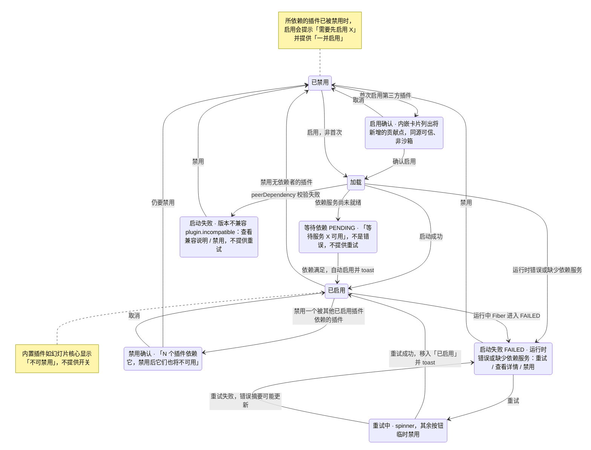

> 状态：草稿 | 负责：设计 | 更新：2026-09-15；2026-09-25（补图） | 依赖：charter v0.1

# 03-09 插件管理器

> **设计基准（2026-09-15 起）**：组件规格以 [`09-design-specification.md`](../09-design-specification.md) v3.0（shadcn Rhea + 材质层）为准；对应 playground 路由 `#/editor/plugins`（[已发布 artifact](https://claude.ai/code/artifact/cf6e1a1a-986b-48bb-b743-5758dff419d2)，源码 `playground/src/routes/`）。本文引用的 `mockups/*.html` 与线框图为历史静态稿，以 playground 实际渲染为终稿。

`ui.dialog`（或独立路由页面，二者皆可，宿主决定）承载的插件生命周期管理界面，直接对应章程 R2"每一级可插拔"的用户可见证据。

---

## 线框（默认态）

```
┌───────────────────────────────────────────────────────┐
│ 插件管理器                                          [×]│
├───────────────────────────────────────────────────────┤
│ [已启用 4] [已禁用 1] [启动失败 1]                        │
├───────────────────────────────────────────────────────┤
│ 🧩 幻灯片核心（内置）              v1.0        [不可禁用]  │
│    幻灯片编辑、渲染与格式支持                              │
│                                                    [▸]  │
│ 🧩 数据图表增强  第三方 · ACME     v0.3.1       (● 启用)  │
│    为图表元素提供高级数据绑定与联动                          │
│    贡献：2 个 ribbon 按钮 · 1 个属性分区                   │
│                                                    [▸]  │
│ 🧩 流程图形状包  第三方 · ACME     v0.1.0       (● 启用)  │
│                                                    [▸]  │
├───────────────────────────────────────────────────────┤
│ 启动失败                                                │
│ ⚠ 演示激光笔  第三方 · Beta Labs   v0.0.4               │
│    错误：缺少依赖服务 "render.overlay"                    │
│    [重试]  [查看详情]  [禁用]                             │
└───────────────────────────────────────────────────────┘
```

首次启用第三方插件时的能力确认（内嵌卡片，非浏览器 `confirm()`）：

```
┌─────────────────────────────┐
│ 启用"数据图表增强"？             │
│ 该插件将新增：                  │
│  · 2 个 Ribbon 按钮             │
│  · 1 个属性面板分区              │
│  · 0 个可访问你数据的后台请求      │
│ 来自第三方（ACME），同源可信，     │
│ 非运行时沙箱隔离                 │
│              [取消]  [确认启用] │
└─────────────────────────────┘
```

---

## 状态

### 空

"已禁用"或"启动失败"分组若为空，整个分组标题隐藏（不显示"暂无"占位，避免管理器界面充满空分组标题）；"已启用"分组理论上至少含内置幻灯片核心插件，不设计空状态。

### 加载

列表显示骨架行（图标块 + 两行灰条 + 开关骨架）。

### 错误（管理器本身加载失败）

"插件列表加载失败 [重试]"，替换整个内容区。

### 离线

```
│ ⚠ 离线时无法添加新插件，已加载插件的启用/禁用仍可本地生效 │
```

"添加插件"入口（若产品范围包含插件发现/市场，见待决事项）禁用；已列出插件的启用/禁用开关保持可用。

### 依赖冲突（禁用一个被依赖的插件）

```
┌─────────────────────────────┐
│ 禁用"幻灯片核心"？               │
│ 3 个插件依赖它，禁用后它们也将    │
│ 不可用：数据图表增强、流程图形状包、│
│ 演示激光笔                      │
│              [取消]  [仍要禁用] │
└─────────────────────────────┘
```

---

## 交互说明

- 每个插件条目可展开 `[▸]` 查看详情：版本、提供方、权限/能力范围、完整贡献点清单（ribbon/panel/command/shortcut/statusBar/overlay 各自计数与列表）、依赖关系（inject 了哪些服务）。
- 启动失败条目的"查看详情"展示原始错误摘要（供技术用户/插件开发者排查），面向最终用户的摘要文案需保持简洁友好（"缺少依赖服务"而非堆栈信息）。
- 内置插件（如幻灯片核心）开关位置替换为"不可禁用"标签，不提供可操作开关，避免用户误以为可以移除核心能力。
- 启用/禁用为本地即时生效操作，不需要"保存"按钮。

## 边界情况

- 一个插件依赖另一个已被禁用的插件：新启用尝试时提示"需要先启用『X』"，并提供快捷"一并启用"操作。
- 插件版本不兼容（peerDependency 校验失败，架构 ADR-0002）：归入"启动失败"分组，错误摘要区分"运行时错误"与"版本不兼容"两类文案。
- 插件市场/发现（浏览、安装未加载过的插件）：当前设计仅覆盖"已安装插件"的管理，市场型 UI 不在本轮范围内，见 README 待决事项。
- 第三方插件图标缺失：使用统一的默认拼图图标兜底，不留空白。

---

## 补充（2026-09-15，G-27，来源 `10-prd/07-design-coverage-and-gaps.md`）

补齐"启动失败"之外的"等待依赖（PENDING）"分组、详情展开、重试中间态、版本不兼容文案（此前仅有 `FAILED` 一种失败态）。

### 线框：等待依赖分组（新增，位于"已启用"与"启动失败"之间）

```
├───────────────────────────────────────────────────────┤
│ 等待依赖 1                                              │
│ 🧩 流程图协作扩展  第三方 · ACME    v0.2.0   等待服务      │
│    等待服务 "collabTransport" 可用                      │
│                                                    [▾]  │
```

- 与 `FAILED` 的关键区别：不是错误，是"尚不能启动"的正常中间态，不提供重试按钮（重试无意义，需等依赖服务本身就绪）；依赖满足后自动转为"已启用"并 toast"『流程图协作扩展』已自动启用"。
- 分组同样遵循"为空则隐藏标题"规则（03-screens/09 已有原则）。

### 展开详情 `[▾]`（全部分组通用，此前未定义）

```
│ 🧩 数据图表增强  第三方 · ACME  v0.3.1              [▴]  │
│  版本 0.3.1 · 提供方 ACME · 宿主兼容 0.1–0.3            │
│  贡献：ribbon(2) panel(1) contextMenu(0) shortcut(1)   │
│  依赖注入：render.overlay、layout.measurer              │
│  能力声明：network:api.acme.com、storage:local（仅展示） │
```

点击行尾 `[▾]`/`[▴]` 展开/折叠详情，展示版本、提供方、宿主兼容范围、按贡献点分组的条目计数、注入的依赖服务、能力声明（PS-13，仅展示不做运行时强制，见 06-extensibility-ux.md §4）。

### 启动失败：详情与重试中间态

```
│ ⚠ 演示激光笔  第三方 · Beta Labs   v0.0.4               │
│    错误：缺少依赖服务 "render.overlay"                    │
│    [重试…]（spinner，禁用其余按钮）  [查看详情]  [禁用]     │
```

- 点击"重试"：按钮替换为 spinner + "重试中…"，其余操作按钮临时禁用；重试失败则恢复失败态（错误摘要可能更新）；重试成功则该插件行移入"已启用"分组并 toast。
- "查看详情"展开原始错误摘要（错误码、插件版本、宿主版本、"复制诊断信息"按钮），面向技术用户；分组标题旁的摘要文案保持简洁友好（"缺少依赖服务"而非堆栈信息，本文件已有原则）。

### 版本不兼容文案

```
│ ⚠ 旧版数据看板  第三方 · Beta Labs   v0.9.0              │
│    需要宿主 0.4–0.6，当前 0.3.1                          │
│    [查看兼容说明]  [禁用]                                  │
```

- 版本不兼容（`plugin.incompatible`）与依赖缺失、运行时抛错视觉上均归入"启动失败"分组，但摘要文案与操作按钮不同（不提供"重试"，因为重试不会改变版本关系）。

**插件在管理器中的状态迁移**



怎么读：每个状态对应管理器里的一个分组或中间态——已启用、已禁用、等待依赖、启动失败（含版本不兼容）；空分组的标题隐藏。启用 / 禁用均本地即时生效，不需要「保存」。
