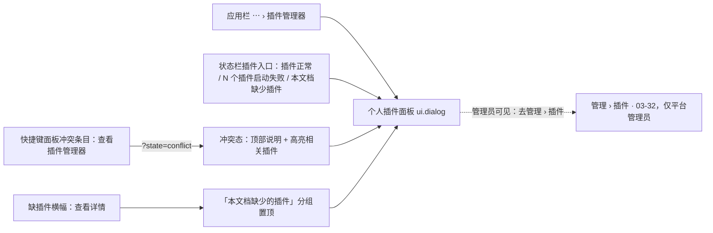
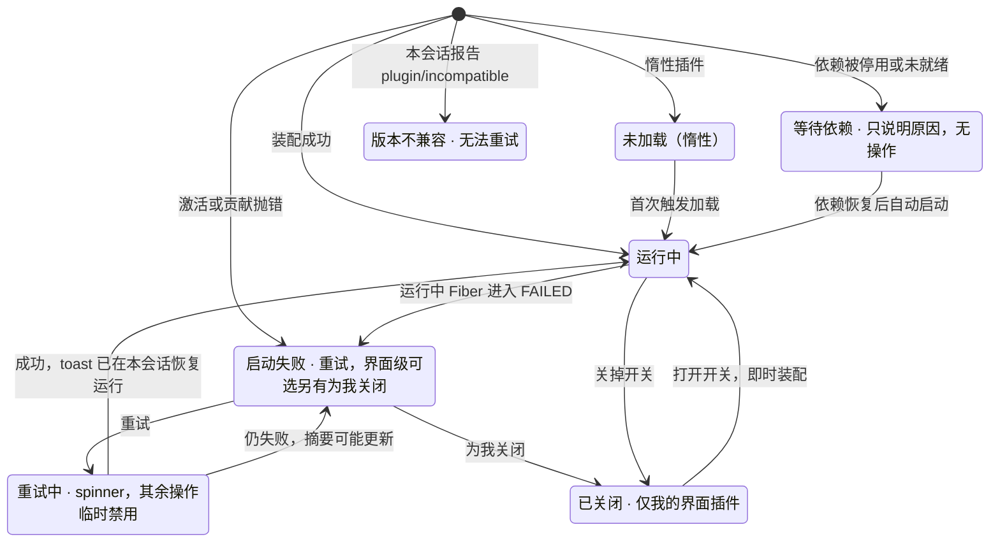
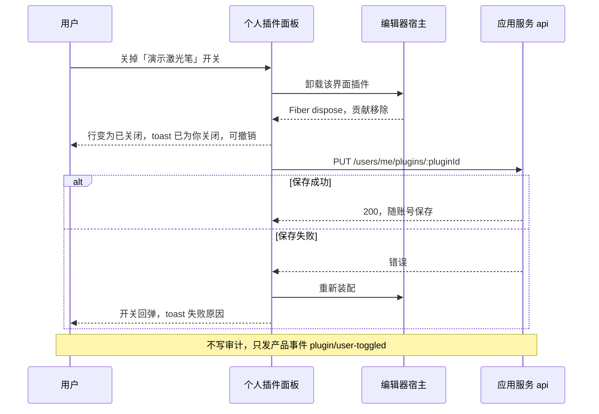
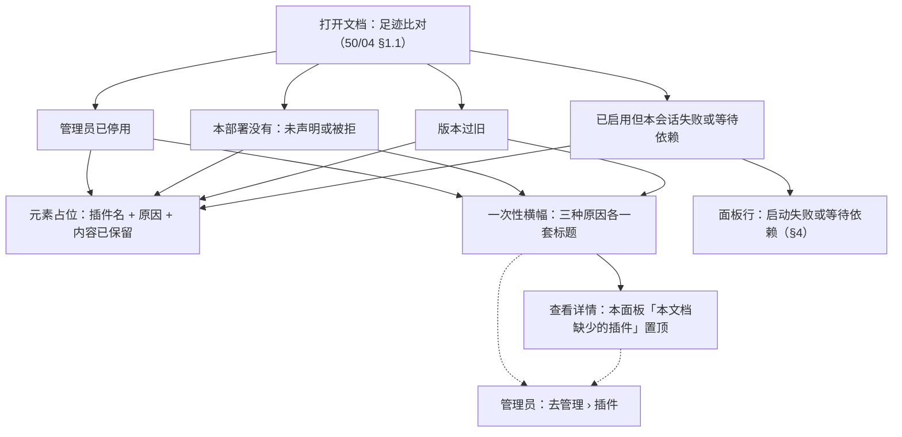

> 状态：草稿 | 负责：设计 | 更新：2026-09-15；2026-09-25（补图）；2026-10-01（§4.23 插件管理样张回写：按用户确认的 playground `#/editor/plugins` 样张整篇重写为「个人插件面板」——三分组（本文档缺少的插件 / 我的界面插件 / 本部署统一启用）、「为我关闭」即时生效、「由管理员统一」、失败详情与本会话重试、等待依赖、会话级版本不兼容（PS-07 客户端上报）、快捷键冲突入口、只读角色、「插件设置已更新」重新加载横幅、缺插件三种原因横幅与详情、空 / 加载 / 错误，状态清单 14 态；旧稿的用户侧首次启用确认卡、依赖冲突卡与「启用 / 禁用本地即时生效」迁往管理员稿 [03-32](32-admin-plugin-management.md)） | 依赖：charter v0.2 §2.3；rulings §4.23（三题裁决与 O-1…O-4）；PRD [09 插件管理](../../10-prd/03-features/09-plugin-manager.md) PM-08、PM-10、PM-11、PM-12、PM-15、PM-16，[04 插件 SDK](../../10-prd/03-features/04-plugin-sdk.md) PS-07、PS-11、PS-13；前端 [50/03](../../50-frontend/03-preset-assembly-and-plugins.md) §5.1、§10，[50/04](../../50-frontend/04-document-commands-and-undo.md) §1.1，[50/02](../../50-frontend/02-app-shell-routing-and-session.md) §12，[50/16](../../50-frontend/16-i18n-and-accessibility.md) §8.1；设计 [06](../06-extensibility-ux.md) §3、[03-24](24-keyboard-shortcuts-panel.md)、[03-02](02-editor-main.md)；playground `#/editor/plugins`

# 03-09 个人插件面板

> **设计基准（2026-09-15 起）**：组件规格以 [`09-design-specification.md`](../09-design-specification.md) v3.0（shadcn Rhea + 材质层）为准；对应 playground 路由 `#/editor/plugins`（[已发布 artifact](https://claude.ai/code/artifact/cf6e1a1a-986b-48bb-b743-5758dff419d2)，源码 `playground/src/routes/`）。本文线框为示意，以 playground 实际渲染为终稿。
>
> **样张（2026-10-01，用户已确认）**：本文各节以 playground `#/editor/plugins` 样张为准，源码 `playground/src/routes/editor/Plugins.tsx`，共用小件 `playground/src/components/plugin-bits.tsx`（插件图标块、作用域徽标、会话状态文字），演示数据 `playground/src/lib/plugin-data.ts`（与管理员稿 03-32 共用同一份部署清单）。14 个演示态见文末「状态清单」（文档站截图按 `09--<状态 id>--light|dark.jpg` 登记在 `docs/_tools/capture-screens.cjs` 第 09 条，默认态 `default`）。行为口径与 PRD 09 PM-10…PM-12 一致，视觉与文案以本文为准。

本面板即 PS-11 所称「扩展」面板（PRD 09 PM-10，二者合一），面向**每一位用户**：看本会话装配了哪些插件、哪个出了问题、能不能自己处理；在管理员开放的范围内开关只影响自己的界面插件。它**不**决定部署里有哪些插件、哪些强制启用——那是管理员在「管理 › 插件」（[03-32](32-admin-plugin-management.md)）里的事。

## 与旧稿的差异（2026-10-01，rulings §4.23）

旧稿（2026-09-15）按「用户本地即时启停全部插件、首次启用第三方由用户确认」写成，与裁决「两级管理、只认部署预置、内容级按部署统一 / 界面级个人启停」不符。本次整篇重写，旧稿内容的去向如下：

| 旧稿内容 | 去向 |
|---|---|
| 「已启用 / 已禁用 / 启动失败」三分组、用户对任意插件的启用 / 禁用开关 | 改为三分组「本文档缺少的插件 / 我的界面插件 / 本部署统一启用」；开关只出现在「我的界面插件」（§3） |
| 首次启用第三方插件的能力确认卡 | 移到管理员稿 [03-32](32-admin-plugin-management.md) §7.3（M4，随第三方插件），普通用户不再看到 |
| 依赖冲突卡「禁用『幻灯片核心』？N 个插件依赖它」 | 移到 03-32 §7.2；本面板里的等待依赖只显示原因，不提供操作（§4.2） |
| 「需要先启用『X』」+「一并启用」 | 移到 03-32 等待依赖行内说明（§5.3） |
| 启动失败的「禁用」按钮 | 删去：界面级可选插件换成「为我关闭」；内容级与强制启用插件显示「请联系管理员」（§4.1） |
| 版本不兼容的「查看兼容说明」 | 改为行内说明「需要宿主 x.y–x.z，当前 a.b；无法重试」；部署级的版本不兼容由管理员稿展示，普通用户看不到被拒插件（§4.3） |
| 离线时「添加插件」入口禁用 | 删去：界面上没有添加插件的入口（裁决 2，只认部署预置） |
| 插件市场 / 发现待决 | 结案为不做（PRD 09 §5 非目标） |
| 「启用 / 禁用本地即时生效，不需要保存」 | 只对「我的界面插件」成立，且改为随账号保存（O-2）；管理员变更走草稿 + 保存条，新会话生效（03-32 §6） |

---

## 1. 入口

| 入口 | 位置 | 进入后的样子 |
|---|---|---|
| 应用栏「⋯ › 插件管理器」 | 编辑器应用栏更多菜单（[03-02](02-editor-main.md)「交互说明」，D27） | 打开本面板（默认态） |
| 状态栏插件入口 | 状态栏右端，与同步状态并列（[06](../06-extensibility-ux.md) §3） | 同上；有失败时失败行排在「本部署统一启用」最前 |
| 快捷键面板冲突条目「查看插件管理器」 | [03-24](24-keyboard-shortcuts-panel.md)「冲突标记」 | 打开本面板的冲突态（`?state=conflict`）：顶部冲突说明 + 高亮相关插件（§4.4） |
| 缺插件横幅「查看详情」 | 编辑器工具卡里的横幅（§6） | 打开本面板，「本文档缺少的插件」分组在最上方 |

状态栏入口的三种文案（样张原文）：

| 情况 | 文案 | 颜色 |
|---|---|---|
| 一切正常 | 插件正常 | 默认前景色 |
| 本会话有 N 个启动失败 | N 个插件启动失败 | `destructive` |
| 无失败、本文档缺少插件 | 本文档缺少插件 | `warning-foreground` |

入口是拼图图标 + 文字的圆角按钮（高 24px），`aria-label` 为「<文案>，打开插件面板」。

**图 1 个人插件面板的入口与去向**



怎么读：左列四个入口都打开同一个对话框；快捷键面板与缺插件横幅会带着上下文进入（冲突高亮、缺少的插件置顶）。虚线表示只有平台管理员在面板里多一个跳往管理页的链接，普通用户没有。
依据：PRD 09 PM-10「入口」；本文 §1。

---

## 2. 线框（默认态）

面板是居中模态对话框（`Dialog`，最大宽 672px，最大高为视口减 80px，内容区独立滚动），标题「插件」，打开时焦点落在对话框本身（不自动聚焦第一个开关，避免误触）。

```
┌───────────────────────────────────────────────────────────────┐
│ 🧩 插件                                                     [×]│
│ 本会话已装配的插件。「我的界面插件」只影响你，不影响协作者，    │
│ 也不会进入文档。                                               │
│ ✓运行中 15  ⧗等待依赖 1  ◌未加载 1              [去管理 › 插件]*│
├───────────────────────────────────────────────────────────────┤
│ 我的界面插件 [M3] 4                                            │
│ 只影响你自己；切换即时生效，随账号保存                          │
│ ┌───────────────────────────────────────────────────────────┐ │
│ │ ▣ 英文语言包 0.3.2 · 内置                  ✓运行中 (●) [▾]│ │
│ │   管理员默认开 · 界面文案的 English 翻译                   │ │
│ │ ▣ 演示激光笔 0.4.0 · 内置                  ✓运行中 (●) [▾]│ │
│ │ ▣ 聚焦搜索   0.2.1 · 内置                  ✓运行中 (●) [▾]│ │
│ │ ▣ 字数统计   0.1.3 · 内置                  ⊘已关闭 (○) [▾]│ │
│ │   管理员默认关 · 状态栏显示本页与全文字数                   │ │
│ └───────────────────────────────────────────────────────────┘ │
│ 本部署统一启用 14  [🔒由管理员统一]                             │
│ 会影响文档内容或渲染的插件，所有协作者一致；个人不能关闭        │
│ ┌───────────────────────────────────────────────────────────┐ │
│ │ ▣ 品牌素材包 2.0.0 · 第三方 · ACME             ⧗等待依赖 [▾]│ │
│ │   ⧗ 等待依赖：「模板库」已被管理员停用；依赖恢复后自动启动，│ │
│ │     无需重试                                               │ │
│ │ ▣ 核心组件 4 个 · 内置                          ✓运行中 [▾]│ │
│ │   内核、幻灯片文档模型、协同存储（Yjs）、DOM 渲染器         │ │
│ │ ▣ 编辑器界面 0.3.2 · 内置                       ✓运行中 [▾]│ │
│ │ ▣ 图表渲染   0.3.1 · 内置                   ◌未加载（惰性）[▾]│ │
│ │ ▣ 查看水印 0.2.0 · 内置 [内容级·部署指定]       ✓运行中 [▾]│ │
│ │ …                                                          │ │
│ └───────────────────────────────────────────────────────────┘ │
└───────────────────────────────────────────────────────────────┘
  * 仅平台管理员可见
```

### 2.1 头部

- 标题行：拼图图标 +「插件」，右上角关闭。
- 说明行（样张原文）：「本会话已装配的插件。「我的界面插件」只影响你，不影响协作者，也不会进入文档。」
- 计数行：按本会话状态计数，只列非零项，顺序固定为运行中 → 启动失败 → 等待依赖 → 版本不兼容 → 未加载；「运行中」把核心组件的 4 个成员算在内。只读角色在计数行末尾追加「只读：编辑类命令不可用」（§4.5）。
- 平台管理员在计数行右端多一个链接按钮「去管理 › 插件」（盾牌图标），跳 `/admin/plugins`；普通用户不显示、不占位（PM-10「管理员在编辑器里仍是普通用户」）。

## 3. 三个分组

分组自上而下固定为下表顺序；分组为空时连标题一起隐藏（沿用旧稿「空分组隐藏」原则），不显示「暂无」。

| 分组 | 何时出现 | 标题旁 | 说明行（样张原文） | 行尾控件 |
|---|---|---|---|---|
| 本文档缺少的插件 | 仅当打开的文档足迹里有插件不可用（PM-12，§6.3） | 数量 | 相关内容以占位显示、数据原样保留；可选中、移动、删除，不能编辑内部 | 原因 + 「去管理 › 插件」（管理员）或「请联系管理员」 |
| 我的界面插件 | 管理员至少把一个界面级插件设为「允许用户选择」 | `M3` 里程碑标记 + 数量 | 只影响你自己；切换即时生效，随账号保存 | 会话状态 + 开关 + 展开 |
| 本部署统一启用 | 始终（至少含核心组件） | 数量 +「🔒由管理员统一」徽标 | 会影响文档内容或渲染的插件，所有协作者一致；个人不能关闭 | 会话状态 + 展开（无开关） |

- 「本部署统一启用」= 内容级插件 + 管理员强制启用的界面级插件（PM-10）；被拒、已停用的插件不进会话，也不出现在这里——普通用户看不到被拒插件（PRD 09 §5 非目标）。
- **核心组件合并为一行**：内核必需与契约必需插件（样张为内核、幻灯片文档模型、协同存储（Yjs）、DOM 渲染器 4 个）合成「核心组件 4 个 · 内置」一行，副标题列出成员名，展开后逐行列出 `id@版本`。它们不会单独失败到只影响一个插件，合并减少噪音。
- **需要处理的排在前面**：「本部署统一启用」里启动失败 → 版本不兼容 → 等待依赖的行排在最前，其后是核心组件行，再其后按部署声明顺序；没有问题行时核心组件行在第一行。
- 强制启用的界面级插件在副标题前加「强制启用的界面插件」；部署声明文件把界面级升为内容级的插件（样张为「查看水印」）在名称旁带作用域徽标「内容级 · 部署指定」，悬停说明「插件声明为界面级，部署声明文件把它升为内容级：全员统一，个人不能关闭」。
- M2 只有只读、诊断与重试：「我的界面插件」的开关在 M3 才可用（分组标题带 `M3` 标记，PRD 09 §4；M2–M3 之前不提供禁用，50/03 §10）。

### 3.1 插件行

```
│ ▣ 名称  版本 · 来源 [作用域徽标*]                 状态文字 (开关*) [▾]│
│   副标题：管理员默认开 · 你已关闭* · 插件描述（单行截断）          │
│   状态说明行*（等待依赖 / 版本不兼容 / 启动失败摘要 / 只读说明）   │
│   [操作按钮*]                                                   │
```

- 图标块 32px 圆角方块，插件无图标时用统一拼图图标兜底；「已关闭」的行图标降为 60% 不透明度。
- 来源：「内置」或「第三方 · <供应商>」。
- 「我的界面插件」的副标题以「管理员默认开 / 关」开头；用户的选择与默认值不同时追加「· 你已开启 / 你已关闭」。
- 会话状态文字（`SessionStatusText`，图标 + 文字，状态不只靠颜色，PM-16）：

| 状态 | 文字 | 图标与颜色 | 何时 |
|---|---|---|---|
| 运行中 | 运行中 | 实心勾，`success-foreground` | Fiber 已激活 |
| 等待依赖 | 等待依赖 | 沙漏，`info-foreground` | 所依赖的插件被管理员停用或服务尚未就绪（§4.2） |
| 启动失败 | 启动失败 | 叉，`destructive` | 本会话 Fiber `FAILED`（§4.1） |
| 版本不兼容 | 版本不兼容 | 三角警示，`destructive` | 本会话报告 `plugin/incompatible`（§4.3） |
| 未加载（惰性） | 未加载（惰性） | 虚线圆，`muted-foreground` | 惰性插件尚未触发加载（样张为「图表渲染」，本页没有图表） |
| 已关闭 | 已关闭 | 斜线圆，`muted-foreground` | 用户为自己关闭了该界面插件 |

- 展开 `[▾]`（仅图标按钮，`aria-expanded`，可读名称「展开 / 收起『<名称>』详情」）后，在行下方缩进的浅底卡片里列出：**贡献**（按贡献点 `point ×N` 胶囊）、**能力声明**（胶囊，末尾注「（仅展示）」，未声明时写「未声明」，PS-13）；启动失败的行另列错误码、摘要、traceId 与「复制诊断信息」（§4.1）。

## 4. 行的状态与操作

**图 2 插件行在本会话里的状态**



怎么读：每个状态对应行尾的一种状态文字；只有「启动失败」有按钮可点，「等待依赖」与「版本不兼容」都不提供重试（重试不会改变依赖或版本关系）。「已关闭」只出现在「我的界面插件」，开关两个方向都即时生效、无需刷新。
依据：PRD 09 PM-10、PM-08（O-1 个人启停即时热切换）；PS-07、PS-11。

### 4.1 启动失败：详情与本会话重试（演示态 `failed`、`failed-admin`）

```
│ ▣ 现场投票 0.9.1 · 第三方 · Beta Labs                   ⊗启动失败 [▴]│
│   在幻灯片上插入投票并实时统计                                       │
│   ⚠ 启动失败：激活超时：投票服务 poll.betalabs.io 在 10 s 内无响应   │
│   [↻ 重试]  仅在本会话重试；如持续失败，请联系管理员  [去管理 › 插件]*│
│   ┌──────────────────────────────────────────────────────────────┐  │
│   │ 贡献     slide.shapeKind ×1  core.command ×2  ui.panel ×1    │  │
│   │ 能力声明 network: poll.betalabs.io （仅展示）                 │  │
│   │ 错误码   plugin.activate_failed                               │  │
│   │ 摘要     激活超时：投票服务 poll.betalabs.io 在 10 s 内无响应  │  │
│   │ traceId  4bf92f3577b34da6a3ce929d0e0e4736                     │  │
│   │ [⧉ 复制诊断信息]                                              │  │
│   └──────────────────────────────────────────────────────────────┘  │
```

- 行内摘要：红色「启动失败：<面向用户的摘要>」，单行截断；完整摘要在展开卡片里。样张 `failed` 态默认展开第一条失败行。
- **重试**（任何用户可用，PS-11）：只在本会话 `fiber.restart()`，不改部署状态。点击后按钮变为 spinner +「重试中…」，面板里其余重试、为我关闭、开关临时禁用；成功则状态变为「运行中」并 toast「『<名称>』已在本会话恢复运行」，屏幕阅读器经 `aria-live=polite` 播报「『<名称>』已恢复运行」；失败则回到启动失败，摘要可能更新。
- **界面级可选插件**（样张为「演示激光笔」，在「我的界面插件」里）：重试旁是次要按钮「为我关闭」，点击等同关掉开关（§5）。
- **内容级或强制启用插件**（在「本部署统一启用」里）：重试旁是说明文字「仅在本会话重试；如持续失败，请联系管理员」；平台管理员另见链接「去管理 › 插件」（演示态 `failed-admin`）。
- **复制诊断信息**：复制 `plugin: <id>@<版本>`、`code`、`traceId` 三行到剪贴板并 toast「已复制诊断信息」；不含文档内容（50/03 §10）。
- 失败本身由客户端经错误上报管线上报（PM-15），管理员页据此统计「近 24 h 失败会话数」（03-32 §4）；面板不单独提供「上报」按钮。

### 4.2 等待依赖

- 行内说明（样张原文）：「等待依赖：『模板库』已被管理员停用；依赖恢复后自动启动，无需重试」；依赖不是被停用而是服务尚未就绪时写「依赖的服务尚未就绪」。
- 不提供重试，也不提供「一并启用」——启用依赖是管理员的事（03-32 §5.3）。依赖恢复后该行自动变为运行中。
- 等待依赖是正常中间态，不是错误：状态文字用 `info` 色，不计入状态栏的失败数。

### 4.3 版本不兼容（本会话报告，演示态 `failed` 中的「甘特图」）

部署校验已拦下 `hostApi` 不覆盖宿主的插件（部署级「版本不兼容」，只在管理员稿出现，普通用户看不到）。本面板展示的是另一种情况：插件通过了部署校验，但**本会话**加载时报告 `plugin/incompatible`（PS-07 客户端版本协商），例如浏览器缓存了旧宿主。

- 行内说明（样张原文）：「版本不兼容：需要宿主 0.4–0.5，当前 0.3；无法重试，如需使用请联系管理员」；平台管理员看到的结尾是「请在管理页查看」。
- 不提供重试。该事件同启动失败一样经客户端错误上报管线上报（PM-15），带插件 `id`、版本、错误码与插件集指纹，管理员页据此计入失败会话。
- 排序在启动失败之后、等待依赖之前（§3「需要处理的排在前面」）。

### 4.4 快捷键冲突（演示态 `conflict`）

从快捷键面板冲突条目的「查看插件管理器」进入（[03-24](24-keyboard-shortcuts-panel.md)，跳 `?state=conflict`）：

```
│ ⌨ 快捷键冲突：⌘−                                                  │
│   内置「缩小」与插件「聚焦搜索」绑定了同一快捷键，当前由内置命令生效。│
│   「聚焦搜索」是你的界面插件，可以为你关闭。                         │
│ 我的界面插件 [M3] 4                                                 │
│ ┃▣ 聚焦搜索 0.2.1 · 内置                       ✓运行中 (●) [▾]     │
│ ┃  管理员默认开 · 打开全局搜索浮窗（只读命令）                       │
│ ┃  ⚠ 与内置「缩小」冲突（⌘−） [为我关闭]                            │
```

- 顶部 `warning` 色说明块（`role=status`）写明冲突键、双方与当前哪一方生效。
- 相关插件行整行浅 `warning` 底 + 左侧 2px 竖条高亮，行内追加「与内置『缩小』冲突（⌘−）」与按钮「为我关闭」；关闭后按钮禁用。
- 冲突一方不可由用户关闭时（内容级或强制启用），说明块改写为「请联系管理员」，不出现「为我关闭」；管理员在 03-32 详情里看到同一冲突（PM-11）。
- 不提供自定义改键（PM-11 非目标）。

### 4.5 只读角色（演示态 `readonly`）

对当前文档只有查看权限（查看者、评审者、凭链接查看）时：

- 应用栏标题旁徽标「仅查看」，状态栏左侧「只读浏览中」；面板计数行末尾「只读：编辑类命令不可用」。
- 「本部署统一启用」里声明了写能力位命令的插件（样张为评论、数据图表增强、流程图形状包、现场投票）行内追加「编辑类命令不可用（你只有查看权限）」；这些插件照常运行、照常渲染。
- 「我的界面插件」的开关照常可用：个人启停只影响自己的界面，与文档权限无关（PM-01）。
- 查看器 preset（`preset-slide-viewer`）与 `/render` 页面**不渲染**本面板，也没有状态栏入口，只显示缺插件占位与一行说明（PM-12，见 [03-25](25-viewer-preset-shell.md)）。

## 5. 为我关闭 / 开启（「我的界面插件」，M3；演示态 `user-off`）

- 开关为 `switch`，可读名称「<名称>，个人设置，只影响你」（PM-16）。切换**即时生效**：本会话立刻装配或卸载该插件（Fiber 启动或 dispose，卸载后它贡献的按钮、面板、状态栏项、覆盖层随即消失、无残留），无需刷新（O-1）。
- 切换后 toast（样张原文）：标题「已为你关闭『<名称>』」/「已为你开启『<名称>』」，说明「立即生效，只影响你；随账号保存，换设备也沿用」，带「撤销」按钮；同时 `aria-live=polite` 播报同一句。
- 选择随账号保存在服务端（O-2），不写审计、只进产品事件 `plugin/user-toggled`（PM-14、PM-15）；保存失败时开关回弹并 toast 失败原因（50/18 PLG-02）。
- 关闭后该行状态为「已关闭」、图标变淡；副标题追加「· 你已关闭」（与管理员默认值不同时）。
- 管理员之后把它改为「强制启用」时，个人选择暂时失效（保留记录），该插件移到「本部署统一启用」；改回「允许用户选择」时恢复（PM-03）。
- 重试进行中所有开关临时禁用，避免与重试的装配交错。

**图 3 为我关闭的即时生效**



怎么读：纵线是参与方，自上而下是时间；界面先在本会话卸载插件并给出反馈，再把选择存到服务端，存失败才回弹。整个过程不刷新页面、不影响协作者。
依据：PRD 09 PM-08、PM-10、PM-14；rulings §4.23 O-1、O-2；50/18 PLG-02。

## 6. 横幅：插件设置已更新与缺少插件

两类横幅都画在编辑器工具卡里、Ribbon 上方（与连接 / 权限横幅同一条横幅通道，位置与优先级见 [03-02](02-editor-main.md)「插件横幅」：同一时刻最多一条，插件横幅排在连接、权限、保存类之后），非阻断、不抢焦点（`role=status`，`aria-live=polite`）；横幅出现时面板默认不打开。

### 6.1 插件设置已更新（演示态 `reload-banner`，PM-08，M3）

```
│ ↻ 管理员更新了插件设置，重新加载后生效              [↻ 重新加载] [×]│
│   未同步的更改会先保存再刷新；你可以先继续编辑，稍后再重新加载      │
```

- 触发：管理员在 03-32 保存了策略变更，已打开的会话在 ≤ 60 s 内或下次重连时收到控制消息（O-1）。
- `info` 色。「重新加载」点击后变为 spinner +「正在保存更改…」，先 flush 未确认的更改再刷新（复用版本漂移流程，50/02 §12）；刷新完成 toast「已重新加载，按新的插件设置装配」。
- 「×」可读名称「稍后再说」：关闭横幅、继续编辑；下次收到新的变更消息时再出现。不强制踢出、不中断编辑。
- 与版本漂移横幅同时出现时合并为一条，以版本漂移的文案与动作为准（PRD 07 G-87）。

### 6.2 缺少插件（演示态 `missing-disabled`、`missing-undeclared`、`missing-version`，PM-12）

打开的文档足迹里有插件在本会话不可用时，文档照常打开，相关元素以占位显示、数据原样保留，顶部出一次性横幅（每个文档每会话一次）。三种原因各一套标题（样张原文，示例插件「二维码形状」`acme:qr-shape`）：

| 原因 | 横幅标题 | 占位元素上的原因 |
|---|---|---|
| 管理员已停用 | 本文档用到了「二维码形状」，管理员已停用该插件 | 插件已停用 |
| 本部署没有此插件（未声明或被拒） | 本文档用到了本部署没有的插件 `acme:qr-shape`（≥ 1.2） | 本部署未部署 |
| 版本过旧 | 「二维码形状」版本过旧：需要 ≥ 1.2，当前 1.0 | 需要 ≥ 1.2 |
| 同时缺多个插件 | 本文档用到了 N 个当前不可用的插件 | 各自原因 |

```
│ 🧩 本文档用到了「二维码形状」，管理员已停用该插件 [查看详情] [去管理 › 插件]* [×]│
│    3 处内容以占位显示，内容已保留；可选中、移动或删除，暂不能编辑内部        │
```

- `warning` 色，拼图图标；说明行统一为「N 处内容以占位显示，内容已保留；可选中、移动或删除，暂不能编辑内部」。
- 按钮：「查看详情」打开本面板并把「本文档缺少的插件」分组放在最上方；平台管理员多一个「去管理 › 插件」；「×」可读名称「关闭提示」。
- 画布上的占位（OF-13）：虚线框 + 拼图图标 + 插件显示名 + 原因 +「内容已保留」；可选中、移动、删除，内部不可编辑。缩略图栏对应页显示警示计数（样张第 1 页 3 处）。状态栏插件入口变为「本文档缺少插件」（§1）。
- 插件已启用但本会话启动失败或等待依赖时，不走这一横幅，按 §4.1 / §4.2 在面板里处理，状态栏入口显示失败数（PM-12 第 4 条）。
- 查看器 preset 只显示占位与一行说明，没有横幅按钮与面板入口。

### 6.3 「本文档缺少的插件」分组（演示态 `missing-detail`）

```
│ 本文档缺少的插件 3                                                   │
│ 相关内容以占位显示、数据原样保留；可选中、移动、删除，不能编辑内部   │
│ ▣ 二维码形状 acme:qr-shape                          ⚠管理员已停用   │
│   需要 ≥ 1.0 · 3 处内容以占位显示 · 第 1 页          去管理 › 插件*  │
│ ▣ 组织架构图 acme:org-chart                         ⚠本部署没有此插件│
│   需要 ≥ 2.0 · 1 处内容以占位显示 · 第 4 页          请联系管理员    │
│ ▣ 数据图表增强 acme:data-binding                    ⚠版本过旧       │
│   需要 ≥ 1.5，当前 1.4.2 · 2 处内容以占位显示 · 第 3、6 页           │
```

- 每行：图标（本部署没有的插件用默认拼图，图标变淡）、显示名、`id`（等宽）、所需版本（版本过旧时加「当前 x」）、受影响处数与页码；行尾原因（`warning` 色图标 + 文字），平台管理员下方是「去管理 › 插件」，普通用户是「请联系管理员」。
- 本分组不提供操作按钮：启用、升级都在部署与管理员侧完成。

**图 4 缺插件从横幅到详情**



怎么读：足迹里不可用的插件先一律降级为占位；前三种原因再合成一条横幅，经「查看详情」进入本面板的缺少插件分组；第四种不出横幅，直接在面板对应行里处理。虚线是只有平台管理员才有的跳转。
依据：PRD 09 PM-12；OF-13；ADR-0050；50/04 §1.1。

## 7. 空、加载、错误

| 状态 | 表现（样张原文） |
|---|---|
| 空 · 管理员未开放可选插件（`no-optional`） | 「我的界面插件」分组隐藏，顶部浅底一行（锁图标）「可选插件由管理员设置：本部署目前没有开放给个人开关的插件」；「本部署统一启用」照常 |
| 加载中（`loading`） | 头部只有标题与说明行（无计数行）；内容区一条短标题骨架 + 5 行骨架（32px 图标块 + 两行灰条 + 右侧短条），`aria-busy=true` |
| 加载失败（`error`） | 内容区替换为空态：红色三角图标、标题「插件列表加载失败」、说明「编辑器本身不受影响；已装配的插件照常运行」、按钮「重试」 |

面板本身的加载失败不影响编辑器与已装配插件；「本部署统一启用」理论上至少含核心组件，不设计空态。

## 8. 无障碍（PM-16）

- 分组标题为 `h2`；「由管理员统一」是文字徽标，不是可操作控件。
- 开关为 `switch`，可读名称带「个人设置，只影响你」；展开按钮 `aria-expanded`；只有图标的按钮都有可读名称（关闭提示、稍后再说、展开 / 收起详情）。
- 重试、开关、重新加载的结果经隐藏的 `aria-live=polite` 区域播报；横幅为 `role=status`，不抢焦点。
- 状态不只靠颜色：六种会话状态、三种缺插件原因都有独立图标与文字。
- 对话框：打开时焦点落在对话框容器，Esc 关闭，关闭后焦点回到触发控件（状态栏入口、菜单项或横幅按钮）。

## 9. 边界情况

- 同一插件既在「本文档缺少的插件」（足迹要求 ≥ 1.5）又在「本部署统一启用」（本部署 1.4.2 运行中）：两处都显示，前者说明版本不够，后者照常显示运行中（样张「数据图表增强」）。
- 本会话同时有失败与缺插件：状态栏入口优先显示失败数；横幅照常出现一次。
- 失败的是惰性插件：在首次触发加载时才可能失败，失败前显示「未加载（惰性）」。
- 第三方插件图标缺失：统一拼图图标兜底，不留空白。
- `ui.theme` 贡献加载期校验失败（[06](../06-extensibility-ux.md) §2.11）：按启动失败处理，摘要写校验失败原因（对比度不达标等），不另设状态。

## 10. 状态清单

14 个演示态，与 `docs/_tools/capture-screens.cjs` 第 09 条、playground `stateOptions` 一一对应；截图文件名 `09--<状态 id>--light.jpg` / `--dark.jpg`（缩略图加 `.thumb`）。

| # | 状态 id | 演示态名（下拉原文） | 说明 | 平台角色 |
|---|---|---|---|---|
| 1 | `default` | 默认 | 三分组中的两组；等待依赖 1、未加载 1 | 成员 |
| 2 | `failed` | 有启动失败 · 详情与重试 | 现场投票（内容级）与演示激光笔（界面级）启动失败、甘特图本会话版本不兼容；第一条失败行展开详情（§4.1、§4.3） | 成员 |
| 3 | `failed-admin` | 启动失败 · 管理员视角 | 同上，计数行与失败行多「去管理 › 插件」 | 管理员 |
| 4 | `user-off` | 个人关闭了「演示激光笔」 | 开关关、状态「已关闭」、副标题「你已关闭」（§5） | 成员 |
| 5 | `conflict` | 快捷键冲突 · 从快捷键面板进入 | 顶部冲突说明 + 聚焦搜索行高亮与「为我关闭」（§4.4） | 成员 |
| 6 | `readonly` | 只读角色（查看者） | 「仅查看」徽标、编辑类命令不可用说明，开关照常（§4.5） | 成员 |
| 7 | `no-optional` | 空 · 管理员未开放可选插件 | 「我的界面插件」隐藏 + 说明行（§7） | 成员 |
| 8 | `reload-banner` | 管理员刚改动 · 重新加载横幅 | 面板关闭，工具卡顶部 info 横幅（§6.1） | 成员 |
| 9 | `missing-disabled` | 缺插件横幅 · 管理员已停用 | 横幅 + 画布三个占位 + 缩略图警示 + 状态栏「本文档缺少插件」（§6.2） | 成员 |
| 10 | `missing-undeclared` | 缺插件横幅 · 本部署未部署 | 同上，原因「本部署没有」 | 成员 |
| 11 | `missing-version` | 缺插件横幅 · 版本过旧 | 同上，原因「版本过旧」 | 成员 |
| 12 | `missing-detail` | 缺少的插件 · 详情（管理员） | 多插件横幅 + 面板「本文档缺少的插件」3 行置顶（§6.3） | 管理员 |
| 13 | `loading` | 加载中 | 骨架（§7） | 成员 |
| 14 | `error` | 加载失败 | 空态 + 重试（§7） | 成员 |

## 11. 待决与推迟

- 无本稿待决项。管理员侧界面（清单、三态、确认卡、详情、配置）见 [03-32](32-admin-plugin-management.md)；缺插件横幅在编辑器中的层级见 [03-02](02-editor-main.md)「插件横幅」。
