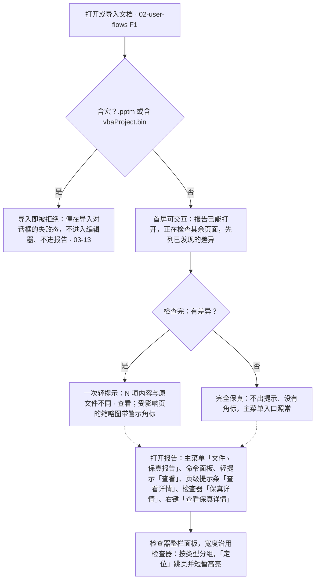

> 状态：草稿 | 负责：设计 | 更新：2026-09-18；2026-09-24（rulings §4.15 Q7：条目全集补 OLE、EMF、chartex、外部链接内容、仅授权查看的字体；动画 / 切换措辞按「结束态按场景」改写）；2026-09-24（rulings §4.16 Q15：宏文件不进入保真报告，改由打开失败态处理）；2026-09-25（补图）；2026-10-15（design-language-v3 第 2 批：按已拍板样张 `fidelity` 整篇改写——①报告是检查器整栏面板，宽度沿用检查器当前宽度（缺省 280）、不加宽，画布始终可见，原「导入详情」模态对话框与「本次不再提醒 / 知道了」作废（DS-38）；②常驻入口只有主菜单「文件 › 保真报告」，原应用栏「⋯」入口与持久小角标作废；上下文入口为轻提示「查看」、页级提示条「查看详情」、检查器「保真详情」与右键「查看保真详情」（DS-1、DS-51）；③打开后有差异时出一次中性轻提示（带「查看」，整页无法解析时为错误语气），不走横幅，看过报告或关掉提示即算已读（DS-51）；④报告按类型分组（无法解析 · 图表 · 图形与对象 · 动画与切换 · 外部内容 · 字体）、同类合并计数，每条两段，多于 5 页收成「共 N 页 查看全部页码」，状态色只给条目图标，范围「全部 · 本页」（DS-41、DS-51）；⑤「定位」跳到那一页、对象 2px 外框或整页外圈短暂高亮、不改选中，多处时逐处查看（DS-51）；⑥生成中用确定进度条、先列已发现的差异，原「入口禁用 + 转圈」作废（DS-53）；完全保真为中性的整块状态；部分解析失败「无法解析」单独成组排最前；⑦页级提示条、缩略图角标、纸面占位与降级对象的检查器、右键分别以 03-13、03-03 G-19、03-05 §3 为准，查看器 ⓘ 见 03-25（DS-51、DS-52）；⑧3 个备选标「未采纳」（DS-63）；依据 rulings §4.25 DS-38、DS-41、DS-51…DS-53、DS-63、TB-60、TB-70）；2026-10-22（design-language-v3 第 3 批：只改与第 3 批裁决有关的段落——§1.3、§3 紧凑形态（640–1024）里报告进右侧检查器抽屉的整栏（宽 280），「定位」高亮落在未遮挡区、不被抽屉挡住，面板「关闭」与抽屉「收起检查器」各管各的（DS-130，原「落位随第 3 批」结案）；§3 查看器 ⓘ 保真摘要（`fidelity.viewer-shell`）的外框换成查看器桌面壳、卡片不动，缺插件的一行说明放进这张卡的最前一行，没有影响查看的差异时卡片写「未发现影响查看的差异」（DS-110、TB-114，03-25）；依据 rulings §4.25 DS-110、DS-130、TB-114）；2026-10-22（design-language-v3 第 3 批回写续：§4.6 补页级占位「此页内容无法解析」在渲染层的纸面内画，与元素级占位、服务端缩略图与放映单页渲染失败的占位同一画法（rulings §4.25 TB-151，模块落点由 40/06 或 40/07 登记）；同日再补：§2 与图 1 补命令面板「保真报告」是不常驻的第二入口，shell-glue 注册的无参命令 `shell.openFidelityReport`（rulings §4.25 TB-162）；§4.6 补整页无法解析的占位是确定内容，服务端缩略图与 PDF、图片导出照常画出、不算失败，放映里运行时单页渲染出错的那种在服务端重试 1 次仍失败时缩略图用占位、导出作业失败（TB-157，60/06 §10.4、§11.3）；2026-10-22 复核修正：§4.6 补浏览器生成的图片导出遇到运行时单页渲染出错同样失败、进导出对话框的失败态，整页无法解析的占位照常导出（rulings §4.25 TB-166，03-22）；状态头的回写轮次字样改为「回写续 / 同日再补」）；2026-10-23（design-language-v3 第 3 批评审修改：§4.1 与图 1 的宏文件拒收改为停在导入对话框的失败态（导入全程在对话框里，rulings §4.25 DS-140；文案仍按 03-13「打开失败态」）；§3.1 `fidelity.alt-dialog` 注明对话框画法随 DS-142 改）；2026-11-04（design-language-v3 母版视图改版：§2 入口补母版视图里主菜单与命令面板的「保真报告」留在原位不可用，报告开着时进入母版视图收起、退出后恢复；rulings §4.25 DS-157、DS-162、TB-203；需求编号、优先级与里程碑不变） | 依赖：charter v0.2 §4；rulings §4.15 Q7、§4.16 Q15、§4.25 DS-1、DS-6、DS-21、DS-23、DS-26、DS-38、DS-41、DS-43、DS-51…DS-53、DS-63、DS-64、DS-110、DS-130、DS-157、DS-162、TB-60、TB-70、TB-114、TB-151、TB-157、TB-162、TB-166、TB-203；PRD [01 打开与保真](../../10-prd/03-features/01-open-and-fidelity.md) OF-09、OF-10、OF-12、OF-13、OF-14、OF-17、OF-18；前端 [50/25](../../50-frontend/25-elements-readonly-and-opaque.md) §2.2、§2.5，[50/12](../../50-frontend/12-viewer-embedding-and-render-page.md) §3，[50/02](../../50-frontend/02-app-shell-routing-and-session.md) §10.1，[50/10](../../50-frontend/10-editor-shell-and-interaction.md) §5；后端 [60/06](../../60-backend/06-modules-jobs-import-export-thumbnails.md) §10.4、§11.3；设计 [02](../02-user-flows.md) F1，[04](../04-design-system.md) §2.5、§4.1c，[09](../09-design-specification.md) §3.3、§3.4，[03-02](02-editor-main.md) §2.3、§3.5，[03-03](03-properties-panel.md) G-19，[03-05](05-context-menu.md) §3，[03-13](13-import-progress-and-degraded-states.md)，[03-19](19-undo-redo-clipboard-and-save-state.md) §4.3，[03-25](25-viewer-preset-shell.md)；playground `#/v3/editor?state=fidelity.*`（`src/v3/scenarios/fidelity/`）

# 03-10 导入保真报告

> **设计基准（2026-10-15 起，rulings §4.25 DS-38、DS-51…DS-53）**：以已拍板的 playground 第 2 批样张 `#/v3/editor?state=fidelity.<状态 id>` 为准（18 个状态，另有 3 个标「未采纳」的备选，§3.1），源码在 `playground/src/v3/scenarios/fidelity/`（`fidelity.scenario.tsx` 各状态的标题与说明，`ReportPanel.tsx` 报告面板与条目，`data.ts` 条目全集、措辞与级别，`canvas.tsx` 轻提示、页级提示条、定位高亮、缩略图角标与占位的右键，`inspector.tsx` 无法显示的对象的检查器内容，`slides.tsx` 第 7、8 页与各文档变体，`store.ts` 场景状态，`viewer.tsx` 查看器 ⓘ，`alternatives.tsx` 未采纳的备选）；对照截图 `openspec/changes/design-language-v3/screens/batch2/fidelity-<状态>-dark.jpg` / `-light.jpg`。编辑器外壳以 [03-02](02-editor-main.md) 为准，整栏面板、整块状态、轻提示与提示条等底座件见 `playground/src/v3/scenarios/README.md` §3a、§3b 与设计 04 §4.1c。画布上的降级三层（纸面占位、页级提示条、缩略图角标）与外部内容、受限字体的提示以 [03-13](13-import-progress-and-degraded-states.md) 为准，本文只写报告本身与打开后的提示。第 3 批（2026-10-22 拍板，rulings §4.25 DS-110、DS-130）的紧凑形态在场景 `narrow-review`（`compact-fidelity`，截图 `screens/batch3/narrow-review-compact-fidelity-*.jpg`），查看器 ⓘ 卡的外框换成查看器桌面壳（场景 `viewer`，03-25）。此前「导入详情」模态对话框的线框、「本次不再提醒 / 知道了」、应用栏「⋯」入口与持久小角标、shadcn / 材质层时期的写法与旧路由 `#/editor/fidelity` 作废。

对应 02-user-flows F1，向用户解释「不透明保留」（章程 §4）在体验上的含义：哪些内容原样保留但当前不可编辑、哪些暂时画不出来。报告是**客观的文件事实**，对文档的所有协作者一致——不因人、不因权限增减条目，评审者与查看者打开的是同一份（PRD OF-13「保真诊断面板」）。

---

## 1. 线框

### 1.1 在编辑器中的位置（桌面 1600 × 1000，报告开着，第 1 页）

```
┌──────────────────────┬──────────────────────────────────────┬────────────────────────────────────┐
│ [Logo▾]  [单页][网格]│                                      │ (周)(王)(李)          ▶  [分享]    │
│                      │                                      ├────────────────────────────────────┤
│ 2026 年 Q2 业绩汇报 ▾│                                      │ 保真报告                         × │
│ ✓ 已同步             │  ┌──────────────────────────────┐    │ 导入自 Q2 业绩汇报-终版.pptx       │
│ ▌1 ┏━━━━━━━━━━━━━━┓  │  │ ▌2026 年 Q2 业绩汇报         │    ├────────────────────────────────────┤
│ ▌  ┗━━━━━━━━━━━━━━┛  │  │  增长、效率与下半年计划      │    │ 9 项差异 · 涉及 8 页 ·             │
│  2 ┌──────────────┐  │  │                              │    │ 1 项以占位显示                     │
│    └──────────────┘  │  └──────────────────────────────┘    │ 内容都已原样保留，导出时一并写回   │
│  …                   │                                      │ [    全部 9    │    本页 2    ]    │
│  7 ┌──────────[⚠1]┐  │  ┌──────────────────────────────┐    ├────────────────────────────────────┤
│    └──────────────┘  │  │ 添加演讲者备注…              │    │ 图表                               │
│  8 ┌──────────────┐  │  └──────────────────────────────┘    │ ▥ 新式图表（瀑布图等）· 1 处  定位 │
│    └──────────────┘  │                                      │   暂不支持显示，已原样保留，       │
│                      │   [选择][文本][形状] … [更多]        │   导出后可在 PowerPoint 查看 ·     │
│                      │                                      │   第 7 页                          │
│                      │                                      ├────────────────────────────────────┤
│                      │                                      │ 图形与对象 …                       │
└──────────────────────┴──────────────────────────────────────┴────────────────────────────────────┘
```

图例：`[⚠1]` 缩略图警示角标（03-13）；`▥` 条目的类型图标。截图：`batch2/fidelity-report-*.jpg`。

- **整栏面板**：主菜单「文件 › 保真报告」打开后，检查器整栏换成报告（`InspectorTakeover`，先例是图表「编辑数据」，rulings §4.25 DS-26）；宽度沿用检查器当前宽度（缺省 280）、不加宽，打开与关闭时画布不跳动（DS-38）；开着时检查器左缘分隔条照常可拖，拖的就是检查器宽度（rulings §4.25 TB-60）。协作行（协作者 · 放映 · 分享）原样不动，「设计 / 评论」页签行换成标题行。同一时刻只开一个整栏面板。
- 报告的主要用法是「看一条、定位、再看下一条」：画布始终可见，「定位」后不必重开报告（备选「做成对话框」未采纳，§3.1）。
- 面板开着时左栏「单页 / 网格」不可用（网格视图没有检查器栏，[03-02](02-editor-main.md) §3.5）。

### 1.2 报告结构

```
┌────────────────────────────────────┐
│ (周)(王)(李)            ▶  [分享]  │  ← 协作行 48，原样不动
├────────────────────────────────────┤
│ 保真报告                         × │  ← 标题行 56：标题 + 一行说明 · 关闭（Esc）
│ 导入自 Q2 业绩汇报-终版.pptx       │
├────────────────────────────────────┤
│ 9 项差异 · 涉及 8 页 ·             │  ← 概要：一行粗体，放不下按词组换行
│ 1 项以占位显示                     │
│ 内容都已原样保留，导出时一并写回   │
│ [    全部 9    │    本页 2    ]    │  ← 范围（§4.3）
├────────────────────────────────────┤
│ 图表                               │  ← 分组标题（按类型）
│ ▥ 新式图表（瀑布图等）· 1 处  定位 │  ← 第一段：图标 · 名称 · 计数，右端「定位」
│   暂不支持显示，已原样保留，       │  ← 第二段：支持级措辞，页码接在后面
│   导出后可在 PowerPoint 查看 ·     │
│   第 7 页                          │
├────────────────────────────────────┤
│ 图形与对象                         │
│ ⧉ SmartArt · 1 处             定位 │
│   已保留为静态图形，暂不支持编辑其 │
│   结构 · 第 8 页                   │
│ …（嵌入对象、EMF / WMF 图片）      │
├────────────────────────────────────┤
│ 动画与切换 · 外部内容 …            │
├────────────────────────────────────┤
│ 字体                               │
│ T 缺失字体替代 · 1 种         定位 │
│   「汉仪旗黑」→「思源黑体」        │  ← 对照，主文字色
│   显示效果可能与原文件存在细微差异 │
│   · 第 7、8 页                     │
│ [锁] 仅授权查看的字体 · 1 种  定位 │
│   「方正兰亭黑」                   │
│   查看和放映时使用原字体；编辑时显 │
│   示为「微软雅黑」，换行位置可能变 │
│   化 · 共 6 页 查看全部页码        │
└────────────────────────────────────┘
```

- **标题行**：「保真报告」（13px 600）+ 一行说明「导入自 〈原文件名〉」（12px `--v3-text-2`，单行截断；报告说的是那份 .pptx 的事实，与当前文档标题可以不同）+「关闭」（×，Esc）。有说明时标题行高 56。
- **概要**：一行粗体（12px 600，主文字色）「N 项差异 · 涉及 N 页」，有无法解析的页时接「· N 页内容无法解析」，有以占位显示的条目时接「· N 项以占位显示」；放不下时在段与段之间换行，「·」留在上一行末尾。下一行 `--v3-text-2`「内容都已原样保留，导出时一并写回」。概要不另起一行写警示、不带状态色图标（标杆对照「报告概要的颜色」：级别只由条目图标表达）。其下是范围分段控件「全部 N ┊ 本页 N」（§4.3）。
- **分组**按类型，自上而下：无法解析 · 图表 · 图形与对象 · 动画与切换 · 外部内容 · 字体；每组一节（节标题 12px 600，节与节之间 1px 分隔），空组不出现。受限字体并入「字体」分组（DS-51）。
- **条目两段**（标杆对照「报告条目的密度」）：第一段「类型图标 · 名称 · 计数」（名称 12px 500 主文字色，「· N 处 / 种」12px `--v3-text-2`），右端「定位」（24px ghost 文字按钮，上下探出到条目的内边距里，条目不因按钮变高）；第二段是支持级措辞（12px `--v3-text-2`，照抄 §4.1 条目全集），页码接在后面「… · 第 7 页」——放不下时页码整段换到下一行，「·」留在上一行末尾；字体条目在两段之间多一行对照（12px 主文字色）。条目上下内边距 6、左右内缩 8、圆角 6，没有单独的页码行；280 栏首屏看得全 8 条。
- **页码多于 5 页**时措辞后写「· 共 N 页 查看全部页码」：「查看全部页码」是句中的文字按钮（主文字色，与这一行同高 18），点开后在同一位置列出全部页码、随行换行，焦点交给展开的页码。
- **状态色只给条目图标**（rulings §4.25 DS-41、DS-51）：无法解析用危险色（`FileWarning`）、以占位显示的条目把类型图标着警告色，其余（已原样保留）类型图标 `--v3-text-2`；文字一律主文字色或 `--v3-text-2`；完全保真这类常态不着色。

### 1.3 紧凑与仅查看形态

- **紧凑窗口（640–1024）**（2026-10-22 第 3 批拍板，rulings §4.25 DS-130；样张 `narrow-review.compact-fidelity`，1000 × 760）：入口仍是主菜单「文件 › 保真报告」（在左上「文档」胶囊里），以及打开后的轻提示「查看」、页级提示条「查看详情」；报告在右侧检查器抽屉的整栏里（同一个面板，宽 280 不变，DS-38「沿用检查器宽度」），右上胶囊让位。点某条的「定位」跳到那一页、在画布上短暂高亮对象——画布在未遮挡的区域里适应，高亮不会被抽屉挡住。面板的「关闭」（Esc 先关面板）回到常规检查器、抽屉还开着；抽屉的「收起检查器」收起抽屉、面板仍开着，再点「显示检查器」回到面板（与版本历史同一规则，03-07 §1.3）；有横幅时抽屉从横幅下沿开始、不盖住横幅（03-02 §5a.1）。
- **仅查看（< 640 或触控）**：没有主菜单，「更多」只放查看类命令（03-02 §5a.2），不提供报告；纸面占位与缩略图角标照常（03-13）。

---

## 2. 入口、打开与关闭

- **常驻入口只有主菜单「文件 › 保真报告」**（与「导出…」「幻灯片大小…」同组，03-02 §2.3；rulings §4.25 DS-51，设计质量门 Q2），完全保真、只读角色同样在。原应用栏「⋯ › 保真报告」与持久小角标（「3 项详情」）作废（DS-1、DS-51）；同步状态行只讲同步，不挂报告入口（备选「同步状态行常驻入口」未采纳，§3.1）。命令面板「保真报告」是不常驻的第二入口，与主菜单同一条命令（shell-glue 注册的无参命令 `shell.openFidelityReport` 与一条 `ui.command`，rulings §4.25 TB-162；条目以 03-24 为准）。母版视图里主菜单「文件 › 保真报告」与命令面板这一条留在原位、不可用，写「母版视图下不可用」（DS-157、TB-203）；报告开着时进入母版视图，面板随之收起，退出后恢复到进入前的样子——当前条目与画布定位一起还原，不抢焦点（DS-162；两条以 03-26 §1.1 为准）。
- **上下文入口**（只在对应情形出现，都打开同一个面板，不另做诊断视图）：打开后的轻提示「查看」（§5）；页级提示条「查看详情」（打开时范围为「本页」，03-13）；选中无法显示的对象时检查器对象说明的「保真详情」与右键「查看保真详情」（打开并定位到该对象，[03-03](03-properties-panel.md) G-19、[03-05](05-context-menu.md) §3）；双击无法显示的对象弹出的说明里的「查看保真详情」（前端 50/25 §2.2）；受限字体轻提示的「详情」（滚到「字体」分组，03-13）。
- **打开**：检查器整栏换成报告，用户打开时焦点进面板第一个可聚焦项（范围分段）；打开它的控件随面板一起换掉的（检查器里的「保真详情」、随报告隐藏的页级提示条），面板在挂上时就把焦点接过去。打开即视为已看过，打开后的轻提示随之收起（§5）。网格视图里选「文件 › 保真报告」先回单页再打开（菜单收起、视图切换的几帧里焦点交给画布列，面板挂上后接走）。
- **关闭**：标题行「关闭」或 Esc——报告收起，检查器回到常规页签，画布上的定位高亮随之清掉；焦点交回打开它的控件：主菜单按钮、检查器里的「保真详情」（随面板关闭才重新挂上，在同一个任务里交过去）、页级提示条的「查看详情」（提示条在报告开着时隐藏、关上后接着显示）、被右键的占位；没有来源时交给画布。焦点不经过 `body`（设计 07 §2.4）。Esc 在面板里有弹层开着时先关弹层。
- **评论钉**：编辑模式照常显示评论钉（DS-43）。报告开着时点画布上的评论钉，先收起报告（焦点留在钉上，定位高亮随之清掉，与「关闭」同一结果），再切到「评论」页签（检查器被报告占着时没有页签，点了要有可见反馈；01 §2.3）。

**图 1 报告的生成、提示与入口**



怎么读：宏文件在最前面就被拦下，永远不会出现在报告里；其余文档首屏可交互后就能打开报告（边检查边补全），检查完有差异时出一次轻提示，没有差异时什么都不出。各个入口都打开同一个整栏面板，常驻的只有主菜单「文件 › 保真报告」。报告内容基于文件本身，对所有协作者一致。
依据：PRD OF-13；rulings §4.16 Q15、§4.25 DS-38、DS-51、DS-53、DS-140、TB-162；02-user-flows F1。

---

## 3. 状态

样张路由均为 `#/v3/editor?state=fidelity.<状态 id>`（暗 / 亮另加 `&theme=dark|light`）。示例文档「2026 年 Q2 业绩汇报」导入自「Q2 业绩汇报-终版.pptx」：示例的 6 页之后接第 7 页「成本结构」（右侧瀑布图以占位显示）与第 8 页「附录」（SmartArt、嵌入的 Excel 工作表、EMF 标志、外部图片，都能画出来），共 9 项差异、涉及 8 页。保真诊断面板为 M2（PRD OF-13，P1）；受限字体为 M2（PRD OF-17）。

| 状态（样张标题） | 要点 | 规格 | 样张 id |
|---|---|---|---|
| 打开后有差异 · 轻提示 | 首屏完成、报告生成后出一次轻提示「9 项内容与原文件不同」+「1 项以占位显示；内容都已原样保留」+「查看」，中性图标；左栏第 7 页警告色角标 | §5 | `fidelity.default` |
| 保真报告 · 检查器整栏面板 | 检查器整栏换成报告、宽度不变；概要、范围、按类型分组的 9 条，280 栏首屏看得全 8 条；「仅授权查看的字体」收成「共 6 页 查看全部页码」 | §1.2、§4 | `fidelity.report` |
| 定位到对象 | 跳到第 7 页，瀑布图占位外 2px 强调色外框短暂高亮，不改选中；这一行成为当前项，页码换成「第 7 页 · 瀑布图「成本构成」」 | §4.2 | `fidelity.locate` |
| 定位到整页 · 逐处查看 | 切换效果是页的属性：幻灯片外一圈 2px 强调色；多处时「‹ 1 / 2 ›」逐处查看；关闭报告后检查器「放映」节的「切换」显示同一个值（淡化，只读） | §4.2 | `fidelity.locate-page` |
| 只看本页 | 范围切到「本页」，只剩第 7 页的两项（瀑布图、缺失字体）；换页跟着当前页走，没有差异时写「第 n 页没有差异」 | §4.3 | `fidelity.filter-page` |
| 本页提示条 | 画布顶部居中的浮动胶囊「本页有 1 处内容无法完整显示 ┊ 查看详情」 | 03-13 | `fidelity.page-hint` |
| 选中无法显示的对象 | 8 个缩放手柄 + 尺寸角标、没有旋转手柄；检查器「新式图表（占位）」三节；页级提示条让位 | 03-03 G-19、03-13 | `fidelity.degraded-selected` |
| 无法显示的对象 · 右键 | 「能摆放」菜单，末组「查看保真详情」，「编辑替代文本…」不可用「需在 PowerPoint 中修改」 | 03-05 §3 | `fidelity.degraded-menu` |
| 部分解析失败 | 第 8 页整页无法解析：「无法解析」单独成组、排最前、危险色图标；概要并进「1 页内容无法解析」；那一页上的对象未知、不再列出；轻提示改为错误语气 | §4.6 | `fidelity.parse-failed` |
| 部分解析失败 · 本页提示条 | 「此页内容无法解析 ┊ 查看详情」，危险色图标；第 8 页角标危险色 | 03-13 | `fidelity.parse-hint` |
| 完全保真 | 面板只写「未发现需要注意的差异」，常态不着色；不出轻提示、没有角标 | §4.5 | `fidelity.no-differences` |
| 报告生成中 | 「正在检查其余页面… 5 / 8」+ 确定进度条，先列已发现的 3 项；左栏第 6–8 页仍是版式骨架 | §4.4 | `fidelity.generating` |
| 外部内容需确认后加载 | 部署 `externalResources = confirm`：占位「此图片来自外部网站」+「加载」，页级提示条「本页包含来自外部网站的内容 ┊ 全部加载」；报告的「外部链接内容」改为需确认后加载、算作以占位显示 | 03-13、§4.1 | `fidelity.external-confirm` |
| 受限字体 · 进入编辑时的轻提示 | 「1 种字体仅授权查看，编辑时以替代字体显示 · 详情」（锁形、中性） | 03-13 | `fidelity.font-toast` |
| 受限字体 · 详情 → 字体分组 | 「详情」打开报告并滚到「字体」分组的「仅授权查看的字体」 | §4.1、03-13 | `fidelity.font-detail` |
| 入口 · 主菜单「文件」 | 「文件 › 保真报告」与「导出…」「幻灯片大小…」同组；选它打开整栏面板，关闭后焦点交回主菜单按钮 | §2 | `fidelity.file-menu` |
| 查看者 · 同一份报告 | 查看者与评审者从主菜单打开同一个面板、同样的条目，可以按页过滤、定位；只读角色画布不画手柄 | §4.2 | `fidelity.viewer-role` |
| 查看器 · ⓘ 保真摘要 | `preset-slide-viewer` 的 ⓘ 弹出极简摘要卡，只给影响「看」的计数；第 3 批起外框换成查看器的桌面壳（`viewer.default`），卡片本身不动（rulings §4.25 DS-110）。文档缺插件时这张卡的最前一行是「N 处内容需要插件「〈插件名〉」，以占位显示」（警告色拼图图标，DS-110，`viewer.missing-plugin`）；没有影响查看的差异时 ⓘ 留在原位，卡片写「未发现影响查看的差异」（中性对勾，同 `fidelity.no-differences`，TB-114） | 03-25 | `fidelity.viewer-shell` |

样张没有单独画、行为照常的：「查看全部页码」展开后的样子（`report` 里可点按演示）；看过报告或关掉提示之后同一文档再次打开不出提示（§5）。紧凑形态已随第 3 批出样张 `narrow-review.compact-fidelity`（§1.3，DS-130）；仅查看形态不提供报告（§1.3）。

### 3.1 未采纳的备选

拍板时画给用户对照的备选留在样张里，标题前加「未采纳 · 」，实现以上表的推荐状态为准（rulings §4.25 DS-63）。

| 备选（样张标题） | 画法 | 样张 id | 结论 |
|---|---|---|---|
| 报告做成对话框 | 居中模态对话框（480，遮罩），内容与面板相同、底部「知道了」；「定位」先关对话框再跳页，看下一条要重开，画布被遮罩盖住；对话框画法 2026-10-23 起随 rulings §4.25 DS-142 改（标题栏 40、圆角 12、× 正文色），画面随之改 | `fidelity.alt-dialog` | 未采纳，DS-38 定为推荐：检查器整栏面板（`fidelity.report`） |
| 打开后的提示走横幅 | 横幅通道放一条信息横幅（末档「其他」，可关闭）「9 项内容与原文件不同」+「查看保真报告」：占文档流、把画布往下推，而横幅通道只留给数据安全与连接（03-12） | `fidelity.alt-banner` | 未采纳，DS-51 定为推荐：一次轻提示（`fidelity.default`） |
| 同步状态行常驻入口 | 同步状态行后面常驻「ⓘ 9 项保真差异」：主菜单之外的第二个常驻入口，而同步状态行只讲同步（DS-6） | `fidelity.alt-indicator` | 未采纳，DS-51 定为推荐：只留主菜单（`fidelity.file-menu`）与打开后的一次轻提示 |

---

## 4. 报告内容

### 4.1 条目全集

rulings §4.15 Q7；PRD OF §2.3–§2.6、OF-09、OF-10、OF-12、OF-17、OF-18。每类一行、同类合并计数（字体以「种」计，其余以「处」计），按文档实际内容出现；「无法解析」的条目不写计数。

| 分组 | 条目（名称） | 级别 | 支持级措辞（第二段，样张原文） | 何时出现 |
|---|---|---|---|---|
| 无法解析 | 第 N 页内容无法解析 | 无法解析（危险色，排在最前） | 该页以占位显示，其余页面不受影响；原内容已保留，导出时原样写回 | 某页的部件解析失败、整体仍可打开（02 F1 E2） |
| 图表 | 新式图表（瀑布图等） | 以占位显示 | 暂不支持显示，已原样保留，导出后可在 PowerPoint 查看 | 含 `cx:` 图表（瀑布、直方、箱形、漏斗、旭日、树状） |
| 图形与对象 | SmartArt | 已原样保留；缺预览数据的单列一条「无法显示」，以占位显示 | 已保留为静态图形，暂不支持编辑其结构 | 含 `dgm:` |
| 图形与对象 | 嵌入对象（OLE） | 已原样保留；无预览图的单列「无法预览」，以占位显示 | 显示为预览图，暂不支持在此编辑 | 含 `p:oleObj` |
| 图形与对象 | EMF / WMF 图片 | 已原样保留；M1 无内嵌预览的以占位显示 | M2 起：已转为图片显示，导出时保留原文件；M1：无内嵌预览的 N 处暂以占位显示 | 含 EMF / WMF |
| 动画与切换 | 动画效果 | 已原样保留 | 已原样保留；放映时显示动画结束后的画面，暂不可修改（编辑态、缩略图、PDF 全部可见；放映按主序列可见性终态，M2 P1） | 含 `p:timing` |
| 动画与切换 | 切换效果 | 已原样保留 | 已原样保留，暂不播放 | 含 `p:transition` |
| 外部内容 | 外部链接内容 | 已原样保留；`confirm` 未加载时以占位显示 | `auto`：N 处内容来自外部网站（〈域名列表〉），已自动加载；`confirm`：N 处外部内容需确认后加载（〈域名〉），点「加载」后改为「N 处外部内容已加载（〈域名〉），本次打开内有效」；`never`：N 处外部内容已被管理员禁止加载 | 含 http(s) 外部关系（03-13「外链资源」） |
| 字体 | 缺失字体替代 | 已原样保留 | 对照行「「原字体」→「替代字体」」；显示效果可能与原文件存在细微差异 | 字体不可用 |
| 字体 | 仅授权查看的字体 | 已原样保留 | 对照行「「字体名」」；查看和放映时使用原字体；编辑时显示为「〈回退字体〉」，换行位置可能变化 | 内嵌字体 `fsType` 受限（M2 起，PRD OF-17） |

- 读屏名在条目名称后带上级别（「（无法解析）」「（以占位显示）」「（已原样保留）」），不只靠颜色（§7）。
- 宏文件（`.pptm` 或含 `vbaProject.bin`）在导入时即被拒绝（`format.macro_rejected`，rulings §4.16 Q15），不进入编辑器，因此不出现在报告里；用户在导入对话框的失败态里看到「不支持包含宏的演示文稿」·「请另存为 .pptx 后再导入」（与 `import.dialog-failed-invalid-package` 同一画法、只换文案，文案见 03-13「打开失败态」；导入全程在叠在原页上的对话框里，rulings §4.25 DS-140）。

### 4.2 定位

- 「定位」跳到受影响的第一处所在页并短暂高亮：对象是 2px 强调色外框、外移 2px（与 1px 选中框、悬停区分开）；页的属性（如切换效果）在幻灯片外画一圈 2px 强调色、与幻灯片圆角同心。高亮停约 1 秒后在约 0.6 秒内淡出，减少动态效果时到点直接消失。**不改选中**：报告开着时检查器被它占着，选中了也看不到属性。
- 这一行成为当前项（强调色淡底、圆角 6，与左栏当前页同一档），措辞后面的页码在同一位置换成「第 n 页 · 〈是什么〉」（主文字色，如「第 7 页 · 瀑布图「成本构成」」）。
- 多处时「定位」换成逐处查看「‹ 1 / 2 ›」（两枚 24px 图标按钮夹「当前 / 总数」）：第一处时「上一处」留在原位不可用、写「已是第一处」，最后一处同理。
- 画布始终可见，接着点下一条即可，不必重开报告；定位结果经 polite 播报「已定位到第 7 页：瀑布图「成本构成」」（画布高亮只是视觉）。
- 评审者、查看者同样可以定位；只读角色画布不画手柄，定位本来就不改选中（样张 `viewer-role`）。

### 4.3 只看本页

- 范围分段（`radiogroup`「显示范围」）：「全部 N」与「本页 N」（读屏名「全部 9 项」「本页（第 7 页）2 项」）。选「本页」时只列当前页上的条目，条目的计数与页码按本页算；概要仍是全文。
- 换页时跟着当前页走；当前页没有差异时写「第 n 页没有差异」。
- 页级提示条的「查看详情」打开时范围就是「本页」（03-13）；其余入口打开时为「全部」。

### 4.4 生成中（rulings §4.25 DS-53）

- 首屏可交互后报告就能打开：概要换成「正在检查其余页面…」（转圈，粗体一行）+ 确定进度条与「5 / 8」+「已发现 3 项差异；不必等待，可以照常编辑」；先列已发现的差异，末尾一行「第 6–8 页检查完成后补全」，检查完自动补全。同步状态行此时是「其余页面加载中 5/8」，左栏未解析完的页仍是版式骨架（03-13）。
- 首屏可交互之前主菜单整组不可用（打开中，03-02 §6.2「加载中」）。原「入口禁用 + 转圈、生成后入口短暂高亮」作废。
- 检查完、有差异时才出打开后的轻提示（§5）；面板开着时不出。

### 4.5 完全保真

- 面板只写一块中性的整块状态（`PanelState`）：对勾（`--v3-text-2`，常态不用状态色）+「未发现需要注意的差异」+「所有内容都已高保真还原，可以正常编辑」。
- 入口照常保留（用户仍可能想确认）；打开文档时不出轻提示，缩略图没有角标。

### 4.6 部分解析失败

- 「无法解析」单独成组、排在最前，危险色图标（文字仍是正文色）：「第 8 页内容无法解析」+「该页以占位显示，其余页面不受影响；原内容已保留，导出时原样写回 · 第 8 页」；「定位」画整页外圈。
- 概要的一行里并进「1 页内容无法解析」（不单独成行、不带状态色图标）；那一页上的对象未知，不再列出（样张里第 8 页的 SmartArt、OLE、EMF 与外部图片都不在）。
- 打开时的轻提示改为错误语气（§5）；画布上的页级占位、提示条与危险色缩略图角标见 03-13。页级占位「此页内容无法解析」在渲染层的纸面内画（render-dom 或 slide-render 的页级回退，模块落点由 40/06 或 40/07 登记），与元素级占位、服务端缩略图以及放映里单页渲染失败的占位同一画法，编辑器、查看器、放映与缩略图看到的是同一份（rulings §4.25 TB-151，03-11）。这块占位是确定的内容：服务端缩略图与 PDF、图片导出照常画出这一页的占位，不算失败；放映里运行时单页渲染出错的「此页内容暂时无法显示」不同，服务端渲染遇到它时重试 1 次，仍失败则缩略图用占位、导出作业失败（rulings §4.25 TB-157，后端 60/06 §10.4、§11.3）；浏览器生成的图片导出同一口径，某一页走了这种运行时页级回退，这次导出就失败、进导出对话框的失败态，不把一时的出错写进文件（TB-166，[03-22](22-export-dialog.md)）。

---

## 5. 打开后的提示（rulings §4.25 DS-51）

```
╭──────────────────────────────────────────────────────────╮
│ ⓘ 9 项内容与原文件不同                            查看 × │
│   1 项以占位显示；内容都已原样保留                       │
╰──────────────────────────────────────────────────────────╯
```

- 首屏完成、报告生成后，有差异时出**一次**轻提示（`ui.notification`，位置与外观见 [03-19](19-undo-redo-clipboard-and-save-state.md) §4.3，画布列底部居中、工具条上方）：标题「N 项内容与原文件不同」，说明「M 项以占位显示；内容都已原样保留」（没有以占位显示的条目时为「内容都已原样保留，可以正常查看」），文字按钮「查看」打开报告，带 ×。图标一律中性（`Info`，`--v3-text-2`）：有以占位显示的内容也不用警告色，警告色只留在缩略图角标与报告条目上（标杆对照「打开后的轻提示：图标颜色」，设计质量门 Q3）。
- 有整页无法解析时改为错误语气：标题「第 N 页内容无法解析」，说明「以占位显示，原内容已保留；其余页面不受影响」，「查看」打开报告并定位到那一条（`parse-failed`）。
- **不走横幅**：03-12 的横幅通道只给数据安全与连接（备选「走横幅」未采纳，§3.1）；报告入口不设常驻角标。
- **已读**：看过报告或关掉提示即算已读，同一文档出现新的差异之前不再出这条提示；已读标记每用户、只在本机（本机键 `cordex.fidelity.{documentId}`，前端 50/02 §10.1，rulings §4.25 TB-70），不同步给他人。原「本次不再提醒」去掉。
- 没有差异时不出提示；报告开着时不出（打开即已读）。进入编辑时的受限字体提示是另一条（03-13）：打开文档时的这条提示已经包含字体时不再另出。

---

## 6. 交互与键盘

- **Tab 顺序**：标题行「关闭」→ 范围分段（方向键切换）→ 各条的「定位」（已定位、多处时为「上一处 / 下一处」）→ 句中的「查看全部页码」。
- **Esc**：面板里有弹层开着时先关弹层，否则关闭报告（document 捕获阶段处理，上面还有浮层时不响应；设计 07 §2.3）。
- **「查看全部页码」**：点后同步展开、在同一个任务里把焦点交给展开出来的页码文字（`tabIndex=-1`，读屏念出全部页码），焦点不在 `body` 停留。
- **定位**：不移动焦点（焦点留在「定位」或逐处查看的按钮上），结果经播报读出（§4.2）。
- 打开与关闭的焦点交接见 §2；面板开着时点评论钉见 §2。

## 7. 可及性

- 整栏面板的读屏名「保真报告」；范围分段为 `radiogroup`；条目名称为 `h4`，读屏名带级别（「（无法解析）」「（以占位显示）」「（已原样保留）」），不只靠颜色（WCAG 1.4.1）；条目图标 `aria-hidden`。
- 「定位」读屏名「定位：〈名称〉（第 n 页）」；逐处查看是一组（读屏名「逐处查看」），不可用的「上一处 / 下一处」留在原位、可聚焦，原因经工具提示读出。
- 定位结果、生成进度经 polite 播报；轻提示自己是一个播报区（中性为 `status`、polite，错误语气为 `alert`），出现两帧后才把内容放进无障碍树，只念一次，不抢焦点（设计 07 §3）。
- 文字对比：概要、措辞与页码为主文字色或 `--v3-text-2`，状态色只在图标上（04 §2.5）。

## 8. 边界情况

- **页码很多**（多于 5 页）：「共 N 页 查看全部页码」（§1.2）。
- **协同**：所有协作者看到相同的报告内容（基于文件本身，不因权限增减条目）；「已读」是每用户的本机状态（§5），不同步给他人。
- **外部内容 `confirm`**：点了占位上的「加载」或提示条的「全部加载」后，该条改为已原样保留级别的「N 处外部内容已加载（〈域名〉），本次打开内有效」，不再算以占位显示，缩略图角标随之减少（03-13）。
- **报告开着时换页**：「本页」范围跟着当前页走；「全部」不变；报告开着时页级提示条不出（03-13）。
- **完全保真**：仍保留入口，不因为「没什么好报告的」而不提供入口（§4.5）。
- **后台还在解析其余页**：边检查边补全（§4.4）。
- **宏 / VBA**：导入时即被拒绝，不进报告（§4.1）。

## 9. 设计规格（速查）

| 项 | 取值 |
|---|---|
| 面板 | 整栏宽度 = 检查器当前宽度（缺省 280）；协作行 48 不动；标题行 56（标题 13px 600 + 说明 12px `--v3-text-2`，单行截断）；「关闭」28px 图标按钮 |
| 概要 | 节内边距左右 16、上下 12，节内间距 12；粗体一行 12px 600、行高 18；说明 12px `--v3-text-2`；范围分段 28 高 |
| 分组 | 节标题 12px 600；节与节之间 1px 分隔 |
| 条目 | 上下内边距 6、左右内缩 8、圆角 6；类型图标 16（描边 1.5）；名称 12px 500；计数与措辞 12px `--v3-text-2`，行高 18；「定位」24px ghost 文字按钮；当前项强调色淡底 |
| 逐处查看 | 两枚 24px 图标按钮夹「1 / 2」（11px 等宽 `--v3-text-2`） |
| 定位高亮 | 对象 2px `--v3-accent` 外框、外移 2px；整页 2px 外圈、与幻灯片圆角同心；停约 1 s、约 0.6 s 淡出 |
| 生成中 | 转圈 + 粗体一行；确定进度条 +「5 / 8」（11px 等宽） |
| 完全保真 | `PanelState` 中性：对勾 20 `--v3-text-2`、标题 13px 600、说明 12px |
| 轻提示 | 03-19 §4.3；中性 `Info` 图标，整页无法解析时为错误色 |
