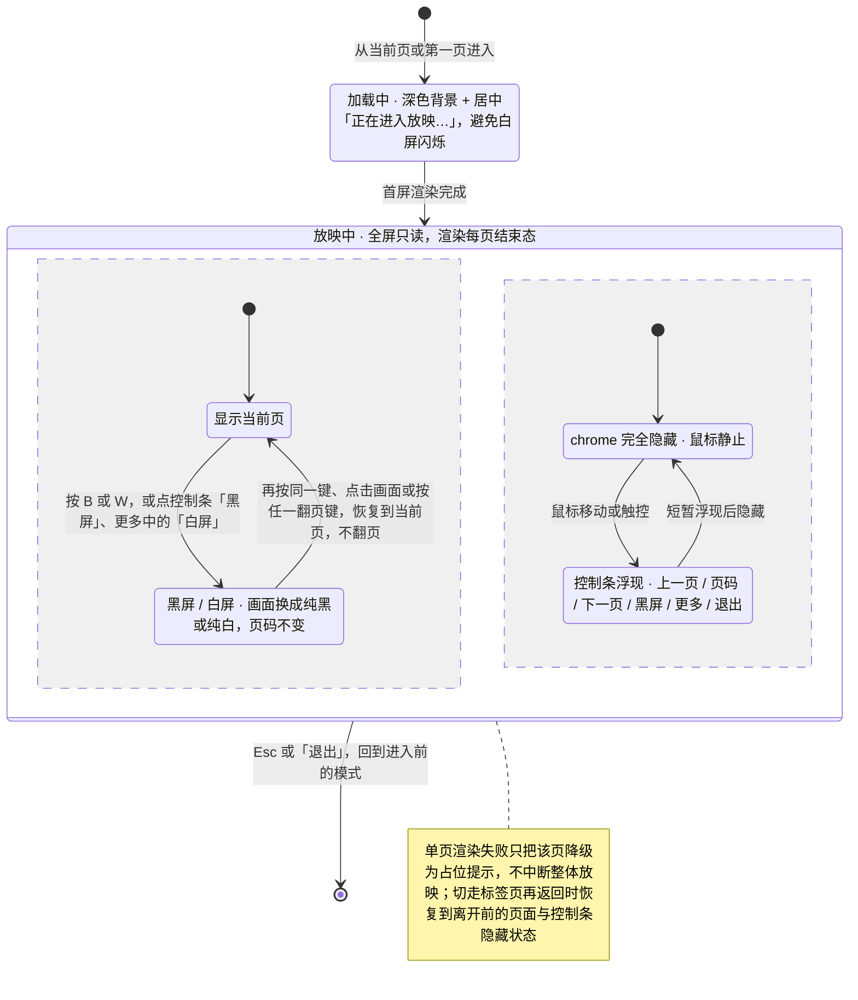
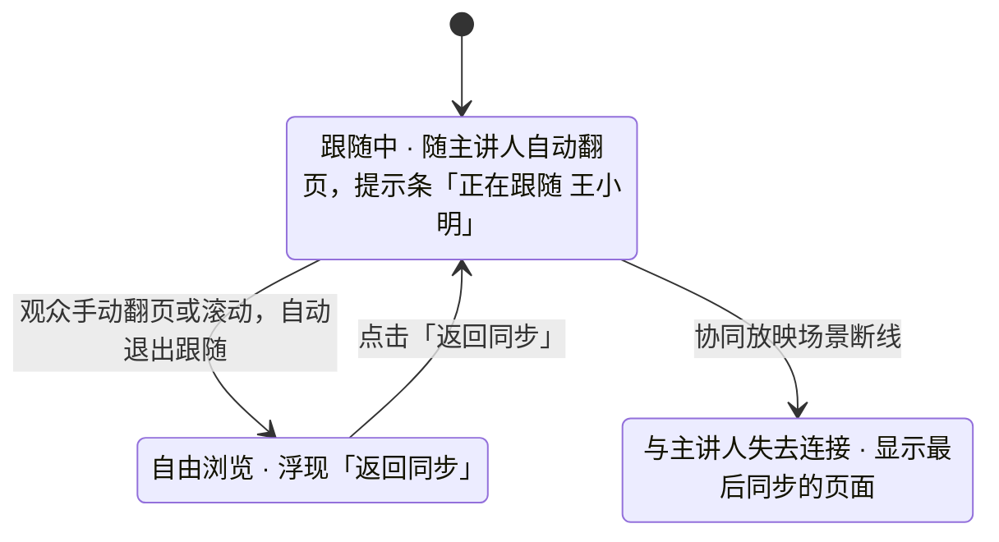

> 状态：草稿 | 负责：设计 | 更新：2026-09-18；2026-09-24（rulings §4.15 Q7：结束态按场景、外链与受限字体口径）；2026-09-25（补图）；2026-09-25（矛盾收口，rulings §4.18） | 依赖：charter v0.2；PRD `07-design-coverage-and-gaps.md` §4 D3；09 v3.0 T-05；playground `Present.tsx`

# 03-11 放映模式

> **设计基准（2026-09-15 起）**：组件规格以 [`09-design-specification.md`](../09-design-specification.md) v3.0（shadcn Rhea + 材质层）为准；对应 playground 路由 `#/present`（[已发布 artifact](https://claude.ai/code/artifact/cf6e1a1a-986b-48bb-b743-5758dff419d2)，源码 `playground/src/routes/`）。本文引用的 `mockups/*.html` 与线框图为历史静态稿，以 playground 实际渲染为终稿。

全屏只读呈现，chrome 全部隐藏（见 01-information-architecture.md §5.1）。**动画与切换的播放分阶段**（总编排裁决 CS-03 / 设计-1，见章程 v0.2 §2.3 与 §7）：M1–M3 放映模式渲染每页的**结束态**、不播放动画与切换（效果原样保留并随导出写回）；按原样播放已导入效果为 **M4+ 的 P2**。「结束态」按场景区分（rulings §4.15 Q7）：编辑态、缩略图与 PDF/PNG 导出为**静态全部可见**；放映为**主序列可见性终态**（M2 P1）——只应用主序列中对可见性的设置，因此带退出动画的元素在放映画面中隐藏、由点击触发的交互序列元素保持隐藏，避免多个元素叠在一起；在 M2 该能力交付前，放映与编辑态一致为全部可见。受限内嵌字体在放映中使用原字体（只读渲染路径，见 03-screens/13）；外链图片/音视频按部署 `externalResources` 规则加载（默认自动）。本文件中涉及播放的交互均标注为 M4+，与保真报告（03-screens/10）中「动画/切换：仅保留」的支持级保持一致。

---

## 线框（默认，鼠标静止时 chrome 完全隐藏）

```
┌─────────────────────────────────────────────────────────────────────────┐
│                                                                           │
│                                                                           │
│                         （当前幻灯片，全屏渲染）                            │
│                                                                           │
│                                                                           │
│                                                                           │
└─────────────────────────────────────────────────────────────────────────┘
```

### 鼠标移动/触控时短暂浮现的控制条

```
┌─────────────────────────────────────────────────────────────────────────┐
│                                                                           │
│                         （当前幻灯片，全屏渲染）                            │
│                                                                           │
│                                                                           │
│              [◂上一页]  5 / 12  [下一页▸]  [⬛黑屏] [⋯更多] [✕退出]        │
└─────────────────────────────────────────────────────────────────────────┘
```

"更多 ⋯"含：白屏、跳至页码、（若产品范围包含）画笔标注/激光笔。黑屏时控制条「黑屏」按钮呈按下态（`aria-pressed="true"`），再点一次恢复当前页；白屏同理由「更多」中的「白屏」切换。演讲者视图不在 M2–M3 范围（PRD §4 D3，ED-21 P2 排 M4+）：菜单中**不显示**其入口，也不做灰显占位（playground `Present.tsx` 已按此移除原禁用占位项，「更多」仅含白屏、跳至页码）。

---

## 状态

**放映模式状态**



怎么读：外层是进入、放映、退出三段；「放映中」内部是两个并行的区域——上半是画面内容（当前页与黑屏 / 白屏互切），下半是控制条的显隐，黑屏 / 白屏期间控制条照常可以浮现。黑屏 / 白屏时按翻页键只恢复当前页、不翻页；`Esc` 在任何子态下都直接退出放映。放映中不显示远端光标、软冲突提示与保真提示，保持画面干净。
依据：本文「交互说明」；PRD ED-21；rulings §4.18 UX-07

**协同放映的观众端跟随**



怎么读：这是 05-collaboration-ux §4 跟随模式在放映中的应用，箭头都由观众本地触发，主讲人不感知；纯本地文件放映不受网络影响，不出现断线状态。

### 加载中（首屏渲染前）

```
┌─────────────────────────────────────────────────────────────────────────┐
│                            正在进入放映…                                   │
└─────────────────────────────────────────────────────────────────────────┘
```

深色背景 + 居中提示，避免白屏闪烁；大文件/未预加载图片时短暂出现，不设计复杂进度条（放映态追求"沉浸"，进度反馈从简）。

### 单页渲染失败

```
┌─────────────────────────────────────────────────────────────────────────┐
│                     此页内容暂时无法显示                                   │
│                     [◂上一页]  5 / 12  [下一页▸]                          │
└─────────────────────────────────────────────────────────────────────────┘
```

仅该页降级为占位提示，不中断整体放映，可继续翻到下一页。

### 协同跟随（观众端）

```
┌─────────────────────────────────────────────────────────────────────────┐
│                         （随主讲人自动翻页）                                │
│  ⓘ 正在跟随 王小明                                          [返回同步]     │
└─────────────────────────────────────────────────────────────────────────┘
```

观众手动翻页/滚动后自动退出跟随（进入自由浏览），浮现"返回同步"按钮以便随时归队；细则见 05-collaboration-ux.md §4。

### 离线

本地已打开文件的放映不受影响；协同放映场景断线时：

```
│  ⓘ 与主讲人失去连接，正在显示最后同步的页面    │
```

### 放映中内容被编辑（他人在其他窗口继续编辑文档）

放映画面实时反映最新文档状态（与单一事实源原则一致，章程 D5）；若当前正呈现的对象被删除，直接反映真实状态变化，不做特殊消隐处理——软冲突的强调型提示（F4）只出现在编辑模式，放映模式保持呈现干净，不叠加提示文案。

---

## 交互说明

- 键盘：`→`/`Space`/`PageDown` 下一页，`←`/`PageUp` 上一页，`Home`/`End` 首/末页，数字+`Enter` 跳页，`Esc` 退出，`B` 黑屏，`W` 白屏。
- 黑屏 / 白屏的恢复（rulings §4.18 UX-07）：`B` / `W` 是切换键——黑屏或白屏时再按同一键、点击画面，或按任一翻页键（`→`/`Space`/`PageDown`/`←`/`PageUp`/`Home`/`End`），都**先恢复到当前页，不翻页**；恢复后再按翻页键才翻页。`Esc` 仍直接退出放映。黑屏 / 白屏期间移动鼠标或触控时控制条照常浮现，可直接用控制条恢复或退出。
- 触控：左右滑动翻页，双指捏合可能进入局部放大（如产品范围包含，标注为待确认）。
- 放映模式不显示协作者远端光标/选区（保持画面干净），仅在协同放映场景显示"跟随状态"提示条。
- 演讲者视图（双屏：当前页+备注+下一页缩略图+计时器）已裁决**不在 M2–M3 范围**（D3，ED-21 P2 排 M4+）：放映中不显示备注、控制条不提供入口；普通放映模式须完整可用。

## 边界情况

- 极窄屏/竖屏设备放映：幻灯片按比例居中缩放，上下或左右留白，不裁切内容。
- 放映中网络波动（非协同场景，纯本地文件）：不受影响，因为已在客户端渲染。
- 放映中打开的其他系统通知/切换标签页：返回后自动恢复到离开前的页面与控制条隐藏状态。
- 首次进入放映若同时存在未解决的软冲突或保真报告中的"部分解析失败"条目：不在放映中弹出提示（放映追求沉浸不打断），仅在退出放映后于编辑器主界面正常提示。
