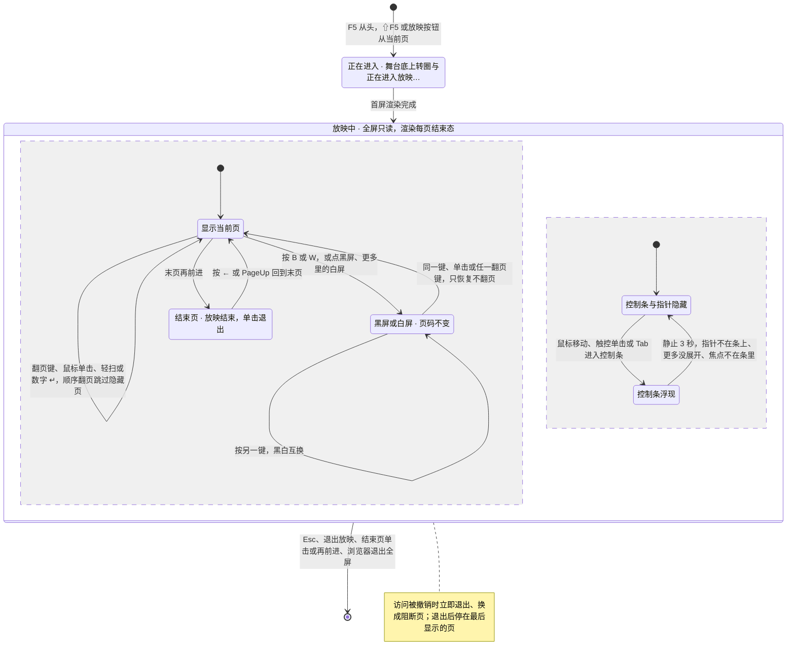
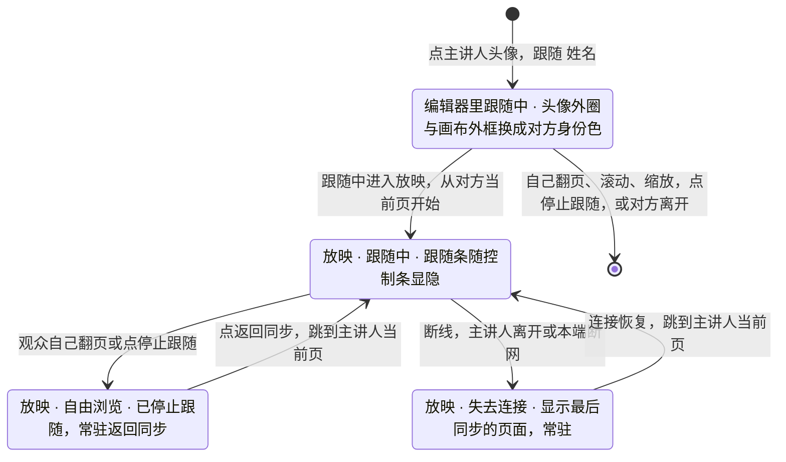

> 状态：草稿 | 负责：设计 | 更新：2026-09-18；2026-09-24（rulings §4.15 Q7：结束态按场景、外链与受限字体口径）；2026-09-25（补图）；2026-09-25（矛盾收口，rulings §4.18）；2026-10-22（design-language-v3 第 3 批：按已拍板样张 `present` 整篇改写——§1 线框按 v3 重画：舞台与界面主题无关、一律取暗色 token，控制条去掉模糊改实色、与编辑器底部工具条同一外观（上一页 · 页码 · 下一页 ┊ 黑屏 · 更多 ┊ 退出放映），「更多」只有白屏 · 跳至页码（窗口内舞台另有「全屏」），补跳页提示条、结束页、跟随条、编辑器里的跟随与手机竖横屏；§2 入口：三处「放映」从当前页、工具提示「从当前页放映 ⇧F5」（TB-103），全部页都设为放映时跳过与版本预览期间不可用并写原因（TB-111、TB-112），放映中吞掉 F5 / ⇧F5、窗口内舞台「更多」多「全屏」（DS-108），退出回到进入前的模式、停在放映里最后显示的那一页（DS-109）；§3 列 17 个样张状态与 1 个未采纳的备选、5 个文字备选（DS-63）；§4 指针：鼠标单击是下一页、触控单击只显隐控制条、左右轻扫翻页，页码按实际页号、数字可跳到隐藏页（TB-111），跳页复用 03-20 §7 的提示条（TB-104），末页之后进结束页（TB-102），指针随控制条静止 3 秒一起隐藏、不做进入时的键盘提示浮层与「显示 / 隐藏光标」（DS-107）；§5 观众跟随：先在编辑器里点主讲人头像进入跟随、再进放映即保持跟随，跟随条在跟随中随控制条显隐、自由浏览与失去连接时常驻，按钮两处统一「停止跟随」，主讲人一侧与协议都不变（DS-106、TB-113）；§6 放映中的权限与版本变化（TB-112）；原「更多」里的画笔标注 / 激光笔（ED-21 没有）、毛玻璃控制条与旧路由的写法作废；依据 rulings §4.25 DS-2、DS-36、DS-43、DS-50…DS-53、DS-62、DS-63、DS-106…DS-109、TB-102…TB-104、TB-111…TB-113、TB-116；同日再补（回写中新增的技术口径）：§2.3、§8 浏览器或容器不允许全屏时「更多」里不出现「全屏」改为引用 TB-134（DS-108 细化，与查看器全屏按钮同一规则）；§6 单页渲染失败的页级占位写明在渲染层的纸面内画、与保真「此页内容无法解析」同一画法（TB-151），§9 速查同步；设计基准与 §9 的源码出处按样张转正后的位置改写（跟随条、舞台作用域、跳页提示条与页级占位并入 kit）；§2.2 注明 rulings TB-102 已按 DS-109 加修订注记；同日再补（回写中新增的技术口径）：§6 单页渲染失败补一句——这一占位不进服务端的产物，服务端渲染遇到同样出错的页时报 render 类错误码、renderer 记失败不回传字节，重试 1 次后缩略图用旧图或占位、导出作业失败，整页无法解析的保真占位照常回传（rulings §4.25 TB-157），§9 速查同步；§4.6 与 §5.1 两处「随第 3 批回写」的残留改为已写定（50/10 §9.2、05 §4、03-02 §3.2 / §3.5 已改）；§2.1 仅查看形态的判据补「或触控」，与 03-02 §5a.2 一致；2026-10-22 复核修正：§1.5、§9 触控形态的「更多」条目不写键位提示（rulings §4.25 TB-164）；§3 两个手机状态的里程碑写法改为「移动浏览器 M3 P1」，不再用「触控设备」指手机（TB-163 起它只指平板），`default` 一行删去样张的演示说明；§4.2、§4.6 两处已随前端 50/10 §9.2 改定的说法不再写成待改；§1.2 括注笔误） | 依赖：charter v0.2；PRD 02 ED-16、ED-19、ED-21，03 CO-03，04 NF-07，07 §4 D3 / D16、G-36、G-68；rulings §4.15 Q7、§4.18 UX-07、§4.20 FE-02 / FE-06 / FE-12、§4.25 DS-2、DS-36、DS-43、DS-50…DS-53、DS-62、DS-63、DS-106…DS-109、TB-102…TB-104、TB-111…TB-113、TB-116、TB-134、TB-151、TB-157、TB-163、TB-164；前端 50/10 §3.3、§9；后端 60/06 §10.4、§11.3；设计 05 §4、03-20 §7；playground `#/v3/editor?state=present.*`（`src/v3/scenarios/present/`；并入底座的 `src/v3/kit/Follow.tsx`、`stage.tsx`、`PageJump.tsx`、`PagePlaceholder.tsx`）

# 03-11 放映模式

> **设计基准（2026-10-22 起，rulings §4.25 DS-106…DS-109）**：以已拍板的 playground 第 3 批样张 `present` 为准——路由 `#/v3/editor?state=present.<状态 id>`（暗 / 亮另加 `&theme=dark|light`；舞台与界面主题无关，两套截图相同），17 个状态加 1 个未采纳的备选（§3）。源码在 `playground/src/v3/scenarios/present/`：`present.scenario.tsx`（各状态的标题与说明）、`stage.tsx`（舞台、控制条、「更多」、结束页、键盘与指针）、`slides.tsx`（第 4 页渲染失败的示例文档）；样张转正时并入底座的件在 `playground/src/v3/kit/`：`Follow.tsx`（`FollowBar` 跟随条、`FollowFrame` 画布身份色外框、`EditorFollow`）、`stage.tsx`（`StageScope` 舞台作用域，舞台色 token 在 `v3.css`）、`PageJump.tsx`（`PageJumpHint` / `PageJumpInput`，与编辑器 03-20 §7 的跳页提示条同一个件）、`PagePlaceholder.tsx`（页级占位，与保真「此页内容无法解析」同一个件）。对照截图 `openspec/changes/design-language-v3/screens/batch3/present-<状态>-dark.jpg`。放映舞台的行为（进入与退出、全屏与降级、翻页、协同）以前端 [50/10](../../50-frontend/10-editor-shell-and-interaction.md) §9 为准，本文定画面、文案与交互细则；跟随的通用规则以设计 [05](../05-collaboration-ux.md) §4 为准。此前的文字线框（`[⬛黑屏] [⋯更多] [✕退出]`、「更多」里的画笔标注 / 激光笔）与 shadcn / 材质层时期的写法（09 v3.0 T-05 的 `bg-stage` 与 `backdrop-blur` 毛玻璃控制条、`--stage-chrome`、`--stage-foreground`、旧路由 `#/present`）一并作废。

放映是全屏只读呈现：左栏、检查器、底部工具条与横幅都不渲染，画布列换成整块舞台（01 §5.1）。覆盖 PRD ED-21（M2 P1）与缺口 **G-36**（放映补全）、**G-68**（手机放映控制条）。

**动画与切换分阶段播放**（总编排裁决 CS-03 / 设计-1，章程 v0.2 §2.3、§7）：M1–M3 放映渲染每页的**结束态**、不播放动画与切换（效果原样保留并随导出写回）；按原样播放已导入的效果是 **M4+ 的 P2**。「结束态」按场景区分（rulings §4.15 Q7）：编辑态、缩略图与 PDF / PNG 导出为**静态全部可见**；放映为**主序列可见性终态**（M2 P1）——只应用主序列里对可见性的设置，所以带退出动画的元素在放映画面里隐藏、由点击触发的交互序列元素保持隐藏，避免多个元素叠在一起；这项能力交付前，放映与编辑态一致、全部可见。受限内嵌字体在放映里用原字体（只读渲染路径，03-13）；外链图片与音视频按部署 `externalResources` 规则加载（缺省自动）。与保真报告（03-10）「动画 / 切换：仅保留」的支持级一致。

---

## 1. 线框

### 1.1 放映舞台（桌面 1600 × 1000，第 3 / 6 页，控制条浮现）

```
┌──────────────────────────────────────────────────────────────────────────────┐
│░░░░░░░░░░░░░░░░░░░░░░░░░░░░░░░░░ 舞台底 ░░░░░░░░░░░░░░░░░░░░░░░░░░░░░░░░░░░░░│
│ ┌──────────────────────────────────────────────────────────────────────────┐ │
│ │ 关键指标                                                                 │ │
│ │ ▬▬                                                                       │ │
│ │  ┌────────────────────┐ ┌────────────────────┐ ┌────────────────────┐    │ │
│ │  │ 营收  ¥1.28 亿     │ │ 活跃客户  3,420    │ │ 毛利率  62 %       │    │ │
│ │  └────────────────────┘ └────────────────────┘ └────────────────────┘    │ │
│ │ 2026 年 Q2 业绩汇报                                                    3 │ │
│ └──────────────────────────────────────────────────────────────────────────┘ │
│                     ╭──────────────────────────────────╮                     │
│                     │ [‹]  3 / 6  [›] ┊ [▭] [⋯] ┊ [×]  │                     │
│                     ╰──────────────────────────────────╯                     │
└──────────────────────────────────────────────────────────────────────────────┘
```

图例：`░` 舞台底（`--v3-stage`，#0A0A0A）；幻灯片 16:9 居中，按宽或按高适应、不裁切；`[‹]` `[›]` 上一页 / 下一页；`3 / 6` 页码；`[▭]` 黑屏（描边矩形里填舞台黑，读作「画面变黑」）；`[⋯]` 更多；`[×]` 退出放映；`┊` 组间 1px 分隔。鼠标静止 3 秒后控制条与指针一起隐藏，只剩幻灯片（`present.idle`）。截图：`batch3/present-default-*.jpg`。

### 1.2 控制条与「更多」

```
                          ╭──────────────────────────╮
                          │  白屏                 W  │
                          │  跳至页码…      数字 ↵   │
                          │  全屏                    │  ← 只在窗口内舞台（非全屏）且允许全屏时出现（DS-108、TB-134）
                          ╰──────────────────────────╯
              ╭──────────────────────────────────────────────╮
              │ [‹]   3 / 6   [›]  ┊  [▭]  [⋯]  ┊  [×]       │
              ╰──────────────────────────────────────────────╯
```

- **控制条**：与编辑器底部工具条同一外观（kit `TOOLBAR_BAR`：底部居中、距底 16、`--v3-panel` 实底、1px `--v3-border`、圆角 12、内边距 4、浮层阴影；去掉模糊、改实色，rulings §4.25 DS-2、09 T-05）。三组：上一页（←）· 页码「3 / 6」（13px 数字等宽，斜线用 `--v3-text-2`，最小宽 56）· 下一页（→）┊ 黑屏（B）· 更多 ┊ 退出放映（Esc）。按钮 36、图标 20；触控形态 44、间距 8（§1.5）。第一页时「上一页」留在原位不可用、写「已是第一页」；结束页上「下一页」不可用、写「放映已结束」（§4.6）。演讲者视图不在 M2–M3（PRD 07 §4 D3，ED-21 P2 排 M4+）：控制条与菜单里都不出现、也不灰显。
- **「更多」**：向上展开，离控制条 8、对齐按钮中线（同编辑器工具条按钮的菜单）；外观同 kit 菜单（`--v3-panel` 实底、1px 边、圆角 8、条目 28，最小宽 168），取舞台的暗色 token，不随界面换成白色菜单。条目只有「白屏 W」（勾选项）·「跳至页码… 数字 ↵」（打开跳页提示条的输入形态，§4.4）；窗口内舞台时多一项「全屏」（§2.3）。「显示 / 隐藏光标」不做（DS-107）；退出已在控制条上，不重复（质量门 Q2）；03-11 原写的「（若产品范围包含）画笔标注 / 激光笔」ED-21 没有，删去。功能名与快捷键面板「放映」组、命令面板同一份（rulings §4.25 TB-116）。截图：`batch3/present-more-menu-*.jpg`。

### 1.3 跳页提示条、跟随条与结束页

```
舞台顶部居中（同一位置只放一条，跳页优先）
╭─────────────────────────────────────╮   ╭─────────────────────────────────────────────╮
│  转到第 5 页        ↵ 跳转          │   │ (王) 正在跟随 王小明 ┊ 停止跟随             │
╰─────────────────────────────────────╯   ╰─────────────────────────────────────────────╯
╭─────────────────────────────────────╮   ╭─────────────────────────────────────────────╮
│  没有第 9 页 · 共 6 页              │   │ (王) 已停止跟随 王小明 ┊ 返回同步           │
╰─────────────────────────────────────╯   ╰─────────────────────────────────────────────╯
╭─────────────────────────────────────╮   ╭─────────────────────────────────────────────╮
│  转到第 [  ] 页   共 6 页   ↵ 跳转  │   │ ⓘ 与主讲人失去连接，正在显示最后同步的页面  │
╰─────────────────────────────────────╯   ╰─────────────────────────────────────────────╯

结束页（末页之后）：整块黑底，居中一行「放映结束，单击退出」
```

- **跳页提示条**（rulings §4.25 TB-104）：与 03-20 §7 编辑器的数字跳页提示条同一个件（kit `PageJumpHint` / `PageJumpInput`，建在 `CanvasHint` 上：36 高、圆角 12、`--v3-panel` 底、1px 边、浮层阴影，12px `--v3-text-2`、页码数字加粗等宽、按键用键帽），取舞台的暗色 token；两段之间只是间距，没有竖分隔线。左下是「更多 › 跳至页码…」打开的输入形态：「第 __ 页」处是 28 高的数字输入（字段外框，同检查器数值字段）。规则见 §4.4。
- **跟随条**（M3，DS-106）：与编辑器里的跟随条同一个件（kit `FollowBar`，同样建在 `CanvasHint` 上，rulings §4.25 DS-62「同一种状态只留一种画法」）：对方头像 20（身份色）· 一句状态 ┊ 一颗 ghost 文字按钮（28）；失去连接时换成中性信息图标、没有按钮。规则见 §5。
- **结束页**（rulings §4.25 TB-102）：黑底（`--v3-stage-black`）居中一行「放映结束，单击退出」（16px、`--v3-text`）。截图：`batch3/present-end-*.jpg`。

### 1.4 编辑器里的跟随（M3，DS-106，05 §4）

```
←─── 240 ───→←───────────────── 画布列 ──────────────────→←───── 280 ──────→
┌────────────┲━━━━━━━━━━━━━━━━━━━━━━━━━━━━━━━━━━━━━━━━━━━━┱────────────────┐
│ 左栏       ┃    ╭──────────────────────────────────╮    ┃ (周)(◎王)(李)  │
│            ┃    │(王) 正在跟随 王小明 ┊ 停止跟随   │    ┃ 检查器         │
│            ┃    ╰──────────────────────────────────╯    ┃                │
│            ┃  ┌──────────────────────────────────────┐  ┃                │
│            ┃  │ 第 4 页（随王小明的视口）            │  ┃                │
│            ┃  │                        ↖ 王小明      │  ┃                │
│            ┃  └──────────────────────────────────────┘  ┃                │
└────────────┺━━━━━━━━━━━━━━━━━━━━━━━━━━━━━━━━━━━━━━━━━━━━┹────────────────┘
             ↑ 画布列四周 2px 对方身份色外框；(◎王) 头像外圈换成对方身份色
```

图例：`┃` 与 `━` 是画布列四周 2px 对方身份色外框；`(◎王)` 是正在跟随的人的头像，外圈 2px 换成对方身份色（外圈与头像之间留 1px 面板色，叠在相邻头像之上）；对方的光标照常。截图：`batch3/present-editor-following-*.jpg`。

### 1.5 手机（< 640，PRD 07 G-68）

```
竖屏 390 × 844                  横屏 844 × 390
┌────────────────────────┐      ┌──────────────────────────────────────────────┐
│························│      │·······┌──────────────────────────────┐·······│
│┌──────────────────────┐│      │·······│ 幻灯片（按高适应）           │·······│
││ 幻灯片（按宽适应）   ││      │·······│                              │·······│
││                      ││      │·······│    ╭────────────────────╮    │·······│
│└──────────────────────┘│      │·······│    │‹ 3/6 › ┊ ▭ ⋯ ┊ ×   │    │·······│
│························│      │·······└────╰────────────────────╯────┘·······│
│                        │      └──────────────────────────────────────────────┘
│ ╭────────────────────╮ │
│ │‹ 3/6 › ┊ ▭ ⋯ ┊ ×   │ │
│ ╰────────────────────╯ │
└────────────────────────┘
```

图例：`·` 舞台底。控制条同一组按钮、触控尺寸：按钮 44 × 44、相邻间距 8（前端 50/16 目标尺寸），「更多」的条目高 44、不写键位提示（触控形态的菜单项一律不写键位，「白屏」后的 W、「跳至页码…」后的「数字 ↵」都不出现；键位照常列在快捷键面板，rulings §4.25 TB-164）。横屏时控制条压在幻灯片下沿之上。不支持元素全屏的移动浏览器（iOS Safari）舞台铺满窗口（50/10 §9.1「全屏降级」），不报错。截图：`batch3/present-phone-*.jpg`、`present-phone-landscape-*.jpg`。

---

## 2. 入口与退出

### 2.1 进入

- **「放映」按钮**：检查器协作行、网格视图右上胶囊、紧凑形态右上胶囊三处（03-02 §3.5、§5.1、§5a.1），从当前页开始；工具提示「从当前页放映 ⇧F5」，三处同一份（rulings §4.25 TB-103；原工具提示「F5」作废，按钮行为不变）。
- **快捷键**：F5 从第一页、⇧F5 从当前页（PRD ED-16、07 §4 D16）；命令面板「从头放映 F5」「从当前页放映 ⇧F5」（分类「放映」）。从头放映只有 F5 与命令面板，不另加控件（TB-103）。
- **仅查看形态（< 640 或触控）**：「更多 › 从当前页放映 / 从头放映」（03-02 §5a.2，样张 `narrow.narrow-more`）。
- **母版视图中**按 F5：先退出母版视图，从恢复后的当前页开始（50/10 §3.3）。
- **不可用**（留在原位、工具提示写原因，rulings §4.20 FE-06）：文档打开中「文档打开后可用」（03-02 §6.2「加载中」）；全部幻灯片都设为放映时跳过「所有幻灯片都已设为放映时跳过」（rulings §4.25 TB-111，PRD ED-30）；版本预览期间「返回当前版本后可用」（TB-112，03-07）。F5 / ⇧F5 在这些情形下同样无效。
- **全屏**：在点「放映」或按 F5 的手势里同步请求全屏（rulings §4.20 FE-12）；浏览器或容器拒绝、不支持时舞台铺满窗口或容器（窗口内舞台），不报错（50/10 §9.1）。首屏渲染前先显示「正在进入放映…」（`present.entering`）。

### 2.2 退出

- **出口**：`Esc`、控制条「退出放映」、在结束页单击或再前进，或浏览器退出全屏（全屏下第一次 `Esc` 由浏览器消费，页面从 `fullscreenchange` 得知，50/10 §9.1）。
- **回到哪里**（rulings §4.25 DS-109）：回到进入放映前的模式（编辑 / 评审 / 只读浏览）与视图，**停在放映里最后显示的那一页**（讲到哪就停在哪，回到编辑器能接着改刚讲的内容）。PRD 07 §4 D16 原写的「回到进入前的模式与页」按 DS-109 改写，rulings TB-102 已按 DS-109 加修订注记；前端 50/10 §3.3 原本就是这一口径。
- **焦点**：回到编辑器里的「放映」按钮（键盘退出时它的工具提示随之出现），交接不经过 `body`（07 §2.4）。

### 2.3 放映中的 F5 与窗口内舞台的「全屏」（DS-108）

- 放映中按 F5 / ⇧F5 吞掉：不刷新页面、不重新进入（误按刷新键不该把演示刷掉）。编辑器的工具单键 V / T / S / C 在放映中同样无效。
- **窗口内舞台**（全屏被拒，或刷新、直接打开 `/documents/:id/present` 时没有用户手势、不能自动全屏）：「更多」多一项「全屏」，只在非全屏时出现；选了在这一次点按的手势里请求全屏。浏览器或容器根本不允许全屏时（`document.fullscreenEnabled` 为假，如未授权全屏的 iframe、iOS Safari）不出这一项，同查看器的全屏按钮（03-25 §4.1；rulings §4.25 TB-134）。样张只画了全屏下的「更多」（`present.more-menu`，没有「全屏」）；窗口内舞台的画面与 `default` 相同，展开「更多」多出「全屏」的样子没有单独画。

---

## 3. 状态

样张路由均为 `#/v3/editor?state=present.<状态 id>`；未写视口的按 1600 × 1000。示例文档 6 页，放映从第 3 页开始；左栏、检查器、工具条在放映状态里不渲染，画布列换成舞台。

| 状态（样张标题） | 要点 | 样张 id | 里程碑 |
|---|---|---|---|
| 放映中 · 控制条浮现 | 第 3 / 6 页全屏，四周留舞台底；底部居中的实色控制条；鼠标移动时浮现，静止 3 秒后与指针一起隐藏；键位见 §4.1 | `present.default` | M2 P1（ED-21） |
| 放映中 · 鼠标静止 | 缺省画面：只剩幻灯片，控制条与指针都隐藏；Tab 进入控制条时照常浮现；不显示远端光标、评论钉、软冲突与保真提示 | `present.idle` | M2 P1 |
| 正在进入放映 | 首屏渲染完成前，舞台底上居中一行转圈 +「正在进入放映…」（DS-53 加载画法），避免白屏闪烁；控制条不出现 | `present.entering` | M2 P1 |
| 「更多」展开 | 向上展开，只有「白屏 W」「跳至页码… 数字 ↵」；本态是全屏，不出现「全屏」 | `present.more-menu` | M2 P1 |
| 黑屏 | 画面换成纯黑、页码不变；「黑屏」按下态用强调色淡底（DS-36），工具提示改为「恢复当前页 B」 | `present.black` | M2 P1（UX-07） |
| 白屏 | 画面换成纯白；「更多」里「白屏」打勾；暗色控制条压在白底上，靠 1px 边与浮层阴影分开 | `present.white` | M2 P1（UX-07） |
| 敲数字跳页 | 舞台顶部居中「转到第 5 页 · ↵ 跳转」；控制条不随之浮现 | `present.page-jump` | M2 P1（TB-104） |
| 跳页 · 没有这一页 | 「没有第 9 页 · 共 6 页」，没有「↵ 跳转」，↵ 不动 | `present.page-jump-none` | M2 P1 |
| 「更多 › 跳至页码…」 | 同一提示条的输入形态，焦点在输入里；↵ 跳转并收起，点别处收起 | `present.jump-input` | M2 P1 |
| 单页渲染失败 | 第 4 页换成页级占位（ImageOff ·「此页内容暂时无法显示」·「渲染这一页时出错，原内容已保留」），不中断放映、可继续翻页 | `present.slide-failed` | M2 P1 |
| 末页之后 · 结束页 | 黑底「放映结束，单击退出」；控制条页码仍是 6 / 6，「下一页」不可用「放映已结束」 | `present.end` | M2 P1（TB-102） |
| 观众 · 跟随主讲人 | 先跟随再放映：舞台顶部「正在跟随 王小明 ┊ 停止跟随」，随主讲人翻页；跟随条与控制条一起显隐 | `present.following` | M3（CO-03） |
| 观众 · 自由浏览 | 观众自己翻页后「已停止跟随 王小明 ┊ 返回同步」，常驻；本态停在第 5 页、主讲人在第 4 页 | `present.follow-free` | M3 |
| 观众 · 与主讲人失去连接 | 中性信息图标 +「与主讲人失去连接，正在显示最后同步的页面」，常驻、没有按钮；本地翻页照常 | `present.follow-lost` | M3 |
| 编辑器里 · 跟随协作者 | 检查器协作行他人的头像是「跟随 〈姓名〉」按钮；跟随中头像外圈与画布列外框换成对方身份色，画布顶部同一跟随条；画布照常画第 4 页的评论钉 | `present.editor-following` | M3（CO-03，05 §4） |
| 手机竖屏 | 390 × 844：按宽适应、上下留舞台底；控制条按钮 44、间距 8；触控单击只显隐控制条、左右轻扫翻页 | `present.phone` | M2（移动浏览器 M3 P1，PRD NF-07；G-68） |
| 手机横屏 | 844 × 390：按高适应、左右留舞台底；控制条压在幻灯片下沿之上 | `present.phone-landscape` | M2（移动浏览器 M3 P1） |

样张没有单独画、规格写在相关状态里的：悬停链接与动作按钮的目标小卡（§4.7）、视频点击播放（§4.7）、窗口内舞台（画面同 `default`，「更多」多「全屏」，§2.3）、页内个别对象画不出来（元素级占位，§6）、「放映」按钮的工具提示（TB-103，底座已改）。

### 3.1 未采纳的备选（DS-63）

拍板时画给用户对照的备选留在样张里，标题前加「未采纳 · 」、说明写明由哪一条 DS 定为推荐；路由不变，实现以上表的状态为准（rulings §4.25 DS-63）。只有文字说明、没有出图的备选同列在这里。

| 备选 | 样张 id | 内容 | 结论 |
|---|---|---|---|
| 进入时的键盘提示浮层 | `present.alt-key-hints` | PRD 07 G-36 原写法：进入放映时在控制条的位置浮出一行键位（→ 空格 下一页 ┊ ← 上一页 ┊ 数字 ↵ 跳页 ┊ B 黑屏 ┊ W 白屏 ┊ Esc 退出），3 秒后淡出；设置加「进入放映时显示键盘提示」开关，「更多」加「显示 / 隐藏光标」 | 未采纳，DS-107 定为两项都不做 |
| 聚光广播 | （文字备选） | 主讲人放映时广播「正在放映」，在场的人收到「王小明正在放映 · 跟随 / 暂不」；要在 awareness 加字段、偏离「被跟随者不感知」 | 未采纳，DS-106 定为先跟随再放映 |
| 跟随条常驻 | （文字备选） | 进入方式同推荐，但跟随中跟随条常驻、不随控制条隐藏，观众随时知道在跟随谁 | 未采纳，DS-106 定为随控制条显隐 |
| 窗口内舞台常驻「全屏」按钮 | （文字备选） | 窗口内舞台时控制条常驻一颗「全屏」 | 未采纳，DS-108 定为「更多」里的条件项 |
| 放映中 F5 交给浏览器 | （文字备选） | 放映中按 F5 照常刷新，刷新后回到窗口内舞台 | 未采纳，DS-108 定为吞掉 |
| 退出后回到进入前的那一页 | （文字备选） | PRD 07 D16 字面：退出放映回到进入放映前所在的那一页 | 未采纳，DS-109 定为停在最后显示的页 |

**图 3-1 放映舞台状态**



怎么读：外层是进入、放映、退出三段；「放映中」内部是两个并行区域——上半是画面（当前页、黑屏 / 白屏、结束页），下半是控制条的显隐，黑屏 / 白屏与结束页期间控制条照常可以浮现。黑屏 / 白屏时任何翻页输入都先恢复当前页、不翻页；`Esc` 在任何子态下都直接退出。退出时回到进入前的模式，停在最后显示的页（DS-109）。
依据：PRD ED-21、07 §4 D16；rulings §4.18 UX-07、§4.25 DS-107、DS-109、TB-102、TB-111、TB-112；50/10 §9。

---

## 4. 交互与键盘

### 4.1 键位

| 键 | 显示当前页时 | 黑屏或白屏时 |
|---|---|---|
| `→`、`空格`、`PageDown` | 下一页（顺序翻页跳过隐藏页）；末页再前进进入结束页，结束页再前进即退出 | 恢复当前页，不翻页 |
| `←`、`PageUp` | 上一页（跳过隐藏页）；结束页上回到末页 | 恢复当前页，不翻页 |
| `Home` / `End` | 首页 / 末页 | 恢复当前页，不翻页 |
| 数字 + `↵` | 跳到该页（可以跳到隐藏页并显示它，TB-111） | 恢复当前页，不翻页 |
| `B` / `W` | 黑屏 / 白屏 | 同一键恢复；按另一键切到另一种空白 |
| `Esc` | 退出放映 | 直接退出放映 |
| `F5` / `⇧F5` | 吞掉，不刷新、不重新进入（DS-108） | 同左 |
| `V` / `T` / `S` / `C` | 无效（编辑器的工具单键不进放映） | 同左 |

- 焦点在控制条按钮上时 `空格` / `↵` 按按钮自己的含义；「更多」菜单里的方向键、`↵`、`空格`、`Esc` 由菜单处理（§4.3）；跳页输入框里的数字、退格、`↵` 由输入框处理。
- 带修饰键（⌘ / Ctrl / Alt）的按键不处理，交给浏览器。
- 键位只在快捷键面板「放映」组（03-24）与控制条按钮的工具提示里给出，不另做进入放映时的键盘提示浮层（DS-107）。

### 4.2 指针与触控（rulings §4.25 TB-111）

- **鼠标**：单击画面是下一页（黑屏时恢复当前页、结束页上退出）；单击超链接与动作按钮不算「下一页」（ED-19，§4.7）。
- **触控**：单击只显隐控制条；左右轻扫翻页（水平位移 ≥ 48 且明显大于竖直位移）；按 `pointerType` 区分鼠标与触控（前端 50/10 §9.2 同此）。
- 「更多」展开或跳页输入开着时，点画面只收起它们、不翻页。
- 页码按文档的实际页号：隐藏页（DS-25）在顺序翻页时跳过，但数字跳页可以跳到隐藏页并显示它；从隐藏页开始放映（当前页是隐藏页时点「放映」）也照样显示这一页。全部页都隐藏时「放映」不可用（§2.1）。

### 4.3 控制条的显隐与「更多」（DS-107）

- 鼠标移动（连续两次指针事件之间 ≥ 3px 的位移）时浮现；静止 3 秒后控制条与**指针**一起隐藏（200ms 淡出，减少动态效果时直接切换）。指针停在控制条上、「更多」展开、或键盘焦点在控制条里时不隐藏；`Tab` 进入控制条时照常浮现（键盘用户不依赖鼠标）。不设「显示 / 隐藏光标」。
- 黑屏 / 白屏期间控制条照常可浮现，可以直接用控制条恢复或退出。
- 「更多」：用户点开时焦点进第一项，`↑` `↓` / `Home` / `End` 移动、`↵` / `空格` 选、`Esc` 收起并把焦点交回「更多」、`Tab` 收起；点外面收起（点画面只收起菜单、不翻页）。「白屏」是勾选项（`menuitemcheckbox`）；「跳至页码…」打开跳页提示条的输入形态并把焦点放进输入（§4.4）。

### 4.4 跳页（rulings §4.25 TB-104）

- **敲数字**：画面上敲数字时舞台顶部居中出现提示条「转到第 N 页 · ↵ 跳转」；没有该页时「没有第 N 页 · 共 M 页」，没有「↵ 跳转」、`↵` 不动。最多 3 位、去掉前导 0；`Backspace` 删一位；约 3 秒无输入自动清空；`↵` 跳过去并收起。控制条不随敲数字浮现。
- **不写「Esc 取消」**：全屏下第一次 `Esc` 由浏览器消费、直接退出放映（50/10 §9.1），所以提示条上不放这一句（与编辑器 03-20 §7 的不同之处）；`Esc` 照常退出放映。
- **「更多 › 跳至页码…」**（给鼠标用户的入口）：打开同一个提示条，「第 __ 页」处是 28 高的数字输入、焦点在输入里，右侧写「共 M 页」，页号超出时改写「没有第 N 页 · 共 M 页」；`↵` 跳转并收起，点别处收起。控制条此时仍浮现。
- 「共 M 页」是全部页数（隐藏页也占号）。黑屏 / 白屏时数字 + `↵` 只恢复当前页（与翻页键同理，50/10 §9.2）。
- 跳页提示条与跟随条同在舞台顶部居中：同一位置只放一条，跳页优先。

### 4.5 黑屏与白屏（rulings §4.18 UX-07）

- `B` / `W` 是切换键；黑屏或白屏时再按同一键、单击画面，或按任一翻页键（`→` `空格` `PageDown` `←` `PageUp` `Home` `End`）、数字 + `↵`，都**先恢复到当前页，不翻页**；恢复后再按翻页键才翻页。按另一键切到另一种空白；`Esc` 直接退出放映。
- 控制条「黑屏」是开关（`aria-pressed`）：按下态用强调色淡底（rulings §4.25 DS-36，同 B / I / U / S 的开关），工具提示改为「恢复当前页 B」；图标是描边矩形里填舞台黑（原实心矩形在暗色控制条上读成一块白，像「白屏」）。白屏只在「更多」里，打勾表示开着。

### 4.6 末页之后：结束页（rulings §4.25 TB-102）

- 末页再前进（→ / 空格 / PageDown / 鼠标单击）进入黑底结束页「放映结束，单击退出」；在结束页单击、再前进或按 `Esc` 都退出，回到进入前的模式、停在最后显示的页（§2.2）；`←` / `PageUp` 回到末页。
- 控制条照常可浮现：页码仍是末页（如「6 / 6」），「下一页」留在原位、不可用并写原因「放映已结束」（读屏名「下一页（放映已结束）」）；不改名成「退出放映」，免得与右侧的「退出放映」重名。前端 50/10 §9.2 原写的「末页之后停在末页、不自动退出」作废（rulings §4.25 TB-102）。

### 4.7 链接、动作与媒体

- 放映里超链接与动作按钮可点（ED-19），单击它们不算下一页：http(s) 在新窗口打开；mailto / tel 只显示目标、可复制；悬停先显示目标小卡（与编辑态的链接小卡 `text-edit.link-hover` 同一画法，去掉「编辑 / 移除」，前端 50/14 §5）。
- 视频点击播放，播放期间控制条隐藏，翻页即停止（03-13 G-06）；浏览器放不了的编码只显示海报帧。

---

## 5. 跟随主讲人（M3，rulings §4.25 DS-106）

观众怎样进入跟随放映：**沿用编辑器的跟随**——先在编辑器里点主讲人的头像进入跟随，再进入放映（F5、⇧F5 或「放映」都一样），即从对方当前页开始并保持跟随。主讲人一侧没有任何变化，不改协议（被跟随者不感知，PRD CO-03、05 §4）。属 M3 多人协同体验层（rulings §4.19 D-M2-CONTENT）。

### 5.1 编辑器里的跟随（`present.editor-following`）

- 检查器协作行（网格视图是右上胶囊里同一组头像）里他人的头像是按钮「跟随 〈姓名〉」（`aria-pressed`）：点按进入跟随、再点停止；跟随中这枚头像外圈 2px 换成对方身份色（外圈与头像之间留 1px 面板色，叠到相邻头像之上；身份色只标「谁」，质量门 Q3），工具提示「停止跟随 〈姓名〉」；点另一个人的头像即改为跟随他。第 1、2 批头像组里他人的头像随之成为这颗按钮（设计 05 §4、03-02 §3.2 与 §3.5 已随之改写）。
- 画布顶部居中跟随条「（头像）正在跟随 王小明 ┊ 停止跟随」（rulings §4.25 TB-113：编辑器与放映两处统一「停止跟随」；05 §4 原写的「退出」在放映里与控制条的「退出放映」撞名）；画布列四周 2px 对方身份色外框；对方的光标照常。
- 跟随只同步「看什么」（当前页、视口），不同步选中与编辑，也不限制自己继续编辑；自己翻页、滚动、缩放或点「停止跟随」即退出，跟随条、外框与头像外圈一起消失（停止后焦点交给画布）；对方离开协同时退出并轻提示（05 §4）。
- 同一时刻画布顶部只放一条提示：插入工具这类模式提示出现时跟随条让位。

### 5.2 放映里的跟随条

| 情形 | 跟随条 | 显隐 | 样张 |
|---|---|---|---|
| 跟随中 | （头像）正在跟随 王小明 ┊ 停止跟随；随主讲人翻页 | 与控制条一起显隐（鼠标静止时一起淡出，画面干净） | `present.following` |
| 自由浏览 | （头像）已停止跟随 王小明 ┊ 返回同步 | 常驻 | `present.follow-free` |
| 与主讲人失去连接 | ⓘ 与主讲人失去连接，正在显示最后同步的页面（中性信息图标，没有按钮） | 常驻 | `present.follow-lost` |

- 观众自己翻页（翻页键、单击、轻扫、数字跳页）或点「停止跟随」即转为自由浏览；「返回同步」跳到主讲人当前页并重新跟随（同时结束黑屏 / 白屏与结束页）。
- 跟随中断线（主讲人离开或本端断网）换成「与主讲人失去连接」；本地翻页照常、不改变这一提示；连接恢复后回到「正在跟随」并跳到主讲人当前页。编辑器里的跟随在对方离开时直接退出并轻提示（§5.1），放映保留「失去连接」这一态是放映的特例。纯本地文件的放映不出现跟随与断线。
- 放映里不画身份色外框（放映追求沉浸，跟随条已说明）；没有远端光标。

**图 5-1 观众跟随主讲人**



怎么读：进入跟随放映只有一条路——先在编辑器里跟随，再进放映；放映里的三种跟随条之间由观众本地触发或由连接状态切换，主讲人一侧不感知。退出放映回到编辑器后，按编辑器里的跟随规则继续（05 §4）。
依据：PRD CO-03；rulings §4.25 DS-62、DS-106、TB-113；05 §4。

---

## 6. 内容、协同与权限

- **画面干净**：放映中不显示远端光标、评论钉（DS-43：只有放映与母版视图不显示评论钉）、软冲突提示与保真提示，不弹横幅与轻提示（03-12 §14、50/10 §11 规则 9）；这些在退出放映后按常规出现。放映里翻过的页不算「本会话第一次进入」：回到编辑器后页级提示条照常出现（DS-51，rulings §4.25 TB-112）。
- **实时反映**：他人在其他窗口的修改照常实时反映（单一事实源，章程 D5；rulings §4.20 FE-02 不提供关闭开关）；当前页被远端删除时跳到其后一页（没有则前一页），不加提示；正在呈现的对象被删除就直接反映，不做特殊消隐（50/10 §9.3）。
- **权限与版本变化**（rulings §4.25 TB-112）：访问被撤销时立即退出放映、换成「访问权限已变更」阻断页（DS-50，画布不能再显示内容）；文档被删除、被降权时照常放映，退出后按常规出横幅与提示（03-12 §7、§8）；版本预览期间「放映」不可用（§2.1）。
- **单页渲染失败**（`present.slide-failed`）：只把这一页换成页级占位，不中断放映、可以继续翻页——与保真报告「整页无法解析」的页级占位同一画法（虚线框 + 图标 + 一行标题 + 一行原因，母版页脚照常；rulings §4.25 DS-52 降级占位统一画法）：`ImageOff`（这一页画不出来，不是内容坏了）·「此页内容暂时无法显示」·「渲染这一页时出错，原内容已保留」。这一页投在观众面前，原因行只写一句中性说明（「可以继续翻页」是给主讲人的，不进纸面）；状态色不进纸面。页级占位在渲染层的纸面内画（render-dom 或 slide-render 的页级回退，模块落点由 40/06 或 40/07 登记），与元素级占位、服务端缩略图一致，不是界面层在画布上另叠的一层（rulings §4.25 TB-151）。这一占位不进服务端的产物：服务端渲染（`/render`，缩略图与导出）遇到同样出错的页时，页面报出 render 类错误码，renderer 把这一页记为失败、不回传字节，重试 1 次仍失败则缩略图保留旧图或显示占位、导出作业失败——一时的出错不写进缩略图与导出的文件；整页无法解析的保真占位是确定内容，照常回传（rulings §4.25 TB-157，后端 60/06 §10.4、§11.3）。
- **页内个别对象画不出来**（保真降级、缺插件）：只显示元素级占位，与编辑器同一画法（03-13「降级渲染占位」），放映里不出页级提示条。
- **演讲者视图**（当前页 + 备注 + 下一页 + 计时器）不在 M2–M3（PRD 07 §4 D3，ED-21 P2 排 M4+）：放映中不显示备注、控制条与菜单不提供入口；普通放映须完整可用。

---

## 7. 可及性

- **语义**：舞台 `role="application"`（方向键与空格交给放映）、名称「放映：〈文档名〉」；幻灯片 `role="img"`「第 N 页：〈页名〉」；舞台里一个常驻的 polite 播报区，翻页、黑白屏、结束页各播一次（「第 4 页，共 6 页：营收趋势」「黑屏」「已恢复第 3 页」「放映结束，单击退出」）；控制条 `role="toolbar"`、名称「放映控制」。
- **按钮**：读屏名与工具提示带快捷键（「上一页 ←」「黑屏 B」「退出放映 Esc」）；不可用项留在原位、可聚焦，读屏名带原因（「上一页（已是第一页）」「下一页（放映已结束）」，07 §3）；「黑屏」`aria-pressed`；「更多」`aria-haspopup="menu"` + `aria-expanded`，「白屏」`menuitemcheckbox` + `aria-checked`。
- **提示条**：跳页提示条与跟随条是 `role="status"`、polite（kit `CanvasHint`），出现时播报一次、不抢焦点；跳页输入的读屏名「页码（1–M）」。编辑器里头像的跟随按钮 `aria-pressed`，读屏名「跟随 王小明」/「停止跟随 王小明」。
- **焦点**：进入放映时焦点交给舞台；退出时回到「放映」按钮；「停止跟随」后焦点交给画布；交接都不经过 `body`（07 §2.4）。
- **动效**：控制条与跟随条的淡入淡出 200ms，减少动态效果时直接切换（07 §5）。
- **触控**：手机上按钮与菜单条目 ≥ 44 × 44、相邻间距 ≥ 8（04 §5、50/16）。

---

## 8. 边界情况

- 极窄屏 / 竖屏设备放映：幻灯片按比例居中缩放，上下或左右留舞台底，不裁切内容。
- 切走标签页或系统通知打断后返回：恢复到离开前的页面与控制条隐藏状态。
- 首次进入放映时存在未解决的软冲突或保真「部分解析失败」：放映里不弹提示（放映追求沉浸），退出后在编辑器按常规提示。
- 放映中网络波动（非协同、本地文件）：不受影响，内容已在客户端渲染；协同场景下断线只影响跟随（§5.2）与远端更新。
- 全部页都设为放映时跳过：三处「放映」与 F5 / ⇧F5 都不可用（§2.1）；只有部分隐藏时，数字跳页可以跳到隐藏页并显示它。
- 浏览器或容器拒绝全屏：舞台铺满窗口或容器（窗口内舞台），「更多」多「全屏」；根本不允许全屏时不出这一项（§2.3，TB-134）。
- 放映中访问被撤销：立即退出、阻断页；文档被删除或被降权：照常放映，退出后按常规提示（§6）。
- 主讲人退出放映：观众这一侧不受影响，仍跟着主讲人当前所在的页（跟随只同步当前页与视口，不同步放映状态）；主讲人离开协同时观众转为「与主讲人失去连接」。

---

## 9. 设计规格（速查）

| 项 | 规格 | 来源 |
|---|---|---|
| 舞台色 | 舞台底与留边 `--v3-stage` #0A0A0A；黑屏与结束页 `--v3-stage-black` #000000；白屏 `--v3-stage-white` #FFFFFF。舞台与压在舞台上的界面件（控制条、「更多」、跳页条、跟随条、结束页）与界面主题无关，一律取暗色 token（舞台里另开 `data-v3-theme="dark"` 作用域，强调色跟随界面）；原 `--stage-chrome`（半透明 + 模糊）与 `--stage-foreground` 作废，三个 token 并入 v3.css 与设计 04 | `kit/stage.tsx` `StageScope`、`v3.css` |
| 幻灯片 | 16:9 居中，按宽或按高适应、不裁切；渲染每页结束态 | `present/stage.tsx` |
| 控制条 | kit `TOOLBAR_BAR`：底部居中、距底 16、`--v3-panel` 实底、1px `--v3-border`、圆角 12、内边距 4、浮层阴影；按钮 36（触控 44、间距 8），图标 20；页码 13px 数字等宽、最小宽 56；组间 1px 分隔 | `present/stage.tsx`、`kit` |
| 显隐 | 鼠标位移 ≥ 3px 浮现，静止 3 秒连同指针隐藏；淡出 200ms（减少动态效果时直接切换） | `present/stage.tsx` |
| 「黑屏」按下态 | 强调色淡底 `--v3-toggle-on`（DS-36），图标 `RectangleHorizontal` 填 `--v3-stage-black` | `present/stage.tsx` |
| 「更多」菜单 | kit 菜单画法：`--v3-panel` 实底、1px 边、圆角 8、条目 28（触控 44、不写键位提示，TB-164）、最小宽 168；离控制条 8、对齐按钮中线；在舞台里就地画，不经界面根节点的 Portal | `present/stage.tsx` `MoreMenu` |
| 跳页提示条 | kit `CanvasHint`：36 高、圆角 12、`--v3-panel` 底、1px 边、浮层阴影、12px `--v3-text-2`，页码加粗等宽、按键用键帽；舞台顶部居中；输入形态的数字输入 28 高、宽 48；放映里不写「Esc 取消」 | `kit/PageJump.tsx` `PageJumpHint` / `PageJumpInput` |
| 跟随条 | 同一个 `CanvasHint`；头像 20、ghost 文字按钮 28（触控时点按区扩到 44 高）；跟随中随控制条淡出 | `kit/Follow.tsx` `FollowBar` |
| 编辑器跟随 | 头像外圈 2px 对方身份色、与头像间 1px 面板色；画布列四周 2px 对方身份色外框 | `kit/Follow.tsx` `FollowFrame` / `EditorFollow`、底座头像组 |
| 结束页 | `--v3-stage-black` 底，居中 16px `--v3-text`「放映结束，单击退出」 | `present/stage.tsx` |
| 正在进入 | 舞台底上居中加载行：转圈 14 + 12px `--v3-text-2`「正在进入放映…」，`role="status"`（DS-53） | kit `LoadingRow` |
| 单页渲染失败 | 页级占位：虚线框（`--s-mute`）+ `ImageOff` + 标题 + 原因，母版页脚照常（DS-52）；产品里在渲染层的纸面内画（TB-151）；服务端渲染不回传这一页、按失败处理（TB-157） | `kit/PagePlaceholder.tsx`、`present/slides.tsx` |
