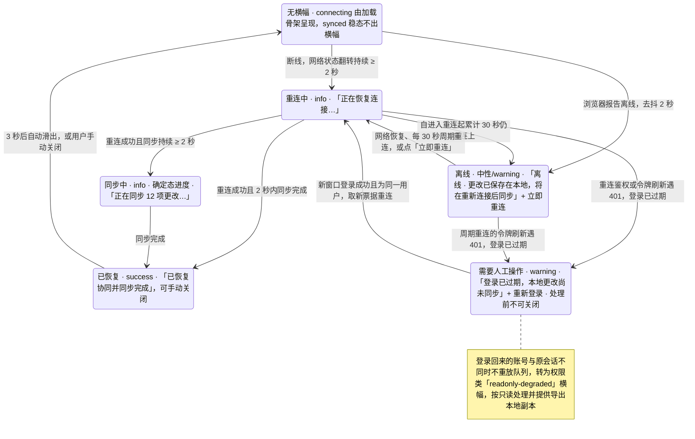
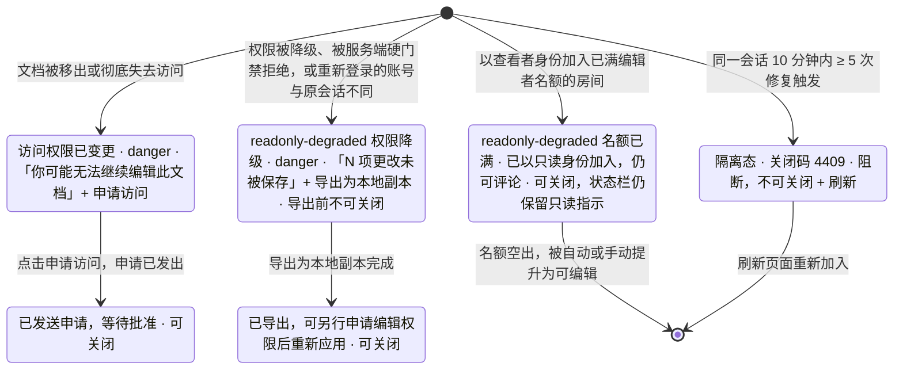
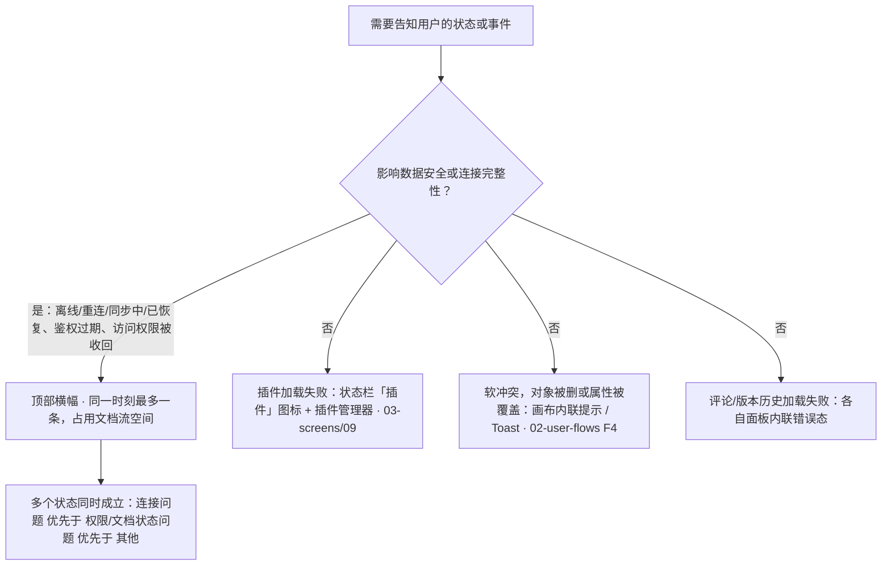
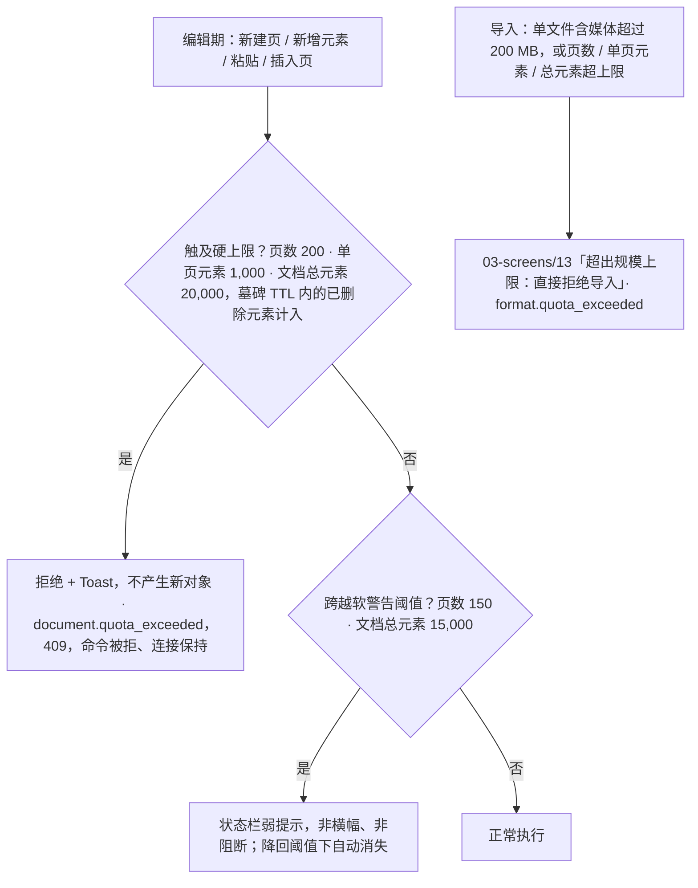

> 状态：草稿 | 负责：设计 | 更新：2026-09-18；2026-09-24（rulings §4.15 Q5：配额表补文档总元素软警告 / 硬上限、超包络导入拒绝、名额按用户计与所有者保席）；2026-09-24（复核修正，rulings §4.17）；2026-09-25（补图）；2026-09-25（矛盾收口，rulings §4.18） | 依赖：charter v0.1
> **实现口径（2026-09-18）**：组件、token 与图标以 `09-design-specification.md` v3.1、`04-design-system.md` v0.5 与 `playground/` 为准；本文中的 `--cordex-*` 变量、Phosphor 图标、`i-*` sprite 类名与 `btn-*` 类名为原设计系统 v0.3 记号，已作废，仅保留交互与状态定义。

# 03-12 离线/冲突横幅

> **设计基准（2026-09-15 起）**：组件规格以 [`09-design-specification.md`](../09-design-specification.md) v3.0（shadcn Rhea + 材质层）为准；对应 playground 路由 `#/offline`（[已发布 artifact](https://claude.ai/code/artifact/cf6e1a1a-986b-48bb-b743-5758dff419d2)，源码 `playground/src/routes/`）。本文引用的 `mockups/*.html` 与线框图为历史静态稿，以 playground 实际渲染为终稿。

顶部横幅位于全局栏下方、Ribbon 上方（编辑模式）或评审工具条上方（评审模式），占用文档流空间（非绝对定位覆盖），避免遮挡画布内容与对象手柄。同一时刻**最多一条**横幅；多个状态同时成立时按优先级取最高者展示：连接问题 > 权限/文档状态问题 > 其他。

本文件的状态与 05-collaboration-ux.md §7 定义的六态会话状态机（`connecting`/`syncing`/`synced`/`reconnecting`/`offline`/`readonly-degraded`，权威口径见 PRD `03-features/03-collaboration.md` §3）一一对应：`connecting` 属于文档初次打开的加载过程，由 03-screens/02 的加载骨架呈现，不产生横幅；**重连时的 `connecting` 以「重连中」呈现**（对外载荷是 M-05 的 SyncState 六态，`connecting` 且 `reconnectAttempt > 0` 即「重连中」，映射见架构 06 §18.3）；其余五态（含 `readonly-degraded` 的两个触发原因）都在本文件描述。每次重连都**先鉴权、再同步**（架构 06 §5.1），所以「重连中」之后必经「同步中」（2 秒内同步完成时直接落到「已恢复」，不闪「同步中」）。

**连接类横幅状态机**



怎么读：每个状态就是当时唯一显示的那条横幅；所有翻转都经过 ≥ 2 秒去抖，关闭「已恢复」后若又断线，照常从「无横幅」重新走一遍，不因刚关闭过而抑制。离线判据按时间：自进入重连起累计 30 秒仍未连上即离线，浏览器报告离线（`navigator.onLine=false`）时立即离线（去抖 2 秒）；令牌刷新的网络失败共用同一计时（PRD CO-01 / §3、设计 05 §7、rulings §4.18 UX-03）。离线后不停止重试：每 30 秒（±20% 抖动）自动重连一次，浏览器报告离线期间暂停；一次尝试不足 2 秒即失败时按去抖规则横幅保持「离线」，不来回闪烁（rulings §4.18 CO-03）。令牌刷新遇 401 直接进「登录已过期」，只有网络错误才走「重连中」（UX-02）。状态与会话六态的对应见 05-collaboration-ux §7。

**权限与文档状态类横幅**



怎么读：四条入口互相独立，同时成立时按「连接问题优先于权限/文档状态问题」取最高者显示；权限降级横幅在导出前不可关闭、导出后降级为可关闭，因为不处理就会丢失用户的工作成果；隔离态是阻断式横幅，只能刷新退出、始终不可关闭。重新登录回来的账号与原会话不同（UX-02）也进入权限降级分支：不重放本地队列，防止以他人身份提交更改。

---

## 线框与状态

### 离线（中性/warning）

```
┌─────────────────────────────────────────────────────────────────────────┐
│ ⚡ 离线 · 更改已保存在本地，将在重新连接后同步               [ 立即重连 ]   │
└─────────────────────────────────────────────────────────────────────────┘
```

离线期间每 30 秒（±20% 抖动）自动重连一次，浏览器报告离线期间暂停；「立即重连」立即发起一次连接（浏览器报告离线时禁用，tooltip「网络恢复后可重连」）。收到浏览器 `online` 事件同样立即重连（架构 06 §5.1、rulings §4.18 CO-03）。

### 重连中（info）

```
┌─────────────────────────────────────────────────────────────────────────┐
│ ↻ 正在恢复连接…                                                          │
└─────────────────────────────────────────────────────────────────────────┘
```

### 同步中（info，确定态进度）

```
┌─────────────────────────────────────────────────────────────────────────┐
│ ↻ 正在同步 12 项更改…                                                     │
└─────────────────────────────────────────────────────────────────────────┘
```

### 已恢复（success，自动消失）

```
┌─────────────────────────────────────────────────────────────────────────┐
│ ✓ 已恢复协同并同步完成                                              [×]  │
└─────────────────────────────────────────────────────────────────────────┘
```

3 秒后自动滑出消失，或用户可手动关闭。

### 需要人工操作（warning/danger）

```
┌─────────────────────────────────────────────────────────────────────────┐
│ ⚠ 登录已过期，本地更改尚未同步                            [ 重新登录 ]     │
└─────────────────────────────────────────────────────────────────────────┘
```

**「重新登录」在新窗口完成，原页不跳转**（rulings §4.18 UX-02）：

- 点「重新登录」在弹窗（被浏览器拦截时退化为新标签链接「在新标签页中登录」）里走 OIDC 登录，服务端照常设置 httpOnly cookie；登录回调页经 BroadcastChannel 通知原页，原页重新获得焦点时也会探测一次 `/auth/me`，两路任一到达即可。
- 原页全程不跳转、本地待同步队列保留；拿到新票据后按「重连中 → 同步中 → 已恢复」回到协同（架构 06 `denied → connecting` 边）。
- 登录回来的账号与原会话**不是同一用户**时不重放队列：转为权限降级横幅（按只读处理，提供「导出为本地副本」），防止以他人身份提交更改。
- 这条横幅在处理前不可关闭；令牌刷新遇 401 直接进本态，只有网络错误才走「重连中」。

```
┌─────────────────────────────────────────────────────────────────────────┐
│ ⛔ 访问权限已变更，你可能无法继续编辑此文档              [ 申请访问 ]      │
└─────────────────────────────────────────────────────────────────────────┘
```

### `readonly-degraded`（锁形图标，danger，两种触发原因）

对应 05-collaboration-ux.md §7/§8：这是唯一会**清空本地未同步队列**的状态，必须明确说明并给出补救入口。

```
┌─────────────────────────────────────────────────────────────────────────┐
│ 🔒 你的权限已变更为「可评审」，3 项更改未被保存         [ 导出为本地副本 ]  │
└─────────────────────────────────────────────────────────────────────────┘
```

```
┌─────────────────────────────────────────────────────────────────────────┐
│ 🔒 编辑者名额已满（上限 {N} 人），你已以只读身份加入，仍可评论      [×] │
└─────────────────────────────────────────────────────────────────────────┘
```

线框中 `{N}` 为每文档并发编辑者上限，**读取部署配置**（默认 20，PRD CO-01 / SV-08），界面不写死数字；右侧 [×] 表示本分支横幅可关闭（见下段）。名额已满只收回画布写入，评论能力随角色保留，所以文案写「只读身份，仍可评论」，不再写「查看身份」——「仅查看」专指只有查看权限的查看者变体（01-information-architecture §5.1，不能评论），两者在横幅、状态栏与文档列表徽标（03-screens/01）上分开称呼（rulings §4.18 UX-19）。

权限降级分支的"导出为本地副本"完整流程（导出后横幅降级为可关闭提示、系统不自动把导出内容重新合并回文档）见 05-collaboration-ux.md §8；导出完成前横幅不可关闭，因为不处理就会丢失用户的工作成果。**未处理前不可关闭的横幅共四类**（rulings §4.18 UX-04）：权限降级（导出前）、访问权限已变更（阻断）、隔离态（刷新前）、登录已过期（重新登录处理前）；其余横幅均可关闭或自动消失。容量已满分支保持到有编辑者名额空出、用户被自动/手动提升为可编辑为止，可关闭（关闭后状态栏仍保留只读指示，用户不会误以为自己仍是编辑者）。上方"访问权限已变更"（文档被移出/彻底失去访问）与本状态不同：那是更严重的、无法继续查看的阻断态，本状态下用户仍可正常查看/评论。

---

## 使用准则（何时用横幅 / 何时不用）

横幅是稀缺资源，仅用于**影响数据安全或连接完整性**的关键态；其余提示改用状态栏图标、Toast 或面板内联提示，避免横幅堆叠造成通知疲劳：

| 情况 | 是否用横幅 |
|---|---|
| 网络离线/重连/同步中/已恢复 | 是（本文件） |
| 鉴权过期、访问权限被收回 | 是（本文件） |
| 服务端存储暂不可用、更改只暂存未落库（PG 故障降级期，已收到 `ack{tier:'spill'}` 或仍在服务端退避重试） | 否：连接与协作照常（降级期照常广播，彼此可见），状态栏同步项显示 warning 色点「未保存到服务器」，hover 说明"服务器存储暂时不可用，更改已暂存，恢复后自动保存"；收到 `ack{tier:'db'}` 后回到「已同步」（rulings §4.18 CO-08） |
| 插件加载失败 | 否，见状态栏"插件"图标 + 插件管理器（03-screens/09） |
| 软冲突（对象被删/属性被覆盖） | 否，见画布内联提示/Toast（02-user-flows.md F4） |
| 评论/版本历史加载失败 | 否，各自面板内联错误态 |

**何时用横幅**



怎么读：先判定是否影响数据安全或连接完整性，只有「是」才进入稀缺的横幅通道，并在多条同时成立时按优先级取一条；其余情况分流到状态栏、Toast 或面板内联，避免横幅堆叠造成通知疲劳。

---

## 交互与动效

- **语义与播报**（2026-09-15 评审）：横幅容器为 `role="status"` + `aria-live="polite"`（离线/同步中/已恢复）；权限降级与错误类横幅用 `aria-live="assertive"`；toast 容器同为 `role="status"`/`polite`，自动消失 3–5 秒（含操作按钮的取 5 秒），不抢焦点，操作按钮可 Tab 到达。
- 进入：从顶部滑入，`--cordex-motion-duration-base` + `ease-decelerate`；退出：滑出，`ease-accelerate`，时长约为进入的 0.6–0.7 倍；`prefers-reduced-motion` 下直接呈现最终态。
- 画布区域随横幅出现/消失自动让出/收回空间（不产生跳变式重排，改用过渡动画平滑高度变化）。
- 去抖：网络状态翻转需持续 ≥ 2 秒才触发横幅显示/切换，避免短暂抖动造成横幅闪烁。
- 多标签页：每个标签页独立判断并展示自己的连接状态，互不同步。

## 边界情况

- 横幅与保真报告角标同时存在：互不冲突（保真报告是角标/面板入口，不是横幅，见 03-screens/10）。
- 用户手动关闭"已恢复"横幅后又立即离线：正常重新按状态机显示离线横幅，不因为刚关闭过而抑制。
- 极窄屏（400px）：横幅文案可能超出单行宽度，允许换行为两行，操作按钮换到文案下方独占一行，保证可点击区域达标（见 07-accessibility-and-i18n.md 触控目标尺寸）。
- 横幅内操作按钮点击后处于加载态：如"重新登录"在打开登录窗口期间按钮显示 Spinner 并禁用（原页不跳转，登录窗口关闭而未完成时恢复可点），避免重复触发。

---

## 补充（2026-09-15，G-51/G-55/G-56，来源 `10-prd/07-design-coverage-and-gaps.md`）

### 门禁的用户可见行为（G-51，CO-12/ADR-0034）

被服务端硬门禁拒绝（降权/锁定窗口触及）时，`readonly-degraded` 横幅在已有文案基础上追加说明，并新增两种关联提示：

```
┌─────────────────────────────────────────────────────────────────────────┐
│ 🔒 你的权限已变更为「可评审」，3 项更改未被保存         [ 导出为本地副本 ]  │
│    文档已重新载入服务端版本，撤销历史已清空                                │
└─────────────────────────────────────────────────────────────────────────┘
```

- 追加行"文档已重新载入服务端版本，撤销历史已清空"，向用户说明"导出后重载"机制的具体后果，避免用户以为撤销栈只是暂时清空。

```
┌─────────────────────────────────────────────────────────────────────────┐
│ ✓ 已自动修正 1 处结构问题                                        [查看] │  ← Toast，非横幅
└─────────────────────────────────────────────────────────────────────────┘
```

- 软门禁修复（未越权，仅结构不变量修复，如父子环）：**Toast**（非横幅，不占用横幅这一稀缺通道，呼应本文件"使用准则"表），`role="status"`/`polite`，"查看"定位到受影响元素；撤销栈不清空。

```
┌─────────────────────────────────────────────────────────────────────────┐
│ ⛔ 你的会话已被暂停协同，请刷新页面重新加入；如持续出现请联系管理员  [刷新] │
└─────────────────────────────────────────────────────────────────────────┘
```

- 隔离态（同一会话 10 分钟内 ≥ 5 次修复触发，关闭码 4409）：阻断式横幅，`aria-live="assertive"`，不可关闭（需刷新才能恢复）。

### 配额超限反馈（G-55，SV-08）

| 场景 | 表现 |
|---|---|
| 页数达 150（软警告） | 状态栏弱提示"已接近 200 页上限"，非横幅、非阻断 |
| 页数达 200（硬上限），新建页 | 拒绝 + Toast"已达页数上限（200）" |
| 单页元素达 1,000，新增元素 | 拒绝 + Toast，不产生新对象 |
| 文档总元素达 15,000（软警告，rulings §4.15 Q5） | 状态栏弱提示"元素数量已接近上限（15,000 / 20,000）"，hover 说明"最近 24 小时内删除的元素仍计入，到期后自动释放"；非横幅、非阻断；跨越阈值时出现一次，降回阈值下自动消失 |
| 文档总元素达 20,000（硬上限），新增元素 / 粘贴 / 插入页 | 拒绝 + Toast"已达每份文档 20,000 个元素的上限"，不产生新对象；已删除但未过期（墓碑 TTL 内）的元素计入总数 |
| 导入文件过大（单文件含媒体超过 200 MB） | 03-screens/13 的"超出规模上限：直接拒绝导入"错误态（`format.quota_exceeded{dimension:"fileSize"}`）；ZIP / 媒体解析安全上限才走 `format.limit_exceeded`（复用，不新增文案体系） |
| 导入文档超出规模上限（页数 / 单页元素 / 总元素） | 03-screens/13 的"超出规模上限：直接拒绝导入"错误态（`format.quota_exceeded`，说明超出哪一项） |
| 房间编辑者已满 | 本文件已有的"编辑者名额已满"`readonly-degraded` 分支（无需新增）。名额按用户计：同一账号再开标签页/设备不会因名额被降为只读；文档所有者不占编辑者名额，永远不会看到此横幅（rulings §4.15 Q5） |
| 房间查看者也已满 | 新增阻断态："文档当前查看人数已达上限，请稍后再试"（无"返回列表"以外的操作）；评审者计入查看者名额 |

上述数字均为部署配置默认值，界面文案读取实际配置，不写死。编辑期触及硬上限的拒绝对应错误码 `document.quota_exceeded{dimension, limit, actual}`（409，命令被拒、连接保持；`dimension` 取 `slides` / `elementsPerSlide` / `elementsTotal`，照抄架构 10 §3，rulings §4.17 D2）。

**配额阈值与反馈通道**



怎么读：从「编辑期」出发的一组是两级阈值（先判硬上限再判软警告），与之不相连的「导入」一组是导入期的直接拒绝；两类错误码分属编辑期与导入期，ZIP / 媒体解析安全上限另走 `format.limit_exceeded`。图中数字均为部署配置默认值，界面文案读取实际配置。

### 权限变更的双向反馈补充（G-56，与 05-collaboration-ux.md §8 对应）

- 被提权：Toast"你现在可以编辑此文档"（05-collaboration-ux.md §8 已定，本文件不重复横幅）。
- "申请访问"横幅点击后的弹层与所有者端"待处理申请"列表属于分享对话框（03-screens/08）范围，见该文件后续补充；本文件仅承载"申请已发送"后的状态——横幅在申请发出后从"需要操作"降级为"已发送申请，等待批准"的可关闭提示。
