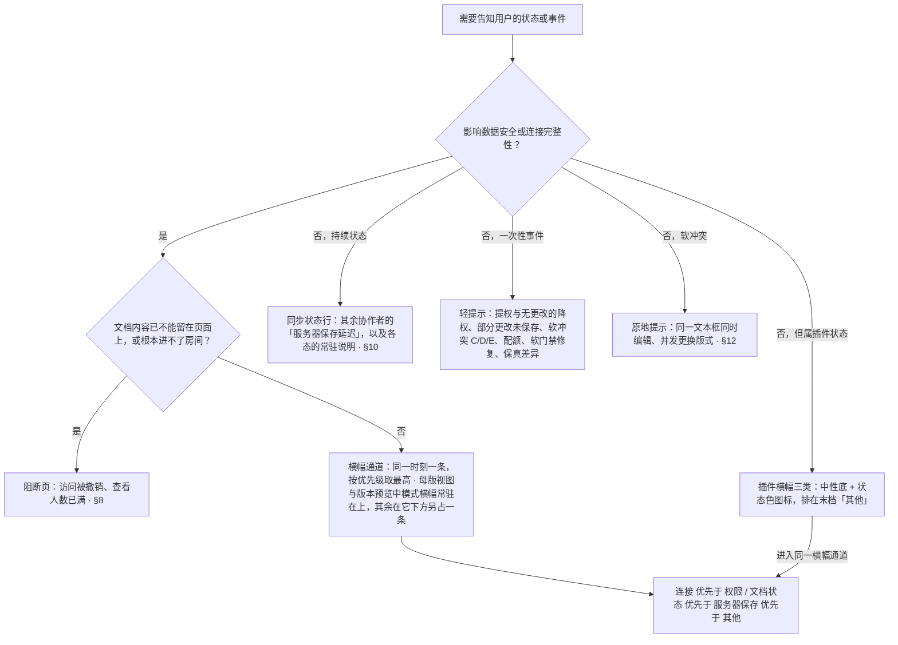
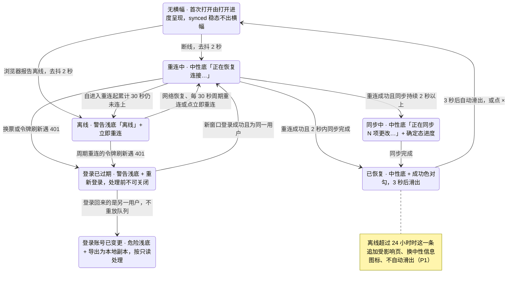
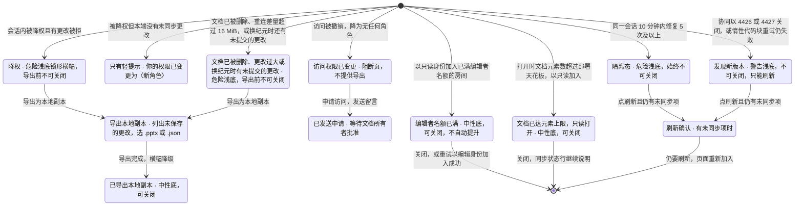
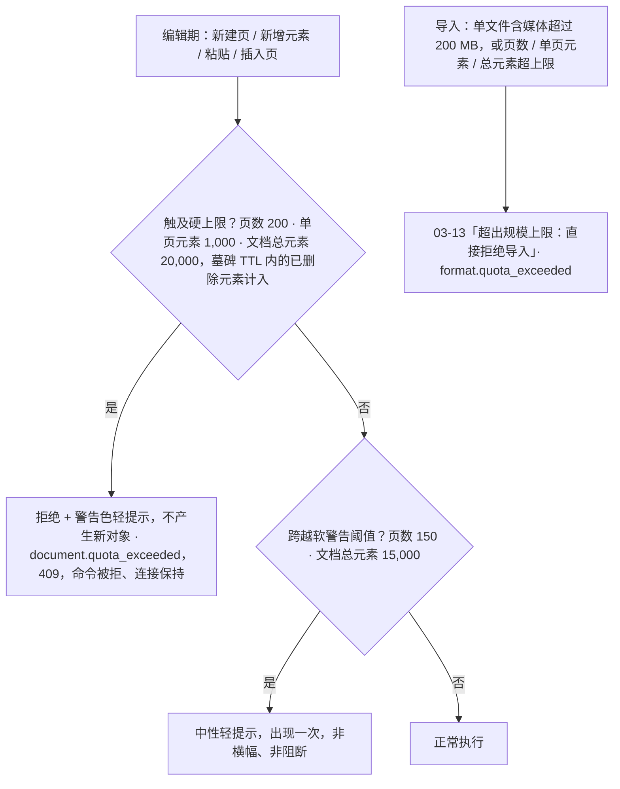

> 状态：草稿 | 负责：设计 | 更新：2026-09-18；2026-09-24（rulings §4.15 Q5：配额表补文档总元素软警告 / 硬上限、超包络导入拒绝、名额按用户计与所有者保席）；2026-09-24（复核修正，rulings §4.17）；2026-09-25（补图）；2026-09-25（矛盾收口，rulings §4.18）；2026-09-25（§4.19）；2026-10-07（design-language-v3 第 1 批：只做第 1 批裁决直接要求的最小改动——开头一段写入「同一时刻最多一条横幅」的母版视图例外（rulings §4.25 TB-14：母版横幅常驻在上，其余横幅在它下方另占一条，最多两条），横幅位置改指 03-02 §6.2「横幅通道」（第 1 批定稿）；其余界面描述随第 2 批回写）；2026-10-08（design-language-v3 第 1 批收口：「使用准则」表与图把插件启动失败、缺少插件、插件设置已更新改为按需横幅、归入优先级末档「其他」（与 03-02 §6.2「插件横幅」、06 §3 一致；原「状态栏插件图标」随 rulings §4.25 DS-6 作废），图中横幅节点补母版视图例外（TB-14）；文首加 v3 读法说明（状态栏 / 状态胶囊即同步状态行）；其余界面描述仍随第 2 批回写）；2026-10-15（design-language-v3 第 2 批：按已拍板样张 `offline-conflict` 整篇改写——文首「设计基准」改指 v3 样张路由、源码与对照截图，原「实现口径」「设计基准」与 2026-10-08 的「v3 读法」说明作废；§1 线框按 v3 外壳重画（横幅通道位置、横幅结构、两条叠放、仅查看形态、阻断页、离开确认与「导出本地副本」）；§2 横幅通道：位置、优先级与插件横幅的先后（DS-54）、母版视图与版本预览两条叠放（DS-39）、各横幅的底色与图标（DS-41：离线、未保存到服务器、登录已过期、降权、隔离等用浅底，已恢复与已导出为中性底 + 成功色图标，长时间离线为中性信息图标，缺少插件与启动失败改为中性底 + 状态色图标）、处理前不可关闭的六类与导出后降级（DS-58）、使用准则改写（访问被撤销与查看人数已满改为阻断页，保真差异、提权与无更改的降权不走横幅，DS-50、DS-51、DS-58、DS-60）；§3 状态列 42 个样张状态（36 个推荐、6 个未采纳，DS-63）与引用的第 1 批状态，两张状态图按新流程改写；§4–§13 逐类写明：离线文案不变、长时间离线最多列 3 个受影响页并换中性信息图标（DS-59），服务器保存，登录已过期与换人，降权横幅新文案（第 1 批 3 个降权画面随之改）、「导出本地副本」对话框列出未保存的更改并可选 .pptx / .json、「已导出本地副本」、被提权与无未同步更改的降权给轻提示、名额已满中性底与「重试以编辑身份加入」（DS-58），访问被撤销阻断页（DS-50），查看人数已满阻断页写明会自动打开（DS-60），隔离态，文档已被删除与更改过大（DS-58），登录已过期与隔离态下字段原位不可用并在检查器顶部写原因（DS-58），应用内离开与刷新拦截（DS-59），横幅与同步状态行（各态以 03-02 §3.1 为准，DS-61），仅查看形态的横幅（DS-60），同一文本框同时编辑的提示签与并发更换版式（DS-60），配额与软门禁轻提示；§14–§17 交互与键盘、可及性（横幅与轻提示的播报规则）、边界情况与规格速查；横幅高度维持「至少 40 高」（DS-62 推迟到第 3 批）；依据 rulings §4.25 DS-38、DS-39、DS-41、DS-48、DS-50…DS-52、DS-54、DS-55、DS-58…DS-63、TB-14；同日再补：文首里程碑与 §3 状态表按 PRD 标注，「文档已被删除」「有更改过大无法同步」跟 PRD CO-06 改为 M3，注明前端 50/07 §16 的 M2 指协议层（TB-66）；§2.2、§2.6、图 2-1 与新增的 §8.6 把样张未画的「发现新版本」、换纪元后的「文档已替换为导入的文件 / 文档已由管理员重建」、「文档已达元素上限」（只读打开或合并后超上限被拒）与锁定窗口有更改被拒的「文档正忙」归入「权限 / 文档状态」档，「发现新版本」与「插件设置已更新」合并后按前者归档，「部分更改未保存」改走轻提示；§2.4、§2.5、§15 注明有更改被拒的「文档正忙」「文档已达元素上限」与降权同一条横幅（TB-66）；§10「文档正忙」状态行用中性锁形（TB-66）；§6 换账号横幅只留「导出为本地副本」（TB-69）；§8.1 申请人再打开时的阻断页与申请被拒不告知（DS-68），所有者另经集成方收到通知（DS-67）；同日再补：§2.4、§2.5、§3、§8.6 样张未画的「发现新版本」、换纪元后的「文档已替换为导入的文件 / 文档已由管理员重建」、「文档已达元素上限，只读打开」三条只写出现条件、文案与档位，底色、图标与能否关闭（含原写的「可关闭」「3 秒后自动消失」）并入第 3 批横幅样张、与横幅高度一起拍板（TB-80）；§7.2 写明「导出本地副本」对话框在 SDK（ui-react 的 `ui.dialog` 模板 `export-local-copy`），四种横幅与参考应用的离开 / 刷新确认框都经 `ui.openDialog` 打开同一个，嵌入形态也有这条兜底（TB-85）；文首里程碑与 §3 状态表的「文档已被删除」「有更改过大无法同步」已是 M3，核对无改动（TB-66））；2026-10-22（design-language-v3 第 3 批：按已拍板样张 `doc-banners` 写定第 2 批没画的三条文档状态横幅——「发现新版本，刷新后继续」警告浅底 + 刷新图标、不可关闭、唯一按钮「刷新」，会话已关闭时转为暂时不能编辑、同步状态行「需要刷新 · N 项未同步」，代码块漂移时会话还在、只有惰性元素保持占位（DS-126）；换纪元没有未提交的更改时中性底 + 信息图标、可关闭、不自动消失，正文「文档已重新载入，撤销历史已清空」，有未提交的更改时同「有更改过大无法同步」（DS-127，前端 50/07 §9 暂行的「3 秒后自动消失」作废）；「文档已达元素上限，只读打开」同「编辑者名额已满」，中性底 + 锁形、可关闭、无按钮，正文带数字与出路（DS-128）——§2.4 表、§2.5、§3、§8.6、§9、§10 随之改，§3.1 补三个未采纳的备选；§7.2、§7.3「导出本地副本」说明与「已导出本地副本」的第二句按原因换，改为一张原因表（DS-129）；§1.2、§17 横幅统一高 40、含 1px 底边，带按钮的上下内边距 5（DS-75，原「至少 40 高」结案）；§2.1 补应用壳页面的横幅位置：主区顶栏之下、只横跨主区，导航不动，最多两条叠放（DS-92）；§11 仅查看形态状态行的三种写法（TB-125、DS-112）与缺插件横幅不放面板入口；§15 补「页面一打开就成立的状态横幅用 status，会话中发生的错误才用 alert」（TB-119）；依据 rulings §4.25 DS-75、DS-92、DS-112、DS-126…DS-129、TB-119、TB-122、TB-125）；2026-10-22（design-language-v3 第 3 批回写续：§2.1 应用壳页面的横幅写明与编辑器同一个件、统一高 40（DS-75）；§7.2 导出本地副本第二句的表后注明 DS-129 没点名的原因一律用中性句（rulings §4.25 TB-139）；§8.6「文档已达元素上限，只读打开」正文里的两个数取自 `auth.ok{reason:'over_ceiling'}` 带的元素数与天花板，与服务端准入同口径、含墓碑（TB-146，30/06 §6.3、60/16 §3 登记）；同日再补：§11 仅查看形态顶部条的状态行补嵌入里又是触控设备时仍写「仅查看 · 在电脑上编辑」（rulings §4.25 TB-159）；2026-10-22 复核修正：§7.2 引 03-22 的括注由「第 3 批定稿」改为已改写的写法；§11 写明手机不论是否触控都按窗口窄写状态行（rulings §4.25 TB-163）；状态头的回写轮次字样改为「回写续 / 同日再补」；§1.4 图注、§2.1、§8.6、§11 与 §17 写明横幅放在最顶上对整个仅查看形态（手机与平板）都成立、按钮只在一行放不下时才换到文案下方（rulings §4.25 TB-172，原「宽度 < 640 时」与「按钮换到文案下方独占一行」的无条件写法作废）；§1.2、§1.4 图注、§2.1、§11 与 §17 补触控形态（手机与平板）的按钮照常 44 高、横幅随之撑高，DS-75 的高 40 指非触控形态（TB-172）；§1.2、§2.1「应用壳页面」与 §17「仅查看形态」写明触控形态里应用壳页面与编辑器的横幅同此：一行放得下时上下内边距沿用带按钮横幅的 5，按钮与 × 44，共 55（含 1px 底边），放不下时竖排、上下 12，§8.6 的「横幅统一高 40」注明指非触控形态（TB-172））；2026-10-23（design-language-v3 第 3 批评审修改：§1.6 线框与图注、§7.2「格式」一节、§3 `degraded-export` 一行与 §17：「导出本地副本」对话框的格式行在单选圈与名称之间放 20px 文件类型图标——.pptx 一行是 Tabler `file-type-ppt`（与通用导出对话框的格式行同一套，kit `FileTypeIcon`），.json 一行是 lucide `FileBraces`（20、描边 1.5），中性色、选中不变色、只作装饰（rulings §4.25 DS-143、TB-182）；对话框与确认框按全站新画法（标题栏 40、圆角 12、× 正文色；确认框没有标题栏，只改圆角，DS-142），设计基准写明 `degraded-export`、`leave-confirm`、`refresh-confirm` 与 `doc-banners.version-drift-refresh` 的画面随之变；依据 rulings §4.25 DS-142、DS-143、TB-182）；2026-11-04（design-language-v3 母版视图改版：设计基准补 `master-offline`、`master-degraded` 按新画法重画；§1.3 图例与 §2.3 的母版横幅改为上下文条、降权说明去掉「，可以切换范围」；§2.4 底色与图标表的模式横幅一行补上下文条的组成与播报；§3 状态表两条母版视图横幅改写并补幻灯片按两条横幅的总高下移；rulings §4.25 DS-145、DS-146、TB-199；需求编号、优先级与里程碑不变） | 依赖：charter v0.2；PRD CO-01、CO-05、CO-06、CO-08、CO-12、SV-08；rulings §4.15 Q5、§4.17 D2、§4.18 UX-02…UX-04、UX-19、CO-03、CO-08、§4.19 INC-09、§4.25 DS-6、DS-15、DS-37…DS-41、DS-48、DS-50…DS-52、DS-54、DS-55、DS-58…DS-63、DS-67、DS-68、DS-75、DS-92、DS-112、DS-126…DS-129、DS-142、DS-143、DS-145、DS-146、TB-2、TB-14、TB-22、TB-66、TB-69、TB-80、TB-85、TB-119、TB-122、TB-125、TB-139、TB-146、TB-159、TB-163、TB-172、TB-182、TB-199；前端 50/02 §5、§12，50/07 §8、§9，50/09 §6.1；playground `#/v3/editor?state=offline-conflict.*`（`src/v3/scenarios/offline-conflict/` 的 `offline-conflict.scenario.tsx`、`banners.tsx`、`status.tsx`、`dialogs.tsx`、`pages.tsx`、`conflicts.tsx`、`affected.tsx`，`src/v3/kit/Banner.tsx`、`Toast.tsx`、`Dialog.tsx`、`FileTypeIcon.tsx`）、`#/v3/editor?state=doc-banners.*`（`src/v3/scenarios/doc-banners/` 的 `doc-banners.scenario.tsx`、`banners.tsx`、`dialogs.tsx`、`editor.tsx`）

# 03-12 离线/冲突横幅

> **设计基准（2026-10-15 起，rulings §4.25 DS-38…DS-63）**：以 playground 第 2 批样张 `#/v3/editor?state=offline-conflict.<状态 id>` 为准（42 个状态：36 个推荐、6 个未采纳的备选，见 §3），源码在 `playground/src/v3/scenarios/offline-conflict/`（`offline-conflict.scenario.tsx` 各状态的标题与说明，`banners.tsx` 横幅，`status.tsx` 同步状态行，`dialogs.tsx` 离开 / 刷新确认与「导出本地副本」，`pages.tsx` 阻断页，`conflicts.tsx` 软冲突件，`affected.tsx` 受影响页）与 `playground/src/v3/kit/`（`Banner.tsx` 横幅与两条叠放，`Toast.tsx` 轻提示）；对照截图 `openspec/changes/design-language-v3/screens/batch2/offline-conflict-<状态>-dark.jpg` / `-light.jpg`；编辑器外壳以 [03-02](02-editor-main.md) 为准。第 1 批已拍板的同步中、重连中、离线（单页与网格）、降权（含主菜单与缩略图右键）、远端覆盖、撤销被跳过与插件横幅在场景 `main-states`（03-02 §6.2），本文引用、不重画。第 3 批（2026-10-22 拍板，rulings §4.25 DS-126…DS-129）补的三条文档状态横幅在场景 `doc-banners`（`#/v3/editor?state=doc-banners.<状态 id>`，13 个状态：10 个推荐、3 个未采纳，§3），源码在 `playground/src/v3/scenarios/doc-banners/`（`doc-banners.scenario.tsx` 各状态的标题与说明，`banners.tsx` 横幅，`dialogs.tsx` 刷新与离开确认、导出说明的第二句，`editor.tsx` 编辑器形态与同步状态行），截图 `screens/batch3/doc-banners-<状态>-dark.jpg` / `-light.jpg`。2026-10-23 第 3 批评审修改起，对话框与确认框按全站新画法（标题栏 40、圆角 12、× 正文色，确认框没有标题栏、只改圆角，rulings §4.25 DS-142），「导出本地副本」的格式行加文件类型图标（DS-143、TB-182，§7.2）——`degraded-export`、`leave-confirm`、`refresh-confirm` 与 `doc-banners.version-drift-refresh` 的画面随之变。母版视图改版（2026-11-03 拍板）后母版视图的模式横幅是上下文条（rulings §4.25 DS-145），`master-offline`、`master-degraded` 两态按新画法重画，对照截图随之重拍。此前 shadcn / 材质层时期的线框、`--cordex-*` 变量、Phosphor 图标与类名写法，以及 2026-10-08 补的「v3 读法」说明，一并作废。

横幅通道里的连接、鉴权、权限、文档状态与服务器保存提示，以及与它们相连的阻断页、离开与刷新的拦截、「导出本地副本」、软冲突与配额提示。覆盖缺口 **G-51**（门禁的用户可见行为）、**G-55**（配额超限反馈）、**G-56**（权限变更的双向反馈），对应 PRD CO-01、CO-05、CO-06、CO-08、CO-12。

本文的横幅与 [05](../05-collaboration-ux.md) §7 的会话六态（`connecting` / `syncing` / `synced` / `reconnecting` / `offline` / `readonly-degraded`，权威口径见 PRD `03-features/03-collaboration.md` §3）及前端 [50/07](../../50-frontend/07-collaboration-client.md) §3.2、§3.3 的覆盖态（登录已过期、访问权限已变更、隔离、文档已删除）对应：`connecting` 属于首次打开的加载过程，由 03-02 的打开进度呈现、不出横幅；重连时的 `connecting` 呈现为「重连中」（`reconnectAttempt > 0`，架构 06 §18.3）。每次重连都先鉴权、再同步（架构 06 §5.1），所以「重连中」之后必经「同步中」（2 秒内同步完成时直接落到「已恢复」，不闪「同步中」）。何时出现以 50/07 §3.3、§8、§9 为准，本文定横幅通道的规则、文案与画法。

**里程碑**（界面状态以 PRD 需求为准，rulings §4.25 TB-66；rulings §4.19 D-M2-CONTENT，PRD 05 §0.3）：协同后端自 M2 起交付。M2 出现的是重连中、同步中、已恢复、登录已过期（含换人后按只读处理）、隔离态、发起方「未保存到服务器 N 项」与其余会话的「服务器保存延迟」、「导出本地副本」与应用内离开 / 刷新的拦截，第 3 批补的「发现新版本」（插件集变化引起的 4426 随 M3，前端 50/07 §16）、换纪元后的两条与「文档已达元素上限，只读打开」，以及配额与软门禁的轻提示；离线（30 秒判据与周期重连）、长时间离线提示（P1）、文档已被删除与有更改过大无法同步（PRD CO-06）、降权、被提权、名额已满、访问被撤销、查看人数已满与软冲突提示属于 M3 多人协同体验层。前端 50/07 §16 把关闭码 4404、4413 的处理列在 M2，指的是协议层的关闭与停止重连随网关交付；这两条横幅按 PRD CO-06 在 M3（TB-66）。

---

## 1. 线框

### 1.1 在编辑器中的位置（桌面 1600 × 1000，单页视图，离线 · 浏览器报告断网）

```
←──────── 240 ────────→←───────────────────────── 画布 flex ─────────────────────────→←───────── 280 ──────────→
┌──────────────────────┬──────────────────────────────────────────────────────────────┬────────────────────────┐
│ [Logo▾]  [单页][网格]│ ⊘ 离线  更改已保存在本地，将在重新连接后同步      [立即重连] │ (周)          ▶ [分享] │
│ 2026 年 Q2 业绩汇报 ▾├──────────────────────────────────────────────────────────────┤                        │
│ ⊘ 离线 · 3 项待同步  │                                          ╭────────────────╮  ├────────────────────────┤
│ [新建幻灯片  ▾] [+]  │                                          │网络恢复后可重连│  │ [设计]  评论    77% ▾  │
│ 1 ┌──────────────┐   │                                          ╰────────────────╯  ├────────────────────────┤
│   └──────────────┘   │  ┌────────────────────────────────────────────────────────┐  │ 幻灯片 2               │
│▌2 ┏━━━━━━━━━━━━━━┓   │  │ 议程                                                   │  │ 版式                   │
│▌  ┗━━━━━━━━━━━━━━┛   │  │                                                        │  │ 主题                   │
│ 3 ┌──────────────┐   │  │ 01  关键指标                         ┌──────────┐      │  │ 背景                   │
│   └──────────────┘   │  │ 02  营收趋势                         │增长 18%  │      │  │ 放映                   │
│ 4 ┌──────────────┐   │  │ 03  区域分布                         └──────────┘      │  │                        │
│   └──────── [评3]┘   │  │ 04  下半年计划                                         │  │                        │
│ ⋮                    │  └────────────────────────────────────────────────────────┘  │                        │
│                      │                             ════                             │                        │
│                      │  ┌────────────────────────────────────────────────────────┐  │                        │
│                      │  │ 添加演讲者备注…                                        │  │                        │
│                      │  └────────────────────────────────────────────────────────┘  │                        │
│                      │       ╭──────────────────────────────────────────────╮       │                        │
│                      │       │[选择][文本][形状][图片][表格][图表][评论][+] │       │                        │
│                      │       ╰──────────────────────────────────────────────╯       │                        │
└──────────────────────┴──────────────────────────────────────────────────────────────┴────────────────────────┘
```

图例：第一行是横幅（警告浅底），在画布列顶部、左右栏之间，占文档流，画布与备注整体下移；`⊘` 离线云图标（警告色）；「立即重连」下方是不可用原因的工具提示（浏览器报告离线时）；左栏文件名下的同步状态行与横幅说同一件事（§10）；断线时在场信息消失，头像组只剩自己。样张 `offline-conflict.offline-no-network`，截图 `screens/batch2/offline-conflict-offline-no-network-*.jpg`。

### 1.2 横幅的结构

```
┌──────────────────────────────────────────────────────────────────────────────────┐
│ ◆  标题  说明（不截断，放不下时换行）                 [次按钮]  [次按钮]      ×  │
└──────────────────────────────────────────────────────────────────────────────────┘
```

高 40、含底部 1px 分隔，左 16、右 12；带按钮的横幅上下内边距 5、按钮 28 在 39 高的行里垂直居中，只有文字或只带 × 的上下 6；多行时照常撑高（2026-10-16，rulings §4.25 DS-75：带按钮与不带按钮的横幅统一为同一高度，原「至少 40 高、统一与否推迟到第 3 批」结案，第 1、2 批带按钮的横幅各矮 1px、布局与文案不动）。高 40 指非触控形态（桌面与紧凑）；触控形态（手机与平板）的按钮与 × 照常 44，横幅随之撑高，编辑器与应用壳页面的横幅同此：一行放得下时上下内边距沿用带按钮横幅的 5，共 55（44 + 10 + 1px 底边）；一行放不下时竖排，上下 12（rulings §4.25 TB-172，§11、§17）。左侧 16px 图标，图标、文字、按钮组与 × 之间各隔 8；粗体短标题（600）后隔 8 接说明，12px / 18px，文字不截断、放不下就换行；右侧按钮是 28 高的次按钮（透明底加一道与分隔线同档的细边，rulings §4.25 DS-37），按钮之间隔 8；可关闭的另有 24px ×。底色与图标见 §2.4。

### 1.3 两条叠放（版本预览与母版视图，TB-14、DS-39）

```
┌──────────────────────────────────────────────────────────────────────────────────┐
│ ↺ 正在查看昨天 16:20 的版本「提案定稿」· 仅你可见    [返回当前版本] [恢复此版本] │ ← 模式横幅：常驻在上
├──────────────────────────────────────────────────────────────────────────────────┤
│ ⊘ 离线  更改已保存在本地，将在重新连接后同步                          [立即重连] │ ← 其余横幅：按优先级取一条
└──────────────────────────────────────────────────────────────────────────────────┘
```

图例：版本预览中离线（样张 `version-history.offline-cached`）：「恢复此版本」恢复连接前不可用（03-07）。母版视图同一画法：上面一条是母版视图的上下文条（图标 +「母版视图」┊ 对象 ┊ 说明 +「关闭母版视图」，画法以 03-26 §6.3 为准，rulings §4.25 DS-145），下面一条是离线或降权横幅（样张 `master-offline`、`master-degraded`）。

### 1.4 仅查看形态（< 640，390 × 844，DS-60）

```
┌──────────────────────────────────────┐
│ ⊘ 离线  更改已保存在本地，将在重新连 │ ← 横幅在最顶上
│   接后同步                           │
│ ┌──────────────────────────────────┐ │
│ │             立即重连             │ │ ← 一行放不下，按钮换到文案下方独占一行，高 44
│ └──────────────────────────────────┘ │
├──────────────────────────────────────┤
│ [‹]  2026 年 Q2 业绩汇报        [⋯]  │ ← 仅查看形态的顶部条排在横幅下面
│      ⊘ 离线 · 3 项待同步             │ ← 同步异常时换成同步状态
├──────────────────────────────────────┤
│ ┌──────────────────────────────────┐ │
│ │ 议程                             │ │
│ │ 01 关键指标          ┌─────────┐ │ │
│ │ 02 营收趋势          │增长 18% │ │ │
│ │ 03 区域分布          └─────────┘ │ │
│ └──────────────────────────────────┘ │
│ ┌──────────────────────────────────┐ │
│ │ 演讲者备注                       │ │
│ │ 按议程四部分讲，每部分 5 分钟    │ │
│ │ 左右，问答留到最后。             │ │
│ └──────────────────────────────────┘ │
│     ╭────────────────────────────╮   │
│     │ [‹]   2 / 6   [›] │ [评论] │   │
│     ╰────────────────────────────╯   │
└──────────────────────────────────────┘
```

样张 `offline-conflict.narrow-offline`（视口 390 × 844）。图中是手机；平板（触控、≥ 640）的横幅同样在最顶上，一行放得下时按钮不换行、照常 44 高，横幅随之撑高（rulings §4.25 TB-172）。规则见 §11。

### 1.5 阻断页（访问被撤销，DS-50；查看人数已满同一布局，DS-60）

```
┌──────────────────────────────────────────────────────────────────────┐
│                                                                      │
│                              （锁形图标）                            │
│                          2026 年 Q2 业绩汇报                         │
│                            访问权限已变更                            │
│           你已无法查看或编辑此文档，未同步的更改已随之丢弃           │
│           可以向文档所有者申请访问，获得批准后即可重新打开           │
│                                                                      │
│                     [申请访问]  [返回文档列表]                       │
│                                                                      │
└──────────────────────────────────────────────────────────────────────┘
```

图例：整个工作区换成这一页，不渲染左栏、检查器与工具条；「申请访问」是主按钮，打开留言弹层（§8.1）。样张 `access-revoked`、`access-requested`、`viewers-full`。

### 1.6 离开确认与「导出本地副本」（DS-58、DS-59）

```
┌──────────────────────────────────────────────┐
│ 离开将丢失 3 项未同步更改                    │
│ 网络恢复后这些更改会自动同步，现在离开会丢失 │
│ 它们。                                       │
│ 可以先导出本地副本，再离开。                 │
│                                              │
│ [导出为本地副本]           [留下] [仍要离开] │
└──────────────────────────────────────────────┘

┌──────────────────────────────────────────────────────────────────────┐
│ 导出本地副本                                                      ×  │
├──────────────────────────────────────────────────────────────────────┤
│ 下面 3 项更改没有保存到文档。                                        │
│ 导出的副本不会自动合并回文档，获得编辑权限后可以对照重做。           │
│                                                                      │
│ 未保存的更改                                                         │
│ T   修改文字「毛利率」                                      第 3 页  │
│ ✥   移动「活跃客户」卡片                                    第 3 页  │
│ ⊞   插入文本框                                              第 5 页  │
│                                                                      │
│ 格式                                                                 │
│ (●) [PPT] 演示文稿副本（.pptx）    含这些更改的完整文档，可直接打开  │
│ ( ) [{ }] 更改摘要（.json）                逐项列出更改，供人工比对  │
├──────────────────────────────────────────────────────────────────────┤
│                                                      [取消]  [导出]  │
└──────────────────────────────────────────────────────────────────────┘
```

图例：上为离开确认（小号 360、圆角 12，「仍要离开」是危险色主按钮，初始焦点在「留下」）；下为「导出本地副本」（中号 480；标题栏 40、圆角 12、× 用正文色，rulings §4.25 DS-142），画的是降权打开时的样子，说明的第二句按原因换（§7.2，DS-129）；`[PPT]` `[{ }]` 是格式行的 20px 文件类型图标（.pptx 一行 Tabler `file-type-ppt`，.json 一行 lucide `FileBraces`；只作装饰，TB-182）。样张 `leave-confirm`、`refresh-confirm`、`degraded-export`。

---

## 2. 横幅通道

### 2.1 位置

- 画布列顶部、左右栏之间的一条（单页视图）：占文档流，画布与备注整体下移，不遮挡画布内容与对象手柄；网格视图里两个浮动胶囊与网格整体下移，紧凑形态里两个胶囊排在横幅下面，左右两个非模态抽屉也从横幅下沿开始、不盖住横幅（03-02 §5.1、§5a.1；2026-10-22，rulings §4.25 DS-130）；横幅放在最顶上对整个仅查看形态（手机与平板）都成立，顶部条排在它下面，按钮只在一行放不下时才换到文案下方（§11，DS-60、TB-172）。
- **应用壳页面**（开始页、文档列表、管理页、模板库；2026-10-22 第 3 批拍板，rulings §4.25 DS-92）：横幅在主区顶栏之下、只横跨主区，左侧导航不动、不被推开；横幅出现与消失时页面标题与搜索框不跳。横幅与编辑器同一个件（离线横幅是警告浅底 + 离线云），非触控形态统一高 40（rulings §4.25 DS-75）；触控形态（手机与平板）与编辑器的横幅同此——按钮与 × 照常 44、横幅随之撑高，一行放得下时上下内边距沿用带按钮横幅的 5，共 55（含 1px 底边），放不下时竖排、上下 12（rulings §4.25 TB-172，§1.2）；同时成立时最多两条叠放，如管理页非生产警示在上、被拒横幅在下（同母版视图、版本预览的两条叠放例外，§2.3）。样张 `documents.offline`、`home.offline`、`admin-plugins.default`、`admin-plugins.unsigned-allowed`；各页的横幅文案归各自的界面文档（[03-29](29-home-start-page.md)、[03-01](01-document-list.md)、[03-32](32-admin-plugin-management.md) §8）。未采纳的「横幅在主区最顶、顶栏之上」见样张 `admin-plugins.alt-banner-top`。
- 横幅把自身高度（两条叠放时是两条的总高）写进 `--v3-banner-h`，画布顶部的浮动件（胶囊、查找面板、提示条、保真报告的页级提示条）据此让开。横幅在文档流里，不占层级、不带阴影（04 §2.10、§2.11）。
- 阻断页、确认框与轻提示都不在横幅通道里（§8、§9、§12、§13）。

### 2.2 同一时刻一条，按优先级取最高

- 同一时刻最多一条。多个状态同时成立时按「连接 > 权限 / 文档状态 > 服务器保存 > 其他」取最高者：
  - **连接**：重连中、同步中、离线、已恢复（含长时间离线那一条）、登录已过期；
  - **权限 / 文档状态**：降权（含登录账号已变更）、名额已满、隔离态、文档已被删除、有更改过大无法同步，以及它们导出后的「已导出本地副本」；第 3 批补的「发现新版本」、换纪元后的「文档已替换为导入的文件 / 文档已由管理员重建」、「文档已达元素上限」（只读打开，或合并后超上限有更改被拒）与锁定窗口里有更改被拒的「文档正忙」同在这一档（rulings §4.25 TB-66、DS-126…DS-128，§8.6）；
  - **服务器保存**：发起方「未保存到服务器 N 项」；
  - **其他**：插件横幅三类（缺少插件、插件启动失败、插件设置已更新，03-02 §6.2「插件横幅」）。
- 低档的横幅在高档在场时让位，等它消失再出现；让位期间不算已展示（缺插件横幅本会话仍出现一次，样张 `priority-yield`）。重连中、离线时由连接横幅承载「N 项待同步」，不叠加「未保存到服务器」；恢复连接后仍未获服务器落库确认，再按判据出现（§5）。连接污染时的「部分更改未保存」只是提示，走轻提示、不占横幅（TB-66）。
- 「其他」档里插件横幅之间的先后（rulings §4.25 DS-54）：同时成立时只放一条，按「缺少插件 > 启动失败 > 设置已更新」取第一条没关过的；本会话关过的不再出现；启动失败横幅关掉后，只在有新插件进入失败时再出现一次、只写新失败的插件，之前的仍在个人插件面板里。「插件设置已更新」与版本漂移的「发现新版本」同时成立时合并为一条，以版本漂移的文案与动作为准（PRD 07 G-87），合并后的这一条按「发现新版本」归「权限 / 文档状态」档（TB-66）。插件横幅的文案与按钮以 [03-09](09-plugin-manager.md) §6 为准，单个插件启动失败时标题写名字（DS-55）。

### 2.3 两条叠放的例外（TB-14、DS-39）

母版视图与版本预览各有一条模式横幅，承载这个模式唯一的常驻出口（「关闭母版视图」；「返回当前版本 / 恢复此版本」），常驻在上、不参与让位；其余横幅按 §2.2 在它下方另占一条，最多两条（rulings §4.25 TB-14 母版视图，DS-39 扩到版本预览）。母版视图中被降权时，上下文条只换锁形图标与说明「只能查看母版与版式」（原句「，可以切换范围」随编辑范围一并作废，rulings §4.25 DS-146），原因与「导出为本地副本」在下面那一条（03-26 §6.3）；版本预览中离线时「恢复此版本」恢复连接前不可用（03-07）。两条的总高度写进 `--v3-banner-h`。

### 2.4 底色与图标（DS-41）

- **浅底**只给有数据风险、要用户留意或处理的横幅：离线、未保存到服务器、登录已过期、发现新版本用警告浅底（`--v3-warning-soft`）；降权、登录账号已变更、隔离态、文档已被删除、有更改过大无法同步、换纪元时有未提交的更改用危险浅底（`--v3-danger-soft`）。
- **中性底**（`--v3-panel`）给其余横幅：重连中、同步中、已恢复（含长时间离线）、已导出本地副本、名额已满、换纪元（没有未提交的更改）、文档已达元素上限（只读打开）、模式横幅，以及不阻断编辑、不丢数据的插件横幅——缺少插件、插件启动失败改为中性底加状态色图标（原警告 / 危险浅底作废，第 1 批 4 个插件横幅画面随之改），插件设置已更新本来就是中性底。
- 状态色只给图标与必要文字，浅底上的正文用主文字色；常态不着色。三种状态色与浅底的取值不改（方案 B，取值见 04 §2.5）。
- 浅底上不可用或进行中的按钮，文字用次级文字色（对比度 ≥ 4.5，由横幅组件统一处理）；中性底横幅上的不可用按钮仍是三级文字色。浅底上可用的次按钮，细边压在浅底上几乎看不出，靠文字、位置与悬停底认出是按钮，维持现画法。

| 横幅 | 底 | 图标 | 关闭 | 读屏 |
|---|---|---|---|---|
| 重连中 | 中性 | 刷新，次级文字色 | 随状态消失，不设 × | status |
| 同步中 | 中性 | 刷新，次级文字色；右侧确定态进度条与百分比 | 随状态消失 | status |
| 离线 | 警告浅底 | 离线云，警告色 | 随状态消失 | status |
| 已恢复 | 中性 | 对勾，成功色 | 3 秒后自动滑出，或点 × | status |
| 已恢复 · 长时间离线 | 中性 | 信息，次级文字色（DS-59） | 不自动滑出，点 × | status |
| 未保存到服务器 N 项 | 警告浅底 | 带感叹号的云，警告色 | × | status |
| 登录已过期 | 警告浅底 | 钥匙，警告色 | 重新登录前不可关闭 | alert |
| 降权、登录账号已变更（含有更改被拒时按原因换标题的「文档正忙」「文档已达元素上限」，§8.6） | 危险浅底 | 锁，危险色 | 导出前不可关闭 | alert |
| 有更改过大无法同步 | 危险浅底 | 圆圈感叹号，危险色 | 导出前不可关闭 | alert |
| 文档已被删除 | 危险浅底 | 带叉的文件，危险色 | 导出前不可关闭 | alert |
| 发现新版本（DS-126） | 警告浅底 | 刷新，警告色 | 始终不可关闭，唯一按钮「刷新」 | alert |
| 换纪元 · 没有未提交的更改（DS-127） | 中性 | 信息，次级文字色 | ×「关闭提示」，不自动消失 | status |
| 换纪元 · 有未提交的更改（DS-127） | 危险浅底 | 圆圈感叹号，危险色（同更改过大） | 导出前不可关闭 | alert |
| 已导出本地副本 | 中性 | 对勾，成功色 | × | status |
| 编辑者名额已满 | 中性 | 锁，次级文字色（DS-58） | × | status |
| 文档已达元素上限，只读打开（DS-128） | 中性 | 锁，次级文字色（同名额已满） | ×「关闭提示」，没有按钮 | status |
| 隔离态 | 危险浅底 | 暂停，危险色 | 始终不可关闭 | alert |
| 缺少插件 | 中性 | 拼图，警告色 | ×「关闭提示」 | status |
| 插件启动失败 | 中性 | 圆圈感叹号，危险色 | × | status |
| 插件设置已更新 | 中性 | 刷新，次级文字色 | ×「稍后再说」 | status |
| 母版视图、版本预览 | 中性 | 各自的模式图标，次级文字色（母版视图被降权时换锁形） | 常驻，出口在横幅按钮上 | status；母版视图的上下文条（图标 +「母版视图」┊ 对象段 ┊ 说明段 +「关闭母版视图」，画法以 03-26 §6.3 为准）出现时念一次，用户操作改了内容后不再整条重读，重新进入母版视图再念（rulings §4.25 DS-145、TB-199） |

第 2 批没画的三条文档状态横幅（TB-80）已随第 3 批拍板，按本节两条通则推出（rulings §4.25 DS-126…DS-128，场景 `doc-banners`）：「发现新版本」不处理就不能继续编辑、还可能丢掉未同步的更改，与「登录已过期」同一档；换纪元没有未提交的更改时没有数据风险，不铺浅底，但内容整份换了、撤销没了，要让用户确实看到，所以不自动消失；有未提交的更改时与「有更改过大无法同步」同属「有更改没进文档、文档本身可以继续编辑」，图标同取圆圈感叹号；元素上限只读打开没有本端写入、没有数据风险，与「编辑者名额已满」同一档。有更改被拒时按原因换标题的「文档正忙」「文档已达元素上限」就是降权那一条横幅，见上表。

### 2.5 处理前不可关闭的横幅（DS-58 的六类，第 3 批另加两条）

- **六类**（DS-58）：权限降级（导出前，含登录账号已变更；锁定窗口与合并后超元素上限的被拒用同一条横幅、标题按原因换成「文档正忙」「文档已达元素上限」，§7.1、§8.6）、访问权限已变更（DS-50 起是阻断页，§8.1）、隔离态（始终不可关闭，只能刷新退出）、登录已过期（重新登录前）、文档已被删除（导出前）、有更改过大无法同步（导出前）。不处理就会丢失用户的工作成果，或文档已不存在、关掉只剩一个不能保存的编辑器。
- **第 3 批另加两条**（2026-10-22）：发现新版本（始终不可关闭，只能刷新；DS-126）；换纪元时有未提交的更改（导出前不可关闭，同「有更改过大无法同步」；DS-127）。
- 有导出出口的五种（降权、登录账号已变更、文档已被删除、更改过大、换纪元时有未提交的更改）导出后降级为可关闭的「已导出本地副本」（§7.3）。
- 连接状态横幅（重连中、同步中、离线）与模式横幅随状态出现与消失，不设 ×；除此之外、不在上面几类里的横幅都可关闭（× 的可读名称「关闭提示」，插件设置横幅为「稍后再说」），× 收起后焦点交给画布、不掉到 `body`。换纪元没有未提交的更改时可关闭、不自动消失（DS-127，原 50/07 §9 暂行的「3 秒后自动消失」作废）；元素上限只读打开可关闭（DS-128）。

### 2.6 使用准则（何时用横幅 / 何时不用）

横幅是稀缺通道，只给**影响数据安全或连接完整性**的会话状态；其余提示改用同步状态行、轻提示、阻断页或面板里的整块状态，避免横幅堆叠造成通知疲劳。

| 情况 | 是否用横幅 |
|---|---|
| 网络离线、重连中、同步中、已恢复 | 是（§4） |
| 登录已过期、换人按只读处理、降权且有更改被拒、名额已满、隔离态、文档已被删除、有更改过大无法同步 | 是（§6–§8） |
| 发现新版本、文档已替换为导入的文件 / 已由管理员重建、文档已达元素上限（只读打开，或合并后超上限有更改被拒）、文档正忙且有更改被拒 | 是，「权限 / 文档状态」档（§8.6，TB-66） |
| 连接污染后部分更改未保存 | 否：轻提示（§8.6，TB-66） |
| 服务端存储暂不可用、更改只暂存未落库（PG 故障降级期） | 按受众分级（rulings §4.19 INC-09）：发起方用横幅「未保存到服务器 N 项」；其余协作者不用横幅，只在同步状态行弱提示「服务器保存延迟」（§5） |
| 插件启动失败、打开的文档缺少插件、管理员更新了插件设置 | 是，按需横幅，归入末档「其他」，非阻断、不抢焦点，更高档在场时让位（§2.2，03-02 §6.2「插件横幅」） |
| 会话中访问被撤销、查看人数已满 | 否：阻断页（§8.1、§8.2，DS-50、DS-60） |
| 被提权、降权但本端没有未同步更改 | 否：轻提示（§7.4，DS-58） |
| 打开后有保真差异 | 否：一次轻提示 + 页级提示条（03-10，DS-51） |
| 软冲突（对象被删、属性被覆盖、同时编辑） | 否：原地提示或轻提示（§12，05 §5） |
| 配额软警告与超限、软门禁修复、性能弱提示 | 否：轻提示（§13，03-02 §6.2） |
| 评论、版本历史、插件列表加载失败 | 否：各自面板里的整块状态（DS-53） |

**图 2-1 何时用横幅**



怎么读：先判定是否影响数据安全或连接完整性；「是」时再看文档内容还能不能留在页面上——不能的走阻断页，能的进横幅通道按优先级取一条；插件状态是唯一走进横幅通道的「否」分支，排在末档；其余分流到同步状态行、轻提示或原地提示，不占横幅。
依据：rulings §4.19 INC-09、§4.25 DS-39、DS-41、DS-50、DS-51、DS-54、DS-58、DS-60、TB-14、TB-66；05 §5、§7；50/07 §3.3。

---

## 3. 状态

样张路由均为 `#/v3/editor?state=offline-conflict.<样张 id>`（暗 / 亮另加 `&theme=dark|light`）；`narrow-offline` 的视口为 390 × 844，其余为 1600 × 1000。

| 状态（样张标题） | 要点 | 样张 id | 里程碑 |
|---|---|---|---|
| **连接** | | | |
| 已恢复 | 重连并同步完成后横幅换成中性底 + 成功色对勾「已恢复协同并同步完成」，3 秒后自动滑出，也可点 ×；在场信息回来（头像组、远端光标），同步状态行回到「✓ 已同步」 | `recovered` | M2 |
| 长时间离线后重连 · 合并后请检查（P1） | 离线超过 24 小时重连合并后，「已恢复」这一条追加「较长时间离线（超过 24 小时），合并后请检查」与可点的页码（切到该页）；超过 3 页只列前 3 页，其后写「等 N 页」；图标换成中性信息图标，不自动滑出 | `long-offline` | M3 P1（CO-06） |
| 离线 · 浏览器报告断网 | 第 1 批离线横幅（文案不改，DS-59）；浏览器报告离线期间周期重连暂停，「立即重连」不可用（不隐藏、仍可聚焦），工具提示「网络恢复后可重连」，文字为次级文字色（DS-41） | `offline-no-network` | M3 |
| 危险横幅 · 按钮进行中 | 降权横幅点了「导出为本地副本」、副本生成中：按钮换成转圈「正在导出…」、不可用，工具提示「正在生成副本，完成后自动下载」；完成后横幅降级为「已导出本地副本」 | `soft-danger-pending` | M3 |
| **服务器保存** | | | |
| 未保存到服务器 · 发起方横幅 | 警告浅底横幅「未保存到服务器 3 项」+「服务器存储暂时不可用，更改已暂存，恢复后自动保存」，可关闭；连接与协作照常（头像组与远端光标都在）；同步状态行警告色「未保存到服务器 3 项」 | `server-unsaved` | M2 |
| 未保存到服务器 · 横幅已关闭 | 关闭后同步状态行保留警告指示，直到全部获落库确认；悬停或聚焦这一行看说明 | `server-unsaved-closed` | M2 |
| 服务器保存延迟 · 其余协作者 | 不出横幅，同步状态行弱提示「服务器保存延迟」（中性图标），悬停或聚焦看说明「服务器存储暂时不可用，你看到的他人修改可能尚未保存」；他人的修改照常实时可见 | `server-delay-peer` | M2 |
| **离开与刷新** | | | |
| 离开拦截 · 有未同步更改 | 离线时选主菜单「返回首页」：先尝试同步，仍有未同步项才弹「离开将丢失 3 项未同步更改」——左下「导出为本地副本」，右侧「留下」（初始焦点）与危险色「仍要离开」；关闭后焦点回主菜单 | `leave-confirm` | M2 |
| 刷新拦截 · 隔离态里点「刷新」 | 「刷新将丢失 3 项未同步更改」，右侧「取消」（初始焦点）与危险色「仍要刷新」，左下「导出为本地副本」；关闭后焦点回横幅的「刷新」 | `refresh-confirm` | M2 |
| **鉴权** | | | |
| 登录已过期 | 令牌刷新遇 401 直接进本态：警告浅底、钥匙图标、「重新登录」，处理前不可关闭；创建工具、新建与检查器字段留在原位不可用，检查器顶部一行「暂不可编辑 · 重新登录后恢复」（§8.5）；同步状态行「登录已过期 · 3 项待同步」（警告色）；头像组只剩自己 | `auth-expired` | M2 |
| 登录已过期 · 登录窗口已打开 | 「重新登录」转圈、不可用（同一颗按钮，焦点留在原处），工具提示「登录窗口已打开，完成后自动恢复」；说明改为「请在新窗口中完成登录；本页不会跳转，更改不会丢失」 | `auth-expired-pending` | M2 |
| 登录已过期 · 弹窗被拦截 | 按钮换成「在新标签页中登录」（外链图标），说明「浏览器拦截了登录窗口，请改在新标签页中登录；本页不会跳转，更改不会丢失」 | `auth-expired-popup-blocked` | M2 |
| 重新登录的账号不同 · 按只读处理 | 不重放队列：危险浅底锁形横幅「登录账号已变更」+「3 项更改来自原账号陈静，不会以你的身份提交；文档已重新载入服务端版本，撤销历史已清空」+「导出为本地副本」，导出前不可关闭；只读展示（DS-15）；同步状态行「只读 · 登录账号已变更」（中性） | `identity-changed` | M2 |
| **权限** | | | |
| 降权 · 导出本地副本 | 降权横幅（新文案，DS-58）的「导出为本地副本」打开对话框：列出未保存的 3 项（命令名 + 所在页，点某项切到该页），格式选演示文稿副本 .pptx（缺省）或更改摘要 .json（格式行带文件类型图标，TB-182） | `degraded-export` | M3 |
| 降权 · 已导出 | 横幅降级为可关闭的中性提示「已导出本地副本」+「可另行申请编辑权限后重新应用；系统不会把副本自动合并回文档」；只读外观不变 | `degraded-exported` | M3 |
| 降权 · 没有未同步的更改 | 不出横幅，只给中性轻提示「你的权限已变更为「可评审」」（锁形图标）；同步状态行「只读 · 权限已变更」、检查器顶部说明与不可用的工具照常 | `degraded-no-changes` | M3 |
| 被提权 | 成功色轻提示「你现在可以编辑此文档」；工具条、检查器与画布立即解锁，无需刷新 | `promoted` | M3 |
| 编辑者名额已满 · 以只读身份加入 | 中性底、锁形中性图标「编辑者名额已满（上限 20 人）」+「你已以只读身份加入；有名额空出后，可以重试以编辑身份加入」+「重试以编辑身份加入」，可关闭、不自动提升；画布写入与评论创建都收回；同步状态行「只读 · 名额已满」（中性） | `seats-full` | M3 |
| **阻断与文档状态** | | | |
| 访问权限已变更 · 阻断页 | 会话中访问被撤销：整个工作区换成与「打开失败 · 没有访问权限」同一布局的阻断页，「申请访问」（主按钮，打开留言弹层）·「返回文档列表」；内存里的文档与待同步更改一并清空，不提供导出 | `access-revoked` | M3 |
| 访问权限已变更 · 已发送申请 | 页上第二句换成成功色对勾 +「已发送申请，等待文档所有者批准」（常驻、polite 播报一次，焦点留在「申请访问」上）；「申请访问」留在原位不可用（24 小时内不能重复）；不另出轻提示 | `access-requested` | M3 |
| 查看人数已满 · 阻断页 | 打开时握手被拒：「文档当前查看人数已达上限」+「有名额空出时会自动打开，保持此页即可」，只有「返回文档列表」；后台按退避重试 | `viewers-full` | M3 |
| 隔离态 · 协同已暂停 | 危险浅底、暂停图标「你的会话已被暂停协同」+「请刷新页面重新加入；如持续出现请联系管理员」+「刷新」，始终不可关闭；工具与字段留在原位不可用，检查器顶部「暂不可编辑 · 协同已暂停，刷新后恢复」；同步状态行「协同已暂停 · 3 项未同步」（警告色）；「刷新」与「返回首页」先走确认 | `quarantine` | M2 |
| 文档已被删除 · 可导出本地副本 | 会话结束、停止重连：危险浅底横幅「文档已被删除」+「3 项更改没有同步，可以导出为本地副本」+「导出为本地副本」「返回文档列表」，导出前不可关闭；只读展示，「分享」不可用（DS-62），放映照常；同步状态行「文档已被删除」（中性） | `doc-deleted` | M3（CO-06） |
| 有更改过大无法同步 | 重连时离线累计的更改超过 16 MiB：不自动重试，危险浅底横幅「有更改过大无法同步」+「3 项更改未被保存；文档已重新载入服务端版本，撤销历史已清空」+「导出为本地副本」，导出前不可关闭；重新载入后可以继续编辑 | `too-large` | M3（CO-06） |
| **叠放与优先级** | | | |
| 优先级 · 离线与缺少插件同时成立 | 离线在场时缺少插件的横幅让位，等离线横幅消失再出现，让位期间不算已展示；画布占位（两行字，DS-52）与左栏第 6 页警示计数照常 | `priority-yield` | M3 |
| 母版视图 · 两条横幅（离线） | 上下文条常驻在上，离线横幅在它下方另占一条；幻灯片按两条横幅的总高下移 | `master-offline` | M3 |
| 母版视图 · 两条横幅（降权） | 上下文条换锁形图标与「只能查看母版与版式」（原句「，可以切换范围」作废，DS-146），下面一条是降权横幅（新文案）；母版视图不强制退出，检查器只读展示；幻灯片按两条横幅的总高下移 | `master-degraded` | M3 |
| 仅查看形态 · 横幅换行（390 宽） | 横幅在最顶上，按钮换到文案下方独占一行（触控高 44）；顶部条排在横幅下面，状态行换成「离线 · 3 项待同步」（警告色图标） | `narrow-offline` | M3 |
| **软冲突** | | | |
| 软冲突 B · 同一文本框同一位置 | 文本框上沿外侧出中性提示签「● 王小明也在编辑此文本框」（色点是对方身份色）+ 对方插入符；不加锁、不阻止输入，断线即消失 | `conflict-same-text` | M3 |
| 软冲突 C · 同一形状被并发移动 | 轻提示「王小明移动了该形状」（左侧对方头像）+「恢复我的值」+ × | `conflict-moved` | M3 |
| 软冲突 D · 正在编辑的元素被删除（P1） | 元素从画布与缩略图上消失；轻提示「你编辑的元素已被王小明删除」+「恢复元素（含我的编辑）」 | `conflict-deleted` | M3 P1 |
| 软冲突 E · 正在添加内容的页被删除（P1） | 该页从左栏消失、画布落到前一页；轻提示「你正在编辑的第 6 页已被王小明删除」+「恢复页」 | `conflict-page-deleted` | M3 P1 |
| 软冲突 I · 并发更换同一页版式 | 不弹轻提示：检查器「版式」字段外圈换成对方身份色，节末写「王小明同时改成了「仅标题」」「你选的「标题和内容」没有生效」+「恢复我的值」（DS-60） | `conflict-layout` | M3 |
| **配额与软门禁** | | | |
| 配额 · 元素数量接近上限 | 文档总元素跨过 15,000 时出现一次中性轻提示「元素数量已接近上限（15,000 / 20,000）」，第二行「最近 24 小时内删除的元素仍计入，到期后自动释放」 | `quota-soft` | M2 |
| 配额 · 达到元素上限被拒 | 警告色轻提示「已达每份文档 20,000 个元素的上限」，第二行「删除不需要的内容后再试；最近 24 小时内删除的元素仍计入」；不产生新对象，连接保持 | `quota-hard` | M2 |
| 软门禁 · 已自动修正结构问题 | 成功色轻提示「已自动修正 1 处结构问题」+「查看」（定位到受影响元素）；撤销栈不清空 | `repair-toast` | M2 |

第 1 批已拍板、本文引用的状态（场景 `main-states`，03-02 §6.2）：

| 状态 | 样张 | 本文口径 |
|---|---|---|
| 同步中 | `main-states.syncing` | 中性横幅「正在同步 12 项更改…」+ 确定态进度条与百分比；同步状态行「同步中 58%」（§4.2） |
| 重连中 | `main-states.reconnecting` | 中性横幅「正在恢复连接…」；同步状态行「重连中…」；头像组只剩自己（§4.2） |
| 离线（单页、网格） | `main-states.offline`、`offline-grid` | 警告浅底「离线」+「更改已保存在本地，将在重新连接后同步」+「立即重连」，文案不改（§4.1，DS-59） |
| 降权（含主菜单、缩略图右键） | `main-states.degraded`、`degraded-menu`、`degraded-thumb-menu` | 横幅后半句改为「文档已重新载入服务端版本，撤销历史已清空」（§7.1，DS-58） |
| 插件横幅 | `main-states.plugin-missing`、`plugin-missing-undeclared`、`plugin-missing-version`、`plugin-settings`、`plugin-failed` | 缺少插件与启动失败改为中性底加状态色图标（§2.4，DS-41）；缺插件占位改为两行字（DS-52）；规则见 03-02 §6.2 |
| 远端覆盖、撤销被跳过 | `main-states.remote-overwrite`、`undo-skipped`、`undo-blocked` | 03-02 §4.5、§6.2；软冲突 I 沿用远端覆盖的画法（§12） |

第 3 批补的文档状态横幅（场景 `doc-banners`，路由 `#/v3/editor?state=doc-banners.<样张 id>`；2026-10-22 拍板，rulings §4.25 DS-126…DS-129；`narrow-version-drift` 视口 390 × 844，其余 1600 × 1000）：

| 状态（样张标题） | 要点 | 样张 id | 里程碑 |
|---|---|---|---|
| 发现新版本 · 会话已关闭 | 协同以 4426 / 4427 关闭、刷新前不接受新写入：警告浅底 + 刷新图标「发现新版本，刷新后继续」，不可关闭、唯一按钮「刷新」；编辑器转为暂时不能编辑（检查器顶部「暂不可编辑 · 发现新版本，刷新后恢复」，工具与字段的原因「刷新后可编辑」，§8.5），头像组只剩自己；同步状态行「需要刷新 · 3 项未同步」（警告色） | `version-drift` | M2（插件集变化的 4426 随 M3） |
| 发现新版本 · 点「刷新」时有未同步更改 | 会话已关闭、没法先同步：确认框「刷新将丢失 3 项未同步更改」，第一句「发现新版本，这些更改还没有提交到服务器。」，左下「导出为本地副本」，右侧「取消」（初始焦点）与危险色「仍要刷新」（§9） | `version-drift-refresh` | M2 |
| 发现新版本 · 代码块漂移 | 惰性代码块重试一次仍失败：会话还在、其余照常编辑，只有惰性元素保持占位（「刷新后显示，内容已保留」）；横幅同上；点「刷新」先同步，按钮转圈「正在保存更改…」 | `version-drift-chunk` | M2 |
| 文档已替换为导入的文件 | 4428 且本会话收到过导入锁定：中性底 + 信息图标，正文「文档已重新载入，撤销历史已清空」，可关闭、不自动消失；画布是导入的内容，主菜单「编辑 › 撤销 / 重做」不可用「没有可撤销的操作」 | `epoch-replaced` | M2 |
| 文档已由管理员重建 | 4428 且本会话没有收到过导入锁定：标题换成这一句，其余同上 | `epoch-rebuilt` | M2 |
| 换纪元 · 有未提交的更改 | 同「有更改过大无法同步」：危险浅底 + 圆圈感叹号，正文追加「；3 项更改未提交」+「导出为本地副本」，导出前不可关闭 | `epoch-pending` | M2 |
| 换纪元 · 已导出本地副本 | 降级为可关闭的中性提示「已导出本地副本」，第二句按原因写「系统不会把副本自动合并回文档，可以对照重做」（DS-129，§7.3） | `epoch-exported` | M2 |
| 文档已达元素上限 · 只读打开 | 中性底 + 锁形，可关闭、没有按钮；正文「元素数量超过本部署的上限（实际 / 上限）；如需编辑，请联系管理员」；只读展示，检查器顶部「只读 · 文档已达元素上限」，同步状态行同一句 | `over-ceiling` | M2 |
| 元素上限 · 横幅已关闭 | 只剩同步状态行与检查器顶部的同一句，状态行可聚焦、悬停或聚焦看说明（与正文同一句） | `over-ceiling-closed` | M2 |
| 仅查看形态 · 发现新版本（390 宽） | 横幅在最顶上、按钮换到文案下方独占一行；顶部条的状态行换成「需要刷新 · 3 项未同步」（警告色） | `narrow-version-drift` | M2 |

样张没有单独画、行为照常的：横幅进出的动效与「已恢复」3 秒后自动滑出（§14）；紧凑形态的横幅（与桌面相同，两个胶囊与两个非模态抽屉排在下面，DS-130）；名额已满横幅关掉后的样子（同步状态行照常）；浏览器原生的离开提示（§9）；锁定窗口里有更改被拒的「文档正忙」与合并后超上限被拒的「文档已达元素上限」（就是降权那一条横幅，只换标题，§8.6）；「发现新版本」与「插件设置已更新」同时成立（只出「发现新版本」这一条，画面同 `doc-banners.version-drift`）；连接污染时的「部分更改未保存」走轻提示（TB-66）。出现条件以 50/07 §8.1、§9 与 50/02 §12 为准，本文的归档、画法与文案见 §8.6。

### 3.1 未采纳的备选（DS-63）

拍板时画给用户对照的备选状态留在样张里，标题前加「未采纳 · 」；实现以推荐状态为准。下表九个状态均未采纳（前六个在场景 `offline-conflict`，后三个是第 3 批的 `doc-banners`），右列写由哪一条 DS 定为推荐、推荐的是哪个状态。

| 样张 id | 未采纳的画法 | 定为推荐的是 |
|---|---|---|
| `alt-recovered-soft` | 「已恢复」整条铺成功浅底 | DS-41：中性底 + 成功色对勾（`recovered`）；每次重连都会闪一下，绿底太抢眼 |
| `alt-soft-paler` | 浅底调淡（方案 A · 警告）：暗色警告浅底由 16% 调到 10%，不可用按钮文字留在三级文字色 | DS-41 方案 B：浅底不动，不可用按钮文字用次级文字色（`offline-no-network`） |
| `alt-soft-paler-danger` | 浅底调淡（方案 A · 危险）：亮色危险浅底由 14% 调到 8%，进行中按钮文字留在三级文字色 | DS-41 方案 B（`soft-danger-pending`） |
| `alt-offline-neutral` | 离线横幅改为中性底加警告色图标 | DS-41：离线仍用警告浅底（M2–M3 刷新会丢更改） |
| `alt-offline-copy` | 离线横幅写明刷新会丢失：「更改暂存在本页，重新连接后自动同步；关闭或刷新本页会丢失这些更改」 | DS-59：第 1 批文案不改，写明会丢失的文案在 M4 启用本地持久化前再定 |
| `alt-access-revoked-banner` | 访问被撤销时危险色阻断横幅留在编辑器上，整栏不可用 | DS-50：阻断页（`access-revoked`）；横幅方案下画布上的内容还看得见 |
| `doc-banners.alt-new-version-neutral` | 「发现新版本」用中性底 + 刷新图标（次级文字色）、不可关闭，底色与图标同「插件设置已更新」 | DS-126：警告浅底 + 刷新图标（`doc-banners.version-drift`）；会话已关闭、写入已受阻时，中性底看不出要紧 |
| `doc-banners.alt-epoch-autohide` | 换纪元没有未提交的更改时 3 秒后自动滑出、不设 ×（50/07 §9 原暂行写法） | DS-127：不自动消失（`doc-banners.epoch-replaced`）；整份内容换了、撤销历史清空只闪 3 秒，用户看别处时就错过了 |
| `doc-banners.alt-element-cap-warning` | 「文档已达元素上限，只读打开」用警告浅底 + 锁形、不可关闭 | DS-128：同「编辑者名额已满」（`doc-banners.over-ceiling`）；以只读加入没有数据风险，浅底违背 §2.4，不可关闭又让一个看了就明白的提示一直占着横幅通道 |

只作文字说明、没有样张的未采纳项：「文档已达元素上限，只读打开」横幅只写标题、没有正文（DS-128）；「导出本地副本」的第二句统一成一句不提权限的中性句（DS-129）。

**图 3-1 连接与鉴权类横幅**



怎么读：每个状态就是当时横幅通道里的那一条（模式横幅另算，§2.3）；所有翻转都经 ≥ 2 秒去抖，关闭「已恢复」后又断线，照常从「无横幅」重新走一遍。离线后不停止重试，每 30 秒（±20% 抖动）自动重连一次，浏览器报告离线期间暂停。令牌刷新遇 401 直接进「登录已过期」，只有网络错误才走「重连中」。
依据：PRD CO-01、CO-05、CO-06；05 §7；50/07 §3.3、§8.3；rulings §4.18 UX-02、UX-03、CO-03，§4.25 DS-41、DS-59。

**图 3-2 权限与文档状态类：横幅、阻断页与导出**



怎么读：左侧各入口互相独立，同时成立时按 §2.2 的档位取一条横幅；有导出出口的分支都汇到同一个「导出本地副本」对话框，导出后降级为可关闭的提示；访问被撤销与查看人数已满（图中未画，打开时就被拒）不在横幅通道里，整个工作区换成阻断页；降权而本端没有未同步更改时只给轻提示。登录回来换了人（图 3-1）同样走这条导出路径。换纪元而没有未提交的更改时只是一条中性、可关闭的提示，图中未画（§8.6）。
依据：PRD CO-05、CO-06、CO-12；05 §8；50/07 §8.1、§8.2、§9；rulings §4.25 DS-50、DS-58、DS-60、DS-126…DS-128。

---

## 4. 连接

### 4.1 离线

- **文案**：第 1 批已拍板的「离线」+「更改已保存在本地，将在重新连接后同步」+「立即重连」不改（DS-59）。写明「关闭或刷新会丢失」的文案在 M4 启用跨刷新持久化（`collab-offline-idb`）前再定（未采纳的 `alt-offline-copy`）；M2–M3 的待同步队列只在本页内存里、刷新即丢，所以应用内的离开与刷新都先拦截（§9）。
- **判据**：自进入重连起累计 30 秒仍未连上即离线；浏览器报告离线（`navigator.onLine=false`）时立即离线（去抖 2 秒）；令牌刷新的网络失败共用同一计时（PRD CO-01 / §3、05 §7、rulings §4.18 UX-03）。
- **周期重连**：离线后不停止重试，每 30 秒（±20% 抖动）自动重连一次，浏览器报告离线期间暂停；一次尝试不足 2 秒即失败时按去抖规则横幅保持「离线」，不来回闪（rulings §4.18 CO-03）。收到浏览器 `online` 事件或点「立即重连」时立即重连（架构 06 §5.1）。
- **「立即重连」不可用**：浏览器报告离线期间不可用（不隐藏、仍可聚焦），工具提示「网络恢复后可重连」，读屏名带原因；警告浅底上它的文字是次级文字色（DS-41）。
- 断线、重连中与离线时在场信息消失：头像组只剩自己，画布上没有远端光标与选区（03-02 §3.2）。

### 4.2 重连中、同步中

- **重连中**：断线（网络状态翻转持续 ≥ 2 秒）后中性横幅「正在恢复连接…」（刷新图标）；同步状态行「重连中…」；本地照常编辑。
- **同步中**：重连成功后先同步，持续 2 秒以上才出中性横幅「正在同步 N 项更改…」+ 确定态进度条与百分比；同步状态行「同步中 x%」；2 秒内完成时直接落到「已恢复」。
- 两条都随状态消失、不设 ×（第 1 批 `main-states.reconnecting`、`syncing`）。

### 4.3 已恢复与长时间离线（DS-41、DS-59）

- **已恢复**：中性底 + 成功色对勾「已恢复协同并同步完成」，3 秒后自动滑出，也可点 ×「关闭提示」。在场信息回来，同步状态行回到「✓ 已同步」。
- **长时间离线**：离线超过 24 小时重连合并后，在「已恢复」这一条上追加「较长时间离线（超过 24 小时），合并后请检查」与受影响页（取被合并的待同步事务所在页，50/07 §4）。页码是可点的文字按钮（中等字重、主文字色、下划线，读屏名「第 N 页，转到这一页检查」，当前页带 `aria-current`），点了切到该页；受影响页超过 3 页时只列前 3 页，其后写「等 N 页」（N 是受影响页的总数），页码串不把横幅撑长。
- 长时间离线这一条的图标换成中性信息图标（要用户回头检查，成功色对勾容易让人以为不用处理），不自动滑出，看完点 × 关闭（P1，PRD CO-06）。普通的「已恢复」仍是成功色对勾。

---

## 5. 服务器保存（rulings §4.19 INC-09）

- **判据**（客户端派生，唯一源 50/07 §6.1）：`room.persist === 'degraded'`（服务端经 `CONTROL.room` 显式推送，PG 写失败 ≤ 1 秒）∨ 在途含仅获 spill 确认的项 ∨ 最老在途更改 ≥ `unsavedWarnAfterMs`（缺省 15 秒）。
- **发起方**（本端有未获 `ack{tier:'db'}` 的更改）：警告浅底横幅、带感叹号的云图标，「未保存到服务器 N 项」+「服务器存储暂时不可用，更改已暂存，恢复后自动保存」，N 为本端未获落库确认的更改数；可关闭。同步状态行同时显示警告色「未保存到服务器 N 项」，横幅关掉后它留着，悬停或聚焦看同一句说明。
- **其余协作者**：不出横幅，只在同步状态行弱提示「服务器保存延迟」（中性图标），悬停或聚焦说明「服务器存储暂时不可用，你看到的他人修改可能尚未保存」。
- 连接与协作照常（降级期照常广播，rulings §4.18 CO-08），会话仍为 `synced`，头像组与远端光标都在。
- **消失**：全部获落库确认、`room.persist` 回到 `ok` 后横幅与状态行自动恢复，不另弹「已恢复」。
- **与连接横幅的关系**：重连中、离线时由连接横幅承载「N 项待同步」，不叠加本横幅；恢复连接后仍未获落库确认，再按判据出现。期间离开或刷新按 §9 拦截。

---

## 6. 登录已过期与换人（rulings §4.18 UX-02）

- 令牌刷新遇 401 直接进「登录已过期」，只有网络错误才走「重连中」（50/07 §8.3）。
- **横幅**：警告浅底、钥匙图标，「登录已过期」+「本地更改尚未同步；重新登录在新窗口中进行，本页不会跳转，更改不会丢失」+「重新登录」；重新登录前不可关闭。期间写命令被拒，界面见 §8.5；同步状态行「登录已过期 · N 项待同步」（警告色）。
- **新窗口登录**：「重新登录」在弹窗里走 OIDC，服务端照常设 httpOnly cookie；回调页经 BroadcastChannel 通知原页，原页重新获得焦点时也探测一次 `/auth/me`，两路任一到达即可。原页全程不跳转、待同步队列保留。
- **登录窗口打开期间**：同一颗按钮显示转圈、不可用，焦点留在原处；工具提示「登录窗口已打开，完成后自动恢复」；说明改为「请在新窗口中完成登录；本页不会跳转，更改不会丢失」；窗口关闭而未完成时恢复可点。
- **弹窗被拦截**：按钮换成「在新标签页中登录」（带外链图标），说明「浏览器拦截了登录窗口，请改在新标签页中登录；本页不会跳转，更改不会丢失」。
- **同一用户登录回来**：取新票据重连，按「重连中 → 同步中 → 已恢复」回到协同。
- **另一用户登录回来**：不重放队列（防止以他人身份提交更改），转为危险浅底锁形横幅「登录账号已变更」+「N 项更改来自原账号〈姓名〉，不会以你的身份提交；文档已重新载入服务端版本，撤销历史已清空」+「导出为本地副本」，导出前不可关闭、导出后降级为「已导出本地副本」，与降权是同一条横幅；只有这一个动作，原「导出本地副本 / 以原账号重新登录 / 放弃这些更改」三选一作废（rulings §4.25 TB-69，50/02 §5）；处理前按只读展示（DS-15：创建工具与新建不可用并写原因「登录账号已变更」，检查器只读展示、顶部一行「只读 · 登录账号已变更」），同步状态行「只读 · 登录账号已变更」（中性）。

---

## 7. 权限

### 7.1 降权横幅（`readonly-degraded` 权限降级分支）

- 会话内被降权、且本端有被拒的更改时出现：危险浅底、锁形图标，「你的权限已变更为「〈新角色〉」」+「N 项更改未被保存；文档已重新载入服务端版本，撤销历史已清空」+「导出为本地副本」，导出前不可关闭（DS-58）。后半句告诉用户撤销历史随重新载入清空了；原后半句「导出后可另行申请编辑权限再重新应用」的意思移到「导出本地副本」对话框的说明与「已导出本地副本」里（DS-58；第 1 批 `main-states.degraded`、`degraded-menu`、`degraded-thumb-menu` 的横幅随之改）。
- 这是唯一会清空本地未同步队列的分支（05 §7、§8）：被拒的更改移入「未同步更改」区，编辑器重开 Unit、撤销栈清空（50/07 §8.2）。被服务端硬门禁拒绝（锁定窗口、合并后超元素上限、单帧超限）同一画法，标题按原因换（50/07 §8.2 第 4 步）。
- **只读外观**（DS-15）：创建工具留在原位、不可用并写原因（「选择」照常，降为「可评审」时「评论」照常）；左栏新建不可用；检查器只读展示当前值，顶部一行「只读 · 需要编辑权限」；主菜单、文档菜单与缩略图右键里改文档的命令留在原位不可用（03-02 §6.2）；同步状态行「只读 · 权限已变更」（中性）。
- 副本生成期间：「导出为本地副本」换成转圈「正在导出…」、不可用，工具提示「正在生成副本，完成后自动下载」（`soft-danger-pending`）。

### 7.2 导出本地副本（DS-58）

- **入口**：降权、登录账号已变更、文档已被删除、有更改过大无法同步、换纪元时有未提交的更改（DS-127）五种横幅的「导出为本地副本」，以及离开 / 刷新确认框与退出登录确认（[03-33](33-login-session-and-error-pages.md) §8）左下的同名按钮（§9）。降权后没有 `doc.export` 也能导出这份副本（PRD CO-05）。
- **归属**（rulings §4.25 TB-85）：对话框在 SDK 里——ui-react 的 `ui.dialog` 模板 `export-local-copy`（前端 50/09 §6.1、50/07 §8.2），横幅与参考应用的离开 / 刷新确认框都经 `ui.openDialog` 打开同一个；嵌入形态没有参考应用的确认框，横幅里的「导出为本地副本」照样能打开它，这条兜底不依赖参考应用（PRD CO-05）。
- **对话框**（中号，宽 480，模态）：标题「导出本地副本」；说明两句各占一行：「下面 N 项更改没有保存到文档。」+ 第二句按打开它的原因换（下表）。
- **第二句按原因换**（2026-10-22 第 3 批拍板，rulings §4.25 DS-129；原「只有一份文案」作废）：只有失去编辑权限的原因（降权、登录账号已变更）才写「获得编辑权限后…」，其余原因不提权限——用户并没有失去编辑权限，话不对题会误导人去申请权限。同一张表也给导出后「已导出本地副本」的正文（§7.3）：

| 打开它的原因 | 对话框说明的第二句 | 「已导出本地副本」的正文 |
|---|---|---|
| 降权、登录账号已变更 | 导出的副本不会自动合并回文档，获得编辑权限后可以对照重做。 | 可另行申请编辑权限后重新应用；系统不会把副本自动合并回文档 |
| 换纪元时有未提交的更改、有更改过大无法同步 | 导出的副本不会自动合并回文档，可以对照重做。 | 系统不会把副本自动合并回文档，可以对照重做 |
| 文档已被删除 | 导出的副本不会自动合并回文档，可以另存为新文档。 | 系统不会把副本自动合并回文档，可以另存为新文档 |
| 离线时的离开确认、退出登录确认（03-33 §8） | 导出的副本不会自动合并回文档，恢复连接后可以对照重做。 | —（从确认框打开，导出后回到原处，不出这条提示） |
| 发现新版本时的刷新或离开确认（样张 `doc-banners.version-drift-refresh`） | 导出的副本不会自动合并回文档，可以对照重做。 | — |
| 其余：登录已过期、协同已暂停、未保存到服务器时的离开或刷新确认；有更改被拒、按原因换标题的「文档正忙」「文档已达元素上限」（§8.6） | 导出的副本不会自动合并回文档，可以对照重做。 | 系统不会把副本自动合并回文档，可以对照重做（只有横幅打开的才有） |

表中最后一行没有单独的样张，按上面的规则取不提权限的中性句（rulings §4.25 TB-139：DS-129 没点名的原因一律用这一句）。样张：`offline-conflict.degraded-export`（降权）、`doc-banners.epoch-pending`（换纪元）、`shell-pages.logout-unsynced-confirm`（退出登录）；第 2 批 `too-large`、`doc-deleted` 与离线、退出登录各态导出后的文案按此改（已拍板画面变化）。对话框是 SDK 里的同一个模板（上面「归属」一条），第二句由打开它的一方按原因传入，模板参数的登记见前端 50/09 §6.1。

- **「未保存的更改」**一节逐行列出被拒事务的摘要（`TransactionRecord.label` + 触及的页，30/04 §2.4、50/07 §8.2）：行高 28，左侧 16px 命令类型图标、命令名，右侧所在页（次级文字色）；整行是按钮，点了把画布切到那一页对照。
- **「格式」**一节单选：「演示文稿副本（.pptx）」（缺省）· 含这些更改的完整文档，可直接打开；「更改摘要（.json）」· 逐项列出更改，供人工比对。单选圈与名称之间放 20px 文件类型图标，与通用导出对话框的格式行同一画法（03-22 §4.1，rulings §4.25 DS-143、TB-182）：.pptx 一行是 Tabler `file-type-ppt`（kit `FileTypeIcon`），.json 一行是 lucide `FileBraces`（20、描边 1.5；Tabler 没有 json 的文件类型图标）；中性色 `--v3-text-2`，选中不变色，只作装饰（`aria-hidden`），单选项的读屏名不变。
- **底栏**：「取消」·「导出」（主按钮）。「导出」即下载（在隔离的临时 Unit 上先应用服务端状态、再应用被拒集合后导出，50/07 §8.2 第 5 步），完成后横幅降级为「已导出本地副本」。关闭后焦点交回打开它的按钮；从离开 / 刷新确认框打开时交回确认框的触发处（主菜单按钮或横幅的「刷新」）。
- 主菜单「文件 › 导出…」打开的是通用导出对话框，另见 [03-22](22-export-dialog.md)（2026-10-22 第 3 批按已拍板样张 `export` 改写）；降权后「文件 › 导出…」不可用、写「需要编辑权限」，带走未保存的更改只走这里的「导出为本地副本」（rulings §4.25 DS-105，03-02 §2.3）。

### 7.3 已导出本地副本

- 中性底 + 成功色对勾「已导出本地副本」+ 正文按原因写（§7.2 表，rulings §4.25 DS-129）——降权与登录账号已变更为「可另行申请编辑权限后重新应用；系统不会把副本自动合并回文档」（`degraded-exported`），换纪元与更改过大为「系统不会把副本自动合并回文档，可以对照重做」（`doc-banners.epoch-exported`），文档已被删除为「系统不会把副本自动合并回文档，可以另存为新文档」；可关闭；外观不变（降权仍是只读，换纪元与更改过大后可以继续编辑）。这是一次性的「数据不丢失」保障，不是自动恢复编辑会话（05 §8）。

### 7.4 降权但没有未同步更改、被提权（G-56，DS-58）

- **降权、本端没有未获确认的更改**：没有要导出的东西，不出横幅，只给中性轻提示「你的权限已变更为「〈新角色〉」」（锁形图标，可关闭），与被提权的轻提示对称；只读外观与同步状态行照常（50/07 §8.1）。
- **被提权**：成功色轻提示「你现在可以编辑此文档」（可关闭）；工具条、检查器与画布立即解锁，无需刷新；已进入「未同步更改」区的内容不自动重放。

### 7.5 编辑者名额已满（`readonly-degraded` 之二，DS-58）

- 以查看者身份加入（`auth.ok{role:'viewer', reason:'capacity'}`，架构 06 §14）：画布写入与评论创建都收回（「评论」同样不可用），只保留浏览、阅读评论与跟随。
- **横幅**：中性底、锁形中性图标（没有丢失任何东西，不用危险色），「编辑者名额已满（上限 {N} 人）」+「你已以只读身份加入；有名额空出后，可以重试以编辑身份加入」+「重试以编辑身份加入」，可关闭。`{N}` 读部署配置（缺省 20，PRD CO-01 / SV-08），界面不写死。
- **不自动提升**：本次连接内服务端不会自动升回，用户点「重试以编辑身份加入」时重新判定名额（50/07 §8.1、60/05 §4.2）。
- 关掉横幅后同步状态行仍保留「只读 · 名额已满」（中性锁），用户不会误以为自己仍是编辑者；「只读身份（名额已满）」与查看者的「仅查看」分开称呼（rulings §4.18 UX-19）。
- 名额按用户计：同一账号再开标签页或设备不会因名额被降为只读；文档所有者不占编辑者名额，不会看到这条横幅（rulings §4.15 Q5）。

---

## 8. 阻断页与文档状态

### 8.1 访问被撤销（DS-50）

- 会话中访问被撤销（降为无任何角色，随后关闭 4403；客户端先复查角色，仍可读则按降权处理，50/07 §9）：Unit 关闭，内存里的文档与待同步更改一并清空（50/07 §8.1），画布上不能再留着文档内容，所以整个工作区换成阻断页——与「打开失败 · 没有访问权限」同一布局（03-02 §6.2「错误（打开失败）」：不渲染左栏、检查器与工具条；32px 线性锁形图标 · 文档名 · 16px 标题 · 12px 说明 · 一行按钮）。
- **文案**：「访问权限已变更」/「你已无法查看或编辑此文档，未同步的更改已随之丢弃」「可以向文档所有者申请访问，获得批准后即可重新打开」/［申请访问］（主按钮）［返回文档列表］。不提供导出本地副本：文档已不在该用户可读范围内，安全优先，与「登录回来换了人不重放队列」同一原则（PRD CO-05）。
- **申请访问**：打开留言弹层（与打开时就没有权限的 `share.request-access` 同一个件，规格见 [03-08](08-share-permissions-dialog.md)，DS-48）——标题「申请访问」+「文档所有者批准后即可打开」+ 可选留言（≤ 200 字，计数常显）+「取消 / 发送」；用户打开时焦点进留言框，Esc 或「取消」关闭、焦点回按钮。
- **发送后**：弹层收起，页上第二句说明换成成功色对勾 +「已发送申请，等待文档所有者批准」（常驻、polite 播报一次），焦点留在「申请访问」上；「申请访问」留在原位不可用，工具提示「已发送申请，24 小时内不能重复申请」；不另出轻提示（同一件事不说两遍）。所有者端在分享对话框顶部「访问申请 N」一节处理，另经集成方收到通知（Webhook 事件 `access_request.created`，DS-67；03-08 §4.4）。
- **再次打开**：离开后再打开这份文档，看到的是打开时就没有权限的阻断页（03-08 §1.4），不再是「访问权限已变更」；申请被拒绝不另外告知，满 24 小时后可以再申请（DS-68，03-08 §4.5）。

### 8.2 查看人数已满（DS-60）

- 打开时握手被拒（`collab.room_full`，关闭码 4503）：同一布局的阻断页，用户群图标，「文档当前查看人数已达上限」/「有名额空出时会自动打开，保持此页即可」/［返回文档列表］，没有其他操作。
- 后台继续按退避重试，有名额空出时自动打开（50/07 §9）；评审者计入查看者名额。

### 8.3 隔离态（G-51）

- 同一会话 10 分钟内 ≥ 5 次修复触发（关闭码 4409）：危险浅底横幅、暂停图标，「你的会话已被暂停协同」+「请刷新页面重新加入；如持续出现请联系管理员」+「刷新」；始终不可关闭，只能刷新退出。
- 待同步更改保留在内存里供导出，所以「刷新」与主菜单「返回首页」都先走确认（§9）；写命令被拒，界面见 §8.5；同步状态行「协同已暂停 · N 项未同步」（警告色暂停图标）。

### 8.4 文档已被删除、有更改过大无法同步（DS-58）

- **文档已被删除**（关闭码 4404）：会话结束、停止重连，本地更改移入「未同步更改」区（PRD CO-06）。危险浅底横幅、带叉的文件图标，「文档已被删除」+「N 项更改没有同步，可以导出为本地副本」+「导出为本地副本」「返回文档列表」；导出前不可关闭（文档已不存在，关掉横幅只剩一个不能保存的编辑器），导出后降级为「已导出本地副本」。编辑器只读展示（检查器顶部「只读 · 文档已被删除」），「分享」不可用（DS-62），放映照常；同步状态行「文档已被删除」（中性）。
- **有更改过大无法同步**（重连差量超过 16 MiB，关闭码 4413）：不自动重试，按「导出后重载」处理（与降权同一导出路径，50/07 §8.2）——危险浅底横幅、圆圈感叹号图标，「有更改过大无法同步」+「N 项更改未被保存；文档已重新载入服务端版本，撤销历史已清空」+「导出为本地副本」，导出前不可关闭；文档已重新载入服务端版本，可以继续编辑。

### 8.5 暂时不能编辑：登录已过期、隔离态与发现新版本（DS-58、DS-126）

- 这几种是暂时状态、不是角色：写命令被拒（50/07 §3.2），创建工具、左栏新建与检查器字段留在原位、不可用（`aria-disabled`，与打开中同一口径），工具提示写原因（「重新登录后可编辑」/「协同已暂停，刷新后可编辑」/「刷新后可编辑」）；「选择」照常。不用只读展示（DS-15 的只读展示只给角色类的只读）。发现新版本只在会话已关闭（4426 / 4427）时进入这一形态，代码块漂移时会话还在、照常编辑（§8.6，rulings §4.25 DS-126）。
- 一组项原因相同，检查器标题上方一行说明写原因（rulings §4.25 TB-22）：「暂不可编辑 · 重新登录后恢复」（钥匙图标）/「暂不可编辑 · 协同已暂停，刷新后恢复」（暂停图标）/「暂不可编辑 · 发现新版本，刷新后恢复」（刷新图标），图标与横幅一致、次级文字色。
- 检查器里的色块、主题缩略与版式缩略降到半透明（满色看不出已经不可用）；连接已断开，头像组只剩自己、画布上没有远端光标。

### 8.6 文档状态横幅（TB-66；第 3 批 DS-126…DS-128）

下面几条都归 §2.2 的「权限 / 文档状态」档（rulings §4.25 TB-66）；出现条件以前端为准（50/07 §8.1、§8.2、§9，50/02 §12），本文定归档、画法与文案。前三条第 2 批没画（TB-80），2026-10-22 随第 3 批横幅样张拍板（rulings §4.25 DS-126…DS-128，场景 `doc-banners`，状态见 §3）；后两条有更改被拒，就是降权那一条横幅（§7.1）。

| 横幅 | 何时出现 | 文案与动作 | 底色、图标与关闭 |
|---|---|---|---|
| 发现新版本 | 惰性加载的代码块重试一次仍失败（会话还在）；或协同以 4426 / 4427 关闭（客户端需升级、内容级插件集已变、协议不兼容），会话已关闭、刷新前不接受新写入 | 「发现新版本，刷新后继续」，唯一按钮「刷新」。会话已关闭时没法先同步：有未同步更改就弹 §9 的刷新确认（第一句「发现新版本，这些更改还没有提交到服务器。」），没有就直接刷新；编辑器转为暂时不能编辑（§8.5），同步状态行「需要刷新 · N 项未同步」（警告色刷新图标；没有未同步项时只写「需要刷新」、中性图标）。代码块漂移时其余照常编辑，只有加载失败的惰性元素保持占位（「刷新后显示，内容已保留」，与保真、缺插件占位同一画法）；点「刷新」先同步（按钮转圈「正在保存更改…」、不可用，最长 10 秒），仍有未同步项再弹同一确认。与「插件设置已更新」同时成立时合并为这一条，文案与动作以这一条为准（PRD 07 G-87） | 警告浅底 + 刷新图标（警告色），始终不可关闭，`role="alert"`（DS-126：不处理就不能继续编辑，还可能丢掉未同步的更改，与「登录已过期」同一档） |
| 文档已替换为导入的文件 / 文档已由管理员重建 | 文档换纪元（4428：覆盖导入提交，或运维重建）；本会话此前收到过导入锁定时写前一句，否则写后一句 | 正文「文档已重新载入，撤销历史已清空」（与降权、「有更改过大」横幅同一说法）：编辑器丢弃本地状态、重新载入，撤销栈清空，主菜单「编辑 › 撤销 / 重做」留在原位不可用「没有可撤销的操作」，评论锚点重算，同步状态行回到「✓ 已同步」、可以继续编辑。有未提交的更改时（4428 到达时本端还有未获服务端确认的更改，移入未同步更改区）正文追加「；N 项更改未提交」+「导出为本地副本」，导出后降级为「已导出本地副本」（第二句按原因写，§7.2） | 没有未提交的更改：中性底 + 信息图标（次级文字色），×「关闭提示」，不自动消失，`role="status"`；有未提交的更改：同「有更改过大无法同步」，危险浅底 + 圆圈感叹号，导出前不可关闭，`role="alert"`（DS-127；前端 50/07 §9 暂行的「3 秒后自动消失」作废） |
| 文档已达元素上限，只读打开 | 部署调低了元素天花板，打开时文档的元素数已超过它，以只读加入（与编辑者名额已满分开的只读原因，50/07 §8.1） | 标题即这一句；正文写数字与出路「元素数量超过本部署的上限（实际 / 上限）；如需编辑，请联系管理员」（两个数取自握手结果：`auth.ok{reason:'over_ceiling'}` 带上文档的元素数与部署的天花板，与服务端准入判定同一口径、含墓碑，字段由架构 30/06 §6.3 与后端 60/16 §3 登记，rulings §4.25 TB-146；界面不写死，样张示例 18,240 / 15,000，取低于缺省硬上限的部署天花板）；不提供「重试以编辑身份加入」（元素数降到天花板以下之前结果不变），没有按钮。编辑器只读展示（DS-15）：检查器顶部「只读 · 文档已达元素上限」，创建工具与评论留在原位不可用、原因「文档已达元素上限」，左栏新建、主菜单与缩略图右键里改文档的命令同样不可用；只读会话照常有在场信息。同步状态行「只读 · 文档已达元素上限」（中性锁形，可聚焦，悬停或聚焦看与正文同一句的说明）；关掉横幅后由同步状态行与检查器顶部继续说明，本会话不再出现 | 同「编辑者名额已满」：中性底 + 锁形（次级文字色），×「关闭提示」，`role="status"`（DS-128：以只读加入没有本端写入、没有数据风险；前端 50/07 §8.1 暂行的「可关闭」随之定稿） |
| 文档已达元素上限 | 合并后超过元素天花板，有更改被拒 | 「N 项更改未被保存；文档已重新载入服务端版本，撤销历史已清空」+「导出为本地副本」 | 与降权同一画法：危险浅底、锁形，导出前不可关闭，导出后降级为「已导出本地副本」（50/07 §8.2） |
| 文档正忙 | 覆盖导入或迁移的锁定窗口里，锁定前已发出的更改被拒 | 同上一行的正文与「导出为本地副本」 | 同上一行 |

- 锁定窗口里没有被拒的更改时不出横幅：编辑器转为只读，同步状态行「文档正忙」（中性锁形图标，TB-66，§10）；锁定为导入时工具提示「正在导入新文件，完成后将自动载入」（50/07 §8.1）。
- **部分更改未保存**（连接污染：这条连接此前丢过写入帧，权限提升或解锁后服务端关闭再重连，本地有被拒项）：只走轻提示、不占横幅（TB-66，50/07 §9）。
- 表中前三条按 §2.4（有数据风险、要用户处理的才用浅底）与 §2.5（不在不可关闭那几类里的一般可关闭）两条通则定下底色与能否关闭（DS-126…DS-128）；横幅统一高 40 指非触控形态（DS-75），触控形态随按钮撑高（TB-172），均见 §1.2。
- 仅查看形态（手机与平板）里「发现新版本」同 §11：横幅在最顶上，按钮只在一行放不下时才换到文案下方（390 宽的样张 `doc-banners.narrow-version-drift` 里「刷新」换到下方独占一行，TB-172），顶部条的状态行换成「需要刷新 · N 项未同步」；这一形态本来就没有编辑入口，「暂时不能编辑」没有额外的画面。

---

## 9. 离开保护（DS-59）

- **应用内的离开与刷新**——主菜单「返回首页」、隔离态横幅的「刷新」、插件设置横幅的「重新加载」、发现新版本横幅的「刷新」——先尝试同步（离开最长等 5 秒，50/04 §8.3；刷新最长等 10 秒，50/02 §12），仍有未同步项时弹应用内确认框；没有就直接离开或刷新。
- **确认框**（小号，宽 360，模态）：标题「离开将丢失 N 项未同步更改」/「刷新将丢失 N 项未同步更改」；说明每句一行、句末加句号，第一句按原因换——离线「网络恢复后这些更改会自动同步，现在离开会丢失它们。」、登录已过期「重新登录后这些更改会自动同步，现在离开会丢失它们。」、协同已暂停「协同已暂停，这些更改还没有提交到服务器。」、未保存到服务器「服务器恢复后这些更改会自动保存，现在离开会丢失它们。」、发现新版本「发现新版本，这些更改还没有提交到服务器。」（会话已关闭，没法先同步；rulings §4.25 DS-126，样张 `doc-banners.version-drift-refresh`）；第二句「可以先导出本地副本，再离开。」/「可以先导出本地副本，再刷新页面。」。
- **退出登录**：账户菜单「退出登录」时先尝试同步，仍有未同步更改才弹同一画法的确认「退出登录将丢失 N 项未同步更改」——第一句用同一张原因表、动词「离开」换成「退出」，第二句「可以先导出本地副本，再退出登录。」，右侧「取消」与危险色「仍要退出」；导出后回到编辑器、不自动退出（rulings §4.25 TB-122，规格见 [03-33](33-login-session-and-error-pages.md) §8）。
- **按钮**：左下「导出为本地副本」（打开 §7.2 的对话框，导出后照常可以离开），右侧安全项「留下」/「取消」与危险色主按钮「仍要离开」/「仍要刷新」。用户打开时初始焦点在安全项（rulings §4.25 DS-40、DS-59）；关闭后焦点回到触发处（主菜单按钮、横幅的「刷新」）。
- **浏览器刷新、关闭标签页**只能用浏览器原生的离开提示（`beforeunload`），文案与外观都不能定制；触发条件同上（重连中、离线或仍有未获服务器确认的更改）。
- M4 启用跨刷新持久化（`collab-offline-idb`）后，这些拦截与离线文案一并改写（05 §7）。

---

## 10. 横幅与同步状态行（DS-61）

- 横幅之外，文件名下方的同步状态行常驻说明当前状态（网格视图与紧凑形态里跟在左上胶囊的文件名后，仅查看形态在顶部条里）。各态的图标、文字与颜色以 [03-02](02-editor-main.md) §3.1 为准；第 2 批补齐的是：「未保存到服务器 N 项」（发起方）、「服务器保存延迟」（其余协作者，可悬停或聚焦看说明）、「登录已过期 · N 项待同步」「协同已暂停 · N 项未同步」、「只读 · 名额已满」「只读 · 登录账号已变更」「文档已被删除」，以及锁定窗口里的「文档正忙」（TB-66，§8.6）；第 3 批补「需要刷新 · N 项未同步」（发现新版本且会话已关闭；没有未同步项时只写「需要刷新」，DS-126）与「只读 · 文档已达元素上限」（可聚焦看说明，DS-128）。
- **颜色**：还带着待同步计数的（离线、登录已过期、协同已暂停、未保存到服务器、需要刷新）用警告色图标——更改还在待同步队列里、没送到服务器；转为只读或文档已不存在时（只读 · 权限已变更 / 名额已满 / 登录账号已变更 / 文档已达元素上限、文档已被删除、文档正忙）用中性图标，有更改时已移入导出区、由横幅提醒导出，「文档正忙」用中性锁形（TB-66）；「服务器保存延迟」本端没有未确认的更改，也用中性。
- 状态行与横幅说同一件事、不重复报警；可关闭的横幅（未保存到服务器、名额已满、文档已达元素上限）关掉后，由状态行继续说明。

---

## 11. 仅查看形态的横幅（DS-60）

- 横幅放在最顶上对整个仅查看形态（手机与平板）都成立；按钮只在一行放不下时才换到文案下方（rulings §4.25 DS-60、TB-172）。仅查看形态的顶部条排在横幅下面（与紧凑形态「两个胶囊排在横幅下面」同一规则）。
- 文案照常不截断、放不下就换行（§1.2）。按钮换到文案下方时独占一行，每个按钮等分宽度、高 44、13px，按钮行左右与横幅内边距对称（390 宽的手机样张 `narrow-offline`、`doc-banners.narrow-version-drift` 都是这样）；一行放得下时按钮留在文案右侧、不换行，按钮照常是 44 的触控尺寸，横幅随之撑高——§1.2 的高 40 指非触控形态（桌面与紧凑），触控形态（手机与平板）不为凑 40 把按钮压矮（rulings §4.25 TB-172，细化 DS-75）。× 一律扩到 44 × 44（触控目标，07；§15）。
- 顶部条的状态行在离线等同步异常时换成同步状态（如「离线 · 3 项待同步」「需要刷新 · 3 项未同步」，警告色图标，与左栏同一个件），与上面的横幅说法一致；在线时按形态写：宽度 < 640「仅查看 · 在更大窗口中编辑」（手机不论是否触控都这样写，rulings §4.25 TB-163），平板（触控、≥ 640）「仅查看 · 在电脑上编辑」（rulings §4.25 TB-125），嵌入里只写「仅查看」（DS-112）——嵌入里又是触控设备时仍写「仅查看 · 在电脑上编辑」（TB-159）（03-02 §5a.2、§5a.4）。
- 缺插件横幅：这一形态没有个人插件面板，不放「查看详情」与「去管理 › 插件」，只留 ×（「关闭提示」，触控 44），正文只写「N 处内容以占位显示，内容已保留」（03-09 §6.2，样张 `narrow-review.narrow-plugin-banner`）。

---

## 12. 软冲突（PRD CO-08，05 §5，02-user-flows F4）

软冲突一律不用横幅（横幅留给会话状态）：优先原地提示，对象被移动或整体消失时才追加轻提示，任何分支都不用阻断式对话框。

- **B 同一文本框同一位置并发编辑**（DS-60）：两人的插入点落在同一处时，文本框上沿外侧（相距 6、左对齐）出现中性提示签「● 王小明也在编辑此文本框」——色点是对方的身份色，姓名中等字重；同时画出对方的插入符（身份色 2px 竖线，不带姓名签，名字已写在提示签里）。这是在场信息的延伸，不加锁、不阻止输入，两段插入相邻并存、顺序确定（CO-10）；提示签 `role="status"` 播报一次，断线即消失。
- **C 同一形状被并发移动**：属性级后写者胜，我拖动的对象「跳」到对方放的位置——轻提示「王小明移动了该形状」（左侧对方头像）+「恢复我的值」（新事务，把位置写回我的值、覆盖对方后写，可再撤销）+ ×；远端选区框标出对方。
- **D 正在编辑的元素被删除**（P1）：删除胜，元素成为墓碑、从画布与缩略图上消失——轻提示「你编辑的元素已被王小明删除」+「恢复元素（含我的编辑）」（清除墓碑、以原 id 恢复，评论锚点等引用一并复原）；墓碑超过 TTL（缺省 24 小时）后入口失效。
- **E 正在添加内容的页被删除**（P1）：该页从左栏消失、画布落到前一页——轻提示「你正在编辑的第 N 页已被王小明删除」+「恢复页」（原 id、原位置恢复，我新增的元素随页复原）。
- **I 两人同时更换同一页的版式**（DS-60）：后写者胜，不弹轻提示，写在受影响的字段本身——检查器「版式」字段外圈换成对方身份色（2px，隔 1px 面板底），节末一行「已更新」标记 + 两行「王小明同时改成了「仅标题」」「你选的「标题和内容」没有生效」+「恢复我的值」（次按钮，新事务）；字段照常可以点开版式画廊。与第 1 批「远端覆盖正在输入的字段」同一画法（03-02 §4.5）。
- A、F、G、H、K 无提示或只有动效，J（解决评论时有新回复）只在评论面板里内联写明（05 §5、03-06）。

---

## 13. 配额与软门禁（G-51、G-55）

| 场景 | 表现 |
|---|---|
| 页数达 150（软警告） | 中性轻提示「已接近 200 页上限」，跨越阈值时出现一次，非横幅、非阻断（原「状态栏弱提示」随 DS-6 作废，改走轻提示） |
| 页数达 200（硬上限），新建页 | 拒绝 + 警告色轻提示「已达页数上限（200）」 |
| 单页元素达 1,000，新增元素 | 拒绝 + 警告色轻提示，不产生新对象 |
| 文档总元素达 15,000（软警告，rulings §4.15 Q5） | 中性轻提示「元素数量已接近上限（15,000 / 20,000）」，第二行「最近 24 小时内删除的元素仍计入，到期后自动释放」；跨越阈值时出现一次，降回阈值下不再提示（样张 `quota-soft`） |
| 文档总元素达 20,000（硬上限），新增元素 / 粘贴 / 插入页 | 拒绝 + 警告色轻提示「已达每份文档 20,000 个元素的上限」，第二行「删除不需要的内容后再试；最近 24 小时内删除的元素仍计入」，不产生新对象；墓碑 TTL 内的已删除元素计入总数（样张 `quota-hard`） |
| 导入文件过大（单文件含媒体超过 200 MB） | 03-13「超出规模上限：直接拒绝导入」错误态（`format.quota_exceeded{dimension:"fileSize"}`）；ZIP / 媒体解析安全上限才走 `format.limit_exceeded` |
| 导入文档超出规模上限（页数 / 单页元素 / 总元素） | 03-13 同一错误态（`format.quota_exceeded`，说明超出哪一项） |
| 房间编辑者已满 | §7.5 名额已满横幅；名额按用户计，文档所有者不占名额 |
| 房间查看者也已满 | §8.2 阻断页 |
| 软门禁修复（未越权，只修结构不变量，如父子环） | 成功色轻提示「已自动修正 1 处结构问题」+「查看」（定位到受影响元素）；撤销栈不清空（样张 `repair-toast`） |

上述数字均为部署配置的缺省值，界面文案读实际配置，不写死。编辑期触及硬上限的拒绝对应错误码 `document.quota_exceeded{dimension, limit, actual}`（409，命令被拒、连接保持；`dimension` 取 `slides` / `elementsPerSlide` / `elementsTotal`，照抄架构 10 §3，rulings §4.17 D2）。

**图 13-1 配额阈值与反馈通道**



怎么读：从「编辑期」出发的一组是两级阈值（先判硬上限再判软警告），与之不相连的「导入」一组是导入期的直接拒绝；两类错误码分属编辑期与导入期，ZIP / 媒体解析安全上限另走 `format.limit_exceeded`。图中数字均为部署配置的缺省值，界面文案读实际配置。
依据：PRD SV-08；rulings §4.15 Q5、§4.17 D2；架构 10 §3。

---

## 14. 交互与键盘

- 横幅不抢焦点、不困住焦点，里面的按钮可用 Tab 到达；× 收起后焦点交给画布，不掉到 `body`（07 §2）。横幅随条件消失或被换成另一条（如导出完成后换成「已导出本地副本」）时，焦点若在横幅里，先交给画布（03-02 §3.2 的兜底落点）再换，同样不经过 `body`。
- 「重新登录」进行中仍是同一颗按钮，焦点留在原处；「导出为本地副本」生成中同此。
- 确认框与「导出本地副本」是模态对话框：确认框的初始焦点在安全项；Esc 或「取消」关闭，焦点交回触发处；指针点外面关闭时，同一次按压不把焦点移到 `body`。
- 受影响页的页码、「未保存的更改」的每一行都是按钮：Enter 或 Space 切到该页。
- 阻断页的按钮组可 Tab；「申请访问」的留言弹层非模态，打开时焦点进留言框，Esc 关闭、焦点回按钮。
- 同步状态行带说明的文字可聚焦，聚焦即显示说明（03-02 §3.1）。
- **去抖**：网络状态翻转持续 ≥ 2 秒才显示或切换横幅，短暂抖动不闪。
- **进出**：横幅随条件出现与消失，「已恢复」3 秒后自动滑出；进出动效的时长取 04 §2.12 的 `duration-base`，减少动态效果时直接出现与消失；画布随横幅让出与收回空间。
- **多标签页**：每个标签页独立判断并显示自己的连接状态，互不同步。
- **放映中**不弹出横幅与轻提示，状态照常由会话维护，退出放映后按本文规则出现（50/10 §11 规则 9）。

---

## 15. 可及性

- **横幅的播报**：横幅自身是播报区——重连中、同步中、离线、已恢复、未保存到服务器、名额已满、文档已达元素上限（只读打开）、换纪元（没有未提交的更改）、已导出本地副本与插件横幅为 `role="status"`（polite）；登录已过期、发现新版本、降权（含按原因换标题的「文档正忙」「文档已达元素上限」，§8.6）、登录账号已变更、隔离态、文档已被删除、有更改过大无法同步、换纪元时有未提交的更改为 `role="alert"`（assertive）。插件横幅即使用危险色图标也是 `status`（不阻断）。取舍的原则（rulings §4.25 TB-119，与设计 09 §3.3 同一条）：页面一打开就成立的状态横幅用 `status`，会话中发生、要用户立即处理的才用 `alert`。横幅出现时播报一次；之后随用户自己的操作改了内容（如「重新登录」进行中改了说明），横幅不再作为播报区、不整条重读，进行中的一句由常驻的 polite 区播报一次——同一件事只走一条读屏通道。
- **轻提示的播报**：每条轻提示自己是一个播报区（`role="status"`、polite；错误为 `alert`），内容在出现两帧后才放进无障碍树，容器本身不是播报区（07 §3、50/16）。
- 阻断页的「已发送申请，等待文档所有者批准」常驻、polite 播报一次；同一文本框同时编辑的提示签与「版式」字段处的说明都是 `role="status"`。
- **读屏名**：受影响页「第 N 页，转到这一页检查」；横幅 × 为「关闭提示」（插件设置横幅为「稍后再说」）；不可用按钮的原因经工具提示（`aria-describedby`）读出，如「立即重连（网络恢复后可重连）」；「重新登录」进行中按钮名不加后缀，原因由工具提示按需提供。
- **对比度**：浅底上的正文用主文字色，不可用与进行中按钮的文字用次级文字色（≥ 4.5，DS-41）；状态色图标在各自浅底上 ≥ 3:1（04 §2.6）。
- **不只靠颜色**：每条横幅都有图标与粗体标题；同步状态行的警告色图标旁有文字与条数。
- **触控**：仅查看形态的横幅按钮与 × 都是 44（§11）。

---

## 16. 边界情况

- 保真差异不进横幅通道：打开后一次轻提示 + 页级提示条（03-10，DS-51）；页级提示条与查找面板一样让开横幅。
- 关闭「已恢复」后又立即离线：照常重新显示离线横幅，不因刚关过而抑制。
- 选中缺插件元素时，缺少插件横幅不为选中而收起（收起会让画布上下跳一条横幅高），检查器的对象说明另有「查看详情」，去处相同（DS-52，03-09）。
- 横幅按钮的进行中：「重新登录」转圈（§6）、「导出为本地副本」转圈「正在导出…」（§7.1）、插件设置「重新加载」转圈「正在保存更改…」（03-09）；进行中不可用，浅底上文字为次级文字色。
- 隔离态里从刷新确认框导出本地副本：导出后照常可以刷新。
- 横幅叠在网格或紧凑形态的胶囊上方时：胶囊排在横幅下面，不被遮住（03-02 §8）。
- 版本预览中被降权或离线：预览横幅常驻在上，降权或离线横幅在它下方（§2.3）；母版视图中缩窄到 < 640 先退出母版视图（03-02 §2.4），横幅改按仅查看形态排列（§11）。

---

## 17. 设计规格（速查）

| 项 | 规格 | 来源 |
|---|---|---|
| 横幅 | 高 40（非触控形态；含底部 1px `--v3-border`，DS-75）、左 16 右 12；带按钮的上下 5、只有文字或只带 × 的上下 6，多行时照常撑高；12px / 18px；图标 16，图标、文字、按钮组与 × 间隔 8；标题 600、后隔 8；次按钮 28 高、间隔 8；× 24 | `kit/Banner.tsx` |
| 应用壳页面的横幅 | 主区顶栏之下、只横跨主区，导航不动；最多两条叠放（DS-92，§2.1） | `kit/ShellLayout.tsx` |
| 底色 | 中性 `--v3-panel`；警告 `--v3-warning-soft`；危险 `--v3-danger-soft`；状态色只给图标与必要文字（取值见 04 §2.5，DS-41 方案 B） | `v3.css` |
| 浅底上的不可用按钮 | 文字 `--v3-text-2`（≥ 4.5）、透明底；中性底上仍为 `--v3-text-3` | `kit/Banner.tsx` |
| 两条叠放 | 模式横幅在上、其余在下，总高写进 `--v3-banner-h` | `kit/Banner.tsx` `BannerStack` |
| 仅查看形态 | 手机与平板都在最顶上；按钮与 × 都是 44，横幅随之撑高：一行放得下时上下 5、共 55（含 1px 底边）；一行放不下时竖排：上下 12、按钮行与文案间隔 12、按钮间隔 8、按钮等分宽度、高 44 / 13px；应用壳页面的横幅在触控形态（手机与平板）同此，位置见 §2.1（TB-172，§1.2、§11） | `kit/Banner.tsx`（`stack`） |
| 阻断页 | 32px 线性图标 `--v3-text-2` · 文档名 12px `--v3-text-2` · 标题 16px 600 · 说明 12px（最宽 420）· 按钮行上距 24 | `main-states/panels.tsx` `OpenFailedPage`、`offline-conflict/pages.tsx` |
| 确认框 | 小号 360、圆角 12（DS-142；确认框没有标题栏）；说明每句一行、句末句号；左下次按钮 + 右侧安全项（初始焦点）+ 危险色主按钮 | `kit/Dialog.tsx`、`offline-conflict/dialogs.tsx` |
| 导出本地副本 | 中号 480；标题栏 40、圆角 12、× 正文色（DS-142）；更改行高 28、图标 16、所在页次级文字色右对齐；格式为单选行，单选圈与名称之间放 20px 文件类型图标（.pptx 一行 Tabler `file-type-ppt`、.json 一行 lucide `FileBraces`，`aria-hidden`，TB-182） | `offline-conflict/dialogs.tsx`、`kit/FileTypeIcon.tsx` |
| 受影响页 | 中等字重、主文字色、下划线（`--v3-text-2`，悬停随文字色）、下划线偏移 3；最多列 3 页，其后「等 N 页」 | `offline-conflict/affected.tsx` |
| 同时编辑提示签 | 画布提示签：高 24、圆角 4、1px `--v3-border`、`--v3-panel` 底、浮层阴影、12px；色点 8px 身份色；距文本框上沿 6、左对齐；对方插入符 2px 身份色 | `kit/canvas.tsx` `CanvasTag`、`offline-conflict/conflicts.tsx` |
| 轻提示 | 位置、外观与层级以 03-19 §4.3 为准 | `kit/Toast.tsx` |
